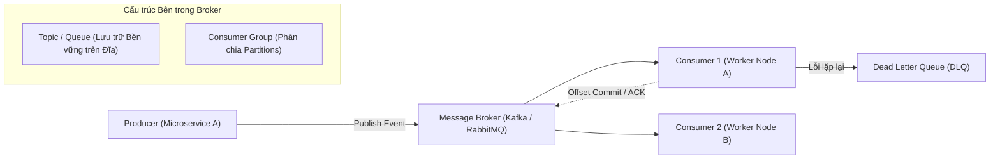
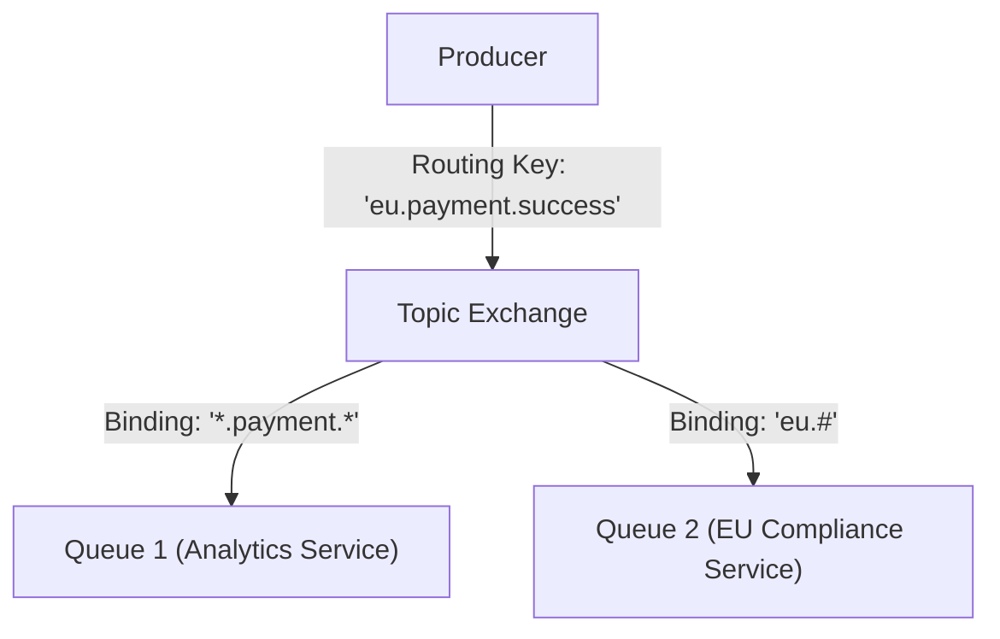
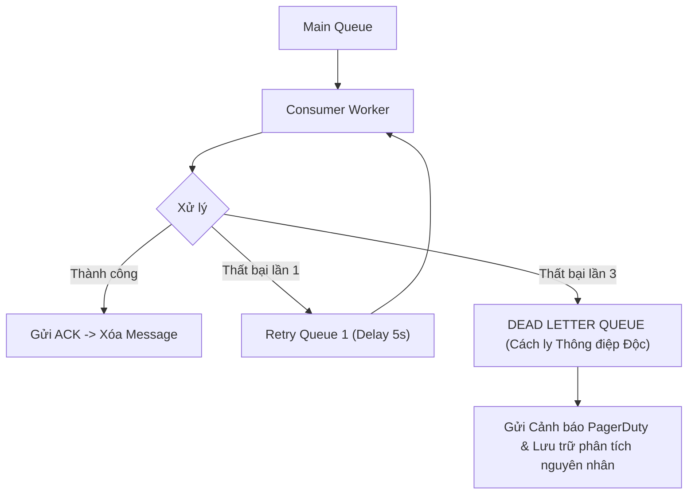
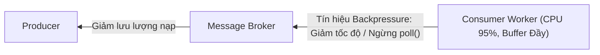
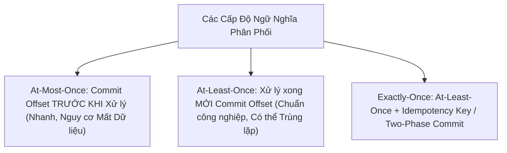
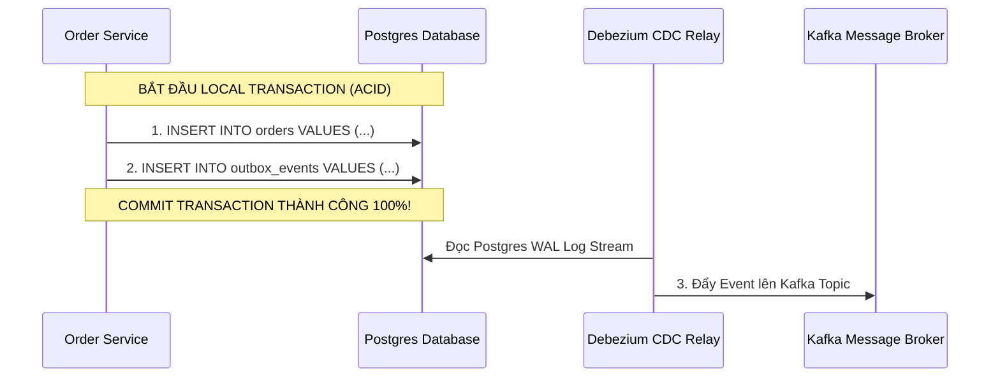

# 2.2. Messaging Systems and Delivery Semantics (Hệ thống Hàng đợi Thông điệp và Ngữ nghĩa Phân phối Dữ liệu)

## Tổng quan về Hệ thống Hàng đợi và Ngữ nghĩa Phân phối
Trong kiến trúc phân tán hiện đại, các dịch vụ không nên bị phụ thuộc chặt chẽ (Tightly Coupled) vào nhau qua các cuộc gọi synchronous RPC. **Hệ thống Hàng đợi Thông điệp (Distributed Messaging Systems)** đóng vai trò là một lớp trung gian phi đồng bộ (Asynchronous Middleware), phân tách hoàn toàn giữa bên sinh dữ liệu (Producer) và bên tiêu thụ dữ liệu (Consumer) theo cả **không gian (Space Decoupling)** và **thời gian (Time Decoupling)**.

Thách thức cốt lõi của giao tiếp thông điệp qua mạng:
$$\textbf{"Làm sao để đảm bảo dữ liệu không bị mất mát, không bị xử lý trùng lặp và đến đích an toàn?"}$$

Ba ngữ nghĩa phân phối thông điệp kinh điển:
1. **At-Most-Once (Tối đa một lần)**: Thông điệp có thể bị mất, nhưng không bao giờ bị xử lý trùng lặp.
2. **At-Least-Once (Ít nhất một lần)**: Thông điệp không bao giờ bị mất, nhưng có thể bị nhận trùng lặp do retry mạng.
3. **Exactly-Once Semantics (Chính xác một lần)**: Mọi thông điệp được đảm bảo xử lý thành công đúng một lần duy nhất về mặt nghiệp vụ (Effectively-Once Processing).



---

## 2. Chi tiết từng Keyword (Under-the-Hood Deep Dive)

---

### Phần 1: Messaging Systems Architecture (Kiến trúc Hệ thống Hàng đợi)

---

### 1. Message Broker, Queue, Topic, Exchange, and Routing

#### 1. Khái niệm bản chất (What & Why)
- **Message Broker**: Máy chủ trung gian chuyên dụng nhận, lưu trữ, định tuyến và phân phối các thông điệp từ Producers tới Consumers.
- **Queue (Hàng đợi)**: Cấu trúc lưu trữ thông điệp theo mô hình điểm-điểm (Point-to-Point): Mỗi thông điệp chỉ được tiêu thụ bởi **duy nhất một Consumer**.
- **Topic (Chủ đề)**: Kênh thông điệp theo mô hình Xuất bản - Đăng ký (Publish-Subscribe): Mỗi thông điệp được nhân bản và gửi tới **tất cả các Consumers / Consumer Groups** đã đăng ký theo dõi.
- **Exchange & Routing Key (AMQP / RabbitMQ Model)**: Thực thể thông minh tiếp nhận thông điệp từ Producer, phân tích trường metadata `Routing Key` và chuyển tiếp thông điệp vào các Queues thích hợp:
  - *Direct Exchange*: Khớp chính xác `Routing Key`.
  - *Fanout Exchange*: Phát tán (Broadcast) tới toàn bộ các Queues kết nối.
  - *Topic Exchange*: Khớp theo mẫu ký tự đại diện (Wildcards: `*.order.paid`).

#### 2. Cơ chế hoạt động sâu (Under the hood / Hardcore Internals)
- **Lưu trữ Thông điệp trên Ổ đĩa (Message Persistence & Retention)**:
  - **RabbitMQ**: Xóa thông điệp khỏi RAM/Disk ngay sau khi Consumer gửi ACK thành công (Queue-based).
  - **Apache Kafka**: Coi Topic là một **Append-Only Log** tuần tự bất biến lưu trên đĩa. Thông điệp KHÔNG bị xóa khi đọc, mà được lưu trữ theo thời gian cấu hình (**Retention Period**: ví dụ giữ 7 ngày) bất kể đã có bao nhiêu consumers đọc qua.

#### 3. Sơ đồ minh họa


#### 4. Code ví dụ thực chiến (TypeScript AMQP-Style Message Router)
```typescript
class SimpleTopicExchange {
    private bindings: Array<{ pattern: RegExp; queueName: string }> = [];

    public bindQueue(queueName: string, patternStr: string): void {
        // Chuyển wildcard 'eu.*' thành regex
        const regex = new RegExp("^" + patternStr.replace(/\./g, "\\.").replace(/\*/g, "[^.]+") + "$");
        this.bindings.push({ pattern: regex, queueName });
    }

    public route(routingKey: string, payload: any): string[] {
        const targetQueues: string[] = [];
        for (const b of this.bindings) {
            if (b.pattern.test(routingKey)) {
                targetQueues.push(b.queueName);
                console.log(`Routed message to [${b.queueName}] via key [${routingKey}]`);
            }
        }
        return targetQueues;
    }
}

const exchange = new SimpleTopicExchange();
exchange.bindQueue("BillingQueue", "order.*");
exchange.bindQueue("AuditQueue", "*.paid");

console.log("Matched queues:", exchange.route("order.paid", { id: 1001 })); // Cả 2 queues!
```

#### 5. Ưu / Nhược điểm, Pitfalls & Anti-patterns
- **Anti-pattern**: Sử dụng Message Broker làm cơ sở dữ liệu lưu trữ vĩnh viễn (Database). Message Broker được tối ưu hóa cho thông lượng streaming, không được thiết kế cho các truy vấn ngẫu nhiên phức tạp (Random Access / JOINs).

#### 6. Ứng dụng thực tế trong Backend / Systems
- RabbitMQ và Apache ActiveMQ: Điều phối luồng công việc tài chính và xuất bản tin nhắn thời gian thực.

---

### 2. Consumer Groups, Offsets, and Consumer Lag

#### 1. Khái niệm bản chất (What & Why)
- **Consumer Group**: Tập hợp các tiến trình consumers cùng nhau chia sẻ việc đọc dữ liệu từ một Topic lớn để scale-out thông lượng xử lý. Mỗi phân vùng (Partition) của Topic chỉ được gán cho duy nhất một Consumer trong cùng một nhóm tại một thời điểm.
- **Consumer Offset**: Một con trỏ số nguyên tuần tự (Integer Offset) đánh dấu vị trí của thông điệp cuối cùng mà một Consumer Group đã đọc và xác nhận (Commit) thành công trong Partition Log.
- **Consumer Lag (Độ trễ Tiêu thụ)**: Khoảng cách giữa thông điệp mới nhất được ghi vào Broker (Log End Offset - LEO) và vị trí hiện tại mà Consumer Group đang đọc (Current Offset):
  $$\text{Consumer Lag} = \text{LEO} - \text{Current Offset}$$
- **Ý nghĩa sống còn**: Consumer Lag là chỉ số quan trọng nhất phản ánh sức khỏe của hệ thống tiêu thụ. Lag tăng cao nghĩa là hệ thống xử lý đang bị quá tải, dữ liệu bị dồn ứ.

#### 2. Cơ chế hoạt động sâu (Under the hood / Hardcore Internals)
- **Cơ chế Rebalance trong Kafka**:
  - Khi một Consumer bị sập hoặc một Consumer mới tham gia vào Group, Group Coordinator kích hoạt quy trình **Rebalance**: Tạm dừng việc đọc, phân chia lại các Partitions cho các thành viên còn sống sót qua thuật toán RangeAssignor hoặc CooperativeStickyAssignor.

#### 3. Sơ đồ minh họa
```text
Cấu trúc Partition Log và Consumer Lag trong Kafka:
Offset Index:  0    1    2    3    4    5    6    7    8    9
Log Messages: [A]  [B]  [C]  [D]  [E]  [F]  [G]  [H]  [I]  [J]
                                   ^                        ^
                             Current Offset (4)        Log End Offset (9)
                             [Consumer Group X]       [Producer mới ghi]
                             <-------- CONSUMER LAG = 5 -------->
```

#### 4. Code ví dụ thực chiến (C++ Consumer Lag Metric Monitor)
```cpp
#include <iostream>
#include <cstdint>

struct PartitionOffsetMetrics {
    uint64_t log_end_offset;
    uint64_t committed_offset;

    [[nodiscard]] uint64_t compute_lag() const noexcept {
        if (log_end_offset >= committed_offset) {
            return log_end_offset - committed_offset;
        }
        return 0; // Tránh tràn số nếu offset bị reset
    }
};

int main() {
    PartitionOffsetMetrics part0{1500000, 1492000};
    uint64_t lag = part0.compute_lag();
    std::cout << "Current Consumer Lag: " << lag << " messages.\n";
    if (lag > 5000) {
        std::cerr << "ALERT: Consumer Lag exceeds threshold! Kích hoạt Auto-scaling Workers.\n";
    }
    return 0;
}
```

#### 5. Ưu / Nhược điểm, Pitfalls & Anti-patterns
- **Thảm họa Rebalance Storm**: Khi Consumer xử lý một batch thông điệp quá lâu vượt quá `max.poll.interval.ms`, Kafka Coordinator tưởng Consumer đã chết và kích hoạt Rebalance liên tục, khiến cả nhóm bị đóng băng.

#### 6. Ứng dụng thực tế trong Backend / Systems
- Hệ thống Kafka Lag Exporter kết hợp Prometheus và Grafana: Tự động cảnh báo và kích hoạt Kubernetes KEDA (Kubernetes Event-driven Autoscaling) để thêm Pods khi Lag tăng vọt.

---

### 3. Dead Letter Queue (DLQ), Poison Messages, and Retry Queues

#### 1. Khái niệm bản chất (What & Why)
- **Poison Message (Thông điệp Độc)**: Một thông điệp có nội dung bị hỏng cú pháp hoặc gây ra ngoại lệ chết người (Fatal Exception / Panic) bên trong mã của Consumer mỗi khi được đọc.
- **Thảm họa Vòng lặp Vô hạn nếu không có DLQ**:
  Consumer đọc Poison Message $\to$ Bị crash/ném Exception $\to$ Không gửi ACK $\to$ Broker tự động gửi lại (Redelivery) $\to$ Consumer đọc lại $\to$ Tiếp tục crash $\implies$ Toàn bộ hệ thống hàng đợi bị nghẽn vĩnh viễn!
- **Dead Letter Queue (DLQ)**: Một hàng đợi cách ly chuyên dụng, nơi lưu trữ các thông điệp đã thử xử lý lại nhiều lần (Max Delivery Attempts) nhưng vẫn thất bại, giúp giải phóng luồng xử lý chính tiếp tục phục vụ các message bình thường khác.

#### 2. Cơ chế hoạt động sâu (Under the hood / Hardcore Internals)
- **Kiến trúc Retry Phân cấp (Exponential Backoff Queues)**:
  - Thay vì retry tức thì, hệ thống sử dụng các hàng đợi trễ phân cấp: `order-retry-5s`, `order-retry-30s`, `order-retry-5m`.
  - Nếu thất bại ở bước cuối cùng, thông điệp được chuyển vào `order-dlq` kèm theo toàn bộ Stack Trace lỗi được đính vào Message Metadata Header.

#### 3. Sơ đồ minh họa


#### 4. Code ví dụ thực chiến (TypeScript Dead Letter Queue Routing Pattern)
```typescript
interface QueueMessage {
    id: string;
    payload: string;
    deliveryAttempts: number;
    lastError?: string;
}

class RobustConsumerWithDLQ {
    private maxRetries = 3;

    public handleIncomingMessage(msg: QueueMessage): void {
        try {
            msg.deliveryAttempts++;
            // Giả lập đọc Poison Message bị lỗi JSON parse
            JSON.parse(msg.payload);
            console.log(`[Msg ${msg.id}] Processed successfully!`);
        } catch (err: any) {
            console.warn(`[Msg ${msg.id}] Attempt ${msg.deliveryAttempts} failed: ${err.message}`);
            if (msg.deliveryAttempts >= this.maxRetries) {
                this.routeToDeadLetterQueue(msg, err.message);
            } else {
                this.scheduleRetry(msg);
            }
        }
    }

    private routeToDeadLetterQueue(msg: QueueMessage, errorReason: string): void {
        msg.lastError = errorReason;
        console.error(`POISON MESSAGE QUARANTINED: Chuyển [${msg.id}] vào DEAD LETTER QUEUE!`);
    }

    private scheduleRetry(msg: QueueMessage): void {
        console.log(`Re-queuing [${msg.id}] for next retry...`);
    }
}

const worker = new RobustConsumerWithDLQ();
const poisonMsg: QueueMessage = { id: "corrupted_01", payload: "{ malformed json...", deliveryAttempts: 0 };
worker.handleIncomingMessage(poisonMsg);
worker.handleIncomingMessage(poisonMsg);
worker.handleIncomingMessage(poisonMsg); // Chuyển vào DLQ!
```

#### 5. Ưu / Nhược điểm, Pitfalls & Anti-patterns
- **Pitfall**: Đưa thông điệp vào DLQ nhưng không có ai theo dõi hay giám sát (Unmonitored DLQ), khiến các giao dịch lỗi của khách hàng bị lãng quên mãi mãi.

#### 6. Ứng dụng thực tế trong Backend / Systems
- Amazon SQS Dead-Letter Queues & RabbitMQ Dead-Letter Exchanges (DLX).

---

### 4. Backpressure and Flow Control in Messaging

#### 1. Khái niệm bản chất (What & Why)
- **Backpressure (Áp lực Ngược)**: Cơ chế kiểm soát luồng (Flow Control) cho phép bên nhận (Consumer) báo hiệu ngược lại cho bên gửi (Broker / Producer) giảm tốc độ gửi dữ liệu khi bộ đệm hoặc năng lực xử lý của bên nhận đang bị quá tải.
- **Nguyên lý sinh tồn**: Thà làm chậm tốc độ tiếp nhận dữ liệu còn hơn để hệ thống bị sập vì lỗi Out-Of-Memory (`OOMKilled`).

#### 2. Cơ chế hoạt động sâu (Under the hood / Hardcore Internals)
- **Mô hình Push vs Pull**:
  - **Push Model (Broker đẩy dữ liệu)**: Dễ gây ngập lụt (Flood) Consumer nếu không có cơ chế `prefetch_count` giới hạn số message chưa ACK (như trong RabbitMQ).
  - **Pull Model (Consumer chủ động kéo dữ liệu - Kafka)**: Giải quyết tự nhiên bài toán Backpressure! Consumer chỉ kéo thêm dữ liệu mới (`poll()`) khi và chỉ khi nó đã xử lý xong batch cũ.

#### 3. Sơ đồ minh họa


#### 4. Code ví dụ thực chiến (TypeScript Reactive Stream Backpressure Signal)
```typescript
class BackpressureQueueConsumer {
    private isBusy: boolean = false;

    public async onMessageReceived(msgId: string): Promise<void> {
        if (this.isBusy) {
            // Phát tín hiệu áp lực ngược: Tạm dừng nhận thêm
            console.warn("BACKPRESSURE ACTIVE: Consumer quá tải, tạm hoãn xử lý!");
            return;
        }

        this.isBusy = true;
        await this.heavyTask(msgId);
        this.isBusy = false; // Sẵn sàng nhận tiếp
    }

    private async heavyTask(id: string): Promise<void> {
        await new Promise(r => setTimeout(r, 200)); // Tốn 200ms
        console.log(`Completed task: ${id}`);
    }
}
```

#### 5. Ưu / Nhược điểm, Pitfalls & Anti-patterns
- **Anti-pattern**: Thiết lập hàng đợi trong bộ nhớ không có giới hạn (Unbounded In-memory Queue) bên trong Consumer code, khiến tiến trình bị crash OOM khi lưu lượng tăng đột biến.

#### 6. Ứng dụng thực tế trong Backend / Systems
- Reactive Streams Specification (Project Reactor, RxJava, Akka Streams): Chuẩn hóa giao thức truyền tín hiệu Backpressure `request(n)`.

---

### Phần 2: Message Delivery Semantics (Ngữ nghĩa Phân phối Thông điệp)

---

### 5. At-Most-Once vs At-Least-Once vs Exactly-Once Semantics

#### 1. Khái niệm bản chất (What & Why)
- **At-Most-Once (Tối đa 1 lần)**: Thông điệp được gửi đi và cam kết không bao giờ gửi lại. Nếu mạng lag hoặc Consumer sập đúng lúc, thông điệp sẽ bị mất vĩnh viễn (Phù hợp cho log metrics, telemetry không quan trọng).
- **At-Least-Once (Ít nhất 1 lần)**: Bên gửi kiên trì retry cho đến khi nhận được xác nhận ACK từ bên nhận. Dữ liệu cam kết không bao giờ bị mất, nhưng bên nhận **có thể nhận được cùng 1 thông điệp nhiều lần** (Yêu cầu Consumer bắt buộc phải có tính Idempotent).
- **Exactly-Once Semantics (EOS / Chính xác 1 lần)**: Bảo đảm toàn diện nhất: Mọi thông điệp được xử lý tương đương đúng một lần duy nhất về mặt biến đổi trạng thái cuối cùng (Effectively-Once Processing).

#### 2. Cơ chế hoạt động sâu (Under the hood / Hardcore Internals)
- **Sự thật về Exactly-Once trong Hệ thống Phân tán**:
  - Không thể ngăn chặn một gói tin mạng bị truyền lại (Do Network Uncertainty).
  - Do đó, **Exactly-Once thực chất là sự kết hợp của:**
    $$\text{Exactly-Once} = \text{At-Least-Once Delivery} + \text{Idempotent Consumer Processing}$$
  - Trong Kafka: Sử dụng **Idempotent Producer** (gắn mã PID và Sequence Number trên mỗi record, Broker tự phát hiện và loại bỏ các gói tin duplicate ở tầng đĩa) kết hợp với **Transactional Coordinator** (Two-Phase Commit giữa các topic partitions và consumer offsets).

#### 3. Sơ đồ minh họa


#### 4. Code ví dụ thực chiến (C++ At-Least-Once Commit Policy)
```cpp
#include <iostream>
#include <string>

class AtLeastOnceProcessor {
public:
    void consume_loop() {
        // BƯỚC 1: Đọc Message từ Broker
        std::string msg = "PaymentOrder: 150$";

        // BƯỚC 2: Xử lý nghiệp vụ TRƯỚC (Ghi vào DB)
        bool success = process_business_logic(msg);

        // BƯỚC 3: Chỉ gửi ACK / Commit Offset khi nghiệp vụ ĐÃ THÀNH CÔNG!
        // Nếu server sập ở Bước 2, offset chưa commit -> Khi khởi động lại, message được gửi lại -> At-Least-Once!
        if (success) {
            commit_offset_to_broker();
        }
    }

private:
    bool process_business_logic(const std::string& data) {
        std::cout << "Executed Business Logic: " << data << "\n";
        return true;
    }

    void commit_offset_to_broker() {
        std::cout << "Committed Offset safely.\n";
    }
};

int main() {
    AtLeastOnceProcessor p;
    p.consume_loop();
    return 0;
}
```

#### 5. Ưu / Nhược điểm, Pitfalls & Anti-patterns
- **Anti-pattern**: Bật chế độ "Auto-commit Offset" trong Kafka Consumer (`enable.auto.commit = true`). Broker tự động commit offset sau mỗi 5 giây mà không quan tâm Consumer đã xử lý xong dữ liệu hay chưa, biến hệ thống thành **At-Most-Once ngoài ý muốn và làm mất dữ liệu!**

#### 6. Ứng dụng thực tế trong Backend / Systems
- Apache Flink Checkpointing & Kafka Transactions: Hiện thực hóa mô hình End-to-End Exactly-Once Processing từ Source sang Sink.

---

### 6. Transactional Outbox and Inbox Patterns

#### 1. Khái niệm bản chất (What & Why)
- **Vấn đề "Dual-Write Problem" kinh điển**:
  Một dịch vụ cần thực hiện 2 thao tác:
  1. Ghi dữ liệu vào Database cục bộ (`UPDATE orders`).
  2. Bắn sự kiện lên Message Broker (`kafka.send("order_paid")`).
  Nếu Database ghi xong nhưng mạng lag làm việc gửi Kafka thất bại $\implies$ Bất nhất dữ liệu! Ngược lại, nếu gửi Kafka trước nhưng Database ghi lỗi $\implies$ Khách hàng chưa lưu đơn nhưng sự kiện giao hàng đã bắn đi!
- **Transactional Outbox Pattern**:
  - Không bắn trực tiếp lên Message Broker!
  - Lưu sự kiện vào một bảng trung gian **`outbox`** nằm trong **CÙNG MỘT Local Database Transaction** với dữ liệu nghiệp vụ (Đảm bảo tính ACID: Cả hai cùng thành công hoặc cùng rollback).
  - Một tiến trình phụ (Outbox Relay / Change Data Capture - Debezium) đọc bảng `outbox` và đẩy lên Kafka một cách bền vững.
- **Transactional Inbox Pattern**:
  - Consumer nhận sự kiện và lưu vào bảng `inbox` cục bộ cùng transaction với việc cập nhật nghiệp vụ để đảm bảo **Message Deduplication (Chống xử lý trùng lặp)**.

#### 2. Cơ chế hoạt động sâu (Under the hood / Hardcore Internals)
- **Change Data Capture (CDC) qua Database Transaction Log**:
  - Thay vì chạy câu lệnh Polling `SELECT * FROM outbox WHERE processed = false` (gây tải DB), các hệ thống hiện đại (Debezium) đọc trực tiếp **WAL (Write-Ahead Log trên PostgreSQL)** hoặc **Binlog (MySQL)** ở tầng nhị phân để stream sự kiện lên Kafka với độ trễ sub-millisecond mà không tốn tài nguyên query.

#### 3. Sơ đồ minh họa


#### 4. Code ví dụ thực chiến (TypeScript Transactional Outbox Pattern)
```typescript
interface DatabaseTransaction {
    query(sql: string, params: any[]): Promise<void>;
    commit(): Promise<void>;
    rollback(): Promise<void>;
}

class OrderServiceWithOutbox {
    public async createOrder(orderId: string, amount: number, db: DatabaseTransaction): Promise<void> {
        try {
            // Bước 1: Ghi nghiệp vụ
            await db.query("INSERT INTO orders (id, amount, status) VALUES ($1, $2, 'CREATED')", [orderId, amount]);

            // Bước 2: Ghi vào bảng Outbox trong CÙNG MỘT TRANSACTION!
            const eventPayload = JSON.stringify({ orderId, amount, eventType: "ORDER_CREATED" });
            await db.query(
                "INSERT INTO outbox_events (aggregate_id, payload, created_at) VALUES ($1, $2, NOW())", 
                [orderId, eventPayload]
            );

            // Bước 3: Commit cả hai cùng lúc
            await db.commit();
            console.log("Transaction Committed: Cả Order và Outbox Event đã được lưu an toàn!");
        } catch (err) {
            await db.rollback();
            throw err;
        }
    }
}
```

#### 5. Ưu / Nhược điểm, Pitfalls & Anti-patterns
- **Ưu điểm**: Giải quyết dứt điểm vấn đề Dual-Write mà không cần đến giao thức Two-Phase Commit (2PC) chậm chạp và phức tạp.

#### 6. Ứng dụng thực tế trong Backend / Systems
- Kiến trúc Microservices của Airbnb, Uber, và Shopify: 100% các sự kiện Domain Events giữa các microservices được phát tán thông qua Transactional Outbox Pattern kết hợp Debezium CDC.
