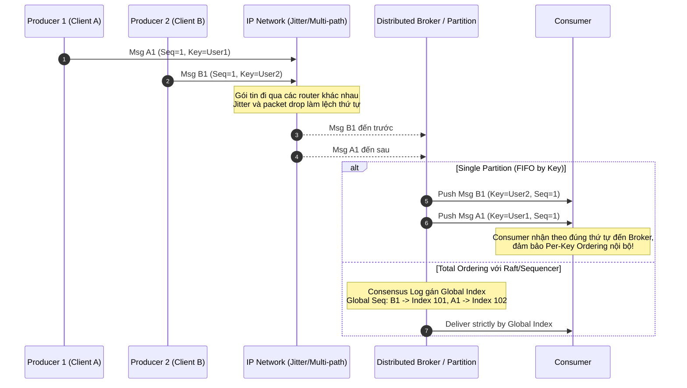

# 2.3. Message Ordering and Technologies (Thứ Tự Tin Nhắn và Công Nghệ Messaging Phân Tán)

> [!IMPORTANT]
> **Nếu bạn chỉ được nhớ một điều duy nhất**: Trong thế giới phân tán không chia sẻ bộ nhớ, không hề tồn tại một "chiếc đồng hồ vũ trụ" để quyết định cái gì xảy ra trước, cái gì xảy ra sau. Thứ tự tin nhắn (Message Ordering) không phải là thuộc tính tự nhiên của mạng máy tính, mà là một **sự đánh đổi nhân tạo tốn kém**. Muốn Total Ordering (thứ tự tuyệt đối toàn cục), bạn phải trả giá bằng một Sequencer độc đạo hoặc sự đồng thuận Consensus làm bóp nghẹt thông lượng; muốn thông lượng hàng triệu tin nhắn mỗi giây, bạn buộc phải nhượng bộ sang Partition Ordering (thứ tự theo khóa - Per-Key) hoặc Causal Ordering (thứ tự nhân quả).

---

## 1. Kiến trúc Tổng quan & Mô hình Tư duy (Mental Model)

Hãy tưởng tượng một sàn giao dịch chứng khoán truyền thống trước thời đại máy tính:
- Nếu chỉ có **một cửa giao dịch duy nhất** (Single Counter / Total Sequencer), mọi lệnh mua bán đều được đóng dấu thời gian và xếp hàng tuần tự. Trật tự hoàn hảo, không ai tranh cãi ai đặt lệnh trước. Nhưng nút thắt cổ chai xuất hiện: hàng nghìn nhà đầu tư chen lấn, tốc độ xử lý sụt giảm thảm hại.
- Nếu sàn giao dịch mở **100 cửa giao dịch độc lập** (Sharding / Multi-Partition): Khách hàng giao dịch cổ phiếu mã `AAPL` chỉ xếp hàng ở Cửa 1, khách hàng mã `GOOG` xếp hàng ở Cửa 2. Bên trong từng cửa, thứ tự hoàn hảo (Per-Key FIFO Ordering). Nhưng giữa lệnh mua `AAPL` ở Cửa 1 và lệnh bán `GOOG` ở Cửa 2 không ai có thể xác định lệnh nào diễn ra trước một cách tuyệt đối, trừ phi áp dụng đồng hồ nguyên tử hoặc giao thức đồng thuận tốn kém!



---

## 2. Chi tiết từng Keyword (Under-the-Hood Deep Dive)

### 2.1. FIFO Ordering (First-In, First-Out Ordering)
- **Khái niệm bản chất (What & Why)**: FIFO Ordering bảo đảm rằng nếu một Producer phát tin nhắn $m_1$ trước $m_2$ ($m_1 \prec_P m_2$), thì mọi Consumer đều phải quan sát và xử lý $m_1$ trước $m_2$. Ràng buộc này chỉ áp dụng trên từng kênh point-to-point hoặc từng Producer đơn lẻ. Nếu có hai Producer độc lập $P_1$ và $P_2$, FIFO không đưa ra bất kỳ bảo đảm nào về thứ tự đan xen giữa các thông điệp của họ.
- **Cơ chế hoạt động sâu (Under the Hood)**:
  - Ở tầng mạng (Layer 4 TCP), hệ điều hành duy trì FIFO byte-stream thông qua trường `Sequence Number` 32-bit trong TCP header. Khi card mạng nhận gói tin thông qua DMA Ring Buffer, nếu gói đến bị out-of-order, nhân Linux lưu gói đó vào hàng đợi `ofo_queue` (Out-of-Order Queue) của socket struct `tcp_sock` và không chuyển lên `sk_receive_queue` cho tới khi các gói bị thiếu được phát lại thành công.
  - Ở tầng phân tán (Application Layer): Khi có nhiều kết nối TCP song song hoặc nhiều partition, TCP FIFO không bảo toàn được thứ tự nghiệp vụ. Ứng dụng phải gán sequence ID tăng dần (`1, 2, 3...`) và receiver phải duy trì một **Reordering Window Buffer** trong Userspace để giữ các tin nhắn đến sớm và chỉ xả (dispatch) theo đúng tuần tự.

### 2.2. Global Ordering & Total Ordering
- **Khái niệm bản chất (What & Why)**: Total Ordering đòi hỏi rằng **tất cả** các node trong hệ thống phân tán đều phải quan sát thấy tất cả các tin nhắn theo cùng một thứ tự duy nhất $m_1 \prec m_2 \prec m_3 \dots$ dù chúng được gửi từ bất kỳ producer nào.
- **Cơ chế hoạt động sâu (Under the Hood)**:
  - Bản chất của Total Ordering tương đương với bài toán **Atomic Broadcast** (Consensus). Hệ thống phải dựa vào một **Sequencer tập trung** (Single Sequencer) hoặc một cụm đồng thuận (**Raft / Paxos / Zab**).
  - *Cổ chai vật lý*: Một Sequencer đơn lẻ bị giới hạn bởi xung nhịp CPU và băng thông NIC của một node (thường tối đa $\approx 200,000 - 500,000\text{ msgs/s}$). Nếu dùng Raft, mỗi tin nhắn phải trải qua 2 vòng RTT mạng để đạt Quorum ghi log trước khi commit, kéo độ trễ từ vài chục microsecond lên vài millisecond.

### 2.3. Partial Ordering & Causal Ordering
- **Khái niệm bản chất (What & Why)**: Không phải mọi sự kiện trong hệ thống đều liên quan đến nhau. Causal Ordering đảm bảo rằng nếu sự kiện $A$ có mối quan hệ nhân quả dẫn tới sự kiện $B$ ($A \to B$ theo quan hệ Happens-Before của Lamport), thì mọi tiến trình đều phải quan sát $A$ trước $B$. Các sự kiện độc lập đồng thời ($A \parallel B$) có thể được xử lý theo bất kỳ thứ tự nào.
- **Cơ chế hoạt động sâu (Under the Hood)**:
  - Causal Ordering sử dụng **Vector Clock** $V$. Mỗi tiến trình $P_i$ duy trì một mảng số nguyên kích thước $N$ (với $N$ là số node).
  - Khi gửi tin nhắn $m$, $P_i$ tăng $V_i[i]$ và đính kèm $V_i$ vào metadata của $m$.
  - Khi node $P_j$ nhận $m$ có vector $V_m$, nó chỉ giao $m$ cho tầng ứng dụng khi:
    $$V_m[i] = V_j[i] + 1 \quad \text{và} \quad \forall k \neq i, V_m[k] \le V_j[k]$$
  - Nếu điều kiện chưa thỏa mãn, $m$ bị lưu tạm vào Causal Buffer chờ các tin nhắn tiền đề cập bến.

### 2.4. Per-Key Ordering & Partition Ordering
- **Khái niệm bản chất (What & Why)**: Đây là giải pháp thực tế nhất được sử dụng trong các hệ thống Streaming quy mô lớn (Apache Kafka, AWS Kinesis). Thay vì ép toàn bộ hệ thống vào Total Order, dữ liệu được phân chia thành nhiều Partition dựa trên Message Key:
  $$\text{Partition ID} = \text{hash}(\text{Key}) \pmod{\text{Total Partitions}}$$
- **Cơ chế hoạt động sâu (Under the Hood)**:
  - Trong nội bộ một Partition, thứ tự là nghiêm ngặt (Strict FIFO) vì Partition được lưu trữ dưới dạng một **Append-Only Commit Log** tuần tự trên đĩa với con trỏ `Offset` 64-bit tăng dần tuyến tính.
  - Các partition khác nhau hoàn toàn độc lập và được đọc song song bởi các worker thread hoặc consumer pods khác nhau mà không cần khóa đồng bộ (`Lock-Free Partitioning`).

### 2.5. Sequence Number, Message Timestamp, Ordering Guarantee & Event Reordering
- **Khái niệm bản chất (What & Why)**:
  - **Sequence Number**: Bộ đếm nguyên đơn điệu tăng dần gán bởi Producer hoặc Sequencer. Đây là cơ chế duy nhất bảo đảm kiểm tra được tính thiếu sót (gap detection) và trùng lặp (duplicate detection).
  - **Message Timestamp**: Dấu thời gian vật lý của máy phát. Rất nguy hiểm nếu dùng để sắp xếp trực tiếp vì hiện tượng Clock Skew và Clock Drift giữa các máy chủ.
  - **Event Reordering**: Hiện tượng mạng xáo trộn thứ tự gói tin. Receiver phải xử lý reordering bằng bộ đệm có chặn giới hạn thời gian (TTL / Watermark).

### 2.6. RabbitMQ vs Apache Kafka
- **Khái niệm & Kiến trúc bản chất**:
  - **RabbitMQ**: Kiến trúc **Smart Broker / Dumb Consumer**. Broker chịu trách nhiệm định tuyến thông minh (Direct, Topic, Fanout, Headers Exchange), duy trì trạng thái của từng tin nhắn trong bộ nhớ RAM (Erlang Actor Mailbox), theo dõi ACK của Consumer và xóa ngay tin nhắn sau khi đã được xác nhận.
  - **Apache Kafka**: Kiến trúc **Dumb Broker / Smart Consumer**. Broker chỉ lưu trữ các append-only commit logs trên đĩa (tận dụng Linux Page Cache và Zero-copy `sendfile(2)`). Consumer tự quản lý `Consumer Offset` của mình để kéo (pull) dữ liệu.
- **Under the Hood**:
  - RabbitMQ sử dụng Erlang Mnesia / Raft (Quorum Queues), chịu chi phí bộ nhớ lớn khi hàng đợi phình to (Message Backlog).
  - Kafka sử dụng tuần tự hóa đĩa (Sequential I/O), biến chi phí ghi thành $O(1)$ không phụ thuộc dung lượng log, cho phép lưu trữ hàng Terabyte sự kiện nhiều tuần.

### 2.7. Apache Pulsar vs NATS & NATS JetStream
- **Khái niệm & Kiến trúc bản chất**:
  - **Apache Pulsar**: Tách rời hoàn toàn tầng tính toán (**Stateless Brokers**) và tầng lưu trữ (**Stateful Storage Nodes - Apache BookKeeper**). Kiến trúc Segment-Centric cho phép mở rộng lưu trữ vô hạn mà không cần rebalance partition đắt đỏ như Kafka.
  - **NATS**: Viết bằng Go, thiết kế với triết lý tối giản tột cùng (KISS), siêu nhẹ, độ trễ cực thấp (sub-millisecond). Ban đầu chỉ là In-Memory At-Most-Once Pub/Sub; phiên bản **NATS JetStream** bổ sung tầng lưu trữ phân tán bền vững dựa trên Raft consensus tích hợp.

### 2.8. Redis Streams vs Cloud Managed Solutions (AWS SQS/SNS, Google Pub/Sub, Azure Service Bus)
- **Redis Streams**: Cấu trúc dữ liệu `Stream` xuất hiện từ Redis 5.0, lưu trữ tin nhắn trong bộ nhớ RAM sử dụng cây cơ số nén (**Radix Tree / Rax**). Hỗ trợ Consumer Groups, Message ID dạng `<millisecondsTime>-<sequenceNumber>`, cung cấp thông lượng cực cao (hơn 1 triệu ops/s) trên single-node.
- **Cloud Managed Solutions**:
  - **AWS SQS Standard**: Thông lượng gần như vô hạn, nhưng chỉ đảm bảo *Best-effort Ordering* (có thể bị đảo thứ tự và gửi trùng lặp).
  - **AWS SQS FIFO**: Giới hạn thông lượng (300 msgs/s hoặc 3000 msgs/s với batching), bảo đảm strictly FIFO dựa trên `MessageGroupId`.
  - **Google Cloud Pub/Sub**: Hỗ trợ ordering key để phân phối theo thứ tự trên từng shard tương tự Kafka.

### 2.9. ZeroMQ & Apache ActiveMQ
- **ZeroMQ**: Không phải là một Message Broker độc lập mà là một **Thư viện Socket nhúng (Brokerless Networking Library)**. Nó cung cấp các mẫu kết nối nâng cao (PUB-SUB, PUSH-PULL, REQ-REP) chạy trực tiếp trên TCP/IPC mà không cần cài đặt server trung gian.
- **Apache ActiveMQ**: Message Broker cổ điển chuẩn Java JMS, sử dụng giao thức AMQP/OpenWire/STOMP. Thường gặp trong các hệ thống doanh nghiệp cũ (Legacy Enterprise Banking/Insurance), nhưng tốc độ và khả năng mở rộng kém hơn nhiều so với Kafka/Pulsar.

---

## 3. Thực thi Mã nguồn & Mô phỏng Chuyên sâu (Dual-Engine Implementation)

### Engine 1: C++20 — In-Memory Partition Router & FIFO Reordering Buffer

Mã nguồn C++20 dưới đây triển khai cơ chế **Reordering Window Buffer** hoàn chỉnh: Xử lý các tin nhắn đến lệch thứ tự (out-of-order), lưu trữ vào bộ nhớ heap, và chỉ phát lệnh xử lý (commit) khi tin nhắn có Sequence ID kế tiếp cập bến an toàn.

```cpp
#include <iostream>
#include <map>
#include <vector>
#include <string>
#include <mutex>
#include <cstdint>
#include <sstream>

struct Message {
    uint64_t sequence_id;
    std::string key;
    std::string payload;
};

class FifoReorderingBuffer {
private:
    uint64_t expected_seq_{1};
    std::map<uint64_t, Message> buffer_;
    std::mutex mtx_;

public:
    explicit FifoReorderingBuffer(uint64_t start_seq = 1) : expected_seq_(start_seq) {}

    std::vector<Message> push(Message msg) {
        std::lock_guard<std::mutex> lock(mtx_);
        std::vector<Message> deliverable;

        // Bỏ qua gói tin trùng lặp đã commit từ trước
        if (msg.sequence_id < expected_seq_) {
            std::cout << "[WARN] Drop duplicate message: Seq=" << msg.sequence_id 
                      << " (Current expected=" << expected_seq_ << ")\n";
            return deliverable;
        }

        // Lưu vào out-of-order buffer (std::map tự sắp xếp theo key là sequence_id)
        buffer_[msg.sequence_id] = std::move(msg);

        // Xả liên tục các gói tin thỏa mãn tính liên tục của chuỗi sequence
        while (!buffer_.empty() && buffer_.begin()->first == expected_seq_) {
            deliverable.push_back(std::move(buffer_.begin()->second));
            buffer_.erase(buffer_.begin());
            expected_seq_++;
        }

        return deliverable;
    }

    uint64_t get_expected_seq() const { return expected_seq_; }
    size_t get_buffered_count() const { return buffer_.size(); }
};

int main() {
    FifoReorderingBuffer reorderer(1);

    // Giả lập mạng bị Jitter làm xáo trộn thứ tự gói tin
    std::vector<Message> network_stream = {
        {1, "acc_100", "Khoi tao tai khoan: +0 USD"},
        {3, "acc_100", "Rut tien: -50 USD"},        // Den som hon goi 2
        {4, "acc_100", "Chuyen khoan: -20 USD"},    // Den som hon goi 2
        {2, "acc_100", "Nap tien: +100 USD"},       // Den muon
        {2, "acc_100", "Nap tien trung lap (Retry)"},
        {5, "acc_100", "Kiem tra so du cuoi ky"}
    };

    std::cout << "=== MO PHONG FIFO REORDERING BUFFER TRONG C++20 ===\n\n";

    for (const auto& raw_msg : network_stream) {
        std::cout << ">>> [NETWORK IN] Nhan goi tin Seq=" << raw_msg.sequence_id 
                  << " | Payload: " << raw_msg.payload << "\n";
        
        auto dispatched = reorderer.push(raw_msg);

        if (!dispatched.empty()) {
            std::cout << "    ===> [DISPATCH ENGINE] Giao xu ly thanh cong " 
                      << dispatched.size() << " goi tin:\n";
            for (const auto& d : dispatched) {
                std::cout << "         * [EXECUTE SEQ " << d.sequence_id 
                          << "] " << d.payload << "\n";
            }
        } else {
            std::cout << "    [BUFFERING] Goi tin den som, tam giu trong heap buffer. Cho Seq=" 
                      << reorderer.get_expected_seq() << "...\n";
        }
        std::cout << "--------------------------------------------------------\n";
    }

    return 0;
}
```

```text
=== MO PHONG FIFO REORDERING BUFFER TRONG C++20 ===

>>> [NETWORK IN] Nhan goi tin Seq=1 | Payload: Khoi tao tai khoan: +0 USD
    ===> [DISPATCH ENGINE] Giao xu ly thanh cong 1 goi tin:
         * [EXECUTE SEQ 1] Khoi tao tai khoan: +0 USD
--------------------------------------------------------
>>> [NETWORK IN] Nhan goi tin Seq=3 | Payload: Rut tien: -50 USD
    [BUFFERING] Goi tin den som, tam giu trong heap buffer. Cho Seq=2...
--------------------------------------------------------
>>> [NETWORK IN] Nhan goi tin Seq=4 | Payload: Chuyen khoan: -20 USD
    [BUFFERING] Goi tin den som, tam giu trong heap buffer. Cho Seq=2...
--------------------------------------------------------
>>> [NETWORK IN] Nhan goi tin Seq=2 | Payload: Nap tien: +100 USD
    ===> [DISPATCH ENGINE] Giao xu ly thanh cong 3 goi tin:
         * [EXECUTE SEQ 2] Nap tien: +100 USD
         * [EXECUTE SEQ 3] Rut tien: -50 USD
         * [EXECUTE SEQ 4] Chuyen khoan: -20 USD
--------------------------------------------------------
>>> [NETWORK IN] Nhan goi tin Seq=2 | Payload: Nap tien trung lap (Retry)
[WARN] Drop duplicate message: Seq=2 (Current expected=5)
--------------------------------------------------------
>>> [NETWORK IN] Nhan goi tin Seq=5 | Payload: Kiem tra so du cuoi ky
    ===> [DISPATCH ENGINE] Giao xu ly thanh cong 1 goi tin:
         * [EXECUTE SEQ 5] Kiem tra so du cuoi ky
--------------------------------------------------------
```

---

### Engine 2: Python 3.11+ — Asynchronous Causal Ordering Broker với Vector Clock

Mã nguồn Python mô phỏng bộ định tuyến tin nhắn bảo đảm **Causal Ordering** giữa 3 node thông qua Vector Clocks và hàng đợi bất đồng bộ `asyncio`:

```python
#!/usr/bin/env python3
import asyncio
from dataclasses import dataclass
from typing import Dict, List

@dataclass
class CausalMessage:
    sender_id: str
    clock: Dict[str, int]
    payload: str

class CausalReceiverNode:
    def __init__(self, node_id: str, cluster_nodes: List[str]):
        self.node_id = node_id
        self.vector_clock: Dict[str, int] = {nid: 0 for nid in cluster_nodes}
        self.incoming_buffer: List[CausalMessage] = []

    def can_deliver(self, msg: CausalMessage) -> bool:
        sender = msg.sender_id
        # Dieu kien 1: Tin nhan la su kien tiep theo truc tiep tu sender
        if msg.clock[sender] != self.vector_clock[sender] + 1:
            return False
        # Dieu kien 2: Tat ca cac su kien tien de khac phai da duoc receiver quan sat
        for nid, clock_val in msg.clock.items():
            if nid != sender and clock_val > self.vector_clock[nid]:
                return False
        return True

    def receive_message(self, msg: CausalMessage) -> List[str]:
        self.incoming_buffer.append(msg)
        delivered_logs = []

        progress = True
        while progress:
            progress = False
            for m in list(self.incoming_buffer):
                if self.can_deliver(m):
                    self.incoming_buffer.remove(m)
                    self.vector_clock[m.sender_id] = m.clock[m.sender_id]
                    delivered_logs.append(
                        f"Node [{self.node_id}] Delivered '{m.payload}' from {m.sender_id} | "
                        f"Current VC: {dict(self.vector_clock)}"
                    )
                    progress = True
                    break
        return delivered_logs

async def main():
    cluster = ["NodeA", "NodeB", "NodeC"]
    receiver = CausalReceiverNode("ReceiverNode", cluster)

    # Kich ban quan he nhan qua:
    # 1. NodeA gui: 'Ban an com chua?' (VC: {NodeA:1, NodeB:0, NodeC:0})
    # 2. NodeB nhan dc, tra loi: 'Toi vua an roi!' (VC: {NodeA:1, NodeB:1, NodeC:0})
    # 3. Do loi mang, tin nhan tra loi cua NodeB lai den Receiver truoc tin nhan cua NodeA!
    msg1 = CausalMessage("NodeA", {"NodeA": 1, "NodeB": 0, "NodeC": 0}, "Ban an com chua?")
    msg2 = CausalMessage("NodeB", {"NodeA": 1, "NodeB": 1, "NodeC": 0}, "Toi vua an roi!")

    print("=== MO PHONG CAUSAL ORDERING VOI VECTOR CLOCK TRONG PYTHON 3.11 ===")
    
    print("\n[EVENT 1] msg2 (Cau tra loi cua NodeB) den truoc:")
    logs = receiver.receive_message(msg2)
    if not logs:
        print("  -> msg2 bi buffer lai vi thieu su kien nguyen nhan tu NodeA!")

    print("\n[EVENT 2] msg1 (Cau hoi goc cua NodeA) den sau:")
    logs = receiver.receive_message(msg1)
    for l in logs:
        print("  ->", l)

if __name__ == "__main__":
    asyncio.run(main())
```

```text
=== MO PHONG CAUSAL ORDERING VOI VECTOR CLOCK TRONG PYTHON 3.11 ===

[EVENT 1] msg2 (Cau tra loi cua NodeB) den truoc:
  -> msg2 bi buffer lai vi thieu su kien nguyen nhan tu NodeA!

[EVENT 2] msg1 (Cau hoi goc cua NodeA) den sau:
  -> Node [ReceiverNode] Delivered 'Ban an com chua?' from NodeA | Current VC: {'NodeA': 1, 'NodeB': 0, 'NodeC': 0}
  -> Node [ReceiverNode] Delivered 'Toi vua an roi!' from NodeB | Current VC: {'NodeA': 1, 'NodeB': 1, 'NodeC': 0}
```

---

## 4. Systems Engineering & Production Pitfalls

### 4.1. Sự cố Nghẽn Đầu Hàng (Head-of-Line Blocking - HoL Blocking)
- **Bản chất**: Khi áp dụng Strict FIFO hoặc Partition Ordering, nếu **một tin nhắn duy nhất** bị lỗi logic nghiệp vụ và không thể xử lý được (ví dụ: database down, invalid schema payload), toàn bộ hàng nghìn tin nhắn hợp lệ xếp phía sau trong partition đó sẽ **bị phong tỏa hoàn toàn**.
- **Giải pháp Production**:
  1. Triển khai **Dead Letter Queue (DLQ)**: Giới hạn số lần thử lại tối đa (Max Retries = 3). Nếu thất bại, ghi nhận tin nhắn hỏng sang topic DLQ riêng để đội On-call thanh tra thủ công và cho phép con trỏ commit log tiếp tục tiến lên.
  2. Sử dụng **Non-blocking Retries Topic**: Thay vì sleep luồng tiêu thụ, đẩy tin nhắn cần retry sang các topic trễ theo cấp số nhân (`orders-retry-5s`, `orders-retry-30s`).

### 4.2. Mất Thứ Tự do Consumer Concurrency trong Service Worker
- **Sai lầm phổ biến**: Developer lấy một batch 100 tin nhắn từ Kafka/RabbitMQ, sau đó dùng `Task.Run` hoặc `ThreadPoolExecutor` để xử lý 100 tin nhắn đó trên nhiều worker thread khác nhau để tăng tốc.
- **Hậu quả**: Thread xử lý gói tin Seq=2 hoàn thành trước Thread xử lý gói tin Seq=1 $\implies$ Vi phạm thứ tự nghiêm trọng ở tầng cơ sở dữ liệu!
- **Khắc phục**: Nếu cần xử lý song song, bắt buộc phải gom nhóm theo ID nghiệp vụ (Key-based routing) và chỉ định mỗi ID cho một luồng chuyên trách (Single-Threaded Actor per Entity).

### 4.3. CLI Chẩn Đoán Lệch Thứ Tự & Quá Tải Hàng Đợi
```bash
# 1. Kiem tra buffer TCP va so luong packet bi un-ACK hoac out-of-order
ss -ti '( sport = :9092 or dport = :9092 )'

# 2. Xem so luong TCP socket bi rot vao hang doi out-of-order (ofo_queue)
netstat -s | grep -i "out of order"

# 3. Theo doi Consumer Lag chi tiet theo tung Partition trong Kafka
kafka-consumer-groups.sh --bootstrap-server localhost:9092 \
    --describe --group payment-processing-group

# 4. Bat goi tin TCP de soi co Sequence Number co bi nhay coc (Packet Reordering)
tcpdump -nn -tt -i eth0 'tcp port 9092' -c 100
```

---

## 5. Bảng So sánh & Decision Matrix

| Chiều Kích So Sánh | RabbitMQ | Apache Kafka | Apache Pulsar | NATS JetStream | Redis Streams | AWS SQS FIFO |
| :--- | :--- | :--- | :--- | :--- | :--- | :--- |
| **Mô hình Kiến trúc** | Smart Broker / Dumb Consumer | Dumb Broker / Smart Consumer | Tiered Storage (Broker + Bookie) | Lightweight Raft Log Engine | In-Memory Data Structure | Cloud Fully-Managed SaaS |
| **Thứ tự (Ordering Guarantee)** | FIFO theo từng Queue đơn lẻ | Strict FIFO theo từng Partition | Strict FIFO theo từng Partition | Strict FIFO theo Stream / Subject | Strict FIFO theo Stream Key | Strict FIFO theo MessageGroupId |
| **Thông lượng (Throughput)** | $\approx 20k - 50k\text{ ops/s}$ | $\mathbf{> 1,000,000\text{ ops/s}}$ | $\mathbf{> 500,000\text{ ops/s}}$ | $\mathbf{> 5,000,000\text{ ops/s}}$ | $\mathbf{> 1,000,000\text{ ops/s}}$ | Giới hạn $300 - 3000\text{ ops/s}$ |
| **Độ trễ (Latency P99)** | Thấp ($1 - 5\text{ ms}$) | Trung bình ($5 - 20\text{ ms}$) | Thấp ($5 - 10\text{ ms}$) | **Cực thấp ($< 1\text{ ms}$)** | **Cực thấp ($< 1\text{ ms}$)** | Trung bình ($20 - 50\text{ ms}$) |
| **Lưu trữ Bền vững (Persistence)** | Bộ nhớ RAM + Ghi đĩa khi cần | Tối ưu tuần tự trên Đĩa (WAL) | Phân tách phân tán (BookKeeper) | Bộ nhớ hoặc Đĩa (Raft-backed) | Bộ nhớ RAM (RDB/AOF Snapshot) | Phân tán trên AWS S3/EBS |
| **Khả năng Tua lại (Replay Events)** | ❌ Không (Xóa ngay sau ACK) | ✅ Có (Lưu trữ vĩnh viễn theo TTL) | ✅ Có (Hỗ trợ Tiered Storage S3) | ✅ Có (Replay theo Time/Sequence) | ✅ Có (Truy vấn theo Range ID) | ❌ Không (Xóa ngay sau khi nhận) |
| **Trường hợp Sử dụng Tối ưu** | Task Queues, RPC định tuyến phức tạp | Big Data Streaming, Event Sourcing | Multi-Tenant Cloud Native, Geo-Replication | Microservices, Edge Computing, Ultra-Low Latency | Cache tích hợp, Session Invalidation | Tích hợp AWS Serverless đơn giản |
