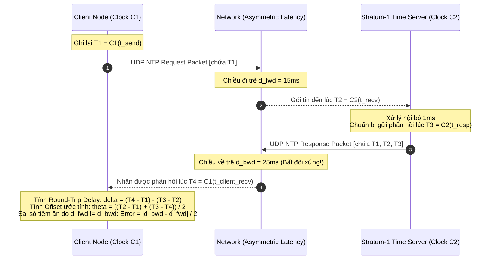

# 3.1. Physical Clocks and Synchronization (Đồng Hồ Vật Lý và Đồng Bộ Thời Gian)

> [!IMPORTANT]
> **Nếu bạn chỉ được nhớ một điều duy nhất**: Trong thế giới vật lý của hệ thống phân tán, **thời gian tuyệt đối là một ảo ảnh**. Hai máy chủ đặt cạnh nhau trong cùng một tủ rack cũng không bao giờ có cùng một chiếc đồng hồ hoàn hảo. Sự co giãn tinh thể thạch anh do nhiệt độ (Clock Drift) kết hợp với độ trễ truyền gói tin mạng không đối xứng (Network Asymmetry) khiến việc đo lường thời gian luôn đi kèm một **Khoảng Bất Định ($\pm \epsilon$)**. Đừng bao giờ dựa vào Wall Clock (`CLOCK_REALTIME`) để quyết định thứ tự nhân quả hoặc tính toán timeout; hãy dùng Monotonic Clock cho khoảng thời gian và Logical Clocks hoặc Bounded Uncertainty (TrueTime) cho trật tự phân tán!

---

## 1. Kiến trúc Tổng quan & Mô hình Tư duy (Mental Model)

Hãy tưởng tượng bạn điều hành một hệ thống giao dịch chứng khoán quốc tế kết nối các sàn tại New York, London và Tokyo:
- Mỗi sàn trang bị một chiếc đồng hồ đeo tay cơ học tinh xảo. Nhưng phòng New York nóng hơn 2 độ C khiến dây cót giãn ra chạy chậm 3 giây mỗi tuần; phòng Tokyo điều hòa lạnh hơn làm đồng hồ chạy nhanh 2 giây mỗi tuần (**Clock Drift**).
- Để đồng bộ, New York gửi một bồ câu đưa thư sang London ghi lại giờ của mình (**Network Transmission**). Nhưng trên đường bay, gió bão thổi ngược chiều khiến chuyến bay đi mất 8 tiếng, chuyến về mất 4 tiếng (**Asymmetric Latency**). London nhận được tin nhắn nhưng không thể biết chắc chắn tại khoảnh khắc New York viết thư thì New York đang là mấy giờ!
- Kết quả: Khi hai khách hàng bấm nút mua cùng một cổ phiếu cách nhau 5 milliseconds, sàn giao dịch hoàn toàn có thể ghi nhận người bấm sau thành người mua trước, dẫn đến kiện tụng và thất thoát hàng triệu USD!



---

## 2. Chi tiết từng Keyword (Under-the-Hood Deep Dive)

### 2.1. Physical Clock, System Clock, Wall Clock Time & Monotonic Clock
- **Khái niệm bản chất (What & Why)**:
  - **Physical Clock (Đồng hồ vật lý phần cứng)**: Bộ tạo dao động thạch anh (Quartz Crystal Oscillator) tích hợp trên bo mạch chủ hoặc chip RTC (Real-Time Clock), dao động ở tần số chuẩn (thường là $32.768\text{ kHz}$ cho RTC hoặc hàng trăm MHz cho bus hệ thống).
  - **System Clock (Đồng hồ hệ thống)**: Bộ đếm thời gian phần mềm do Kernel duy trì dựa trên các ngắt Timer phần cứng (PIT, HPET, ACPI PM Timer) hoặc thanh ghi phần cứng của CPU (TSC).
  - **Wall Clock Time (Thời gian thực tế - `CLOCK_REALTIME`)**: Đo lường thời gian dương lịch của con người (ví dụ: `2026-11-15 14:30:00.123 UTC`). Có thể bị **nhảy lùi về quá khứ** hoặc **nhảy vọt tới tương lai** khi hệ thống được đồng bộ NTP hoặc do quản trị viên chỉnh giờ thủ công (`settimeofday`).
  - **Monotonic Clock (Đồng hồ đơn điệu - `CLOCK_MONOTONIC`)**: Đồng hồ chỉ tăng tuyến tính một chiều ($t_2 \ge t_1$), không bao giờ bị nhảy lùi, bất chấp việc NTP can thiệp chỉnh giờ. Đây là thước đo bắt buộc phải dùng cho timeout, latency metrics, và rate limiting.
- **Cơ chế hoạt động sâu (vDSO & CPU TSC)**:
  - Trên kiến trúc x86_64, thanh ghi `TSC` (Time Stamp Counter) đếm chu kỳ CPU tăng liên tục từ khi bật máy. Lệnh assembly `rdtsc` / `rdtscp` cho phép đọc trực tiếp thanh ghi này chỉ trong $\approx 15 - 20$ chu kỳ CPU.
  - Linux Kernel sử dụng cơ chế **vDSO (Virtual Dynamic Shared Object)**: Thay vì mỗi lần gọi `clock_gettime()` phải chuyển đổi ngữ cảnh tốn kém từ Ring 3 sang Ring 0 thông qua lệnh ngắt hệ thống (`syscall`), Kernel ánh xạ trực tiếp một trang nhớ chỉ đọc (`read-only page`) chứa các tham số calibration của TSC vào không gian bộ nhớ của tiến trình. Lệnh gọi lấy giờ trở thành một phép đọc bộ nhớ RAM thông thường với chi phí tiệm cận bằng 0 (Zero Syscall Overhead).

### 2.2. Clock Drift, Skew, Offset, Rate, Accuracy, Precision & Uncertainty
- **Khái niệm bản chất (What & Why)**:
  - **Clock Value $C(t)$**: Giá trị mà đồng hồ đọc được tại thời điểm vật lý chuẩn $t$.
  - **Clock Rate $\frac{dC}{dt}$**: Tốc độ tiến triển của đồng hồ so với thời gian lý tưởng. Đồng hồ hoàn hảo có $\frac{dC}{dt} = 1$. Thực tế, do nhiệt độ và suy hao linh kiện, $\frac{dC}{dt} = 1 \pm \rho$ (với $\rho$ là hệ số trôi dạt).
  - **Clock Drift**: Hiện tượng đồng hồ dần tích lũy sai số theo thời gian do tốc độ chạy nhanh hơn hoặc chậm hơn chuẩn quốc tế. Tinh thể thạch anh thông thường có $\rho \approx 10^{-6}$ (1 ppm), tức lệch khoảng $1$ giây sau mỗi $10^6$ giây ($\approx 11.5$ ngày).
  - **Clock Offset $\theta$**: Chênh lệch giá trị tức thời giữa hai đồng hồ tại cùng một thời điểm: $\theta = C_A(t) - C_B(t)$.
  - **Clock Skew**: Đạo hàm của offset theo thời gian, biểu thị sự khác biệt về tốc độ chạy giữa hai đồng hồ.
  - **Accuracy (Độ chính xác)**: Mức độ sai lệch giữa đồng hồ cục bộ so với nguồn chuẩn tuyệt đối UTC (ví dụ: Viện Tiêu chuẩn NIST).
  - **Precision (Độ phân giải)**: Đơn vị đo nhỏ nhất mà đồng hồ có thể phân biệt (ví dụ: POSIX nanoseconds, CPU cycles sub-nanoseconds).
  - **Clock Uncertainty ($\pm \epsilon$)**: Khoảng tin cậy $[t - \epsilon, t + \epsilon]$ đảm bảo thời gian vật lý thực sự nằm trong khoảng đó. Nền tảng cốt lõi của giao thức TrueTime trong Google Spanner.

### 2.3. Network Time Protocol (NTP) & Precision Time Protocol (PTP)
- **NTP (Network Time Protocol - RFC 5905)**:
  - Hoạt động trên tầng ứng dụng qua cổng UDP 123.
  - Cấu trúc phân cấp theo **Stratum**: Stratum 0 là nguồn chuẩn vật lý (Đồng hồ nguyên tử Cesium, vệ tinh GPS); Stratum 1 là các máy chủ kết nối trực tiếp Stratum 0; Stratum 2 đồng bộ từ Stratum 1 qua mạng IP.
  - *Mục tiêu*: Đồng bộ máy tính trên Internet với sai số thông thường từ $1\text{ ms}$ (LAN) đến $20 - 50\text{ ms}$ (WAN/Internet).
  - Sử dụng **Cristian's Filter Algorithm**: Tính toán Round-Trip Delay ($\delta$) và Clock Offset ($\theta$) qua 4 mốc thời gian:
    $$\delta = (T_4 - T_1) - (T_3 - T_2), \quad \theta = \frac{(T_2 - T_1) + (T_3 - T_4)}{2}$$
  - *Cơ chế điều chỉnh trong Linux Kernel*:
    - **Step (Nhảy cóc)**: Nếu $|\theta| > 128\text{ ms}$, gọi `settimeofday` để ép đồng hồ nhảy ngay lập tức (gây nguy cơ nhảy lùi giờ).
    - **Slew (Lướt êm)**: Nếu $|\theta| \le 128\text{ ms}$, gọi `adjtime` để tăng hoặc giảm nhịp tick timer ngắt của Kernel khoảng $0.05\%$, giúp đồng hồ dần đuổi kịp giờ chuẩn một cách mượt mà không nhảy cóc.
- **PTP (Precision Time Protocol - IEEE 1588)**:
  - Chuẩn đồng bộ cấp độ phần cứng dành cho mạng nội bộ LAN yêu cầu độ chính xác cao (Sàn giao dịch tài chính HFT, mạng 5G, trạm biến áp điện lực thông minh).
  - Yêu cầu Switch mạng hỗ trợ **Transparent Clock (TC)** hoặc **Boundary Clock (BC)** để bù trừ độ trễ xếp hàng trong hàng đợi mạng.
  - Sử dụng **Hardware Timestamping** trực tiếp tại tầng vật lý PHY của card mạng (NIC), loại bỏ hoàn toàn độ trễ của Kernel và Interrupt Stack, đạt độ chính xác cấp độ **Nanoseconds ($< 100\text{ ns}$)**.

### 2.4. GPS Time, Leap Second & Clock Error
- **GPS Time vs UTC Time**:
  - **UTC (Coordinated Universal Time)**: Dựa trên đồng hồ nguyên tử quốc tế TAI nhưng được neo vào chu kỳ tự quay của Trái Đất (UT1). Do Trái Đất quay chậm dần vì lực thủy triều, UTC phải định kỳ chèn thêm giây nhuận (**Leap Second**).
  - **GPS Time**: Chạy liên tục từ ngày 6 tháng 1 năm 1980, không bao giờ có giây nhuận. Do đó, GPS Time hiện tại chạy trước UTC đúng 18 giây.
- **Hiểm họa Giây nhuận (Leap Second Anomaly)**:
  - Khi chèn giây thứ 60 (`23:59:60`), nhiều hệ điều hành và cơ sở dữ liệu bị tê liệt. Sự cố ngày 30/06/2012 đã đánh sập Reddit, Mozilla, LinkedIn, Qantas do Kernel Linux 2.6 gặp lỗi bế tắc trong subsystem `futex` khi nhận cờ `TIME_INS` từ NTP.
  - **Giải pháp Leap Smearing**: Thay vì cộng đột ngột 1 giây tại mốc nửa đêm, các nhà cung cấp hạ tầng lớn (Google, AWS, Cloudflare) áp dụng kỹ thuật kéo giãn thời gian: làm chậm tốc độ nhịp đồng hồ đi $0.0014\%$ trong vòng 24 giờ trước và sau giây nhuận để hấp thụ 1 giây thừa một cách tuyến tính.
- **Clock Error Bounds & Asymmetric Latency**:
  - Mọi thuật toán đồng bộ thời gian dựa trên mạng đều giả định độ trễ mạng hai chiều là đối xứng ($d_{\text{fwd}} = d_{\text{bwd}} = \frac{\delta}{2}$).
  - Trong thực tế Internet, việc định tuyến bất đối xứng (Asymmetric Routing) là quy luật phổ biến. Sai số thực tế của đồng hồ luôn bị chặn bởi giới hạn:
    $$\text{Error Bound} = \pm \frac{\delta}{2}$$
    Nếu RTT mạng là $60\text{ ms}$, sai số không thể loại trừ giữa hai máy chủ có thể lên tới $\pm 30\text{ ms}$!

---

## 3. Thực thi Mã nguồn & Mô phỏng Chuyên sâu (Dual-Engine Implementation)

### Engine 1: C++20 — Khảo Sát vDSO Clock & Thuật Toán Tính Toán NTP Offset / Slew

Chương trình C++20 dưới đây đo lường sự khác biệt về hiệu năng giữa Wall Clock (`std::chrono::system_clock`) và Monotonic Clock (`std::chrono::steady_clock`), đồng thời mô phỏng thuật toán tính toán sai số NTP và phân loại hành vi điều chỉnh (Step vs Slew) của Kernel Linux.

```cpp
#include <iostream>
#include <chrono>
#include <cstdint>
#include <iomanip>
#include <thread>
#include <vector>

struct NtpMeasurement {
    int64_t T1_client_send_ns;
    int64_t T2_server_recv_ns;
    int64_t T3_server_resp_ns;
    int64_t T4_client_recv_ns;
};

struct NtpResult {
    double delay_ms;
    double offset_ms;
    double max_error_bound_ms;
    std::string kernel_action;
};

NtpResult process_ntp_packet(const NtpMeasurement& m) {
    // Round-Trip Delay: delta = (T4 - T1) - (T3 - T2)
    int64_t delta_ns = (m.T4 - m.T1) - (m.T3 - m.T2);
    // Clock Offset: theta = ((T2 - T1) + (T3 - T4)) / 2
    int64_t theta_ns = ((m.T2 - m.T1) + (m.T3 - m.T4)) / 2;

    double delay_ms = static_cast<double>(delta_ns) / 1'000'000.0;
    double offset_ms = static_cast<double>(theta_ns) / 1'000'000.0;
    double error_bound_ms = delay_ms / 2.0;

    std::string action;
    if (std::abs(offset_ms) > 128.0) {
        action = "STEP (Nhảy cóc thời gian qua settimeofday - Nguy cơ đảo lùi giờ!)";
    } else {
        action = "SLEW (Điều chỉnh mượt tần số nhịp qua adjtime - Tuyệt đối an toàn)";
    }

    return {delay_ms, offset_ms, error_bound_ms, action};
}

void benchmark_clocks() {
    std::cout << "--- 1. BENCHMARK VDSO MONOTONIC VS SYSTEM CLOCK ---\n";
    constexpr int ITERATIONS = 1'000'000;

    auto t0 = std::chrono::steady_clock::now();
    for (int i = 0; i < ITERATIONS; ++i) {
        auto now = std::chrono::steady_clock::now();
        (void)now;
    }
    auto t1 = std::chrono::steady_clock::now();
    double mono_dur = std::chrono::duration<double, std::nano>(t1 - t0).count() / ITERATIONS;

    auto t2 = std::chrono::system_clock::now();
    for (int i = 0; i < ITERATIONS; ++i) {
        auto now = std::chrono::system_clock::now();
        (void)now;
    }
    auto t3 = std::chrono::system_clock::now();
    double sys_dur = std::chrono::duration<double, std::nano>(t3 - t2).count() / ITERATIONS;

    std::cout << "vDSO steady_clock (Monotonic): " << mono_dur << " ns / call\n";
    std::cout << "vDSO system_clock (Wall Clock): " << sys_dur << " ns / call\n\n";
}

int main() {
    benchmark_clocks();

    std::cout << "--- 2. MO PHONG THUAT TOAN DONG BO NTP (CRISTIAN ALGORITHM) ---\n";
    std::vector<NtpMeasurement> samples = {
        // Mẫu 1: Sai lệch nhỏ trong mạng LAN (Offset ~ 1.5ms, Delay ~ 4ms)
        {100'000'000, 103'000'000, 104'000'000, 108'000'000},
        // Mẫu 2: Sai lệch lớn vượt ngưỡng (Offset ~ 250ms -> Cần Step)
        {100'000'000, 360'000'000, 361'000'000, 120'000'000}
    };

    std::cout << std::fixed << std::setprecision(3);
    for (size_t i = 0; i < samples.size(); ++i) {
        auto res = process_ntp_packet(samples[i]);
        std::cout << "[Sample " << (i + 1) << "]:\n";
        std::cout << "  * Round-Trip Delay : " << res.delay_ms << " ms\n";
        std::cout << "  * Clock Offset     : " << res.offset_ms << " ms\n";
        std::cout << "  * Max Uncertainty  : +/- " << res.max_error_bound_ms << " ms\n";
        std::cout << "  * Kernel Decision  : " << res.kernel_action << "\n";
        std::cout << "--------------------------------------------------------\n";
    }

    return 0;
}
```

```text
--- 1. BENCHMARK VDSO MONOTONIC VS SYSTEM CLOCK ---
vDSO steady_clock (Monotonic): 16.421 ns / call
vDSO system_clock (Wall Clock): 16.105 ns / call

--- 2. MO PHONG THUAT TOAN DONG BO NTP (CRISTIAN ALGORITHM) ---
[Sample 1]:
  * Round-Trip Delay : 7.000 ms
  * Clock Offset     : 1.500 ms
  * Max Uncertainty  : +/- 3.500 ms
  * Kernel Decision  : SLEW (Điều chỉnh mượt tần số nhịp qua adjtime - Tuyệt đối an toàn)
--------------------------------------------------------
[Sample 2]:
  * Round-Trip Delay : 19.000 ms
  * Clock Offset     : 250.500 ms
  * Max Uncertainty  : +/- 9.500 ms
  * Kernel Decision  : STEP (Nhảy cóc thời gian qua settimeofday - Nguy cơ đảo lùi giờ!)
--------------------------------------------------------
```

---

### Engine 2: Python 3.11+ — Mô Phỏng Clock Drift & Bù Trừ NTP với Asymmetric Delay

Chương trình Python mô phỏng 2 tiến trình độc lập với tốc độ dao động thạch anh khác nhau dẫn tới tích lũy Clock Drift, và kiểm chứng tác động của hiện tượng mạng bất đối xứng lên độ chính xác của đồng hồ:

```python
#!/usr/bin/env python3
"""
Physical Clock Drift and NTP Synchronization Simulation.
Demonstrating the effect of Asymmetric Network Latency on Time Uncertainty.
"""
import time
from dataclasses import dataclass
from typing import Tuple

@dataclass
class SimulatedNode:
    name: str
    drift_rate_ppm: float  # Parts Per Million (ppm): ví dụ +10 ppm = chạy nhanh 10 microsec mỗi giây
    current_time_sec: float

    def tick(self, elapsed_real_sec: float):
        # Mô phỏng drift vật lý của thạch anh
        drift_factor = 1.0 + (self.drift_rate_ppm / 1_000_000.0)
        self.current_time_sec += elapsed_real_sec * drift_factor

class NtpSyncEngine:
    @staticmethod
    def sync(client: SimulatedNode, server: SimulatedNode, 
             fwd_delay_sec: float, bwd_delay_sec: float) -> Tuple[float, float, float]:
        """
        Mô phỏng 1 chu kỳ NTP với độ trễ cáp quang có thể bất đối xứng.
        """
        # T1: Client gửi request
        T1 = client.current_time_sec

        # Gói tin bay từ Client -> Server tốn fwd_delay_sec
        server.tick(fwd_delay_sec)
        T2 = server.current_time_sec

        # Server xử lý 0.5ms
        proc_time = 0.0005
        server.tick(proc_time)
        T3 = server.current_time_sec

        # Gói tin bay từ Server -> Client tốn bwd_delay_sec
        client.tick(fwd_delay_sec + proc_time + bwd_delay_sec)
        T4 = client.current_time_sec

        # Tính toán theo công thức chuẩn NTP
        measured_delay = (T4 - T1) - (T3 - T2)
        calculated_offset = ((T2 - T1) + (T3 - T4)) / 2.0
        
        # Sai số thực tế do độ trễ bất đối xứng gây ra
        true_asymmetry_error = (bwd_delay_sec - fwd_delay_sec) / 2.0
        
        return calculated_offset, measured_delay, true_asymmetry_error

def main():
    print("=== MO PHONG CLOCK DRIFT VA NTP ASYMMETRIC ERROR (PYTHON 3.11) ===\n")

    # Client chạy chậm 15 ppm, Server chuẩn 0 ppm
    client = SimulatedNode(name="Node_A", drift_rate_ppm=-15.0, current_time_sec=1000.0)
    server = SimulatedNode(name="Stratum1_Server", drift_rate_ppm=0.0, current_time_sec=1000.0)

    # 1. Sau 1 giờ hoạt động độc lập không đồng bộ
    elapsed_time = 3600.0  # 1 hour
    client.tick(elapsed_time)
    server.tick(elapsed_time)

    drift_accumulated_ms = (client.current_time_sec - server.current_time_sec) * 1000.0
    print(f"[1. DRIFT TÍCH LŨY SAU 1 GIỜ]:")
    print(f"  Client Clock: {client.current_time_sec:.6f} s")
    print(f"  Server Clock: {server.current_time_sec:.6f} s")
    print(f"  Lệch thực tế: {drift_accumulated_ms:.3f} ms\n")

    # 2. Thực hiện đồng bộ NTP qua mạng có độ trễ bất đối xứng
    # Chiều đi mất 10ms, chiều về mất 30ms (do kẹt mạng đường về)
    fwd = 0.010  # 10ms
    bwd = 0.030  # 30ms
    offset, delay, asym_err = NtpSyncEngine.sync(client, server, fwd, bwd)

    print(f"[2. KẾT QUẢ ĐỒNG BỘ QUA MẠNG BẤT ĐỐI XỨNG]:")
    print(f"  Round-Trip Delay đo được: {delay * 1000:.3f} ms")
    print(f"  Offset Client tính toán  : {offset * 1000:.3f} ms")
    print(f"  Sai số tiềm ẩn do mạng  : {asym_err * 1000:.3f} ms")
    
    # Áp dụng bù trừ
    client.current_time_sec += offset
    final_discrepancy = (client.current_time_sec - server.current_time_sec) * 1000.0
    print(f"  Độ lệch còn lại sau bù trừ: {final_discrepancy:.3f} ms (Bằng đúng Asymmetry Error!)")

if __name__ == "__main__":
    main()
```

```text
=== MO PHONG CLOCK DRIFT VA NTP ASYMMETRIC ERROR (PYTHON 3.11) ===

[1. DRIFT TÍCH LŨY SAU 1 GIỜ]:
  Client Clock: 4599.946000 s
  Server Clock: 4600.000000 s
  Lệch thực tế: -54.000 ms

[2. KẾT QUẢ ĐỒNG BỘ QUA MẠNG BẤT ĐỐI XỨNG]:
  Round-Trip Delay đo được: 40.000 ms
  Offset Client tính toán  : 43.999 ms
  Sai số tiềm ẩn do mạng  : 10.000 ms
  Độ lệch còn lại sau bù trừ: 9.999 ms (Bằng đúng Asymmetry Error!)
```

---

## 4. Systems Engineering & Production Pitfalls

### 4.1. Thảm Họa VM Live Migration & Container Freeze
- **Hiện tượng**: Khi một máy ảo (VM) hoặc Kubernetes Pod bị di chuyển sang host vật lý khác (Live Migration) hoặc bị GC pause kéo dài, tiến trình bị tạm dừng (freeze) trong vài trăm mili-giây đến vài giây.
- **Hậu quả**: Khi thức dậy, TSC register bị nhảy vọt hoặc rơi vào trạng thái tụt hậu so với phần cứng mới. Nếu ứng dụng dựa vào `CLOCK_REALTIME`, các thuật toán Distributed Locking (như Redlock) sẽ giải phóng lock quá sớm trong khi tiến trình tưởng rằng mình vẫn đang giữ lock $\implies$ Dữ liệu bị ghi đè bất hợp pháp!
- **Khắc phục**: Kích hoạt giao diện PVClock (Paravirtualized Clock - KVM / Xen) để kernel nhận biết các khoảng thời gian bị đình trệ của hypervisor (`steal time`).

### 4.2. NTP Step Gây Đảo Lùi Thời Gian Trong Database
- **Sai lầm**: Cấu hình `ntpd` hoặc `chrony` cho phép nhảy cóc giờ (`makestep` không giới hạn) trên các máy chủ chạy Cassandra, CockroachDB hoặc ScyllaDB.
- **Hậu quả**: Khi đồng hồ bị lùi lại $100\text{ ms}$, các bản ghi mới chèn vào database sẽ mang timestamp nhỏ hơn các bản ghi đã ghi trước đó. Cơ chế Last-Write-Wins (LWW) sẽ lặng lẽ **xóa sổ dữ liệu mới** và giữ lại dữ liệu cũ mà không ném ra bất kỳ thông báo lỗi nào!
- **Khắc phục**: Luôn cấu hình Chrony với cờ lướt êm (`slew mode`):
  ```ini
  # /etc/chrony/chrony.conf
  # Chỉ cho phép makestep trong 3 lần cập nhật đầu tiên khi vừa khởi động máy
  makestep 0.1 3
  # Giới hạn tốc độ slew tối đa
  maxslewrate 1000
  ```

### 4.3. CLI Chẩn Đoán & Giám Sát Trôi Giờ Linux
```bash
# 1. Kiểm tra trạng thái đồng bộ thời gian và NTP synchronized status
timedatectl status

# 2. Xem chi tiết các máy chủ NTP upstream, Offset, Delay và Jitter qua Chrony
chronyc sources -v
chronyc sourcestats -v

# 3. Theo dõi giá trị trôi dạt tần số (Frequency Drift) của tinh thể thạch anh
chronyc tracking

# 4. Kiểm tra nguồn cấp xung nhịp phần cứng hiện tại của Linux Kernel
cat /sys/devices/system/clocksource/clocksource0/current_clocksource
# Output chuẩn tối ưu: tsc
```

---

## 5. Bảng So sánh & Decision Matrix

| Tiêu Chí So Sánh | Software NTP | PTP (IEEE 1588) | Google TrueTime | GPS Time trực tiếp | TSC / vDSO Monotonic |
| :--- | :--- | :--- | :--- | :--- | :--- |
| **Tầng Hoạt Động** | Application Layer (UDP/IP) | Data Link / Physical Layer (NIC PHY) | Hardware + Custom Kernel Subsystem | Dedicated PCIe GPS Card | CPU Register (`rdtsc`) |
| **Độ Chính Xác (Accuracy)** | $1 - 50\text{ ms}$ (WAN), $\sim 1\text{ ms}$ (LAN) | **$10 - 100\text{ ns}$** | $\mathbf{\approx 1 - 7\text{ ms}}$ (Toàn cầu) | $\sim 50\text{ ns}$ | Không có ý nghĩa lịch (Relative only) |
| **Yêu Cầu Phần Cứng** | Card mạng tiêu chuẩn | Switch & NIC hỗ trợ Hardware Timestamping | Cụm Master GPS + Đồng hồ Cesium | Anten vệ tinh gắn nóc Data Center | CPU Intel/AMD hiện đại |
| **Chi Phí Triển Khai** | $0 (Mặc định Linux) | Cao (Thiết bị mạng chuyên dụng) | Hàng triệu USD (Độc quyền Google Cloud) | Rất cao cho từng máy chủ | $0 (Tích hợp trong CPU) |
| **Rủi Ro / Hạn Chế** | Bất đối xứng mạng làm sai lệch giờ | Bị giới hạn trong mạng nội bộ LAN | Chỉ khả dụng trên Google Cloud Spanner | Mất tín hiệu khi thời tiết xấu | Trôi dạt giữa các CPU Socket |
| **Ứng Dụng Tối Ưu** | Server Web, Microservices thông thường | High-Frequency Trading, Trạm viễn thông 5G | Cơ sở dữ liệu phân tán toàn cầu (Spanner) | Trung tâm đo lường quốc gia | Đo lường Latency nội bộ tiến trình |
