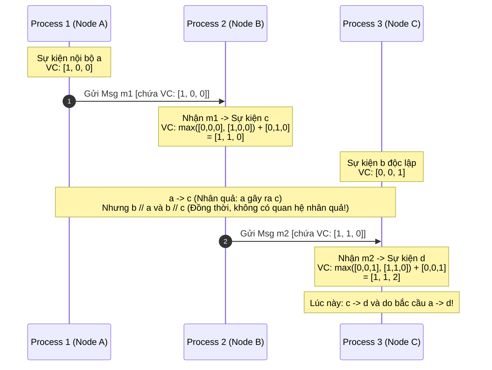

# 3.2. Logical Clocks, Vector Clocks and Causality (Đồng Hồ Logic, Vector Clocks và Tính Nhân Quả)

> [!IMPORTANT]
> **Nếu bạn chỉ được nhớ một điều duy nhất**: Trong điện toán phân tán, **thời gian vật lý là thứ yếu, trật tự nhân quả (Causality) mới là chân lý**. Bạn không thể biết chính xác hai sự kiện ở New York và Tokyo xảy ra cách nhau bao nhiêu phần triệu giây theo đồng hồ treo tường; nhưng nếu Alice đọc một bài viết rồi mới bình luận phản hồi, thì bài viết **bắt buộc phải là nguyên nhân sinh ra bình luận** ($A \to B$). Lamport Clock gán nhãn thời gian bằng một số nguyên $O(1)$ để tạo trật tự toàn phần nhưng không thể phát hiện xung đột đồng thời ($A \parallel B$); chỉ có Vector Clock $O(N)$ mới phản ánh chính xác quan hệ nhân quả hai chiều và phát hiện phân nhánh dữ liệu.

---

## 1. Kiến trúc Tổng quan & Mô hình Tư duy (Mental Model)

Hãy tưởng tượng một nhóm điều tra phá án gồm 3 thám tử độc lập tại 3 thành phố khác nhau (Paris, London, Rome):
- Mỗi thám tử ghi chép nhật ký phá án nhưng đồng hồ đeo tay của họ đều chạy sai lệch vài phút. Nếu thám tử Paris ghi: *"14:02 - Tìm thấy bức thư tống tiền"* và thám tử Rome ghi: *"14:01 - Nhận được điện thoại kẻ bắt cóc"*, ta không thể kết luận cuộc gọi diễn ra trước bức thư chỉ dựa vào số phút ghi trên giấy!
- Thay vào đó, họ dùng **Trật tự Nhân quả (Causality / Happens-Before)**: Nếu bức thư tống tiền tại Paris đề cập đến nội dung cuộc điện thoại tại Rome, thì cuộc điện thoại **chắc chắn phải xảy ra trước** bức thư, bất chấp đồng hồ ghi giờ thế nào!
- **Lamport Clock** giống như việc mỗi thám tử dán một con số thứ tự tăng dần lên chứng cứ. Nhưng nếu hai thám tử cùng thu thập chứng cứ độc lập mà không liên lạc với nhau, cả hai có thể cùng gán nhãn số `5` $\implies$ Cần một quy tắc bẻ gãy đồng hạng (Tie-breaking).
- **Vector Clock** giống như một tấm hộ chiếu có đóng dấu thị thực của cả 3 thành phố. Khi nhìn vào cuốn sổ, người điều tra biết chính xác thám tử này đã nắm được bao nhiêu phần báo cáo của hai người còn lại, phát hiện ngay khi hai người đưa ra hai kết luận trái ngược nhau cùng một lúc (**Concurrent Writes / Conflict**)!



---

## 2. Chi tiết từng Keyword (Under-the-Hood Deep Dive)

### 2.1. Quan hệ Happens-Before ($\to$), Causality & Concurrent Events
- **Khái niệm bản chất (What & Why)**:
  - Năm 1978, Leslie Lamport công bố bài báo kinh điển *"Time, Clocks, and the Ordering of Events in a Distributed System"*, định nghĩa quan hệ **Happens-Before** (ký hiệu: $\to$).
  - Quan hệ $\to$ thỏa mãn 3 tiên đề toán học khắt khe:
    1. **Nội bộ tiến trình (Program Order)**: Nếu sự kiện $a$ và $b$ cùng xảy ra trong tiến trình $P_i$ và $a$ được thực thi trước $b$, thì $a \to b$.
    2. **Gửi và nhận thông điệp (Message Passing)**: Nếu $a$ là sự kiện gửi thông điệp của tiến trình $P_i$, và $b$ là sự kiện nhận thông điệp đó tại tiến trình $P_j$, thì $a \to b$.
    3. **Tính chất bắc cầu (Transitivity)**: Nếu $a \to b$ và $b \to c$, thì chắc chắn $a \to c$.
- **Sự kiện đồng thời (Concurrent Events - $a \parallel b$)**:
  - Nếu $a \not\to b$ và $b \not\to a$, hai sự kiện này được coi là đồng thời (Concurrent). Không có bất kỳ luồng thông tin nào lan truyền giữa chúng, và không sự kiện nào là nguyên nhân hay hệ quả của sự kiện kia.
- **Bản chất toán học (Partial Order vs Total Order)**:
  - Quan hệ Happens-Before chỉ là một **Thứ tự bộ phận (Partial Order)**: Một số cặp sự kiện so sánh được nhân quả với nhau, một số cặp khác ($a \parallel b$) thì không thể sắp thứ tự.
  - Để biến Partial Order thành **Thứ tự toàn phần (Total Order)** phục vụ State Machine Replication, hệ thống phải áp dụng một luật bổ trợ tùy ý (Arbitrary Tie-breaking), ví dụ so sánh Node ID.

### 2.2. Lamport Clocks & Lamport Timestamps
- **Khái niệm bản chất (What & Why)**:
  - Lamport Clock là một bộ đếm số nguyên vô hướng đơn giản $L \in \mathbb{N}$ duy trì trên từng node mạng.
  - Mục tiêu duy nhất: Thỏa mãn **Điều kiện đồng hồ (Clock Condition)**:
    $$\text{Nếu } a \to b \implies L(a) < L(b)$$
- **Thuật toán Lamport Clock Under the Hood**:
  1. Khởi tạo: Mỗi node $i$ gán $L_i = 0$.
  2. Trước mỗi sự kiện nội bộ:
     $$L_i = L_i + 1$$
  3. Khi gửi thông điệp $m$: Node $i$ tăng $L_i = L_i + 1$, đính kèm giá trị $T_m = L_i$ vào header gói tin.
  4. Khi nhận thông điệp $m$ có timestamp $T_m$: Node nhận $j$ cập nhật đồng hồ của mình:
     $$L_j = \max(L_j, T_m) + 1$$
- **Lamport Timestamp & Total Ordering**:
  - Để tạo một Total Order tuyệt đối từ Lamport Clock, ta ghép cặp `(L, Node_ID)`:
    $$(L_a, \text{Node}_A) < (L_b, \text{Node}_B) \iff (L_a < L_b) \lor (L_a = L_b \land \text{Node}_A < \text{Node}_B)$$
- **Khiếm khuyết chí tử của Lamport Clock**:
  - Chiều ngược lại **HOÀN TOÀN KHÔNG ĐÚNG**:
    $$L(a) < L(b) \not\implies a \to b$$
  - Nếu bạn thấy $L(a) = 3$ và $L(b) = 4$, bạn **không thể** biết được liệu $a$ có gây ra $b$ hay không, hay $a$ và $b$ là hai sự kiện hoàn toàn độc lập diễn ra đồng thời ($a \parallel b$). Lamport Clock làm mất hoàn toàn khả năng phát hiện xung đột dữ liệu!

### 2.3. Vector Clocks & Version Vectors
- **Khái niệm bản chất (What & Why)**:
  - Được phát minh độc lập bởi Colin Fidge và Friedemann Mattern (1988), **Vector Clock** giải quyết triệt để hạn chế của Lamport Clock bằng một mảng $N$ phần tử:
    $$V = [v_1, v_2, \dots, v_N]$$
    với $N$ là tổng số node trong cụm phân tán. Phần tử $V[i]$ đại diện cho số lượng sự kiện tại node $i$ mà node hiện tại đã quan sát được.
  - **Đẳng thức tương đương hai chiều hoàn hảo**:
    $$a \to b \iff V(a) < V(b)$$
    $$a \parallel b \iff \neg(V(a) \le V(b)) \land \neg(V(b) \le V(a))$$
- **Thuật toán cập nhật Vector Clock Under the Hood**:
  1. Node $i$ duy trì $V_i[1 \dots N]$, ban đầu toàn bộ bằng $0$.
  2. Trước khi phát sinh sự kiện nội bộ hoặc gửi tin:
     $$V_i[i] = V_i[i] + 1$$
  3. Gửi thông điệp kèm toàn bộ vector $V_i$.
  4. Khi node $j$ nhận thông điệp kèm vector $V_{msg}$:
     $$\forall k \in [1, N]: V_j[k] = \max(V_j[k], V_{msg}[k])$$
     $$V_j[j] = V_j[j] + 1$$
- **Quy tắc so sánh hai Vector Clock ($V_A$ và $V_B$)**:
  - $V_A \le V_B \iff \forall k: V_A[k] \le V_B[k]$.
  - $V_A < V_B \iff V_A \le V_B \land V_A \neq V_B$ (Nghĩa là $A$ chắc chắn là tiền đề của $B$).
  - **Xung đột / Phân nhánh ($V_A \parallel V_B$)**: Tồn tại chỉ số $x$ sao cho $V_A[x] > V_B[x]$ VÀ tồn tại chỉ số $y$ sao cho $V_A[y] < V_B[y]$.
- **Version Vector trong Leaderless Storage (Dynamo / Riak)**:
  - Version Vector dùng để theo dõi các phiên bản ghi đè trên từng item dữ liệu thay vì theo dõi mọi sự kiện mạng. Khi hai client ghi đồng thời vào hai replica khác nhau, Version Vector phát hiện ra tình trạng rẽ nhánh (Split / Siblings), buộc client hoặc cơ chế CRDT phải hợp nhất (Reconciliation).

### 2.4. Matrix Clocks
- **Khái niệm bản chất (What & Why)**:
  - Matrix Clock mở rộng Vector Clock lên ma trận hai chiều kích thước $N \times N$, ký hiệu $M_i$.
  - Hàng $M_i[i, \ast]$ chính là Vector Clock của chính node $i$.
  - Hàng $M_i[j, k]$ biểu thị: *Theo kiến thức của node $i$, node $j$ đã biết bao nhiêu sự kiện của node $k$*.
- **Cơ chế thu gom rác phân tán (Distributed Garbage Collection)**:
  - Trong các hệ thống lưu trữ sự kiện hoặc checkpointing phân tán, node không thể tùy tiện xóa log cũ vì sợ node khác chưa nhận được.
  - Nhờ Matrix Clock, node $i$ có thể tính toán:
    $$\text{Safe To Discard}(k) = \min_{j} M_i[j, k]$$
  - Khi giá trị này tăng lên $m$, node $i$ biết chắc chắn rằng **toàn bộ $N$ node trong hệ thống** đều đã nhận được ít nhất $m$ sự kiện từ node $k$, do đó có thể giải phóng bộ nhớ log một cách an toàn tuyệt đối.

### 2.5. Logical Timestamp & Causal Order Summary
- **Mối liên hệ giữa các thế hệ đồng hồ**:
  - **Physical Clock**: Dựa vào phần cứng thực tế, sai số do mạng và nhiệt độ, không thể suy diễn quan hệ nhân quả.
  - **Lamport Clock**: Vô hướng $O(1)$, bảo toàn trật tự nhân quả một chiều ($a \to b \implies L_a < L_b$), chi phí mạng và RAM thấp nhất, nhưng không phân biệt được sự kiện đồng thời.
  - **Vector Clock**: Mảng $O(N)$, bảo toàn nhân quả hai chiều ($a \to b \iff V_a < V_b$), phát hiện hoàn hảo xung đột dữ liệu, nhưng chi phí mở rộng khi $N$ lớn (Vector Bloat).
  - **Matrix Clock**: Ma trận $O(N^2)$, cung cấp tri thức bậc hai ("tôi biết bạn biết gì"), cho phép thu gom rác log phân tán, nhưng chi phí truyền tải $O(N^2)$ rất nặng.

---

## 3. Thực thi Mã nguồn & Mô phỏng Chuyên sâu (Dual-Engine Implementation)

### Engine 1: C++20 — Lamport Clock Engine với Total Order Tie-Breaking

Chương trình C++20 dưới đây mô phỏng cụm phân tán 3 tiến trình sử dụng Lamport Timestamp để tạo một Total Order duy nhất và nhất quán trên toàn bộ hệ thống:

```cpp
#include <iostream>
#include <string>
#include <vector>
#include <algorithm>
#include <cstdint>
#include <tuple>
#include <iomanip>

struct LamportTimestamp {
    uint64_t counter{0};
    uint32_t process_id{0};

    // Toán tử so sánh biến Partial Order thành Strict Total Order
    auto operator<=>(const LamportTimestamp& other) const = default;
};

struct Event {
    std::string description;
    LamportTimestamp ts;
};

class LamportNode {
private:
    uint32_t pid_;
    uint64_t counter_{0};

public:
    explicit LamportNode(uint32_t pid) : pid_(pid) {}

    Event local_event(const std::string& desc) {
        counter_++;
        return {desc, {counter_, pid_}};
    }

    std::pair<std::string, LamportTimestamp> send_message(const std::string& data) {
        counter_++;
        return {data, {counter_, pid_}};
    }

    Event receive_message(const std::string& data, const LamportTimestamp& sender_ts) {
        // Thuật toán Lamport: L_recv = max(L_local, L_msg) + 1
        counter_ = std::max(counter_, sender_ts.counter) + 1;
        return {std::string("Recv '") + data + "'", {counter_, pid_}};
    }

    uint32_t pid() const { return pid_; }
    uint64_t counter() const { return counter_; }
};

int main() {
    LamportNode node1(1);
    LamportNode node2(2);
    LamportNode node3(3);

    std::vector<Event> global_trace;

    // 1. Node 1 phát sinh sự kiện nội bộ
    global_trace.push_back(node1.local_event("Node1: Init Transaction"));

    // 2. Node 2 phát sinh sự kiện nội bộ độc lập
    global_trace.push_back(node2.local_event("Node2: Read Local Config"));

    // 3. Node 1 gửi tin nhắn sang Node 3
    auto [msg1, ts1] = node1.send_message("TRANSFER $100");
    global_trace.push_back({"Node1: Send " + msg1, ts1});

    // 4. Node 3 nhận tin nhắn từ Node 1
    global_trace.push_back(node3.receive_message(msg1, ts1));

    // 5. Node 3 gửi xác nhận sang Node 2
    auto [msg2, ts2] = node3.send_message("ACK_TRANSFER");
    global_trace.push_back({"Node3: Send " + msg2, ts2});

    // 6. Node 2 nhận tin nhắn từ Node 3
    global_trace.push_back(node2.receive_message(msg2, ts2));

    std::cout << "=== MO PHONG LAMPORT CLOCK TRONG C++20 ===\n\n";
    std::cout << "--- DANH SÁCH SỰ KIỆN THEO THỜI GIAN THU THẬP ---\n";
    for (const auto& ev : global_trace) {
        std::cout << "  * TS(" << std::setw(2) << ev.ts.counter << ", Node " 
                  << ev.ts.process_id << "): " << ev.description << "\n";
    }

    // Sắp xếp các sự kiện theo Lamport Total Order (Counter tăng dần, Tie-break bằng Node ID)
    std::sort(global_trace.begin(), global_trace.end(), 
              [](const Event& a, const Event& b) {
                  return a.ts < b.ts;
              });

    std::cout << "\n--- THỨ TỰ TOÀN PHẦN CUỐI CÙNG (STRICT TOTAL ORDER) ---\n";
    for (size_t i = 0; i < global_trace.size(); ++i) {
        std::cout << "  " << (i + 1) << ". TS(" << global_trace[i].ts.counter 
                  << ", Node " << global_trace[i].ts.process_id << "): " 
                  << global_trace[i].description << "\n";
    }

    return 0;
}
```

```text
=== MO PHONG LAMPORT CLOCK TRONG C++20 ===

--- DANH SÁCH SỰ KIỆN THEO THỜI GIAN THU THẬP ---
  * TS( 1, Node 1): Node1: Init Transaction
  * TS( 1, Node 2): Node2: Read Local Config
  * TS( 2, Node 1): Node1: Send TRANSFER $100
  * TS( 3, Node 3): Recv 'TRANSFER $100'
  * TS( 4, Node 3): Node3: Send ACK_TRANSFER
  * TS( 5, Node 2): Recv 'ACK_TRANSFER'

--- THỨ TỰ TOÀN PHẦN CUỐI CÙNG (STRICT TOTAL ORDER) ---
  1. TS(1, Node 1): Node1: Init Transaction
  2. TS(1, Node 2): Node2: Read Local Config
  3. TS(2, Node 1): Node1: Send TRANSFER $100
  4. TS(3, Node 3): Recv 'TRANSFER $100'
  5. TS(4, Node 3): Node3: Send ACK_TRANSFER
  6. TS(5, Node 2): Recv 'ACK_TRANSFER'
```

---

### Engine 2: Python 3.11+ — Dynamic Vector Clock Engine với Kiểm Tra Causality & Phát Hiện Phân Nhánh (Fork)

Chương trình Python 3.11 triển khai lớp `VectorClock` hoàn chỉnh, hỗ trợ các toán tử so sánh quan hệ nhân quả (`BEFORE`, `AFTER`, `CONCURRENT`) và mô phỏng hiện tượng phân nhánh ghi dữ liệu (Data Forking / Siblings):

```python
#!/usr/bin/env python3
"""
Full Vector Clock Engine & Conflict Detector in Python 3.11.
Demonstrating Causality, Concurrency Detection, and Branch Merging.
"""
from dataclasses import dataclass, field
from enum import Enum
from typing import Dict, Set

class CausalRelation(Enum):
    BEFORE = "BEFORE (A -> B: A là nguyên nhân dẫn đến B)"
    AFTER = "AFTER (B -> A: B là tiền đề của A)"
    EQUAL = "EQUAL (Hai vector hoàn toàn đồng nhất)"
    CONCURRENT = "CONCURRENT (A || B: XUNG ĐỘT ĐỒNG THỜI - Cần Reconcile!)"

@dataclass
class VectorClock:
    clock: Dict[str, int] = field(default_factory=dict)

    def get(self, node_id: str) -> int:
        return self.clock.get(node_id, 0)

    def increment(self, node_id: str) -> None:
        self.clock[node_id] = self.get(node_id) + 1

    def merge(self, remote: 'VectorClock') -> None:
        all_nodes = set(self.clock.keys()).union(remote.clock.keys())
        for nid in all_nodes:
            self.clock[nid] = max(self.get(nid), remote.get(nid))

    def copy(self) -> 'VectorClock':
        return VectorClock(clock=dict(self.clock))

    @staticmethod
    def compare(v1: 'VectorClock', v2: 'VectorClock') -> CausalRelation:
        all_nodes = set(v1.clock.keys()).union(v2.clock.keys())
        v1_greater = False
        v2_greater = False

        for nid in all_nodes:
            c1 = v1.get(nid)
            c2 = v2.get(nid)
            if c1 > c2:
                v1_greater = True
            elif c1 < c2:
                v2_greater = True

        if not v1_greater and not v2_greater:
            return CausalRelation.EQUAL
        if v1_greater and not v2_greater:
            return CausalRelation.AFTER
        if not v1_greater and v2_greater:
            return CausalRelation.BEFORE
        return CausalRelation.CONCURRENT

def main():
    print("=== MO PHONG VECTOR CLOCK & PHAT HIEN XUNG DOT (PYTHON 3.11) ===\n")

    # Kịch bản 1: Quan hệ nhân quả tuần tự (A -> B)
    vc_base = VectorClock({"Node1": 1, "Node2": 0})
    vc_derived = vc_base.copy()
    vc_derived.increment("Node1")  # Node1 ghi tiep -> {"Node1": 2, "Node2": 0}

    print("[Kịch Bản 1]: Ghi tuần tự trên cùng một node:")
    print(f"  VC_Base   : {vc_base.clock}")
    print(f"  VC_Derived: {vc_derived.clock}")
    print(f"  Quan hệ   : {VectorClock.compare(vc_base, vc_derived).value}\n")

    # Kịch bản 2: Phân nhánh đồng thời (Concurrent Writes / Split-Brain)
    # Từ trạng thái gốc, Client A ghi vào Node1, Client B ghi vào Node2
    vc_branch_a = vc_base.copy()
    vc_branch_a.increment("Node1")  # {"Node1": 2, "Node2": 0}

    vc_branch_b = vc_base.copy()
    vc_branch_b.increment("Node2")  # {"Node1": 1, "Node2": 1}

    print("[Kịch Bản 2]: Ghi đồng thời trên hai replica khác nhau:")
    print(f"  Nhánh A (Node1 ghi): {vc_branch_a.clock}")
    print(f"  Nhánh B (Node2 ghi): {vc_branch_b.clock}")
    relation = VectorClock.compare(vc_branch_a, vc_branch_b)
    print(f"  Quan hệ            : {relation.value}\n")

    # Kịch bản 3: Hợp nhất dữ liệu (Reconciliation)
    if relation == CausalRelation.CONCURRENT:
        print("[Kịch Bản 3]: Tiến hành Reconcile và gộp nhánh (Merge):")
        merged_vc = vc_branch_a.copy()
        merged_vc.merge(vc_branch_b)
        # Tăng nhịp của nút hòa giải (Node 3)
        merged_vc.increment("Node3")
        print(f"  Vector Clock sau khi giải quyết xung đột: {merged_vc.clock}")
        print(f"  So sánh với Nhánh A: {VectorClock.compare(vc_branch_a, merged_vc).value}")
        print(f"  So sánh với Nhánh B: {VectorClock.compare(vc_branch_b, merged_vc).value}")

if __name__ == "__main__":
    main()
```

```text
=== MO PHONG VECTOR CLOCK & PHAT HIEN XUNG DOT (PYTHON 3.11) ===

[Kịch Bản 1]: Ghi tuần tự trên cùng một node:
  VC_Base   : {'Node1': 1, 'Node2': 0}
  VC_Derived: {'Node1': 2, 'Node2': 0}
  Quan hệ   : BEFORE (A -> B: A là nguyên nhân dẫn đến B)

[Kịch Bản 2]: Ghi đồng thời trên hai replica khác nhau:
  Nhánh A (Node1 ghi): {'Node1': 2, 'Node2': 0}
  Nhánh B (Node2 ghi): {'Node1': 1, 'Node2': 1}
  Quan hệ            : CONCURRENT (A || B: XUNG ĐỘT ĐỒNG THỜI - Cần Reconcile!)

[Kịch Bản 3]: Tiến hành Reconcile và gộp nhánh (Merge):
  Vector Clock sau khi giải quyết xung đột: {'Node1': 2, 'Node2': 1, 'Node3': 1}
  So sánh với Nhánh A: BEFORE (A -> B: A là nguyên nhân dẫn đến B)
  So sánh với Nhánh B: BEFORE (A -> B: A là nguyên nhân dẫn đến B)
```

---

## 4. Systems Engineering & Production Pitfalls

### 4.1. Sự cố Phình To Vector Clock (Vector Clock Explosion)
- **Bản chất**: Kích thước của Vector Clock tỉ lệ thuận với số lượng node $O(N)$. Trong các kiến trúc phân tán mở rộng, nếu mỗi Client di động hoặc mỗi Serverless Function tạm thời (Ephemeral Pod) đều tạo ra một Node ID riêng biệt, Vector Clock sẽ phình to từ vài byte lên hàng trăm Kilobyte, làm bóp nghẹt băng thông mạng và dung lượng lưu trữ trên đĩa.
- **Sự cố thực tế**: Trong Amazon Dynamo đời đầu và Apache Cassandra, các bản ghi cũ tích lũy hàng nghìn cặp key-value trong Version Vector khiến độ trễ đọc/ghi tăng đột biến.
- **Giải pháp Production**:
  1. **Pruning (Cắt tỉa theo thời gian)**: Đính kèm timestamp vật lý vào từng entry trong vector. Khi kích thước vector vượt quá ngưỡng (ví dụ: $> 10$ entries), xóa bỏ các node không có hoạt động trong 30 ngày qua. Nhược điểm: có thể tạo ra false-concurrency nếu node cũ quay trở lại.
  2. **Dotted Version Vectors (DVV)**: Kỹ thuật hiện đại được dùng trong Riak 2.0: Tách riêng một counter ẩn danh duy nhất đại diện cho giá trị cơ sở, chỉ lưu trữ các "chấm" (dots) cho các xung đột chưa được giải quyết, giúp kích thước luôn giữ ở mức tối thiểu.

### 4.2. Hiểu Sai Giữa Lamport Clock và Trật Tự Vật Lý
- **Sai lầm phổ biến**: Developer cho rằng nếu $L(a) < L(b)$ thì sự kiện $a$ chắc chắn xảy ra trước sự kiện $b$ trong thế giới thực.
- **Hậu quả**: Hai sự kiện độc lập hoàn toàn (ví dụ: User 1 tại Việt Nam mua giày lúc 10:00, User 2 tại Mỹ nạp thẻ lúc 10:05). Do node tại Mỹ vừa khởi động nên $L(\text{US}) = 1$, còn node Việt Nam đã chạy lâu nên $L(\text{VN}) = 500$. Nếu dùng Lamport Clock để hiển thị timeline trên giao diện người dùng, hành động mua giày lúc 10:00 sẽ bị đẩy lùi xuống sau hành động lúc 10:05!
- **Khắc phục**: Lamport Clock chỉ dùng để bảo vệ trật tự phân tán nội bộ và bẻ gãy đồng hạng; đối với trải nghiệm người dùng cuối, phải kết hợp với **Hybrid Logical Clock (HLC)** hoặc định dạng UTC hiển thị.

### 4.3. CLI Chẩn Đoán & Kiểm Tra Xung Đột Dữ Liệu
```bash
# 1. Kiểm tra số lượng Siblings (bản sao xung đột) trong cụm Riak KV
riak-admin diag

# 2. Xem metadata Version Vector của một khóa cụ thể trong Riak / Cassandra
curl -i http://localhost:8098/buckets/users/keys/user_1001

# 3. Theo dõi số lượng sự kiện phân nhánh trong Cassandra cluster
nodetool tablestats keyspace_orders.orders_table | grep -i "tombstones"
```

---

## 5. Bảng So sánh & Decision Matrix

| Tiêu Chí So Sánh | Physical Wall Clock | Lamport Logical Clock | Vector Clock / Version Vector | Matrix Clock | Hybrid Logical Clock (HLC) |
| :--- | :--- | :--- | :--- | :--- | :--- |
| **Kích Thước Lưu Trữ** | $O(1)$ (8 bytes) | $O(1)$ (8 bytes) | $O(N)$ (Tỉ lệ với số node) | $O(N^2)$ (Ma trận vuông) | $O(1)$ (12-16 bytes) |
| **Bảo Đảm Nhân Quả** | ❌ Không thể | ⚠️ Một chiều ($a \to b \implies L_a < L_b$) | ✅ Hai chiều ($a \to b \iff V_a < V_b$) | ✅ Hai chiều hoàn hảo | ⚠️ Tương đương Lamport + bám sát Physical |
| **Phát Hiện Concurrency ($a \parallel b$)** | ❌ Không thể | ❌ Không thể | ✅ Phát hiện chính xác tuyệt đối | ✅ Phát hiện chính xác tuyệt đối | ❌ Không thể |
| **Độ Phức Tạp Giao Thức** | Rất thấp | Cực thấp | Trung bình (Dễ bị bloat vector) | Rất cao | Thấp |
| **Bám Sát Thời Gian Thực** | Bám sát UTC | Hoàn toàn tách rời thời gian thực | Hoàn toàn tách rời thời gian thực | Tách rời thời gian thực | **Luôn nằm trong khoảng $[pt, pt + \epsilon]$** |
| **Ứng Dụng Điển Hình** | Ghi log hệ thống, audit con người | Total order broadcast, Distributed Mutex | Cơ sở dữ liệu Dynamo-style, CRDTs | Distributed Garbage Collection | CockroachDB, MongoDB sharding |
