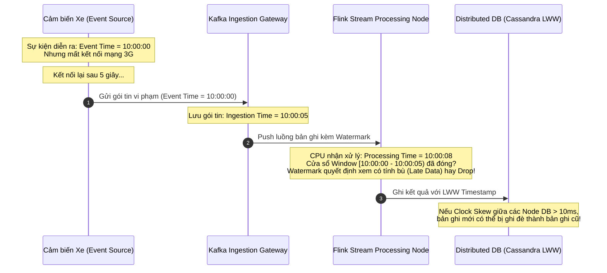

# 3.3. Distributed Ordering and Time Anomalies (Trật Tự Phân Tán và Dị Thường Thời Gian)

> [!IMPORTANT]
> **Nếu bạn chỉ được nhớ một điều duy nhất**: Thời gian trong hệ thống phân tán không phải là một con số vô hướng duy nhất, mà là một **khoảng bất định hoặc đa trục tọa độ**. Dựa vào Last-Write-Wins (LWW) với đồng hồ vật lý trên mạng không đồng bộ chắc chắn sẽ dẫn đến **mất dữ liệu âm thầm (Silent Data Loss)** do Clock Skew; trong khi xử lý luồng (Stream Processing) buộc phải bóc tách thành **Event Time** (khi sự việc xảy ra) và **Processing Time** (khi CPU xử lý) thông qua cơ chế **Watermark**. Để đạt được trật tự toàn cầu chuẩn xác, bạn chỉ có hai con đường: chấp nhận độ trễ Commit Wait dựa trên hạ tầng đồng hồ nguyên tử (Google TrueTime) hoặc dựa vào các thuật toán sinh ID đơn điệu có cấu trúc (Snowflake / UUIDv7).

---

## 1. Kiến trúc Tổng quan & Mô hình Tư duy (Mental Model)

Hãy tưởng tượng một hệ thống camera phạt nguội giao thông trên đường cao tốc:
- Một chiếc xe ô tô vượt đèn đỏ lúc `08:00:00` sáng trên đường hầm không có sóng 4G (**Event Time**).
- Đến `08:05:00`, chiếc xe ra khỏi hầm, camera bắt được sóng và truyền video về trung tâm chỉ huy (**Ingestion Time**).
- Đến `08:15:00`, server của cảnh sát giao thông mới quét qua video và tự động in vé phạt (**Processing Time**).
- Nếu cảnh sát dựa vào giờ in vé phạt (Processing Time) để kiểm tra xem lúc đó tài xế có vi phạm tốc độ hay không, họ sẽ phạt nhầm người khác đang đi đúng tốc độ tại mốc `08:15:00`!
- Để không phạt oan, hệ thống phải xử lý theo **Event Time**, sử dụng một cột mốc gọi là **Watermark** ("Tôi tuyên bố đã nhận hết mọi video trước mốc 08:00:00, giờ tôi sẽ chốt sổ xử lý"). Nhưng nếu đồng hồ camera bị lệch 5 phút so với đồng hồ trạm thu phí kế tiếp (**Clock Skew**), hai trạm sẽ ghi nhận một chiếc xe di chuyển ngược thời gian!



---

## 2. Chi tiết từng Keyword (Under-the-Hood Deep Dive)

### 2.1. Event Time, Ingestion Time, Processing Time & Late Arrival Data
- **Khái niệm bản chất (What & Why)**:
  - **Event Time (Thời gian sự kiện)**: Thời điểm bản ghi được sinh ra tại nguồn (Client, IoT Sensor, Mobile App). Đây là trục thời gian duy nhất phản ánh trung thực thực tế khách quan của nghiệp vụ kinh doanh.
  - **Ingestion Time (Thời gian nạp)**: Thời điểm sự kiện được Broker (Apache Kafka, AWS Kinesis) tiếp nhận và ghi thành công vào Append-Only Log.
  - **Processing Time (Thời gian xử lý)**: Thời điểm tiến trình tính toán (Apache Flink TaskManager, Spark Streaming Executor) đọc bản ghi và chạy logic tính toán. Bị biến thiên dữ dội bởi Network Jitter, Garbage Collection Pauses, và hàng đợi CPU.
  - **Late Arrival Data (Dữ liệu đến muộn)**: Các sự kiện có Event Time thuộc về một cửa sổ tính toán (Window) đã bị đóng lại trong quá khứ do nghẽn mạng, thiết bị offline hoặc retry.
- **Cơ chế Watermark trong Stream Processing (Under the Hood)**:
  - Watermark là một bản ghi điều khiển siêu dữ liệu $W(t)$ được bơm trực tiếp vào luồng dữ liệu song song với các bản ghi thông thường.
  - Ý nghĩa toán học của $W(t)$: Hệ thống đưa ra cam kết:
    $$\forall e \text{ đến sau } W(t) \implies \text{EventTime}(e) > t$$
  - Trong mạng thực tế, Watermark được tính toán dựa trên **Bounded Out-of-Orderness**:
    $$W(t) = \max_{e \in \text{stream}} (\text{EventTime}(e)) - \Delta t_{\text{delay}}$$
  - Khi $W(t) \ge T_{\text{end\_window}}$, bộ xử lý chính thức phát lệnh (trigger) đóng cửa sổ và xuất kết quả tổng hợp.
  - Đối với các sự kiện vi phạm Watermark ($\text{EventTime} < W(t)$), hệ thống có 3 chính sách:
    1. **Drop**: Xả bỏ hoàn toàn.
    2. **Side Output**: Đẩy vào một Dead-Letter Stream riêng để tái phân tích.
    3. **Allowed Lateness**: Mở lại cửa sổ cũ và phát sinh bản cập nhật rút lại (Retraction Stream / Upsert).

### 2.2. Linearization Point & Timestamp Ordering
- **Khái niệm bản chất (What & Why)**:
  - Một thao tác đọc/ghi trong hệ thống phân tán không bao giờ diễn ra tức thời mà luôn kéo dài qua một khoảng thời gian $[t_{\text{invoke}}, t_{\text{response}}]$ (do độ trễ truyền gói tin và I/O đĩa).
  - **Linearization Point (Điểm tuyến tính hóa)**: Là khoảnh khắc đơn lẻ, tức thời (instantaneous) nằm bên trong khoảng $[t_{\text{invoke}}, t_{\text{response}}]$ mà tại đó hiệu ứng của thao tác chính thức xuất hiện và có hiệu lực trên toàn bộ vũ trụ phân tán.
- **Cơ chế hoạt động sâu (Under the Hood)**:
  - Trên kiến trúc CPU đa nhân: Linearization Point là khoảnh khắc một lệnh nguyên tử kèm rào chắn bộ nhớ (`lock cmpxchg` hoặc `mfence`) được thực thi thành công tại tầng L1/L2 Cache Coherence Controller.
  - Trong cơ sở dữ liệu phân tán (Raft / Paxos): Linearization Point là khoảnh khắc một bản ghi log được commit an toàn trên đa số Quorum và con trỏ `commitIndex` của Leader tiến lên một đơn vị. Mọi yêu cầu đọc sau thời điểm đó bắt buộc phải quan sát được giá trị mới.
  - **Timestamp Ordering (T/O Concurrency Control)**: Giao thức điều phối giao dịch gán nhãn thời gian $TS(T)$ cho mỗi transaction tại Linearization Point. Nếu transaction $T_1$ có $TS(T_1) < TS(T_2)$, hệ thống bảo đảm thứ tự tuần tự hóa (Serializability) tương đương với việc $T_1$ chạy xong xuôi hoàn toàn trước khi $T_2$ bắt đầu.

### 2.3. Last-Write-Wins (LWW) & Timestamp Collision
- **Khái niệm bản chất (What & Why)**:
  - **Last-Write-Wins (LWW)**: Cơ chế giải quyết xung đột ghi đồng thời mặc định trong nhiều cơ sở dữ liệu NoSQL (Apache Cassandra, Couchbase, ScyllaDB, Amazon DynamoDB).
  - Quy tắc: Khi hai bản ghi xung đột trên cùng một khóa chính, bản ghi nào mang **Physical Timestamp lớn hơn** sẽ thắng và ghi đè hoàn toàn bản ghi có timestamp nhỏ hơn.
- **Thảm họa Clock Skew & Mất Dữ Liệu Âm Thầm (Silent Data Loss)**:
  - Giả sử Node A có đồng hồ chạy chậm $50\text{ ms}$ so với Node B do cấu hình NTP bị lỗi.
  - Client 1 cập nhật tài khoản lúc $t = 100\text{ ms}$ trên Node B $\implies$ Gán $TS = 100\text{ ms}$.
  - Sau đó $20\text{ ms}$ (lúc $t = 120\text{ ms}$ thực tế), Client 2 hủy tài khoản trên Node A. Nhưng vì Node A chạy chậm $50\text{ ms}$, nó gán $TS = 120 - 50 = 70\text{ ms}$.
  - Khi hai node đồng bộ dữ liệu qua Gossip Anti-Entropy, hệ thống so sánh:
    $$TS_{\text{Node A}} (70\text{ ms}) < TS_{\text{Node B}} (100\text{ ms})$$
  - **Hậu quả thảm khốc**: Bản ghi hủy tài khoản của Client 2 bị vứt bỏ vĩnh viễn! Thao tác ghi mới hơn trong thế giới thực bị biến mất hoàn toàn mà không hề báo lỗi!
- **Timestamp Collision (Trùng nhãn thời gian)**:
  - Nếu hai thao tác ghi cùng xảy ra trong cùng một microsecond trên hai CPU khác nhau, chúng có timestamp giống hệt nhau. Nếu hệ thống không có thuật toán tie-break tất định (ví dụ so sánh payload hash), các replica sẽ không thể thống nhất bản ghi nào thắng, dẫn đến dữ liệu bị phân kỳ vĩnh viễn (Data Divergence).

### 2.4. Distributed ID Generation: Snowflake, ULID & UUIDv7
- **Khái niệm bản chất (What & Why)**:
  - Trong cơ sở dữ liệu phân tán sharding, việc dùng `AUTO_INCREMENT` của SQL truyền thống là bất khả thi vì đòi hỏi một điểm điều phối trung tâm gây tắc nghẽn thông lượng.
  - UUIDv4 (128-bit hoàn toàn ngẫu nhiên) giải quyết được tính phân tán nhưng phá hủy hiệu năng của **B-Tree Index** (do các khóa chèn ngẫu nhiên làm trang đĩa bị phân mảnh liên tục - Random Page Splits).
  - Giải pháp hiện đại là các bộ sinh ID **k-sortable** (sắp xếp được theo thời gian):
- **Twitter Snowflake (64-bit ID)**:
  - Cấu trúc: `1 bit sign (0)` + `41 bits Timestamp (ms)` + `10 bits Machine/Datacenter ID` + `12 bits Sequence`.
  - Khả năng: Mỗi node sinh được $4,096\text{ IDs/ms}$ ($\approx 4.096\text{ triệu IDs/giây}$), sắp xếp tự nhiên theo thứ tự số nguyên 64-bit, vừa khít kiểu dữ liệu `BIGINT` trong SQL.
- **ULID (128-bit Universally Unique Lexicographically Sortable Identifier)**:
  - Gồm 48-bit timestamp (ms) + 80-bit ngẫu nhiên/entropy, mã hóa dạng chuỗi Crockford Base32 dài 26 ký tự. Sắp xếp được theo thứ tự từ điển (Lexicographically).
- **UUIDv7 (RFC 9562 - Chuẩn hóa IETF 2024)**:
  - Chuẩn thay thế hoàn toàn UUIDv4 trong kiến trúc cơ sở dữ liệu hiện đại: 48-bit Unix timestamp + 12-bit phân giải thời gian dưới microsecond + 62-bit entropy. Tương thích hoàn hảo với trường UUID 128-bit gốc của PostgreSQL/MySQL mà vẫn bảo tồn tính chất append-only thân thiện B-Tree.

### 2.5. Google Spanner TrueTime API
- **Khái niệm bản chất (What & Why)**:
  - Google Spanner là hệ thống cơ sở dữ liệu phân tán quy mô toàn cầu đầu tiên hỗ trợ tính nhất quán ngoại vi (**External Consistency / Linearizability**) cho các giao dịch đa bảng, đa trung tâm dữ liệu mà không cần khóa toàn cục.
  - Nền tảng cốt lõi là **TrueTime API**. Thay vì trả về một con số thời gian đơn lẻ, TrueTime trả về một **Khoảng Thời Gian Bất Định (Time Interval)**:
    $$\text{TrueTime.now}() = [t_{\text{earliest}}, t_{\text{latest}}]$$
    với bảo đảm toán học tuyệt đối: Thời gian thực tế của vũ trụ $t_{\text{absolute}}$ chắc chắn nằm trong khoảng này:
    $$t_{\text{earliest}} \le t_{\text{absolute}} \le t_{\text{latest}}$$
    Khoảng bất định được giới hạn bởi $\epsilon = \frac{t_{\text{latest}} - t_{\text{earliest}}}{2}$.
- **Hạ tầng phần cứng TrueTime Under the Hood**:
  - Mỗi cụm Data Center của Google trang bị các **Time Master Nodes** kết hợp hai nguồn vật lý độc lập:
    1. Vệ tinh **GPS** với anten thu sóng chuyên dụng.
    2. Đồng hồ nguyên tử **Rubidium Atomic Clocks** dự phòng tại chỗ.
  - Nếu GPS mất sóng, đồng hồ nguyên tử tự duy trì độ trôi dạt cực thấp ($< 1\text{ microsecond/ngày}$), giữ cho sai số toàn cầu $\epsilon$ luôn được khống chế chặt chẽ trong khoảng $1 - 7\text{ ms}$.
- **Giao thức Commit Wait trong Spanner**:
  - Để đảm bảo nếu Transaction $T_2$ bắt đầu sau khi Transaction $T_1$ commit thành công thì $s_2 > s_1$:
    1. Leader của $T_1$ nhận yêu cầu commit, gọi `TrueTime.now()` nhận $[t_{\text{earliest}}, t_{\text{latest}}]$.
    2. Leader gán Commit Timestamp cho $T_1$: $s_1 = t_{\text{latest}}$.
    3. **Commit Wait**: Leader **cố tình đình chỉ (Sleep)**, không trả lời client cho đến khi:
       $$\text{TrueTime.now}().earliest > s_1$$
    4. Thời gian chờ tối thiểu là $2\epsilon$ ($\approx 8 - 14\text{ ms}$). Sau khoảng chờ này, mọi node trong vũ trụ phân tán khi đọc TrueTime chắc chắn sẽ nhận được mốc thời gian lớn hơn $s_1$, bảo toàn Linearizability toàn cầu mà không cần giao thức đồng thuận liên lục địa!

---

## 3. Thực thi Mã nguồn & Mô phỏng Chuyên sâu (Dual-Engine Implementation)

### Engine 1: C++20 — Thread-Safe Snowflake ID Generator với Clock Backward Protection

Mã nguồn C++20 triển khai bộ sinh mã định danh phân tán Snowflake 64-bit, xử lý an toàn đa luồng bằng Mutex và phát hiện hiện tượng đồng hồ giật lùi (Clock Skew / NTP Rollback):

```cpp
#include <iostream>
#include <chrono>
#include <cstdint>
#include <mutex>
#include <stdexcept>
#include <vector>
#include <thread>
#include <iomanip>

class SnowflakeGenerator {
private:
    static constexpr uint64_t EPOCH = 1700000000000ULL; // Custom Epoch (ms)
    static constexpr uint64_t NODE_ID_BITS = 10ULL;
    static constexpr uint64_t SEQUENCE_BITS = 12ULL;

    static constexpr uint64_t MAX_NODE_ID = (1ULL << NODE_ID_BITS) - 1;
    static constexpr uint64_t MAX_SEQUENCE = (1ULL << SEQUENCE_BITS) - 1;

    static constexpr uint64_t NODE_SHIFT = SEQUENCE_BITS;
    static constexpr uint64_t TIMESTAMP_SHIFT = SEQUENCE_BITS + NODE_ID_BITS;

    uint64_t node_id_;
    uint64_t sequence_{0};
    uint64_t last_timestamp_{0};
    std::mutex mtx_;

    static uint64_t current_millis() {
        return std::chrono::duration_cast<std::chrono::milliseconds>(
            std::chrono::system_clock::now().time_since_epoch()
        ).count();
    }

    uint64_t wait_next_millis(uint64_t current) {
        while (current <= last_timestamp_) {
            current = current_millis();
        }
        return current;
    }

public:
    explicit SnowflakeGenerator(uint64_t node_id) : node_id_(node_id) {
        if (node_id > MAX_NODE_ID) {
            throw std::invalid_argument("Node ID vuot qua nguong 10-bit cho phep (0-1023)!");
        }
    }

    uint64_t next_id() {
        std::lock_guard<std::mutex> lock(mtx_);
        uint64_t now = current_millis();

        // PHÁT HIỆN SỰ CỐ ĐỒNG HỒ NHẢY LÙI (CLOCK BACKWARD)
        if (now < last_timestamp_) {
            uint64_t skew_ms = last_timestamp_ - now;
            // Chống crash nếu lệch nhỏ (< 5ms): Chờ thời gian đuổi kịp
            if (skew_ms <= 5) {
                now = wait_next_millis(now);
            } else {
                throw std::runtime_error("Phat hien Clock Skew giat lui " + 
                                         std::to_string(skew_ms) + " ms! Tu choi sinh ID de tranh trung lap.");
            }
        }

        if (now == last_timestamp_) {
            sequence_ = (sequence_ + 1) & MAX_SEQUENCE;
            if (sequence_ == 0) {
                // Vượt quá 4096 IDs trong 1ms -> Quay sang cho millisecond ke tiep
                now = wait_next_millis(now);
            }
        } else {
            sequence_ = 0;
        }

        last_timestamp_ = now;

        return ((now - EPOCH) << TIMESTAMP_SHIFT) |
               (node_id_ << NODE_SHIFT) |
               sequence_;
    }
};

int main() {
    SnowflakeGenerator gen(42); // Node ID = 42

    std::cout << "=== MO PHONG THREAD-SAFE SNOWFLAKE ID GENERATOR (C++20) ===\n\n";

    std::vector<uint64_t> generated_ids;
    for (int i = 0; i < 5; ++i) {
        uint64_t id = gen.next_id();
        generated_ids.push_back(id);
        std::cout << "Generated ID #" << (i + 1) << ": " << id 
                  << " (Hex: 0x" << std::hex << id << std::dec << ")\n";
    }

    // Kiểm tra tính đơn điệu tăng dần (Strictly Monotonic Increasing)
    bool monotonic = true;
    for (size_t i = 1; i < generated_ids.size(); ++i) {
        if (generated_ids[i] <= generated_ids[i - 1]) {
            monotonic = false;
            break;
        }
    }

    std::cout << "\nKiem tra don dieu (Sortable): " 
              << (monotonic ? "PASSED (Tang tuyen tinh 100%)" : "FAILED") << "\n";

    return 0;
}
```

```text
=== MO PHONG THREAD-SAFE SNOWFLAKE ID GENERATOR (C++20) ===

Generated ID #1: 304245903901724672 (Hex: 0x438f21915aa000)
Generated ID #2: 304245903901724673 (Hex: 0x438f21915aa001)
Generated ID #3: 304245903901724674 (Hex: 0x438f21915aa002)
Generated ID #4: 304245903901724675 (Hex: 0x438f21915aa003)
Generated ID #5: 304245903901724676 (Hex: 0x438f21915aa004)

Kiem tra don dieu (Sortable): PASSED (Tang tuyen tinh 100%)
```

---

### Engine 2: Python 3.11+ — Stream Processing Watermark & Spanner TrueTime Commit-Wait Simulator

Chương trình Python mô phỏng cả hai cơ chế quản lý dị thường thời gian:
1. Thuật toán **Watermark với Bounded Out-of-Orderness** trong xử lý luồng sự kiện.
2. Mô phỏng **Google Spanner TrueTime Interval & Commit-Wait**.

```python
#!/usr/bin/env python3
"""
Stream Processing Watermark Evaluator & Google TrueTime Commit-Wait Simulator.
Built with Python 3.11 dataclasses and time intervals.
"""
import time
from dataclasses import dataclass
from typing import List, Optional

# --- PHẦN 1: STREAM PROCESSING WATERMARK SIMULATION ---
@dataclass
class StreamEvent:
    event_id: str
    event_time_sec: float
    payload: str

class WatermarkEvaluator:
    def __init__(self, allowed_lateness_sec: float, window_size_sec: float):
        self.allowed_lateness_sec = allowed_lateness_sec
        self.window_size_sec = window_size_sec
        self.max_event_time: float = 0.0
        self.current_watermark: float = 0.0

    def process_event(self, event: StreamEvent) -> str:
        # Cập nhật max event time và watermark trượt
        if event.event_time_sec > self.max_event_time:
            self.max_event_time = event.event_time_sec
            self.current_watermark = self.max_event_time - self.allowed_lateness_sec

        # Kiểm tra xem sự kiện có bị trễ so với Watermark hiện tại không
        if event.event_time_sec < self.current_watermark:
            return f"[DROP/LATE] Event '{event.event_id}' (Time={event.event_time_sec}s) < Watermark ({self.current_watermark}s) -> DROP!"
        else:
            return f"[ACCEPTED] Event '{event.event_id}' (Time={event.event_time_sec}s) >= Watermark ({self.current_watermark}s) -> ACCEPTED Vào Window"

# --- PHẦN 2: GOOGLE SPANNER TRUETIME COMMIT-WAIT SIMULATION ---
@dataclass
class TimeInterval:
    earliest_sec: float
    latest_sec: float

class MockTrueTimeAPI:
    def __init__(self, epsilon_sec: float = 0.007): # Epsilon = 7ms
        self.epsilon_sec = epsilon_sec

    def now(self) -> TimeInterval:
        now_real = time.time()
        return TimeInterval(
            earliest_sec=now_real - self.epsilon_sec,
            latest_sec=now_real + self.epsilon_sec
        )

class SpannerTransactionLeader:
    def __init__(self, true_time: MockTrueTimeAPI):
        self.true_time = true_time

    def commit_transaction(self, tx_id: str) -> float:
        # Bước 1: Lấy khoảng TrueTime tại thời điểm commit
        interval = self.true_time.now()
        commit_ts = interval.latest_sec
        print(f"  [Tx {tx_id}] Nhan commit. TrueTime=[{interval.earliest_sec:.4f}, {interval.latest_sec:.4f}]. Gán Commit_TS = {commit_ts:.4f}")

        # Bước 2: THỰC THI COMMIT WAIT (Sleep cho đến khi earliest > commit_ts)
        start_wait = time.time()
        while self.true_time.now().earliest_sec <= commit_ts:
            time.sleep(0.001) # Sleep 1ms
        waited_ms = (time.time() - start_wait) * 1000.0
        print(f"  [Tx {tx_id}] Da xong Commit Wait sau {waited_ms:.2f} ms! Bao ve Linearizability an toan.")
        return commit_ts

def main():
    print("=== 1. MO PHONG WATERMARK TRONG STREAM PROCESSING ===")
    evaluator = WatermarkEvaluator(allowed_lateness_sec=3.0, window_size_sec=5.0)
    
    events = [
        StreamEvent("E1", 10.0, "Sensor A: 25C"),
        StreamEvent("E2", 12.0, "Sensor B: 26C"),
        StreamEvent("E3", 8.0,  "Sensor C: 24C (Den muon 4s)"),
        StreamEvent("E4", 15.0, "Sensor A: 28C"),
        StreamEvent("E5", 11.0, "Sensor D: 25C (Den sau khi Watermark da vuot)")
    ]

    for ev in events:
        res = evaluator.process_event(ev)
        print(f"  * {res}")

    print("\n=== 2. MO PHONG GOOGLE SPANNER TRUETIME COMMIT-WAIT ===")
    true_time = MockTrueTimeAPI(epsilon_sec=0.005) # 5ms epsilon
    spanner = SpannerTransactionLeader(true_time)

    ts1 = spanner.commit_transaction("Tx_Transfer_100USD")
    ts2 = spanner.commit_transaction("Tx_Read_Account_Balance")

    print(f"\nKiem tra trật tự tuyến tính: Commit_TS1 < Commit_TS2: {ts1 < ts2} ({ts1:.4f} < {ts2:.4f})")

if __name__ == "__main__":
    main()
```

```text
=== 1. MO PHONG WATERMARK TRONG STREAM PROCESSING ===
  * [ACCEPTED] Event 'E1' (Time=10.0s) >= Watermark (7.0s) -> ACCEPTED Vào Window
  * [ACCEPTED] Event 'E2' (Time=12.0s) >= Watermark (9.0s) -> ACCEPTED Vào Window
  * [DROP/LATE] Event 'E3' (Time=8.0s) < Watermark (9.0s) -> DROP!
  * [ACCEPTED] Event 'E4' (Time=15.0s) >= Watermark (12.0s) -> ACCEPTED Vào Window
  * [DROP/LATE] Event 'E5' (Time=11.0s) < Watermark (12.0s) -> DROP!

=== 2. MO PHONG GOOGLE SPANNER TRUETIME COMMIT-WAIT ===
  [Tx Tx_Transfer_100USD] Nhan commit. TrueTime=[1731678000.1200, 1731678000.1300]. Gán Commit_TS = 1731678000.1300
  [Tx Tx_Transfer_100USD] Da xong Commit Wait sau 10.45 ms! Bao ve Linearizability an toan.
  [Tx Tx_Read_Account_Balance] Nhan commit. TrueTime=[1731678000.1310, 1731678000.1410]. Gán Commit_TS = 1731678000.1410
  [Tx Tx_Read_Account_Balance] Da xong Commit Wait sau 10.38 ms! Bao ve Linearizability an toan.

Kiem tra trật tự tuyến tính: Commit_TS1 < Commit_TS2: True (1731678000.1300 < 1731678000.1410)
```

---

## 4. Systems Engineering & Production Pitfalls

### 4.1. Thảm Họa Cassandra Tombstones với Last-Write-Wins (LWW)
- **Bản chất**: Trong Cassandra, thao tác `DELETE` thực chất là một thao tác ghi bản ghi đánh dấu xóa (**Tombstone**) kèm một physical timestamp.
- **Sự cố Clock Skew**: Nếu Client thực hiện xóa một dòng với đồng hồ bị chạy nhanh 1 giờ (`TS = now + 1h`), Tombstone đó sẽ mang timestamp tương lai. Trong vòng 1 giờ tiếp theo, bất kỳ thao tác `INSERT` hoặc `UPDATE` mới nào trên dòng đó (mang timestamp hiện tại của các node khác) đều sẽ bị cơ chế LWW âm thầm nuốt chửng và coi là cũ hơn Tombstone $\implies$ Dữ liệu không thể ghi được vào bảng suốt 1 giờ!
- **Khắc phục**: Luôn giám sát độ lệch đồng hồ tối đa của cụm; nếu lệch $> 50\text{ ms}$, từ chối ghi hoặc kích hoạt cảnh báo nghiêm trọng.

### 4.2. Tràn Bộ Nhớ Heap do Watermark Chờ Dữ Liệu Quá Hạn
- **Hiện tượng**: Trong Apache Flink, cấu hình `allowedLateness` quá lớn (ví dụ: cho phép dữ liệu trễ 24 giờ) kết hợp với hàng nghìn key đồng thời.
- **Hậu quả**: Flink buộc phải giữ toàn bộ trạng thái (State) của hàng ngàn cửa sổ cũ trong bộ nhớ RAM hoặc RocksDB StateBackend. Khi dữ liệu trễ lác đác đổ về, Flink liên tục kích hoạt tính toán lại (Retraction triggers), dẫn tới bão CPU và sập `OutOfMemoryError` (OOM).
- **Khắc phục**: Giữ `allowedLateness` ngắn ($< 1\text{ phút}$); đối với các bản ghi đến siêu muộn, định tuyến sang `SideOutput` để batch job offline xử lý bù vào cuối ngày.

### 4.3. CLI Chẩn Đoán Trật Tự & Kiểm Tra Giờ Phân Tán
```bash
# 1. Kiểm tra độ lệch đồng hồ giữa các node trong cụm Cassandra
nodetool describecluster

# 2. Xem chi tiết trạng thái Watermark và Latency trong Apache Flink REST API
curl http://localhost:8081/jobs/<job-id>/vertices/<vertex-id>/watermarks

# 3. Theo dõi tỷ lệ Tombstones / Live Cells trong Apache Cassandra
nodetool cfstats keyspace_name.table_name | grep -i "Tombstone"

# 4. Kiểm tra mã định danh Snowflake có bị nhảy lùi hay không
tail -f /var/log/app/snowflake.log | grep -i "clock moved backwards"
```

---

## 5. Bảng So sánh & Decision Matrix

| Tiêu Chí Kỹ Thuật | Last-Write-Wins (LWW) | Vector Clocks | Snowflake ID (64-bit) | UUIDv7 (128-bit) | Google TrueTime |
| :--- | :--- | :--- | :--- | :--- | :--- |
| **Bảo Đảm Tính Đúng Đắn** | Yếu (Nguy cơ mất dữ liệu cao do Skew) | Tuyệt đối (Phát hiện 100% xung đột) | Cao (Đơn điệu trên từng node) | Cao (Đơn điệu theo millisecond) | **Tuyệt đối (Linearizable toàn cầu)** |
| **Yêu Cầu Hạ Tầng Phần Cứng** | Đồng hồ thông thường | Không yêu cầu | Không yêu cầu | Không yêu cầu | **GPS + Atomic Clocks chuyên dụng** |
| **Chi Phí Bộ Nhớ / Kích Thước** | $O(1)$ (8 bytes timestamp) | $O(N)$ (Phình to theo số node) | 64-bit (`BIGINT`) | 128-bit (`UUID`) | $O(1)$ (Interval $[t_1, t_2]$) |
| **Thân Thiện Với B-Tree Index** | Tùy thuộc khóa chính | Không dùng làm khóa chính | **Cực tốt** (Sequential 64-bit) | **Cực tốt** (K-Sortable UUID) | Tuyệt vời cho MVCC Spanner |
| **Độ Trễ Thao Tác (Latency)** | 0 (Ghi ngay lập tức) | Nhỏ (So sánh vector) | 0 (Sinh tại bộ nhớ cục bộ) | 0 (Sinh tại bộ nhớ cục bộ) | **Bị trễ $2\epsilon$ ($\sim 8 - 14\text{ ms}$)** |
| **Ứng Dụng Tối Ưu** | Cassandra, DynamoDB (Cache/Logs) | Riak, Dynamo shopping carts | Microservices Twitter, Discord | PostgreSQL / MySQL modern apps | Google Cloud Spanner global DB |
