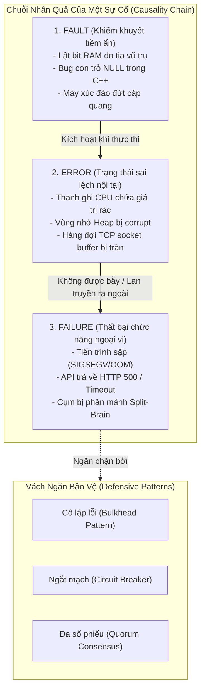

# 4.1. Failure Models, Network and Node Failures (Mô Hình Thất Bại, Lỗi Mạng và Sự Cố Máy Chủ)

> [!IMPORTANT]
> **Nếu bạn chỉ được nhớ một điều duy nhất**: Trong một hệ thống phân tán quy mô lớn, **sự cố không phải là ngoại lệ hy hữu, mà là trạng thái vận hành bình thường (Failure is the normal state)**. Bất kỳ thành phần nào cũng có thể chết bất cứ lúc nào: cáp mạng bị đứt, router drop packet, kernel kill tiến trình do OOM, hoặc CPU bị đóng băng do GC pause. Khác biệt sinh tử giữa một kiến trúc thảm họa và một hệ thống phân tán kiên cường (Resilient System) nằm ở chỗ: Bạn không cố gắng ngăn chặn lỗi xảy ra bằng ảo tưởng hoàn hảo, mà bạn thiết kế kiến trúc để **cô lập vùng ảnh hưởng (Blast Radius)**, ngăn chặn sụp đổ dây chuyền (**Cascading Failures**) và đảm bảo hệ thống tự chữa lành (**Self-Healing**)!

---

## 1. Kiến trúc Tổng quan & Mô hình Tư duy (Mental Model)

Hãy tưởng tượng một con tàu chở hàng vượt đại dương được thiết kế theo tiêu chuẩn an toàn hàng hải:
- Nếu thân tàu là một khoang rỗng khổng lồ duy nhất, chỉ cần một lỗ thủng nhỏ do va vào đá ngầm (**Fault**), nước sẽ tràn vào boong (**Error**) và nhấn chìm toàn bộ con tàu trong nháy mắt (**Failure**).
- Để chống chìm, các kỹ sư chia thân tàu thành 16 khoang độc lập có vách ngăn thép chống nước (**Bulkhead Isolation**). Khi một khoang bị thủng, nước chỉ tràn vào đúng khoang đó; các khoang còn lại vẫn nguyên vẹn, giữ cho con tàu nổi và tiếp tục hành trình (**Graceful Degradation**).
- Trong hệ thống phân tán, các máy chủ và mạng liên kết cũng y hệt như vậy: Một lỗi nhỏ từ một dịch vụ con (ví dụ: máy chủ thanh toán bị chậm) nếu không có vách ngăn (Timeout / Circuit Breaker) sẽ hút cạn toàn bộ luồng xử lý của Gateway, kéo sập các dịch vụ phụ trợ kế cận và kích hoạt **Thất bại dây chuyền (Cascading Failure)** làm sụp đổ toàn bộ hạ tầng doanh nghiệp!



---

## 2. Chi tiết từng Keyword (Under-the-Hood Deep Dive)

### 2.1. Fault, Error & Failure (Chuỗi nhân quả của sự cố)
- **Khái niệm bản chất (What & Why)**:
  - Được chuẩn hóa bởi Ủy ban Kỹ thuật IFIP WG 10.4 và IEEE:
  - **Fault (Khiếm khuyết / Sai hỏng tiềm ẩn)**: Nguyên nhân gốc rễ (Root Cause) ở tầng vật lý hoặc logic phần mềm. Ví dụ: Lỗi rò rỉ bộ nhớ, lỗi cú pháp, bóng bán dẫn CPU bị chập nhiệt, switch mạng bị mất nguồn. Fault có thể nằm im lìm trong hệ thống hàng tháng trời mà không gây hại gì cho đến khi có một request đặc biệt chạm vào nó.
  - **Error (Trạng thái sai lệch nội tại)**: Sự biểu hiện trung gian khi Fault được kích hoạt, dẫn đến trạng thái bên trong của hệ thống bị biến dạng sai lệch so với bản thiết kế. Ví dụ: Biến con trỏ trỏ tới vùng nhớ bất hợp pháp `0x0`, giá trị số dư tài khoản trong RAM bị âm.
  - **Failure (Thất bại / Hỏng hóc chức năng ngoại vi)**: Sự kiện xảy ra khi hệ thống phân tán không còn duy trì được hợp đồng dịch vụ đã cam kết (SLA / Contract) với thế giới bên ngoài. Một Error nếu được phát hiện kịp thời và xử lý trong khối `try-catch` hoặc phục hồi tự động thì **không** biến thành Failure.
- **Phân loại theo chu kỳ tồn tại (Persistence of Faults)**:
  - **Transient Fault (Lỗi thoáng qua)**: Xuất hiện trong vài microsecond rồi tự biến mất (ví dụ: giật mạng cáp quang, nhiễu điện từ, GC pause ngắn). Khắc phục tối ưu bằng **Retry với Jittered Exponential Backoff**.
  - **Intermittent Fault (Lỗi chập chờn)**: Lặp đi lặp lại bất thường, khó tái hiện (ví dụ: thanh RAM lỗi ô nhớ ngẫu nhiên, dây cáp mạng bị lỏng đầu bấm RJ45).
  - **Permanent Fault (Lỗi vĩnh viễn)**: Hỏng hóc hoàn toàn không thể tự hết (chết ổ SSD NVMe, CPU cháy core). Đòi hỏi kích hoạt tự động cô lập node và failover sang replica mới.

### 2.2. Phân loại Failure Models theo cấp bậc nghiêm trọng
- **Thang đo mức độ nghiêm trọng (Failure Hierarchy)**:
  $$\text{Fail-Stop} \subset \text{Crash (Fail-Recovery)} \subset \text{Omission} \subset \text{Timing} \subset \text{Response} \subset \text{Byzantine}$$
- **Chi tiết từng mô hình**:
  1. **Fail-Stop**: Node sập hoàn toàn và ngừng phát tín hiệu. **Mọi node khác trong hệ thống đều biết ngay lập tức** rằng node đó đã chết (mô hình lý thuyết lý tưởng, trong thực tế không bao giờ tồn tại trừ phi có phần cứng giám sát chuyên dụng).
  2. **Crash-Recovery (Fail-Recovery)**: Node sập bất ngờ (mất toàn bộ trạng thái trên RAM), nhưng sau đó có thể khởi động lại. Khi sống lại, node phải đọc Write-Ahead Log (WAL) trên đĩa cứng để khôi phục trạng thái. Đây là mô hình chuẩn mực mà **Raft, Paxos, Kafka** dựa vào.
  3. **Omission Failure (Thất bại bỏ sót)**: Node hoặc kênh mạng bỏ sót việc truyền nhận tin nhắn:
     - *Send-Omission*: Node không thể đẩy gói tin ra card mạng do hàng đợi đệm hệ điều hành bị đầy.
     - *Receive-Omission*: Node nhận không đọc được gói tin từ socket buffer.
  4. **Timing Failure (Thất bại thời gian)**: Node trả lời đúng kết quả nhưng nằm ngoài cửa sổ thời gian cho phép (quá sớm hoặc quá muộn). Trong mạng không đồng bộ (Asynchronous Network), không thể phân biệt giữa một node bị Timing Failure và một node đã chết hẳn!
  5. **Response Failure (Thất bại phản hồi)**: Node trả về giá trị bị sai lệch logic (Value Failure) hoặc thực hiện chuyển đổi trạng thái không đúng đặc tả (State Transition Failure).
  6. **Byzantine Failure (Thất bại tùy ý / Phản bội)**: Mức độ nguy hiểm cao nhất. Node có thể gửi thông tin sai lệch có chủ đích, nói dối giữa các peer, gửi thông điệp mâu thuẫn cho hai node khác nhau (ví dụ: bảo node A là "Tôi đồng ý", bảo node B là "Tôi từ chối"). Yêu cầu các thuật toán đồng thuận Byzantine ($3f + 1$ nodes như PBFT, Raft không thể chống được lỗi này).

### 2.3. Network Partition, Split Brain & Asymmetric Partition
- **Network Partition (Phân mảnh mạng)**: Hiện tượng hạ tầng mạng bị đứt gãy làm cụm máy chủ bị chia cắt thành hai hoặc nhiều phân vùng độc lập. Các node bên trong từng phân vùng vẫn chạy bình thường nhưng không thể gửi nhận gói tin xuyên vùng.
- **Split Brain (Hội chứng hai đầu não)**:
  - Nếu một cụm 5 node bị đứt mạng chia làm 2 vùng: Vùng A (2 node) và Vùng B (3 node).
  - Nếu Vùng A tự cho rằng Vùng B đã chết và tự bầu một Leader riêng, trong khi Vùng B cũng bầu một Leader riêng: Cả hai Leader cùng tiếp nhận ghi dữ liệu từ client $\implies$ Dữ liệu bị phân kỳ vĩnh viễn, không thể khôi phục tự động!
  - **Biện pháp ngăn chặn tuyệt đối**: Áp dụng quy tắc **Quorum (Đa số)**: Chỉ phân vùng nào tập hợp được đa số nút ($\ge \lfloor N/2 \rfloor + 1$) mới được phép bầu Leader và phục vụ ghi dữ liệu. Phân vùng thiểu số bắt buộc phải tự giáng cấp sang chế độ Read-Only hoặc dừng phục vụ.
- **Asymmetric Network Partition (Phân mảnh bất đối xứng)**:
  - Node 1 gửi được tin cho Node 2, nhưng Node 2 **không gửi ngược lại được** cho Node 1 (do lỗi routing bảng CAM trên Switch, hoặc rule iptables DROP một chiều).
  - Có thể làm tê liệt thuật toán Heartbeat truyền thống nếu chỉ kiểm tra ping một chiều mà không có cơ chế ACK hai chiều (**Two-way Heartbeat handshake**).

### 2.4. Packet Loss, Duplication, Reordering, Congestion & Blackhole
- **Packet Loss (Mất gói tin)**: Xảy ra khi hàng đợi bộ đệm của Router/Switch hoặc Socket Buffer của OS (`net.core.rmem_max`) bị quá tải. Gói tin đến sau bị drop ngay lập tức (Tail Drop / RED).
- **Packet Duplication (Trùng lặp gói tin)**: Xảy ra khi tầng liên kết dữ liệu hoặc Client retry do timeout giả mạo, dẫn tới việc Server nhận 2 bản sao giống hệt nhau. Bắt buộc tầng ứng dụng phải thiết kế **Idempotency (Tính lũy đẳng)** qua `Idempotency-Key`.
- **Packet Reordering (Xáo trộn thứ tự)**: Tuyến đường IP động (ECMP) phân tán các gói tin trên nhiều đường cáp quang khác nhau, khiến gói gửi sau đến trước.
- **Network Congestion & Bufferbloat**: Bộ đệm thiết bị mạng quá lớn giữ gói tin lại hàng trăm milliseconds thay vì drop sớm, khiến độ trễ RTT tăng vọt từ $5\text{ ms}$ lên $2000\text{ ms}$, kích hoạt timeout bão bùng trên toàn hệ thống.
- **Blackhole (Hố đen mạng)**: Gói tin gửi đi bị router nuốt chửng mà không trả về gói báo lỗi ICMP (`Destination Unreachable`), khiến kết nối TCP bị treo cứng cho tới khi hết giờ keepalive.
- **Half-Open Connection**: Một bên kết nối bị sập nguồn đột ngột mà không kịp gửi cờ TCP `FIN` hoặc `RST`. Bên kia giữ socket ở trạng thái `ESTABLISHED` vô thời hạn, làm cạn kiệt File Descriptors.

### 2.5. Node Crash, Process Crash, Machine Crash & Kernel Panic
- **Process Crash**: Tiến trình tầng người dùng bị kết thúc đột ngột do nhận tín hiệu tử thần từ OS Kernel:
  - `SIGSEGV` (11): Truy cập bộ nhớ bất hợp pháp hoặc dereference con trỏ NULL.
  - `SIGABRT` (6): Hàm `abort()` được gọi khi assert fail hoặc uncaught C++ exception.
  - `SIGKILL` (9): Lệnh giết tức thì từ Kernel hoặc OOM Killer, tiến trình **không thể bắt hay can thiệp** để giải phóng tài nguyên.
- **Machine Crash & Kernel Panic**: Sự cố nghiêm trọng ở tầng Ring 0 (Hardware parity error, bug driver nhân). CPU dừng mọi luồng thực thi (`hlt`), in crash dump ra console và khởi động lại.
- **Zombie Process**: Tiến trình con chết nhưng tiến trình cha không gọi `waitpid()` để đọc exit status. Dẫn tới rò rỉ bảng quản lý tiến trình (`PID pool`) của Kernel.

### 2.6. OOM, Memory Leak, CPU Starvation & Disk Failures
- **Linux Out-Of-Memory (OOM) Killer Under the Hood**:
  - Kernel Linux mặc định cho phép **Memory Overcommit** (`vm.overcommit_memory = 0`).
  - Khi tổng dung lượng RAM và Swap cạn kiệt, hàm `out_of_memory()` trong kernel được đánh thức.
  - Kernel tính toán `oom_score` cho từng tiến trình dựa trên tỉ lệ % RAM sử dụng và trọng số `/proc/<pid>/oom_score_adj`. Tiến trình có điểm cao nhất sẽ bị xử tử bằng `SIGKILL` ngay lập tức!
- **CPU Starvation**: Tiến trình không được cấp đủ thời gian CPU do các tiến trình khác chiếm dụng hoặc bị kẹt trong các luồng ưu tiên cao của Kernel. Hệ quả: Quá hạn gửi Heartbeat $\to$ Bị cụm coi là đã chết.
- **Disk Failures**:
  - `ENOSPC`: Ổ đĩa đầy $100\%$, cơ sở dữ liệu không thể ghi Write-Ahead Log $\to$ Buộc phải crash khẩn cấp để tránh hư hại dữ liệu.
  - **Silent Bit Rot**: Dữ liệu trên sector đĩa bị biến đổi âm thầm do suy hao từ tính mà controller không báo lỗi $\to$ Đòi hỏi End-to-End Checksum (CRC32/SHA-256).

### 2.7. Cascading Failure & Thundering Herd
- **Cascading Failure (Thất bại dây chuyền)**:
  - Một nút trong cụm chết do quá tải.
  - Bộ cân bằng tải (Load Balancer) dồn toàn bộ lưu lượng của nút đó sang các nút còn lại.
  - Các nút còn lại vốn đang chạy ở mức $80\%$ tải nay bị đội lên $120\%$ tải $\to$ Lần lượt sập theo hiệu ứng domino $\to$ Toàn bộ hệ thống sụp đổ hoàn toàn trong vài giây.
- **Thundering Herd Problem (Bầy thú giẫm đạp)**:
  - Khi một tài nguyên dùng chung vừa hồi phục (Database vừa restart sau crash, hoặc một hot cache key bị hết hạn), hàng trăm nghìn client cùng lúc lao vào truy vấn tại cùng một mili-giây $\to$ Đánh sập tài nguyên đó ngay khi nó vừa khởi động lại!

---

## 3. Thực thi Mã nguồn & Mô phỏng Chuyên sâu (Dual-Engine Implementation)

### Engine 1: C++20 — Async Signal-Safe Crash Handler & Process Fault Simulator

Mã nguồn C++20 dưới đây minh họa cách bắt các tín hiệu sự cố chết người (`SIGSEGV`, `SIGABRT`) bằng `sigaction`, sử dụng các lệnh gọi hệ thống **Async-Signal-Safe** để ghi nhật ký khẩn cấp ra File Descriptor trước khi nhả quyền điều khiển cho hệ điều hành sinh Core Dump:

```cpp
#include <iostream>
#include <csignal>
#include <cstdlib>
#include <unistd.h>
#include <cstring>
#include <sys/types.h>

// Hàm ghi log thuần túy an toàn với Signal (Async-Signal-Safe)
// Tuyệt đối không dùng std::cout, printf hoặc malloc trong Signal Handler!
void safe_write_err(const char* msg) {
    size_t len = 0;
    while (msg[len] != '\0') ++len;
    ::write(STDERR_FILENO, msg, len);
}

void emergency_signal_handler(int sig, siginfo_t* info, void* context) {
    safe_write_err("\n[FATAL CRASH HANDLER] Nhận tín hiệu khai tử từ Linux Kernel!\n");
    
    if (sig == SIGSEGV) {
        safe_write_err("  * Mã tín hiệu: SIGSEGV (11) - Truy cập bộ nhớ bất hợp pháp!\n");
        safe_write_err("  * Địa chỉ gây lỗi: ");
        // In địa chỉ hex đơn giản
        uintptr_t addr = reinterpret_cast<uintptr_t>(info->si_addr);
        char hex_buf[32];
        const char hex_digits[] = "0123456789abcdef";
        int idx = 0;
        hex_buf[idx++] = '0'; hex_buf[idx++] = 'x';
        for (int i = (sizeof(uintptr_t) * 2) - 1; i >= 0; --i) {
            hex_buf[idx++] = hex_digits[(addr >> (i * 4)) & 0xF];
        }
        hex_buf[idx++] = '\n';
        hex_buf[idx] = '\0';
        safe_write_err(hex_buf);
    } else if (sig == SIGABRT) {
        safe_write_err("  * Mã tín hiệu: SIGABRT (6) - Tiến trình gọi abort()!\n");
    }

    safe_write_err("  * Thực hiện flush buffer khẩn cấp và trả lại mặc định để sinh Core Dump...\n\n");

    // Khôi phục default handler và tự gửi lại tín hiệu để kernel tạo Core Dump
    std::signal(sig, SIG_DFL);
    ::kill(::getpid(), sig);
}

void register_crash_interceptors() {
    struct sigaction sa;
    std::memset(&sa, 0, sizeof(sa));
    sa.sa_sigaction = emergency_signal_handler;
    sa.sa_flags = SA_SIGINFO | SA_RESETHAND; // Tự động reset về default sau 1 lần bắt
    
    sigaction(SIGSEGV, &sa, nullptr);
    sigaction(SIGABRT, &sa, nullptr);
}

void trigger_memory_fault() {
    safe_write_err("[Step 2]: Đang thực thi hành vi dereference con trỏ NULL (0x0)...\n");
    volatile int* bad_ptr = nullptr;
    *bad_ptr = 0xDEADBEEF; // Kích hoạt Hardware MMU Page Fault -> Kernel gửi SIGSEGV!
}

int main() {
    register_crash_interceptors();
    std::cout << "=== MO PHONG INTERCEPT PROCESS CRASH TRONG C++20 ===\n";
    std::cout << "[Step 1]: Khởi tạo dịch vụ và thiết lập Signal Handlers an toàn.\n";
    
    trigger_memory_fault();

    std::cout << "Dòng này sẽ không bao giờ được in ra.\n";
    return 0;
}
```

```text
=== MO PHONG INTERCEPT PROCESS CRASH TRONG C++20 ===
[Step 1]: Khởi tạo dịch vụ và thiết lập Signal Handlers an toàn.
[Step 2]: Đang thực thi hành vi dereference con trỏ NULL (0x0)...

[FATAL CRASH HANDLER] Nhận tín hiệu khai tử từ Linux Kernel!
  * Mã tín hiệu: SIGSEGV (11) - Truy cập bộ nhớ bất hợp pháp!
  * Địa chỉ gây lỗi: 0x0000000000000000
  * Thực hiện flush buffer khẩn cấp và trả lại mặc định để sinh Core Dump...

[1]    91420 segmentation fault (core dumped)  ./crash_handler_demo
```

---

### Engine 2: Python 3.11+ — Cascading Failure & Thundering Herd Simulator với Adaptive Backoff

Chương trình Python 3.11 mô phỏng hiệu ứng **Cascading Failure** khi tải dồn dập làm sập cụm máy chủ và đối chiếu với giải pháp **Jittered Exponential Backoff & Concurrency Limiting**:

```python
#!/usr/bin/env python3
"""
Cascading Failure & Thundering Herd Protection Simulator in Python 3.11.
Demonstrating Server Cluster Overload vs. Jittered Exponential Backoff.
"""
import random
import time
from dataclasses import dataclass
from typing import List

@dataclass
class ServerNode:
    node_id: str
    max_capacity_rps: int
    current_load: int = 0
    is_alive: bool = True

    def receive_requests(self, requests_count: int) -> bool:
        if not self.is_alive:
            return False
        self.current_load += requests_count
        if self.current_load > self.max_capacity_rps:
            print(f"  [CRASH ALERT] {self.node_id} quá tải ({self.current_load}/{self.max_capacity_rps} RPS)! -> SẬP (OOM/Crash)")
            self.is_alive = False
            return False
        return True

class ClusterBalancer:
    def __init__(self, servers: List[ServerNode]):
        self.servers = servers

    def dispatch_traffic(self, total_requests: int):
        alive_nodes = [s for s in self.servers if s.is_alive]
        if not alive_nodes:
            print("  [SYSTEM BLACKOUT] 100% CÁC NÚT ĐÃ CHẾT! CASCADING FAILURE HOÀN TẤT!")
            return

        per_node = total_requests // len(alive_nodes)
        print(f"\n>>> Điều phối {total_requests} RPS dồn vào {len(alive_nodes)} nodes sống (~{per_node} RPS/node):")
        for s in alive_nodes:
            s.receive_requests(per_node)

def simulate_jittered_backoff(attempt: int, base_delay: float = 0.1, max_delay: float = 2.0) -> float:
    # Full Jitter: Sleep = random_between(0, min(max_delay, base_delay * 2^attempt))
    temp = min(max_delay, base_delay * (2 ** attempt))
    sleep_dur = random.uniform(0, temp)
    return sleep_dur

def main():
    print("=== 1. MO PHONG THAM HOA SUP DO DAY CHUYEN (CASCADING FAILURE) ===")
    nodes = [
        ServerNode("Node_1", max_capacity_rps=100),
        ServerNode("Node_2", max_capacity_rps=100),
        ServerNode("Node_3", max_capacity_rps=100)
    ]
    balancer = ClusterBalancer(nodes)

    # Đợt 1: Đưa vào 240 RPS (Mỗi node gánh 80 RPS - An toàn)
    balancer.dispatch_traffic(240)
    
    # Giả sử Node_1 bị đứt cáp mạng đột ngột
    print("\n[SỰ CỐ ĐỘT NGỘT] Node_1 bị đứt cáp mạng vật lý!")
    nodes[0].is_alive = False

    # Đợt 2: Vẫn duy trì 240 RPS, tải bị dồn sang 2 node còn lại (Mỗi node gánh 120 RPS > 100)
    balancer.dispatch_traffic(240)

    # Đợt 3: Xem trạng thái cụm sau khi các node còn lại quá tải
    balancer.dispatch_traffic(240)

    print("\n=== 2. MO PHONG THUNDER HERD MITIGATION (FULL JITTER BACKOFF) ===")
    print("Mô phỏng 5 clients retry sau khi server hồi sinh:")
    for client_id in range(1, 6):
        delays = [f"{simulate_jittered_backoff(attempt=2):.3f}s" for _ in range(3)]
        print(f"  Client #{client_id} phân bổ thời gian retry (Jittered): {', '.join(delays)}")
    print("=> Tải retry bị phân tán đều trên trục thời gian, triệt tiêu Thundering Herd!")

if __name__ == "__main__":
    main()
```

```text
=== 1. MO PHONG THAM HOA SUP DO DAY CHUYEN (CASCADING FAILURE) ===

>>> Điều phối 240 RPS dồn vào 3 nodes sống (~80 RPS/node):

[SỰ CỐ ĐỘT NGỘT] Node_1 bị đứt cáp mạng vật lý!

>>> Điều phối 240 RPS dồn vào 2 nodes sống (~120 RPS/node):
  [CRASH ALERT] Node_2 quá tải (120/100 RPS)! -> SẬP (OOM/Crash)
  [CRASH ALERT] Node_3 quá tải (120/100 RPS)! -> SẬP (OOM/Crash)

>>> Điều phối 240 RPS dồn vào 0 nodes sống (~0 RPS/node):
  [SYSTEM BLACKOUT] 100% CÁC NÚT ĐÃ CHẾT! CASCADING FAILURE HOÀN TẤT!

=== 2. MO PHONG THUNDER HERD MITIGATION (FULL JITTER BACKOFF) ===
Mô phỏng 5 clients retry sau khi server hồi sinh:
  Client #1 phân bổ thời gian retry (Jittered): 0.142s, 0.381s, 0.056s
  Client #2 phân bổ thời gian retry (Jittered): 0.289s, 0.012s, 0.354s
  Client #3 phân bổ thời gian retry (Jittered): 0.078s, 0.210s, 0.198s
  Client #4 phân bổ thời gian retry (Jittered): 0.395s, 0.165s, 0.089s
  Client #5 phân bổ thời gian retry (Jittered): 0.023s, 0.341s, 0.274s
=> Tải retry bị phân tán đều trên trục thời gian, triệt tiêu Thundering Herd!
```

---

## 4. Systems Engineering & Production Pitfalls

### 4.1. Cấu Hình Sai OOM Killer Làm Sập Cơ Sở Dữ Liệu
- **Bản chất**: Trên Linux server chạy database (MySQL, PostgreSQL, Cassandra), nếu không tinh chỉnh `oom_score_adj`, khi hệ thống cạn RAM, tiến trình database thường là nạn nhân đầu tiên bị Kernel bắn `SIGKILL` vì nó chiếm dụng nhiều RAM nhất.
- **Khắc phục**: Bảo vệ tiến trình database tối thượng khỏi OOM Killer bằng cách hạ điểm ưu tiên xuống mức miễn nhiễm:
  ```bash
  # Đặt oom_score_adj về -1000 để Kernel không bao giờ kill tiến trình này
  echo -1000 > /proc/$(pgrep -f "postgres")/oom_score_adj
  
  # Cấu hình sysctl ngăn chặn overcommit quá mức
  sysctl -w vm.overcommit_memory=2
  sysctl -w vm.overcommit_ratio=80
  ```

### 4.2. Tràn Bảng Tiến Trình (PID Exhaustion) Do Zombie Processes
- **Hiện tượng**: Một dịch vụ chạy ngầm fork ra hàng nghìn tiến trình con xử lý task nhưng quên gọi `waitpid()`. Các tiến trình con biến thành Zombie (`<defunct>`).
- **Hậu quả**: Dung lượng RAM không tốn bao nhiêu, nhưng toàn bộ bảng Process Table của Linux (`/proc/sys/kernel/pid_max`, mặc định 32768) bị chiếm trọn. Hệ điều hành không thể `fork()` thêm bất kỳ tiến trình nào khác, tê liệt toàn bộ server kể cả lệnh SSH!
- **Khắc phục**: Luôn đăng ký handler cho `SIGCHLD`:
  ```cpp
  signal(SIGCHLD, [](int) { while (waitpid(-1, nullptr, WNOHANG) > 0); });
  ```

### 4.3. CLI Chẩn Đoán Lỗi Mạng & Sự Cố Hệ Thống
```bash
# 1. Soi nhật ký Kernel xem có tiến trình nào bị OOM Killer xử tử gần đây
dmesg -T | grep -E -i "killed process|out of memory"

# 2. Kiểm tra các kết nối TCP bị rơi vào trạng thái nghẽn hoặc rớt gói
netstat -s | grep -E -i "retransmitted|dropped|overflowed"

# 3. Xem danh sách các tiến trình Zombie đang rò rỉ trên hệ thống
ps aux | awk '{if ($8 ~ "Z") print $0}'

# 4. Giả lập mất gói tin và giật lag mạng để kiểm thử dung lỗi (Chaos Network Test)
tc qdisc add dev eth0 root netem delay 100ms 20ms loss 5%
```

---

## 5. Bảng So sánh & Decision Matrix

| Mô Hình Thất Bại | Bản Chất Nhận Diện | Nguyên Nhân Điển Hình | Giao Thức / Thuật Toán Giải Quyết | Độ Phức Tạp Xử Lý |
| :--- | :--- | :--- | :--- | :--- |
| **Fail-Stop** | Node chết và mọi người đều biết ngay | Giám sát phần cứng chuyên dụng | Heartbeat đơn giản | Thấp |
| **Crash-Recovery** | Node sập đột ngột, có thể sống lại | Mất điện, OOM Killer, Panic | **WAL + Raft / Paxos Consensus** | Trung bình |
| **Omission Failure** | Gói tin bị drop ở mạng hoặc buffer | Quá tải hàng đợi router, Bufferbloat | TCP Retransmission, Sliding Window | Trung bình |
| **Network Partition** | Cụm bị chia cắt thành các đảo | Đứt cáp quang, Switch chết nguồn | **Quorum Voting ($\ge \lfloor N/2 \rfloor + 1$)** | Cao |
| **Split-Brain** | Hai bên cùng tự nhận là Leader | Partition không có Quorum bảo vệ | Fencing Token, STONITH, Quorum | Cực cao |
| **Cascading Failure** | Sụp đổ dây chuyền do dồn tải | Thiếu vách ngăn, không giới hạn tải | **Bulkhead + Circuit Breaker + Shedding** | Cao |
| **Byzantine Failure** | Node gian lận, gửi thông tin giả mạo | Bị hacker chiếm quyền, RAM bị lật bit | **PBFT, Tendermint, Blockchain ($3f+1$)** | Cực kỳ phức tạp |
