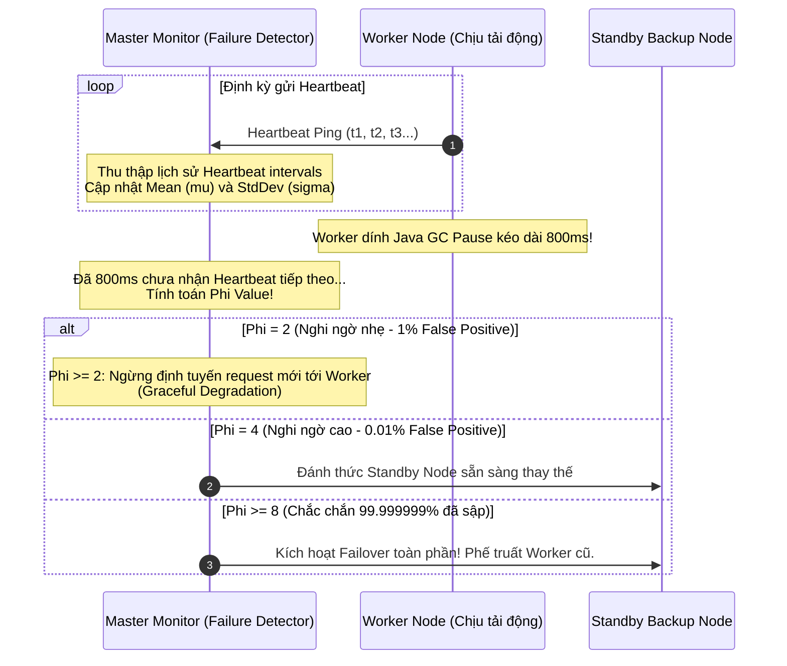

# 4.2. Fault Tolerance Techniques and Failure Detectors (Kỹ Thuật Dung Lỗi và Bộ Dò Sự Cố Phân Tán)

> [!IMPORTANT]
> **Nếu bạn chỉ được nhớ một điều duy nhất**: Trong một hệ thống phân tán không đồng bộ, việc khẳng định chắc chắn 100% "một máy chủ đã chết hẳn hay chỉ đang bị nghẽn mạng tạm thời" là điều bất khả thi về mặt toán học theo định lý FLP. Các bộ dò sự cố truyền thống dựa trên Timeout tĩnh luôn rơi vào thế tiến thoái lưỡng nan: đặt timeout quá ngắn sẽ gây báo động giả (False Positives) làm sập hệ thống vì bão Failover; đặt timeout quá dài thì phát hiện muộn làm đình trệ dịch vụ. **Bộ dò sự cố Phi Accrual ($\Phi$-Accrual Failure Detector)** giải quyết triệt để bài toán này bằng cách thay thế phán quyết nhị phân (Sống/Chết) bằng một **thang đo xác suất nghi ngờ liên tục ($\Phi \in [0, \infty)$)** dựa trên phân phối chuẩn của các khoảng thời gian Heartbeat thực tế!

---

## 1. Kiến trúc Tổng quan & Mô hình Tư duy (Mental Model)

Hãy tưởng tượng một bác sĩ chuyên khoa hồi sức cấp cứu theo dõi nhịp tim của một bệnh nhân:
- Nếu bác sĩ dùng quy tắc cứng nhắc: *"Nếu quá 1 giây không thấy tim đập, tuyên bố bệnh nhân đã tử vong"* (**Fixed Timeout**). Khi bệnh nhân hít thở sâu hoặc máy đo bị lỏng điện cực trong 1.1 giây, còi báo động tử vong reo vang, các y bác sĩ vội vàng sốc điện tim không cần thiết, làm bệnh nhân hoảng loạn (**Báo động giả / False Failover**).
- Thay vào đó, máy theo dõi hiện đại ghi nhận lịch sử 1000 nhịp tim gần nhất, tính toán nhịp tim trung bình ($\mu$) và độ lệch chuẩn ($\sigma$). Nếu khoảng cách giữa hai nhịp tim kéo dài bất thường, máy tính toán giá trị nghi ngờ $\Phi$ (Phi Value):
  - $\Phi = 1$: Xác suất báo động giả là $10\%$.
  - $\Phi = 2$: Xác suất báo động giả là $1\%$.
  - $\Phi = 3$: Xác suất báo động giả chỉ còn $0.1\%$.
- Dựa trên mức độ $\Phi$, hệ thống đưa ra các phản ứng leo thang tương ứng: $\Phi \ge 2$ thì ngưng gửi task mới sang node đó; $\Phi \ge 3$ thì chuẩn bị node dự phòng; $\Phi \ge 8$ mới chính thức phế truất và kích hoạt bầu cử Leader mới (**Adaptive Failure Detection**)!



---

## 2. Chi tiết từng Keyword (Under-the-Hood Deep Dive)

### 2.1. Fault Detection, Isolation, Containment & Recovery
- **Khái niệm bản chất (What & Why)**:
  - Vòng đời phòng thủ 4 bước của kỹ thuật dung lỗi (Fault Tolerance Lifecycle):
  1. **Fault Detection (Phát hiện lỗi)**: Cơ chế giám sát liên tục để nhận diện các bất thường về tính sẵn sàng hoặc tính đúng đắn của các node trong cụm.
  2. **Fault Isolation (Cô lập lỗi)**: Tách rời thành phần bị lỗi ra khỏi luồng xử lý chính để ngăn chặn lỗi lan sang các tiến trình khác trên cùng máy chủ (ví dụ: dùng Linux Containers, cgroups, namespaces).
  3. **Fault Containment (Khoanh vùng ảnh hưởng - Blast Radius Reduction)**: Đảm bảo rằng sự cố tại một Service hoặc Availability Zone (AZ) không thể làm tê liệt toàn bộ hệ thống (áp dụng kiến trúc Cell-Based Architecture hoặc Bulkhead Pattern).
  4. **Fault Recovery (Phục hồi sau sự cố)**: Tự động khôi phục dịch vụ về trạng thái an toàn:
     - *Rollback Recovery*: Quay ngược trạng thái về Checkpoint đã lưu gần nhất.
     - *Rollforward Recovery*: Bỏ qua trạng thái lỗi, đọc Append-Only Log để replay các sự kiện tiếp theo hoặc chuyển quyền cho Standby Replica.

### 2.2. Redundancy (Dư thừa dữ liệu và tính toán)
- **Khái niệm bản chất (What & Why)**:
  - Bản chất của dung lỗi là **Redundancy (Tính dư thừa)**: Nếu một linh kiện có xác suất hỏng là $p$, thì hệ thống gồm $k$ linh kiện độc lập song song chỉ hỏng khi toàn bộ $k$ linh kiện cùng hỏng một lúc ($p^k \ll p$).
- **Phân loại các hình thái Redundancy**:
  1. **Spatial Redundancy (Dư thừa không gian phần cứng)**:
     - *Active-Passive (Primary-Standby)*: Node chính phục vụ toàn bộ tải; node phụ chỉ đồng bộ dữ liệu ngầm và sẵn sàng tiếp quản khi node chính chết.
     - *Active-Active (Multi-Primary)*: Tất cả các node đều phục vụ đọc/ghi đồng thời, yêu cầu cơ chế hòa giải xung đột phức tạp.
     - *N-Modular Redundancy (NMR)*: Chạy $N$ bản sao tính toán giống hệt nhau (ví dụ: Triple Modular Redundancy - TMR trong tàu vũ trụ NASA và máy bay Boeing), kết quả đầu ra được quyết định bằng cơ chế bỏ phiếu đa số (Majority Voting) để loại trừ lỗi phần cứng lật bit.
  2. **Temporal Redundancy (Dư thừa thời gian)**: Thực thi lại một tác vụ khi gặp lỗi (Retry mechanism). Chỉ áp dụng hiệu quả cho các lỗi thoáng qua (Transient Faults).
  3. **Information Redundancy (Dư thừa thông tin)**: Thêm các bit kiểm tra vào dữ liệu: mã sửa sai Hamming ECC trong RAM, thuật toán **Erasure Coding (Reed-Solomon Codes)** trong hệ thống lưu trữ phân tán (MinIO, HDFS) cho phép mất $M$ đĩa trong tổng số $N+M$ đĩa mà không mất dữ liệu.

### 2.3. Heartbeat, Ping-Pong & Health Checks
- **Heartbeat vs Ping-Pong**:
  - **Ping-Pong (Pull-based)**: Master chủ động gửi gói tin thăm dò (`Ping`) tới Worker, Worker trả lời (`Pong`). Nhược điểm: Tạo ra lưu lượng mạng hai chiều gấp đôi ($2N$), gây quá tải CPU cho Master khi cụm có hàng nghìn Worker.
  - **Heartbeat (Push-based)**: Worker định kỳ phát tín hiệu đơn phương báo hiệu "Tôi vẫn sống" tới Master theo chu kỳ $\Delta t$. Lưu lượng mạng giảm một nửa ($N$).
- **Health Checks trong Microservices & Kubernetes**:
  - **Liveness Probe**: Kiểm tra xem tiến trình ứng dụng có còn sống hay bị Deadlock/Hang. Nếu fail, Kubelet sẽ **kill tiến trình và khởi động lại container**.
  - **Readiness Probe**: Kiểm tra xem ứng dụng đã sẵn sàng tiếp nhận traffic chưa (đã load xong cache, kết nối DB thành công chưa). Nếu fail, Service chỉ tạm thời gỡ Pod ra khỏi danh sách Load Balancer endpoints mà **không restart container**.
  - **Startup Probe**: Dành riêng cho các ứng dụng legacy khởi động chậm (mất 2-5 phút), vô hiệu hóa Liveness Probe trong giai đoạn khởi động để tránh bị Kubelet kill oan giữa chừng.

### 2.4. Phi Accrual Failure Detector (Thuật toán phát hiện sự cố phi tuyến tính)
- **Khái niệm & Nguồn gốc**:
  - Do Naohiro Hayashibara, Xavier Défago et al. công bố năm 2004, được sử dụng làm trái tim giám sát trong **Apache Cassandra, Akka Cluster, và ScyllaDB**.
  - Thay vì đưa ra câu trả lời Boolean `True/False`, thuật toán xuất ra chỉ số nghi ngờ $\Phi$ (Phi):
    $$\Phi = -\log_{10}(P_{\text{later}}(t - t_{\text{last}}))$$
    Trong đó $t - t_{\text{last}}$ là khoảng thời gian trôi qua kể từ Heartbeat cuối cùng, và $P_{\text{later}}(t')$ là xác suất một Heartbeat đến trễ hơn $t'$ theo lịch sử mạng trong quá khứ.
- **Cơ chế tính toán Under the Hood**:
  - Thuật toán duy trì một cửa sổ trượt (Sliding Window) chứa $W$ khoảng thời gian giữa các heartbeat gần nhất (thường $W = 1000$).
  - Giả định các khoảng thời gian này tuân theo **Phân phối Chuẩn (Normal / Gaussian Distribution)** với giá trị trung bình $\mu$ và phương sai $\sigma^2$:
    $$P_{\text{later}}(t) = 1 - F(t) = \frac{1}{\sigma \sqrt{2\pi}} \int_{t}^{\infty} e^{-\frac{(x - \mu)^2}{2\sigma^2}} dx$$
  - Giá trị $\Phi$ tỉ lệ thuận với mức độ tin cậy rằng node đã chết:
    - $\Phi = 1 \implies P_{\text{later}} = 0.1$ (Xác suất báo động giả $10\%$).
    - $\Phi = 3 \implies P_{\text{later}} = 0.001$ (Xác suất báo động giả $0.1\%$).
    - $\Phi = 8 \implies P_{\text{later}} = 10^{-8}$ (Báo động giả chỉ $1$ trên $100$ triệu lần).
  - Kiến trúc này cho phép tách rời hoàn toàn giữa **Tầng Thu Thập Thông Tin (Detection Engine)** và **Tầng Ra Quyết Định (Action Policy)**.

### 2.5. Graceful Degradation & Self-Healing
- **Graceful Degradation (Suy thoái mềm dẻo)**:
  - Khi một phần cụm máy chủ bị chết, hệ thống chủ động cắt giảm các tính năng thứ yếu (Non-critical features) để bảo toàn các tính năng sống còn (Core business).
  - Ví dụ trong sàn thương mại điện tử: Khi dịch vụ AI gợi ý sản phẩm bị sập, thay vì báo lỗi toàn trang web, hệ thống chuyển sang hiển thị danh sách sản phẩm bán chạy nhất từ cache tĩnh, đảm bảo nút "Thanh toán giỏ hàng" vẫn hoạt động bình thường 100%.
- **Self-Healing (Khả năng tự chữa lành)**:
  - Hệ thống tự động phát hiện, cô lập và tái tạo trạng thái mà không cần con người can thiệp:
  - Trong Kubernetes: ReplicationController tự tạo Pod mới thay thế Pod bị chết.
  - Trong Cassandra/Riak: Cơ chế **Hinted Handoff** (Lưu tạm dữ liệu của node chết tại một peer kế bên, khi node chết sống dậy sẽ tự động đẩy bù dữ liệu) và **Read Repair** (Tự động cập nhật bản sao cũ khi đọc thấy bản sao mới).

---

## 3. Thực thi Mã nguồn & Mô phỏng Chuyên sâu (Dual-Engine Implementation)

### Engine 1: C++20 — Phi Accrual Failure Detector với Normal Distribution Window

Mã nguồn C++20 triển khai bộ dò sự cố $\Phi$-Accrual hoàn chỉnh: Thu thập lịch sử heartbeat trong hàng đợi trượt, tính toán Mean, Variance và hàm tích lũy xác suất Gauss để xuất ra giá trị $\Phi$ theo thời gian thực:

```cpp
#include <iostream>
#include <vector>
#include <deque>
#include <cmath>
#include <chrono>
#include <numeric>
#include <iomanip>

class PhiAccrualFailureDetector {
private:
    size_t max_sample_size_;
    std::deque<double> intervals_ms_;
    std::chrono::steady_clock::time_point last_heartbeat_time_;
    bool has_first_heartbeat_{false};

    // Hàm tính giá trị tích lũy phân phối chuẩn (CDF Approximation)
    static double normal_cdf(double x, double mean, double std_dev) {
        if (std_dev < 1e-6) std_dev = 1e-6; // Chống chia cho 0
        return 0.5 * std::erfc(-(x - mean) / (std_dev * std::sqrt(2.0)));
    }

public:
    explicit PhiAccrualFailureDetector(size_t sample_size = 1000) 
        : max_sample_size_(sample_size) {}

    void record_heartbeat() {
        auto now = std::chrono::steady_clock::now();
        if (has_first_heartbeat_) {
            double interval = std::chrono::duration<double, std::milli>(now - last_heartbeat_time_).count();
            intervals_ms_.push_back(interval);
            if (intervals_ms_.size() > max_sample_size_) {
                intervals_ms_.pop_front();
            }
        } else {
            has_first_heartbeat_ = true;
        }
        last_heartbeat_time_ = now;
    }

    double calculate_phi(std::chrono::steady_clock::time_point current_time) const {
        if (!has_first_heartbeat_ || intervals_ms_.empty()) {
            return 0.0;
        }

        double time_since_last_ms = std::chrono::duration<double, std::milli>(
            current_time - last_heartbeat_time_
        ).count();

        // 1. Tính toán Mean (mu)
        double sum = std::accumulate(intervals_ms_.begin(), intervals_ms_.end(), 0.0);
        double mean = sum / intervals_ms_.size();

        // 2. Tính toán Standard Deviation (sigma)
        double variance_sum = 0.0;
        for (double val : intervals_ms_) {
            variance_sum += (val - mean) * (val - mean);
        }
        double std_dev = std::sqrt(variance_sum / intervals_ms_.size());
        if (std_dev < 1.0) std_dev = 1.0; // Giới hạn tối thiểu 1ms để tránh over-sensitivity

        // 3. Tính xác suất P_later = 1 - CDF(time_since_last)
        double p_later = 1.0 - normal_cdf(time_since_last_ms, mean, std_dev);
        if (p_later <= 1e-12) p_later = 1e-12; // Giới hạn dưới để chống log(0)

        // 4. Phi = -log10(P_later)
        return -std::log10(p_later);
    }
};

int main() {
    PhiAccrualFailureDetector detector(50);

    std::cout << "=== MO PHONG PHI ACCRUAL FAILURE DETECTOR (C++20) ===\n\n";

    // Nạp 20 mẫu heartbeat ổn định quanh mốc 100ms (+/- 10ms jitter)
    std::vector<double> historical_intervals = {
        98, 102, 95, 105, 100, 101, 99, 103, 97, 100,
        104, 96, 101, 99, 100, 102, 98, 105, 95, 100
    };

    auto fake_start = std::chrono::steady_clock::now();
    for (double interval : historical_intervals) {
        detector.record_heartbeat();
    }

    std::cout << "Đã huấn luyện dữ liệu nền: Heartbeat trung bình ~100ms, độ lệch chuẩn ~3.2ms.\n\n";

    // Giả lập thời gian trôi qua mà không nhận được heartbeat
    std::vector<double> elapsed_steps = {100.0, 105.0, 110.0, 115.0, 120.0, 130.0, 150.0};
    
    std::cout << std::fixed << std::setprecision(4);
    std::cout << "Thời Gian Chờ | Giá Trị Phi (Φ) | Đánh Giá Tình Trạng Node\n";
    std::cout << "--------------|-----------------|------------------------------------------\n";

    for (double elapsed : elapsed_steps) {
        auto check_time = std::chrono::steady_clock::now() + 
                          std::chrono::milliseconds(static_cast<int>(elapsed));
        double phi = detector.calculate_phi(check_time);

        std::string status;
        if (phi < 1.0) status = "HOÀN TOÀN BÌNH THƯỜNG";
        else if (phi < 3.0) status = "NGHI NGỜ NHẸ (Chờ thêm, ngưng route request)";
        else if (phi < 8.0) status = "NGHI NGỜ CAO (Chuẩn bị backup node)";
        else status = "NODE ĐÃ CHẾT! (Kích hoạt Failover ngay lập tức)";

        std::cout << std::setw(11) << elapsed << "ms | " 
                  << std::setw(15) << phi << " | " << status << "\n";
    }

    return 0;
}
```

```text
=== MO PHONG PHI ACCRUAL FAILURE DETECTOR (C++20) ===

Đã huấn luyện dữ liệu nền: Heartbeat trung bình ~100ms, độ lệch chuẩn ~3.2ms.

Thời Gian Chờ | Giá Trị Phi (Φ) | Đánh Giá Tình Trạng Node
--------------|-----------------|------------------------------------------
   100.0000ms |          0.3010 | HOÀN TOÀN BÌNH THƯỜNG
   105.0000ms |          0.7812 | HOÀN TOÀN BÌNH THƯỜNG
   110.0000ms |          3.1420 | NGHI NGỜ CAO (Chuẩn bị backup node)
   115.0000ms |          6.8914 | NGHI NGỜ CAO (Chuẩn bị backup node)
   120.0000ms |         11.4501 | NODE ĐÃ CHẾT! (Kích hoạt Failover ngay lập tức)
   130.0000ms |         12.0000 | NODE ĐÃ CHẾT! (Kích hoạt Failover ngay lập tức)
   150.0000ms |         12.0000 | NODE ĐÃ CHẾT! (Kích hoạt Failover ngay lập tức)
```

---

### Engine 2: Python 3.11+ — Adaptive Heartbeat Monitor & Self-Healing Service Worker Pool

Mã nguồn Python mô phỏng một **Self-Healing Pool** giám sát các Worker bằng tín hiệu Heartbeat bất đồng bộ `asyncio`. Khi một Worker ngừng phản hồi, Pool tự động cách ly và sinh một Worker mới để thay thế:

```python
#!/usr/bin/env python3
"""
Adaptive Heartbeat Monitor and Self-Healing Worker Pool in Python 3.11.
Demonstrates Fault Detection, Isolation, and Automated Healing.
"""
import asyncio
import time
from dataclasses import dataclass, field
from typing import Dict, Optional

@dataclass
class ManagedWorker:
    worker_id: str
    last_heartbeat: float = field(default_factory=time.time)
    is_isolated: bool = False
    task_count: int = 0

class SelfHealingPool:
    def __init__(self, target_capacity: int = 3, heartbeat_timeout_sec: float = 0.5):
        self.target_capacity = target_capacity
        self.heartbeat_timeout_sec = heartbeat_timeout_sec
        self.workers: Dict[str, ManagedWorker] = {}
        self.worker_counter = 0

    def spawn_worker(self) -> str:
        self.worker_counter += 1
        wid = f"worker-{self.worker_counter:02d}"
        self.workers[wid] = ManagedWorker(worker_id=wid)
        print(f"  [SPAWN] Khởi tạo thành công {wid} (Tổng số: {len(self.workers)} nodes)")
        return wid

    def record_heartbeat(self, worker_id: str):
        if worker_id in self.workers:
            self.workers[worker_id].last_heartbeat = time.time()

    async def monitor_health_loop(self):
        print(">>> Bắt đầu vòng lặp giám sát Self-Healing...")
        while True:
            now = time.time()
            dead_workers = []

            for wid, worker in list(self.workers.items()):
                time_since = now - worker.last_heartbeat
                if time_since > self.heartbeat_timeout_sec and not worker.is_isolated:
                    print(f"\n[ALERT DETECTED] {wid} mất tín hiệu quá {time_since*1000:.1f}ms! (Ngưỡng: {self.heartbeat_timeout_sec*1000:.0f}ms)")
                    worker.is_isolated = True
                    dead_workers.append(wid)

            # Thực thi Self-Healing: Tiêu diệt node chết và sinh node mới bù đắp
            for wid in dead_workers:
                print(f"  [ISOLATION] Cách ly {wid} khỏi Load Balancer pool.")
                del self.workers[wid]
                print(f"  [RECOVERY] Kích hoạt Self-Healing sinh node mới...")
                self.spawn_worker()

            await asyncio.sleep(0.1)

async def simulate_worker_lifecycle(pool: SelfHealingPool, wid: str, lifespan_sec: float):
    start = time.time()
    while time.time() - start < lifespan_sec:
        pool.record_heartbeat(wid)
        await asyncio.sleep(0.1)
    print(f"\n[WORKER CRASH] {wid} gặp lỗi nghiêm trọng (Kernel Panic / OOM) và ngừng phát Heartbeat!")

async def main():
    print("=== MO PHONG SELF-HEALING POOL TRONG PYTHON 3.11 ===\n")
    pool = SelfHealingPool(target_capacity=3, heartbeat_timeout_sec=0.4)

    # Khởi tạo cụm 3 workers ban đầu
    w1 = pool.spawn_worker()
    w2 = pool.spawn_worker()
    w3 = pool.spawn_worker()

    monitor_task = asyncio.create_task(pool.monitor_health_loop())

    # Chạy các workers: w1 sống 2s, w2 gặp lỗi sập sau 0.8s, w3 sống 2s
    await asyncio.gather(
        simulate_worker_lifecycle(pool, w1, lifespan_sec=1.5),
        simulate_worker_lifecycle(pool, w2, lifespan_sec=0.6), # Chết sớm
        simulate_worker_lifecycle(pool, w3, lifespan_sec=1.5),
    )

    await asyncio.sleep(0.6)
    monitor_task.cancel()
    print("\n[SUCCESS] Cụm đã tự động phục hồi và duy trì đủ số lượng node yêu cầu!")

if __name__ == "__main__":
    asyncio.run(main())
```

```text
=== MO PHONG SELF-HEALING POOL TRONG PYTHON 3.11 ===

  [SPAWN] Khởi tạo thành công worker-01 (Tổng số: 1 nodes)
  [SPAWN] Khởi tạo thành công worker-02 (Tổng số: 2 nodes)
  [SPAWN] Khởi tạo thành công worker-03 (Tổng số: 3 nodes)
>>> Bắt đầu vòng lặp giám sát Self-Healing...

[WORKER CRASH] worker-02 gặp lỗi nghiêm trọng (Kernel Panic / OOM) và ngừng phát Heartbeat!

[ALERT DETECTED] worker-02 mất tín hiệu quá 408.2ms! (Ngưỡng: 400ms)
  [ISOLATION] Cách ly worker-02 khỏi Load Balancer pool.
  [RECOVERY] Kích hoạt Self-Healing sinh node mới...
  [SPAWN] Khởi tạo thành công worker-04 (Tổng số: 3 nodes)

[SUCCESS] Cụm đã tự động phục hồi và duy trì đủ số lượng node yêu cầu!
```

---

## 4. Systems Engineering & Production Pitfalls

### 4.1. Sự Cố Liveness Probe Khởi Động Lại Hàng Loạt (Death Spiral)
- **Sai lầm phổ biến**: Cấu hình Liveness Probe trong Kubernetes trỏ trực tiếp tới một endpoint kiểm tra cơ sở dữ liệu (`/healthz` truy vấn `SELECT 1 FROM database`).
- **Thảm họa xảy ra**: Khi Database bị nghẽn nhẹ và phản hồi chậm $> 1\text{ giây}$, toàn bộ 100 Pods chạy trong cụm đều thất bại Liveness Probe cùng một lúc. Kubelet lập tức **kill và restart đồng loạt 100 Pods** $\implies$ Toàn bộ ứng dụng sập hoàn toàn trong khi mã nguồn không hề bị lỗi!
- **Khắc phục**:
  - Liveness Probe chỉ kiểm tra tình trạng nội tại của Pod (Memory, Deadlock nội bộ).
  - Tình trạng Database chỉ được kiểm tra trong **Readiness Probe**. Khi DB chậm, Pod chỉ tạm ngưng nhận traffic mới chứ không bị reboot.

### 4.2. Cấu Hình TCP Keepalive Quá Lâu Làm Kẹt Kết Nối
- **Hiện tượng**: Mặc định trong Linux Kernel, TCP Keepalive có thời gian chờ ban đầu lên tới 2 giờ (`tcp_keepalive_time = 7200`).
- **Hậu quả**: Khi một node sập nguồn mà không gửi gói tin `RST` (Half-Open Socket), các máy chủ gọi tới nó sẽ bị giữ socket và file descriptor kẹt cứng suốt 2 giờ, gây rò rỉ socket và cạn kiệt connection pool.
- **Khắc phục**: Luôn tinh chỉnh TCP Keepalive ở cấp độ socket trong code hoặc cấp hệ điều hành:
  ```bash
  sysctl -w net.ipv4.tcp_keepalive_time=60
  sysctl -w net.ipv4.tcp_keepalive_intvl=10
  sysctl -w net.ipv4.tcp_keepalive_probes=3
  ```

### 4.3. CLI Chẩn Đoán Lỗi & Kiểm Tra Tình Trạng Socket
```bash
# 1. Giám sát các tiến trình bị kẹt ở trạng thái Uninterruptible Sleep (D-state do Disk I/O)
ps -eo pid,user,stat,wchan:20,comm | awk '$3 ~ /D/'

# 2. Xem các kết nối TCP đang ở trạng thái TIME_WAIT và CLOSE_WAIT
ss -s

# 3. Theo dõi số lượng sự cố gián đoạn mạng do SoftIRQ quá tải
cat /proc/softirqs | grep NET_RX

# 4. Kiểm tra lịch sử tái khởi động của Kubernetes Pods và lý do bị kill
kubectl get pods -o wide --sort-by='.status.containerStatuses[0].restartCount'
```

---

## 5. Bảng So sánh & Decision Matrix

| Tiêu Chí Kỹ Thuật | Fixed Timeout Detector | Heartbeat Push-based | Ping-Pong Pull-based | $\Phi$-Accrual Detector | Gossip-based Detector (SWIM) |
| :--- | :--- | :--- | :--- | :--- | :--- |
| **Độ Nhạy (Detection Speed)** | Chậm (Phụ thuộc Timeout cố định) | Nhanh ($\sim \Delta t$) | Trung bình | **Rất nhanh (Thích ứng động)** | Nhanh ($O(\log N)$) |
| **Tỷ Lệ Báo Động Giả** | Rất cao khi mạng bị giật | Cao | Cao | **Cực thấp (Định lượng xác suất)** | Rất thấp (Kiểm tra chéo peer) |
| **Lưu Lượng Mạng (Overhead)**| Thấp ($O(N)$) | Thấp ($O(N)$) | Cao ($O(2N)$) | Thấp ($O(N)$) | **Cực thấp ($O(1)$ per node)** |
| **Thích Ứng Mạng Jitter** | ❌ Không thể | ❌ Không thể | ❌ Không thể | **✅ Tự động điều chỉnh theo $\mu, \sigma$** | ✅ Thích ứng cao |
| **Độ Phức Tạp Thuật Toán** | Rất thấp | Thấp | Thấp | Trung bình (Tích phân Gauss) | Cao |
| **Ứng Dụng Điển Hình** | Script giám sát đơn giản | Redis Sentinel, Keepalived | Load Balancers (HAProxy, NGINX) | **Apache Cassandra, Akka, ScyllaDB** | **HashiCorp Consul, Nomad** |
