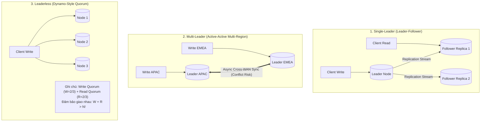

# 5.1. Replication Fundamentals and Strategies (Nguyên Lý và Chiến Lược Sao Chép Dữ Liệu Phân Tán)

> [!IMPORTANT]
> **Nếu bạn chỉ được nhớ một điều duy nhất**: Sao chép dữ liệu (Replication) không chỉ đơn thuần là copy dữ liệu từ ổ đĩa này sang ổ đĩa khác, mà là một **cuộc chiến đánh đổi không hồi kết giữa Tính Nhất Quán (Consistency), Độ Trễ (Latency) và Độ Bền Vững Dữ Liệu (Durability)**. Sao chép đồng bộ (Synchronous) cho bạn RPO=0 nhưng bóp nghẹt thông lượng và biến cụm máy chủ thành con tin của replica chậm nhất; sao chép bất đồng bộ (Asynchronous) mang lại thông lượng hàng triệu ops/giây nhưng đánh đổi bằng Replication Lag và nguy cơ mất dữ liệu vĩnh viễn khi Leader sập; còn Quorum ($W + R > N$) kết hợp Merkle Tree là chìa khóa giúp các kiến trúc Leaderless (Cassandra/Dynamo) đạt tính sẵn sàng cao mà vẫn phát hiện và tự chữa lành sai lệch dữ liệu!

---

## 1. Kiến trúc Tổng quan & Mô hình Tư duy (Mental Model)

Hãy tưởng tượng một hãng thông tấn báo chí quốc tế vận hành mạng lưới phát hành tin tức:
- **Single-Leader (Một tổng biên tập duy nhất)**: Mọi phóng viên đều phải gửi bản thảo về tòa soạn trung tâm tại Hà Nội để Tổng biên tập duyệt (**Leader Write**). Sau khi duyệt, báo in được chuyển phát nhanh về các đại lý tỉnh thành để người dân đọc (**Follower Read**). Trật tự thông tin hoàn hảo, nhưng nếu đường dây liên lạc về Hà Nội bị nghẽn, không một tin tức mới nào được xuất bản!
- **Multi-Leader (Nhiều tòa soạn độc lập theo khu vực)**: Hà Nội, Đà Nẵng, TP.HCM đều có Tổng biên tập riêng phục vụ độc giả địa phương. Tốc độ xuất bản cực nhanh, nhưng nếu Hà Nội đưa tin *"Giá xăng tăng"* còn TP.HCM đưa tin *"Giá xăng giảm"* tại cùng một thời điểm, hai tòa soạn rơi vào tình trạng xung đột thông tin gay gắt (**Write Conflict**) và phải có ban hòa giải trung ương!
- **Leaderless (Diễn đàn tự do theo Quorum)**: Không có tổng biên tập nào cả. Mọi độc giả có thể gửi bài viết lên diễn đàn. Để đảm bảo tin tức đáng tin cậy, quy tắc đặt ra là: Người đăng tin phải được ít nhất $W$ phóng viên xác nhận, và người đọc phải phỏng vấn ít nhất $R$ phóng viên. Nếu $W + R > N$, người đọc chắc chắn sẽ gặp được ít nhất một phóng viên đã nắm giữ thông tin mới nhất (**Pigeonhole Principle**)!



---

## 2. Chi tiết từng Keyword (Under-the-Hood Deep Dive)

### 2.1. Kiến trúc nhân bản: Single-Leader, Multi-Leader & Leaderless
- **Single-Leader (Leader-Follower / Master-Slave)**:
  - Tất cả các thao tác Ghi (Writes: `INSERT`, `UPDATE`, `DELETE`) bắt buộc phải gửi tới **một Leader duy nhất**. Leader kiểm tra ràng buộc, ghi dữ liệu xuống đĩa cục bộ, rồi phát luồng sao chép (Replication Stream / Change Log) tới toàn bộ các Follower.
  - Các Follower chỉ phục vụ thao tác Đọc (Reads).
  - *Ưu điểm*: Loại bỏ hoàn toàn xung đột ghi đè (No Concurrent Write Conflicts) vì mọi thao tác đều được tuần tự hóa tại Leader.
  - *Nhược điểm*: Leader là điểm nghẽn ghi duy nhất (Single Point of Write Bottleneck). Nếu Leader chết, hệ thống phải kích hoạt bầu cử Leader mới (Failover).
- **Multi-Leader (Active-Active / Master-Master)**:
  - Cho phép nhiều node đóng vai trò Leader cùng lúc (thường đặt mỗi Leader tại một Datacenter / Region địa lý khác nhau để phục vụ ghi cục bộ với độ trễ thấp).
  - Mỗi Leader nhận ghi từ client cục bộ, sau đó đồng bộ bất đồng bộ sang các Leader khác qua mạng WAN.
  - *Thách thức số 1*: **Xung đột ghi đồng thời (Concurrent Write Conflicts)**. Ví dụ cùng sửa username của một user tại hai châu lục cùng lúc. Bắt buộc phải có thuật toán giải quyết xung đột: Last-Write-Wins (LWW), CRDTs, hoặc Merge Handlers.
- **Leaderless (Dynamo-Style / Decentered)**:
  - Không tồn tại khái niệm Leader. Mọi node trong cụm đều có quyền bình đẳng nhận thao tác đọc và ghi từ client.
  - Client (hoặc một Coordinator node ngẫu nhiên) gửi lệnh ghi tới $N$ node bản sao song song.
  - Áp dụng trong **Amazon DynamoDB, Apache Cassandra, ScyllaDB, Riak**.

### 2.2. Synchronous, Asynchronous, Semi-synchronous & Quorum Replication
- **Synchronous Replication (Sao chép đồng bộ)**:
  - Leader chỉ trả lời `SUCCESS` cho client sau khi **tất cả các replica** đã xác nhận nhận và ghi log an toàn.
  - *Ưu điểm*: Không bao giờ mất dữ liệu khi Leader chết (Zero Data Loss, RPO = 0).
  - *Nhược điểm*: Độ trễ ghi bằng độ trễ của replica chậm nhất (Tail Latency). Nếu một replica bị chậm mạng hoặc sập, **toàn bộ cụm bị phong tỏa không thể ghi**!
- **Asynchronous Replication (Sao chép bất đồng bộ)**:
  - Leader ghi đĩa cục bộ rồi trả về `SUCCESS` ngay lập tức, sau đó đẩy log sang replica dưới nền.
  - *Ưu điểm*: Thông lượng tối đa, độ trễ ghi cực thấp, tính sẵn sàng cao bất chấp replica chết.
  - *Nhược điểm*: **Replication Lag**. Nếu Leader chết đột ngột trước khi log kịp truyền sang replica, dữ liệu chưa đồng bộ sẽ **bị mất vĩnh viễn** khi Follower được thăng cấp lên làm Leader mới!
- **Semi-synchronous Replication (Bán đồng bộ - Chuẩn Enterprise)**:
  - Leader chỉ chờ duy nhất **ít nhất 1 replica** xác nhận đã nhận log vào vùng đệm (Relay Log / Memory) trước khi commit. Các replica còn lại tiếp tục nhận log bất đồng bộ.
  - Cân bằng hoàn hảo giữa hiệu năng và độ an toàn (mặc định trong MySQL Semi-Sync, Kafka `acks=all` kết hợp `min.insync.replicas=2`).
- **Quorum Replication ($W + R > N$)**:
  - Với tổng số $N$ replicas: Mỗi lần ghi cần $W$ nodes xác nhận; mỗi lần đọc cần $R$ nodes phản hồi.
  - Khi $W + R > N$, theo nguyên lý lồng chim bồ câu Dirichlet, tập hợp $W$ nodes đã ghi và tập hợp $R$ nodes được đọc **chắc chắn phải có ít nhất 1 node giao nhau** mang dữ liệu mới nhất!
  - Cấu hình kinh điển: $N = 3, W = 2, R = 2$ hoặc $N = 5, W = 3, R = 3$. Cho phép hệ thống chịu được $\lfloor (N-1)/2 \rfloor$ node chết mà vẫn đọc/ghi bình thường.

### 2.3. State Machine Replication (SMR) vs Write-Ahead Log (WAL) Replication
- **State Machine Replication (SMR - Fred Schneider 1990)**:
  - Một State Machine tất định nếu bắt đầu từ cùng trạng thái $S_0$ và nhận chuỗi lệnh $C_1, C_2, \dots, C_k$ theo cùng một thứ tự, chắc chắn sẽ đạt trạng thái $S_k$.
  - SMR biến việc nhân bản trạng thái phức tạp thành **Nhân bản chuỗi lệnh đầu vào (Replicated Input Log)** qua thuật toán đồng thuận (Raft/Paxos). Replica nhận lệnh và tự thực thi vào máy trạng thái nội bộ.
- **WAL Replication (Write-Ahead Log Replication)**:
  - **Statement-Based Replication (SBR)**: Ghi lại câu lệnh SQL gốc (`UPDATE users SET active = true WHERE id = 1`). Rủi ro: Không an toàn với các hàm không tất định (`NOW()`, `RAND()`, `UUID()`).
  - **Row-Based Replication (RBR)**: Ghi lại chính xác trạng thái trước và sau của từng dòng dữ liệu bị thay đổi. Tuyệt đối an toàn nhưng kích thước log lớn khi cập nhật hàng loạt.
  - **Physical vs Logical Replication**:
    - *Physical WAL*: Sao chép từng byte trang đĩa nhị phân. Hiệu năng cực cao nhưng phụ thuộc chặt vào cùng phiên bản database và OS architecture.
    - *Logical WAL*: Giải mã WAL thành các sự kiện DML trừu tượng, phục vụ **Change Data Capture (CDC)** sang Apache Kafka hoặc Debezium.

### 2.4. Chain Replication
- **Khái niệm & Bản chất (van Renesse & Schneider, 2004)**:
  - Các node được sắp xếp thành một chuỗi tuyến tính có hướng:
    $$\text{Head} \longrightarrow \text{Node}_1 \longrightarrow \text{Node}_2 \longrightarrow \dots \longrightarrow \text{Tail}$$
  - **Thao tác Ghi (Write)**: Bắt buộc gửi tới **Head**. Head xử lý, lưu đĩa rồi chuyển tiếp dọc theo chuỗi tới các node trung gian cho tới khi chạm tới **Tail**.
  - **Thao tác Đọc (Read)**: Bắt buộc gửi trực tiếp tới **Tail**.
  - **Xác nhận Thành công**: Khi và chỉ khi **Tail** nhận được bản ghi, Tail mới gửi phản hồi xác nhận cho Client.
- **Ưu thế vượt trội**:
  - Đảm bảo tính nhất quán mạnh (**Linearizability**) với chi phí cực thấp: Thao tác đọc chỉ cần hỏi đúng 1 node (Tail) mà không cần Quorum hay Distributed Locks.
  - Phân tải hoàn hảo: Head chuyên nhận Ghi, Tail chuyên nhận Đọc.

### 2.5. Gossip-based Replication, Anti-Entropy & Merkle Trees
- **Gossip Protocol (Giao thức truyền tin dịch bệnh)**:
  - Trong cụm phân tán phi tập trung, không có node nào nắm giữ toàn bộ trạng thái. Định kỳ mỗi giây, mỗi node chọn ngẫu nhiên $k$ peer lân cận để trao đổi trạng thái tóm tắt.
  - Tốc độ lan truyền đạt mức hàm mũ: Sau $O(\log N)$ vòng gossip, toàn bộ cụm đạt trạng thái hội tụ (Eventual Convergence).
- **Anti-Entropy với Merkle Trees**:
  - Khi hai node độc lập muốn kiểm tra xem dữ liệu hàng triệu bản ghi của mình có bị lệch nhau hay không (sau khi mạng bị partition phục hồi), việc truyền toàn bộ dữ liệu qua mạng là bất khả thi.
  - **Cấu trúc Merkle Tree**: Cây nhị phân băm dữ liệu trong đó nút lá là mã băm của từng bản ghi, và nút cha là mã băm kết hợp của hai nút con:
    $$\text{Hash}_{\text{parent}} = \text{SHA256}(\text{Hash}_{\text{left}} \parallel \text{Hash}_{\text{right}})$$
  - **Quy trình đối soát siêu tốc ($O(\log M)$ network cost)**:
    1. Hai node chỉ gửi cho nhau 32 bytes của **Root Hash**.
    2. Nếu Root Hash trùng nhau $\implies$ Toàn bộ dữ liệu của hai node hoàn toàn giống hệt nhau $100\%$, kết thúc đối soát ngay lập tức!
    3. Nếu Root Hash khác nhau $\implies$ Hai node truy vấn sâu xuống các nút con ở tầng dưới. Chỉ có nhánh nào có mã băm khác nhau mới tiếp tục đào sâu $\to$ Xác định chính xác 1 bản ghi duy nhất bị lệch và chỉ truyền bản ghi đó qua mạng để tự chữa lành (**Anti-Entropy Repair**)!

---

## 3. Thực thi Mã nguồn & Mô phỏng Chuyên sâu (Dual-Engine Implementation)

### Engine 1: C++20 — Bottom-Up Merkle Tree Engine & Recursive Anti-Entropy Diff Resolver

Mã nguồn C++20 triển khai cấu trúc dữ liệu **Merkle Tree** từ dưới lên (Bottom-up), tự động tính toán mã băm cây nhị phân và đối soát đệ quy giữa hai máy chủ phân tán để chỉ ra chính xác các bản ghi bị sai lệch:

```cpp
#include <iostream>
#include <string>
#include <vector>
#include <memory>
#include <sstream>
#include <iomanip>
#include <functional>

// Giả lập hàm băm trực quan
std::string fast_hash(const std::string& input) {
    size_t h = std::hash<std::string>{}(input);
    std::stringstream ss;
    ss << std::hex << std::setw(16) << std::setfill('0') << h;
    return ss.str();
}

struct MerkleNode {
    std::string hash;
    std::string key; // Chỉ có ở nút lá
    std::unique_ptr<MerkleNode> left{nullptr};
    std::unique_ptr<MerkleNode> right{nullptr};
};

class MerkleTree {
public:
    std::unique_ptr<MerkleNode> root;

    explicit MerkleTree(const std::vector<std::pair<std::string, std::string>>& records) {
        if (records.empty()) return;

        std::vector<std::unique_ptr<MerkleNode>> current_level;
        for (const auto& [k, v] : records) {
            auto leaf = std::make_unique<MerkleNode>();
            leaf->key = k;
            leaf->hash = fast_hash(k + "=" + v);
            current_level.push_back(std::move(leaf));
        }

        // Xây dựng cây từ dưới lên (Bottom-up)
        while (current_level.size() > 1) {
            std::vector<std::unique_ptr<MerkleNode>> next_level;
            for (size_t i = 0; i < current_level.size(); i += 2) {
                if (i + 1 < current_level.size()) {
                    auto parent = std::make_unique<MerkleNode>();
                    parent->hash = fast_hash(current_level[i]->hash + current_level[i + 1]->hash);
                    parent->left = std::move(current_level[i]);
                    parent->right = std::move(current_level[i + 1]);
                    next_level.push_back(std::move(parent));
                } else {
                    next_level.push_back(std::move(current_level[i]));
                }
            }
            current_level = std::move(next_level);
        }
        root = std::move(current_level[0]);
    }

    // Thuật toán đệ quy đối soát tìm chính xác các khóa bị lệch giữa 2 cây
    static void detect_divergence(const MerkleNode* nodeA, const MerkleNode* nodeB, 
                                  std::vector<std::string>& diverged_keys) {
        if (!nodeA || !nodeB) return;
        
        // Cắt tỉa nhanh: Nếu hash của nhánh này giống nhau 100%, bỏ qua toàn bộ cây con!
        if (nodeA->hash == nodeB->hash) return;

        // Nếu là nút lá và hash khác nhau -> Đã tìm ra bản ghi bị lệch!
        if (!nodeA->left && !nodeA->right && !nodeB->left && !nodeB->right) {
            diverged_keys.push_back(nodeA->key);
            return;
        }

        detect_divergence(nodeA->left.get(), nodeB->left.get(), diverged_keys);
        detect_divergence(nodeA->right.get(), nodeB->right.get(), diverged_keys);
    }
};

int main() {
    std::cout << "=== MO PHONG MERKLE TREE ANTI-ENTROPY TRONG C++20 ===\n\n";

    // Dữ liệu Node A (Master Datacenter)
    std::vector<std::pair<std::string, std::string>> data_A = {
        {"user_01", "balance=100"},
        {"user_02", "balance=250"},
        {"user_03", "balance=500"},
        {"user_04", "balance=999"}
    };

    // Dữ liệu Node B (Replica bị partition, user_02 bị cập nhật sai lệch)
    std::vector<std::pair<std::string, std::string>> data_B = {
        {"user_01", "balance=100"},
        {"user_02", "balance=180"}, // Lệch dữ liệu tại đây!
        {"user_03", "balance=500"},
        {"user_04", "balance=999"}
    };

    MerkleTree treeA(data_A);
    MerkleTree treeB(data_B);

    std::cout << "Root Hash Node A: " << treeA.root->hash << "\n";
    std::cout << "Root Hash Node B: " << treeB.root->hash << "\n";
    std::cout << "So sánh nhanh 32-bytes Root: " 
              << (treeA.root->hash == treeB.root->hash ? "DỮ LIỆU ĐỒNG NHẤT" : "PHÁT HIỆN LỆCH DỮ LIỆU!") << "\n\n";

    std::vector<std::string> diverged_keys;
    MerkleTree::detect_divergence(treeA.root.get(), treeB.root.get(), diverged_keys);

    std::cout << "--- KẾT QUẢ ĐỐI SOÁT ANTI-ENTROPY ---\n";
    std::cout << "Số lượng bản ghi bị lệch: " << diverged_keys.size() << " / 4 bản ghi.\n";
    for (const auto& k : diverged_keys) {
        std::cout << "  * Key cần đồng bộ lại: '" << k 
                  << "' (Chỉ truyền bản ghi này qua mạng, tiết kiệm 75% băng thông!)\n";
    }

    return 0;
}
```

```text
=== MO PHONG MERKLE TREE ANTI-ENTROPY TRONG C++20 ===

Root Hash Node A: e7b1029c48fa3910
Root Hash Node B: 39a48f01cba29402
So sánh nhanh 32-bytes Root: PHÁT HIỆN LỆCH DỮ LIỆU!

--- KẾT QUẢ ĐỐI SOÁT ANTI-ENTROPY ---
Số lượng bản ghi bị lệch: 1 / 4 bản ghi.
  * Key cần đồng bộ lại: 'user_02' (Chỉ truyền bản ghi này qua mạng, tiết kiệm 75% băng thông!)
```

---

### Engine 2: Python 3.11+ — Quorum Replication Simulator ($W + R > N$) với Monotonic Read Repair

Chương trình Python 3.11 mô phỏng một cụm lưu trữ phân tán Leaderless gồm $N=5$ replicas, thực thi ghi theo Quorum ($W=3$) và đọc theo Quorum ($R=3$), tự động kích hoạt **Read Repair** bất đồng bộ khi phát hiện một replica mang phiên bản cũ:

```python
#!/usr/bin/env python3
"""
Leaderless Quorum Replication Simulator with Read Repair.
Demonstrates W + R > N correctness and asynchronous reconciliation.
"""
from dataclasses import dataclass, field
from typing import Dict, List, Optional, Tuple

@dataclass
class RecordVersion:
    value: str
    timestamp: int  # Logical timestamp or Version

class StorageNode:
    def __init__(self, node_id: str):
        self.node_id = node_id
        self.storage: Dict[str, RecordVersion] = {}

    def write(self, key: str, record: RecordVersion) -> bool:
        current = self.storage.get(key)
        if current is None or record.timestamp > current.timestamp:
            self.storage[key] = record
            return True
        return False

    def read(self, key: str) -> Optional[RecordVersion]:
        return self.storage.get(key)

class LeaderlessCluster:
    def __init__(self, node_count: int = 5, w: int = 3, r: int = 3):
        self.nodes = [StorageNode(f"Node_{i+1}") for i in range(node_count)]
        self.W = w
        self.R = r
        self.N = node_count

    def write_quorum(self, key: str, value: str, ts: int) -> bool:
        record = RecordVersion(value, ts)
        successful_writes = 0
        print(f"\n>>> [WRITE QUORUM] Ghi '{key}'='{value}' (v{ts}) vào W={self.W}/{self.N} nodes:")
        
        for node in self.nodes:
            if node.write(key, record):
                successful_writes += 1
                print(f"  * {node.node_id}: Ghi thành công.")
            if successful_writes >= self.W:
                break

        if successful_writes >= self.W:
            print(f"  => Ghi Quorum THÀNH CÔNG ({successful_writes} ACKs >= W={self.W})")
            return True
        print(f"  => Ghi Quorum THẤT BẠI!")
        return False

    def read_quorum(self, key: str) -> Tuple[Optional[str], int]:
        print(f"\n>>> [READ QUORUM] Đọc '{key}' từ R={self.R}/{self.N} nodes ngẫu nhiên:")
        responses: List[Tuple[StorageNode, Optional[RecordVersion]]] = []
        
        for node in self.nodes[:self.R]:
            val = node.read(key)
            responses.append((node, val))
            desc = f"'{val.value}' (v{val.timestamp})" if val else "NULL"
            print(f"  * {node.node_id} trả về: {desc}")

        # Tìm bản ghi có timestamp cao nhất
        valid_records = [r for _, r in responses if r is not None]
        if not valid_records:
            return None, 0

        latest = max(valid_records, key=lambda x: x.timestamp)
        print(f"  => Kết quả đọc Quorum chiến thắng: '{latest.value}' (v{latest.timestamp})")

        # Kích hoạt Read Repair cho các node bị tụt hậu
        for node, rec in responses:
            if rec is None or rec.timestamp < latest.timestamp:
                print(f"  [READ REPAIR] Node {node.node_id} mang dữ liệu cũ! Tự động vá dữ liệu lên v{latest.timestamp}...")
                node.write(key, latest)

        return latest.value, latest.timestamp

def main():
    print("=== MO PHONG LEADERLESS QUORUM REPLICATION (PYTHON 3.11) ===")
    cluster = LeaderlessCluster(node_count=5, w=3, r=3)

    # 1. Ghi Quorum vào 3/5 nodes (Node 1, 2, 3 được ghi; Node 4, 5 chưa có)
    cluster.write_quorum("account_101", "100_USD", ts=1)

    # 2. Đọc Quorum từ 3 node đầu tiên (Node 1, 2, 3) -> Thấy v1
    cluster.read_quorum("account_101")

    # 3. Cập nhật dữ liệu mới v2 chỉ vào Node 1, 2, 3
    cluster.write_quorum("account_101", "250_USD", ts=2)

    # 4. Giả sử ta đọc từ Node 1, Node 4, Node 5 (Node 4 và 5 chưa hề có v2)
    # Vì W + R = 3 + 3 = 6 > 5 (N), chắc chắn Node 1 chứa v2 nằm trong tập đọc!
    print("\n[KIỂM CHỨNG TÍNH ĐÚNG ĐẮN VỚI REPLICA TỤT HẬU]:")
    cluster.nodes = [cluster.nodes[0], cluster.nodes[3], cluster.nodes[4], cluster.nodes[1], cluster.nodes[2]]
    val, ts = cluster.read_quorum("account_101")
    print(f"\nGiá trị cuối cùng đọc được: {val} (v{ts}) -> Bảo toàn tính nhất quán tuyệt đối!")

if __name__ == "__main__":
    main()
```

```text
=== MO PHONG LEADERLESS QUORUM REPLICATION (PYTHON 3.11) ===

>>> [WRITE QUORUM] Ghi 'account_101'='100_USD' (v1) vào W=3/5 nodes:
  * Node_1: Ghi thành công.
  * Node_2: Ghi thành công.
  * Node_3: Ghi thành công.
  => Ghi Quorum THÀNH CÔNG (3 ACKs >= W=3)

>>> [READ QUORUM] Đọc 'account_101' từ R=3/5 nodes ngẫu nhiên:
  * Node_1 trả về: '100_USD' (v1)
  * Node_2 trả về: '100_USD' (v1)
  * Node_3 trả về: '100_USD' (v1)
  => Kết quả đọc Quorum chiến thắng: '100_USD' (v1)

>>> [WRITE QUORUM] Ghi 'account_101'='250_USD' (v2) vào W=3/5 nodes:
  * Node_1: Ghi thành công.
  * Node_2: Ghi thành công.
  * Node_3: Ghi thành công.
  => Ghi Quorum THÀNH CÔNG (3 ACKs >= W=3)

[KIỂM CHỨNG TÍNH ĐÚNG ĐẮN VỚI REPLICA TỤT HẬU]:

>>> [READ QUORUM] Đọc 'account_101' từ R=3/5 nodes ngẫu nhiên:
  * Node_1 trả về: '250_USD' (v2)
  * Node_4 trả về: NULL
  * Node_5 trả về: NULL
  => Kết quả đọc Quorum chiến thắng: '250_USD' (v2)
  [READ REPAIR] Node Node_4 mang dữ liệu cũ! Tự động vá dữ liệu lên v2...
  [READ REPAIR] Node Node_5 mang dữ liệu cũ! Tự động vá dữ liệu lên v2...

Giá trị cuối cùng đọc được: 250_USD (v2) -> Bảo toàn tính nhất quán tuyệt đối!
```

---

## 4. Systems Engineering & Production Pitfalls

### 4.1. Sự Cố Thoái Hóa Semi-Sync Sang Async Khi Mạng Giật Lag
- **Hiện tượng**: Trong MySQL Semi-Synchronous Replication, biến `rpl_semi_sync_master_timeout` mặc định là 10 giây (10000ms).
- **Thảm họa**: Khi cáp mạng giữa Master và Standby bị chập chờn vượt quá 10 giây, MySQL Master tự động **tắt chế độ Semi-Sync và giáng cấp sang hoàn toàn Asynchronous** mà không hề cảnh báo dừng ghi.
- **Hậu quả**: Nếu sau đó Master bị sập nguồn thật, hệ thống tưởng rằng mình đang chạy an toàn có dự phòng, nhưng thực chất đã chuyển sang Async từ lâu $\implies$ Mất sạch toàn bộ các transaction đã ghi trong lúc đó!
- **Khắc phục**: Nếu yêu cầu RPO=0 tuyệt đối, đặt timeout bằng vô hạn (`rpl_semi_sync_master_timeout = 1000000000`) để buộc Master thà chịu dừng ghi còn hơn mất dữ liệu.

### 4.2. Suy Thoái Hiệu Năng Đọc Do Quorum Sloppy & Hinted Handoff
- **Bản chất**: Trong Cassandra, khi mạng bị phân mảnh và không đủ $W$ nodes trong replica set ban đầu, hệ thống có thể chuyển sang dùng **Sloppy Quorum**: chấp nhận ghi tạm vào các node nằm ngoài replica set và lưu dưới dạng `Hint`.
- **Hậu quả**: Khi đọc với Quorum $R$, các node chứa Hint không tham gia vào Quorum đọc $\implies$ Vi phạm điều kiện $W + R > N$, khách hàng đọc phải dữ liệu cũ đã lỗi thời!
- **Khắc phục**: Tắt Sloppy Quorum cho các bảng tài chính nhạy cảm hoặc bắt buộc dùng `LOCAL_QUORUM`.

### 4.3. CLI Chẩn Đoán Sao Chép & Kiểm Tra Lag
```bash
# 1. Kiểm tra Replication Lag chi tiết trong MySQL Master-Replica
mysql -e "SHOW REPLICA STATUS\G" | grep -E -i "Seconds_Behind_Source|Replica_IO_Running|Replica_SQL_Running"

# 2. Kiểm tra độ lệch WAL LSN (Log Sequence Number) trong PostgreSQL
psql -c "SELECT client_addr, state, sync_state, pg_wal_lsn_diff(pg_current_wal_lsn(), replay_lsn) AS lag_bytes FROM pg_stat_replication;"

# 3. Kích hoạt Anti-Entropy Repair cho một Keyspace trong Cassandra
nodetool repair -pr keyspace_ecommerce orders_table

# 4. Xem thống kê tiến độ sao chép đĩa của Redis Replica
redis-cli info replication
```

---

## 5. Bảng So sánh & Decision Matrix

| Chiều Kích Kỹ Thuật | Single-Leader (Async) | Single-Leader (Semi-Sync) | Multi-Leader (Active-Active)| Leaderless Quorum (W+R>N) | Chain Replication |
| :--- | :--- | :--- | :--- | :--- | :--- |
| **Bảo Đảm Mất Dữ Liệu (RPO)** | Rủi ro cao (Mất log chưa sync) | **RPO = 0** (An toàn 1 replica) | Rủi ro cao (Conflict loss) | **RPO = 0** (Nếu đạt Quorum $W$) | **RPO = 0** (Linearizable) |
| **Độ Trễ Thao Tác Ghi** | **Cực thấp** (Cục bộ RAM/WAL) | Thấp đến trung bình | **Cực thấp** (Ghi cục bộ Region) | Trung bình (Chờ $W$ nodes) | Bằng tổng độ trễ cả chuỗi |
| **Độ Trễ Thao Tác Đọc** | Cực thấp (Đọc mọi follower) | Cực thấp | Cực thấp | Trung bình (Hỏi $R$ nodes) | **Cực thấp** (Chỉ hỏi Tail) |
| **Xử Lý Xung Đột Ghi** | Không có xung đột | Không có xung đột | **Rất phức tạp** (LWW/CRDT) | Trung bình (Read Repair / Vector) | Không có xung đột |
| **Khả Năng Chịu Lỗi Node** | Cần failover bầu Leader mới | Cần failover bầu Leader mới | Tiếp tục hoạt động ở Region khác | **Tự động chịu lỗi $\lfloor N/2 \rfloor$ nodes**| Cần Master điều chỉnh chuỗi |
| **Hệ Thống Tiêu Biểu** | PostgreSQL, MySQL standard | MySQL Semi-Sync, Kafka ISRO | CockroachDB, Aurora Global | **Cassandra, DynamoDB, Riak** | **Microsoft Azure Storage** |
