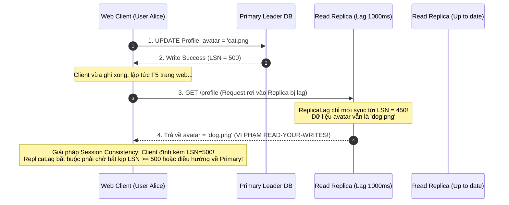

# 5.2. Replication Conflicts and Guarantees (Xung Đột Sao Chép và Các Mức Bảo Đảm Tính Nhất Quán)

> [!IMPORTANT]
> **Nếu bạn chỉ được nhớ một điều duy nhất**: Trong thế giới sao chép dữ liệu phân tán (Replication), hiện tượng **Replication Lag** và **Concurrent Writes** là hai con quái vật không thể tránh khỏi. Nếu không có cơ chế giải quyết xung đột toán học chuẩn mực như **CRDTs (Conflict-Free Replicated Data Types)**, việc nhắm mắt chọn Last-Write-Wins (LWW) sẽ xóa sổ dữ liệu của bạn một cách âm thầm; còn nếu không áp dụng các mức cam kết như **Read-Your-Writes** và **Monotonic Reads**, người dùng sẽ liên tục bị ảo giác "du hành thời gian" khi thấy bài viết của mình vừa đăng biến mất hoặc trạng thái đơn hàng nhảy ngược về quá khứ!

---

## 1. Kiến trúc Tổng quan & Mô hình Tư duy (Mental Model)

Hãy tưởng tượng một người dùng chỉnh sửa hồ sơ cá nhân và đặt hàng trên một ứng dụng thương mại điện tử toàn cầu:
- **Hiện tượng Du Hành Thời Gian (Time-Travel Anomaly)**: Người dùng vừa đổi ảnh đại diện và lưu thành công trên Primary Database. Trình duyệt tự động reload trang, nhưng yêu cầu đọc tiếp theo lại bị phân bổ sang một Read Replica đang bị chậm mạng $500\text{ ms}$ (**Replication Lag**). Kết quả: Người dùng vẫn nhìn thấy ảnh đại diện cũ, tưởng rằng thao tác lưu bị lỗi nên tiếp tục bấm lưu 5 lần liên tiếp (**Thiếu Read-Your-Writes**)!
- **Hiện tượng Nhảy Lùi Trạng Thái (Monotonic Violation)**: Người dùng refresh lần một rơi vào Replica A đã sync tới giây thứ 10, thấy đơn hàng là `SHIPPED`. Refresh lần hai rơi vào Replica B mới sync tới giây thứ 8, thấy đơn hàng quay giật lùi về `PENDING` (**Thiếu Monotonic Reads**)!
- **Xung Đột Đồng Thời (Concurrent Edit Conflict)**: Hai vợ chồng dùng chung một tài khoản giỏ hàng; người chồng ở Paris thêm *"Táo"*, người vợ ở New York thêm *"Cam"*. Nếu dùng Last-Write-Wins, món đồ của một trong hai người sẽ bị xóa sổ; chỉ có **CRDT Set (Conflict-Free Replicated Data Type)** mới tự động hợp nhất giỏ hàng thành `{"Táo", "Cam"}` trên cả hai lục địa mà không cần khóa đồng bộ!



---

## 2. Chi tiết từng Keyword (Under-the-Hood Deep Dive)

### 2.1. Phân loại xung đột: Concurrent Write, Update & Delete Conflicts
- **Concurrent Write Conflict (Xung đột ghi đồng thời)**:
  - Hai client độc lập phát hành lệnh cập nhật cùng một thuộc tính của một bản ghi dữ liệu tại hai node khác nhau trong cùng một khoảng thời gian:
    $$\text{Client 1: } \text{User.email} \gets \text{"a@example.com"} \quad \parallel \quad \text{Client 2: } \text{User.email} \gets \text{"b@example.com"}$$
  - Trong kiến trúc Multi-Leader hoặc Leaderless, cả hai node tiếp nhận đều ghi nhận cục bộ thành công mà không biết về thao tác của node kia cho tới khi gossip đồng bộ.
- **Update-Delete Conflict (Xung đột Cập nhật - Xóa)**:
  - Client 1 sửa đổi nội dung một dòng dữ liệu (ví dụ: cập nhật địa chỉ giao hàng), trong khi Client 2 gửi lệnh xóa (`DELETE`) dòng dữ liệu đó.
  - Khi hai bản sao đồng bộ, hệ thống phải quyết định: Dòng dữ liệu nên bị xóa vĩnh viễn, hay dòng dữ liệu nên được tái sinh với địa chỉ mới?
- **Phân kỳ (Divergence) vs Hội tụ (Convergence)**:
  - **Divergence (Phân kỳ dữ liệu)**: Các replica duy trì các trạng thái khác nhau vô hạn định sau khi mạng đã phục hồi. Đây là trạng thái hỏng hóc nghiêm trọng nhất của hệ thống phân tán.
  - **Eventual Convergence (Hội tụ cuối cùng)**: Đảm bảo rằng khi tất cả các bản ghi cập nhật đã lan truyền xong và không còn ghi mới, **100% các replica bắt buộc phải hội tụ về cùng một trạng thái bit-for-bit hoàn toàn giống hệt nhau**.

### 2.2. Các cơ chế giải quyết xung đột (Conflict Resolution Mechanisms)
- **1. Last-Write-Wins (LWW)**:
  - So sánh Physical Timestamp của các bản ghi, bản ghi có timestamp lớn hơn sẽ đè bẹp bản ghi nhỏ hơn.
  - *Đánh giá*: Cực kỳ nguy hiểm, gây **mất dữ liệu âm thầm** do hiện tượng Clock Skew như đã chứng minh ở Chương 3.
- **2. Multi-Version Concurrency Control (MVCC) / Siblings**:
  - Khi phát hiện xung đột qua Version Vector, database không tự ý xóa dữ liệu mà lưu trữ đồng thời **cả hai phiên bản** dưới dạng các nhánh anh em (**Siblings**).
  - Trả trách nhiệm giải quyết xung đột về cho ứng dụng (Application-Level Conflict Resolver).
- **3. Application-Level Conflict Resolver**:
  - Mã nguồn backend tự định nghĩa logic nghiệp vụ để hòa giải (ví dụ: giỏ hàng của Amazon hợp nhất tập hợp các món đồ của cả hai nhánh).
- **4. Operational Transformation (OT)**:
  - Biến đổi tọa độ của các phép toán soạn thảo văn bản đồng thời dựa trên ngữ cảnh (nền tảng của Google Docs). Rất phức tạp khi mở rộng lên hạ tầng peer-to-peer.
- **5. CRDTs (Conflict-Free Replicated Data Types)**:
  - Giải pháp toán học tối thượng cho điện toán cộng tác phân tán hiện đại.

### 2.3. CRDTs (Conflict-Free Replicated Data Types)
- **Cơ sở toán học: Nửa lưới hợp có chặn (Bounded Join-Semilattice)**:
  - Do Marc Shapiro et al. (INRIA) công bố năm 2011. Một cấu trúc dữ liệu là CRDT nếu không gian trạng thái $S$ được trang bị một phép toán hợp $(\sqcup)$ thỏa mãn 3 tính chất đại số cơ bản:
    1. **Giao hoán (Commutative)**: $x \sqcup y = y \sqcup x$ (Gói tin đến trước hay đến sau không làm đổi trạng thái cuối cùng).
    2. **Kết hợp (Associative)**: $(x \sqcup y) \sqcup z = x \sqcup (y \sqcup z)$ (Gom nhóm gói tin không ảnh hưởng tới kết quả).
    3. **Lũy đẳng (Idempotent)**: $x \sqcup x = x$ (Mạng retry gửi trùng lặp thông điệp vô hại $100\%$).
- **Phân loại CRDTs**:
  - **CvRDT (State-based CRDTs)**: Các node định kỳ gửi toàn bộ trạng thái cục bộ cho nhau; node nhận gọi hàm `merge(remote_state)` (tính toán $s_{\text{local}} \sqcup s_{\text{remote}}$). Yêu cầu băng thông mạng lớn hơn nhưng chịu được mất gói tin hoặc gửi lệch thứ tự hoàn toàn.
  - **CmRDT (Operation-based CRDTs)**: Các node chỉ truyền các phép toán biến đổi nhỏ (ví dụ: `add(x)`). Đòi hỏi mạng phải bảo đảm gửi tin Exactly-Once hoặc Causal Delivery.
- **Các kiểu CRDT phổ biến**:
  - **G-Counter (Grow-Only Counter)**: Bộ đếm chỉ tăng.
  - **PN-Counter (Positive-Negative Counter)**: Hỗ trợ cả tăng và giảm bằng cách kết hợp hai G-Counter ($P$ và $N$), giá trị bằng $\sum P - \sum N$.
  - **LWW-Element-Set**: Tập hợp các phần tử có gắn timestamp để giải quyết xung đột Add/Remove.
  - **OR-Set (Observed-Remove Set)**: Mỗi phần tử thêm vào được gán một tag UUID duy nhất. Khi xóa, chỉ xóa các tag đã quan sát được trong quá khứ $\implies$ Bảo đảm thao tác Concurrent Add luôn thắng Concurrent Remove.

### 2.4. Read-Your-Writes (Read-After-Write) Consistency
- **Bản chất**: Bảo đảm rằng nếu một tiến trình thực hiện một thao tác ghi $W$, thì mọi thao tác đọc $R$ tiếp theo của **chính tiến trình đó** luôn nhìn thấy giá trị vừa ghi (hoặc một phiên bản mới hơn). Các client khác có thể thấy chậm hơn.
- **Kỹ thuật triển khai trong Thực tế**:
  1. **User-Pinned Primary Routing**: Mọi thao tác đọc của người dùng đối với các thực thể mà chính họ vừa sửa đổi (ví dụ: Profile của chính họ) được tự động chuyển hướng (route) thẳng về **Primary Leader** trong một khoảng thời gian cửa sổ ngắn (ví dụ: $5\text{ giây}$ sau thao tác ghi gần nhất).
  2. **Client-Tracked LSN / Monotonic Cookies**: Khi Primary Leader thực hiện ghi, nó trả về số hiệu nhật ký `Commit_LSN = 1042`. Client lưu số này vào Session Cookie hoặc JWT. Khi client gửi read request tới một Read Replica, client đính kèm header `X-Min-LSN: 1042`. Nếu Replica hiện tại mới sync tới `LSN = 1020`, Replica sẽ **chủ động sleep chờ** vài mili-giây cho tới khi sync kịp LSN 1042 rồi mới trả kết quả!

### 2.5. Monotonic Reads & Monotonic Writes
- **Monotonic Reads (Đọc đơn điệu - Chống du hành thời gian)**:
  - Nếu một client đã đọc được giá trị của một bản ghi tại phiên bản $V_t$, thì trong tất cả các lần đọc tiếp theo, client đó **không bao giờ nhìn thấy bất kỳ giá trị nào cũ hơn $V_t$**.
  - *Giải pháp*: **Sticky Replica Routing** (Gắn chặt User ID với một Replica nhất định bằng Consistent Hashing tại API Gateway / Load Balancer) để tránh việc các request liên tiếp nhảy nhót qua lại giữa replica nhanh và replica chậm.
- **Monotonic Writes (Ghi đơn điệu)**:
  - Bảo đảm các thao tác ghi phát sinh từ cùng một client luôn được áp dụng vào tất cả các bản sao theo đúng thứ tự mà client đã gửi. Tránh việc thao tác sửa địa chỉ giao hàng bị ghi trước thao tác tạo đơn hàng.

### 2.6. Writes-Follow-Reads (Causal Consistency) & Session Consistency
- **Writes-Follow-Reads (Tính nhất quán nhân quả)**:
  - Bảo đảm rằng nếu một thao tác ghi $W_2$ được sinh ra dựa trên việc quan sát thấy kết quả của thao tác đọc $R_1$ (vốn phản ánh thao tác ghi $W_1$ trước đó), thì bất kỳ client nào quan sát thấy $W_2$ cũng đều **bắt buộc phải quan sát thấy $W_1$ trước**.
  - Ví dụ: Trong nhóm chat, tin nhắn trả lời câu hỏi của một người không thể hiển thị trước câu hỏi gốc.
- **Session Consistency (Tính nhất quán theo phiên)**:
  - Mô hình nhất quán thực dụng và phổ biến nhất trong điện toán đám mây (mặc định trong **Azure Cosmos DB** và **AWS DynamoDB Accelerator**).
  - Nó đóng gói trọn vẹn cả 3 bảo đảm: **Read-Your-Writes + Monotonic Reads + Monotonic Writes** bên trong phạm vi một phiên làm việc (Session Token) của một người dùng đơn lẻ. Khi đổi sang thiết bị khác hoặc hết hạn session, hệ thống chấp nhận tính nhất quán Eventual.

### 2.7. Bounded Staleness & Linearizable Reads
- **Bounded Staleness (Độ trễ có giới hạn)**:
  - Replica cam kết dữ liệu đọc được không bao giờ bị tụt hậu quá $K$ phiên bản hoặc không trôi dạt quá $T$ giây so với Primary Leader (ví dụ: tối đa trễ 5 giây). Nếu vượt quá ngưỡng, replica từ chối phục vụ đọc để tránh phát tán dữ liệu quá hạn.
- **Linearizable Reads / Follower Reads**:
  - Đọc trực tiếp từ Follower nhưng vẫn bảo đảm tính Tuyến tính hóa thời gian thực (Linearizability):
  - **Raft ReadIndex**: Follower nhận read request, gửi một RPC siêu nhẹ hỏi Leader xem `commitIndex` hiện tại là bao nhiêu. Follower đợi cho đến khi State Machine nội bộ của mình apply tới chỉ số đó rồi mới trả dữ liệu cho client $\implies$ Đảm bảo dữ liệu mới nhất mà giảm tải CPU tuyệt đối cho Leader.

---

## 3. Thực thi Mã nguồn & Mô phỏng Chuyên sâu (Dual-Engine Implementation)

### Engine 1: C++20 — PN-Counter & LWW-Element-Set CRDT Engine với Semilattice Merge

Mã nguồn C++20 triển khai hai cấu trúc dữ liệu CRDT kinh điển: **PN-Counter** (Bộ đếm tăng giảm tự do) và **LWW-Element-Set** (Tập hợp phần tử không xung đột), kiểm chứng tính chất toán học Giao hoán, Kết hợp và Lũy đẳng khi hòa giải giữa hai máy chủ:

```cpp
#include <iostream>
#include <string>
#include <map>
#include <set>
#include <algorithm>
#include <chrono>
#include <cstdint>

// 1. PN-COUNTER CRDT
class PNCounter {
private:
    std::string node_id_;
    std::map<std::string, int64_t> P_; // Grow-only Counter cho Increment
    std::map<std::string, int64_t> N_; // Grow-only Counter cho Decrement

public:
    explicit PNCounter(std::string node_id) : node_id_(std::move(node_id)) {}

    void increment(int64_t val = 1) {
        if (val > 0) P_[node_id_] += val;
    }

    void decrement(int64_t val = 1) {
        if (val > 0) N_[node_id_] += val;
    }

    int64_t value() const {
        int64_t sum_p = 0;
        int64_t sum_n = 0;
        for (const auto& [_, v] : P_) sum_p += v;
        for (const auto& [_, v] : N_) sum_n += v;
        return sum_p - sum_n;
    }

    // Phép toán Join-Semilattice: Giao hoán, Kết hợp, Lũy đẳng
    void merge(const PNCounter& other) {
        for (const auto& [nid, v] : other.P_) {
            P_[nid] = std::max(P_[nid], v);
        }
        for (const auto& [nid, v] : other.N_) {
            N_[nid] = std::max(N_[nid], v);
        }
    }
};

// 2. LWW-ELEMENT-SET CRDT
template <typename T>
class LWWElementSet {
private:
    struct ElementRecord {
        uint64_t timestamp;
    };
    std::map<T, uint64_t> add_set_;
    std::map<T, uint64_t> remove_set_;

public:
    void add(const T& element, uint64_t ts) {
        add_set_[element] = std::max(add_set_[element], ts);
    }

    void remove(const T& element, uint64_t ts) {
        remove_set_[element] = std::max(remove_set_[element], ts);
    }

    bool contains(const T& element) const {
        auto it_add = add_set_.find(element);
        if (it_add == add_set_.end()) return false;
        
        auto it_rem = remove_set_.find(element);
        if (it_rem == remove_set_.end()) return true;

        // Nếu timestamp Add >= Remove thì coi như phần tử tồn tại (Add-Wins on Tie)
        return it_add->second >= it_rem->second;
    }

    void merge(const LWWElementSet<T>& other) {
        for (const auto& [elem, ts] : other.add_set_) {
            add_set_[elem] = std::max(add_set_[elem], ts);
        }
        for (const auto& [elem, ts] : other.remove_set_) {
            remove_set_[elem] = std::max(remove_set_[elem], ts);
        }
    }
};

int main() {
    std::cout << "=== MO PHONG CONFLICT-FREE REPLICATED DATA TYPES (C++20) ===\n\n";

    // 1. Kiểm chứng PN-Counter
    PNCounter node_us("US-East");
    PNCounter node_eu("EU-West");

    // US tăng 10, giảm 2 -> US value = 8
    node_us.increment(10);
    node_us.decrement(2);

    // EU tăng 5 đồng thời -> EU value = 5
    node_eu.increment(5);

    std::cout << "[Trước Merge]:\n";
    std::cout << "  * Node US Counter: " << node_us.value() << "\n";
    std::cout << "  * Node EU Counter: " << node_eu.value() << "\n";

    // Mạng đồng bộ 2 chiều (Gossip Sync)
    node_us.merge(node_eu);
    node_eu.merge(node_us);

    std::cout << "[Sau Merge 2 Chiều]:\n";
    std::cout << "  * Node US Counter: " << node_us.value() << "\n";
    std::cout << "  * Node EU Counter: " << node_eu.value() << " (Hội tụ tuyệt đối 13!)\n\n";

    // 2. Kiểm chứng LWW-Element-Set
    LWWElementSet<std::string> cart_A;
    LWWElementSet<std::string> cart_B;

    cart_A.add("Laptop Dell", 100);
    cart_B.add("Laptop Dell", 100);
    cart_B.remove("Laptop Dell", 105); // B xóa laptop lúc t=105

    cart_A.add("Chuột Logitech", 102);

    cart_A.merge(cart_B);
    cart_B.merge(cart_A);

    std::cout << "[Kiểm Chứng LWW-Set Giỏ Hàng]:\n";
    std::cout << "  * Chứa 'Laptop Dell'?    : " << (cart_A.contains("Laptop Dell") ? "CÓ" : "KHÔNG (Đã xóa ở t=105)") << "\n";
    std::cout << "  * Chứa 'Chuột Logitech'? : " << (cart_A.contains("Chuột Logitech") ? "CÓ" : "KHÔNG") << "\n";

    return 0;
}
```

```text
=== MO PHONG CONFLICT-FREE REPLICATED DATA TYPES (C++20) ===

[Trước Merge]:
  * Node US Counter: 8
  * Node EU Counter: 5
[Sau Merge 2 Chiều]:
  * Node US Counter: 13
  * Node EU Counter: 13 (Hội tụ tuyệt đối 13!)

[Kiểm Chứng LWW-Set Giỏ Hàng]:
  * Chứa 'Laptop Dell'?    : KHÔNG (Đã xóa ở t=105)
  * Chứa 'Chuột Logitech'? : CÓ
```

---

### Engine 2: Python 3.11+ — Session Consistency Router với Read-Your-Writes & Monotonic Reads Tracking

Mã nguồn Python mô phỏng một **Session Consistency Router**: Theo dõi số hiệu nhật ký `Min_LSN` trong phiên của người dùng để điều hướng thông minh giữa Primary và các Replica bị lag:

```python
#!/usr/bin/env python3
"""
Session Consistency Router Simulator in Python 3.11.
Guarantees Read-Your-Writes and Monotonic Reads despite Replication Lag.
"""
import time
from dataclasses import dataclass
from typing import Dict, List, Optional

@dataclass
class DatabaseReplica:
    node_id: str
    current_lsn: int  # Log Sequence Number hiện tại mà replica đã sync được
    data_store: Dict[str, str]

class PrimaryDatabase:
    def __init__(self):
        self.current_lsn = 100
        self.data_store: Dict[str, str] = {"profile_user_1": "Avatar: Cat"}

    def write(self, key: str, val: str) -> int:
        self.current_lsn += 1
        self.data_store[key] = val
        return self.current_lsn

class SessionRouter:
    def __init__(self, primary: PrimaryDatabase, replicas: List[DatabaseReplica]):
        self.primary = primary
        self.replicas = replicas
        # Lưu trữ phiên người dùng: session_id -> min_required_lsn
        self.session_lsn_tracker: Dict[str, int] = {}

    def execute_write(self, session_id: str, key: str, val: str) -> str:
        commit_lsn = self.primary.write(key, val)
        self.session_lsn_tracker[session_id] = commit_lsn
        return f"[WRITE SUCCESS] Đã lưu '{key}'='{val}' tại Primary (LSN={commit_lsn}). Cập nhật Session Token!"

    def execute_read(self, session_id: str, key: str) -> str:
        min_lsn = self.session_lsn_tracker.get(session_id, 0)
        
        # Tìm một replica đã bắt kịp LSN của session (Monotonic & Read-Your-Writes)
        eligible_replicas = [r for r in self.replicas if r.current_lsn >= min_lsn]

        if eligible_replicas:
            chosen = eligible_replicas[0]
            val = chosen.data_store.get(key, "NOT_FOUND")
            return f"[READ REPLICA] Đọc từ {chosen.node_id} (LSN={chosen.current_lsn} >= MinLSN={min_lsn}): '{val}'"
        else:
            # Fallback an toàn: Nếu toàn bộ Replica đều bị lag, buộc phải đọc từ Primary!
            val = self.primary.data_store.get(key, "NOT_FOUND")
            return f"[READ FALLBACK PRIMARY] Tất cả Replicas đều lag (< MinLSN={min_lsn})! Điều hướng về Primary: '{val}'"

def main():
    print("=== MO PHONG SESSION CONSISTENCY ROUTER (PYTHON 3.11) ===\n")
    primary = PrimaryDatabase()
    
    # Tạo 2 replicas: Replica 1 sync tốt, Replica 2 bị lag nặng
    rep1 = DatabaseReplica("Replica_Fast", current_lsn=100, data_store=dict(primary.data_store))
    rep2 = DatabaseReplica("Replica_Laggy", current_lsn=90, data_store={"profile_user_1": "Avatar: Dog (Cũ)"})

    router = SessionRouter(primary, [rep1, rep2])
    alice_session = "session_alice_9981"

    # 1. Alice đọc lần đầu khi chưa ghi gì
    print("[1. Lần Đọc Ban Đầu]:")
    print(" ", router.execute_read(alice_session, "profile_user_1"))

    # 2. Alice cập nhật ảnh đại diện mới
    print("\n[2. Alice Cập Nhật Hồ Sơ]:")
    print(" ", router.execute_write(alice_session, "profile_user_1", "Avatar: Cyberpunk Robot"))

    # 3. Alice reload trang ngay lập tức (Primary LSN = 101, trong khi Replicas mới chỉ LSN=100)
    print("\n[3. Alice Refresh Trang Ngay Lập Tức (Replicas Chưa Kịp Sync)]:")
    print(" ", router.execute_read(alice_session, "profile_user_1"))

    # 4. Giả lập Replica_Fast bắt kịp LSN 101
    print("\n[4. Replica_Fast Đã Bắt Kịp LSN = 101]:")
    rep1.current_lsn = 101
    rep1.data_store["profile_user_1"] = "Avatar: Cyberpunk Robot"
    print(" ", router.execute_read(alice_session, "profile_user_1"))

if __name__ == "__main__":
    main()
```

```text
=== MO PHONG SESSION CONSISTENCY ROUTER (PYTHON 3.11) ===

[1. Lần Đọc Ban Đầu]:
  [READ REPLICA] Đọc từ Replica_Fast (LSN=100 >= MinLSN=0): 'Avatar: Cat'

[2. Alice Cập Nhật Hồ Sơ]:
  [WRITE SUCCESS] Đã lưu 'profile_user_1'='Avatar: Cyberpunk Robot' tại Primary (LSN=101). Cập nhật Session Token!

[3. Alice Refresh Trang Ngay Lập Tức (Replicas Chưa Kịp Sync)]:
  [READ FALLBACK PRIMARY] Tất cả Replicas đều lag (< MinLSN=101)! Điều hướng về Primary: 'Avatar: Cyberpunk Robot'

[4. Replica_Fast Đã Bắt Kịp LSN = 101]:
  [READ REPLICA] Đọc từ Replica_Fast (LSN=101 >= MinLSN=101): 'Avatar: Cyberpunk Robot'
```

---

## 4. Systems Engineering & Production Pitfalls

### 4.1. Sự Cố Rò Rỉ Bộ Nhớ Do Tombstone Của CRDT Sets
- **Bản chất**: Trong các CRDT Set (OR-Set, 2P-Set), khi một phần tử bị xóa, hệ thống không thể xóa bỏ hẳn vùng nhớ của phần tử đó vì cần lưu trữ thẻ bài đánh dấu xóa (**Tombstone**) để khi merge với các node khác không bị hồi sinh phần tử cũ.
- **Hậu quả**: Sau vài tháng hoạt động, bộ nhớ RAM của CRDT Engine phình to gấp 100 lần kích thước dữ liệu thực tế do chứa hàng triệu Tombstone cũ!
- **Khắc phục**: Định kỳ kích hoạt giao thức **Tombstone Garbage Collection** dựa trên Matrix Clocks hoặc Vector Clocks: Chỉ xóa bỏ Tombstone khi chắc chắn $100\%$ các node trong hệ thống đều đã quan sát thấy thao tác xóa đó.

### 4.2. Bão Fallback Đọc Về Primary Khi Read Replicas Bị Lag
- **Hiện tượng**: Khi áp dụng cơ chế Read-Your-Writes fallback về Primary: Nếu đường truyền mạng nội bộ bị nghẽn nhẹ làm các Read Replica bị lag $2\text{ giây}$, toàn bộ hàng nghìn người dùng vừa bấm lưu sẽ bị Router đẩy ngược thao tác đọc về Primary Leader.
- **Hậu quả**: Primary Leader vốn chỉ thiết kế để gánh tải Ghi nay bị dồn thêm $500\%$ tải Đọc $\implies$ CPU của Primary chạm $100\%$, làm sập luôn toàn bộ khả năng Ghi của cả hệ thống!
- **Khắc phục**: Thay vì fallback về Primary, bắt buộc Client phải chờ (Wait with Timeout $500\text{ ms}$) tại Replica hoặc trả về thông báo "Dữ liệu đang được đồng bộ hóa".

### 4.3. CLI Chẩn Đoán Xung Đột & Kiểm Tra Session Consistency
```bash
# 1. Soi các truy vấn đọc bị rơi vào Replica có Replication Lag lớn trong MySQL
mysql -e "SELECT id, user, host, time, state, info FROM information_schema.processlist WHERE time > 2;"

# 2. Kiểm tra số lượng Siblings (xung đột dữ liệu) tồn đọng trong cụm Riak KV
riak-admin diag | grep -i "siblings"

# 3. Theo dõi số lượng sự kiện Read Repair được kích hoạt tự động trong Cassandra
nodetool netstats | grep -i "Read Repair"
```

---

## 5. Bảng So sánh & Decision Matrix

| Mức Độ Bảo Đảm (Guarantee) | Mô Tả Cam Kết | Chi Phí Triển Khai | Đánh Đổi Hiệu Năng | Trường Hợp Sử Dụng Tối Ưu |
| :--- | :--- | :--- | :--- | :--- |
| **Linearizable (Strong)** | Đọc ngay lập tức dữ liệu mới nhất toàn cầu | Rất cao (Đồng thuận Quorum) | Latency cao, Throughput thấp | Chuyển khoản ngân hàng, Quản lý kho vé |
| **Session Consistency** | Read-Your-Writes + Monotonic trong 1 user | Thấp (Dùng Cookie LSN token) | Rất nhỏ | Mạng xã hội, Dashboard người dùng cá nhân |
| **Causal Consistency** | Bảo đảm quan hệ nhân quả (A -> B) | Trung bình (Vector Clocks) | Thấp | Luồng thảo luận bình luận, Chat room |
| **Bounded Staleness** | Dữ liệu cũ không quá $K$ giây hoặc $M$ LSN | Thấp | Rất thấp | Bảng xếp hạng điểm số, Giá cổ phiếu tham khảo |
| **Eventual Consistency** | Chỉ cam kết hội tụ trong tương lai | Tối thiểu ($0) | **Thông lượng tối đa, siêu nhanh** | Lượt xem video Youtube, Lượt Like Facebook |
