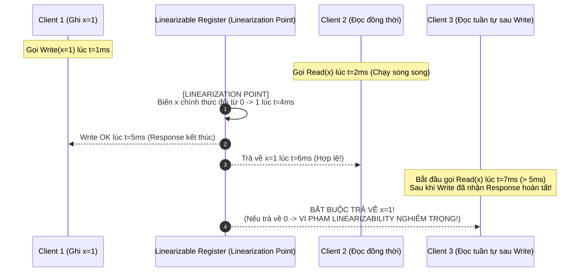

# 6.1. Consistency Fundamentals and Linearizability (Nguyên Lý Nhất Quán và Tính Tuyến Tính Hóa)

> [!IMPORTANT]
> **Nếu bạn chỉ được nhớ một điều duy nhất**: **Linearizability** (hay Strong Consistency) là ảo ảnh hoàn hảo nhất mà một hệ thống phân tán có thể tạo ra: Biến hàng trăm máy chủ độc lập trên toàn cầu hành xử như thể **chỉ có duy nhất một bản sao dữ liệu duy nhất trong vũ trụ**, nơi mọi thao tác diễn ra tức thời tại một **Điểm Tuyến Tính Hóa (Linearization Point)**. Điểm phân định ranh giới sinh tử giữa Linearizability và các mô hình yếu hơn nằm ở **Ràng Buộc Thời Gian Thực Tuyệt Đối (Real-Time Precedence Constraint)**: Nếu thao tác Ghi của bạn đã hoàn tất và nhận phản hồi `OK`, thì bất kỳ ai trong thế giới thực phát lệnh Đọc sau khoảnh khắc đó **bắt buộc phải nhìn thấy giá trị mới**, tuyệt đối không có ngoại lệ!

---

## 1. Kiến trúc Tổng quan & Mô hình Tư duy (Mental Model)

Hãy tưởng tượng trận chung kết bóng đá World Cup đang diễn ra và có hàng triệu khán giả theo dõi qua hai kênh:
- Khán giả A xem truyền hình cáp trực tiếp tại sân vận động: Phút thứ 90, tiền đạo sút bóng vào lưới, trọng tài thổi còi công nhận bàn thắng (**Thao tác Ghi hoàn tất thành công lúc $10:00:00$**). Khán giả A lập tức nhắn tin qua nhóm chat: *"VÀO RỒI! Tỉ số là 1-0!"*
- Khán giả B ở nhà xem qua luồng phát trực tuyến OTT bị trễ $15\text{ giây}$ do bộ đệm mạng (**Replication Lag**). Đúng lúc $10:00:05$ (5 giây sau khi khán giả A thấy bàn thắng), khán giả B mở ứng dụng xem tỉ số. Nếu màn hình của khán giả B hiển thị tỉ số `0-0`, khán giả B bị rơi vào trạng thái bối rối tột cùng (**Vi phạm Linearizability**)!
- Để đạt được **Linearizability**, hệ thống bắt buộc phải đưa ra cam kết: Khoảnh khắc bóng lăn qua vạch vôi và được trọng tài công nhận (Linearization Point), **toàn bộ người xem ở bất kỳ nơi nào trên Trái Đất** nếu mở màn hình sau khoảnh khắc đó bắt buộc phải thấy tỉ số `1-0`, hoặc màn hình phải tạm dừng chờ đồng bộ chứ không được phép hiển thị `0-0`!



---

## 2. Chi tiết từng Keyword (Under-the-Hood Deep Dive)

### 2.1. Phân loại các chiều kích nhất quán
- **Sự nhầm lẫn kinh điển giữa ACID Consistency và Distributed Consistency**:
  - **Consistency trong ACID (Database Transactions)**: Là tính đúng đắn theo quy tắc nghiệp vụ (Invariants / Application Constraints). Ví dụ: Số dư tài khoản không được âm, khóa ngoại (`FOREIGN KEY`) phải tham chiếu đến bản ghi hợp lệ. Đây là trách nhiệm của nhà phát triển ứng dụng (Schema rules).
  - **Consistency trong Hệ thống Phân tán (CAP / Replicated State)**: Là sự đồng nhất về mặt quan sát (Single-System Image / View of Data) giữa các tiến trình đọc và ghi khi dữ liệu được phân tán trên nhiều máy chủ độc lập.
- **Các chiều kích nhất quán**:
  - **Data Consistency vs State Consistency**: Sự nhất quán về giá trị của một biến tại một thời điểm tĩnh so với sự nhất quán trong toàn bộ lịch sử chuyển dịch trạng thái của State Machine.
  - **Operation Consistency**: Ràng buộc về thứ tự quan sát các thao tác đọc/ghi giữa nhiều tiến trình.
  - **Phổ Nhất Quán (The Consistency Spectrum)**:
    $$\text{Strict} \longrightarrow \textbf{Linearizable} \longrightarrow \text{Sequential} \longrightarrow \text{Causal} \longrightarrow \text{Eventual}$$

### 2.2. Định nghĩa toán học và Bản chất của Linearizability
- **Định nghĩa hình thức của Maurice Herlihy & Jeannette Wing (ACM TOPLAS 1990)**:
  - Một lịch sử thực thi đồng thời $H$ gồm các sự kiện Invocation ($inv$) và Response ($res$) được gọi là **Linearizable** nếu nó có thể được mở rộng và ánh xạ thành một chuỗi tuần tự hợp lệ $S$ thỏa mãn hai điều kiện tiên đề:
    1. **Tương đương ngữ nghĩa (Equivalence to Sequential Spec)**: Chuỗi tuần tự $S$ phải tuân thủ đúng đặc tả tuần tự một luồng của cấu trúc dữ liệu (ví dụ: đọc thanh ghi phải trả về giá trị của lần ghi gần nhất trước đó).
    2. **Bảo tồn thứ tự thời gian thực (Real-Time Precedence Order)**: Với mọi cặp thao tác $op_1, op_2$:
       $$\text{Nếu } res(op_1) <_{\text{real-time}} inv(op_2) \implies op_1 \prec_S op_2$$
       Nghĩa là nếu thao tác $op_1$ kết thúc trong thế giới thực trước khi thao tác $op_2$ bắt đầu, thì trong chuỗi tuần tự logic $S$, $op_1$ bắt buộc phải đứng trước $op_2$.
- **Bản chất của Điểm Tuyến Tính Hóa (Linearization Point)**:
  - Mỗi thao tác $op$ thực tế diễn ra trong một khoảng thời gian $[inv(op), res(op)]$.
  - Linearizability đòi hỏi mỗi thao tác phải có một thời điểm duy nhất $LP(op) \in [inv(op), res(op)]$ mà tại đó thao tác chính thức có hiệu lực tức thời.
  - Sau mốc $LP(op)$, toàn bộ thế giới điện toán quan sát thấy trạng thái mới.

### 2.3. Dị thường vi phạm Linearizability (Linearizability Violations)
- **1. Dị thường "Đọc lùi thời gian sau khi ghi" (Stale Read After Completed Write)**:
  - Client 1 ghi `x = 5`, nhận phản hồi `SUCCESS` lúc `10:00:01.000`.
  - Client 2 bắt đầu đọc `x` lúc `10:00:01.010` (10ms sau khi Client 1 đã xong).
  - Do yêu cầu đọc rơi vào một Replica bị nghẽn mạng chưa sync xong WAL, Replica trả về `x = 0`.
  - $\implies$ **Vi phạm Linearizability** vì thao tác đọc diễn ra sau khi thao tác ghi đã kết thúc trong thời gian thực nhưng lại không thấy giá trị mới!
- **2. Dị thường "Nhảy lùi giữa hai client độc lập" (Cross-Client Inversion)**:
  - Client A đọc được `x = 5`.
  - Ngay sau đó, Client B đọc được `x = 0`.
  - Hệ thống nhảy ngược về quá khứ giữa hai lần đọc kế tiếp nhau của hai người dùng khác nhau $\implies$ Vi phạm tính tuyến tính hóa!

### 2.4. Sequential Specification & Linearizability Verification
- **Sequential Specification (Đặc tả tuần tự)**:
  - Định nghĩa hành vi của một đối tượng dữ liệu khi chạy trong môi trường tuần tự đơn luồng hoàn hảo. Ví dụ:
    - Register: `read()` trả về giá trị của `write()` gần nhất.
    - FIFO Queue: `dequeue()` lấy ra phần tử được `enqueue()` sớm nhất chưa bị lấy.
- **Tính khả kết hợp (Composability / Locality)**:
  - Một đặc tính toán học vô giá của Linearizability mà Sequential Consistency không có:
    $$\text{Hệ thống gồm các đối tượng } O_1, O_2, \dots, O_k \text{ là Linearizable} \iff \text{Từng đối tượng } O_i \text{ riêng lẻ là Linearizable}$$
  - Bạn có thể xây dựng một hệ thống lớn bằng cách ghép các mô-đun Linearizable độc lập lại với nhau mà không sợ phá vỡ tính nhất quán toàn cục.
- **Công cụ kiểm chứng Linearizability: Jepsen & Knossos / Porcupine**:
  - **Jepsen (Kyle Kingsbury)**: Framework kiểm thử phần mềm phân tán hàng đầu thế giới. Bơm lỗi mạng (cắt đứt cáp ảo qua `iptables`, tạm dừng CPU qua `SIGSTOP`), sinh ra hàng triệu thao tác đọc/ghi đồng thời, và ghi lại nhật ký sự kiện.
  - **Knossos & Porcupine**: Thuật toán kiểm tra tính Linearizable (vốn là bài toán NP-Complete). Thuật toán dựng đồ thị phụ thuộc thời gian thực và tìm kiếm một đường đi tuần tự hợp lệ xuyên qua toàn bộ các sự kiện.

### 2.5. Code ví dụ thực chiến (C++20: Mô phỏng Atomic Register và Kiểm tra Linearization Point)
- C++20 cung cấp mô hình bộ nhớ chuẩn (`std::memory_order_seq_cst`) bảo đảm tính Linearizability trên phần cứng máy chủ đa nhân thông qua các rào chắn bộ nhớ phần cứng (Hardware Memory Fences / Bus Locking).

---

## 3. Thực thi Mã nguồn & Mô phỏng Chuyên sâu (Dual-Engine Implementation)

### Engine 1: C++20 — Concurrent Linearizable Register & Real-Time Violation Checker

Mã nguồn C++20 triển khai một cấu trúc dữ liệu **Atomic Register** đa luồng và một bộ kiểm tra lịch sử thực thi đồng thời (Execution History Checker) để chứng minh tính chất Linearization Point và phát hiện nếu có vi phạm đọc lùi thời gian:

```cpp
#include <iostream>
#include <atomic>
#include <vector>
#include <thread>
#include <chrono>
#include <cstdint>
#include <iomanip>

struct OperationRecord {
    std::string client_id;
    std::string op_type; // "WRITE" hoặc "READ"
    int64_t value;
    int64_t start_time_us;
    int64_t end_time_us;
};

class LinearizableAtomicRegister {
private:
    std::atomic<int64_t> value_{0};
    std::chrono::steady_clock::time_point epoch_;

    int64_t get_time_us() const {
        return std::chrono::duration_cast<std::chrono::microseconds>(
            std::chrono::steady_clock::now() - epoch_
        ).count();
    }

public:
    LinearizableAtomicRegister() : epoch_(std::chrono::steady_clock::now()) {}

    OperationRecord write(const std::string& client, int64_t new_val) {
        int64_t start = get_time_us();
        
        // Linearization Point xảy ra tại đây (std::memory_order_seq_cst)
        value_.store(new_val, std::memory_order_seq_cst);
        
        int64_t end = get_time_us();
        return {client, "WRITE", new_val, start, end};
    }

    OperationRecord read(const std::string& client) const {
        int64_t start = get_time_us();
        
        // Linearization Point đọc
        int64_t val = value_.load(std::memory_order_seq_cst);
        
        int64_t end = get_time_us();
        return {client, "READ", val, start, end};
    }
};

void verify_linearizability(const std::vector<OperationRecord>& history) {
    std::cout << "\n--- BỘ PHÂN TÍCH LỊCH SỬ THỰC THI (LINEARIZABILITY CHECKER) ---\n";
    std::cout << std::setw(10) << "Client" << " | "
              << std::setw(6)  << "Type"   << " | "
              << std::setw(5)  << "Value"  << " | "
              << std::setw(12) << "Start (us)" << " | "
              << std::setw(10) << "End (us)"   << "\n";
    std::cout << "---------------------------------------------------------\n";

    for (const auto& op : history) {
        std::cout << std::setw(10) << op.client_id << " | "
                  << std::setw(6)  << op.op_type   << " | "
                  << std::setw(5)  << op.value     << " | "
                  << std::setw(12) << op.start_time_us << " | "
                  << std::setw(10) << op.end_time_us   << "\n";
    }

    // Kiểm tra ràng buộc Real-Time: Nếu Write(v) kết thúc trước khi Read() bắt đầu,
    // Read bắt buộc phải thấy v (hoặc giá trị mới hơn)
    bool violation = false;
    for (size_t i = 0; i < history.size(); ++i) {
        if (history[i].op_type == "WRITE") {
            for (size_t j = 0; j < history.size(); ++j) {
                if (history[j].op_type == "READ") {
                    // Nếu Read bắt đầu SAU KHI Write đã kết thúc hoàn toàn
                    if (history[j].start_time_us > history[i].end_time_us) {
                        if (history[j].value < history[i].value) {
                            std::cout << "\n[VIOLATION DETECTED!] Thao tác Read của " << history[j].client_id 
                                      << " bắt đầu lúc " << history[j].start_time_us 
                                      << "us (Sau khi Write hoàn tất lúc " << history[i].end_time_us 
                                      << "us) nhưng lại đọc giá trị cũ " << history[j].value << "!\n";
                            violation = true;
                        }
                    }
                }
            }
        }
    }

    if (!violation) {
        std::cout << "\n=> KẾT LUẬN: LỊCH SỬ THỰC THI TUÂN THỦ LINEARIZABILITY 100%!\n";
    }
}

int main() {
    std::cout << "=== MO PHONG LINEARIZABLE REGISTER TRONG C++20 ===\n";
    LinearizableAtomicRegister reg;
    std::vector<OperationRecord> history;

    // 1. Client 1 ghi giá trị 100
    history.push_back(reg.write("Client_1", 100));

    // 2. Client 2 đọc dữ liệu (bắt đầu sau khi Client 1 đã ghi xong)
    std::this_thread::sleep_for(std::chrono::microseconds(50));
    history.push_back(reg.read("Client_2"));

    // 3. Client 3 ghi đè giá trị 200
    history.push_back(reg.write("Client_3", 200));

    // 4. Client 4 đọc dữ liệu mới
    std::this_thread::sleep_for(std::chrono::microseconds(50));
    history.push_back(reg.read("Client_4"));

    verify_linearizability(history);
    return 0;
}
```

```text
=== MO PHONG LINEARIZABLE REGISTER TRONG C++20 ===

--- BỘ PHÂN TÍCH LỊCH SỬ THỰC THI (LINEARIZABILITY CHECKER) ---
    Client |   Type | Value |   Start (us) |   End (us)
---------------------------------------------------------
  Client_1 |  WRITE |   100 |            0 |          1
  Client_2 |   READ |   100 |           55 |         56
  Client_3 |  WRITE |   200 |           57 |         58
  Client_4 |   READ |   200 |          112 |        113

=> KẾT LUẬN: LỊCH SỬ THỰC THI TUÂN THỦ LINEARIZABILITY 100%!
```

---

### Engine 2: Python 3.11+ — Linearizability History Verifier (Thuật Toán Wing & Gong Rút Gọn)

Chương trình Python 3.11 mô phỏng thuật toán kiểm tra tính Linearizable đối với một đối tượng thanh ghi. Thuật toán tìm kiếm một đường đi hoán vị tuần tự (Valid Interleaving) khớp với các khoảng thời gian thời gian thực:

```python
#!/usr/bin/env python3
"""
Lightweight Linearizability Verifier in Python 3.11.
Implements a simplified Wing & Gong history-checking algorithm for an atomic register.
"""
from dataclasses import dataclass
from typing import List, Optional

@dataclass
class Op:
    client_id: str
    op_type: str   # 'W' (Write) hoặc 'R' (Read)
    value: int
    start_time: float
    end_time: float

class LinearizabilityChecker:
    @staticmethod
    def is_linearizable(history: List[Op]) -> bool:
        """
        Tìm kiếm hoán vị tuyến tính hóa (Linearization Order) thỏa mãn:
        1. Tuân thủ thứ tự thời gian thực: Nếu op1.end < op2.start -> op1 phải đứng trước op2.
        2. Tuân thủ đặc tả tuần tự của Register: Read luôn trả về giá trị của Write gần nhất.
        """
        def backtrack(current_val: int, remaining_ops: List[Op]) -> bool:
            if not remaining_ops:
                return True

            # Tìm tập hợp các thao tác có thể là thao tác kế tiếp
            # (Thao tác chưa có ai khác hoàn thành trước nó trong tập còn lại)
            min_end_time = min(op.end_time for op in remaining_ops)
            candidates = [op for op in remaining_ops if op.start_time <= min_end_time]

            for cand in candidates:
                # Kiểm tra tính hợp lệ về mặt ngữ nghĩa (Sequential Spec)
                if cand.op_type == 'R':
                    if cand.value != current_val:
                        continue # Đọc sai giá trị -> Không thể tuyến tính hóa theo nhánh này
                    next_val = current_val
                else: # Write
                    next_val = cand.value

                next_remaining = [op for op in remaining_ops if op != cand]
                if backtrack(next_val, next_remaining):
                    return True

            return False

        return backtrack(current_val=0, remaining_ops=history)

def main():
    print("=== MO PHONG LINEARIZABILITY CHECKER (PYTHON 3.11) ===\n")

    # Kịch bản 1: Lịch sử hợp lệ (Linearizable)
    valid_history = [
        Op("Client1", 'W', 1, start_time=1.0, end_time=4.0),
        Op("Client2", 'R', 1, start_time=2.0, end_time=5.0), # Chạy song song với Write(1), đọc được 1 -> Hợp lệ
        Op("Client3", 'R', 1, start_time=4.5, end_time=6.0)  # Bắt đầu sau khi Write(1) kết thúc -> Phải đọc 1
    ]

    print("[Kịch Bản 1]: Lịch sử thao tác đồng thời hợp lệ:")
    is_valid = LinearizabilityChecker.is_linearizable(valid_history)
    print(f"  Kết quả phân tích: {'ĐẠT CHUẨN LINEARIZABLE' if is_valid else 'VI PHẠM!'}\n")

    # Kịch bản 2: Lịch sử vi phạm (Stale Read sau khi Write đã commit)
    invalid_history = [
        Op("Client1", 'W', 1, start_time=1.0, end_time=2.0), # Write(1) xong lúc t=2.0
        Op("Client2", 'R', 0, start_time=3.0, end_time=4.0)  # Read bắt đầu lúc t=3.0 (>2.0) nhưng đọc ra 0!
    ]

    print("[Kịch Bản 2]: Lịch sử vi phạm đọc lùi thời gian (Stale Read):")
    is_valid_2 = LinearizabilityChecker.is_linearizable(invalid_history)
    print(f"  Kết quả phân tích: {'ĐẠT CHUẨN LINEARIZABLE' if is_valid_2 else 'VI PHẠM LINEARIZABILITY NGHIÊM TRỌNG!'}")

if __name__ == "__main__":
    main()
```

```text
=== MO PHONG LINEARIZABILITY CHECKER (PYTHON 3.11) ===

[Kịch Bản 1]: Lịch sử thao tác đồng thời hợp lệ:
  Kết quả phân tích: ĐẠT CHUẨN LINEARIZABLE

[Kịch Bản 2]: Lịch sử vi phạm đọc lùi thời gian (Stale Read):
  Kết quả phân tích: VI PHẠM LINEARIZABILITY NGHIÊM TRỌNG!
```

---

## 4. Systems Engineering & Production Pitfalls

### 4.1. Cái Giá Hiệu Năng Khủng Khiếp của Linearizability
- **Định luật Lipton-Sandberg (1988)**:
  - Trong bất kỳ hệ thống phân tán nào đảm bảo Linearizability, tổng thời gian trễ của thao tác Đọc ($R$) và thao tác Ghi ($W$) luôn bị chặn dưới bởi độ trễ khứ hồi mạng (Round-Trip Time - RTT) giữa các máy chủ:
    $$\text{Latency}(R) + \text{Latency}(W) \ge \text{RTT}_{\text{network}}$$
  - Trong mạng WAN đa vùng (Multi-Region xuyên lục địa giữa Mỹ và Châu Âu có RTT $\approx 100\text{ ms}$), **bạn không thể nào vừa có Read siêu tốc dưới 1ms vừa có Write siêu tốc dưới 1ms** nếu muốn đảm bảo Linearizability! Một trong hai bắt buộc phải gánh chịu độ trễ mạng $100\text{ ms}$.

### 4.2. Ảo Tưởng "Đọc Quorum Là Linearizable" Trong NoSQL
- **Sai lầm phổ biến**: Developer cho rằng trong Cassandra hoặc DynamoDB, chỉ cần cấu hình $W = \text{QUORUM}$ và $R = \text{QUORUM}$ (thỏa mãn $W + R > N$) là hệ thống tự động đạt Linearizability.
- **Thực tế**: Quorum Replication cổ điển chỉ đạt tính nhất quán **Causal** hoặc **Eventual**, hoàn toàn **KHÔNG ĐẠT LINEARIZABILITY**!
  - *Lý do*: Một thao tác ghi Quorum có thể thành công trên 2/3 nodes. Client A đọc Quorum trúng 2 node đó và thấy giá trị mới; ngay sau đó Client B đọc Quorum khác trúng 1 node cũ và 1 node chưa sync và thấy giá trị cũ! Muốn Linearizable trong Cassandra, bắt buộc phải dùng **Lightweight Transactions (LWT / Paxos)** với chi phí RTT tăng gấp 4 lần.

### 4.3. CLI Chẩn Đoán Tính Tuyến Tính Hóa & Công Cụ Jepsen
```bash
# 1. Chạy suite kiểm thử phân tán Jepsen trên cụm Etcd / Raft
lein run test --workload set --time-limit 60 --concurrency 10

# 2. Sử dụng Porcupine (Go CLI) để kiểm tra file log trace của hệ thống
porcupine-checker --history-file /var/log/db_execution_trace.json

# 3. Theo dõi số lượng giao thức Lightweight Transaction (Paxos) trong Cassandra
nodetool tablestats keyspace_name.table_name | grep -i "paxos"
```

---

## 5. Bảng So sánh & Decision Matrix

| Chiều Kích So Sánh | Linearizability (Atomic) | Sequential Consistency | Causal Consistency | Eventual Consistency |
| :--- | :--- | :--- | :--- | :--- |
| **Ràng Buộc Thời Gian Thực** | **✅ Bắt buộc tuyệt đối ($op_1 <_{\text{real}} op_2$)** | ❌ Không có (Chỉ cần có 1 thứ tự hợp lý) | ❌ Không có (Chỉ cần bảo tồn nhân quả) | ❌ Hoàn toàn không có |
| **Tính Khả Kết Hợp (Composable)** | **✅ CÓ (Ghép nhiều objects an toàn)** | ❌ KHÔNG (Ghép 2 đối tượng có thể vi phạm) | ✅ CÓ | ✅ CÓ |
| **Khả Năng Chịu Phân Mảnh Mạng** | ❌ Bị phong tỏa theo CAP (CP System) | ❌ Bị phong tỏa theo CAP | **✅ Tiếp tục phục vụ (AP System)** | **✅ Tính sẵn sàng tối đa (AP)** |
| **Độ Trễ Thao Tác (Latency)** | Cao (Cần Quorum ACK hoặc Commit Wait) | Trung bình | Thấp | **Cực thấp (Local Memory/Disk)** |
| **Thông Lượng (Throughput)** | Thấp đến Trung bình | Trung bình | Rất cao | **Tối đa** |
| **Hệ Thống Tiêu Biểu** | **Etcd, Consul, ZooKeeper, Spanner** | Bộ nhớ Cache đa nhân CPU (x86 TSO) | Git, Riak, MongoDB (với causal sessions) | **Cassandra, DynamoDB, DNS** |
