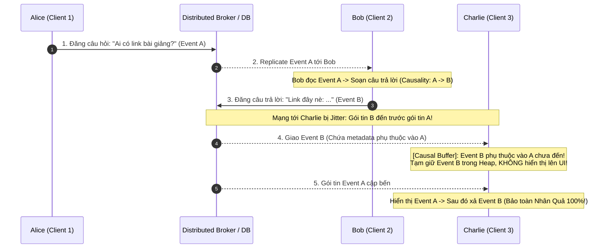

# 6.2. Sequential, Causal and Eventual Consistency (Tính Nhất Quán Tuần Tự, Nhân Quả và Nhất Quán Cuối Cùng)

> [!IMPORTANT]
> **Nếu bạn chỉ được nhớ một điều duy nhất**: Không có một mô hình nhất quán vạn năng (One-Size-Fits-All) cho mọi hệ thống phân tán. **Sequential Consistency** bỏ qua thời gian thực nhưng buộc mọi node phải đồng thuận trên cùng một kịch bản xen kẽ duy nhất; **Causal Consistency** là ranh giới tối thượng của định lý CAP — mô hình mạnh nhất có thể đạt được mà vẫn bảo đảm tính sẵn sàng 100% khi mạng bị phân mảnh (AP System); còn **Eventual Consistency** là sự nhượng bộ thực dụng giúp Internet và các nền tảng Big Data mở rộng quy mô toàn cầu bằng cách chấp nhận dữ liệu cũ trong chốc lát để đổi lấy thông lượng hàng triệu requests mỗi giây!

---

## 1. Kiến trúc Tổng quan & Mô hình Tư duy (Mental Model)

Hãy tưởng tượng một diễn đàn thảo luận trực tuyến có hàng triệu thành viên tham gia:
- **Sequential Consistency (Một cuốn biên bản hội nghị duy nhất)**: Giống như một phiên tòa xét xử: Bất kỳ thẩm phán hay luật sư nào phát biểu, lời nói đều được thư ký tòa án ghi vào một cuốn sổ biên bản theo một thứ tự duy nhất. Thư ký có thể ghi câu nói của người này trước người kia dù ở ngoài đời họ nói cách nhau vài giây (**Bỏ qua thời gian thực**), nhưng một khi đã ghi vào sổ, **tất cả mọi người trong phòng xử án đều phải đọc được cùng một trang sách giống hệt nhau** và không ai được phép nói câu sau trước câu trước của chính mình (**Program Order**).
- **Causal Consistency (Mối quan hệ nhân quả trong cuộc hội thoại)**: Alice đăng một câu hỏi: *"Ai có đáp án đề thi hôm nay?"* ($A$). Bob nhìn thấy câu hỏi của Alice và trả lời: *"Đáp án là C"* ($B$). Vì câu trả lời $B$ được sinh ra do nhìn thấy $A$ ($A \to B$), hệ thống **tuyệt đối không được phép** để bất kỳ người dùng nào nhìn thấy câu trả lời $B$ xuất hiện trên màn hình trước câu hỏi $A$! Tuy nhiên, nếu Charlie độc lập đăng tin: *"Hôm nay trời mưa to"* ($C$), tin nhắn $C$ không có quan hệ nhân quả với $A$ và $B$ ($C \parallel A, C \parallel B$), nên người thì thấy $C$ ở trên, người thì thấy $C$ ở dưới đều hoàn toàn hợp lệ!
- **Eventual Consistency (Tin đồn truyền miệng trong thành phố)**: Một người bắt đầu tung một tin đồn. Ban đầu chỉ vài người xung quanh biết; sau vài giờ, tin đồn lan qua mạng xã hội, truyền miệng. Nếu không có ai sửa đổi tin đồn đó, cuối cùng cả thành phố đều sẽ nắm được cùng một câu chuyện.



---

## 2. Chi tiết từng Keyword (Under-the-Hood Deep Dive)

### 2.1. Sequential Consistency & Định nghĩa toán học của Lamport
- **Khái niệm & Nguồn gốc hình thức**:
  - Được Leslie Lamport công bố năm 1979 trong bài báo mang tính cột mốc *"How to Make a Multiprocessor Computer That Correctly Executes Multiprocess Programs"*.
  - Xuất phát điểm của bài toán: Làm thế nào để một hệ thống gồm nhiều CPU chia sẻ chung bộ nhớ RAM (hoặc nhiều nút phân tán) có thể vận hành đúng đắn khi các trình biên dịch (Compilers) và phần cứng CPU liên tục xáo trộn thứ tự lệnh (Out-of-Order Execution).
  - Định nghĩa hình thức: Một hệ thống đa tiến trình được gọi là đạt **Sequential Consistency** khi:
    > "Kết quả của bất kỳ lần thực thi nào cũng tương đương như thể các thao tác của tất cả các tiến trình được thực thi theo một **thứ tự tuần tự toàn cầu duy nhất (Global Sequential Order)**, và trong chuỗi tuần tự đó, các thao tác của từng tiến trình riêng lẻ xuất hiện theo đúng **thứ tự chương trình (Program Order)** do mã nguồn của tiến trình đó quy định."
- **Hai Tiên Đề Toán Học Bắt Buộc**:
  1. **Program Order Constraint**: Với mọi tiến trình $P_i$, nếu thao tác $op_{i,1}$ xuất hiện trước $op_{i,2}$ trong mã lệnh của $P_i$, thì trong chuỗi tuần tự toàn cục $S$:
     $$op_{i,1} \prec_S op_{i,2}$$
  2. **Uniform View Constraint (Đồng nhất góc nhìn)**: Tồn tại một chuỗi xen kẽ $S$ duy nhất của tất cả các thao tác sao cho **mọi tiến trình trong hệ thống đều quan sát thấy các thao tác xảy ra theo đúng chuỗi $S$ đó**.
- **Cơ chế phần cứng & Kernel**:
  - Trên vi kiến trúc CPU hiện đại, để đảm bảo Sequential Consistency đòi hỏi phải chèn các lệnh rào chắn bộ nhớ phần cứng (**Memory Barriers / Fences** như lệnh `mfence` trên x86 hoặc `dmb ish` trên ARM) để vô hiệu hóa Store Buffer và ép CPU phải xả bộ đệm tuần tự ra L1/L2 Cache Coherence Bus.

### 2.2. So sánh chuyên sâu: Sequential Consistency vs Linearizability
- **Sự khác biệt duy nhất: Ràng buộc Thời Gian Thực (Real-Time Constraint)**:
  - **Linearizability**: Bắt buộc phải khớp với trục thời gian thực tuyệt đối ngoài đời thực ($res(op_1) <_{\text{real-time}} inv(op_2) \implies op_1 \prec op_2$).
  - **Sequential Consistency**: **Hoàn toàn không quan tâm đến thời gian thực**. Hệ thống có thể sắp xếp một thao tác diễn ra sau ở ngoài đời lên trước một thao tác diễn ra trước, **miễn là tất cả các node đều đồng thuận quan sát thấy thứ tự đó** và không vi phạm Program Order của từng node.
- **Tính khả kết hợp (Composability / Locality)**:
  - *Linearizability có tính Composable*: Nếu đối tượng Register A là Linearizable và Register B là Linearizable, thì hệ thống gồm cả A và B chắc chắn là Linearizable.
  - *Sequential Consistency KHÔNG có tính Composable*: Bạn có thể có Register A đạt Sequential Consistency và Register B đạt Sequential Consistency, nhưng khi một tiến trình tương tác với cả A và B, toàn bộ hệ thống lại **vi phạm Sequential Consistency**!
- **Hệ thống điển hình**:
  - Apache ZooKeeper (Giao thức Zab): Cung cấp Sequential Consistency cho các thao tác ghi và đọc. (Để đọc dữ liệu Linearizable trong ZooKeeper, client bắt buộc phải gọi thêm hàm `sync()`).
  - Mô hình bộ nhớ vi xử lý x86 TSO (Total Store Order).

### 2.3. Causal Consistency: Bản chất và Ràng buộc toán học
- **Định nghĩa của Hagit Attiya & Mustapha Ahamad (1995)**:
  - Các thao tác có liên hệ nhân quả với nhau ($A \to B$ theo quan hệ Happens-Before của Lamport) **bắt buộc phải được tất cả các tiến trình quan sát thấy theo cùng một thứ tự** ($A$ trước $B$).
  - Các thao tác độc lập đồng thời ($A \parallel B$) không có mối liên hệ nhân quả, do đó các tiến trình khác nhau **được phép quan sát chúng theo các thứ tự khác nhau**.
- **Vị thế tối thượng trong Định lý CAP**:
  - Mahajan et al. (2011) đã chứng minh bằng toán học: **Causal Consistency là mô hình nhất quán mạnh mẽ nhất có thể đạt được trong một hệ thống phân tán hoàn toàn khả dụng (High Availability) dưới điều kiện mạng bị phân mảnh (AP System)**.
  - Nghĩa là: Bạn không thể xây dựng một hệ thống AP đạt Sequential hay Linearizable, nhưng bạn hoàn toàn có thể xây dựng một hệ thống AP đạt Causal Consistency!
- **Cơ chế triển khai Under the Hood**:
  - Đính kèm **Vector Clocks** hoặc danh sách các ID phụ thuộc (Causal Dependency Graph) vào metadata của từng thao tác.
  - Tại node nhận: Nếu bản ghi $B$ phụ thuộc vào bản ghi $A$ mà $A$ chưa có trong database, node nhận đưa $B$ vào **Causal Hold Queue** trong bộ nhớ RAM và không giao cho ứng dụng cho tới khi $A$ được nạp thành công.

### 2.4. Eventual Consistency: Định nghĩa và Khái niệm bản chất
- **Định nghĩa của Werner Vogels (CTO Amazon - 2007)**:
  - Nếu không còn bất kỳ thao tác ghi mới nào được nạp vào hệ thống (Quiescent State), thì sau một khoảng thời gian hữu hạn, **tất cả các bản sao sẽ hội tụ và trả về giá trị giống hệt nhau**.
- **Các khái niệm cốt lõi**:
  - **Quiescent State (Trạng thái tĩnh lặng)**: Tiền đề bắt buộc. Nếu client liên tục ghi đè với tốc độ nhanh hơn tốc độ lan truyền gossip của mạng, hệ thống sẽ liên tục ở trong trạng thái phân kỳ (Divergence).
  - **Monotonic Convergence**: Quá trình các node giảm dần khoảng cách sai lệch dữ liệu thông qua Read Repair, Hinted Handoff và Anti-Entropy Merkle Trees.
  - **Stale Reads**: Hệ quả không thể tránh khỏi. Client đọc dữ liệu có thể nhận được giá trị cũ do Replication Lag.
- **Biến thể tăng cường (Eventual Consistency with Guarantees)**:
  - Khi thuần túy Eventual Consistency quá lỏng lẻo cho trải nghiệm người dùng, các kỹ sư bổ sung thêm các ràng buộc Session Guarantees:
    - *Read-Your-Writes*: Đảm bảo tác giả luôn thấy tác phẩm của mình.
    - *Monotonic Reads*: Đảm bảo không du hành ngược thời gian.
    - *Monotonic Writes*: Đảm bảo các lần ghi của một client không bị đảo lộn.

### 2.5. Code ví dụ thực chiến (C++20: Mô phỏng Causal Dependency Resolver)
- Triển khai hàng đợi lưu trữ và kiểm tra quan hệ phụ thuộc nhân quả giữa bài viết gốc và các bình luận phân tán.

---

## 3. Thực thi Mã nguồn & Mô phỏng Chuyên sâu (Dual-Engine Implementation)

### Engine 1: C++20 — Causal Dependency Queue & Out-of-Order Message Stitcher

Chương trình C++20 mô phỏng tầng lưu trữ bảo đảm **Causal Consistency**: Tiếp nhận các sự kiện đến lệch thứ tự qua mạng, tự động đưa các sự kiện con vào hàng đợi giữ lại (Hold Queue) và chỉ phát lệnh commit khi sự kiện nguyên nhân tiền đề cập bến:

```cpp
#include <iostream>
#include <string>
#include <vector>
#include <unordered_map>
#include <memory>
#include <cstdint>

struct CausalEvent {
    std::string event_id;
    std::string causal_parent_id; // ID của sự kiện nguyên nhân tiền đề (rỗng nếu là gốc)
    std::string payload;
};

class CausalMessageStitcher {
private:
    std::unordered_map<std::string, std::string> committed_events_;
    std::vector<CausalEvent> hold_queue_;

public:
    void process_incoming_event(const CausalEvent& ev) {
        std::cout << ">>> [NETWORK IN] Nhận sự kiện '" << ev.event_id 
                  << "' (Cần parent: '" << (ev.causal_parent_id.empty() ? "NONE" : ev.causal_parent_id) 
                  << "') | Payload: " << ev.payload << "\n";

        // Kiểm tra xem Parent đã được commit trước đó chưa
        if (ev.causal_parent_id.empty() || committed_events_.contains(ev.causal_parent_id)) {
            commit_event(ev);
            drain_hold_queue();
        } else {
            std::cout << "    [HOLD QUEUE] Parent '" << ev.causal_parent_id 
                      << "' chưa xuất hiện! Tạm giữ '" << ev.event_id << "' trong bộ nhớ RAM.\n";
            hold_queue_.push_back(ev);
        }
        std::cout << "--------------------------------------------------------\n";
    }

private:
    void commit_event(const CausalEvent& ev) {
        committed_events_[ev.event_id] = ev.payload;
        std::cout << "    ===> [COMMIT ENGINE] Cam kết thành công: '" << ev.event_id 
                  << "' -> " << ev.payload << "\n";
    }

    void drain_hold_queue() {
        bool progress = true;
        while (progress) {
            progress = false;
            for (auto it = hold_queue_.begin(); it != hold_queue_.end();) {
                if (committed_events_.contains(it->causal_parent_id)) {
                    std::cout << "    [UNBLOCK] Parent '" << it->causal_parent_id 
                              << "' đã xuất hiện! Giải phóng '" << it->event_id << "' từ Hold Queue:\n";
                    commit_event(*it);
                    it = hold_queue_.erase(it);
                    progress = true;
                } else {
                    ++it;
                }
            }
        }
    }
};

int main() {
    std::cout << "=== MO PHONG CAUSAL DEPENDENCY STITCHER (C++20) ===\n\n";
    CausalMessageStitcher stitcher;

    // Giả lập kịch bản mạng xáo trộn: Bài bình luận và phản hồi đến TRƯỚC bài viết gốc!
    // Mối quan hệ: Post_1 -> Comment_1A -> Reply_1A1
    CausalEvent ev_comment{"Comment_1A", "Post_1", "Comment: Cảm ơn bạn vì bài viết hay!"};
    CausalEvent ev_reply{"Reply_1A1", "Comment_1A", "Reply: Mình cũng thấy bài viết rất bổ ích!"};
    CausalEvent ev_post{"Post_1", "", "Post: Giới thiệu về kiến trúc phân tán."};

    // 1. Bình luận đến đầu tiên (mất gốc)
    stitcher.process_incoming_event(ev_comment);

    // 2. Phản hồi của bình luận đến thứ hai (mất cả bài viết lẫn bình luận)
    stitcher.process_incoming_event(ev_reply);

    // 3. Cuối cùng bài viết gốc mới đến sau khi mạng hết nghẽn
    stitcher.process_incoming_event(ev_post);

    return 0;
}
```

```text
=== MO PHONG CAUSAL DEPENDENCY STITCHER (C++20) ===

>>> [NETWORK IN] Nhận sự kiện 'Comment_1A' (Cần parent: 'Post_1') | Payload: Comment: Cảm ơn bạn vì bài viết hay!
    [HOLD QUEUE] Parent 'Post_1' chưa xuất hiện! Tạm giữ 'Comment_1A' trong bộ nhớ RAM.
--------------------------------------------------------
>>> [NETWORK IN] Nhận sự kiện 'Reply_1A1' (Cần parent: 'Comment_1A') | Payload: Reply: Mình cũng thấy bài viết rất bổ ích!
    [HOLD QUEUE] Parent 'Comment_1A' chưa xuất hiện! Tạm giữ 'Reply_1A1' trong bộ nhớ RAM.
--------------------------------------------------------
>>> [NETWORK IN] Nhận sự kiện 'Post_1' (Cần parent: 'NONE') | Payload: Post: Giới thiệu về kiến trúc phân tán.
    ===> [COMMIT ENGINE] Cam kết thành công: 'Post_1' -> Post: Giới thiệu về kiến trúc phân tán.
    [UNBLOCK] Parent 'Post_1' đã xuất hiện! Giải phóng 'Comment_1A' từ Hold Queue:
    ===> [COMMIT ENGINE] Cam kết thành công: 'Comment_1A' -> Comment: Cảm ơn bạn vì bài viết hay!
    [UNBLOCK] Parent 'Comment_1A' đã xuất hiện! Giải phóng 'Reply_1A1' từ Hold Queue:
    ===> [COMMIT ENGINE] Cam kết thành công: 'Reply_1A1' -> Reply: Mình cũng thấy bài viết rất bổ ích!
--------------------------------------------------------
```

---

### Engine 2: Python 3.11+ — Trình Mô Phỏng So Sánh Trực Quan 3 Mô Hình Nhất Quán (Sequential vs Causal vs Eventual)

Chương trình Python 3.11 chạy mô phỏng đối chứng sự khác biệt trong hành vi quan sát của các tiến trình khi chạy dưới 3 mô hình nhất quán khác nhau:

```python
#!/usr/bin/env python3
"""
Interactive Comparison of Sequential, Causal, and Eventual Consistency in Python 3.11.
Demonstrating observer verification with program-order and causal dependencies.
"""
from dataclasses import dataclass
from typing import List, Dict

@dataclass
class ObservedTrace:
    process_id: str
    observed_sequence: List[str]

def evaluate_sequential_consistency(traces: List[ObservedTrace]) -> bool:
    """
    Sequential Consistency: Tất cả mọi tiến trình BẮT BUỘC phải quan sát thấy
    chuỗi sự kiện giống hệt nhau 100% (Một trật tự tuần tự duy nhất).
    """
    first_seq = traces[0].observed_sequence
    for t in traces[1:]:
        if t.observed_sequence != first_seq:
            return False
    return True

def evaluate_causal_consistency(traces: List[ObservedTrace], causal_rules: Dict[str, str]) -> bool:
    """
    Causal Consistency: Với mọi cặp (A -> B), trong chuỗi quan sát của BẤT KỲ tiến trình nào,
    A bắt buộc phải xuất hiện trước B. Các sự kiện độc lập có thể xen kẽ tùy ý.
    """
    for t in traces:
        seq = t.observed_sequence
        for parent, child in causal_rules.items():
            if parent in seq and child in seq:
                if seq.index(parent) > seq.index(child):
                    return False # Child xuất hiện trước Parent -> Vi phạm Causal!
    return True

def main():
    print("=== SO SÁNH HÌNH THÁI QUAN SÁT CỦA CÁC MÔ HÌNH NHẤT QUÁN (PYTHON 3.11) ===\n")

    # Kịch bản các sự kiện:
    # Event A: "Tạo tài khoản"
    # Event B: "Nạp tiền" (Nhân quả: A -> B)
    # Event C: "Đăng ký nhận quảng cáo" (Độc lập: C || A, C || B)
    causal_rules = {"Event_A": "Event_B"}

    # Trường hợp 1: Hai tiến trình quan sát thấy
    # P1: [Event_A, Event_B, Event_C]
    # P2: [Event_C, Event_A, Event_B]
    traces_case1 = [
        ObservedTrace("P1", ["Event_A", "Event_B", "Event_C"]),
        ObservedTrace("P2", ["Event_C", "Event_A", "Event_B"])
    ]

    print("[Kịch Bản 1]: Các tiến trình quan sát sự kiện độc lập xen kẽ khác nhau:")
    print(f"  P1 quan sát: {traces_case1[0].observed_sequence}")
    print(f"  P2 quan sát: {traces_case1[1].observed_sequence}")
    is_seq1 = evaluate_sequential_consistency(traces_case1)
    is_causal1 = evaluate_causal_consistency(traces_case1, causal_rules)
    print(f"  -> Đạt Sequential Consistency? {is_seq1} (Vì P1 và P2 thấy thứ tự Event_C khác nhau!)")
    print(f"  -> Đạt Causal Consistency?     {is_causal1} (Vì cả 2 đều thấy A trước B, C độc lập!)\n")

    # Trường hợp 2: Tiến trình 2 bị lỗi mạng nhận B trước A
    traces_case2 = [
        ObservedTrace("P1", ["Event_A", "Event_B", "Event_C"]),
        ObservedTrace("P2", ["Event_B", "Event_A", "Event_C"])
    ]

    print("[Kịch Bản 2]: Tiến trình P2 quan sát thấy kết quả trước nguyên nhân:")
    print(f"  P1 quan sát: {traces_case2[0].observed_sequence}")
    print(f"  P2 quan sát: {traces_case2[1].observed_sequence}")
    is_seq2 = evaluate_sequential_consistency(traces_case2)
    is_causal2 = evaluate_causal_consistency(traces_case2, causal_rules)
    print(f"  -> Đạt Sequential Consistency? {is_seq2}")
    print(f"  -> Đạt Causal Consistency?     {is_causal2} (P2 thấy B trước A -> VI PHẠM NHÂN QUẢ!)")
    print(f"  -> Đây chỉ đạt mức:            EVENTUAL CONSISTENCY (Sau khi hết ghi, data hội tụ)!")

if __name__ == "__main__":
    main()
```

```text
=== SO SÁNH HÌNH THÁI QUAN SÁT CỦA CÁC MÔ HÌNH NHẤT QUÁN (PYTHON 3.11) ===

[Kịch Bản 1]: Các tiến trình quan sát sự kiện độc lập xen kẽ khác nhau:
  P1 quan sát: ['Event_A', 'Event_B', 'Event_C']
  P2 quan sát: ['Event_C', 'Event_A', 'Event_B']
  -> Đạt Sequential Consistency? False (Vì P1 và P2 thấy thứ tự Event_C khác nhau!)
  -> Đạt Causal Consistency?     True (Vì cả 2 đều thấy A trước B, C độc lập!)

[Kịch Bản 2]: Tiến trình P2 quan sát thấy kết quả trước nguyên nhân:
  P1 quan sát: ['Event_A', 'Event_B', 'Event_C']
  P2 quan sát: ['Event_B', 'Event_A', 'Event_C']
  -> Đạt Sequential Consistency? False
  -> Đạt Causal Consistency?     False (P2 thấy B trước A -> VI PHẠM NHÂN QUẢ!)
  -> Đây chỉ đạt mức:            EVENTUAL CONSISTENCY (Sau khi hết ghi, data hội tụ)!
```

---

## 4. Systems Engineering & Production Pitfalls

### 4.1. Sự Cố Rò Rỉ Hàng Đợi (Hold Queue Explosion) Trong Causal Consistency
- **Hiện tượng**: Một sự kiện nguyên nhân tiền đề ($A$) bị mất vĩnh viễn trên đường truyền mạng do card mạng bị drop packet hoặc bug phần mềm.
- **Hậu quả**: Hàng trăm sự kiện con cháu ($B, C, D \dots$) phụ thuộc vào $A$ sẽ bị bộ đệm Causal Stitcher giữ lại vĩnh viễn trong bộ nhớ RAM mà không bao giờ được xả ra $\implies$ Tiêu tốn hàng Gigabyte RAM và gây rò rỉ bộ nhớ nghiêm trọng!
- **Khắc phục**: Thiết lập **Causal Timeout / Tombstone Expiration**: Nếu sau 30 giây không nhận được sự kiện cha, kích hoạt cơ chế yêu cầu truyền lại (Explicit Retransmission Request) hoặc xả bỏ kèm cảnh báo khẩn cấp.

### 4.2. Cạm Bẫy Đọc Tuần Tự Trong Apache ZooKeeper
- **Bản chất**: ZooKeeper đảm bảo Sequential Consistency cho mọi thao tác Ghi, nhưng thao tác Đọc mặc định có thể trả về dữ liệu cũ nếu kết nối tới một Follower bị lag mạng.
- **Hậu quả**: Khi triển khai Distributed Lock trên ZooKeeper, một tiến trình đọc lock node từ Follower có thể thấy lock đang rảnh (trong khi Leader đã cấp lock cho tiến trình khác) $\implies$ Hai tiến trình cùng vào vùng nguy hiểm (Critical Section)!
- **Khắc phục**: Trước khi đọc dữ liệu quan trọng trong ZooKeeper, bắt buộc phải gọi phương thức `sync()`:
  ```java
  // Bắt buộc gọi sync() để đẩy con trỏ Follower bắt kịp Leader trước khi đọc
  zk.sync("/distributed_lock", callback, null);
  ```

### 4.3. Cơn Bão Đọc Dữ Liệu Cũ (Stale Read Storm) Trong Eventual Consistency
- **Hiện tượng**: Trong kiến trúc Microservices với Eventual Consistency, khi một sự kiện cập nhật được publish nhưng Kafka consumer bị lag 5 giây:
- Hàng nghìn người dùng đồng loạt reload trang web và liên tục thấy dữ liệu cũ, kích hoạt vòng lặp bấm nút F5 liên tục (Retry storm).
- Tải truy vấn lên Database tăng vọt gấp 10 lần, kéo dài thêm thời gian xử lý của Consumer và biến độ trễ 5 giây thành thảm họa sập hệ thống kéo dài hàng giờ.
- **Biện pháp phòng ngừa**: Kết hợp **Optimistic UI Updates** trên Frontend (giả định thao tác thành công và cập nhật ngay trên giao diện) cùng với cơ chế **Backoff Feedback** để ngăn người dùng spam F5.

### 4.4. CLI Chẩn Đoán Mô Hình Nhất Quán
```bash
# 1. Kiểm tra trạng thái đồng thuận và commit index trong ZooKeeper Zab
echo mntr | nc localhost 2181 | grep -E -i "zk_avg_latency|zk_synced_followers|zk_pending_syncs"

# 2. Theo dõi Replication Lag của các nút Cassandra trong cụm
nodetool netstats | grep -i "Gossip"

# 3. Xem độ trễ đồng bộ hàng đợi trong etcd Raft cluster
etcdctl endpoint status --write-out=table
```

---

## 5. Bảng So sánh & Decision Matrix

| Mô Hình Nhất Quán | Ràng Buộc Thời Gian Thực | Mọi Node Thấy Cùng 1 Thứ Tự? | Khả Dụng Khi Có Network Partition? | Chi Phí Mạng & Độ Trễ | Hệ Thống Điển Hình |
| :--- | :--- | :--- | :--- | :--- | :--- |
| **Linearizability** | **CÓ (Tuyệt đối)** | **CÓ** | ❌ Bị phong tỏa (CP System) | Cao (Phải có Quorum ACK) | **Etcd, Google Spanner, Consul** |
| **Sequential** | ❌ KHÔNG | **CÓ** | ❌ Bị phong tỏa | Trung bình | **Apache ZooKeeper (Zab), CPU x86** |
| **Causal** | ❌ KHÔNG | ❌ KHÔNG (Chỉ cùng thứ tự nếu có nhân quả)| **✅ SẴN SÀNG 100% (AP System)** | Thấp (Đính kèm Vector Clock) | **Git, MongoDB Causal Sessions, Riak** |
| **Eventual** | ❌ KHÔNG | ❌ KHÔNG | **✅ SẴN SÀNG 100% (AP System)** | **Cực thấp (Asynchronous)** | **Cassandra, DynamoDB, DNS** |
