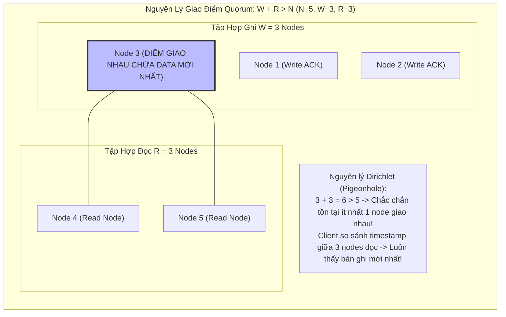

# 6.3. Consistency Trade-offs and Tunable Consistency (Đánh Đổi Nhất Quán và Tính Nhất Quán Có Thể Điều Chỉnh)

> [!IMPORTANT]
> **Nếu bạn chỉ được nhớ một điều duy nhất**: Tính nhất quán trong cơ sở dữ liệu hiện đại không phải là một công tắc nhị phân bật/tắt thô thiển (All-or-Nothing), mà là một **núm xoay điều chỉnh liên tục (Tunable Knob)**. Thông qua phương trình Quorum kinh điển $W + R > N$, kiến trúc sư hệ thống có toàn quyền quyết định sự đánh đổi giữa **Độ trễ (Latency)**, **Tính sẵn sàng (Availability)** và **Tính nhất quán (Consistency)** trên từng câu lệnh truy vấn riêng lẻ: Đặt $W=1, R=1$ để đạt thông lượng hàng triệu ops/giây với độ trễ dưới 1ms cho dữ liệu phân tích; đặt $W=\text{QUORUM}, R=\text{QUORUM}$ cho các giao dịch quan trọng chống Stale Reads; hoặc đặt $W=\text{ALL}, R=1$ cho các bảng cấu hình đọc nhiều ghi ít!

---

## 1. Kiến trúc Tổng quan & Mô hình Tư duy (Mental Model)

Hãy tưởng tượng một hội đồng thẩm định gồm $N = 5$ giáo sư chấm điểm các bài nghiên cứu khoa học:
- **Cấu hình Tối đa Tốc độ ($W=1, R=1$)**: Thí sinh chỉ cần thuyết phục được **đúng 1 giáo sư** gật đầu là bài báo được thông qua ($W=1$). Khi nhà tuyển dụng muốn kiểm tra, họ cũng chỉ hỏi ngẫu nhiên **đúng 1 giáo sư** ($R=1$). Tốc độ xét duyệt cực nhanh, chi phí siêu rẻ. Nhưng nếu nhà tuyển dụng hỏi trúng 1 trong 4 giáo sư chưa từng đọc bài báo, họ sẽ nhận được câu trả lời: *"Thí sinh này chưa nộp bài"* (**Vi phạm tính nhất quán / Stale Read**)!
- **Cấu hình Đa số Quorum ($W=3, R=3$)**: Thí sinh phải được **ít nhất 3/5 giáo sư** phê duyệt. Khi nhà tuyển dụng kiểm tra, họ phỏng vấn **ít nhất 3/5 giáo sư** độc lập và lấy kết quả của người có bằng chứng mới nhất. Vì hai nhóm bất kỳ gồm 3 người trong tổng số 5 người **chắc chắn phải có ít nhất 1 người trùng nhau** ($3 + 3 = 6 > 5$, theo nguyên lý lồng chim bồ câu), nhà tuyển dụng chắc chắn sẽ tìm ra được ít nhất một giáo sư đã chấm bài cho thí sinh!
- **Cấu hình Siêu an toàn ($W=5, R=1$)**: Bắt buộc cả 5 giáo sư cùng đồng thuận. Việc ghi bài rất chậm và dễ bị tắc nếu 1 giáo sư đi vắng, nhưng bù lại bất kỳ ai chỉ cần hỏi 1 giáo sư bất kỳ là có ngay câu trả lời chính xác 100%!



---

## 2. Chi tiết từng Keyword (Under-the-Hood Deep Dive)

### 2.1. Consistency vs Availability & Consistency vs Latency
- **Đánh đổi Nhất quán vs Tính sẵn sàng (Consistency vs Availability - Định lý CAP)**:
  - Khi sự cố mạng làm cụm phân tán bị chia cắt (Network Partition):
    - Nếu hệ thống ưu tiên **Consistency (CP System)**: Phân vùng thiểu số không thể gom đủ Quorum phiếu bầu $\implies$ Phải từ chối phục vụ thao tác ghi để ngăn chặn phân kỳ dữ liệu $\implies$ **Hy sinh Availability**.
    - Nếu hệ thống ưu tiên **Availability (AP System)**: Cả hai phân vùng độc lập đều tiếp tục chấp nhận thao tác ghi của client $\implies$ Dữ liệu bị rẽ nhánh xung đột $\implies$ **Hy sinh Consistency**.
- **Đánh đổi Nhất quán vs Độ trễ (Consistency vs Latency - Định lý PACELC)**:
  - Ngay cả trong điều kiện mạng hoạt động hoàn hảo 100% (**Else (E)** trong PACELC):
    - Muốn **Strong Consistency**: Mỗi thao tác ghi bắt buộc phải gửi gói tin qua mạng và chờ xác nhận từ nhiều node bản sao $\implies$ Độ trễ ghi tăng vọt (bằng RTT của mạng cộng thời gian fsync đĩa) $\implies$ **Đánh đổi Latency cao**.
    - Muốn **Low Latency (EL System)**: Ghi vào RAM cục bộ của một node rồi trả về ngay lập tức, sao chép ngầm bất đồng bộ $\implies$ Đạt độ trễ dưới 1ms nhưng **chấp nhận rủi ro đọc dữ liệu cũ (Stale Reads)**.

### 2.2. Nguyên lý giao điểm Quorum ($W + R > N$)
- **Ba tham số cấu hình nền tảng**:
  - $N$ (Replication Factor): Tổng số bản sao dữ liệu được phân bổ trên các node độc lập.
  - $W$ (Write Quorum): Số lượng node bản sao tối thiểu phải xác nhận đã ghi log/dữ liệu thành công trước khi trả lời `OK` cho client.
  - $R$ (Read Quorum): Số lượng node bản sao tối thiểu mà client phải truy vấn đồng thời và so sánh phiên bản (timestamp) để chọn ra giá trị mới nhất.
- **Chứng minh toán học Nguyên lý Giao điểm**:
  - Gọi $\mathcal{W}$ là tập hợp các node đã nhận thao tác ghi ($|\mathcal{W}| = W$), và $\mathcal{R}$ là tập hợp các node được truy vấn đọc ($|\mathcal{R}| = R$).
  - Theo công thức hợp của hai tập con trong tập $N$ phần tử:
    $$|\mathcal{W} \cup \mathcal{R}| = |\mathcal{W}| + |\mathcal{R}| - |\mathcal{W} \cap \mathcal{R}| \le N$$
    $$\implies |\mathcal{W} \cap \mathcal{R}| \ge W + R - N$$
  - Khi điều kiện $W + R > N$ được thỏa mãn:
    $$|\mathcal{W} \cap \mathcal{R}| \ge 1$$
  - Điều này bảo đảm chắc chắn $100\%$ rằng **luôn tồn tại ít nhất một node vừa nằm trong tập ghi, vừa nằm trong tập đọc**. Node này mang bản ghi có version cao nhất, giúp client loại bỏ hoàn toàn nguy cơ đọc phải dữ liệu cũ!

### 2.3. Tunable Consistency Configurations (Các cấu hình Quorum phổ biến)
Trong **Apache Cassandra, ScyllaDB, Amazon DynamoDB**, các kỹ sư có thể tinh chỉnh mức nhất quán linh hoạt trên từng câu lệnh:
1. **`ANY` (Write Only)**:
   - Thao tác ghi thành công nếu ít nhất 1 node nhận tin (kể cả node đó không phải là replica chính thức mà chỉ lưu tạm dưới dạng Hinted Handoff).
   - *Đặc điểm*: Khả dụng tối đa ($100\%$), nhưng tính nhất quán thấp nhất.
2. **`ONE`**:
   - Thao tác thành công khi **đúng 1 replica chính thức** xác nhận ghi hoặc đọc.
   - *Đặc điểm*: Độ trễ cực thấp (bằng RTT của node gần nhất), thông lượng cực cao. Nhược điểm: Nguy cơ đọc phải dữ liệu cũ rất cao.
3. **`QUORUM` ($\lfloor N/2 \rfloor + 1$)**:
   - Cần đa số node xác nhận (ví dụ: $N=3 \implies \text{Quorum}=2$; $N=5 \implies \text{Quorum}=3$).
   - Kết hợp $W = \text{QUORUM}$ và $R = \text{QUORUM}$ bảo đảm tính nhất quán mạnh mẽ vì $2 \times (\lfloor N/2 \rfloor + 1) > N$. Chịu được tối đa $\lfloor (N-1)/2 \rfloor$ node chết mà không sập cụm.
4. **`LOCAL_QUORUM` (Multi-Datacenter Optimization)**:
   - Chỉ yêu cầu đạt Quorum trong **Datacenter cục bộ** (Local DC), không chờ các replica ở Datacenter xuyên đại dương.
   - *Đột phá*: Loại bỏ hoàn toàn độ trễ mạng WAN xuyên lục địa ($\approx 100\text{ ms}$), giữ cho độ trễ ghi ở mức $< 5\text{ ms}$ trong khi vẫn bảo đảm nhất quán trong nội bộ Datacenter.
5. **`ALL`**:
   - Bắt buộc tất cả $N$ replicas cùng xác nhận.
   - *Đặc điểm*: Tính nhất quán tuyệt đối, nhưng tính khả dụng kém nhất: Chỉ cần 1 node bị chết hoặc khởi động lại, toàn bộ thao tác ghi bị thất bại!

### 2.4. Sloppy Quorum & Hinted Handoff
- **Sloppy Quorum (Quorum lỏng lẻo)**:
  - Khi xảy ra sự cố mạng làm một số node trong Replica Set tự nhiên của một Key bị cô lập, hệ thống không từ chối ghi mà chuyển sang lưu tạm bản ghi vào các node hàng xóm nằm ngoài Replica Set (**Sloppy Nodes**).
  - *Đánh giá*: Tăng tối đa tính sẵn sàng ghi (Availability), nhưng tạm thời phá vỡ điều kiện giao điểm $W + R > N$, khiến các thao tác đọc Quorum tiếp theo không thấy được bản ghi này.
- **Hinted Handoff (Chuyển giao gợi ý)**:
  - Khi một node chính thức bị sập, node coordinator lưu bản ghi vào đĩa cục bộ dưới dạng một bức thư gợi ý (**Hint**).
  - Node coordinator liên tục thăm dò node chính thức; ngay khi node chính thức sống lại và hồi phục mạng, coordinator sẽ xả toàn bộ Hint sang để node chính thức bắt kịp trạng thái, đưa cụm về trạng thái Quorum chuẩn mực.

### 2.5. Code ví dụ thực chiến (C++20: Mô phỏng Tunable Quorum Storage Engine)
- Triển khai mô hình lưu trữ phân tán cho phép tùy chọn các cấp độ `ConsistencyLevel::ONE`, `ConsistencyLevel::QUORUM`, `ConsistencyLevel::ALL` trên từng thao tác đọc và ghi.

---

## 3. Thực thi Mã nguồn & Mô phỏng Chuyên sâu (Dual-Engine Implementation)

### Engine 1: C++20 — Tunable Quorum Storage Engine với W/R Configurable Levels

Mã nguồn C++20 dưới đây triển khai một cụm lưu trữ phân tán 5 node, cho phép tinh chỉnh cấp độ nhất quán động giữa `ONE`, `QUORUM` và `ALL`, tự động kiểm tra số lượng ACK và chứng minh điều kiện giao điểm $W + R > N$:

```cpp
#include <iostream>
#include <vector>
#include <string>
#include <unordered_map>
#include <algorithm>
#include <stdexcept>
#include <cstdint>

enum class ConsistencyLevel {
    ONE,
    QUORUM,
    ALL
};

struct DataEntry {
    std::string value;
    uint64_t timestamp;
};

class StorageNode {
public:
    std::string node_id;
    bool is_online{true};
    std::unordered_map<std::string, DataEntry> memory_store;

    explicit StorageNode(std::string id) : node_id(std::move(id)) {}

    bool write(const std::string& key, const std::string& val, uint64_t ts) {
        if (!is_online) return false;
        auto it = memory_store.find(key);
        if (it == memory_store.end() || ts > it->second.timestamp) {
            memory_store[key] = {val, ts};
        }
        return true;
    }

    bool read(const std::string& key, DataEntry& out_entry) const {
        if (!is_online) return false;
        auto it = memory_store.find(key);
        if (it != memory_store.end()) {
            out_entry = it->second;
            return true;
        }
        return false;
    }
};

class TunableQuorumCluster {
private:
    std::vector<StorageNode> nodes_;

    size_t get_required_acks(ConsistencyLevel cl) const {
        size_t n = nodes_.size();
        switch (cl) {
            case ConsistencyLevel::ONE: return 1;
            case ConsistencyLevel::QUORUM: return (n / 2) + 1; // 5 nodes -> 3
            case ConsistencyLevel::ALL: return n;              // 5 nodes -> 5
        }
        return 1;
    }

public:
    explicit TunableQuorumCluster(size_t node_count = 5) {
        for (size_t i = 1; i <= node_count; ++i) {
            nodes_.emplace_back("Node_" + std::to_string(i));
        }
    }

    StorageNode& get_node(size_t index) { return nodes_.at(index); }
    size_t size() const { return nodes_.size(); }

    bool write(const std::string& key, const std::string& val, uint64_t ts, ConsistencyLevel cl) {
        size_t required = get_required_acks(cl);
        size_t acks = 0;

        for (auto& node : nodes_) {
            if (node.write(key, val, ts)) {
                acks++;
            }
        }

        std::cout << "[WRITE] Key='" << key << "', Val='" << val << "' | Yêu cầu: " << required 
                  << " ACKs -> Thu được: " << acks << " ACKs. ";
        if (acks >= required) {
            std::cout << "=> GHI THÀNH CÔNG!\n";
            return true;
        } else {
            std::cout << "=> GHI THẤT BẠI (Không đủ Quorum)!\n";
            return false;
        }
    }

    std::string read(const std::string& key, ConsistencyLevel cl) {
        size_t required = get_required_acks(cl);
        std::vector<DataEntry> responses;

        for (const auto& node : nodes_) {
            DataEntry entry;
            if (node.read(key, entry)) {
                responses.push_back(entry);
            }
        }

        std::cout << "[READ] Key='" << key << "' | Yêu cầu: " << required 
                  << " Responses -> Thu được: " << responses.size() << " Responses.\n";

        if (responses.size() < required) {
            throw std::runtime_error("Lỗi: Không thu thập đủ số lượng bản sao đọc theo yêu cầu!");
        }

        // Chọn bản ghi có timestamp cao nhất
        auto latest = std::max_element(responses.begin(), responses.end(), 
            [](const DataEntry& a, const DataEntry& b) {
                return a.timestamp < b.timestamp;
            });

        return latest->value;
    }
};

int main() {
    std::cout << "=== MO PHONG TUNABLE QUORUM CLUSTER (C++20) ===\n\n";
    TunableQuorumCluster cluster(5); // N = 5 nodes

    // Kịch bản 1: Ghi với QUORUM (W=3), Đọc với QUORUM (R=3)
    std::cout << "--- 1. KỊCH BẢN GHI/ĐỌC VỚI MỨC QUORUM (W=3, R=3 -> W+R=6 > 5) ---\n";
    cluster.write("user_profile", "Name: Alice | Rank: Gold", 100, ConsistencyLevel::QUORUM);
    
    std::string result1 = cluster.read("user_profile", ConsistencyLevel::QUORUM);
    std::cout << "  ===> Kết quả đọc Quorum: \"" << result1 << "\"\n\n";

    // Kịch bản 2: Giả lập 2 node bị sập mạng (Node 4 và Node 5 chết)
    std::cout << "--- 2. SỰ CỐ MẠNG: NODE 4 VÀ NODE 5 BỊ SẬP NGUỒN ĐỘT NGỘT ---\n";
    cluster.get_node(3).is_online = false;
    cluster.get_node(4).is_online = false;

    // Ghi tiếp với QUORUM (Cần 3 nodes, còn đúng 3 nodes sống 1, 2, 3) -> Vẫn thành công!
    cluster.write("user_profile", "Name: Alice | Rank: Platinum", 200, ConsistencyLevel::QUORUM);

    // Kịch bản 3: Thử ghi với ALL (Cần 5 nodes) -> Bị từ chối ngay lập tức để bảo vệ tính nhất quán!
    std::cout << "\n--- 3. THỬ NGHIỆM GHI VỚI MỨC ALL (Yêu cầu 5/5 nodes) ---\n";
    cluster.write("user_profile", "Name: Alice | Rank: Diamond", 300, ConsistencyLevel::ALL);

    return 0;
}
```

```text
=== MO PHONG TUNABLE QUORUM CLUSTER (C++20) ===

--- 1. KỊCH BẢN GHI/ĐỌC VỚI MỨC QUORUM (W=3, R=3 -> W+R=6 > 5) ---
[WRITE] Key='user_profile', Val='Name: Alice | Rank: Gold' | Yêu cầu: 3 ACKs -> Thu được: 5 ACKs. => GHI THÀNH CÔNG!
[READ] Key='user_profile' | Yêu cầu: 3 Responses -> Thu được: 5 Responses.
  ===> Kết quả đọc Quorum: "Name: Alice | Rank: Gold"

--- 2. SỰ CỐ MẠNG: NODE 4 VÀ NODE 5 BỊ SẬP NGUỒN ĐỘT NGỘT ---
[WRITE] Key='user_profile', Val='Name: Alice | Rank: Platinum' | Yêu cầu: 3 ACKs -> Thu được: 3 ACKs. => GHI THÀNH CÔNG!

--- 3. THỬ NGHIỆM GHI VỚI MỨC ALL (Yêu cầu 5/5 nodes) ---
[WRITE] Key='user_profile', Val='Name: Alice | Rank: Diamond' | Yêu cầu: 5 ACKs -> Thu được: 3 ACKs. => GHI THẤT BẠI (Không đủ Quorum)!
```

---

### Engine 2: Python 3.11+ — Sloppy Quorum & Hinted Handoff Multi-Node Simulator

Mã nguồn Python mô phỏng cơ chế **Sloppy Quorum** và **Hinted Handoff**: Khi node bản sao chính thức bị sập, coordinator lưu tạm bức thư gợi ý (Hint) vào node lân cận và tự động chuyển giao lại (Handoff) khi node chính sống dậy:

```python
#!/usr/bin/env python3
"""
Sloppy Quorum & Hinted Handoff Simulator in Python 3.11.
Demonstrating Temporary Asymmetry and Eventual Repair.
"""
from dataclasses import dataclass, field
from typing import Dict, List, Optional

@dataclass
class Hint:
    target_node_id: str
    key: str
    value: str
    timestamp: int

class DatabaseNode:
    def __init__(self, node_id: str):
        self.node_id = node_id
        self.is_alive = True
        self.storage: Dict[str, str] = {}
        self.hints_buffer: List[Hint] = []

    def write_direct(self, key: str, val: str):
        self.storage[key] = val

    def store_hint(self, hint: Hint):
        self.hints_buffer.append(hint)
        print(f"  [HINT STORED] {self.node_id} nhận cất giữ hộ bức thư Hint cho {hint.target_node_id}: Key='{hint.key}'")

class SloppyQuorumCoordinator:
    def __init__(self, primary_nodes: List[DatabaseNode], standby_node: DatabaseNode):
        self.primary_nodes = primary_nodes
        self.standby_node = standby_node

    def write_with_sloppy_quorum(self, key: str, val: str, ts: int) -> bool:
        print(f"\n>>> [SLOPPY WRITE] Bắt đầu ghi '{key}'='{val}' vào Replica Set (Yêu cầu 2 ACKs):")
        acks = 0

        # Thử ghi vào các Primary Nodes
        for node in self.primary_nodes:
            if node.is_alive:
                node.write_direct(key, val)
                acks += 1
                print(f"  * {node.node_id} (Primary): Ghi thành công.")
            else:
                print(f"  * {node.node_id} (Primary): CHẾT! Kích hoạt Sloppy Quorum...")
                # Gửi Hint sang Standby Node lưu hộ
                hint = Hint(target_node_id=node.node_id, key=key, value=val, timestamp=ts)
                self.standby_node.store_hint(hint)
                acks += 1 # Sloppy Quorum tính Hint là 1 ACK hợp lệ!

        return acks >= 2

    def recover_node_and_replay_hints(self, recovered_node: DatabaseNode):
        print(f"\n>>> [NODE RECOVERED] {recovered_node.node_id} đã hồi sinh thành công! Bắt đầu Replay Hints...")
        recovered_node.is_alive = True
        
        # Xả toàn bộ hints từ standby sang node vừa hồi phục
        remaining_hints = []
        for hint in self.standby_node.hints_buffer:
            if hint.target_node_id == recovered_node.node_id:
                recovered_node.write_direct(hint.key, hint.value)
                print(f"  [HANDOFF SUCCESS] Đã bàn giao lại Key='{hint.key}'='{hint.value}' cho {recovered_node.node_id}!")
            else:
                remaining_hints.append(hint)
        self.standby_node.hints_buffer = remaining_hints

def main():
    print("=== MO PHONG SLOPPY QUORUM & HINTED HANDOFF (PYTHON 3.11) ===")
    node_A = DatabaseNode("Node_Primary_A")
    node_B = DatabaseNode("Node_Primary_B")
    node_Standby = DatabaseNode("Node_Standby_C")

    coordinator = SloppyQuorumCoordinator([node_A, node_B], node_Standby)

    # 1. Bình thường ghi thành công vào cả 2 Primary nodes
    coordinator.write_with_sloppy_quorum("config_theme", "Dark_Mode", ts=1)

    # 2. Node B bị sập nguồn đột ngột
    print("\n[ALERT] Node_Primary_B bị đứt kết nối mạng!")
    node_B.is_alive = False

    # 3. Client ghi dữ liệu mới: Node A nhận, Node B chết -> Standby C lưu Hint
    coordinator.write_with_sloppy_quorum("config_theme", "Cyberpunk_Neon", ts=2)

    print(f"\nKiểm tra dữ liệu trên Node B (Đang chết): {node_B.storage.get('config_theme')} (Vẫn mang data cũ!)")

    # 4. Node B hồi sinh: Kích hoạt Hinted Handoff
    coordinator.recover_node_and_replay_hints(node_B)

    print(f"Kiểm tra lại dữ liệu trên Node B sau Handoff: '{node_B.storage.get('config_theme')}' (Đã cập nhật mới nhất!)")

if __name__ == "__main__":
    main()
```

```text
=== MO PHONG SLOPPY QUORUM & HINTED HANDOFF (PYTHON 3.11) ===

>>> [SLOPPY WRITE] Bắt đầu ghi 'config_theme'='Dark_Mode' vào Replica Set (Yêu cầu 2 ACKs):
  * Node_Primary_A (Primary): Ghi thành công.
  * Node_Primary_B (Primary): Ghi thành công.

[ALERT] Node_Primary_B bị đứt kết nối mạng!

>>> [SLOPPY WRITE] Bắt đầu ghi 'config_theme'='Cyberpunk_Neon' vào Replica Set (Yêu cầu 2 ACKs):
  * Node_Primary_A (Primary): Ghi thành công.
  * Node_Primary_B (Primary): CHẾT! Kích hoạt Sloppy Quorum...
  [HINT STORED] Node_Standby_C nhận cất giữ hộ bức thư Hint cho Node_Primary_B: Key='config_theme'

Kiểm tra dữ liệu trên Node B (Đang chết): Dark_Mode (Vẫn mang data cũ!)

>>> [NODE RECOVERED] Node_Primary_B đã hồi sinh thành công! Bắt đầu Replay Hints...
  [HANDOFF SUCCESS] Đã bàn giao lại Key='config_theme'='Cyberpunk_Neon' cho Node_Primary_B!
Kiểm tra lại dữ liệu trên Node B sau Handoff: 'Cyberpunk_Neon' (Đã cập nhật mới nhất!)
```

---

## 4. Systems Engineering & Production Pitfalls

### 4.1. Sự Cố Nghẽn Băng Thông WAN Do Dùng `QUORUM` Thay Vì `LOCAL_QUORUM`
- **Bản chất**: Trong cơ sở dữ liệu Multi-Region (Cassandra đa Datacenter), nếu cấu hình truy vấn ghi ở mức `QUORUM`:
  - Hệ thống sẽ tính Quorum trên **toàn bộ tổng số node của tất cả các Datacenter trên thế giới**.
  - Một câu lệnh ghi phát sinh tại Data Center Singapore bắt buộc phải gửi gói tin qua cáp biển sang Data Center London và New York để chờ ACK $\implies$ **Độ trễ ghi tăng từ $2\text{ ms}$ lên $250\text{ ms}$**, làm nghẽn toàn bộ connection pool của backend!
- **Khắc phục**: Luôn luôn sử dụng `LOCAL_QUORUM` cho các ứng dụng web thông thường; chỉ dùng `EACH_QUORUM` hoặc `QUORUM` cho các tác vụ batch đối soát tài chính quan trọng cuối ngày.

### 4.2. Thảm Họa Đĩa Tràn Ngập Do Bão Hinted Handoff Khi Node Chết Kéo Dài
- **Hiện tượng**: Một node bị chết phần cứng trong nhiều ngày nhưng không được gỡ ra khỏi cụm (decommission).
- **Hậu quả**: Các node còn lại liên tục ghi nhận các thao tác ghi và lưu hàng chục triệu bản ghi Hint xuống thư mục `/var/lib/cassandra/hints` $\implies$ Toàn bộ các node sống bị **tràn $100\%$ ổ cứng (ENOSPC)** và lần lượt sập theo!
- **Khắc phục**: Giới hạn thời gian lưu Hint tối đa (`max_hint_window_in_ms = 3 giờ`). Sau 3 giờ nếu node chưa sống dậy, ngừng ghi Hint và chuyển sang dùng cơ chế Manual Repair (`nodetool repair`).

### 4.3. CLI Chẩn Đoán Quorum & Hiệu Năng Truy Vấn
```bash
# 1. Kiểm tra thống kê các luồng xử lý Read/Write Quorum trong Cassandra
nodetool tpstats | grep -E -i "MutationStage|ReadStage"

# 2. Xem số lượng Hinted Handoff đang tồn đọng trên đĩa
nodetool statushandoff

# 3. Theo dõi tỷ lệ Read Repair giữa các node bản sao
nodetool netstats | grep -i "Read Repair"

# 4. Kiểm tra cấu hình Replication Factor và Strategy của Keyspace
cqlsh -e "DESCRIBE KEYSPACE ecommerce_store;"
```

---

## 5. Bảng So sánh & Decision Matrix

| Cấu Hình Quorum | Phương Trình Toán Học | Đảm Bảo Nhất Quán Mạnh? | Mức Độ Chịu Lỗi Node | Độ Trễ (Latency) | Trường Hợp Sử Dụng Tối Ưu |
| :--- | :--- | :--- | :--- | :--- | :--- |
| **`W=1, R=1`** | $W + R = 2 \le N$ | ❌ KHÔNG (Stale Reads) | Tối đa (Chỉ cần 1 node sống) | **Cực thấp ($< 1\text{ ms}$)** | Lượt xem, Logs, GPS tracking |
| **`W=QUORUM, R=QUORUM`** | $W + R > N$ | **✅ CÓ (Strong Consistency)** | Chịu lỗi $\lfloor (N-1)/2 \rfloor$ nodes | Trung bình | **Giao dịch tài chính, Profile user** |
| **`W=ALL, R=1`** | $W + R = N + 1 > N$ | **✅ CÓ (Linearizable Reads)** | $0$ node chết (Rất dễ fail khi ghi)| Đọc siêu nhanh, Ghi rất chậm | **Bảng danh mục sản phẩm, Tỉ giá** |
| **`W=1, R=ALL`** | $W + R = N + 1 > N$ | **✅ CÓ (Fast Writes)** | $0$ node chết (Dễ fail khi đọc) | Ghi siêu nhanh, Đọc rất chậm | **Hệ thống cảm biến IoT ghi dồn dập** |
| **`LOCAL_QUORUM`** | $W_{\text{loc}} + R_{\text{loc}} > N_{\text{loc}}$ | **✅ CÓ (Trong Local DC)** | Chịu lỗi trong nội bộ Region | **Rất thấp (Không phụ thuộc WAN)**| **Hệ thống đa vùng (Multi-Region)** |
