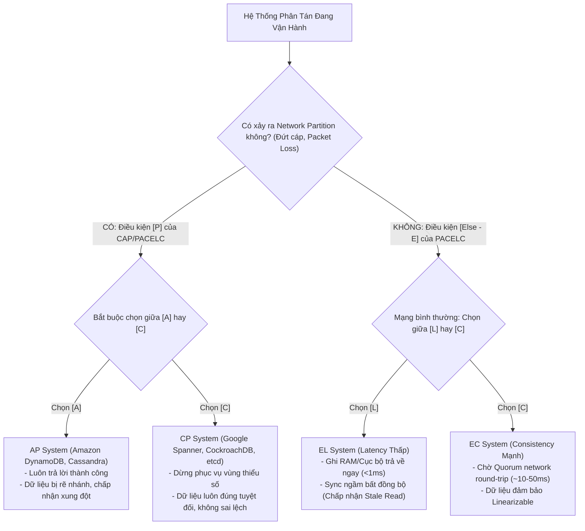

# 7.1. CAP and PACELC Theorems Deep Dive (Phân Tích Chuyên Sâu Định Lý CAP và PACELC)

> [!IMPORTANT]
> **Nếu bạn chỉ được nhớ một điều duy nhất**: **"Hệ thống CA" là một ảo tưởng vật lý hoàn toàn không tồn tại trong thế giới phân tán**. Mạng máy tính vật lý không bao giờ hoàn hảo và chắc chắn sẽ bị phân mảnh (**Partition - P** là thực tế khách quan của tự nhiên, không phải tính năng phần mềm do lập trình viên bật/tắt). Khi mạng bị đứt gãy, bạn chỉ được quyền chọn giữa **Nhất quán (CP)** bằng cách từ chối phục vụ để bảo vệ tính đúng, hoặc **Sẵn sàng (AP)** bằng cách cho phép ghi dữ liệu phân kỳ. Hơn thế nữa, **Định lý PACELC** chỉ ra rằng ngay cả trong $99.9\%$ thời gian khi mạng hoạt động hoàn toàn bình thường (**Else - E**), bạn vẫn phải tiếp tục đánh đổi giữa **Độ trễ thấp (Latency - L)** và **Tính nhất quán mạnh (Consistency - C)**!

---

## 1. Kiến trúc Tổng quan & Mô hình Tư duy (Mental Model)

Hãy tưởng tượng một hệ thống máy rút tiền tự động (ATM) của một ngân hàng gồm hai cây ATM độc lập: một cây tại Hà Nội và một cây tại TP.HCM:
- Tài khoản của khách hàng có số dư là **$1,000$ USD**.
- Đột nhiên, tuyến cáp quang nối giữa Hà Nội và TP.HCM bị đứt hoàn toàn (**Xảy ra Network Partition - P**). Hai cây ATM mất hoàn toàn liên lạc với nhau.
- Đúng lúc đó, hai vợ chồng cùng lúc đến hai cây ATM: Người chồng tại Hà Nội rút $800$ USD; người vợ tại TP.HCM cũng rút $800$ USD:
  - **Kịch bản 1: Chọn Tính Sẵn Sàng (AP System)**: Cả hai cây ATM đều ưu tiên phục vụ khách hàng không để họ phàn nàn (**Availability**). Cả hai cây cùng nhả tiền $800 + 800 = 1,600$ USD! Tài khoản ngân hàng bị âm $600$ USD $\implies$ **Dữ liệu bị mâu thuẫn, mất tính Nhất quán (Consistency)!**
  - **Kịch bản 2: Chọn Tính Nhất Quán (CP System)**: Khi người vợ bấm rút tiền tại TP.HCM, cây ATM phát hiện không thể liên lạc với trung tâm Hà Nội để khóa số dư (không đủ Quorum). Cây ATM hiện thông báo: *"Dịch vụ tạm thời gián đoạn do sự cố mạng, xin quý khách thử lại sau"* $\implies$ **Bảo toàn số dư chính xác 100%, nhưng hy sinh Tính sẵn sàng (Availability)!**



---

## 2. Chi tiết từng Keyword (Under-the-Hood Deep Dive)

### 2.1. Định nghĩa hình thức của ba thuộc tính C - A - P
- **Lịch sử hình thành**:
  - Năm 2000, Eric Brewer (UC Berkeley) nêu ra giả thuyết tại hội nghị ACM PODC.
  - Năm 2002, Seth Gilbert và Nancy Lynch (MIT) chính thức công bố bài báo toán học chứng minh định lý trong mô hình mạng bất đồng bộ.
- **1. Consistency (Tính nhất quán - C)**:
  - Trong bài báo chứng minh hình thức của Gilbert & Lynch, **Consistency được định nghĩa chính xác là Linearizability** (Atomic Consistency).
  - Yêu cầu: Mọi thao tác đọc dữ liệu bắt buộc phải trả về giá trị của thao tác ghi thành công gần nhất theo thời gian thực tuyệt đối. Toàn bộ cụm phân tán hành xử như thể chỉ có duy nhất một bản sao dữ liệu duy nhất.
- **2. Availability (Tính sẵn sàng - A)**:
  - Định nghĩa khắt khe: **Mọi node không bị sập (non-failing node)** khi nhận được request từ client **bắt buộc phải trả về một phản hồi thành công (non-error response)**.
  - *Lưu ý quan trọng*: Việc trả về mã lỗi `HTTP 500`, `Connection Refused` hoặc timeout **không được tính là Available** theo định lý CAP!
- **3. Partition Tolerance (Khả năng chịu đựng phân mảnh mạng - P)**:
  - Định nghĩa: Mạng phân tán có thể làm rơi rớt (drop) hoặc làm trễ vô hạn số lượng gói tin tùy ý giữa các node, chia cắt cụm thành các phân vùng độc lập, nhưng hệ thống vẫn tiếp tục duy trì hoạt động logic của nó.

### 2.2. Chứng minh toán học hình thức của Gilbert & Lynch (2002)
- **Mô hình toán học**:
  - Xét hai node phân tán độc lập: $Node_1$ và $Node_2$. Ban đầu biến dữ liệu có giá trị $v = v_0$.
  - Giả sử xuất hiện một sự cố phân mảnh mạng hoàn toàn giữa hai node: Mọi gói tin từ $Node_1 \to Node_2$ và $Node_2 \to Node_1$ đều bị drop $100\%$.
- **Các bước chứng minh bằng phương pháp phản chứng**:
  1. Client A kết nối tới $Node_1$ và thực hiện thao tác ghi giá trị mới: $\text{Write}(v = v_1)$. Thao tác hoàn tất và nhận phản hồi `OK`.
  2. Để bảo đảm tính sẵn sàng (**Availability**), $Node_1$ không thể chờ thông điệp xác nhận từ $Node_2$ (vì mạng bị đứt vĩnh viễn). Do đó $Node_1$ buộc phải commit cục bộ và trả về thành công cho Client A.
  3. Ngay sau đó theo thời gian thực, Client B kết nối tới $Node_2$ và phát lệnh đọc: $\text{Read}(v)$.
  4. Nút $Node_2$ rơi vào thế lưỡng nan toán học:
     - *Nếu $Node_2$ trả lời ngay để bảo đảm Availability*: Vì mạng bị đứt, $Node_2$ không có cách nào biết được $v$ đã được đổi thành $v_1$. Do đó $Node_2$ buộc phải trả về giá trị cũ $v_0$. Điều này **vi phạm tính Linearizability (Consistency)**!
     - *Nếu $Node_2$ từ chối trả lời hoặc trả về lỗi để bảo vệ Consistency*: Điều này đồng nghĩa với việc $Node_2$ **vi phạm tính Availability**!
  5. **Kết luận**: Trong một mạng có thể bị phân mảnh ($P$), không một thuật toán phân tán nào có thể đồng thời đạt được cả $C$ và $A$.

### 2.3. Vạch trần sai lầm kinh điển: "CA Fallacy" & Misconceptions
- **Ảo tưởng về "Hệ thống CA" (The CA Fallacy)**:
  - Nhiều tài liệu sơ cấp thường vẽ biểu đồ Venn 3 hình tròn giao nhau và nói rằng kiến trúc sư có thể chọn giữa: **CP**, **AP**, hoặc **CA**.
  - **Sự thật kỹ thuật**: **Trong thế giới phân tán thực tế, "Hệ thống CA" là điều hoàn toàn KHÔNG TỒN TẠI!**
  - Mạng máy tính vật lý (cáp quang biển bị cá mập cắn, router bị tràn buffer, switch reboot, firewall cấu hình sai) **chắc chắn sẽ bị phân mảnh**.
  - Bạn **không thể "từ chối" Partition Tolerance (P)** vì $P$ là một thực tế vật lý khách quan của tự nhiên, không phải là một cờ tính năng phần mềm do kỹ sư chọn lựa.
  - Do đó, câu hỏi thực tế của CAP là: **"Khi mạng bị phân mảnh không thể tránh khỏi, hệ thống của bạn chọn bảo vệ Consistency (CP) hay chọn bảo vệ Availability (AP)?"**
  - Khái niệm "CA" chỉ có ý nghĩa trên một máy chủ đơn lẻ (Single-node RDBMS như PostgreSQL/MySQL chạy 1 node duy nhất), vì không có mạng phân tán thì làm sao có phân mảnh mạng!

### 2.4. Định nghĩa và Cấu trúc của PACELC (Daniel Abadi)
- Năm 2012, Giáo sư Daniel Abadi (Yale University) chỉ ra rằng định lý CAP quá hạn hẹp: CAP chỉ mô tả hành vi của hệ thống trong khoảnh khắc hy hữu khi có sự cố đứt mạng ($P$). Trong khi đó, mạng phân tán dành hơn $99.9\%$ thời gian hoạt động ở trạng thái bình thường!
- **Định lý PACELC mở rộng**:
  $$\textbf{If } \mathbf{P} \text{ (Partition)} \implies \text{Trade-off giữa } [\mathbf{A} \text{ và } \mathbf{C}]; \quad \textbf{Else } \mathbf{E} \implies \text{Trade-off giữa } [\mathbf{L} \text{ và } \mathbf{C}]$$
  - Khi có phân mảnh mạng ($P$): Chọn giữa Tính sẵn sàng ($A$) hay Tính nhất quán ($C$).
  - Khi mạng bình thường ($Else - E$): Chọn giữa Độ trễ thấp ($Latency - L$) hay Tính nhất quán mạnh ($Consistency - C$).

### 2.5. Phân loại 4 nhóm hệ thống theo PACELC
1. **PC/EC (Spanner, CockroachDB, etcd, ZooKeeper)**:
   - Khi có sự cố ($P$): Chọn **Consistency** (dừng phục vụ vùng thiểu số).
   - Khi bình thường ($E$): Chọn **Consistency** (chờ Quorum đồng thuận qua mạng, chấp nhận độ trễ $\approx 10 - 30\text{ ms}$).
2. **PA/EL (Amazon DynamoDB, Apache Cassandra, ScyllaDB, Couchbase)**:
   - Khi có sự cố ($P$): Chọn **Availability** (vẫn cho ghi cả hai bên phân vùng).
   - Khi bình thường ($E$): Chọn **Latency** (ghi đĩa/RAM cục bộ trả lời ngay $< 1\text{ ms}$, đồng bộ ngầm sau).
3. **PC/EL (MongoDB, PostgreSQL Master-Slave Async)**:
   - Khi có sự cố ($P$): Chọn **Consistency** (chặn ghi nếu mất Master).
   - Khi bình thường ($E$): Chọn **Latency** (ghi Master trả lời ngay, không đợi Replica).
4. **PA/EC**: Hầu như không tồn tại trong thực tế vì mâu thuẫn triết lý thiết kế (khi bình thường thì chịu trễ cao để giữ nhất quán, nhưng khi đứt mạng lại vứt bỏ nhất quán).

### 2.6. Phân loại thực chiến các Database Engines
- **Google Cloud Spanner / CockroachDB**: Đại diện tiêu biểu của nhóm **PC/EC**. Dùng Paxos/Raft trên từng range dữ liệu, hỗ trợ giao dịch phân tán chuẩn ACID toàn cầu.
- **Apache Cassandra / DynamoDB**: Đại diện xuất sắc của nhóm **PA/EL**. Tối ưu hóa cho tốc độ ghi cực đại hàng triệu write/giây, chấp nhận hòa giải xung đột dữ liệu bằng CRDTs hoặc LWW.
- **Redis (Single-node vs Cluster)**: Single node là CA (không phân tán); Redis Cluster với async replication thuộc nhóm **PA/EL** (có nguy cơ mất dữ liệu khi Master sập trước khi đồng bộ sang Replica).

---

## 3. Thực thi Mã nguồn & Mô phỏng Chuyên sâu (Dual-Engine Implementation)

### Engine 1: C++20 — PACELC Routing Decision Engine & Partition Quorum Simulator

Chương trình C++20 dưới đây mô phỏng bộ định tuyến quyết định hành vi phân tán tuân theo định lý PACELC, kiểm chứng sự khác biệt giữa hai trường phái thiết kế **PC/EC** (Google Spanner-style) và **PA/EL** (Apache Cassandra-style):

```cpp
#include <iostream>
#include <string>
#include <chrono>
#include <vector>

enum class PacelcClass {
    PC_EC, // Consistency under Partition, Consistency under Normal
    PA_EL  // Availability under Partition, Latency under Normal
};

struct ExecutionResult {
    bool success;
    std::string data;
    double latency_ms;
    std::string decision_rationale;
};

class PacelcDatabaseNode {
private:
    std::string node_name_;
    PacelcClass system_class_;
    bool is_partitioned_{false};
    bool is_majority_quorum_{true};
    std::string stored_value_{"v0_initial"};

public:
    PacelcDatabaseNode(std::string name, PacelcClass cls)
        : node_name_(std::move(name)), system_class_(cls) {}

    void set_network_state(bool partitioned, bool has_majority) {
        is_partitioned_ = partitioned;
        is_majority_quorum_ = has_majority;
    }

    ExecutionResult execute_write(const std::string& new_val) {
        if (is_partitioned_) {
            // Nhánh [P] của PACELC
            if (system_class_ == PacelcClass::PC_EC) {
                if (!is_majority_quorum_) {
                    return {
                        false, "", 0.5,
                        "[" + node_name_ + " - PC/EC]: Từ chối ghi vì mất Quorum! (Bảo vệ C, hy sinh A)"
                    };
                }
                stored_value_ = new_val;
                return {true, stored_value_, 15.0, "[" + node_name_ + " - PC/EC]: Ghi thành công trên phân vùng đa số Quorum."};
            } else { // PA_EL
                stored_value_ = new_val;
                return {
                    true, stored_value_, 0.8,
                    "[" + node_name_ + " - PA/EL]: Vẫn cho phép ghi cục bộ dù mất mạng! (Bảo vệ A, hy sinh C)"
                };
            }
        } else {
            // Nhánh [Else - E] của PACELC (Mạng bình thường)
            if (system_class_ == PacelcClass::PC_EC) {
                stored_value_ = new_val;
                return {
                    true, stored_value_, 25.0, // Chờ Network RTT Quorum
                    "[" + node_name_ + " - PC/EC]: Ghi thành công sau khi chờ Quorum Network Round-Trip (~25ms). (Ưu tiên C)"
                };
            } else { // PA_EL
                stored_value_ = new_val;
                return {
                    true, stored_value_, 0.3, // Ghi RAM trả về ngay
                    "[" + node_name_ + " - PA/EL]: Ghi siêu tốc in-memory và trả lời ngay (<1ms). (Ưu tiên L)"
                };
            }
        }
    }
};

int main() {
    std::cout << "=== MO PHONG PACELC ROUTING ENGINE TRONG C++20 ===\n\n";

    PacelcDatabaseNode spanner("Spanner_Node", PacelcClass::PC_EC);
    PacelcDatabaseNode cassandra("Cassandra_Node", PacelcClass::PA_EL);

    // Kịch bản 1: Khi mạng hoạt động hoàn toàn bình thường (Else - E)
    std::cout << "--- 1. TRẠNG THÁI MẠNG BÌNH THƯỜNG (ELSE - E) ---\n";
    auto r1 = spanner.execute_write("Alice_Account_100USD");
    std::cout << "  * " << r1.decision_rationale << " | Latency: " << r1.latency_ms << "ms\n";

    auto r2 = cassandra.execute_write("Alice_Account_100USD");
    std::cout << "  * " << r2.decision_rationale << " | Latency: " << r2.latency_ms << "ms\n\n";

    // Kịch bản 2: Khi xảy ra phân mảnh mạng (Partition - P) tại vùng thiểu số (Minority Partition)
    std::cout << "--- 2. XẢY RA SỰ CỐ MẠNG (PARTITION - P: VÙNG THIỂU SỐ) ---\n";
    spanner.set_network_state(true, false);   // Cô lập, mất Quorum
    cassandra.set_network_state(true, false); // Cô lập, mất Quorum

    auto r3 = spanner.execute_write("Alice_Account_500USD");
    std::cout << "  * " << r3.decision_rationale << " | Thành công: " << (r3.success ? "CÓ" : "KHÔNG") << "\n";

    auto r4 = cassandra.execute_write("Alice_Account_500USD");
    std::cout << "  * " << r4.decision_rationale << " | Thành công: " << (r4.success ? "CÓ" : "KHÔNG") << "\n";

    return 0;
}
```

```text
=== MO PHONG PACELC ROUTING ENGINE TRONG C++20 ===

--- 1. TRẠNG THÁI MẠNG BÌNH THƯỜNG (ELSE - E) ---
  * [Spanner_Node - PC/EC]: Ghi thành công sau khi chờ Quorum Network Round-Trip (~25ms). (Ưu tiên C) | Latency: 25ms
  * [Cassandra_Node - PA/EL]: Ghi siêu tốc in-memory và trả lời ngay (<1ms). (Ưu tiên L) | Latency: 0.3ms

--- 2. XẢY RA SỰ CỐ MẠNG (PARTITION - P: VÙNG THIỂU SỐ) ---
  * [Spanner_Node - PC/EC]: Từ chối ghi vì mất Quorum! (Bảo vệ C, hy sinh A) | Thành công: KHÔNG
  * [Cassandra_Node - PA/EL]: Vẫn cho phép ghi cục bộ dù mất mạng! (Bảo vệ A, hy sinh C) | Thành công: CÓ
```

---

### Engine 2: Python 3.11+ — Gilbert & Lynch Network Partition Proof Simulator

Chương trình Python 3.11 tái hiện mô hình toán học phản chứng của Gilbert & Lynch (2002): Mô phỏng hai node bị cô lập mạng và chứng minh bằng thực nghiệm rằng không thể vừa duy trì Availability vừa giữ được Linearizability:

```python
#!/usr/bin/env python3
"""
Gilbert & Lynch (2002) CAP Theorem Formal Proof Simulator in Python 3.11.
Demonstrates why a partitioned network forces a strict choice between C and A.
"""
from dataclasses import dataclass
from typing import Optional, Tuple

class SimulatedPartitionedCluster:
    def __init__(self):
        self.node1_val = "v0"
        self.node2_val = "v0"
        self.network_partition_active = True # Mạng bị đứt hoàn toàn giữa Node 1 và Node 2

    def client_write_node1(self, new_val: str, choose_availability: bool) -> Tuple[bool, str]:
        """
        Client 1 gửi yêu cầu ghi vào Node 1.
        """
        if self.network_partition_active:
            if choose_availability:
                # Hệ thống AP: Ghi cục bộ và trả lời OK ngay
                self.node1_val = new_val
                return True, f"[Node 1] Ghi thành công '{new_val}' cục bộ (Ưu tiên Availability)."
            else:
                # Hệ thống CP: Không thể liên lạc Node 2 để sync -> Từ chối!
                return False, "[Node 1] LỖI: Không thể đồng bộ với Node 2 do đứt mạng! Từ chối ghi (Ưu tiên Consistency)."
        self.node1_val = new_val
        self.node2_val = new_val
        return True, "[Node 1] Ghi thành công đồng bộ cả 2 nodes."

    def client_read_node2(self, choose_availability: bool) -> Tuple[Optional[str], str]:
        """
        Client 2 đọc dữ liệu từ Node 2 ngay sau khi Client 1 đã ghi xong.
        """
        if self.network_partition_active:
            if choose_availability:
                # Hệ thống AP: Trả về giá trị hiện tại có trong RAM
                return self.node2_val, f"[Node 2] Trả về '{self.node2_val}' để đảm bảo Availability (DỮ LIỆU ĐÃ BỊ CŨ!)."
            else:
                # Hệ thống CP: Phát hiện mạng đứt, từ chối trả về giá trị không chắc chắn
                return None, "[Node 2] LỖI: Mạng bị phân mảnh, từ chối trả lời để chống Stale Read (Ưu tiên Consistency)."
        return self.node2_val, f"[Node 2] Trả về '{self.node2_val}'."

def main():
    print("=== CHỨNG MINH HÌNH THỨC ĐỊNH LÝ CAP (GILBERT & LYNCH 2002) ===\n")

    # KỊCH BẢN 1: HỆ THỐNG LỰA CHỌN AVAILABILITY (AP)
    print("--- KỊCH BẢN 1: HỆ THỐNG CHỌN AVAILABILITY (AP SYSTEM) ---")
    cluster_ap = SimulatedPartitionedCluster()
    success, msg1 = cluster_ap.client_write_node1("v1_new", choose_availability=True)
    print("  Bước 1:", msg1)

    val, msg2 = cluster_ap.client_read_node2(choose_availability=True)
    print("  Bước 2:", msg2)
    print(f"  => ĐÁNH GIÁ: Client 1 ghi 'v1_new', nhưng Client 2 đọc ra '{val}'!")
    print("  => KẾT LUẬN: Đạt Availability (100% phản hồi thành công) NHƯNG VI PHẠM CONSISTENCY!\n")

    # KỊCH BẢN 2: HỆ THỐNG LỰA CHỌN CONSISTENCY (CP)
    print("--- KỊCH BẢN 2: HỆ THỐNG CHỌN CONSISTENCY (CP SYSTEM) ---")
    cluster_cp = SimulatedPartitionedCluster()
    success, msg1 = cluster_cp.client_write_node1("v1_new", choose_availability=False)
    print("  Bước 1:", msg1)

    val, msg2 = cluster_cp.client_read_node2(choose_availability=False)
    print("  Bước 2:", msg2)
    print(f"  => ĐÁNH GIÁ: Không có dữ liệu cũ nào bị rò rỉ ra ngoài!")
    print("  => KẾT LUẬN: Bảo vệ tuyệt đối Consistency NHƯNG HY SINH AVAILABILITY (Client nhận lỗi)!")

if __name__ == "__main__":
    main()
```

```text
=== CHỨNG MINH HÌNH THỨC ĐỊNH LÝ CAP (GILBERT & LYNCH 2002) ===

--- KỊCH BẢN 1: HỆ THỐNG CHỌN AVAILABILITY (AP SYSTEM) ---
  Bước 1: [Node 1] Ghi thành công 'v1_new' cục bộ (Ưu tiên Availability).
  Bước 2: [Node 2] Trả về 'v0' để đảm bảo Availability (DỮ LIỆU ĐÃ BỊ CŨ!).
  => ĐÁNH GIÁ: Client 1 ghi 'v1_new', nhưng Client 2 đọc ra 'v0'!
  => KẾT LUẬN: Đạt Availability (100% phản hồi thành công) NHƯNG VI PHẠM CONSISTENCY!

--- KỊCH BẢN 2: HỆ THỐNG CHỌN CONSISTENCY (CP SYSTEM) ---
  Bước 1: [Node 1] LỖI: Không thể đồng bộ với Node 2 do đứt mạng! Từ chối ghi (Ưu tiên Consistency).
  Bước 2: [Node 2] LỖI: Mạng bị phân mảnh, từ chối trả lời để chống Stale Read (Ưu tiên Consistency).
  => ĐÁNH GIÁ: Không có dữ liệu cũ nào bị rò rỉ ra ngoài!
  => KẾT LUẬN: Bảo vệ tuyệt đối Consistency NHƯNG HY SINH AVAILABILITY (Client nhận lỗi)!
```

---

## 4. Systems Engineering & Production Pitfalls

### 4.1. Ảo Tưởng "Đám Mây AWS/GCP Không Bao Giờ Bị Network Partition"
- **Sai lầm phổ biến**: Nhiều kiến trúc sư tin rằng khi triển khai ứng dụng trên các Availability Zone (AZ) của AWS với cáp quang ngầm băng thông 100Gbps, hiện tượng phân mảnh mạng là không thể xảy ra, từ đó thiết kế hệ thống theo mô hình "CA".
- **Sự cố thực tế**: Năm 2019, AWS US-East-1 gặp sự cố sập đường truyền cáp ngầm giữa các AZ do mất điện cục bộ. Hàng loạt hệ thống tưởng rằng mình là "CA" bị sập hoàn toàn do rơi vào trạng thái bế tắc (Deadlock) hoặc phân mảnh Split-Brain dữ liệu!
- **Khắc phục**: Luôn chuẩn bị sẵn kịch bản ứng phó cho sự cố cô lập mạng (Network Partition Testing qua Chaos Engineering).

### 4.2. Thời Gian Trễ Failover Trong Nhóm PC/EL (MongoDB / MySQL)
- **Hiện tượng**: Khi Primary Node bị sập trong cụm MongoDB Replica Set:
  - Hệ thống mất khoảng $2 - 10\text{ giây}$ để phát hiện heartbeat timeout và bầu chọn Primary mới.
  - Trong suốt 10 giây này, **toàn bộ thao tác ghi của ứng dụng bị từ chối hoàn toàn**.
  - Nếu backend không có hàng đợi đệm (Message Queue buffer), hàng nghìn request từ người dùng sẽ trả về HTTP 500.
- **Khắc phục**: Sử dụng hàng đợi bất đồng bộ (Kafka/RabbitMQ) đứng trước Database để hấp thụ tải ghi trong thời gian cụm thực hiện Failover.

### 4.3. CLI Chẩn Đoán Phân Vùng Mạng & Giám Sát Cụm
```bash
# 1. Giả lập đứt mạng hoàn toàn giữa hai node bằng iptables (Tạo Partition nhân tạo)
sudo iptables -A INPUT -s 192.168.1.50 -j DROP
sudo iptables -A OUTPUT -d 192.168.1.50 -j DROP

# 2. Kiểm tra trạng thái Quorum của cụm etcd (Hệ thống PC/EC)
etcdctl endpoint health --write-out=table

# 3. Theo dõi số lượng kết nối bị drop và lỗi mạng trên giao diện eth0
ip -s link show eth0
```

---

## 5. Bảng So sánh & Decision Matrix

| Hệ Thống Cơ Sở Dữ Liệu | Phân Loại CAP | Phân Loại PACELC | Giao Thức Đồng Thuận / Nhân Bản | Trường Hợp Sử Dụng Tối Ưu |
| :--- | :--- | :--- | :--- | :--- |
| **Google Cloud Spanner** | **CP** | **PC / EC** | Multi-Paxos + TrueTime API | Giao dịch tài chính toàn cầu, Ngân hàng |
| **CockroachDB / TiDB** | **CP** | **PC / EC** | Multi-Raft Consensus Engine | NewSQL RDBMS mở rộng ngang chuẩn ACID |
| **etcd / ZooKeeper** | **CP** | **PC / EC** | Raft / Zab Protocol | Cấu hình Kubernetes, Leader Election, Locks |
| **Apache Cassandra** | **AP** | **PA / EL** | Gossip + Tunable Quorum + LWW | Big Data time-series, IoT Sensor, Logs |
| **Amazon DynamoDB** | **AP** | **PA / EL** | Paxos nội bộ shard + Quorum routing | E-commerce shopping carts, Gaming profiles |
| **MongoDB (Default)** | **CP** | **PC / EL** | Raft-like Election + Async Replicas | Ứng dụng Web tài liệu linh hoạt, Metadata |
| **Redis Cluster** | **AP** | **PA / EL** | Async Master-Replica + Gossip | In-memory Cache tốc độ cao, Session Store |
