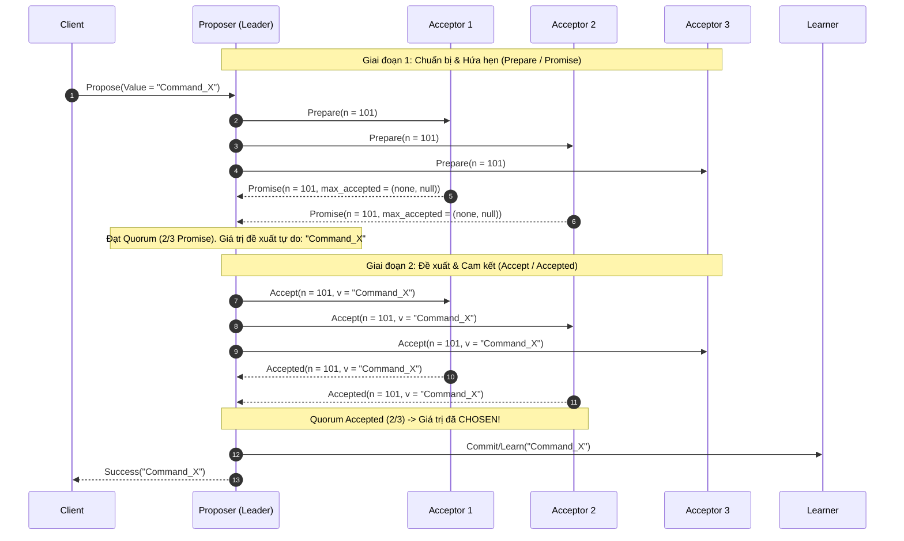

# 8.1. Consensus Fundamentals & Paxos Algorithm

> [!IMPORTANT]
> **Nếu bạn chỉ được nhớ một điều duy nhất**: Đồng thuận phân tán (Distributed Consensus) là nghệ thuật đạt được thỏa hiệp tuyệt đối giữa các tiến trình độc lập qua mạng truyền thông không tin cậy. Trong mô hình bất đồng bộ (Asynchronous Model), định lý **FLP Impossibility** chứng minh rằng không một thuật toán xác định nào có thể đảm bảo cả tính đúng đắn (**Safety**) và tính kết thúc (**Liveness**) khi có dù chỉ một node bị crash. Thuật toán **Paxos** của Leslie Lamport hy sinh Liveness (chấp nhận rủi ro Livelock khi có *Dueling Proposers*) để bảo vệ tuyệt đối Safety: không bao giờ hai giá trị khác nhau được quyết định cho cùng một phiên đồng thuận.

---

## 1. Kiến trúc Tổng quan & Mô hình Tư duy (Mental Model)

### Ẩn dụ Đời sống: Phòng Họp Quốc Hội Hy Lạp Cổ Đại
Hãy hình dung một nghị viện cổ đại trên hòn đảo Paxos. Các nghị sĩ (Proposers) muốn thông qua một sắc lệnh duy nhất. Tuy nhiên, phòng họp không có micro tập trung; các nghị sĩ phải gửi thư tay qua những người liên lạc hậu đậu có thể ngủ quên, làm mất thư hoặc đến trễ vô thời hạn (Asynchronous Network).

Các quan tòa giữ sổ bộ (Acceptors) ngồi trong các phòng biệt lập:
1. **Giai đoạn 1 (Prepare / Promise)**: Nghị sĩ $P_1$ gửi đề xuất đánh số hiệu $n_1$ hỏi các quan tòa: *"Tôi có quyền mở phiên thảo luận với số hiệu $n_1$ không? Các ngài đã từng hứa hay bỏ phiếu cho sắc lệnh nào trước đó chưa?"*. Nếu một đa số (Quorum $\lfloor N/2 \rfloor + 1$) đồng ý hứa rằng *"Sẽ không chấp nhận bất kỳ đề xuất nào có số hiệu nhỏ hơn $n_1$"* và gửi lại giá trị đã được bỏ phiếu cao nhất trước đó (nếu có), $P_1$ giành được quyền bảo trợ dự luật.
2. **Giai đoạn 2 (Accept / Accepted)**: $P_1$ chọn giá trị: nếu các quan tòa đã từng bỏ phiếu cho một giá trị trong quá khứ, $P_1$ buộc phải tôn trọng giá trị đó; nếu chưa ai bỏ phiếu, $P_1$ tự do đưa giá trị $v$ của mình. $P_1$ gửi thông điệp Accept $(n_1, v)$. Khi quá bán quan tòa ghi nhận thông điệp này vào sổ lưu trữ bất biến (WAL), giá trị $v$ chính thức được phê chuẩn (Chosen) và công bố cho toàn dân (Learners).



---

## 2. Chi tiết từng Keyword (Under-the-Hood Deep Dive)

### 2.1. Bốn thuộc tính toán học bắt buộc của bài toán Đồng thuận
Một thuật toán đồng thuận phân tán đúng đắn phải thỏa mãn nghiêm ngặt 4 thuộc tính toán học cơ bản giữa $N$ tiến trình độc lập:

1. **Termination (Tính kết thúc / Liveness)**:
   $$\forall p_i \in \text{Correct Processes}, \quad \exists t < \infty: p_i \text{ quyết định một giá trị } v$$
   Mọi tiến trình không gặp lỗi (non-faulty) cuối cùng đều phải đưa ra quyết định sau một khoảng thời gian hữu hạn.
2. **Validity (Tính hợp lệ / Liveness/Safety)**:
   $$\text{Nếu } p_i \text{ quyết định } v \implies \exists p_j \text{ đã từng đề xuất } v$$
   Giá trị được hệ thống chọn phải do một thành viên hợp lệ đề xuất, không thể tự sinh ra từ hư vô hoặc bịa đặt.
3. **Integrity (Tính toàn vẹn / Safety)**:
   $$\forall p_i, \quad p_i \text{ quyết định tối đa một lần duy nhất}$$
   Không có tiến trình nào lật lại quyết định hoặc quyết định hai lần các giá trị xung đột nhau trong cùng một slot/vòng đồng thuận.
4. **Agreement (Tính nhất quán / Safety)**:
   $$\forall p_i, p_j \text{ (correct)}, \quad \text{Quyết định}(p_i) = \text{Quyết định}(p_j) = v$$
   Tất cả các tiến trình bình thường bắt buộc phải quyết định cùng một giá trị duy nhất.

### 2.2. Hai trụ cột: Safety vs Liveness & Định lý FLP Impossibility
Trong lý thuyết hệ phân tán, mọi đảm bảo đều quy về hai thuộc tính đối ngẫu:
- **Safety ("Nothing bad happens")**: Hệ thống không bao giờ đưa ra trạng thái sai. Hai node không bao giờ đồng thuận hai giá trị khác nhau (No Split-Brain). Safety có thể được bảo toàn bằng cách "treo" hệ thống không phản hồi.
- **Liveness ("Something good eventually happens")**: Hệ thống không bị treo vô hạn, mọi yêu cầu cuối cùng đều nhận được kết quả xử lý.

#### Định lý FLP Impossibility (Fischer, Lynch, Paterson - 1985)
> **Phát biểu định lý**: *Trong một hệ thống mạng phân tán bất đồng bộ (Asynchronous Network), không tồn tại bất kỳ thuật toán đồng thuận xác định (deterministic consensus algorithm) nào có thể đảm bảo 100% tính Liveness nếu hệ thống cho phép dù chỉ 1 node duy nhất gặp lỗi crash-stop.*

- **Bản chất toán học**: Trong mạng bất đồng bộ, độ trễ tin nhắn là không chặn ($\Delta t = \infty$). Không thể phân biệt được một node bị chết (crashed) hay chỉ đang phản hồi cực kỳ chậm do tắc nghẽn mạng (slow network).
- **Hệ quả thực tiễn**: Mọi thuật toán đồng thuận trong kỹ nghệ phần mềm (Paxos, Raft, Zab) đều **ưu tiên Safety tuyệt đối**, và chỉ có thể đạt được **Liveness dựa trên giả định bán đồng bộ (Partial Synchrony)** hoặc sử dụng tính ngẫu nhiên (Randomized timeouts / Failure detectors $\diamondsuit \mathcal{W}$ hoặc $\diamondsuit \mathcal{P}$).

### 2.3. Mô hình lỗi: Crash Fault Tolerance (CFT) vs Byzantine Fault Tolerance (BFT)
Khả năng chịu lỗi của thuật toán phụ thuộc vào giả định mô hình hành vi của node lỗi:

| Tiêu chí | Crash Fault Tolerance (CFT) | Byzantine Fault Tolerance (BFT) |
| :--- | :--- | :--- |
| **Hành vi lỗi** | Node dừng hoạt động (Crash-stop), khởi động lại (Crash-recovery), hoặc mạng rớt gói. Không gửi dữ liệu giả mạo. | Node bị kẻ xấu chiếm quyền, bị lỗi bit RAM, gửi dữ liệu lừa đảo hoặc gửi 2 thông điệp đối lập cho 2 nhóm khác nhau. |
| **Môi trường ứng dụng** | Private Data Center, Intranet nội bộ (Google Chubby, Spanner, ZooKeeper, etcd, Kafka KRaft). | Public Blockchain, Untrusted P2P Network, Hàng không vũ trụ (Bitcoin, Ethereum, Tendermint, PBFT). |
| **Công thức Quorum** | $N \ge 2f + 1$ (Chịu được $f$ node lỗi crash trong tổng số $N$ nodes). | $N \ge 3f + 1$ (Chịu được $f$ node phản bội/byzantine). |
| **Tỷ lệ đa số an toàn** | Quorum đơn giản: $\lfloor N/2 \rfloor + 1$ ($> 50\%$). | Quorum hai phần ba: $\lfloor 2N/3 \rfloor + 1$ ($> 66.7\%$). |
| **Chi phí tính toán** | Thấp, message passing đơn giản, mã hóa TLS thông thường. | Rất cao, chữ ký mật mã (Cryptographic signatures), Merkle proofs. |

### 2.4. Kiến trúc phân vai trong Paxos: Proposer, Acceptor, Learner
Trong thuật toán Paxos kinh điển, một node vật lý có thể đảm nhận đồng thời 3 vai trò logic:
- **Proposer (Người đề xuất)**: Tiếp nhận lệnh từ Client, tạo ra số hiệu đề xuất tăng dần $n$ (Proposal Number: kết hợp `<sequence_number, node_id>` để đảm bảo duy nhất), gửi yêu cầu Prepare và Accept đến các Acceptor.
- **Acceptor (Quan chức phê duyệt / Ban giám khảo)**: Lưu trữ trạng thái bền vững trên đĩa (WAL). Duy trì hai giá trị cốt lõi:
  - $n_p$ (minProposal / promised): Số hiệu đề xuất cao nhất mà nó từng hứa sẽ phục vụ.
  - $(n_a, v_a)$ (acceptedProposal, acceptedValue): Cặp số hiệu và giá trị cao nhất mà nó từng chính thức chấp thuận.
- **Learner (Người thụ hưởng / Replica State Machine)**: Sau khi một giá trị được Quorum của Acceptor phê duyệt (Chosen), Learner nhận thông báo để thực thi lệnh vào máy trạng thái (FSM) và trả kết quả cho Client.

### 2.5. Thuật toán Single-Decree Paxos (2 Giai đoạn cốt lõi)
Single-Decree Paxos dùng để đồng thuận một giá trị duy nhất cho một vị trí (Slot):

#### Giai đoạn 1: Prepare & Promise (Xin quyền ưu tiên & Thu thập trạng thái)
1. **Proposer** chọn số hiệu duy nhất $n > \text{last\_seen\_n}$ và gửi $\text{Prepare}(n)$ tới đa số Acceptors.
2. **Acceptor** nhận $\text{Prepare}(n)$:
   - Nếu $n > n_p$: Cập nhật $n_p \leftarrow n$ (ghi đĩa). Trả lời $\text{Promise}(n, n_a, v_a)$ cam kết từ chối mọi đề xuất tương lai có số hiệu nhỏ hơn $n$.
   - Nếu $n \le n_p$: Từ chối ($\text{Nack}$) hoặc bỏ qua tin nhắn.

#### Giai đoạn 2: Accept & Accepted (Đề xuất & Bỏ phiếu cam kết)
1. **Proposer** thu thập đủ Quorum $\lfloor N/2 \rfloor + 1$ phản hồi $\text{Promise}$:
   - Tìm trong các phản hồi xem có $(n_a, v_a)$ nào có $n_a$ lớn nhất không.
   - Nếu có, gán $v \leftarrow v_a$ (BẮT BUỘC tuân thủ giá trị đã được bỏ phiếu trước đó để giữ Safety!).
   - Nếu không ai có giá trị cũ, Proposer được tự do chọn giá trị riêng $v \leftarrow v_{\text{client}}$.
   - Gửi $\text{Accept}(n, v)$ tới Quorum Acceptors.
2. **Acceptor** nhận $\text{Accept}(n, v)$:
   - Nếu $n \ge n_p$: Ghi nhận $n_p \leftarrow n$, $n_a \leftarrow n$, $v_a \leftarrow v$ vào đĩa. Phản hồi $\text{Accepted}(n, v)$ cho Proposer và Learners.
   - Nếu $n < n_p$: Từ chối vì đã trót hứa với một Proposer khác có số hiệu cao hơn.

### 2.6. Vấn đề Dueling Proposers & Multi-Paxos

#### Vấn đề Dueling Proposers (Hiệp sĩ đấu kiếm / Livelock)
Nếu hai Proposers $P_1$ và $P_2$ đồng thời đề xuất mà không có cơ chế điều phối:
- $P_1$ gửi $\text{Prepare}(n_1)$ thành công (Acceptors hứa với $n_1$).
- Trước khi $P_1$ kịp gửi $\text{Accept}$, $P_2$ gửi $\text{Prepare}(n_2 > n_1)$ thành công (Acceptors ghi đè lời hứa lên $n_2$).
- Khi $P_1$ gửi $\text{Accept}(n_1, v_1)$, các Acceptor từ chối vì $n_1 < n_2$.
- $P_1$ phát hiện bị từ chối, lập tức tăng số hiệu lên $n_3 > n_2$ và gửi $\text{Prepare}(n_3)$ trước khi $P_2$ gửi $\text{Accept}(n_2, v_2)$.
- Hệ thống rơi vào vòng lặp **Livelock vô tận**: liên tục ghi đè lời hứa mà không bao giờ một giá trị nào được Quorum chấp thuận!

#### Multi-Paxos (Tối ưu hóa sản xuất cho chuỗi nhật ký Log)
Trong hệ thống thực tế (như Chubby, Megastore), chúng ta cần đồng thuận một chuỗi liên tiếp các slot lệnh ($Log[0], Log[1], \dots$). Chạy 2 Round trips cho mỗi slot là quá chậm:
1. **Stable Leader Election**: Bầu một Proposer duy nhất làm Leader thông qua thuật toán thuê bao có thời hạn (**Leader Lease**).
2. **Phase 1 Optimization**: Giai đoạn Prepare chỉ cần chạy **một lần duy nhất** khi Leader khởi động cho toàn bộ các slot trong tương lai.
3. **Pipelining Phase 2**: Với các lệnh tiếp theo, Leader chỉ cần gửi trực tiếp $\text{Accept}(Slot\_ID, n, v)$ (chỉ mất 1 Round Trip Time) tới Acceptors.

---

## 3. Thực thi Mã nguồn & Mô phỏng Chuyên sâu (Dual-Engine Implementation)

### Engine 1: C++20 — Mô phỏng Cốt lõi Single-Decree Paxos với Quorum Validation

```cpp
#include <iostream>
#include <vector>
#include <string>
#include <optional>
#include <memory>
#include <algorithm>
#include <format>
#include <cstdint>

struct ProposalNumber {
    uint64_t sequence;
    uint32_t node_id;

    auto operator<=>(const ProposalNumber&) const = default;
};

struct PromiseResponse {
    bool ok;
    ProposalNumber promised_n;
    std::optional<ProposalNumber> accepted_n;
    std::optional<std::string> accepted_val;
};

// Acceptor State Machine
class Acceptor {
public:
    uint32_t id;
    ProposalNumber min_proposal{0, 0};
    std::optional<ProposalNumber> accepted_proposal;
    std::optional<std::string> accepted_value;

    explicit Acceptor(uint32_t id) : id(id) {}

    PromiseResponse receive_prepare(const ProposalNumber& n) {
        if (n > min_proposal) {
            min_proposal = n;
            return PromiseResponse{
                .ok = true,
                .promised_n = n,
                .accepted_n = accepted_proposal,
                .accepted_val = accepted_value
            };
        }
        return PromiseResponse{.ok = false, .promised_n = min_proposal, .accepted_n = std::nullopt, .accepted_val = std::nullopt};
    }

    bool receive_accept(const ProposalNumber& n, const std::string& val) {
        if (n >= min_proposal) {
            min_proposal = n;
            accepted_proposal = n;
            accepted_value = val;
            return true;
        }
        return false;
    }
};

// Proposer State Machine
class Proposer {
public:
    uint32_t id;
    uint64_t sequence{0};
    std::vector<std::shared_ptr<Acceptor>> cluster;

    Proposer(uint32_t id, std::vector<std::shared_ptr<Acceptor>> cluster)
        : id(id), cluster(std::move(cluster)) {}

    bool propose(const std::string& client_val) {
        sequence++;
        ProposalNumber n{sequence, id};
        size_t quorum = cluster.size() / 2 + 1;

        std::cout << std::format("\n>>> [Proposer {}] Bắt đầu Phase 1: Prepare(seq={}, node={})\n", id, n.sequence, n.node_id);

        size_t promises_count = 0;
        std::optional<ProposalNumber> highest_accepted_n;
        std::optional<std::string> value_to_propose = client_val;

        for (auto& acceptor : cluster) {
            auto res = acceptor->receive_prepare(n);
            if (res.ok) {
                promises_count++;
                if (res.accepted_n.has_value()) {
                    if (!highest_accepted_n.has_value() || res.accepted_n.value() > highest_accepted_n.value()) {
                        highest_accepted_n = res.accepted_n;
                        value_to_propose = res.accepted_val;
                    }
                }
            }
        }

        std::cout << std::format("    -> Nhận {}/{} Promises (Cần Quorum: {})\n", promises_count, cluster.size(), quorum);
        if (promises_count < quorum) {
            std::cout << "    [!] Thất bại Phase 1: Không đạt Quorum Promise!\n";
            return false;
        }

        if (highest_accepted_n.has_value()) {
            std::cout << std::format("    [*] Phát hiện giá trị cũ đã được bỏ phiếu: '{}' (với n={}.{}). Bắt buộc tuân thủ!\n",
                value_to_propose.value(), highest_accepted_n->sequence, highest_accepted_n->node_id);
        } else {
            std::cout << std::format("    [*] Không có giá trị cũ. Tự do đề xuất giá trị Client: '{}'\n", value_to_propose.value());
        }

        // Phase 2: Accept
        std::cout << std::format(">>> [Proposer {}] Bắt đầu Phase 2: Accept(n={}.{}, val='{}')\n",
            id, n.sequence, n.node_id, value_to_propose.value());

        size_t accepted_count = 0;
        for (auto& acceptor : cluster) {
            if (acceptor->receive_accept(n, value_to_propose.value())) {
                accepted_count++;
            }
        }

        std::cout << std::format("    -> Nhận {}/{} Accepted\n", accepted_count, cluster.size());
        if (accepted_count >= quorum) {
            std::cout << std::format("    [V] THÀNH CÔNG! Giá trị '{}' đã được CHOSEN an toàn!\n", value_to_propose.value());
            return true;
        } else {
            std::cout << "    [!] Thất bại Phase 2: Bị ghi đè bởi Proposer khác!\n";
            return false;
        }
    }
};

int main() {
    // Khởi tạo cụm 3 Acceptors
    std::vector<std::shared_ptr<Acceptor>> cluster = {
        std::make_shared<Acceptor>(1),
        std::make_shared<Acceptor>(2),
        std::make_shared<Acceptor>(3)
    };

    Proposer p1(10, cluster);
    Proposer p2(20, cluster);

    // Kịch bản 1: p1 đề xuất thành công
    p1.propose("INSERT INTO users VALUES ('Alice')");

    // Kịch bản 2: p2 đề xuất giá trị khác nhưng buộc phải học giá trị của p1 để giữ Safety
    p2.propose("INSERT INTO users VALUES ('Bob')");

    return 0;
}
```

#### Terminal Output Mẫu:
```text
>>> [Proposer 10] Bắt đầu Phase 1: Prepare(seq=1, node=10)
    -> Nhận 3/3 Promises (Cần Quorum: 2)
    [*] Không có giá trị cũ. Tự do đề xuất giá trị Client: 'INSERT INTO users VALUES ('Alice')'
>>> [Proposer 10] Bắt đầu Phase 2: Accept(n=1.10, val='INSERT INTO users VALUES ('Alice')')
    -> Nhận 3/3 Accepted
    [V] THÀNH CÔNG! Giá trị 'INSERT INTO users VALUES ('Alice')' đã được CHOSEN an toàn!

>>> [Proposer 20] Bắt đầu Phase 1: Prepare(seq=1, node=20)
    -> Nhận 3/3 Promises (Cần Quorum: 2)
    [*] Phát hiện giá trị cũ đã được bỏ phiếu: 'INSERT INTO users VALUES ('Alice')' (với n=1.10). Bắt buộc tuân thủ!
>>> [Proposer 20] Bắt đầu Phase 2: Accept(n=1.20, val='INSERT INTO users VALUES ('Alice')')
    -> Nhận 3/3 Accepted
    [V] THÀNH CÔNG! Giá trị 'INSERT INTO users VALUES ('Alice')' đã được CHOSEN an toàn!
```

---

### Engine 2: Python 3.11+ — Mô phỏng Hiện tượng Dueling Proposers (Livelock) & Giải pháp Random Backoff

```python
import asyncio
import random
from dataclasses import dataclass
from typing import Optional, List, Tuple

@dataclass(order=True)
class ProposalId:
    round_num: int
    proposer_id: int

class Acceptor:
    def __init__(self, node_id: int):
        self.node_id = node_id
        self.promised_id: Optional[ProposalId] = None
        self.accepted_id: Optional[ProposalId] = None
        self.accepted_value: Optional[str] = None

    def prepare(self, prop_id: ProposalId) -> Tuple[bool, Optional[ProposalId], Optional[str]]:
        if self.promised_id is None or prop_id > self.promised_id:
            self.promised_id = prop_id
            return True, self.accepted_id, self.accepted_value
        return False, self.promised_id, None

    def accept(self, prop_id: ProposalId, value: str) -> bool:
        if self.promised_id is None or prop_id >= self.promised_id:
            self.promised_id = prop_id
            self.accepted_id = prop_id
            self.accepted_value = value
            return True
        return False

class Proposer:
    def __init__(self, proposer_id: int, cluster: List[Acceptor], use_backoff: bool = False):
        self.proposer_id = proposer_id
        self.cluster = cluster
        self.round_num = 0
        self.use_backoff = use_backoff

    async def run_round(self, value: str) -> bool:
        self.round_num += 1
        prop_id = ProposalId(self.round_num, self.proposer_id)
        quorum = len(self.cluster) // 2 + 1

        # Phase 1: Prepare
        promises = []
        for acc in self.cluster:
            ok, acc_id, acc_val = acc.prepare(prop_id)
            if ok:
                promises.append((acc_id, acc_val))

        if len(promises) < quorum:
            return False

        # Chọn giá trị: giá trị có proposal id cao nhất đã được accept
        highest_prop_id = None
        chosen_val = value
        for acc_id, acc_val in promises:
            if acc_id is not None:
                if highest_prop_id is None or acc_id > highest_prop_id:
                    highest_prop_id = acc_id
                    chosen_val = acc_val

        # Giả lập delay mạng giữa Phase 1 và Phase 2 (Căn nguyên của Dueling Proposers)
        await asyncio.sleep(0.01)

        # Phase 2: Accept
        accepts = 0
        for acc in self.cluster:
            if acc.accept(prop_id, chosen_val):
                accepts += 1

        return accepts >= quorum

    async def execute_until_chosen(self, value: str, max_attempts: int = 10) -> Optional[str]:
        for attempt in range(1, max_attempts + 1):
            success = await self.run_round(value)
            if success:
                print(f"[Node {self.proposer_id}] CHOSEN thành công sau {attempt} vòng!")
                return value
            else:
                if self.use_backoff:
                    delay = random.uniform(0.01, 0.05)
                    await asyncio.sleep(delay)
        print(f"[Node {self.proposer_id}] Bị LIVELOCK/TIMEOUT sau {max_attempts} vòng!")
        return None

async def main():
    cluster = [Acceptor(i) for i in range(1, 4)]

    print("--- Thử nghiệm 1: Tranh chấp KHÔNG CÓ Random Backoff (Dueling Proposers) ---")
    p1 = Proposer(1, cluster, use_backoff=False)
    p2 = Proposer(2, cluster, use_backoff=False)
    await asyncio.gather(
        p1.execute_until_chosen("Val_A", max_attempts=5),
        p2.execute_until_chosen("Val_B", max_attempts=5)
    )

    print("\n--- Thử nghiệm 2: Tranh chấp CÓ Random Backoff (Phá vỡ Livelock) ---")
    p3 = Proposer(3, cluster, use_backoff=True)
    p4 = Proposer(4, cluster, use_backoff=True)
    await asyncio.gather(
        p3.execute_until_chosen("Val_C", max_attempts=10),
        p4.execute_until_chosen("Val_D", max_attempts=10)
    )

if __name__ == "__main__":
    asyncio.run(main())
```

#### Terminal Output Mẫu:
```text
--- Thử nghiệm 1: Tranh chấp KHÔNG CÓ Random Backoff (Dueling Proposers) ---
[Node 1] Bị LIVELOCK/TIMEOUT sau 5 vòng!
[Node 2] Bị LIVELOCK/TIMEOUT sau 5 vòng!

--- Thử nghiệm 2: Tranh chấp CÓ Random Backoff (Phá vỡ Livelock) ---
[Node 3] CHOSEN thành công sau 2 vòng!
[Node 4] CHOSEN thành công sau 3 vòng!
```

---

## 4. Systems Engineering & Production Pitfalls

### 4.1. Những cạm bẫy sống còn khi triển khai Paxos thực tế
1. **Quên `fsync` trước khi gửi phản hồi Promise / Accepted**:
   - Nếu Acceptor nhận `Prepare(n)` và trả về Promise nhưng chỉ ghi trạng thái vào page cache của OS, khi máy chủ bị mất điện đột ngột (Power Loss) rồi khởi động lại, node này sẽ mất ký ức về số hiệu $n$. Nó có thể chấp nhận một đề xuất $n' < n$, phá vỡ vĩnh viễn thuộc tính **Agreement** (Split-brain).
   - *Quy tắc vàng*: Mọi cập nhật `min_proposal`, `accepted_proposal`, `accepted_value` bắt buộc phải gọi `fsync()` hoặc sử dụng `O_DSYNC` trên đĩa trước khi gửi gói tin mạng phản hồi.

2. **Dueling Proposers Livelock trong Multi-Master Systems**:
   - Như đã chứng minh ở phần code Python, hai node cùng nỗ lực giành quyền Leader liên tục tăng proposal number làm vô hiệu hóa lẫn nhau.
   - *Khắc phục*: Sử dụng **Randomized Exponential Backoff** khi bị từ chối, hoặc sử dụng **Pre-Vote / Leader Lease** bằng đồng hồ vật lý đồng bộ (TrueTime) hoặc Paxos Lease.

3. **Cấu hình Quorum chẵn và Partition Split**:
   - Nếu dựng cụm 4 nodes, Quorum là $\lfloor 4/2 \rfloor + 1 = 3$. Nếu chết 2 nodes, cụm chỉ còn 2 nodes $(< 3) \implies$ cụm dừng hoạt động hoàn toàn. Do đó, 4 nodes có mức độ khả dụng (fault tolerance) hoàn toàn bằng cụm 3 nodes (đều chỉ chịu được tối đa 1 node chết).
   - *Khắc phục*: Luôn triển khai số lượng node lẻ ($3, 5, 7$) để tối ưu chi phí hạ tầng và hiệu năng mạng.

### 4.2. Chẩn đoán Sự cố Paxos trên Production (CLI Runbook)

```bash
# 1. Kiểm tra tình trạng đồng bộ fsync trễ trên thiết bị lưu trữ WAL của Paxos
iostat -xz 1 5 | awk '{print $1, $8, $9, $10, $14}'

# 2. Bắt gói tin chẩn đoán hiện tượng lặp vòng Prepare liên tục (Dueling Proposers)
sudo tcpdump -i eth0 -nn 'port 2379 or port 2181' -X -s 0 -c 100 | grep -E "Prepare|Promise|Nack"

# 3. Theo dõi số lượng fsync latency của cụm (chậm fsync làm tăng độ trễ Phase 1 & 2)
sudo bpftrace -e 'tracepoint:syscalls:sys_enter_fsync { @start[tid] = nsecs; } 
tracepoint:syscalls:sys_exit_fsync /@start[tid]/ { 
    @lat_us = hist((nsecs - @start[tid]) / 1000); 
    delete(@start[tid]); 
}'
```

---

## 5. Bảng So sánh & Decision Matrix

| Tiêu chí Đánh giá | Single-Decree Paxos | Multi-Paxos | Raft Consensus | Zab (ZooKeeper) |
| :--- | :--- | :--- | :--- | :--- |
| **Mục tiêu thiết kế** | Đồng thuận 1 giá trị duy nhất | Đồng thuận chuỗi nhật ký Log liên tục | Dễ hiểu, module hóa mạnh mẽ | Đồng thuận cho cấu trúc cây ZooKeeper |
| **Cơ chế Leader** | Không bắt buộc (Peer-to-peer) | Cần Leader ổn định để bỏ qua Phase 1 | Cốt lõi bắt buộc (Strong Leader) | Cốt lõi bắt buộc (Primary-Backup) |
| **Độ trễ khi ghi (RTT)** | 2 RTT (Prepare + Accept) | 1 RTT (Chỉ chạy Phase 2 khi Leader ổn định) | 1 RTT (AppendEntries) | 1 RTT (Proposal + Commit) |
| **Xử lý xung đột** | Theo Proposal Number lớn nhất | Theo Slot ID + Proposal Number | Bác bỏ Log cũ, Leader ép Log mới | Leader ghi epoch id zxid |
| **Độ phức tạp triển khai** | Trung bình (Dễ hiểu lý thuyết) | Cực kỳ phức tạp (Gap filling, View change) | Thấp đến Trung bình | Cao (Gắn liền mã nguồn ZooKeeper) |
| **Hệ thống áp dụng tiêu biểu** | Lý thuyết Lamport | Google Chubby, Spanner, Megastore | etcd, HashiCorp Consul, CockroachDB | Apache ZooKeeper, ClickHouse Keeper |
