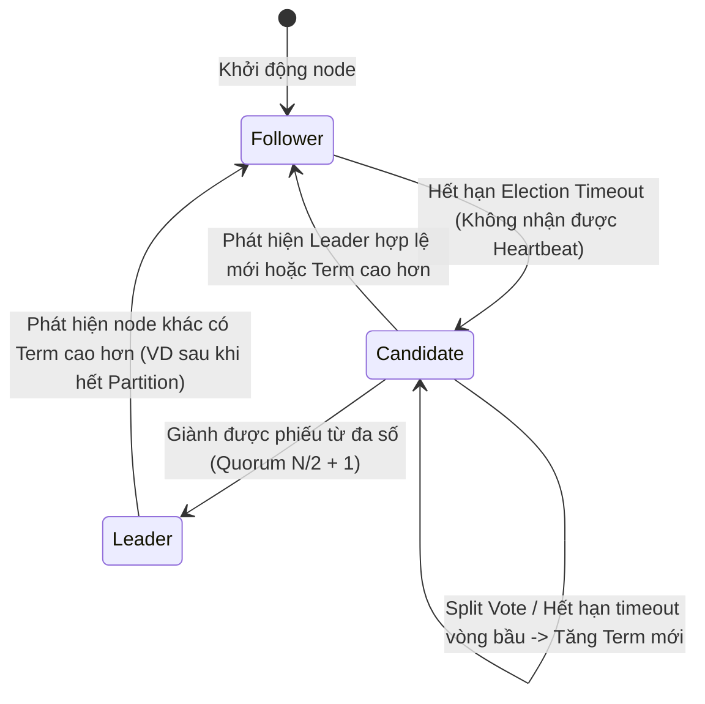

# 8.2. Raft Consensus Algorithm Deep Dive

> [!IMPORTANT]
> **Nếu bạn chỉ được nhớ một điều duy nhất**: Raft được thiết kế để giải quyết điểm yếu chí mạng của Paxos: *tính khó hiểu và khó hiện thực hóa trong thực tế*. Bằng cách phân tách bài toán đồng thuận thành 3 bài toán con độc lập (**Leader Election**, **Log Replication**, và **Safety**), Raft áp dụng mô hình **Strong Leader** toàn năng: dữ liệu chỉ chảy một chiều từ Leader sang các Follower. Tính đúng đắn của Raft dựa trên bất biến: một node chỉ có thể trở thành Leader nếu nhật ký (Log) của nó chứa đầy đủ tất cả các entry đã từng được commit ở các nhiệm kỳ trước (**Leader Completeness Property**).

---

## 1. Kiến trúc Tổng quan & Mô hình Tư duy (Mental Model)

### Ẩn dụ Đời sống: Chế độ Quân Chủ Tập Quyền với Giới hạn Nhiệm kỳ
Hãy tưởng tượng một quốc gia vận hành theo thể chế quân chủ tuyển cử:
- **Leader (Nhà Vua)**: Nắm toàn quyền lập pháp và hành pháp. Mọi chỉ dụ (Client requests) đều phải nộp lên vua; vua viết vào biên niên sử của mình rồi gửi các bản sao (AppendEntries) cho các công tước địa phương (Followers). Chỉ khi quá bán công tước xác nhận đã chép chỉ dụ vào kho lưu trữ, chỉ dụ mới có hiệu lực thi hành.
- **Followers (Các Công tước)**: Tuyệt đối phục tùng và thụ động. Họ định kỳ nhận được thư báo bình an (Heartbeats) từ nhà vua.
- **Candidate (Ứng viên soán ngôi)**: Nếu quá lâu không nhận được thư của nhà vua (Election Timeout hết hạn do vua chết hoặc bị cô lập), một công tước sẽ tự tuyên bố nhiệm kỳ mới (Tăng Term), phát động bầu cử và xin chữ ký ủng hộ (RequestVote). Để tránh việc các ứng viên nổi dậy cùng một lúc gây nội chiến bất phân thắng bại (**Split Vote**), mỗi công tước có một chiếc đồng hồ báo thức ngẫu nhiên (**Randomized Election Timeout**).



---

## 2. Chi tiết từng Keyword (Under-the-Hood Deep Dive)

### 2.1. Ba trạng thái của Node & Khái niệm Term (Nhiệm kỳ)
Trong mọi thời điểm của chu kỳ sống, mỗi node trong cụm Raft chỉ nằm ở đúng một trong ba vai trò:
- **Follower**: Hoàn toàn thụ động. Chỉ phản hồi các RPC từ Leader (`AppendEntries`) hoặc Candidate (`RequestVote`). Không bao giờ tự phát sinh yêu cầu trừ khi hết hạn bộ đếm thời gian (`electionTimeout`).
- **Candidate**: Trạng thái trung gian khi bầu cử. Node tăng `currentTerm`, tự bỏ phiếu cho chính mình, và gửi `RequestVote` RPC tới tất cả các node khác trong cụm để tìm kiếm đa số phiếu.
- **Leader**: Node lãnh đạo duy nhất. Tiếp nhận mọi yêu cầu đọc/ghi từ client, gán index/term cho log entry, điều phối nhân bản dữ liệu, và liên tục phát nhịp tim rỗng định kỳ (`heartbeatPeriod`) để duy trì quyền lực và ức chế các Follower nổi dậy.

#### Khái niệm Term (Nhiệm kỳ số nguyên tăng đơn điệu)
- **Term** đóng vai trò là chiếc đồng hồ logic (Logical Clock) tối cao của thuật toán Raft.
- Term là một số nguyên dương $T \in \mathbb{N}$, khởi tạo bằng 0 và tăng ngặt theo thời gian.
- **Quy tắc trao đổi Term**: Mọi RPC và phản hồi RPC trong Raft đều đính kèm `term`.
  - Nếu một node nhận được thông điệp có `msg.term > currentTerm`, node đó lập tức cập nhật `currentTerm = msg.term` và hạ cấp ngay về trạng thái **Follower**.
  - Nếu Leader hoặc Candidate nhận thông điệp có `msg.term < currentTerm`, nó từ chối xử lý và gửi trả `currentTerm` để node kia tự động cập nhật.

### 2.2. Thuật toán Leader Election & Cơ chế Randomized Election Timeout

#### Quy trình Bầu cử (Step-by-Step)
1. Khi đồng hồ `electionTimeout` của Follower đếm về 0:
   - Chuyển trạng thái sang **Candidate**.
   - Tăng nhiệm kỳ: `currentTerm += 1`.
   - Tự bỏ 1 phiếu cho chính mình: `votedFor = self.id`.
   - Đặt lại đồng hồ `electionTimeout`.
   - Gửi song song `RequestVote(term, candidateId, lastLogIndex, lastLogTerm)` tới tất cả node trong cụm.
2. Các node khác khi nhận được `RequestVote`:
   - Từ chối bỏ phiếu nếu `term < currentTerm`.
   - Chỉ bỏ phiếu nếu node này chưa bỏ phiếu cho ai khác trong `term` hiện tại (`votedFor == null || votedFor == candidateId`) VÀ log của Candidate **ít nhất phải mới bằng log của node nhận** (*Up-to-date check*).
3. Candidate đắc cử khi và chỉ khi nhận được sự đồng thuận từ một **Quorum** ($\lfloor N/2 \rfloor + 1$ node). Nó lập tức chuyển thành **Leader** và phát broadcast Heartbeat đầu tiên để dập tắt các Candidate khác.

#### Cơ chế Randomized Election Timeout & Pre-Vote
- **Vấn đề Split Vote**: Nếu tất cả các Follower cùng timeout tại một thời điểm, chúng sẽ đồng thời ứng cử, tự vote cho mình và chia đều phiếu bầu $\implies$ không ai đạt được đa số Quorum.
- **Giải pháp**: Raft quy định thời gian timeout được chọn ngẫu nhiên trong một dải:
  $$\text{ElectionTimeout} \in [T_{\text{min}}, T_{\text{max}}] \quad (\text{thường là } [150\text{ms}, 300\text{ms}])$$
  Đảm bảo xác suất một node thức dậy sớm nhất và thu thập đủ phiếu trước các node khác là gần như $100\%$.
- **Pre-Vote Extension**: Trước khi chính thức tăng `currentTerm`, Candidate gửi một tin nhắn thăm dò `PreVote` xem các node khác có sẵn sàng bầu cho mình hay không. Điều này ngăn chặn hiện tượng một node bị rớt mạng chập chờn liên tục tăng Term và làm gián đoạn cụm khi tái kết nối.

### 2.3. Thuật toán Log Replication & Hai con trỏ NextIndex, MatchIndex

#### Cấu trúc một Log Entry
Một bản ghi nhật ký trong Raft gồm 3 trường:
$$\text{LogEntry} = \langle \text{Index: } k, \quad \text{Term: } t, \quad \text{Command: } c \rangle$$

#### Hai cấu trúc dữ liệu cốt lõi trên Leader
Leader duy trì trạng thái khả biến để quản lý từng Follower $i$:
1. **`nextIndex[i]`**: Chỉ số index của log entry tiếp theo mà Leader sẽ gửi cho Follower $i$ (khởi tạo bằng $\text{Leader.lastLogIndex} + 1$).
2. **`matchIndex[i]`**: Chỉ số index cao nhất mà Leader biết chắc chắn rằng Follower $i$ đã sao chép thành công và đồng bộ trên đĩa (khởi tạo bằng 0).

#### Quy trình AppendEntries RPC & Log Matching Property
Khi nhận lệnh từ Client:
1. Leader chép lệnh vào Log của mình: `Log.append({index, currentTerm, cmd})`.
2. Gửi RPC `AppendEntries(term, leaderId, prevLogIndex, prevLogTerm, entries[], leaderCommit)` tới các Follower.
3. **Log Matching Property**: Follower kiểm tra xem tại vị trí `prevLogIndex` của nó có log entry nào mang nhiệm kỳ `prevLogTerm` không:
   - Nếu **không khớp**: Follower trả về `Success = False`. Leader giảm `nextIndex[i] -= 1` và thử lại cho đến khi tìm được điểm chung. Khi đó, Follower sẽ ghi đè và xóa toàn bộ các log mâu thuẫn phía sau điểm chung đó!
   - Nếu **khớp**: Follower chép các `entries[]` mới vào đĩa và trả về `Success = True`.
4. Khi Leader thấy một entry đã được sao chép trên đa số node ($\text{matchIndex}[i] \ge N$ trên Quorum): Leader tăng `commitIndex`, áp dụng lệnh vào State Machine (FSM), và gửi phản hồi kết quả về cho Client.

### 2.4. Ba thuộc tính an toàn cốt lõi của Raft (Raft Safety Properties)
Để đảm bảo máy trạng thái nhân bản (Replicated State Machine) cho ra kết quả đồng nhất tuyệt đối, Raft chứng minh 5 bất biến:
1. **Election Safety**: Tại một Term nhất định, có tối đa một Leader duy nhất được bầu cử.
2. **Leader Append-Only**: Leader không bao giờ sửa đổi, ghi đè hoặc cắt tỉa (truncate) log của chính nó; nó chỉ nối thêm các entry mới vào cuối.
3. **Log Matching Property**: Nếu hai cuốn nhật ký tại hai node khác nhau có cùng một entry tại vị trí $(index, term)$, thì tất cả các entry từ vị trí $1$ đến $index$ của hai node đó hoàn toàn đồng nhất.
4. **Leader Completeness Property**: Nếu một log entry đã được commit ở một term $T$, thì entry đó bắt buộc phải hiện diện trong log của mọi Leader ở các term $T' > T$.
5. **State Machine Safety**: Nếu một node đã áp dụng một log entry tại index $k$ vào FSM của nó, thì không có bất kỳ node nào khác trong cụm áp dụng một lệnh khác tại index $k$.

### 2.5. Log Compaction, Snapshotting & Cluster Membership Changes

#### Log Compaction & Snapshotting (Thu dọn nhật ký)
Nếu hệ thống chạy hàng tháng, file log sẽ phình to đến hàng terabyte, gây tràn đĩa và khiến các node mới khởi động lại tốn hàng giờ để replay log:
- Hệ thống định kỳ đóng băng trạng thái máy trạng thái (FSM) và ghi đè thành một file **Snapshot** duy nhất.
- Sau khi ghi snapshot thành công, toàn bộ log entry từ index 1 đến `lastIncludedIndex` được xóa bỏ hoàn toàn khỏi đĩa.
- Nếu một Follower bị tụt lại quá xa (điểm `nextIndex` của nó đã bị xóa khỏi log trên Leader), Leader sẽ gửi file snapshot trực tiếp qua RPC `InstallSnapshot`.

#### Cluster Membership Changes (Thay đổi cấu hình cụm động)
Khi cần thêm hoặc bớt node mà không làm dừng hệ thống:
- Không thể chuyển đổi cấu hình từ Cũ ($C_{\text{old}}$) sang Mới ($C_{\text{new}}$) trong một bước vì có thể tạo ra hai Quorum độc lập song song dẫn đến Split-Brain.
- **Raft áp dụng cơ chế Joint Consensus**:
  $$C_{\text{old,new}} = C_{\text{old}} \cap C_{\text{new}}$$
  Mọi quyết định commit trong giai đoạn chuyển đổi đều phải nhận được sự chấp thuận của cả hai Quorum: một Quorum thuộc cấu hình cũ $C_{\text{old}}$ VÀ một Quorum thuộc cấu hình mới $C_{\text{new}}$.

---

## 3. Thực thi Mã nguồn & Mô phỏng Chuyên sâu (Dual-Engine Implementation)

### Engine 1: C++20 — Mô phỏng Cốt lõi Raft Node State Machine & Log Matching Validation

```cpp
#include <iostream>
#include <vector>
#include <string>
#include <optional>
#include <algorithm>
#include <format>
#include <cstdint>

enum class NodeRole { Follower, Candidate, Leader };

struct LogEntry {
    uint64_t index;
    uint64_t term;
    std::string command;
};

struct AppendEntriesArgs {
    uint64_t term;
    uint32_t leader_id;
    uint64_t prev_log_index;
    uint64_t prev_log_term;
    std::vector<LogEntry> entries;
    uint64_t leader_commit;
};

struct AppendEntriesReply {
    uint64_t term;
    bool success;
    uint64_t match_index;
};

class RaftFollowerNode {
public:
    uint32_t id;
    uint64_t current_term{0};
    std::optional<uint32_t> voted_for;
    std::vector<LogEntry> log;
    uint64_t commit_index{0};

    explicit RaftFollowerNode(uint32_t id) : id(id) {
        // Dummy entry tại index 0 để 1-based indexing dễ quản lý
        log.push_back(LogEntry{.index = 0, .term = 0, .command = "ROOT"});
    }

    AppendEntriesReply handle_append_entries(const AppendEntriesArgs& args) {
        // Quy tắc 1: Bác bỏ nếu term của Leader cũ hơn
        if (args.term < current_term) {
            std::cout << std::format("[Node {}] Từ chối AppendEntries vì Leader term {} < currentTerm {}\n",
                id, args.term, current_term);
            return AppendEntriesReply{.term = current_term, .success = false, .match_index = log.size() - 1};
        }

        current_term = args.term;

        // Quy tắc 2: Log Matching Check
        // Kiểm tra xem vị trí prev_log_index có tồn tại và khớp term hay không
        if (args.prev_log_index >= log.size()) {
            std::cout << std::format("[Node {}] Log trễ: prev_log_index {} > log size {}\n",
                id, args.prev_log_index, log.size());
            return AppendEntriesReply{.term = current_term, .success = false, .match_index = log.size() - 1};
        }

        if (log[args.prev_log_index].term != args.prev_log_term) {
            std::cout << std::format("[Node {}] Xung đột Log tại index {}: local term {} != leader term {}\n",
                id, args.prev_log_index, log[args.prev_log_index].term, args.prev_log_term);
            // Xóa log xung đột và tất cả các log sau nó
            log.resize(args.prev_log_index);
            return AppendEntriesReply{.term = current_term, .success = false, .match_index = log.size() - 1};
        }

        // Quy tắc 3: Nối thêm log entries mới từ Leader
        for (const auto& entry : args.entries) {
            if (entry.index < log.size()) {
                if (log[entry.index].term != entry.term) {
                    log.resize(entry.index);
                    log.push_back(entry);
                }
            } else {
                log.push_back(entry);
            }
        }

        // Quy tắc 4: Cập nhật commitIndex
        if (args.leader_commit > commit_index) {
            commit_index = std::min(args.leader_commit, static_cast<uint64_t>(log.size() - 1));
            std::cout << std::format("[Node {}] Cập nhật commit_index = {}\n", id, commit_index);
        }

        return AppendEntriesReply{.term = current_term, .success = true, .match_index = log.size() - 1};
    }
};

int main() {
    RaftFollowerNode follower(2);

    std::cout << "--- Bước 1: Gửi Log Entry 1 hợp lệ từ Leader (Term 1) ---\n";
    AppendEntriesArgs rpc1{
        .term = 1,
        .leader_id = 1,
        .prev_log_index = 0,
        .prev_log_term = 0,
        .entries = { LogEntry{.index = 1, .term = 1, .command = "SET x=10"} },
        .leader_commit = 1
    };
    auto res1 = follower.handle_append_entries(rpc1);
    std::cout << std::format("Kết quả: success={}, match_index={}\n\n", res1.success, res1.match_index);

    std::cout << "--- Bước 2: Giả lập Leader mới (Term 2) gửi Log với prevLog không khớp ---\n";
    AppendEntriesArgs rpc_conflict{
        .term = 2,
        .leader_id = 3,
        .prev_log_index = 2, // Follower chưa có index 2
        .prev_log_term = 1,
        .entries = { LogEntry{.index = 3, .term = 2, .command = "SET y=20"} },
        .leader_commit = 1
    };
    auto res2 = follower.handle_append_entries(rpc_conflict);
    std::cout << std::format("Kết quả: success={}, match_index={}\n\n", res2.success, res2.match_index);

    std::cout << "--- Bước 3: Leader lùi prev_log_index về 1 và đồng bộ lại ---\n";
    AppendEntriesArgs rpc_retry{
        .term = 2,
        .leader_id = 3,
        .prev_log_index = 1,
        .prev_log_term = 1,
        .entries = { LogEntry{.index = 2, .term = 2, .command = "SET y=20"} },
        .leader_commit = 2
    };
    auto res3 = follower.handle_append_entries(rpc_retry);
    std::cout << std::format("Kết quả: success={}, match_index={}\n", res3.success, res3.match_index);

    return 0;
}
```

#### Terminal Output Mẫu:
```text
--- Bước 1: Gửi Log Entry 1 hợp lệ từ Leader (Term 1) ---
[Node 2] Cập nhật commit_index = 1
Kết quả: success=true, match_index=1

--- Bước 2: Giả lập Leader mới (Term 2) gửi Log với prevLog không khớp ---
[Node 2] Log trễ: prev_log_index 2 > log size 2
Kết quả: success=false, match_index=1

--- Bước 3: Leader lùi prev_log_index về 1 và đồng bộ lại ---
[Node 2] Cập nhật commit_index = 2
Kết quả: success=true, match_index=2
```

---

### Engine 2: Python 3.11+ — Mô phỏng Cơ chế Bầu cử Raft với Randomized Election Timeout

```python
import asyncio
import random
from enum import Enum
from typing import Dict, List, Optional

class Role(Enum):
    FOLLOWER = "Follower"
    CANDIDATE = "Candidate"
    LEADER = "Leader"

class RaftNode:
    def __init__(self, node_id: int, cluster_ids: List[int]):
        self.node_id = node_id
        self.cluster_ids = cluster_ids
        self.role = Role.FOLLOWER
        self.current_term = 0
        self.voted_for: Optional[int] = None
        self.election_timer_task: Optional[asyncio.Task] = None
        self.alive = True

    def reset_election_timeout(self) -> float:
        # Randomized Election Timeout [150ms, 300ms]
        timeout = random.uniform(0.15, 0.30)
        return timeout

    async def run(self, cluster_nodes: Dict[int, 'RaftNode']):
        while self.alive:
            if self.role == Role.FOLLOWER:
                timeout = self.reset_election_timeout()
                await asyncio.sleep(timeout)
                # Nếu không ai ping trong thời gian này, chuyển thành Candidate
                if self.role == Role.FOLLOWER:
                    print(f"[Node {self.node_id}] Timeout ({timeout*1000:.1f}ms)! Chuyển thành Candidate.")
                    await self.start_election(cluster_nodes)

            elif self.role == Role.CANDIDATE:
                timeout = self.reset_election_timeout()
                await asyncio.sleep(timeout)
                if self.role == Role.CANDIDATE:
                    print(f"[Node {self.node_id}] Bầu cử thất bại/Split vote. Bắt đầu Term mới.")
                    await self.start_election(cluster_nodes)

            elif self.role == Role.LEADER:
                # Phát heartbeat định kỳ 50ms
                for nid in self.cluster_ids:
                    if nid != self.node_id and cluster_nodes[nid].alive:
                        cluster_nodes[nid].receive_heartbeat(self.current_term, self.node_id)
                await asyncio.sleep(0.05)

    def receive_heartbeat(self, term: int, leader_id: int):
        if term >= self.current_term:
            self.current_term = term
            self.role = Role.FOLLOWER
            self.voted_for = None

    async def start_election(self, cluster_nodes: Dict[int, 'RaftNode']):
        self.role = Role.CANDIDATE
        self.current_term += 1
        self.voted_for = self.node_id
        votes_received = 1
        quorum = len(self.cluster_ids) // 2 + 1

        print(f"[*] [Node {self.node_id}] Phát động bầu cử Term {self.current_term}")

        for nid in self.cluster_ids:
            if nid != self.node_id and cluster_nodes[nid].alive:
                peer = cluster_nodes[nid]
                if peer.current_term < self.current_term and (peer.voted_for is None or peer.voted_for == self.node_id):
                    peer.current_term = self.current_term
                    peer.voted_for = self.node_id
                    votes_received += 1

        if votes_received >= quorum:
            self.role = Role.LEADER
            print(f"[V] [Node {self.node_id}] ĐÃ TRỞ THÀNH LEADER cho Term {self.current_term} ({votes_received}/{len(self.cluster_ids)} phiếu)!")
        else:
            print(f"[X] [Node {self.node_id}] Không đủ Quorum ({votes_received}/{quorum} phiếu).")

async def main():
    cluster_ids = [1, 2, 3]
    nodes = {nid: RaftNode(nid, cluster_ids) for nid in cluster_ids}

    tasks = [asyncio.create_task(node.run(nodes)) for node in nodes.values()]

    # Chạy mô phỏng trong 0.8 giây để quan sát bầu cử
    await asyncio.sleep(0.8)

    print("\n--- Tắt cụm mô phỏng ---")
    for node in nodes.values():
        node.alive = False
    for t in tasks:
        t.cancel()

if __name__ == "__main__":
    asyncio.run(main())
```

#### Terminal Output Mẫu:
```text
[Node 2] Timeout (164.2ms)! Chuyển thành Candidate.
[*] [Node 2] Phát động bầu cử Term 1
[V] [Node 2] ĐÃ TRỞ THÀNH LEADER cho Term 1 (3/3 phiếu)!

--- Tắt cụm mô phỏng ---
```

---

## 4. Systems Engineering & Production Pitfalls

### 4.1. Những cạm bẫy sống còn khi vận hành cụm Raft
1. **Phân rã Quorum do lỗi Disk Slow (IOPS Stall)**:
   - Một node Raft bị đĩa quay quá tải (`fsync` mất 500ms trong khi Heartbeat timeout là 200ms) sẽ không thể phản hồi AppendEntries kịp thời. Leader coi node này đã chết. Khi node phản hồi lại trễ, nó gửi tin nhắn với Term cũ hoặc làm gián đoạn pipeline.
   - *Quy tắc vận hành*: Luôn tách riêng ổ đĩa chạy WAL (Write-Ahead-Log) của Raft sang NVMe SSD độc lập và không để chung phân vùng với dữ liệu ứng dụng.

2. **Hiện tượng Phantom Disruption (Node bị cô lập làm tăng Term liên tục)**:
   - Node $A$ bị cô lập khỏi mạng (Network partition một chiều). Nó không nhận được Heartbeat nên liên tục tăng `currentTerm` từ $1 \to 100$ và liên tục broadcast `RequestVote`. Khi partition hết, $A$ gửi tin nhắn với `term = 100` vào cụm. Leader hiện tại thấy Term cao hơn lập tức tự thoái vị làm hạ bệ cụm và kích hoạt bầu cử không cần thiết.
   - *Khắc phục*: Bắt buộc kích hoạt cờ **`Pre-Vote` phase** (đã được bật mặc định trong etcd và HashiCorp Consul). Node chỉ tăng `currentTerm` nếu vòng thăm dò Pre-Vote xác nhận được sự đồng thuận từ đa số.

3. **Snapshots làm nghẽn băng thông mạng (Network Saturation)**:
   - Khi một Follower mới được thêm vào cụm hoặc tụt hậu, Leader phải truyền toàn bộ Snapshot qua RPC `InstallSnapshot`. Nếu snapshot dung lượng hàng chục GB mà không có rate-limiting, nó sẽ nuốt trọn card mạng của Leader, khiến Leader không thể gửi Heartbeat cho các Follower khác $\implies$ kích hoạt một đợt bầu cử giả mạo thảm khốc.
   - *Khắc phục*: Thiết lập cờ giới hạn băng thông gửi snapshot (`max-snap-rate` trong etcd hoặc `snapshot-transfer-rate` trong Consul).

### 4.2. Runbook Chẩn đoán Sự cố Cụm Raft (etcd CLI)

```bash
# 1. Kiểm tra trạng thái sức khỏe và Leader hiện tại của cụm etcd Raft
etcdctl endpoint status --write-out=table

# 2. Kiểm tra độ lệch commit index giữa các node để phát hiện node tụt hậu
etcdctl endpoint status --write-out=fields | grep -E "Endpoint|RAFT_INDEX|RAFT_TERM|IS_LEADER"

# 3. Theo dõi chỉ số cảnh báo rớt Leader và thời gian chờ fsync qua Prometheus
curl -s http://localhost:2379/metrics | grep -E "etcd_server_leader_changes_seen_total|etcd_disk_wal_fsync_duration_seconds_bucket"
```

---

## 5. Bảng So sánh & Decision Matrix

| Khía cạnh Kỹ thuật | Raft | Multi-Paxos | Zab (ZooKeeper) | Tendermint (BFT) |
| :--- | :--- | :--- | :--- | :--- |
| **Mô hình Lãnh đạo** | Strong Leader (Đơn hướng) | Weak Leader / Multi-Proposer | Primary-Backup (Cố định) | Proposer luân phiên theo round |
| **Thuộc tính Log** | Tuyệt đối không có lỗ hổng (No Gaps) | Có thể có lỗ hổng (Gaps allowed) | Chuỗi liên tục zxid | Chuỗi khối mã hóa (Blockchain) |
| **Quy trình Leader Election** | Bầu người có Log mới nhất | Bầu bất kỳ, sau đó học lại giá trị cũ | Fast Leader Election (FLE) | Stake-weighted Round Robin |
| **Khả năng chịu lỗi** | CFT ($N \ge 2f + 1$) | CFT ($N \ge 2f + 1$) | CFT ($N \ge 2f + 1$) | BFT ($N \ge 3f + 1$) |
| **Hệ thống áp dụng** | **etcd, Consul, CockroachDB, TiKV** | Google Chubby, Spanner, Megastore | Apache ZooKeeper, ClickHouse Keeper | Cosmos, L1/L2 Blockchains |
