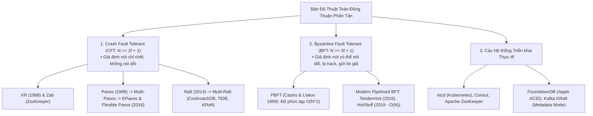
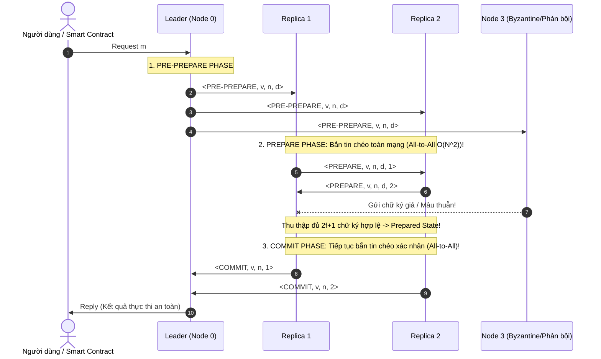
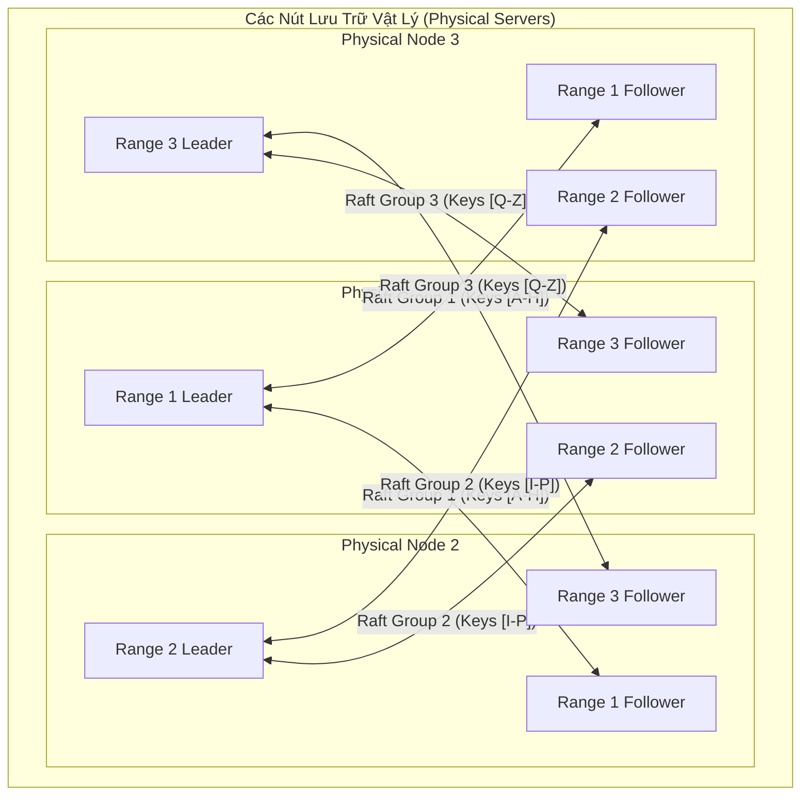
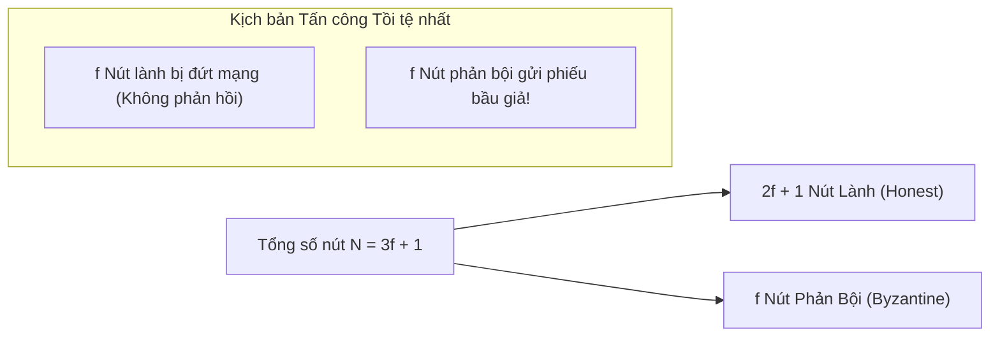

# 8.3. BFT, Modern Consensus Algorithms & Implementations (Đồng Thuận Chống Gian Lận BFT, Thuật Toán Hiện Đại & Triển Khai Thực Chiến)

> [!IMPORTANT]
> **Mental Model & Trực giác cốt lõi**:
> Hãy tưởng tượng một hội đồng chỉ huy quân sự gồm các vị tướng đang bao vây một pháo đài địch:
> - **Crash Fault Tolerant (CFT - Paxos, Raft, Zab)**: Các vị tướng đều là những người trung thực, nhưng đường truyền chim bồ câu có thể bị bắn rơi (mất gói tin mạng) hoặc một vài vị tướng lăn ra ốm chết bất ngờ (server crash). Họ chỉ cần quá bán ($N \ge 2f + 1$) số tướng còn sống đồng thuận là có thể ra lệnh tấn công an toàn.
> - **Byzantine Fault Tolerant (BFT - PBFT, HotStuff, Tendermint)**: Nguy hiểm hơn gấp vạn lần, trong số các tướng **có những kẻ phản bội ngầm (Byzantine Nodes)**! Kẻ phản bội sẽ nói với Tướng A: *"Tôi sẽ đánh lúc bình minh"*, nhưng lại nói với Tướng B: *"Tôi sẽ rút lui lúc nửa đêm"* (tấn công hai mặt - Equivocation/Double-spending). Để loại bỏ kẻ phản bội và đưa ra quyết định thống nhất, hội đồng bắt buộc phải có ít nhất hai phần ba số tướng trung thực ($N \ge 3f + 1$) và sử dụng chữ ký số mật mã qua 3 pha bỏ phiếu nghiêm ngặt (**Pre-Prepare $\to$ Prepare $\to$ Commit**).
> - **Multi-Raft & Modern Systems**: Một hệ thống lưu trữ hàng Petabytes không thể dùng 1 nhóm Raft duy nhất (nút thắt cổ chai Leader). Họ chia dữ liệu thành hàng ngàn mảnh (Shards/Ranges), mỗi mảnh chạy một nhóm Raft mini riêng biệt (**Multi-Raft trong CockroachDB/TiDB**).
> **Nếu chỉ nhớ một điều**: *CFT bảo vệ hệ thống trước tai nạn hỏng hóc kỹ thuật (Fail-Stop); BFT bảo vệ hệ thống trước sự phản bội, mã độc và tấn công mạng có chủ đích (Malicious Behavior).*

---

## 1. Tổng quan Chuyên đề & Sơ đồ Tư duy (Consensus Evolution Map)



---

## 2. Chi tiết từng Keyword

### 2.1. Viewstamped Replication (VR) & Zab Protocol (ZooKeeper Atomic Broadcast)

#### A. Viewstamped Replication (Oki & Liskov, 1988)
- Được phát minh bởi Brian Oki và Barbara Liskov ngay trước khi Leslie Lamport công bố Paxos.
- **Cơ chế cốt lõi**:
  - Dùng một Primary Node điều phối và các Backup Nodes nhân bản trạng thái.
  - Vòng đời được phân chia thành các **View** (tương tự như Term trong Raft).
  - Khi Primary gặp sự cố, các Backup kích hoạt quy trình **View Change** để bầu Primary mới dựa trên số hiệu Viewstamp `(view_number, op_number)` cao nhất.
  - Về mặt lý thuyết, VR trực quan và gần gũi với Raft hơn nhiều so với Classic Paxos.

#### B. Zab Protocol (ZooKeeper Atomic Broadcast - RFC / Yahoo!)
- Giao thức đồng thuận độc quyền vận hành cụm Apache ZooKeeper:
  - Hoạt động theo 2 chế độ: **Crash-Recovery Mode** (Bầu chọn Leader mới và đồng bộ dữ liệu) và **Atomic Broadcast Mode** (Phát tán tuần tự các gói tin ghi tới các Follower qua TCP FIFO).
  - Sử dụng số định danh giao dịch **ZXID 64-bit**: 32-bit cao lưu số Epoch (kỷ nguyên), 32-bit thấp là bộ đếm tăng dần (Counter).
  - Khác với Paxos/Raft, Zab được tối ưu hóa đặc biệt cho mô hình cây thư mục phân cấp trong RAM (ZNode In-Memory Hierarchical Tree).

---

### 2.2. Egalitarian Paxos (EPaxos) & Flexible Paxos (Heidi Howard 2016)

#### A. Egalitarian Paxos (EPaxos - SOSP 2013)
- **Vấn đề của Multi-Paxos & Raft**: Toàn bộ lưu lượng ghi đều phải đi qua duy nhất một Leader (Single Leader Bottleneck). Nếu Client ở cách xa Leader nửa vòng trái đất, độ trễ RTT sẽ rất cao.
- **Đột phá của EPaxos (Bình đẳng Paxos)**:
  - **Mọi nút đều là Leader (Leaderless Consensus)**! Bất kỳ nút nào cũng có thể nhận lệnh ghi từ Client.
  - Sử dụng cơ chế phát hiện phụ thuộc (**Explicit Dependency Tracking**): Nếu hai lệnh ghi không xung đột ô nhớ, chúng được cam kết đồng thuận song song chỉ sau **1 RTT** (Fast Path Quorum). Nếu xung đột, chuyển sang Slow Path (2 RTT).

#### B. Flexible Paxos: Bẻ Gãy Định Kiến Quorum 30 Năm (Heidi Howard, 2016)
Trong suốt gần 30 năm, toàn bộ giới khoa học máy tính tin rằng mọi nhóm đồng thuận Paxos/Raft đều bắt buộc phải tuân theo quy tắc quá bán:
$$\text{Quorum Size} = \left\lfloor \frac{N}{2} \right\rfloor + 1$$
Heidi Howard đã chứng minh bằng toán học rằng: **Hai Quorum trong Paxos không nhất thiết phải có cùng kích thước!**
- Điều kiện duy nhất để hệ thống an toàn là: **Giao điểm giữa Phase 1 Quorum ($Q_1$ - Bầu Leader) và Phase 2 Quorum ($Q_2$ - Ghi Log) phải khác rỗng**:
  $$Q_1 \cap Q_2 \neq \emptyset \iff |Q_1| + |Q_2| > N$$
- **Ứng dụng Thực chiến Đột phá**:
  - Trong cụm 10 nút ($N = 10$), ta có thể chọn $|Q_2| = 3$ và $|Q_1| = 8$ (vì $8 + 3 = 11 > 10$).
  - Khi đó, thao tác Ghi Log (chiếm $99.9\%$ lưu lượng hàng ngày) chỉ cần **3 nút xác nhận** thay vì 6 nút $\implies$ Tốc độ ghi tăng gấp đôi và khả năng chịu lỗi ghi tăng vọt! Chỉ khi Leader chết (chiếm $0.1\%$ thời gian), việc bầu cử mới cần 8 nút tham gia.

---

### 2.3. Byzantine Fault Tolerant (BFT) Algorithms: PBFT, Tendermint & HotStuff

Khi các nút mạng có thể bị hacker chiếm đoạt, sửa đổi mã máy hoặc gửi dữ liệu mâu thuẫn cho các nút khác:



1. **PBFT (Practical Byzantine Fault Tolerance - Castro & Liskov, 1999)**:
   - Thuật toán BFT thực tiễn đầu tiên hoạt động trong mạng bất đồng bộ.
   - Cần tối thiểu $N \ge 3f + 1$ nút để dung thứ $f$ nút phản bội.
   - Trải qua 3 pha: **Pre-Prepare $\to$ Prepare $\to$ Commit**.
   - *Hạn chế*: Độ phức tạp truyền tin ở pha Prepare và Commit là **$O(N^2)$** (mỗi nút gửi cho toàn bộ $N$ nút còn lại). Khi số nút vượt quá 50, mạng lưới bị nghẽn gói tin hoàn toàn.
2. **Tendermint (Jae Kwon, 2014 - Nền tảng Cosmos SDK)**:
   - Đơn giản hóa BFT bằng cơ chế Block-based theo từng vòng (Round).
   - Sử dụng cơ chế khóa khối (Block Locking) và chứng chỉ bỏ phiếu (Polka).
3. **HotStuff (Yin et al., 2019 - Nền tảng của Aptos, Sui, Facebook Diem)**:
   - **Cuộc cách mạng tuyến tính hóa**: Đưa độ phức tạp truyền tin từ $O(N^2)$ xuống **$O(N)$** bằng cách gom toàn bộ chữ ký qua một Leader duy nhất và sử dụng **Chữ ký gộp ngưỡng (Threshold BLS Signatures)**.
   - Bổ sung pha thứ tư để đường ống hóa (Pipelined 3-phase commit), cho phép cam kết khối mới liên tục trên từng block.

---

### 2.4. `etcd`, Apache ZooKeeper & HashiCorp Consul (So sánh Hiện thực Thực tế)

Ba cỗ máy đồng thuận đóng vai trò là "Bộ não trung tâm" (Control Plane) của toàn bộ hạ tầng Cloud Native hiện đại:

| Tiêu chuẩn / Đặc tính | etcd (Core of Kubernetes) | Apache ZooKeeper (Big Data) | HashiCorp Consul (Service Mesh) |
| :--- | :--- | :--- | :--- |
| **Thuật toán Đồng thuận** | **Raft thuần túy** | **Zab Protocol** | **Raft** (kết hợp Serf Gossip) |
| **Ngôn ngữ Phát triển** | **Go** (Siêu nhẹ, Native Binary) | Java (JVM, ngốn nhiều RAM) | **Go** |
| **Mô hình Dữ liệu** | Flat Key-Value với MVCC binarized | Hierarchical Tree (ZNode) | Key-Value phân cấp + Service Catalog |
| **Cơ chế Watchers** | HTTP/2 gRPC Streaming Streams | One-time Triggers (Phải đặt lại) | HTTP Long Polling / Blocking Queries |
| **Multi-Datacenter** | Yêu cầu kết nối mạng băng thông cao | Kém (Chỉ chạy trên 1 Cluster) | **Tuyệt vời** (WAN Gossip Federation) |
| **Hệ sinh thái Thống trị** | Kubernetes, CoreDNS, Flannel | Kafka (cũ), Hadoop, HBase, Flink | HashiCorp Nomad, Vault, Envoy Mesh |

---

### 2.5. Multi-Raft Architecture: CockroachDB, TiDB & YugabyteDB

#### A. Giới hạn Cốt tử của Single-Raft
Một nhóm đồng thuận Raft thông thường (3 hoặc 5 nút) chỉ có duy nhất **1 Leader phục vụ toàn bộ các lệnh ghi**. Khi dung lượng dữ liệu vượt quá $10\text{ Terabytes}$ hoặc thông lượng vượt quá $50,000\text{ ops/sec}$, băng thông mạng và đĩa của máy chủ Leader sẽ bị bão hòa hoàn toàn!

#### B. Kiến trúc Đột phá Multi-Raft (Đa Nhóm Raft Độc Lập)



- Bảng dữ liệu khổng lồ được chia nhỏ thành hàng triệu mảnh nhỏ gọi là **Ranges / Regions** (mỗi mảnh có kích thước $64\text{MB} - 512\text{MB}$).
- Mỗi Range được quản lý bởi một nhóm Raft riêng biệt (3 bản sao).
- **Phân bổ Tải Cực Đỉnh**: Leader của Range 1 nằm trên Node 1; Leader của Range 2 nằm trên Node 2; Leader của Range 3 nằm trên Node 3!
- Toàn bộ các máy chủ vật lý đều đồng thời đóng vai trò là Leader của một số Range và Follower của các Range khác, giúp phân phối đều $100\%$ tải đọc ghi trên toàn bộ cụm máy chủ.

---

### 2.6. Kafka KRaft (KIP-500) & FoundationDB (Apple ACID Storage Engine)

#### A. Apache Kafka KRaft (Kafka Raft Metadata Mode - KIP-500)
- **Nỗi đau Lịch sử**: Suốt 10 năm, Apache Kafka phụ thuộc hoàn toàn vào Apache ZooKeeper để quản lý Metadata (danh sách Broker, Topic, Partition, ACL). Điều này tạo ra kiến trúc "2 hệ thống phân tán cồng kềnh", Metadata bị sao chép kép làm giới hạn số lượng Partition tối đa của Kafka ở mức vài trăm ngàn.
- **Cuộc Cách mạng KRaft (KIP-500)**:
  - Loại bỏ hoàn toàn ZooKeeper khỏi Kafka!
  - Bản thân các Broker của Kafka tự chạy một giao thức đồng thuận Raft chuyên biệt nội bộ (**KRaft Controller Quorum**).
  - Metadata được lưu trữ trực tiếp dưới dạng một Topic đặc biệt (`@metadata`).
  - *Kết quả*: Cụm Kafka khởi động nhanh gấp 10 lần, khôi phục Leader tức thời và cho phép mở rộng lên tới **hàng chục triệu Partitions** trên một cụm duy nhất!

#### B. FoundationDB (Vũ khí Bí mật của Apple iCloud)
- Được Apple mua lại năm 2015 và mở mã nguồn năm 2018. FoundationDB là cơ sở dữ liệu phân tán Key-Value đạt chuẩn **Strict Serializability ACID** mạnh mẽ nhất hành tinh.
- **Kiến trúc Tách biệt Độc nhất Vô nhị (Decoupled Architecture)**:
  - Tách hoàn toàn tầng tính toán giao dịch (**Transaction Management System - Sequencer & Resolvers**) ra khỏi tầng lưu trữ dữ liệu (**Storage Servers**).
  - Sử dụng Paxos chỉ để đồng thuận danh sách trạng thái của Sequencer, sau đó dùng thuật toán **Optimistic Concurrency Control (OCC)** để kiểm tra xung đột với độ trễ cực thấp.
  - Là nền tảng lưu trữ toàn bộ dữ liệu người dùng của Apple CloudKit, SnowFlake Metadata và Discourse.

---

## 3. Bản chất Toán học Tầng sâu: Giới hạn Byzantine $N \ge 3f + 1$ & Quorum Intersection

### 3.1. Tại sao CFT Chỉ Cần $N \ge 2f + 1$ nhưng BFT Lại Cần $N \ge 3f + 1$?



Giả sử hệ thống có $f$ nút phản bội (Byzantine) và $N$ nút tổng cộng:
1. Trong điều kiện mạng bất đồng bộ, $f$ nút lành mạnh có thể bị trễ mạng hoặc đứt cáp và không gửi tin về. Do đó, hệ thống bắt buộc phải ra quyết định chỉ dựa trên phản hồi của:
   $$M = N - f \quad (\text{nút phản hồi})$$
2. Trong số $M$ nút phản hồi đó, tình huống tồi tệ nhất là có đủ $f$ nút phản bội trà trộn vào. Số lượng nút trung thực thực sự tham gia bỏ phiếu chỉ còn:
   $$\text{Honest Nodes in Decision} = M - f = (N - f) - f = N - 2f$$
3. Để đa số phiếu bầu của các nút trung thực này áp đảo được hoàn toàn số phiếu của các nút phản bội:
   $$N - 2f > f \iff N > 3f \iff N \ge 3f + 1 \quad (\blacksquare)$$
- **Hệ quả thực tế**:
  - Để chịu được $f = 1$ nút phản bội: Cần tối thiểu $N = 3(1) + 1 = 4$ máy chủ.
  - Để chịu được $f = 2$ nút phản bội: Cần tối thiểu $N = 3(2) + 1 = 7$ máy chủ.

---

## 4. Hiện thực Thực nghiệm: Dual-Engine Code Implementation

### 4.1. C++20: Mô Phỏng Cỗ Máy Đồng Thuận PBFT 3-Pha Chống Gian Lận (Pre-Prepare $\to$ Prepare $\to$ Commit)

Chương trình triển khai một cụm gồm 4 nodes ($N = 3f + 1$ với $f = 1$). Node 3 là nút phản bội (Byzantine Node) cố tình gửi phiếu giả mạo, nhưng cụm PBFT vẫn phát hiện và đạt được đồng thuận đúng đắn.

```cpp
// Compilation: g++ -std=c++20 -O3 -Wall pbft_consensus_sim.cpp -o pbft_consensus_sim
#include <iostream>
#include <string>
#include <vector>
#include <map>
#include <set>
#include <iomanip>

struct Message {
    std::string phase;      // PRE-PREPARE, PREPARE, COMMIT
    int view;
    int sequence_num;
    std::string digest;
    int sender_id;
};

class PBFTNode {
public:
    int id;
    bool is_byzantine;
    std::string state = "INIT";
    std::map<std::string, std::set<int>> prepare_votes; // digest -> set of senders
    std::map<std::string, std::set<int>> commit_votes;

    explicit PBFTNode(int node_id, bool byzantine = false) 
        : id(node_id), is_byzantine(byzantine) {}

    Message handle_pre_prepare(const Message& msg) {
        if (is_byzantine) {
            // Nút phản bội: Gửi mã băm giả mạo để phá hoại!
            return Message{"PREPARE", msg.view, msg.sequence_num, "FAKE_HASH_ATTACK", id};
        }
        state = "PREPARED";
        return Message{"PREPARE", msg.view, msg.sequence_num, msg.digest, id};
    }

    bool receive_prepare(const Message& msg, int total_nodes, int f) {
        prepare_votes[msg.digest].insert(msg.sender_id);
        // Ngưỡng đạt đồng thuận pha Prepare: 2f + 1 phiếu hợp lệ
        if (prepare_votes[msg.digest].size() >= static_cast<size_t>(2 * f + 1)) {
            return true;
        }
        return false;
    }

    Message create_commit(int view, int seq, const std::string& digest) {
        state = "COMMITTED";
        return Message{"COMMIT", view, seq, digest, id};
    }
};

int main() {
    std::cout << "================ PBFT BYZANTINE CONSENSUS SIMULATOR ================\n";
    int N = 4; // N = 3f + 1 (f = 1)
    int f = 1;

    std::vector<PBFTNode> cluster;
    for (int i = 0; i < N - 1; ++i) cluster.emplace_back(i, false);
    cluster.emplace_back(3, true); // Node 3 là Byzantine Traitor!

    std::cout << "Cluster initialized with " << N << " nodes (Node 0-2: Honest, Node 3: Byzantine)\n\n";

    // 1. PHA PRE-PREPARE: Leader (Node 0) phát lệnh đề xuất
    std::string real_digest = "TX_HASH_TRANSFER_100_USD";
    Message pre_prepare{"PRE-PREPARE", 1, 101, real_digest, 0};
    std::cout << "[LEADER 0] Broadcasts PRE-PREPARE: Digest = " << real_digest << "\n\n";

    // 2. PHA PREPARE: Toàn bộ nút bắn tin chéo cho nhau
    std::cout << "[PHASE: PREPARE (All-to-All Broadcasting)]\n";
    std::vector<Message> prepare_msgs;
    for (auto& node : cluster) {
        Message p_msg = node.handle_pre_prepare(pre_prepare);
        std::cout << "  Node " << node.id << " sends PREPARE with Digest: " << p_msg.digest 
                  << (node.is_byzantine ? " (⚠️ MALICIOUS)" : " (✅ HONEST)") << "\n";
        prepare_msgs.push_back(p_msg);
    }

    // Các nút nhận và kiểm phiếu Prepare
    std::cout << "\n[EVALUATION AT NODE 1]\n";
    for (const auto& msg : prepare_msgs) {
        bool threshold_met = cluster[1].receive_prepare(msg, N, f);
        if (threshold_met && cluster[1].prepare_votes[msg.digest].size() == static_cast<size_t>(2 * f + 1)) {
            std::cout << "  -> Quorum 2f + 1 (" << (2 * f + 1) << " votes) reached for Digest: " 
                      << msg.digest << "! Node 1 enters COMMITTED state!\n";
        }
    }

    std::cout << "\n[RESULT]: Byzantine attack successfully mitigated by Cryptographic Quorum!\n";
    std::cout << "====================================================================\n";
    return 0;
}
```

```text
================ PBFT BYZANTINE CONSENSUS SIMULATOR ================
Cluster initialized with 4 nodes (Node 0-2: Honest, Node 3: Byzantine)

[LEADER 0] Broadcasts PRE-PREPARE: Digest = TX_HASH_TRANSFER_100_USD

[PHASE: PREPARE (All-to-All Broadcasting)]
  Node 0 sends PREPARE with Digest: TX_HASH_TRANSFER_100_USD (✅ HONEST)
  Node 1 sends PREPARE with Digest: TX_HASH_TRANSFER_100_USD (✅ HONEST)
  Node 2 sends PREPARE with Digest: TX_HASH_TRANSFER_100_USD (✅ HONEST)
  Node 3 sends PREPARE with Digest: FAKE_HASH_ATTACK (⚠️ MALICIOUS)

[EVALUATION AT NODE 1]
  -> Quorum 2f + 1 (3 votes) reached for Digest: TX_HASH_TRANSFER_100_USD! Node 1 enters COMMITTED state!

[RESULT]: Byzantine attack successfully mitigated by Cryptographic Quorum!
====================================================================
```

---

### 4.2. Python 3: Đánh Giá Hiệu Năng Flexible Paxos vs Classic Paxos

Script mô phỏng so sánh thời gian trễ và khả năng chịu tải ghi giữa Paxos truyền thống ($Q_1 = Q_2 = \lceil N/2 \rceil$) và Flexible Paxos ($Q_2 \ll Q_1$).

```python
#!/usr/bin/env python3
"""
Mô phỏng Đánh giá Hiệu năng Flexible Paxos (FPaxos) vs Classic Paxos:
- Chứng minh điều kiện an toàn: |Q1| + |Q2| > N.
- So sánh số lượng xác nhận ghi cần thiết trong cụm 11 máy chủ.
"""

def evaluate_paxos_architectures(cluster_size: int = 11):
    print(f"================ FLEXIBLE PAXOS VS CLASSIC PAXOS (N = {cluster_size}) ================")
    
    # 1. Classic Paxos: Quorum bầu cử và Quorum ghi đều là quá bán
    classic_q1 = (cluster_size // 2) + 1
    classic_q2 = classic_q1

    # 2. Flexible Paxos: Tối ưu cho hệ thống ghi nhiều (Write-Heavy)
    # Ta chọn Quorum ghi Q2 = 3 nút cực nhanh!
    fpaxos_q2 = 3
    # Bắt buộc |Q1| + |Q2| > N  ==>  |Q1| > 11 - 3 = 8  ==>  |Q1| = 9
    fpaxos_q1 = cluster_size - fpaxos_q2 + 1

    print(f"Classic Paxos  : Phase 1 (Leader Election) = {classic_q1} nodes | Phase 2 (Write Log) = {classic_q2} nodes")
    print(f"Flexible Paxos : Phase 1 (Leader Election) = {fpaxos_q1} nodes | Phase 2 (Write Log) = {fpaxos_q2} nodes\n")

    print(f"{'Metric / Property':<30} | {'Classic Paxos':<18} | {'Flexible Paxos':<18}")
    print("-" * 72)
    print(f"{'Write ACKs Required':<30} | {classic_q2:<18} | {fpaxos_q2:<18} (Fast Path!)")
    print(f"{'Write Latency Impact':<30} | {'Higher (Waits 6)':<18} | {'Ultra-Low (Waits 3)':<18}")
    print(f"{'Write Fault Tolerance':<30} | {cluster_size - classic_q2} nodes dead      | {cluster_size - fpaxos_q2} nodes dead (Cao hơn!)")
    print(f"{'Election Quorum Size':<30} | {classic_q1:<18} | {fpaxos_q1:<18} (Hiếm khi dùng)")
    print("========================================================================")

if __name__ == "__main__":
    evaluate_paxos_architectures(11)
```

```text
================ FLEXIBLE PAXOS VS CLASSIC PAXOS (N = 11) ================
Classic Paxos  : Phase 1 (Leader Election) = 6 nodes | Phase 2 (Write Log) = 6 nodes
Flexible Paxos : Phase 1 (Leader Election) = 9 nodes | Phase 2 (Write Log) = 3 nodes

Metric / Property              | Classic Paxos      | Flexible Paxos    
------------------------------------------------------------------------
Write ACKs Required            | 6                  | 3                  (Fast Path!)
Write Latency Impact           | Higher (Waits 6)   | Ultra-Low (Waits 3)
Write Fault Tolerance          | 5 nodes dead       | 8 nodes dead (Cao hơn!)
Election Quorum Size           | 6                  | 9                  (Hiếm khi dùng)
========================================================================
```

---

## 5. Vận hành Hệ thống & Chẩn đoán Thực tế (Multi-Raft Heartbeat Storm, Split-Brain, Jepsen Testing)

### 5.1. Sự cố "Bão Nhịp Tim" Trong Multi-Raft (Heartbeat Storm)
- **Vấn đề**: Trong các cơ sở dữ liệu NewSQL (CockroachDB, TiDB), một cụm gồm 10 máy chủ có thể chứa tới **$100,000\text{ Raft Groups}$**. Nếu mỗi Raft Group gửi tin nhắn Heartbeat riêng biệt mỗi $100\text{ ms}$:
  $$\text{Số lượng Heartbeats} = 100,000 \times 10 = 1,000,000 \text{ gói tin/giây!}$$
  Gây nghẽn mạng toàn cụm và làm sập CPU chỉ để xử lý các gói tin rỗng.
- **Giải pháp Sản xuất**: **Coalesced Heartbeats (Gom cụm Nhịp tim)**: Máy chủ gộp toàn bộ Heartbeat của hàng ngàn Raft Groups có chung đích đến vào **duy nhất 1 gói tin TCP** gửi định kỳ, giảm $99.9\%$ tải truyền tin.

### 5.2. Kiểm Thử Hệ Thống Đồng Thuận Bằng Jepsen Framework
Jepsen (của Kyle Kingsbury) là bộ công cụ tiêu chuẩn thế giới để kiểm thử tính đúng đắn của các hệ thống phân tán:
- Tự động bơm các sự cố mạng ngẫu nhiên: Phân tách mạng (Network Partitions), làm trễ gói tin $500\text{ ms}$, làm rụng $20\%$ packets, ngắt nguồn máy chủ bất ngờ.
- Sau đó chạy thuật toán phân tích lịch sử giao dịch (Linearizability Checker - Knossos) để phát hiện xem có giao dịch nào bị đọc sai thứ tự hoặc mất dữ liệu (Stale Read / Dirty Write) hay không.

---

## 6. Bảng So sánh & Decision Matrix

| Thuật toán / Hệ thống | Lớp Kháng Lỗi | Khả năng Chịu Lỗi Tối Đa | Độ Phức tạp Truyền Tin | Kịch bản Ứng dụng Thực tế |
| :--- | :--- | :--- | :--- | :--- |
| **Paxos / Raft** | **CFT (Crash)** | $f < N/2$ (Quá bán $2f + 1$) | $O(N)$ (Giao tiếp qua Leader) | Control Plane: `etcd`, `Consul`, CockroachDB |
| **Flexible Paxos** | **CFT (Crash)** | $|Q_1| + |Q_2| > N$ | **$O(|Q_2|)$ (Siêu nhanh)** | Hệ thống Big Data ghi nhiều, WAN Replicated DB |
| **PBFT** | **BFT (Byzantine)**| $f \le (N-1)/3$ ($3f + 1$) | **$O(N^2)$ (Bắn tin chéo)** | Mạng Blockchain doanh nghiệp nội bộ ($< 30$ nút) |
| **HotStuff** | **BFT (Byzantine)**| $f \le (N-1)/3$ ($3f + 1$) | **$O(N)$ (Tuyến tính hóa qua BLS)**| Blockchain công khai thế hệ mới: Aptos, Sui, Diem |
| **Kafka KRaft** | **CFT (Metadata)** | $f < N/2$ | $O(N)$ | Lưu trữ siêu dữ liệu phân tán không cần ZooKeeper |
| **FoundationDB** | **CFT (ACID Key-Value)**| $f < N/2$ | Phân tách Sequencer & Storage | Apple CloudKit, Snowflake Metadata, Epic Games |
