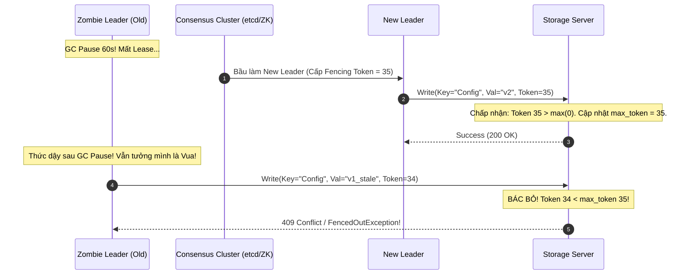

# 9.1. Leader Election Algorithms & Split-Brain Prevention

> [!IMPORTANT]
> **Nếu bạn chỉ được nhớ một điều duy nhất**: Trong một hệ thống phân tán, bầu ra một Leader duy nhất không khó bằng việc **ngăn chặn vị Leader cũ đã chết đi sống lại hành xử như một bóng ma (Zombie Leader)**. Hiện tượng trễ mạng, Stop-the-world GC pause, hoặc phân mảnh mạng (Network Partition) có thể khiến một Leader cũ tưởng rằng nó vẫn nắm quyền và tiếp tục ghi đè dữ liệu. Cách duy nhất về mặt toán học để bảo vệ toàn vẹn dữ liệu khỏi hiện tượng **Split-Brain** là cơ chế **Fencing Token** (Mã chặn đơn điệu) được kiểm tra tại tầng lưu trữ cuối cùng (Storage Layer), bác bỏ mọi yêu cầu mang token cũ hơn token hiện hành.

---

## 1. Kiến trúc Tổng quan & Mô hình Tư duy (Mental Model)

### Ẩn dụ Đời sống: Vua Hôn Mê và Con Dấu Hoàng Gia Đổi Mới
Hãy tưởng tượng một vương quốc cổ đại. Nhà vua đột ngột bị hôn mê sâu (tương tự như một tiến trình bị Stop-the-world Full GC Pause hoặc treo I/O đĩa trong 60 giây). Sau một thời gian không thấy vua ban chiếu, triều đình tuyên bố vua đã băng hà và bầu ra một Tân vương. Triều đình đúc một **Con dấu Hoàng gia mới** được khắc số hiệu cao hơn ($Token = 35$).

Khi vị vua cũ tỉnh dậy sau cơn hôn mê, ông hoàn toàn không biết rằng thời gian đã trôi qua 60 giây và mình đã bị truất phế. Ông vội vã viết sắc lệnh ra lệnh xuất kho bạc và đóng con dấu cũ ($Token = 34$). Sắc lệnh được mang đến cho Thượng thư Bộ Ngân khố (Hệ thống Lưu trữ / Storage Node). Thượng thư nhìn vào con dấu và kiểm tra sổ bộ: *"Chúng tôi đã nhận lệnh từ người mang con dấu số 35. Con dấu số 34 của ngài đã hết giá trị!"* và lập tức xé bỏ sắc lệnh. Nếu không có con dấu mang số hiệu đơn điệu này, kho bạc sẽ bị xuất hai lần (Data Corruption).



---

## 2. Chi tiết từng Keyword (Under-the-Hood Deep Dive)

### 2.1. Thuật toán Bully (The Bully Algorithm - Garcia-Molina, 1982)

#### Khái niệm & Giả định bản chất
Thuật toán Bully (Kẻ bắt nạt) hoạt động dựa trên triết lý đơn giản: node nào có định danh (Node ID) lớn nhất đang hoạt động sẽ tự động trở thành Leader tối cao.
- Mọi node đều biết danh sách và ID của tất cả các node khác trong hệ thống.
- Hệ thống giả định mạng bán đồng bộ có timeout để phát hiện node chết.

#### Ba loại thông điệp cốt lõi
1. **`ELECTION`**: Thông điệp thông báo phát động bầu cử, gửi tới tất cả các node có ID lớn hơn node hiện tại.
2. **`ANSWER` / `OK`**: Thông điệp phản hồi từ các node có ID lớn hơn: *"Ta vẫn còn sống, ngươi hãy im lặng và để ta xử lý!"*.
3. **`COORDINATOR`**: Thông điệp chiến thắng phát đi toàn mạng: *"Ta là node có ID lớn nhất còn sống, ta chính là Leader mới!"*.

#### Quy trình Thực thi chi tiết
1. Khi node $P$ phát hiện Leader không phản hồi heartbeat:
   - $P$ gửi `ELECTION` tới tất cả các node $Q$ có $ID(Q) > ID(P)$.
2. Nếu không có node nào phản hồi `ANSWER` trong khoảng thời gian timeout:
   - $P$ thắng cử! $P$ broadcast thông điệp `COORDINATOR` tới toàn bộ cụm.
3. Nếu có ít nhất một node $Q$ trả về `ANSWER`:
   - $P$ lùi lại chờ đợi. Node $Q$ chịu trách nhiệm tiếp tục phát động bầu cử tới các node cao hơn nó.
4. Nếu một node bị crash trước đó sống lại, và nó có ID cao nhất:
   - Nó lập tức gửi `ELECTION`, hạ bệ Leader hiện tại và tự phong mình làm Leader mới (Hiện tượng "Bully" - kẻ bắt nạt).

#### Nhược điểm chí mạng của Bully Algorithm
- **Độ phức tạp thông điệp**: Trong trường hợp xấu nhất, số lượng tin nhắn đạt $O(N^2)$, gây bão mạng (Broadcast Storm).
- **Hiện tượng Flapping (Dao động mạng)**: Nếu node có ID cao nhất bị lỗi phần cứng chập chờn (cứ sống dậy 5 giây rồi chết 5 giây), nó sẽ liên tục cướp quyền và làm sụp đổ Leader ổn định hiện tại, khiến cụm không bao giờ xử lý được công việc thực tế.

### 2.2. Thuật toán Vòng tròn (Ring Election Algorithm - Chang & Roberts, 1979)
Khắc phục điểm yếu broadcast của Bully bằng cách tổ chức các node thành một vòng tròn logic có hướng ($P_0 \to P_1 \to \dots \to P_{N-1} \to P_0$):
- Mỗi node chỉ cần biết địa chỉ IP của node kế tiếp bên phải nó trong vòng tròn (Active Ring).
- Khi phát hiện Leader chết, node $P_i$ tạo thông điệp `ELECTION` chứa danh sách các ứng viên `[ID_i]` và chuyển tiếp dọc theo chiều kim đồng hồ.
- Mỗi node tiếp theo nối ID của chính mình vào danh sách và chuyển tiếp.
- Khi thông điệp đi đủ một vòng quay về node $P_i$ khởi xướng: nó duyệt danh sách, chọn ra node có ID lớn nhất làm Leader, và gửi một vòng thông điệp `COORDINATOR` để thông báo cho toàn bộ vòng tròn.
- **Độ phức tạp thông điệp**: Tối đa $2N$ tin nhắn, ổn định hơn Bully nhưng thời gian hội tụ bị kéo dài nếu vòng tròn lớn hoặc có nhiều node trung gian bị chết liên tiếp.

### 2.3. Leader Election bằng Distributed Consensus & Ephemeral Storage
Trong các hệ thống phân tán hiện đại cấp doanh nghiệp (Kubernetes, Kafka, HDFS), việc bầu cử tự phát (Bully/Ring) bị loại bỏ hoàn toàn để chuyển sang sử dụng các hệ thống lưu trữ đồng thuận phân tán (**etcd**, **ZooKeeper**, **Consul**):

#### Bảng so sánh các kỹ thuật Leader Election hiện đại
| Cơ chế | Hệ thống triển khai | Cách thức hoạt động | Ưu / Nhược điểm |
| :--- | :--- | :--- | :--- |
| **Ephemeral Sequential Znode** | Apache ZooKeeper (Curator `LeaderLatch`) | Tạo node tạm thời có thứ tự `/leader/lock-00001`. Node có số nhỏ nhất là Leader. Các node khác chỉ Watch node liền trước. | **Không có bão Watcher (Thundering Herd)**. Cần duy trì cụm ZooKeeper riêng. |
| **Lease KeepAlive & TTL** | etcd (Kubernetes Controller Manager) | Leader tạo key `/leader` kèm một `Lease` có TTL 10 giây. Leader định kỳ gửi heartbeat để gia hạn lease. | Đơn giản, độ tin cậy cao, native trên nền Raft. Nếu Leader lag mạng, mất quyền sau TTL. |
| **Session Lock** | HashiCorp Consul | Tạo KV key với flag `acquire` gắn liền với Session Health Check. | Tích hợp sẵn Service Discovery, rất thuận tiện cho Microservices. |

#### Cơ chế Curator LeaderLatch (ZooKeeper Ephemeral Sequential)
Để giải quyết bài toán Thundering Herd (khi Leader chết, hàng trăm candidate cùng lao vào tranh chấp gây sập ZK server):
1. Mỗi Candidate tạo một znode tạm thời dạng sequence: `/election/guid-n_0000000001`, `guid-n_0000000002`...
2. Node lấy danh sách tất cả con của `/election`.
3. Nếu số đuôi của nó nhỏ nhất $\implies$ Nó chính thức là Leader!
4. Nếu số đuôi không nhỏ nhất $\implies$ Nó **chỉ đặt Watcher theo dõi znode có số đuôi liền kề trước nó**. Khi node trước chết, chỉ DUY NHẤT một node nhận được thông báo để lên làm Leader mới!

### 2.4. Leader Leases, Leader Fencing & Split-Brain Prevention

#### Hiểm họa Split-Brain và "Stale Leader" (Zombie Leader)
Split-Brain xảy ra khi cụm bị phân mảnh mạng thành 2 nửa cô lập ($A$ và $B$). Nếu cả hai nửa đều tự nhận mình là Leader và tiếp tục nhận ghi dữ liệu, cơ sở dữ liệu sẽ phân kỳ (diverge) và không thể dung hòa.
Nguy hiểm hơn nữa là hiện tượng **Zombie Leader do GC Pause**: Node 1 là Leader nhưng bị Java JVM "Stop-the-world" GC trong 45 giây. Hệ thống etcd hết hạn TTL nên bầu Node 2 làm Leader mới. Khi Node 1 tỉnh lại, CPU tiếp tục chạy ngay dòng lệnh ghi tiếp theo, ghi đè dữ liệu cũ lên dữ liệu mới của Node 2!

#### Cơ chế bảo vệ 1: Leader Lease (Hạn thuê bao thời gian)
- Leader chỉ có quyền lực trong một khoảng thời gian hữu hạn $T_{\text{lease}}$ (ví dụ 5 giây).
- Leader phải chủ động từ bỏ quyền hạn nếu đồng hồ cục bộ của nó trôi qua thời hạn thuê bao mà chưa nhận được xác nhận gia hạn từ Quorum.
- **Rủi ro**: Dựa vào đồng hồ vật lý cục bộ (Clock Drift/Skew). Nếu đồng hồ của Leader chạy chậm hơn đồng hồ của Follower, Leader vẫn tưởng mình còn lease trong khi Follower đã bầu Leader mới!

#### Cơ chế bảo vệ 2: Fencing Token (Mã chặn tăng đơn điệu - Martin Kleppmann)
Để không phụ thuộc vào đồng hồ vật lý, giải pháp toán học triệt để là **Fencing Token**:
1. Mỗi lần Leader mới đắc cử từ hệ thống đồng thuận (etcd/ZK), hệ thống cấp cho nó một số nguyên tăng đơn điệu $Token$ (ví dụ: $34, 35, 36$).
2. Trong mọi thao tác ghi dữ liệu xuống tầng lưu trữ (Database/Storage Server), Leader bắt buộc phải gửi kèm $Token$ này trong payload.
3. Tầng lưu trữ duy trì một biến `highest_token_seen` trên đĩa:
   - Nếu $Token_{\text{request}} \ge \text{highest\_token\_seen}$: Chấp nhận ghi, cập nhật $\text{highest\_token\_seen} \leftarrow Token_{\text{request}}$.
   - Nếu $Token_{\text{request}} < \text{highest\_token\_seen}$: **Lập tức từ chối thẳng thừng** và ném lỗi `FencedOutException`!

---

## 3. Thực thi Mã nguồn & Mô phỏng Chuyên sâu (Dual-Engine Implementation)

### Engine 1: C++20 — Mô phỏng Storage Fencing Token Validator với Thread-Safe Atomic Protection

```cpp
#include <iostream>
#include <string>
#include <optional>
#include <mutex>
#include <stdexcept>
#include <format>
#include <cstdint>
#include <thread>
#include <chrono>

// Ngoại lệ ném ra khi phát hiện Zombie Leader cố tình ghi đè dữ liệu
class FencedOutException : public std::runtime_error {
public:
    explicit FencedOutException(const std::string& msg) : std::runtime_error(msg) {}
};

// Storage Engine đóng vai trò bảo vệ dữ liệu cuối cùng (Fencing Gatekeeper)
class FencedStorageEngine {
private:
    std::mutex mtx_;
    uint64_t highest_token_{0};
    std::string data_payload_{"INITIAL_DATA"};

public:
    // Thao tác ghi có bảo vệ Fencing Token
    void write(const std::string& key, const std::string& value, uint64_t client_token, const std::string& client_name) {
        std::lock_guard<std::mutex> lock(mtx_);

        std::cout << std::format("[Storage] Nhận yêu cầu ghi từ '{}' với Token: {}\n", client_name, client_token);

        if (client_token < highest_token_) {
            std::string err = std::format(
                "VI PHẠM FENCING! Token {} bị từ chối vì hệ thống đã ghi nhận Token cao hơn: {}. Yêu cầu từ '{}' bị hủy bỏ!",
                client_token, highest_token_, client_name
            );
            throw FencedOutException(err);
        }

        // Cập nhật token cao nhất và lưu trữ dữ liệu mới
        highest_token_ = client_token;
        data_payload_ = value;
        std::cout << std::format("    -> [V] Ghi thành công! Token hiện tại: {}. Dữ liệu mới: '{}'\n",
            highest_token_, data_payload_);
    }

    std::string read() {
        std::lock_guard<std::mutex> lock(mtx_);
        return data_payload_;
    }
};

// Mô phỏng Tiến trình Leader
class LeaderNode {
public:
    std::string name;
    uint64_t fencing_token;

    LeaderNode(std::string name, uint64_t token)
        : name(std::move(name)), fencing_token(token) {}

    void execute_write(FencedStorageEngine& storage, const std::string& data) {
        try {
            storage.write("SystemConfig", data, fencing_token, name);
        } catch (const FencedOutException& e) {
            std::cout << std::format("    [!] LỖI TẠI {}: {}\n", name, e.what());
            std::cout << std::format("    [*] {} nhận diện bản thân đã trở thành ZOMBIE LEADER. Tiến hành tự sát (Suicide)!\n", name);
        }
    }
};

int main() {
    FencedStorageEngine storage;

    // Leader 1 đắc cử nhiệm kỳ trước (Token = 34)
    LeaderNode old_leader("Leader_Old_Node1", 34);

    // Kịch bản: Old Leader bị GC Pause dài. Hệ thống bầu New Leader (Token = 35)
    LeaderNode new_leader("Leader_New_Node2", 35);

    std::cout << "--- Kịch bản 1: New Leader đắc cử và ghi dữ liệu mới trước ---\n";
    new_leader.execute_write(storage, "PAYLOAD_V2_BY_NEW_LEADER");

    std::cout << "\n--- Kịch bản 2: Old Leader tỉnh lại sau GC Pause và cố tình ghi đè dữ liệu cũ ---\n";
    old_leader.execute_write(storage, "PAYLOAD_V1_STALE_BY_ZOMBIE");

    std::cout << std::format("\n[Kiểm tra Toàn vẹn] Trạng thái dữ liệu cuối cùng trên Storage: '{}'\n", storage.read());

    return 0;
}
```

#### Terminal Output Mẫu:
```text
--- Kịch bản 1: New Leader đắc cử và ghi dữ liệu mới trước ---
[Storage] Nhận yêu cầu ghi từ 'Leader_New_Node2' với Token: 35
    -> [V] Ghi thành công! Token hiện tại: 35. Dữ liệu mới: 'PAYLOAD_V2_BY_NEW_LEADER'

--- Kịch bản 2: Old Leader tỉnh lại sau GC Pause và cố tình ghi đè dữ liệu cũ ---
[Storage] Nhận yêu cầu ghi từ 'Leader_Old_Node1' với Token: 34
    [!] LỖI TẠI Leader_Old_Node1: VI PHẠM FENCING! Token 34 bị từ chối vì hệ thống đã ghi nhận Token cao hơn: 35. Yêu cầu từ 'Leader_Old_Node1' bị hủy bỏ!
    [*] Leader_Old_Node1 nhận diện bản thân đã trở thành ZOMBIE LEADER. Tiến hành tự sát (Suicide)!

[Kiểm tra Toàn vẹn] Trạng thái dữ liệu cuối cùng trên Storage: 'PAYLOAD_V2_BY_NEW_LEADER'
```

---

### Engine 2: Python 3.11+ — Mô phỏng Thuật toán Bully và Hiện tượng Flapping Cụm

```python
import asyncio
from typing import Dict, List, Optional

class BullyNode:
    def __init__(self, node_id: int, all_node_ids: List[int]):
        self.node_id = node_id
        self.all_node_ids = sorted(all_node_ids)
        self.leader_id: Optional[int] = None
        self.is_alive = True

    def receive_election(self, sender_id: int) -> bool:
        """Nếu node này còn sống và có ID lớn hơn sender, trả lời OK và tự phát động bầu cử."""
        if not self.is_alive:
            return False
        if self.node_id > sender_id:
            return True
        return False

    def receive_coordinator(self, new_leader_id: int):
        self.leader_id = new_leader_id
        print(f"  -> [Node {self.node_id}] Đã ghi nhận Leader mới: Node {new_leader_id}")

    async def start_election(self, nodes: Dict[int, 'BullyNode']):
        print(f"\n[*] [Node {self.node_id}] Phát hiện Leader chết! Phát động Bully Election...")
        higher_nodes = [nid for nid in self.all_node_ids if nid > self.node_id]

        got_ok = False
        for hid in higher_nodes:
            target = nodes[hid]
            if target.receive_election(self.node_id):
                print(f"  -> [Node {hid}] Trả lời OK cho Node {self.node_id}! Node {self.node_id} lùi lại.")
                got_ok = True
                # Node cao hơn nhận trách nhiệm phát động bầu cử tiếp
                asyncio.create_task(target.start_election(nodes))
                break

        if not got_ok:
            print(f"[V] [Node {self.node_id}] Không ai lớn hơn ta còn sống! Ta chính là COORDINATOR!")
            self.leader_id = self.node_id
            for nid in self.all_node_ids:
                if nid != self.node_id and nodes[nid].is_alive:
                    nodes[nid].receive_coordinator(self.node_id)

async def main():
    cluster_ids = [1, 2, 3, 4, 5]
    nodes = {nid: BullyNode(nid, cluster_ids) for nid in cluster_ids}

    # Ban đầu Node 5 là Leader
    for n in nodes.values():
        n.leader_id = 5
    print("Khởi tạo cụm 5 nodes. Leader hiện tại: Node 5.")

    print("\n--- Giai đoạn 1: Node 5 bị crash. Node 2 phát hiện trước ---")
    nodes[5].is_alive = False
    await nodes[2].start_election(nodes)
    await asyncio.sleep(0.1)

    print("\n--- Giai đoạn 2: Hiện tượng Flapping - Node 5 đột ngột sống dậy và cướp quyền (Bullying) ---")
    nodes[5].is_alive = True
    print("[!] Node 5 sống lại sau lỗi mạng và tự phát động bầu cử!")
    await nodes[5].start_election(nodes)
    await asyncio.sleep(0.1)

if __name__ == "__main__":
    asyncio.run(main())
```

#### Terminal Output Mẫu:
```text
Khởi tạo cụm 5 nodes. Leader hiện tại: Node 5.

--- Giai đoạn 1: Node 5 bị crash. Node 2 phát hiện trước ---
[*] [Node 2] Phát hiện Leader chết! Phát động Bully Election...
  -> [Node 3] Trả lời OK cho Node 2! Node 2 lùi lại.
[*] [Node 3] Phát hiện Leader chết! Phát động Bully Election...
  -> [Node 4] Trả lời OK cho Node 3! Node 3 lùi lại.
[*] [Node 4] Phát hiện Leader chết! Phát động Bully Election...
[V] [Node 4] Không ai lớn hơn ta còn sống! Ta chính là COORDINATOR!
  -> [Node 1] Đã ghi nhận Leader mới: Node 4
  -> [Node 2] Đã ghi nhận Leader mới: Node 4
  -> [Node 3] Đã ghi nhận Leader mới: Node 4

--- Giai đoạn 2: Hiện tượng Flapping - Node 5 đột ngột sống dậy và cướp quyền (Bullying) ---
[!] Node 5 sống lại sau lỗi mạng và tự phát động bầu cử!
[*] [Node 5] Phát hiện Leader chết! Phát động Bully Election...
[V] [Node 5] Không ai lớn hơn ta còn sống! Ta chính là COORDINATOR!
  -> [Node 1] Đã ghi nhận Leader mới: Node 5
  -> [Node 2] Đã ghi nhận Leader mới: Node 5
  -> [Node 3] Đã ghi nhận Leader mới: Node 5
  -> [Node 4] Đã ghi nhận Leader mới: Node 5
```

---

## 4. Systems Engineering & Production Pitfalls

### 4.1. Những cạm bẫy sống còn khi vận hành Leader Election
1. **Thiếu Fencing tại Storage Layer**:
   - Rất nhiều kỹ sư cho rằng việc sử dụng ZooKeeper Leader Latch là đủ an toàn. Tuy nhiên, nếu không có Fencing Token ở database (như MySQL/PostgreSQL version check hoặc S3 object versioning), một Leader bị JVM pause vẫn có thể phá hoại dữ liệu ngay sau khi thức dậy.
   - *Khắc phục*: Triển khai `generation_id` hoặc conditional writes (`UPDATE ... WHERE version = expected_token`).

2. **Cấu hình Session Timeout / TTL quá ngắn hoặc quá dài**:
   - Nếu để TTL ZooKeeper/etcd quá ngắn (ví dụ 500ms): một đợt CPU spike ngắn của container hoặc một đợt GC nhỏ sẽ khiến cụm hiểu nhầm Leader đã chết $\implies$ kích hoạt bầu cử liên tục làm tắc nghẽn hệ thống.
   - Nếu để TTL quá dài (ví dụ 60 giây): khi Leader thật sự bị ngắt nguồn, toàn bộ hệ thống bị đóng băng không thể tiếp nhận thao tác ghi trong suốt 1 phút.
   - *Khuyến nghị sản xuất*: Đặt TTL trong khoảng $5\text{s} - 10\text{s}$, với Heartbeat Interval bằng $1/3$ TTL ($1.5\text{s} - 3\text{s}$).

3. **Hiện tượng STONITH (Shoot The Other Node In The Head)**:
   - Trong các hệ thống clustering cổ điển (như Pacemaker/Corosync trong Linux High Availability), khi nghi ngờ node Leader cũ bị phân rã mạng, cơ chế STONITH sẽ can thiệp thông qua phần cứng quản trị từ xa (IPMI/iLO/PDU) để **ngắt nguồn điện vật lý** của node cũ lập tức, đảm bảo 100% nó không thể chạy lệnh nào nữa trước khi cụm dựng Leader mới.

### 4.2. Chẩn đoán và Giám sát Sự cố Split-Brain (CLI Diagnostics)

```bash
# 1. Kiểm tra trạng thái Lease và xem ai đang nắm giữ Leader Lock trong Kubernetes
kubectl get leases -n kube-system

# 2. Xem chi tiết Lease holder và thời gian renew gần nhất của Kube Controller Manager
kubectl describe lease kube-controller-manager -n kube-system

# 3. Theo dõi số lần bầu lại Leader trong ZooKeeper cluster
echo stat | nc localhost 2181 | grep -E "Mode|Node count"
```

---

## 5. Bảng So sánh & Decision Matrix

| Tiêu chí | Bully Algorithm | Ring Algorithm | ZooKeeper Ephemeral | etcd Lease Mechanism |
| :--- | :--- | :--- | :--- | :--- |
| **Độ phức tạp tin nhắn** | $O(N^2)$ (Broadcast lớn) | $O(N)$ (Tuần tự dọc theo vòng) | $O(1)$ (Chỉ Watch node trước) | $O(1)$ (Heartbeat trực tiếp) |
| **Thời gian phát hiện lỗi** | Nhanh (dựa vào timeout) | Chậm (phải truyền qua $N$ chặng) | Theo Session Timeout | Theo Lease TTL |
| **Khả năng chịu Flapping** | Cực kỳ kém (Dễ bị cướp quyền) | Kém | Tốt (Cơ chế Lease ổn định) | Rất tốt (Pre-Vote + Lease) |
| **Thundering Herd Problem**| Có | Không | Đã giải quyết (LeaderLatch) | Đã giải quyết (Campaign API) |
| **Hệ thống áp dụng** | Nghiên cứu lý thuyết | Token Ring networks | Apache Kafka, Hadoop HDFS | Kubernetes Control Plane |
