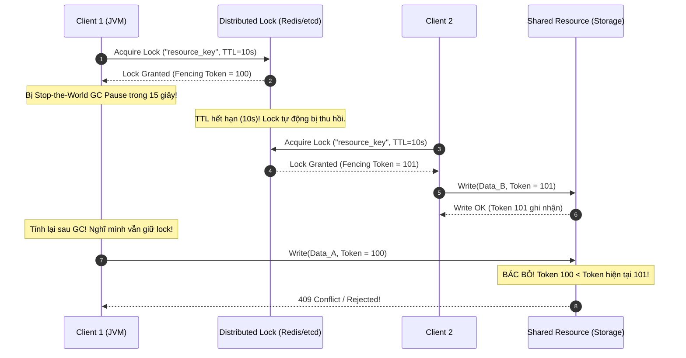
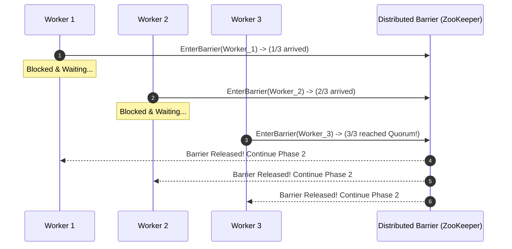

# 9.2. Distributed Coordination & Distributed Locking Deep Dive

> [!IMPORTANT]
> **Nếu bạn chỉ được nhớ một điều duy nhất**: Khóa phân tán (Distributed Lock) không bao giờ an toàn tuyệt đối nếu chỉ dựa vào thời gian thuê bao (TTL/Lease) mà thiếu **Fencing Token** ở phía hệ thống lưu trữ đích. Trong cuộc tranh biện kinh điển giữa Martin Kleppmann và antirez (tác giả Redis), Kleppmann đã chứng minh rằng: dưới tác động của hiện tượng tạm dừng tiến trình (GC Pause), trễ mạng (Network Delays), và lệch đồng hồ vật lý (Clock Drift), thuật toán Redlock vẫn có thể cho phép hai client cùng lúc giữ lock và cùng ghi vào tài nguyên dùng chung, trừ khi tầng lưu trữ áp dụng Fencing Token để loại trừ các yêu cầu lạc hậu.

---

## 1. Kiến trúc Tổng quan & Mô hình Tư duy (Mental Model)

### Ẩn dụ Đời sống: Phòng Thử Đồ Công Cộng và Thẻ Số Thứ Tự
Hãy tưởng tượng một phòng thử đồ công cộng duy nhất tại một trung tâm thương mại đông đúc:
- **Mutual Exclusion (Độc quyền truy cập)**: Tại một thời điểm, chỉ một khách hàng được phép bước vào thử đồ và chốt then cài bên trong.
- **Lease / TTL (Thời hạn thuê bao)**: Để tránh trường hợp một khách hàng ngất xỉu bên trong khiến phòng bị khóa vĩnh viễn (Deadlock), nhân viên bảo vệ cài đặt chốt khóa tự động mở sau 10 phút. Khách hàng nếu cần thêm thời gian phải liên tục ấn nút gia hạn thời gian (Watchdog Heartbeat).
- **Tranh cãi Redlock & Fencing**: Khách hàng A đang ở bên trong thì đột ngột bị "đóng băng" 15 phút. Chốt cửa tự động bật mở; khách hàng B bước vào và nhận chìa khóa mang số 101. Khi khách hàng A tỉnh lại, A vẫn nghĩ mình đang hợp lệ và bước ra treo đồ lên giá. Nếu người quản lý kho không kiểm tra số thẻ của A ($100 < 101$) để từ chối nhận đồ, quần áo của cả hai khách sẽ bị treo lẫn lộn làm hỏng toàn bộ quy trình.



---

## 2. Chi tiết từng Keyword (Under-the-Hood Deep Dive)

### 2.1. Distributed Lock, Semaphore & Barrier

#### 1. Distributed Lock (Khóa phân tán)
Cung cấp ngữ nghĩa loại trừ tương hỗ (Mutual Exclusion - Mutex) giữa các tiến trình chạy trên nhiều máy chủ vật lý khác nhau qua mạng. Đảm bảo tại bất kỳ thời điểm nào chỉ có tối đa một tiến trình được thực thi trong đoạn găng (Critical Section).
- **Yêu cầu an toàn (Safety)**: Không bao giờ có 2 client cùng giữ một lock tại cùng một thời điểm.
- **Yêu cầu sống (Liveness)**: Không bao giờ xảy ra Deadlock; nếu tiến trình giữ lock bị crash hoặc mạng bị rớt, lock phải tự động được giải phóng sau một khoảng thời hạn hữu hạn (Lease TTL).

#### 2. Distributed Semaphore (Đèn hiệu phân tán)
Mở rộng của Distributed Lock cho phép một số lượng hữu hạn $K$ tiến trình ($K > 1$) cùng lúc truy cập vào tài nguyên (ví dụ: giới hạn tối đa 5 tiến trình cùng gọi vào một API cổng thanh toán đắt đỏ):
- Duy trì bộ đếm permits phân tán trên cụm đồng thuận (ZooKeeper znode hoặc Redis counter).
- Thao tác `acquire()` giảm permit đi 1; nếu permit = 0 thì tiến trình phải chờ (block hoặc polling).
- Thao tác `release()` tăng permit lên 1 và đánh thức tiến trình đang chờ.

#### 3. Distributed Barrier (Rào chắn phân tán)
Cơ chế đồng bộ hóa pha (Phase Synchronization) cho các tác vụ tính toán phân tán song song (như MapReduce, Apache Spark, MPI):
- Một nhóm gồm $M$ worker cùng thực thi một giai đoạn tính toán độc lập.
- Tất cả các worker phải dừng lại tại "Barrier" và chờ đợi cho đến khi **worker cuối cùng trong số $M$ worker** hoàn thành và bước tới barrier.
- Khi điều kiện số lượng worker đạt đủ $M$, barrier tự động mở ra để tất cả cùng bước sang giai đoạn tính toán kế tiếp.



### 2.2. Service Discovery, Cluster Membership & Group Protocols

#### 1. Service Discovery & Configuration Management
Trong kiến trúc Microservices và Cloud-Native, các container được sinh ra và tiêu hủy liên tục, mang các địa chỉ IP động:
- **Client-Side Discovery**: Client tự truy vấn Service Registry (Eureka, Consul) để lấy danh sách IP còn sống, sau đó tự chạy thuật toán cân bằng tải (Round-robin, Least Connection).
- **Server-Side Discovery**: Client gửi request đến một Load Balancer (AWS ALB, Kubernetes Service/Kube-proxy); Load Balancer truy vấn registry và forward gói tin đến Pod đích.

#### 2. Cluster Membership Protocols: SWIM & Serf
Để duy trì danh sách thành viên trong cụm hàng nghìn node mà không làm nghẽn mạng:
- **Giao thức SWIM (Structured Weakly-consistent Infection-style Process Group Membership Protocol)**:
  - Phân tách việc phát hiện lỗi (Failure Detection) và phổ biến thông tin (Dissemination).
  - Sử dụng cơ chế Ping trực tiếp và Ping gián tiếp qua các peer trung gian để loại trừ báo động giả do đứt cáp mạng cục bộ.
  - Đạt độ phức tạp thông điệp $O(1)$ trên mỗi chu kỳ kiểm tra, không phụ thuộc vào kích thước cụm.
- **HashiCorp Serf / Memberlist**: Triển khai thực tế của SWIM kết hợp thuật toán đồn thổi Gossip Protocol, được sử dụng trong HashiCorp Consul và Nomad để quản trị hàng chục nghìn node.

### 2.3. Vòng đời của một Distributed Lock: Lease, Expiration & Renewal
Một Distributed Lock hoàn chỉnh trải qua 4 giai đoạn bắt buộc:
1. **Acquire (Xin cấp khóa)**: Client gửi lệnh atomic kèm một mã ngẫu nhiên duy nhất (`client_uuid` hoặc fencing token) và thời gian sống `TTL` (ví dụ: `SET resource_key my_random_value NX PX 30000`).
2. **Heartbeat / Watchdog Renewal (Gia hạn khóa tự động)**:
   - Nếu tác vụ trong đoạn găng thực thi lâu hơn dự kiến (ví dụ: xử lý dữ liệu mất 40 giây trong khi lock TTL là 30 giây), một tiến trình nền (**Watchdog**) định kỳ mỗi $\text{TTL} / 3$ (10 giây) gửi lệnh gia hạn thêm thời gian sống cho lock.
3. **Execution & Fencing Validation**: Client thực thi công việc và gửi token đính kèm xuống database để xác thực quyền hạn.
4. **Safe Release (Giải phóng khóa an toàn)**: Client chỉ được phép giải phóng khóa **nếu giá trị lưu trong lock vẫn trùng khớp với `client_uuid` ban đầu** của nó, ngăn chặn việc client giải phóng nhầm lock của một client khác vừa mới giành quyền!

### 2.4. So sánh các cơ chế Distributed Lock thực tế

| Tiêu chí | Redis (SET NX EX) | Redlock (Multi-node Redis) | ZooKeeper (Curator) | etcd (Concurrency API) |
| :--- | :--- | :--- | :--- | :--- |
| **Bản chất lưu trữ** | In-Memory (Single Master) | Multi-Master In-memory | CP (Zab Consensus trên đĩa) | CP (Raft Consensus trên đĩa) |
| **Độ trễ (Latency)** | Cực thấp ($< 1\text{ms}$) | Thấp ($2-5\text{ms}$) | Trung bình ($5-15\text{ms}$) | Trung bình ($5-15\text{ms}$) |
| **Khả năng chịu lỗi** | Kém (Mất lock nếu Master crash trước khi replica sync) | Khá (Chịu được thiểu số node crash) | Rất cao (Đảm bảo bởi Quorum zxid) | Rất cao (Đảm bảo bởi Raft commit) |
| **Cơ chế Watcher** | Polling hoặc Pub/Sub | Polling lặp lại | Watcher znode liền kề (Tối ưu) | gRPC Long-running Watch Stream |
| **Độ an toàn cho dữ liệu tài chính** | Thấp (Chỉ dùng cho rate-limiting/cache) | Trung bình (Dễ bị lỗi đồng hồ) | **Tuyệt đối an toàn** | **Tuyệt đối an toàn** |

### 2.5. Tranh cãi kinh điển: Redlock vs Martin Kleppmann

#### 1. Thuật toán Redlock của Salvatore Sanfilippo (antirez)
Để tránh rủi ro Single Point of Failure (SPOF) của Redis đơn lẻ, antirez đề xuất Redlock chạy trên $N$ cụm Redis độc lập hoàn toàn ($N=5$):
- Client lấy timestamp hiện tại $T_1$.
- Cố gắng acquire lock tuần tự trên cả 5 node với timeout ngắn.
- Nếu lấy được lock trên đa số node ($M \ge 3$) và thời gian lấy khóa $\Delta T = T_2 - T_1 < \text{TTL}$, lock được coi là hợp lệ với thời gian hiệu lực còn lại là $\text{TTL} - \Delta T$.

#### 2. Phản biện khoa học của Martin Kleppmann
Martin Kleppmann chỉ ra rằng Redlock dựa trên một giả định tai hại: **Hệ thống mạng đồng bộ và đồng hồ vật lý không bị nhảy vọt (Synchronous model with bounded clock drift)**. Trong thực tế đám mây:
1. **Clock Drift / NTP Step**: NTP nhảy cóc thời gian có thể khiến lock trên 3 node hết hạn sớm hơn thực tế.
2. **Process Pauses (GC Pause)**: Client có thể bị dừng lại ngay sau khi nhận lock từ 3 node; khi tỉnh dậy, lock đã bị trao cho client khác nhưng client này không biết.
3. **Kết luận của Kleppmann**: Nếu bạn chỉ cần lock để tối ưu hiệu năng (tránh tính toán trùng lặp), 1 node Redis đơn lẻ là đủ. Nếu bạn cần lock để bảo vệ **tính đúng đắn của dữ liệu (Correctness)**, Redlock không an toàn vì nó không cấp được **Fencing Token** đơn điệu!

---

## 3. Thực thi Mã nguồn & Mô phỏng Chuyên sâu (Dual-Engine Implementation)

### Engine 1: C++20 — Mô phỏng Cốt lõi Distributed Lock Manager với Fencing Token & Raft-based Lease

```cpp
#include <iostream>
#include <string>
#include <optional>
#include <chrono>
#include <thread>
#include <mutex>
#include <format>
#include <cstdint>

struct LockState {
    std::string holder_id;
    uint64_t fencing_token;
    std::chrono::steady_clock::time_point expires_at;
};

class DistributedLockService {
private:
    std::mutex mtx_;
    std::optional<LockState> current_lock_;
    uint64_t global_token_counter_{0};

public:
    // Cố gắng chiếm lock với TTL xác định
    std::optional<uint64_t> try_acquire(const std::string& client_id, std::chrono::milliseconds ttl) {
        std::lock_guard<std::mutex> lock(mtx_);
        auto now = std::chrono::steady_clock::now();

        // Kiểm tra xem lock hiện tại còn hiệu lực không
        if (current_lock_.has_value()) {
            if (now < current_lock_->expires_at) {
                // Lock vẫn đang bị giữ bởi client khác
                return std::nullopt;
            }
            std::cout << std::format("[LockService] Lock cũ của '{}' đã hết hạn TTL! Tự động thu hồi.\n",
                current_lock_->holder_id);
        }

        // Cấp lock mới kèm Fencing Token tăng đơn điệu
        global_token_counter_++;
        current_lock_ = LockState{
            .holder_id = client_id,
            .fencing_token = global_token_counter_,
            .expires_at = now + ttl
        };

        std::cout << std::format("[LockService] Cấp Lock thành công cho '{}' | Token: {} | TTL: {}ms\n",
            client_id, global_token_counter_, ttl.count());

        return global_token_counter_;
    }

    // Gia hạn thời gian sống (Heartbeat Watchdog)
    bool renew(const std::string& client_id, uint64_t token, std::chrono::milliseconds extension) {
        std::lock_guard<std::mutex> lock(mtx_);
        auto now = std::chrono::steady_clock::now();

        if (current_lock_.has_value() && current_lock_->holder_id == client_id && current_lock_->fencing_token == token) {
            current_lock_->expires_at = now + extension;
            std::cout << std::format("  -> [Watchdog] Gia hạn thành công cho '{}' thêm {}ms\n", client_id, extension.count());
            return true;
        }
        std::cout << std::format("  -> [Watchdog] Gia hạn THẤT BẠI cho '{}'! Lock đã bị tước đoạt.\n", client_id);
        return false;
    }

    // Giải phóng lock an toàn (Atomic Check-and-Delete)
    bool release(const std::string& client_id, uint64_t token) {
        std::lock_guard<std::mutex> lock(mtx_);
        if (current_lock_.has_value() && current_lock_->holder_id == client_id && current_lock_->fencing_token == token) {
            current_lock_.reset();
            std::cout << std::format("[LockService] Giải phóng Lock thành công bởi '{}' (Token {})\n", client_id, token);
            return true;
        }
        std::cout << std::format("[LockService] CẢNH BÁO: '{}' cố giải phóng lock không thuộc quyền sở hữu!\n", client_id);
        return false;
    }
};

int main() {
    DistributedLockService lock_service;

    std::cout << "--- Bước 1: Client 1 xin lock với TTL 100ms ---\n";
    auto token1 = lock_service.try_acquire("Client_Worker_1", std::chrono::milliseconds(100));

    std::cout << "\n--- Bước 2: Client 2 xin cùng lock ngay lập tức (Kỳ vọng thất bại) ---\n";
    auto token2 = lock_service.try_acquire("Client_Worker_2", std::chrono::milliseconds(100));
    if (!token2.has_value()) {
        std::cout << "[Client 2] Bị từ chối vì Lock đang bận!\n";
    }

    std::cout << "\n--- Bước 3: Client 1 chạy tác vụ và gia hạn qua Watchdog ---\n";
    std::this_thread::sleep_for(std::chrono::milliseconds(40));
    lock_service.renew("Client_Worker_1", token1.value(), std::chrono::milliseconds(100));

    std::cout << "\n--- Bước 4: Client 1 hoàn thành tác vụ và giải phóng an toàn ---\n";
    lock_service.release("Client_Worker_1", token1.value());

    std::cout << "\n--- Bước 5: Client 2 thử xin lại lock sau khi Client 1 đã nhả ---\n";
    auto token2_retry = lock_service.try_acquire("Client_Worker_2", std::chrono::milliseconds(100));
    if (token2_retry.has_value()) {
        std::cout << std::format("[Client 2] Thành công! Nhận Token: {}\n", token2_retry.value());
        lock_service.release("Client_Worker_2", token2_retry.value());
    }

    return 0;
}
```

#### Terminal Output Mẫu:
```text
--- Bước 1: Client 1 xin lock với TTL 100ms ---
[LockService] Cấp Lock thành công cho 'Client_Worker_1' | Token: 1 | TTL: 100ms

--- Bước 2: Client 2 xin cùng lock ngay lập tức (Kỳ vọng thất bại) ---
[Client 2] Bị từ chối vì Lock đang bận!

--- Bước 3: Client 1 chạy tác vụ và gia hạn qua Watchdog ---
  -> [Watchdog] Gia hạn thành công cho 'Client_Worker_1' thêm 100ms

--- Bước 4: Client 1 hoàn thành tác vụ và giải phóng an toàn ---
[LockService] Giải phóng Lock thành công bởi 'Client_Worker_1' (Token 1)

--- Bước 5: Client 2 thử xin lại lock sau khi Client 1 đã nhả ---
[LockService] Cấp Lock thành công cho 'Client_Worker_2' | Token: 2 | TTL: 100ms
[Client 2] Thành công! Nhận Token: 2
[LockService] Giải phóng Lock thành công bởi 'Client_Worker_2' (Token 2)
```

---

### Engine 2: Python 3.11+ — Mô phỏng Redis Lock Manager với Lua Script Atomic Release & Watchdog Thread

```python
import asyncio
import time
import uuid
from typing import Optional

class MockRedisServer:
    """Mô phỏng máy chủ Redis đơn luồng với lệnh nguyên tử SET NX PX và EVAL Lua Script."""
    def __init__(self):
        self.store = {}
        self.expiry = {}

    def set_nx_px(self, key: str, value: str, px_ms: int) -> bool:
        now = time.time()
        # Dọn dẹp key hết hạn
        if key in self.expiry and now >= self.expiry[key]:
            del self.store[key]
            del self.expiry[key]

        if key not in self.store:
            self.store[key] = value
            self.expiry[key] = now + (px_ms / 1000.0)
            return True
        return False

    def eval_lua_release(self, key: str, expected_val: str) -> bool:
        """Lua script nguyên tử: if redis.call('get', KEYS[1]) == ARGV[1] then return redis.call('del', KEYS[1]) else return 0 end"""
        now = time.time()
        if key in self.expiry and now >= self.expiry[key]:
            del self.store[key]
            del self.expiry[key]
            return False

        if self.store.get(key) == expected_val:
            del self.store[key]
            del self.expiry[key]
            return True
        return False

    def eval_lua_renew(self, key: str, expected_val: str, extension_ms: int) -> bool:
        now = time.time()
        if self.store.get(key) == expected_val and now < self.expiry.get(key, 0):
            self.expiry[key] = now + (extension_ms / 1000.0)
            return True
        return False

class AsyncDistributedLock:
    def __init__(self, redis: MockRedisServer, resource_key: str, ttl_ms: int = 200):
        self.redis = redis
        self.resource_key = resource_key
        self.ttl_ms = ttl_ms
        self.lock_val = str(uuid.uuid4())
        self._watchdog_task: Optional[asyncio.Task] = None
        self._running = False

    async def acquire(self) -> bool:
        if self.redis.set_nx_px(self.resource_key, self.lock_val, self.ttl_ms):
            self._running = True
            # Bật watchdog tự động gia hạn mỗi 1/3 TTL
            self._watchdog_task = asyncio.create_task(self._watchdog_loop())
            return True
        return False

    async def _watchdog_loop(self):
        renew_interval = (self.ttl_ms / 1000.0) / 3.0
        while self._running:
            await asyncio.sleep(renew_interval)
            if self._running:
                ok = self.redis.eval_lua_renew(self.resource_key, self.lock_val, self.ttl_ms)
                if not ok:
                    print(f"[Watchdog] Mất quyền gia hạn key '{self.resource_key}'!")
                    break

    async def release(self) -> bool:
        self._running = False
        if self._watchdog_task:
            self._watchdog_task.cancel()
        return self.redis.eval_lua_release(self.resource_key, self.lock_val)

async def main():
    redis = MockRedisServer()
    lock_a = AsyncDistributedLock(redis, "order_lock_123", ttl_ms=100)
    lock_b = AsyncDistributedLock(redis, "order_lock_123", ttl_ms=100)

    print("--- 1. Worker A chiếm lock thành công ---")
    assert await lock_a.acquire() == True
    print(f"Worker A đã chiếm lock thành công! Key: order_lock_123")

    print("\n--- 2. Worker B cố gắng chiếm lock trùng lặp ---")
    acquired_b = await lock_b.acquire()
    print(f"Worker B chiếm lock: {acquired_b} (Bị chặn đúng như kỳ vọng)")

    print("\n--- 3. Chờ Watchdog gia hạn lock cho Worker A trong 150ms ---")
    await asyncio.sleep(0.15)

    print("\n--- 4. Worker A giải phóng lock qua Lua Script an toàn ---")
    released = await lock_a.release()
    print(f"Worker A giải phóng lock: {released}")

    print("\n--- 5. Worker B xin lại lock sau khi Worker A đã nhả ---")
    acquired_b_retry = await lock_b.acquire()
    print(f"Worker B chiếm lại lock: {acquired_b_retry}")
    await lock_b.release()

if __name__ == "__main__":
    asyncio.run(main())
```

#### Terminal Output Mẫu:
```text
--- 1. Worker A chiếm lock thành công ---
Worker A đã chiếm lock thành công! Key: order_lock_123

--- 2. Worker B cố gắng chiếm lock trùng lặp ---
Worker B chiếm lock: False (Bị chặn đúng như kỳ vọng)

--- 3. Chờ Watchdog gia hạn lock cho Worker A trong 150ms ---

--- 4. Worker A giải phóng lock qua Lua Script an toàn ---
Worker A giải phóng lock: True

--- 5. Worker B xin lại lock sau khi Worker A đã nhả ---
Worker B chiếm lại lock: True
```

---

## 4. Systems Engineering & Production Pitfalls

### 4.1. Những cạm bẫy sống còn khi triển khai Distributed Lock
1. **Dùng lệnh `DEL` thay vì Lua Script khi giải phóng Redis Lock**:
   - Rất nhiều lập trình viên gọi `redis.del(key)` khi kết thúc hàm. Nếu tác vụ chạy quá hạn TTL, Redis đã xóa key và client khác đã chiếm key đó; lệnh `DEL` ngây thơ của client cũ sẽ **vô tình xóa luôn lock của client mới**, mở toang cánh cửa cho client thứ 3 bước vào đoạn găng!
   - *Khắc phục*: Bắt buộc giải phóng lock bằng **Lua Script nguyên tử kiểm tra giá trị uuid** (`if redis.call('get', KEYS[1]) == ARGV[1] then return redis.call('del', KEYS[1]) else return 0 end`).

2. **Redis Asynchronous Replication gây mất Lock khi Master failover**:
   - Client A ghi `SET lock_key uuid NX` lên Redis Master. Master vừa trả về OK cho client A thì bị sập điện, trước khi dữ liệu kịp replicate sang Redis Replica.
   - Redis Sentinel / Cluster bầu Replica lên làm Master mới. Replica này chưa có key `lock_key`.
   - Client B gửi `SET lock_key uuid2 NX` lên Master mới và chiếm lock thành công $\implies$ **Cả Client A và Client B cùng lúc giữ Lock!**
   - *Khắc phục*: Nếu cần độ an toàn tài chính tuyệt đối, không dùng Redis đơn giản cho Mutex; hãy sử dụng **etcd** hoặc **ZooKeeper**.

3. **Hiện tượng rò rỉ Lock (Lock Leak) do lỗi không bắt Exception**:
   - Nếu code trong đoạn găng ném ngoại lệ hoặc tiến trình bị `SIGKILL`, khối lệnh `finally` giải phóng lock không bao giờ được gọi. Nếu không cài đặt `TTL` (hoặc đặt TTL là vô hạn), tài nguyên sẽ bị khóa vĩnh viễn (Deadlock).

### 4.2. Runbook Chẩn đoán Sự cố Lock trên Production (CLI Commands)

```bash
# 1. Quét tìm các lock phân tán đang bị chiếm giữ và kiểm tra TTL còn lại trong Redis
redis-cli --scan --pattern "*lock*" | while read key; do echo "$key -> TTL: $(redis-cli ttl "$key")s"; done

# 2. Kiểm tra danh sách các client đang giữ lease/lock trên etcd cluster
etcdctl lease list
etcdctl lease timetolive <LEASE_ID> --keys

# 3. Xem danh sách Ephemeral znode đang chờ đợi trong ZooKeeper lock recipe
zkCli.sh ls -s /locks/database_migration_lock
```

---

## 5. Bảng So sánh & Decision Matrix

| Trường hợp Sử dụng (Use Case) | Khuyến nghị Công nghệ | Lý do Kỹ thuật | Fencing Token Bắt buộc? |
| :--- | :--- | :--- | :--- |
| **Chống Duplicate Click / Debounce API** | **Redis (SET NX EX)** | Rất nhanh ($< 1\text{ms}$), không cần tính đúng đắn tuyệt đối, mất lock cũng không gây sụp đổ hệ thống. | Không |
| **Đồng bộ Cronjob định kỳ (Ví dụ: Chạy lúc 00:00)**| **ShedLock / Redis** | Đơn giản, tự động giải phóng theo TTL, tránh 2 container cùng chạy 1 job. | Không |
| **Leader Election & Điều phối Cụm (Cluster Management)** | **etcd / ZooKeeper** | CP System, đảm bảo bởi thuật toán Raft/Zab, an toàn tuyệt đối trước phân mảnh mạng. | Có (Term/Epoch) |
| **Xử lý Giao dịch Tài chính & Kho bãi (Inventory)** | **etcd Lock + Database Fencing Token** | Bảo vệ kép: etcd bảo vệ ở tầng ứng dụng, Fencing Token bảo vệ ở tầng cơ sở dữ liệu. | **BẮT BUỘC** |
