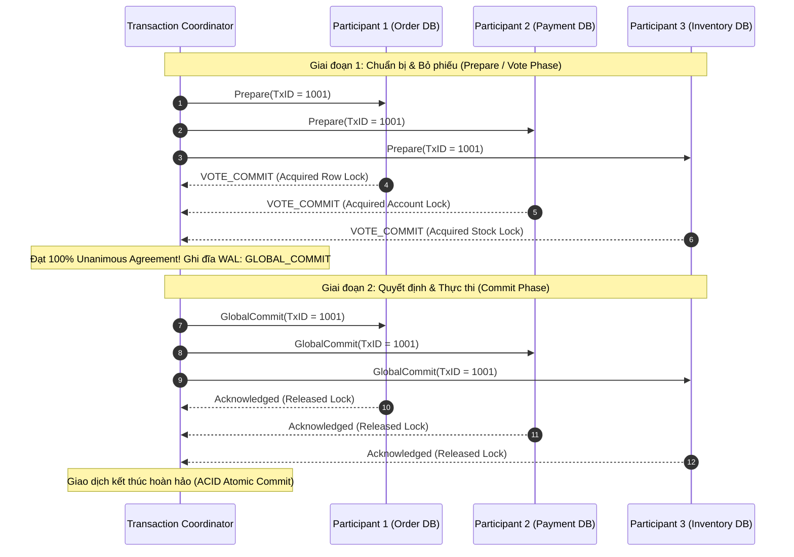

# 10.1. Distributed Transactions, 2PC & 3PC

> [!IMPORTANT]
> **Nếu bạn chỉ được nhớ một điều duy nhất**: Giao thức **Two-Phase Commit (2PC)** là một giao thức **chặn (Blocking Protocol)**: nếu Coordinator bị sập sau khi các Participant đã bỏ phiếu `VOTE_COMMIT` ở Phase 1, tất cả các Participant sẽ rơi vào trạng thái lơ lửng (**In-Doubt**) và buộc phải giữ chặt các khóa tài nguyên (Resource Locks) vô hạn định, làm tê liệt toàn bộ hệ thống. Giao thức **Three-Phase Commit (3PC)** chia nhỏ pha cam kết để loại bỏ tính chất chặn, nhưng chỉ đúng trên mô hình mạng đồng bộ lý tưởng và **hoàn toàn thất bại trước phân mảnh mạng (Network Partition)**.

---

## 1. Kiến trúc Tổng quan & Mô hình Tư duy (Mental Model)

### Ẩn dụ Đời sống: Lễ Thành Hôn Tập Thể và Chủ Tịch Đoàn
Hãy tưởng tượng một lễ thành hôn tập thể trang trọng do một vị Chủ tế (Transaction Coordinator) điều hành giữa các cặp đôi (Database Participants):
1. **Giai đoạn 1 (Prepare / Voting Phase)**: Vị Chủ tế hỏi từng người: *"Bạn có đồng ý lấy người này làm vợ/chồng không và đã sẵn sàng ký vào hôn thú chưa?"*. Mỗi bên kiểm tra tâm lý, số dư tài khoản và cam kết giữ nguyên trạng thái độc thân (Giữ Exclusive Lock). Họ trả lời: *"Tôi đồng ý (VOTE_COMMIT)"*. Nếu chỉ cần một người nói: *"Tôi từ chối (VOTE_ABORT)"*, đám cưới lập tức bị hủy bỏ.
2. **Giai đoạn 2 (Commit / Decision Phase)**: Khi nhận đủ 100% lời đồng ý từ tất cả các bên, Chủ tế tuyên bố: *"Tôi chính thức công nhận hai bạn là vợ chồng (GLOBAL_COMMIT)"*. Mọi người cùng ký vào sổ bộ và giải phóng trạng thái chờ.
3. **Thảm kịch Blocking (In-Doubt)**: Nếu ngay sau khi tất cả mọi người đã đồng thanh hô *"Tôi đồng ý"*, vị Chủ tế đột ngột lên cơn đau tim và ngất xỉu (Coordinator Crash) trước khi kịp tuyên bố quyết định. Lúc này, không ai biết Chủ tế đã kịp ký quyết định chưa; không ai dám bỏ đi lấy người khác (vì có thể Chủ tế đã ký), nhưng cũng không ai được coi là đã kết hôn hợp pháp. Toàn bộ hội trường rơi vào tình trạng đóng băng vô hạn (**In-Doubt State**).



---

## 2. Chi tiết từng Keyword (Under-the-Hood Deep Dive)

### 2.1. Kiến trúc phân vai: Coordinator, Participant & Atomic Commit Problem

#### 1. Định nghĩa Kỹ thuật & Bài toán Atomic Commit
Bài toán Atomic Commit Problem yêu cầu một tập hợp gồm $M$ cơ sở dữ liệu hoặc dịch vụ độc lập ($P_1, P_2, \dots, P_M$) cùng đạt được thỏa thuận nhị phân:
- **Tất cả cùng Commit**: Dữ liệu trên toàn bộ $M$ hệ thống đều được cập nhật vĩnh viễn xuống đĩa.
- **Tất cả cùng Abort / Rollback**: Không có bất kỳ thay đổi nào được lưu lại trên bất kỳ node nào.
- **Tính nhất quán tuyệt đối (All-or-Nothing)**: Không bao giờ xảy ra trường hợp tài khoản người gửi bị trừ tiền mà tài khoản người nhận không được cộng tiền.

#### 2. Hiện tượng In-Doubt Transaction (Giao dịch lơ lửng)
- Khi một Participant gửi phản hồi `VOTE_COMMIT` về cho Coordinator: nó đã tự tước đoạt quyền tự quyết của chính mình! Nó **không được phép đơn phương Rollback** (vì Coordinator có thể quyết định Commit), và cũng **không được phép đơn phương Commit** (vì một Participant khác có thể đã bỏ phiếu Abort).
- Nếu Coordinator bị sập hoặc cáp mạng nối tới Coordinator bị đứt: Participant bị kẹt vĩnh viễn ở trạng thái **In-Doubt**. Tất cả các hàng dữ liệu bị khóa bởi giao dịch đó sẽ tiếp tục bị giữ khóa, gây nghẽn toàn bộ các transaction khác đến sau.

### 2.2. Distributed Two-Phase Locking (Distributed 2PL) & Distributed Deadlock

#### 1. Strict Two-Phase Locking (Strict 2PL)
Để đảm bảo tính cô lập (Isolation Level - Serializable) trong giao dịch phân tán:
- **Pha 1 (Growing Phase)**: Transaction thu thập các khóa độc quyền (Exclusive Lock - X-Lock) hoặc khóa chia sẻ (Shared Lock - S-Lock) trên từng node trước khi đọc hoặc ghi.
- **Pha 2 (Shrinking Phase / Strict Rule)**: Mọi khóa tài nguyên **bắt buộc phải được giữ chặt cho đến khi giao dịch được Commit hoặc Abort hoàn toàn** trên tất cả các node. Không được phép nhả khóa sớm giữa chừng để tránh hiện tượng Đọc bẩn (Dirty Read) hoặc Phục hồi theo chuỗi (Cascading Aborts).

#### 2. Distributed Deadlock (Bế tắc phân tán)
- Xảy ra khi xuất hiện chu trình phụ thuộc vòng tròn giữa các transaction chạy trên nhiều máy chủ khác nhau:
  - Transaction $T_1$ trên Node $A$ giữ Lock tài nguyên $R_A$ và chờ Lock tài nguyên $R_B$ trên Node $B$.
  - Transaction $T_2$ trên Node $B$ giữ Lock tài nguyên $R_B$ và chờ Lock tài nguyên $R_A$ trên Node $A$.
- **Distributed Wait-For Graph (WFG)**: Cần một tiến trình tập trung hoặc thuật toán phân tán (Chandy-Misra-Haas) để phát hiện chu trình vòng tròn.
- **Giải pháp thực tế**: Sử dụng cơ chế phòng ngừa deadlock dựa trên timestamp:
  - **Wait-Die Scheme (Không ưu tiên giao dịch trẻ)**: Nếu $T_{\text{old}}$ cần khóa bị giữ bởi $T_{\text{young}}$, $T_{\text{old}}$ được phép chờ; nếu $T_{\text{young}}$ cần khóa bị giữ bởi $T_{\text{old}}$, $T_{\text{young}}$ lập tức bị "chết" (Die/Abort) và retry lại.
  - **Wound-Wait Scheme (Ưu tiên giao dịch già)**: Nếu $T_{\text{old}}$ cần khóa bị giữ bởi $T_{\text{young}}$, $T_{\text{old}}$ "làm bị thương" (Wound/Preempt) và ép $T_{\text{young}}$ rollback; nếu $T_{\text{young}}$ cần khóa bị giữ bởi $T_{\text{old}}$, $T_{\text{young}}$ được phép chờ.

### 2.3. Giao thức Two-Phase Commit (2PC - RFC 734)

#### Giai đoạn 1: Voting / Prepare Phase
1. Coordinator cấp một mã giao dịch duy nhất $TxID$ và ghi log WAL: `START_2PC(TxID)`.
2. Coordinator gửi thông điệp mạng `PREPARE(TxID)` song song tới tất cả các Participant.
3. Mỗi Participant khi nhận được lệnh:
   - Kiểm tra ràng buộc toàn vẹn, tài nguyên, khóa dữ liệu.
   - Ghi các thay đổi dự kiến vào bản ghi nhật ký hoàn tác/hoàn tất (Undo/Redo Log).
   - Nếu sẵn sàng commit: Ghi log WAL `VOTED_COMMIT` và trả về thông điệp `VOTE_COMMIT`.
   - Nếu gặp lỗi (hết tiền, khóa xung đột): Ghi log WAL `VOTED_ABORT`, tự giải phóng tài nguyên và trả về `VOTE_ABORT`.

#### Giai đoạn 2: Decision / Commit Phase
1. **Trường hợp Thành công (Unanimous Consent)**: Nếu **tất cả 100%** Participant trả về `VOTE_COMMIT`:
   - Coordinator ghi đĩa WAL: `GLOBAL_COMMIT(TxID)`.
   - Gửi thông điệp `GLOBAL_COMMIT` tới tất cả Participant.
   - Mỗi Participant nhận lệnh: Áp dụng thay đổi vĩnh viễn (Redo), giải phóng toàn bộ khóa tài nguyên, ghi log WAL `COMMITTED`, và gửi lại `ACK`.
   - Khi nhận đủ mọi `ACK`, Coordinator ghi log `END_TRANSACTION` và báo thành công cho Client.
2. **Trường hợp Thất bại**: Nếu có **dù chỉ một** Participant trả lời `VOTE_ABORT` hoặc bị timeout mạng:
   - Coordinator ghi đĩa WAL: `GLOBAL_ABORT(TxID)`.
   - Gửi thông điệp `GLOBAL_ROLLBACK` tới toàn bộ Participant.
   - Các Participant hoàn tác thay đổi theo Undo Log, giải phóng khóa và trả về `ACK`.

### 2.4. Điểm yếu chí mạng của 2PC: Blocking Protocol
2PC được coi là một "antipattern" trong kiến trúc Microservices hiện đại vì những lý do:
1. **SPOF (Single Point of Failure)**: Nếu Coordinator bị chết sau khi gửi lệnh `PREPARE` và nhận đủ phiếu `VOTE_COMMIT`, các Participant hoàn toàn bất lực. Chúng không thể tự ý đưa ra quyết định mà phải chờ đợi Coordinator hồi phục.
2. **Kéo dài Tail Latency**: Độ trễ của toàn bộ giao dịch bằng tổng độ trễ của node chậm nhất (Straggler problem) cộng với chi phí 2 lần ghi đĩa `fsync` trên tất cả các node.
3. **Giảm độ khả dụng theo cấp số nhân**: Nếu mỗi node có uptime là $99.9\%$, một giao dịch 2PC liên quan đến 10 service độc lập sẽ có uptime lý thuyết là $0.999^{10} \approx 99.0\%$, làm sụt giảm nghiêm trọng SLA của hệ thống.

### 2.5. Giao thức Three-Phase Commit (3PC - Skeen, 1981)

#### Tại sao 3PC là Non-blocking?
3PC chia nhỏ giai đoạn quyết định bằng cách chèn thêm một trạng thái đệm trung gian (**Pre-Commit**), tạo thành 3 pha:
1. **Phase 1: Can-Commit?**: Tương tự Prepare của 2PC, hỏi xem các node có khả năng thực thi không.
2. **Phase 2: Pre-Commit**:
   - Nếu tất cả trả lời Yes: Coordinator gửi `PRE_COMMIT`.
   - Khi nhận được `PRE_COMMIT`, các Participant biết chắc chắn rằng **toàn bộ hệ thống đều đã đồng ý và không có node nào bỏ phiếu Abort**. Trạng thái này loại bỏ hoàn toàn tính chất In-Doubt!
3. **Phase 3: Do-Commit**: Coordinator gửi `DO_COMMIT` để chính thức áp dụng thay đổi.

#### Điểm yếu thực tế của 3PC: Thất bại trước Network Partition
Mặc dù 3PC giải quyết được vấn đề node crash trong mạng đồng bộ có chặn thời gian (Synchronous Network), nhưng trong mạng thực tế đám mây (Asynchronous Network với rủi ro Network Partition):
- Nếu mạng bị phân mảnh trong lúc một bên đang ở trạng thái `Pre-Commit` và một bên bị timeout, một nửa cụm có thể quyết định Commit trong khi nửa còn lại quyết định Abort $\implies$ **Phá vỡ tính toàn vẹn (Split-Brain ACID)**.
- Do đó, trong thực tế, các kiến trúc phân tán hiện đại lựa chọn **Saga Pattern**, **Raft-backed Transactions (Spanner)**, hoặc **Transactional Outbox** thay vì 3PC.

---

## 3. Thực thi Mã nguồn & Mô phỏng Chuyên sâu (Dual-Engine Implementation)

### Engine 1: C++20 — Mô phỏng Cốt lõi Two-Phase Commit Coordinator với WAL Logging & Timeout Handling

```cpp
#include <iostream>
#include <vector>
#include <string>
#include <memory>
#include <optional>
#include <chrono>
#include <format>
#include <cstdint>

enum class VoteResponse { VOTE_COMMIT, VOTE_ABORT, TIMEOUT };

// Database Participant đóng vai trò Resource Manager
class DatabaseParticipant {
public:
    std::string name;
    bool should_fail_vote;
    bool is_locked{false};
    bool committed{false};

    DatabaseParticipant(std::string name, bool fail = false)
        : name(std::move(name)), should_fail_vote(fail) {}

    VoteResponse prepare(uint64_t tx_id) {
        std::cout << std::format("  -> [{}] Nhận Prepare(TxID={}). Đang kiểm tra ràng buộc & khóa hàng...\n", name, tx_id);
        if (should_fail_vote) {
            std::cout << std::format("  -> [{}] VOTE_ABORT (Không đủ số dư hoặc vi phạm Unique Constraint)!\n", name);
            return VoteResponse::VOTE_ABORT;
        }
        is_locked = true; // Khóa tài nguyên trong giai đoạn In-Doubt
        std::cout << std::format("  -> [{}] Ghi WAL: VOTED_COMMIT. Trả lời VOTE_COMMIT.\n", name);
        return VoteResponse::VOTE_COMMIT;
    }

    void commit(uint64_t tx_id) {
        committed = true;
        is_locked = false; // Giải phóng khóa sau khi ghi đĩa vĩnh viễn
        std::cout << std::format("  -> [{}] Ghi WAL: COMMITTED(TxID={}). Nhả khóa thành công.\n", name, tx_id);
    }

    void rollback(uint64_t tx_id) {
        committed = false;
        is_locked = false; // Giải phóng khóa và hoàn tác
        std::cout << std::format("  -> [{}] Ghi WAL: ABORTED(TxID={}). Hoàn tác dữ liệu & nhả khóa.\n", name, tx_id);
    }
};

// Transaction Coordinator
class TwoPhaseCommitCoordinator {
private:
    std::vector<std::shared_ptr<DatabaseParticipant>> participants_;

public:
    explicit TwoPhaseCommitCoordinator(std::vector<std::shared_ptr<DatabaseParticipant>> participants)
        : participants_(std::move(participants)) {}

    bool execute_transaction(uint64_t tx_id) {
        std::cout << std::format("\n================ BẮT ĐẦU 2PC TRANSACTION (TxID: {}) ================\n", tx_id);
        std::cout << ">>> GIAI ĐOẠN 1: Chuẩn bị & Bỏ phiếu (Prepare Phase)\n";

        bool all_voted_commit = true;
        for (auto& p : participants_) {
            auto vote = p->prepare(tx_id);
            if (vote != VoteResponse::VOTE_COMMIT) {
                all_voted_commit = false;
                std::cout << std::format("[!] Phát hiện thất bại tại {}. Toàn bộ giao dịch sẽ bị HỦY BỎ!\n", p->name);
                break;
            }
        }

        std::cout << "\n>>> GIAI ĐOẠN 2: Quyết định Toàn cục (Decision Phase)\n";
        if (all_voted_commit) {
            std::cout << "[Coordinator WAL] Ghi đĩa: GLOBAL_COMMIT. Phát lệnh Commit tới tất cả participants.\n";
            for (auto& p : participants_) {
                p->commit(tx_id);
            }
            std::cout << std::format("[V] Giao dịch TxID={} COMMIT TOÀN CỤC THÀNH CÔNG!\n", tx_id);
            return true;
        } else {
            std::cout << "[Coordinator WAL] Ghi đĩa: GLOBAL_ABORT. Phát lệnh Rollback tới tất cả participants.\n";
            for (auto& p : participants_) {
                p->rollback(tx_id);
            }
            std::cout << std::format("[X] Giao dịch TxID={} ROLLBACK TOÀN CỤC AN TOÀN!\n", tx_id);
            return false;
        }
    }
};

int main() {
    auto db_order = std::make_shared<DatabaseParticipant>("OrderDB_PostgreSQL");
    auto db_payment = std::make_shared<DatabaseParticipant>("PaymentDB_Oracle");
    auto db_inventory = std::make_shared<DatabaseParticipant>("InventoryDB_MySQL");

    TwoPhaseCommitCoordinator coord({db_order, db_payment, db_inventory});

    // Kịch bản 1: Tất cả các bên sẵn sàng -> Commit thành công
    coord.execute_transaction(101);

    // Kịch bản 2: PaymentDB bị lỗi không đủ tiền -> Rollback toàn cục
    db_payment->should_fail_vote = true;
    coord.execute_transaction(102);

    return 0;
}
```

#### Terminal Output Mẫu:
```text
================ BẮT ĐẦU 2PC TRANSACTION (TxID: 101) ================
>>> GIAI ĐOẠN 1: Chuẩn bị & Bỏ phiếu (Prepare Phase)
  -> [OrderDB_PostgreSQL] Nhận Prepare(TxID=101). Đang kiểm tra ràng buộc & khóa hàng...
  -> [OrderDB_PostgreSQL] Ghi WAL: VOTED_COMMIT. Trả lời VOTE_COMMIT.
  -> [PaymentDB_Oracle] Nhận Prepare(TxID=101). Đang kiểm tra ràng buộc & khóa hàng...
  -> [PaymentDB_Oracle] Ghi WAL: VOTED_COMMIT. Trả lời VOTE_COMMIT.
  -> [InventoryDB_MySQL] Nhận Prepare(TxID=101). Đang kiểm tra ràng buộc & khóa hàng...
  -> [InventoryDB_MySQL] Ghi WAL: VOTED_COMMIT. Trả lời VOTE_COMMIT.

>>> GIAI ĐOẠN 2: Quyết định Toàn cục (Decision Phase)
[Coordinator WAL] Ghi đĩa: GLOBAL_COMMIT. Phát lệnh Commit tới tất cả participants.
  -> [OrderDB_PostgreSQL] Ghi WAL: COMMITTED(TxID=101). Nhả khóa thành công.
  -> [PaymentDB_Oracle] Ghi WAL: COMMITTED(TxID=101). Nhả khóa thành công.
  -> [InventoryDB_MySQL] Ghi WAL: COMMITTED(TxID=101). Nhả khóa thành công.
[V] Giao dịch TxID=101 COMMIT TOÀN CỤC THÀNH CÔNG!

================ BẮT ĐẦU 2PC TRANSACTION (TxID: 102) ================
>>> GIAI ĐOẠN 1: Chuẩn bị & Bỏ phiếu (Prepare Phase)
  -> [OrderDB_PostgreSQL] Nhận Prepare(TxID=102). Đang kiểm tra ràng buộc & khóa hàng...
  -> [OrderDB_PostgreSQL] Ghi WAL: VOTED_COMMIT. Trả lời VOTE_COMMIT.
  -> [PaymentDB_Oracle] Nhận Prepare(TxID=102). Đang kiểm tra ràng buộc & khóa hàng...
  -> [PaymentDB_Oracle] VOTE_ABORT (Không đủ số dư hoặc vi phạm Unique Constraint)!
[!] Phát hiện thất bại tại PaymentDB_Oracle. Toàn bộ giao dịch sẽ bị HỦY BỎ!

>>> GIAI ĐOẠN 2: Quyết định Toàn cục (Decision Phase)
[Coordinator WAL] Ghi đĩa: GLOBAL_ABORT. Phát lệnh Rollback tới tất cả participants.
  -> [OrderDB_PostgreSQL] Ghi WAL: ABORTED(TxID=102). Hoàn tác dữ liệu & nhả khóa.
  -> [PaymentDB_Oracle] Ghi WAL: ABORTED(TxID=102). Hoàn tác dữ liệu & nhả khóa.
  -> [InventoryDB_MySQL] Ghi WAL: ABORTED(TxID=102). Hoàn tác dữ liệu & nhả khóa.
[X] Giao dịch TxID=102 ROLLBACK TOÀN CỤC AN TOÀN!
```

---

### Engine 2: Python 3.11+ — Mô phỏng Hiện tượng In-Doubt Khi Coordinator Bị Sập Giữa Hai Pha

```python
import asyncio
from enum import Enum
from typing import Dict, List, Optional

class State(Enum):
    INIT = "INIT"
    PREPARED = "PREPARED (In-Doubt Locked)"
    COMMITTED = "COMMITTED"
    ABORTED = "ABORTED"

class Participant:
    def __init__(self, name: str):
        self.name = name
        self.state = State.INIT
        self.locked_record: Optional[str] = None

    def prepare(self, tx_id: int, record_id: str) -> bool:
        self.state = State.PREPARED
        self.locked_record = record_id
        print(f"[{self.name}] Khóa bản ghi '{record_id}' và bỏ phiếu VOTE_COMMIT.")
        return True

    def commit(self, tx_id: int):
        self.state = State.COMMITTED
        locked = self.locked_record
        self.locked_record = None
        print(f"[{self.name}] Đã COMMIT giao dịch. Mở khóa bản ghi '{locked}'.")

    def rollback(self, tx_id: int):
        self.state = State.ABORTED
        locked = self.locked_record
        self.locked_record = None
        print(f"[{self.name}] Đã ROLLBACK giao dịch. Mở khóa bản ghi '{locked}'.")

class Coordinator:
    def __init__(self, participants: List[Participant]):
        self.participants = participants

    async def execute_with_crash_injection(self, tx_id: int, crash_after_prepare: bool = False):
        print(f"\n--- Coordinator phát động 2PC cho TxID={tx_id} ---")
        # Pha 1: Prepare
        for p in self.participants:
            p.prepare(tx_id, "ACCOUNT_BALANCE_USER_1")

        if crash_after_prepare:
            print("\n[THẢM HỌA] Coordinator bị CRASH / Mất điện đột ngột sau khi các node đã Prepare!")
            print("[THẢM HỌA] Không có lệnh Commit hay Abort nào được phát đi!")
            return False

        # Pha 2: Commit
        for p in self.participants:
            p.commit(tx_id)
        return True

async def main():
    p1 = Participant("Bank_A_Database")
    p2 = Participant("Bank_B_Database")
    coord = Coordinator([p1, p2])

    # Kịch bản mô phỏng thảm họa In-Doubt
    await coord.execute_with_crash_injection(tx_id=999, crash_after_prepare=True)

    print("\n--- Kiểm tra trạng thái các Participant sau sự cố Coordinator ---")
    for p in [p1, p2]:
        print(f"Node {p.name}: Trạng thái = {p.state.value} | Khóa tài nguyên = '{p.locked_record}'")
    print("[Hệ quả] Bản ghi 'ACCOUNT_BALANCE_USER_1' bị treo vô hạn, các giao dịch khác đến sau đều bị chặn!")

if __name__ == "__main__":
    asyncio.run(main())
```

#### Terminal Output Mẫu:
```text
--- Coordinator phát động 2PC cho TxID=999 ---
[Bank_A_Database] Khóa bản ghi 'ACCOUNT_BALANCE_USER_1' và bỏ phiếu VOTE_COMMIT.
[Bank_B_Database] Khóa bản ghi 'ACCOUNT_BALANCE_USER_1' và bỏ phiếu VOTE_COMMIT.

[THẢM HỌA] Coordinator bị CRASH / Mất điện đột ngột sau khi các node đã Prepare!
[THẢM HỌA] Không có lệnh Commit hay Abort nào được phát đi!

--- Kiểm tra trạng thái các Participant sau sự cố Coordinator ---
Node Bank_A_Database: Trạng thái = PREPARED (In-Doubt Locked) | Khóa tài nguyên = 'ACCOUNT_BALANCE_USER_1'
Node Bank_B_Database: Trạng thái = PREPARED (In-Doubt Locked) | Khóa tài nguyên = 'ACCOUNT_BALANCE_USER_1'
[Hệ quả] Bản ghi 'ACCOUNT_BALANCE_USER_1' bị treo vô hạn, các giao dịch khác đến sau đều bị chặn!
```

---

## 4. Systems Engineering & Production Pitfalls

### 4.1. Những cạm bẫy sống còn khi triển khai 2PC trong thực tế
1. **XA Transactions trong MySQL / PostgreSQL bị treo In-Doubt**:
   - Khi sử dụng chuẩn XA (`XA PREPARE 'tx_123'`), nếu kết nối ứng dụng (Java JDBC connection) bị đứt trước khi kịp gửi `XA COMMIT`, phiên giao dịch đó không tự động rollback mà vẫn giữ khóa XA trên engine InnoDB mãi mãi!
   - Hệ quả: Toàn bộ bảng dữ liệu bị khóa, làm cạn kiệt Connection Pool và khiến database rơi vào trạng thái tê liệt hoàn toàn.
   - *Khắc phục*: Cần có định kỳ background worker quét bảng `information_schema.innodb_trx` và danh sách `XA RECOVER` để giải phóng các giao dịch mồ côi.

2. **Bỏ qua `fsync` trên Coordinator WAL**:
   - Coordinator bắt buộc phải ghi trạng thái `GLOBAL_COMMIT` xuống đĩa bền vững bằng `fsync` trước khi gửi gói tin commit cho các participant. Nếu Coordinator chỉ lưu trên RAM và bị mất điện, khi khởi động lại nó tưởng giao dịch đã abort và gửi rollback $\implies$ vi phạm nghiêm trọng tính nhất quán của hệ thống.

3. **Mô hình XA không tương thích với Microservices đa ngôn ngữ**:
   - Chuẩn XA yêu cầu kết nối mạng duy trì trạng thái cấp thấp giữa Transaction Manager và Resource Manager qua socket TCP liên tục. Trong môi trường Kubernetes với Pods khởi động lại liên tục và API giao tiếp qua HTTP/gRPC, 2PC thuần túy là bất khả thi.

### 4.2. Runbook Chẩn đoán Sự cố XA 2PC trên Production (CLI Commands)

```bash
# 1. Kiểm tra các giao dịch XA đang bị treo In-Doubt trên MySQL Database
mysql -u root -p -e "XA RECOVER;"

# 2. Cưỡng chế Rollback một giao dịch XA bị cô lập (Orphaned XA Transaction)
mysql -u root -p -e "XA ROLLBACK 'xid_string_format';"

# 3. Kiểm tra các Lock phân tán đang chờ đợi trong PostgreSQL
psql -U postgres -c "SELECT pid, locktype, mode, granted, query FROM pg_locks l JOIN pg_stat_activity a ON l.pid = a.pid WHERE NOT granted;"
```

---

## 5. Bảng So sánh & Decision Matrix

| Tiêu chí Đánh giá | Two-Phase Commit (2PC) | Three-Phase Commit (3PC) | Saga Pattern | Spanner TrueTime 2PC |
| :--- | :--- | :--- | :--- | :--- |
| **Tính chất Chặn (Blocking)** | **Có (Blocking khi Coordinator chết)** | Không (Non-blocking trên crash-stop) | Không (Eventual Consistency) | Không (Nhờ Paxos Replicated Leader) |
| **Mức độ Cô lập (Isolation)** | ACID Toàn cục (Serializable) | ACID Toàn cục | BASE (Eventual / Read Uncommitted) | ACID Toàn cục (External Consistency) |
| **Độ trễ Giao dịch** | Cao ($2 \times \text{RTT} + 2 \times \text{Disk fsync}$) | Rất cao ($3 \times \text{RTT}$) | Thấp (Chia nhỏ từng bước) | Trung bình ($1 \times \text{WAN RTT} + \text{Clock Uncertainty}$) |
| **Khả năng chịu Phân mảnh Mạng** | Tốt (Ưu tiên Safety, chấp nhận treo) | Kém (Dễ bị Split-Brain) | Rất tốt (Từng service tự do chạy) | Rất tốt (Paxos Quorum) |
| **Phù hợp nhất cho** | Monolithic Multi-DB (Oracle/PostgreSQL) | Lý thuyết mạng đồng bộ | **Microservices, Thương mại điện tử** | **Global Cloud Databases (Spanner, CockroachDB)** |
