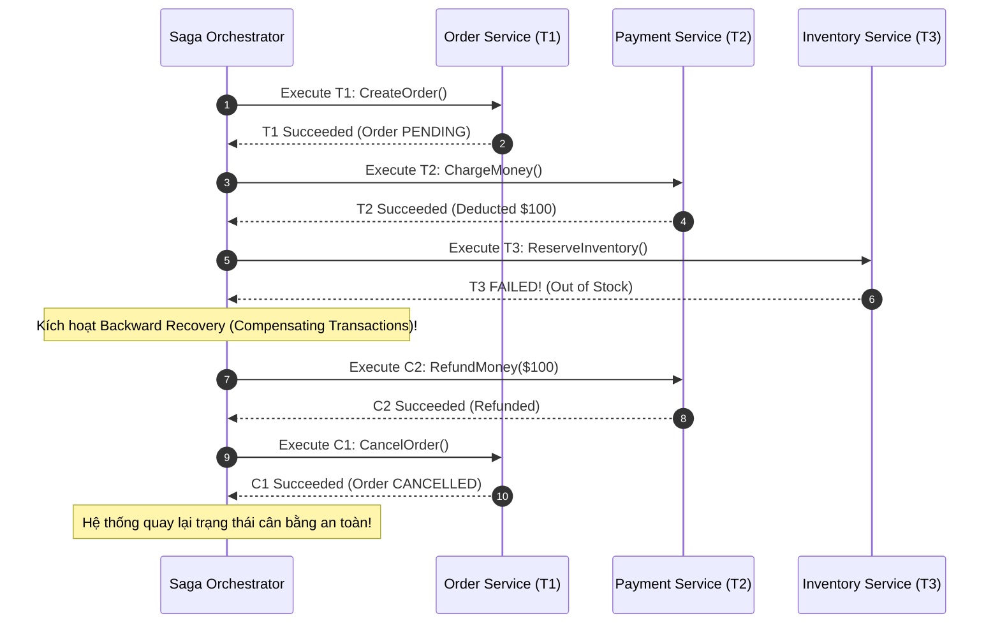
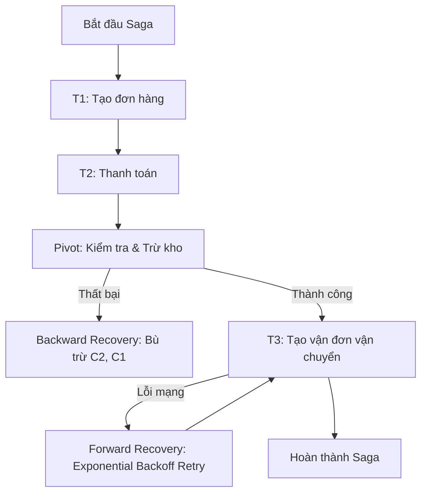

# 10.2. Saga Pattern & Compensating Transactions

> [!IMPORTANT]
> **Nếu bạn chỉ được nhớ một điều duy nhất**: Saga Pattern đánh đổi thuộc tính **Cô lập (Isolation)** của ACID để đạt được hiệu năng cao và tính khả dụng tuyệt đối trong kiến trúc Microservices. Một Saga chia nhỏ một giao dịch toàn cục thành một chuỗi các giao dịch cục bộ độc lập (**Local Transactions**). Điểm mấu chốt là: một giao dịch bù trừ (**Compensating Transaction**) không thể "undo" thời gian thực tế mà là một hành động ngữ nghĩa mới (ví dụ: hoàn tiền thay vì xóa giao dịch quẹt thẻ); vì vậy, mọi giao dịch bù trừ **bắt buộc phải có tính lũy đẳng (Idempotent)** và có khả năng xử lý các thông điệp đến lệch thứ tự (Out-of-Order Events).

---

## 1. Kiến trúc Tổng quan & Mô hình Tư duy (Mental Model)

### Ẩn dụ Đời sống: Đặt Tour Du Lịch Trọn Gói
Hãy hình dung bạn lên kế hoạch cho một chuyến du lịch gồm 3 bước:
1. Đặt vé máy bay ($T_1$).
2. Đặt phòng khách sạn ($T_2$).
3. Thuê xe ô tô tự lái ($T_3$).

Trong mô hình ACID (2PC), công ty du lịch sẽ yêu cầu giữ chỗ cả 3 dịch vụ và không cho ai khác chạm vào cho đến khi bạn thanh toán xong. Điều này làm nghẽn toàn bộ hệ thống của hãng hàng không và khách sạn.

Trong mô hình **Saga**:
- Bạn quẹt thẻ thanh toán vé máy bay ngay lập tức ($T_1$ commit thành công).
- Bạn đặt phòng khách sạn ($T_2$ commit thành công).
- Nhưng khi đến bước thuê xe ($T_3$), công ty báo hết xe! Bạn không thể dùng "nút Ctrl+Z thần kỳ" để đảo ngược thời gian.
- Thay vào đó, bạn phải thực hiện các **hành động bù trừ (Compensating Actions)** theo chiều ngược lại:
  - Hủy phòng khách sạn và nhận lại tiền cọc ($C_2$).
  - Hủy vé máy bay và chấp nhận phí hủy vé ($C_1$).
- Vé máy bay đã từng xuất hiện trên hệ thống; mọi người đều thấy nó trong một khoảng thời gian (thiếu Isolation), nhưng cuối cùng hệ thống đã trở về trạng thái nhất quán ngữ nghĩa (**Eventual Consistency**).



---

## 2. Chi tiết từng Keyword (Under-the-Hood Deep Dive)

### 2.1. Định nghĩa toán học của Saga (Garcia-Molina & Salem, 1987)
Một Saga là một chuỗi hữu hạn các giao dịch cục bộ:
$$\mathcal{S} = \{T_1, T_2, \dots, T_n\}$$
Mỗi giao dịch cục bộ $T_i$ có một giao dịch bù trừ tương ứng $C_i$ (Compensating Transaction) sao cho chuỗi $T_i$ theo sau bởi $C_i$ tương đương về mặt ngữ nghĩa với việc không thực hiện thao tác nào:
$$T_i \circ C_i \equiv \mathcal{I} \quad (\text{Identity Semantic})$$

#### Chuỗi thực thi thành công
$$T_1 \to T_2 \to \dots \to T_n$$
Mọi bước đều thành công, toàn bộ giao dịch được coi là hoàn tất viên mãn.

#### Chuỗi thực thi khi có sự cố tại bước $T_k$ ($k \le n$)
Nếu bước $T_k$ gặp lỗi không thể khắc phục:
$$T_1 \to T_2 \to \dots \to T_k \text{ (Fail)} \to C_{k-1} \to C_{k-2} \to \dots \to C_1$$
Hệ thống kích hoạt tuần tự các giao dịch bồi hoàn ngược từ $k-1$ về $1$ để đưa dữ liệu về trạng thái nhất quán.

### 2.2. Phân loại 3 loại Transaction trong một Saga
Mọi bước trong một Saga thực tế đều được phân loại vào đúng 1 trong 3 nhóm:

1. **Compensable Transactions (Giao dịch có thể bù trừ)**:
   - Các giao dịch có thể hoàn tác bằng một thao tác đối ngẫu.
   - Ví dụ: Trừ tiền ví điện tử $\to$ bù trừ bằng lệnh cộng lại tiền; Tạo đơn hàng tạm $\to$ bù trừ bằng lệnh đánh dấu đơn hủy.
2. **Pivot Transaction (Giao dịch then chốt / Điểm không thể quay đầu)**:
   - Là bước ranh giới quyết định sự thành bại của toàn bộ Saga.
   - Nếu Pivot Transaction thành công $\implies$ Saga chắc chắn sẽ hoàn thành thành công (không bao giờ rollback nữa).
   - Nếu Pivot Transaction thất bại $\implies$ Saga buộc phải rollback toàn bộ các bước Compensable trước đó.
   - Một Saga chỉ có tối đa một Pivot Transaction duy nhất.
3. **Retriable Transactions (Giao dịch bắt buộc phải thử lại)**:
   - Các bước đứng sau Pivot Transaction.
   - Các bước này **không cần giao dịch bù trừ** vì chúng được đảm bảo 100% sẽ thành công (về mặt kỹ thuật). Nếu gặp lỗi mạng hoặc sập server, hệ thống sẽ liên tục retry cho tới khi hoàn tất.
   - Ví dụ: Gửi email xác nhận đặt hàng thành công, bắn push notification cho khách hàng.

### 2.3. Hai chiến lược phục hồi: Forward Recovery vs Backward Recovery



- **Backward Recovery (Phục hồi Lùi)**: Áp dụng khi gặp lỗi logic nghiệp vụ trước hoặc tại Pivot Transaction. Kích hoạt chuỗi bồi hoàn ngược để hủy bỏ toàn bộ kết quả.
- **Forward Recovery (Phục hồi Tiến)**: Áp dụng cho các Retriable Transactions sau khi Pivot đã thành công. Hệ thống không bao giờ rollback mà kiên trì retry (kết hợp Dead Letter Queue và Exponential Backoff) cho đến khi hoàn thành mục tiêu.

### 2.4. Hai mô hình thực thi: Choreography vs Orchestration

#### 1. Saga Choreography (Vũ đạo phân tán / Event-Driven)
- Không có bộ điều phối trung tâm. Mỗi service khi hoàn thành transaction cục bộ sẽ bắn một Domain Event lên Message Broker (Kafka/RabbitMQ).
- Các service khác lắng nghe event đó và tự động kích hoạt transaction tiếp theo của mình.
- **Ưu điểm**: Loose coupling, hiệu năng cao, không có SPOF.
- **Nhược điểm**: Rất khó debug, rủi ro circular dependency (phụ thuộc vòng tròn), khó theo dõi trạng thái tổng thể của một đơn hàng khi có hàng chục service tham gia.

#### 2. Saga Orchestration (Dàn nhạc giao hưởng / Centralized Coordinator)
- Có một service trung tâm đóng vai trò Nhạc trưởng (**Orchestrator** - State Machine).
- Orchestrator gửi lệnh trực tiếp tới từng service qua gRPC/REST hoặc command queue, nhận phản hồi và quyết định bước đi tiếp theo.
- **Ưu điểm**: Luồng nghiệp vụ minh bạch, dễ theo dõi trạng thái qua dashboard (Temporal, Camunda, AWS Step Functions), dễ xử lý bù trừ tập trung.
- **Nhược điểm**: Nguy cơ biến Orchestrator thành một God Object chứa quá nhiều logic nghiệp vụ, chi phí vận hành cụm điều phối.

#### Bảng so sánh Choreography vs Orchestration
| Tiêu chí | Saga Choreography | Saga Orchestration |
| :--- | :--- | :--- |
| **Kiến trúc** | Phân tán, Pub/Sub thuần túy | Tập trung, State Machine Engine |
| **Khả năng quan sát (Observability)** | Rất khó khăn (Cần Distributed Tracing) | Cực kỳ trực quan (Theo dõi State Graph) |
| **Độ phức tạp khi mở rộng** | Khó quản lý khi Saga $> 4-5$ bước | Dễ dàng mở rộng thêm bước mới |
| **Phù hợp nhất cho** | Quy trình ngắn ($2-3$ service), team tự chủ | Quy trình phức tạp, thanh toán, ngân hàng |

### 2.5. Các thách thức và Pitfalls chết người trong Saga

#### 1. Vấn đề Thiếu tính Cô lập (Lack of Isolation Anomalies)
Vì các transaction cục bộ commit ngay lập tức, dữ liệu trung gian bị lộ ra cho các transaction khác đọc:
- **Dirty Reads**: Service A trừ $100 của khách; Service B đọc thấy số dư mới và cho phép rút tiền; sau đó Saga của Service A bị rollback khiến khách hàng có thể tiêu vượt quá số dư!
- **Lost Updates**: Hai Saga cùng đọc số lượng tồn kho và cùng ghi đè mà không có lock toàn cục.
- *Biện pháp phòng vệ*: Áp dụng cờ trạng thái ngữ nghĩa (**Semantic Locking** - ví dụ: trạng thái `PENDING_PAYMENT`, `BLOCKED`) và so sánh giá trị phiên bản (Optimistic Concurrency Control).

#### 2. Tính lũy đẳng (Idempotency) của Compensating Transactions
- Trong mạng phân tán, tin nhắn kích hoạt bù trừ có thể bị gửi trùng lặp do network retry.
- Nếu lệnh hoàn tiền `RefundMoney($100)` được nhận 2 lần mà không có cơ chế kiểm tra trùng lặp (Idempotency Key), khách hàng sẽ được hoàn $200!
- *Quy tắc vàng*: Mọi API bù trừ bắt buộc phải lưu `Idempotency-Key` vào database bằng thao tác Atomic Insert để chặn đứng việc thực thi lần 2.

#### 3. Sự cố "Tin nhắn đến lệch thứ tự" (Out-of-Order Messages)
- Do mạng lag, tin nhắn bù trừ `CancelOrder` có thể bay đến Service trước cả khi tin nhắn tạo `CreateOrder` xuất hiện!
- Nếu Service hủy một đơn hàng chưa từng tồn tại, sau đó lệnh tạo đơn hàng đến nơi và tạo đơn mới $\implies$ đơn hàng bị treo vĩnh viễn không bao giờ bị hủy!
- *Khắc phục*: Service phải ghi nhận sự kiện hủy trước vào bảng trạng thái (Ghost Tombstone): nếu thấy lệnh tạo đơn đến sau cho một mã đã bị hủy, lập tức từ chối tạo.

---

## 3. Thực thi Mã nguồn & Mô phỏng Chuyên sâu (Dual-Engine Implementation)

### Engine 1: C++20 — Mô phỏng Cốt lõi Saga Orchestrator State Machine với Backward Compensation

```cpp
#include <iostream>
#include <vector>
#include <string>
#include <memory>
#include <functional>
#include <format>
#include <cstdint>

struct SagaStep {
    std::string name;
    std::function<bool()> execute;
    std::function<void()> compensate;
};

class SagaOrchestrator {
private:
    std::string saga_id_;
    std::vector<SagaStep> steps_;

public:
    explicit SagaOrchestrator(std::string saga_id) : saga_id_(std::move(saga_id)) {}

    void add_step(std::string name, std::function<bool()> forward, std::function<void()> rollback) {
        steps_.push_back(SagaStep{
            .name = std::move(name),
            .execute = std::move(forward),
            .compensate = std::move(rollback)
        });
    }

    bool execute_saga() {
        std::cout << std::format("\n>>> [Saga Orchestrator] Khởi động Saga Execution: {}\n", saga_id_);
        std::vector<size_t> executed_indices;

        for (size_t i = 0; i < steps_.size(); ++i) {
            std::cout << std::format("  -> Thực thi Bước [{}/{}]: {}\n", i + 1, steps_.size(), steps_[i].name);
            bool ok = steps_[i].execute();
            if (ok) {
                executed_indices.push_back(i);
                std::cout << std::format("     [OK] Bước '{}' thành công.\n", steps_[i].name);
            } else {
                std::cout << std::format("     [FAILED] Bước '{}' THẤT BẠI! Kích hoạt quy trình bồi hoàn (Rollback)...\n", steps_[i].name);
                compensate_executed_steps(executed_indices);
                return false;
            }
        }

        std::cout << std::format("[V] SAGA {} HOÀN TẤT VIÊN MÃN (100% Steps Success)!\n", saga_id_);
        return true;
    }

private:
    void compensate_executed_steps(const std::vector<size_t>& executed_indices) {
        std::cout << ">>> [Saga Orchestrator] Bắt đầu Backward Recovery...\n";
        // Bồi hoàn theo chiều ngược lại (LIFO: Last-In, First-Out)
        for (auto it = executed_indices.rbegin(); it != executed_indices.rend(); ++it) {
            size_t idx = *it;
            std::cout << std::format("  <- [Bù trừ] Kích hoạt Compensating Action cho: {}\n", steps_[idx].name);
            steps_[idx].compensate();
        }
        std::cout << "[!] Quy trình bồi hoàn hoàn tất! Toàn bộ trạng thái đã trở về nhất quán.\n";
    }
};

int main() {
    std::cout << "================ KỊCH BẢN 1: SAGA THÀNH CÔNG ================";
    SagaOrchestrator saga1("ORDER_FLOW_SUCCESS");
    saga1.add_step(
        "Tạo Đơn Hàng (Order Service)",
        []() { std::cout << "       DB: INSERT INTO orders VALUES ('PENDING');\n"; return true; },
        []() { std::cout << "       DB: UPDATE orders SET status='CANCELLED';\n"; }
    );
    saga1.add_step(
        "Trừ Tiền Tài Khoản (Payment Service)",
        []() { std::cout << "       DB: UPDATE accounts SET balance = balance - 100;\n"; return true; },
        []() { std::cout << "       DB: UPDATE accounts SET balance = balance + 100;\n"; }
    );
    saga1.add_step(
        "Trừ Tồn Kho (Inventory Service)",
        []() { std::cout << "       DB: UPDATE stock SET qty = qty - 1;\n"; return true; },
        []() { std::cout << "       DB: UPDATE stock SET qty = qty + 1;\n"; }
    );
    saga1.execute_saga();

    std::cout << "\n================ KỊCH BẢN 2: THẤT BẠI TẠI INVENTORY -> BACKWARD RECOVERY ================";
    SagaOrchestrator saga2("ORDER_FLOW_OUT_OF_STOCK");
    saga2.add_step(
        "Tạo Đơn Hàng (Order Service)",
        []() { std::cout << "       DB: INSERT INTO orders VALUES ('PENDING');\n"; return true; },
        []() { std::cout << "       DB: UPDATE orders SET status='CANCELLED';\n"; }
    );
    saga2.add_step(
        "Trừ Tiền Tài Khoản (Payment Service)",
        []() { std::cout << "       DB: UPDATE accounts SET balance = balance - 100;\n"; return true; },
        []() { std::cout << "       DB: UPDATE accounts SET balance = balance + 100 (Refund);\n"; }
    );
    saga2.add_step(
        "Trừ Tồn Kho (Inventory Service - Pivot Step)",
        []() { std::cout << "       DB: Tồn kho = 0! Lỗi OUT_OF_STOCK!\n"; return false; },
        []() { /* Không cần bù trừ vì chưa làm gì */ }
    );
    saga2.execute_saga();

    return 0;
}
```

#### Terminal Output Mẫu:
```text
================ KỊCH BẢN 1: SAGA THÀNH CÔNG ================
>>> [Saga Orchestrator] Khởi động Saga Execution: ORDER_FLOW_SUCCESS
  -> Thực thi Bước [1/3]: Tạo Đơn Hàng (Order Service)
       DB: INSERT INTO orders VALUES ('PENDING');
     [OK] Bước 'Tạo Đơn Hàng (Order Service)' thành công.
  -> Thực thi Bước [2/3]: Trừ Tiền Tài Khoản (Payment Service)
       DB: UPDATE accounts SET balance = balance - 100;
     [OK] Bước 'Trừ Tiền Tài Khoản (Payment Service)' thành công.
  -> Thực thi Bước [3/3]: Trừ Tồn Kho (Inventory Service)
       DB: UPDATE stock SET qty = qty - 1;
     [OK] Bước 'Trừ Tồn Kho (Inventory Service)' thành công.
[V] SAGA ORDER_FLOW_SUCCESS HOÀN TẤT VIÊN MÃN (100% Steps Success)!

================ KỊCH BẢN 2: THẤT BẠI TẠI INVENTORY -> BACKWARD RECOVERY ================
>>> [Saga Orchestrator] Khởi động Saga Execution: ORDER_FLOW_OUT_OF_STOCK
  -> Thực thi Bước [1/3]: Tạo Đơn Hàng (Order Service)
       DB: INSERT INTO orders VALUES ('PENDING');
     [OK] Bước 'Tạo Đơn Hàng (Order Service)' thành công.
  -> Thực thi Bước [2/3]: Trừ Tiền Tài Khoản (Payment Service)
       DB: UPDATE accounts SET balance = balance - 100;
     [OK] Bước 'Trừ Tiền Tài Khoản (Payment Service)' thành công.
  -> Thực thi Bước [3/3]: Trừ Tồn Kho (Inventory Service - Pivot Step)
       DB: Tồn kho = 0! Lỗi OUT_OF_STOCK!
     [FAILED] Bước 'Trừ Tồn Kho (Inventory Service - Pivot Step)' THẤT BẠI! Kích hoạt quy trình bồi hoàn (Rollback)...
>>> [Saga Orchestrator] Bắt đầu Backward Recovery...
  <- [Bù trừ] Kích hoạt Compensating Action cho: Trừ Tiền Tài Khoản (Payment Service)
       DB: UPDATE accounts SET balance = balance + 100 (Refund);
  <- [Bù trừ] Kích hoạt Compensating Action cho: Tạo Đơn Hàng (Order Service)
       DB: UPDATE orders SET status='CANCELLED';
[!] Quy trình bồi hoàn hoàn tất! Toàn bộ trạng thái đã trở về nhất quán.
```

---

### Engine 2: Python 3.11+ — Mô phỏng Saga Choreography với Event Bus và Idempotency Bảo vệ

```python
import asyncio
from typing import Dict, Set

class MockEventBus:
    def __init__(self):
        self.subscribers = {}

    def subscribe(self, event_name: str, handler):
        if event_name not in self.subscribers:
            self.subscribers[event_name] = []
        self.subscribers[event_name].append(handler)

    async def publish(self, event_name: str, payload: dict):
        print(f"\n[EventBus] -> Bắn Event: '{event_name}' | Data: {payload}")
        if event_name in self.subscribers:
            for handler in self.subscribers[event_name]:
                await handler(payload)

class OrderService:
    def __init__(self, bus: MockEventBus):
        self.bus = bus
        self.orders = {}
        self.bus.subscribe("PAYMENT_FAILED", self.on_payment_failed)

    async def create_order(self, order_id: str, amount: float):
        self.orders[order_id] = {"amount": amount, "status": "PENDING"}
        print(f"[OrderService] Đơn hàng {order_id} tạo với trạng thái PENDING.")
        await self.bus.publish("ORDER_CREATED", {"order_id": order_id, "amount": amount})

    async def on_payment_failed(self, payload: dict):
        oid = payload["order_id"]
        if oid in self.orders:
            self.orders[oid]["status"] = "CANCELLED"
            print(f"[OrderService] (Bồi hoàn) Đơn {oid} đã chuyển trạng thái sang CANCELLED.")

class PaymentService:
    def __init__(self, bus: MockEventBus):
        self.bus = bus
        self.processed_events: Set[str] = set() # Chống xử lý trùng lặp (Idempotency)
        self.bus.subscribe("ORDER_CREATED", self.on_order_created)

    async def on_order_created(self, payload: dict):
        oid = payload["order_id"]
        amount = payload["amount"]
        idempotency_key = f"pay_{oid}"

        if idempotency_key in self.processed_events:
            print(f"[PaymentService] Bỏ qua Event trùng lặp: {idempotency_key}")
            return
        self.processed_events.add(idempotency_key)

        print(f"[PaymentService] Đang xử lý trừ tiền ${amount} cho đơn {oid}...")
        # Giả lập nghiệp vụ: Số tiền lớn hơn 500 thì thanh toán bị từ chối
        if amount > 500:
            print(f"[PaymentService] Lỗi: Tài khoản không đủ hạn mức (${amount} > $500)!")
            await self.bus.publish("PAYMENT_FAILED", {"order_id": oid, "reason": "INSUFFICIENT_FUNDS"})
        else:
            print(f"[PaymentService] Trừ tiền thành công cho đơn {oid}!")
            await self.bus.publish("PAYMENT_SUCCESS", {"order_id": oid})

async def main():
    bus = MockEventBus()
    order_svc = OrderService(bus)
    payment_svc = PaymentService(bus)

    print("--- Kịch bản: Đơn hàng $750 vượt hạn mức -> Tự động kích hoạt bù trừ ---")
    await order_svc.create_order("ORD_999", amount=750.0)

    print(f"\n[Kiểm tra Cuối cùng] Trạng thái đơn ORD_999: {order_svc.orders['ORD_999']['status']}")

if __name__ == "__main__":
    asyncio.run(main())
```

#### Terminal Output Mẫu:
```text
--- Kịch bản: Đơn hàng $750 vượt hạn mức -> Tự động kích hoạt bù trừ ---
[OrderService] Đơn hàng ORD_999 tạo với trạng thái PENDING.

[EventBus] -> Bắn Event: 'ORDER_CREATED' | Data: {'order_id': 'ORD_999', 'amount': 750.0}
[PaymentService] Đang xử lý trừ tiền $750.0 cho đơn ORD_999...
[PaymentService] Lỗi: Tài khoản không đủ hạn mức ($750.0 > $500)!

[EventBus] -> Bắn Event: 'PAYMENT_FAILED' | Data: {'order_id': 'ORD_999', 'reason': 'INSUFFICIENT_FUNDS'}
[OrderService] (Bồi hoàn) Đơn ORD_999 đã chuyển trạng thái sang CANCELLED.

[Kiểm tra Cuối cùng] Trạng thái đơn ORD_999: CANCELLED
```

---

## 4. Systems Engineering & Production Pitfalls

### 4.1. Những cạm bẫy sống còn khi vận hành Saga Pattern
1. **Compensating Action bị thất bại (Compensate Fail)**:
   - Chuyện gì xảy ra nếu bước thanh toán thành công nhưng khi hủy đơn, API hoàn tiền của cổng thanh toán trả về `HTTP 500` hoặc timeout?
   - Không được phép nuốt exception! Hệ thống bắt buộc phải đẩy sự kiện lỗi vào **Dead Letter Queue (DLQ)** và kích hoạt worker chạy lại liên tục hoặc phát cảnh báo PagerDuty để kỹ sư can thiệp thủ công.
   - *Nguyên tắc thiết kế*: Hành động bù trừ bắt buộc phải là một **Retriable Transaction** (không bao giờ được bỏ cuộc).

2. **Semantic Lock và Khủng hoảng Kho hàng (Ghost Inventory)**:
   - Nếu giữ hàng bằng cờ `RESERVED` trong 30 phút mà khách hàng không thanh toán hoặc Saga bị treo, lượng hàng này biến thành "hàng ma" (ghost stock) mà người khác không mua được.
   - *Khắc phục*: Cần có cơ chế Timeout tự động (TTL trên Redis hoặc scheduled job) để tự động kích hoạt hủy giữ chỗ khi hết hạn.

3. **Hiện tượng Deadlock ở Tầng Nghiệp vụ (Choreography Cycle)**:
   - Service A chờ Event từ Service B để hoàn tất; Service B lại lắng nghe Event từ Service C; Service C lại cần Event từ Service A. Nếu không có tài liệu kiến trúc rõ ràng, hệ thống sẽ rơi vào bế tắc vòng tròn mà không ai hay biết.

### 4.2. Runbook Chẩn đoán Sự cố Saga trên Production

```bash
# 1. Quét tìm các Saga Execution đang bị kẹt quá thời hạn trong Temporal Server
tctl workflow list --query "WorkflowType='OrderSagaWorkflow' AND ExecutionStatus='Running'"

# 2. Kiểm tra các message bị văng vào Dead Letter Queue (DLQ) trong Kafka do lỗi bù trừ
kafka-console-consumer --bootstrap-server localhost:9092 --topic order-compensation-dlq --from-beginning --max-messages 10

# 3. Theo dõi số lượng sự kiện hoàn tiền thất bại qua Prometheus
curl -s http://localhost:8080/actuator/prometheus | grep "saga_compensation_failed_total"
```

---

## 5. Bảng So sánh & Decision Matrix

| Khía cạnh | Two-Phase Commit (2PC) | Saga Choreography | Saga Orchestration |
| :--- | :--- | :--- | :--- |
| **Bảo đảm Tính toàn vẹn** | ACID Tuyệt đối (Immediate) | BASE (Eventual Consistency) | BASE (Eventual Consistency) |
| **Điểm lỗi tập trung (SPOF)**| Coordinator bị sập gây In-Doubt | Không có (Phân tán trên Broker) | Orchestrator (Cần HA/Clustered) |
| **Độ trễ và Băng thông** | Kém (Khóa tài nguyên đồng bộ) | Rất tốt (Bất đồng bộ không chặn) | Tốt (Điều phối qua State Machine) |
| **Khả năng Debug & Audit** | Khó nếu có nhiều DB phân mảnh | Rất khó khăn | Cực kỳ dễ dàng (Trực quan hóa FSM) |
| **Công nghệ tiêu biểu** | XA Transactions, PostgreSQL | Apache Kafka, RabbitMQ, NATS | **Temporal, Camunda, AWS Step Functions** |
