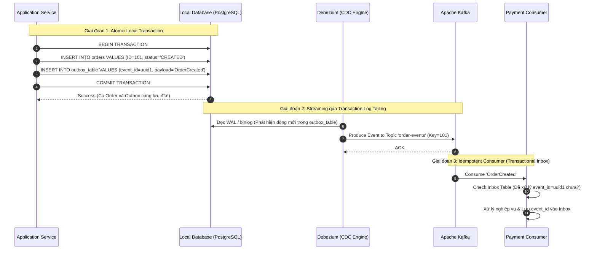

# 10.3. Advanced Transaction Patterns: Outbox, Inbox, CDC & TCC

> [!IMPORTANT]
> **Nếu bạn chỉ được nhớ một điều duy nhất**: Bài toán **Dual Write Problem** (vừa ghi vào Database vừa gửi Message lên Message Broker) không thể giải quyết bằng khối `try-catch` thông thường vì hai hệ thống này không cùng thuộc một phạm vi giao dịch (Transaction Scope). Giải pháp công nghiệp tiêu chuẩn là **Transactional Outbox Pattern**: lưu thông điệp vào bảng `outbox` ngay trong transaction của cơ sở dữ liệu, sau đó sử dụng công nghệ **Change Data Capture (CDC)** (như Debezium) đọc trực tiếp từ Transaction Log (MySQL binlog / Postgres WAL) để streaming lên Kafka với cam kết **At-least-once delivery**, kết hợp với **Transactional Inbox Pattern** tại phía Consumer để đạt được ngữ nghĩa xử lý chính xác một lần (**Effectively-Once**).

---

## 1. Kiến trúc Tổng quan & Mô hình Tư duy (Mental Model)

### Ẩn dụ Đời sống: Hòm Thư Đi Bưu Điện và Thư Ký Lưu Trữ
Hãy hình dung giám đốc một công ty cần ký hợp đồng kinh doanh ($DB$) và gửi thông báo cho đối tác ($Broker$):
- **Sai lầm Dual Write**: Giám đốc ký hợp đồng xong, cầm thư đi ra ngoài để gửi bưu điện. Trên đường đi, ông bị cướp giật hoặc đột quỵ (Server sập nguồn). Hợp đồng đã ký nằm trong két sắt, nhưng đối tác không bao giờ nhận được thư! Ngược lại, nếu ông gửi thư trước rồi mới quay về ký hợp đồng, bưu điện có thể chuyển thư đi trong khi bút của ông bị hết mực (DB ném Exception). Đối tác nhận được thông báo mà hợp đồng không hề tồn tại.
- **Giải pháp Transactional Outbox**: Giám đốc ký hợp đồng và đồng thời nhét một bản sao thông báo vào **Hòm thư đi (Outbox Tray)** đặt ngay trên bàn làm việc của mình trong cùng một khoảnh khắc (Local ACID Transaction). Sau đó, một nhân viên bưu tá chuyên trách (CDC Worker) định kỳ đi qua, nhặt tất cả thư trong hòm Outbox và chuyển đi. Dù giám đốc có bị ốm hay đi vắng, bưu tá vẫn lấy được thư và gửi đi chính xác.
- **Giải pháp Transactional Inbox**: Khi đối tác nhận thư, người thư ký của họ mở sổ lưu trữ ra kiểm tra: *"Mã số bưu phẩm này đã được đóng dấu nhận chưa?"*. Nếu đã nhận rồi (do bưu tá phát trùng), thư ký lập tức xé bỏ bản sao trùng lặp, đảm bảo công ty không xử lý đơn hàng hai lần.



---

## 2. Chi tiết từng Keyword (Under-the-Hood Deep Dive)

### 2.1. Dual Write Problem (Vấn đề ghi kép)

#### Tại sao ghi vào DB rồi Publish Message luôn luôn thất bại trong thực tế?
Hãy xem xét đoạn mã phổ biến nhưng tiềm ẩn thảm họa sau:

```java
@Transactional
public void createOrder(Order order) {
    orderRepository.save(order);       // Bước 1: Ghi vào DB
    kafkaTemplate.send("orders", order); // Bước 2: Gửi Message
}
```

1. **Kịch bản Lỗi 1 (DB Commit thành công, Message thất bại)**:
   - Dòng `orderRepository.save(order)` ghi thành công.
   - Nhưng khi gọi `kafkaTemplate.send()`, mạng bị rớt gói tin hoặc Kafka cluster bị timeout $\implies$ ném Exception.
   - Nếu Spring `@Transactional` rollback: DB bị rollback nhưng nếu Kafka đã kịp nhận tin nhắn (ACK bị trễ) thì message đã bay ra ngoài trong khi DB không có đơn hàng!
   - Nếu không rollback: Đơn hàng đã lưu trong DB nhưng không có bất kỳ event nào được bắn ra để kích hoạt thanh toán hoặc giao hàng $\implies$ Đơn hàng bị "chết chìm" vĩnh viễn.

2. **Kịch bản Lỗi 2 (Server sập nguồn giữa 2 bước)**:
   - DB commit thành công, nhưng ngay trước khi CPU kịp gọi lệnh gửi message, container bị OOMKilled hoặc máy chủ bị mất điện đột ngột $\implies$ Message vĩnh viễn biến mất!

### 2.2. Transactional Outbox Pattern (Mẫu thiết kế Hộp thư đi)

#### Khái niệm bản chất & Giải pháp kiến trúc
Transactional Outbox Pattern giải quyết Dual Write bằng cách biến thao tác gửi message thành một thao tác ghi dữ liệu nội bộ trong cơ sở dữ liệu quan hệ:
1. Tạo một bảng chuyên dụng tên là `outbox_table` ngay trong cùng schema của cơ sở dữ liệu:
   $$\text{outbox\_table} = \langle \text{id, aggregate\_type, aggregate\_id, event\_type, payload, created\_at} \rangle$$
2. Khi thực thi nghiệp vụ, bảng nghiệp vụ (`orders`) và bảng `outbox_table` được ghi trong **cùng một Local ACID Transaction**:
   ```sql
   BEGIN;
   INSERT INTO orders (id, customer_id, total) VALUES (1001, 42, 250.00);
   INSERT INTO outbox_table (id, event_type, payload) VALUES ('uuid-1', 'OrderCreated', '{"id":1001,"total":250.00}');
   COMMIT;
   ```
3. Đảm bảo tính nguyên tử tuyệt đối: hoặc cả đơn hàng và thông điệp đều được ghi vào đĩa, hoặc cả hai cùng bị hủy bỏ.

### 2.3. Change Data Capture (CDC) & Debezium

#### 1. Polling Publisher vs Transaction Log Tailing (CDC)
Làm thế nào để đưa message từ bảng `outbox_table` lên Kafka? Có 2 cách tiếp cận:

| Phương pháp | Polling Publisher | Transaction Log Tailing (CDC / Debezium) |
| :--- | :--- | :--- |
| **Cơ chế hoạt động** | Định kỳ chạy truy vấn `SELECT * FROM outbox WHERE processed = false LIMIT 100` rồi cập nhật `processed = true`. | Kết nối trực tiếp vào giao thức sao chép nhị phân (MySQL binlog, PostgreSQL Logical Replication / WAL). |
| **Tác động lên Database** | Gây nghẽn CPU và I/O đĩa do liên tục quét bảng, khóa bảng (Table Locking). | **Gần như bằng 0** (Zero impact), đọc streaming trực tiếp từ file log tuần tự. |
| **Độ trễ (Latency)** | Cao (phụ thuộc vào chu kỳ polling: vài trăm ms đến hàng giây). | Cực thấp (Near Real-Time: $< 10-50\text{ms}$). |
| **Bỏ sót sự kiện** | Dễ bỏ sót nếu transaction bị xen kẽ (gap in autoincrement ID). | **Không bao giờ bỏ sót**, đảm bảo thứ tự tuyệt đối theo Log Sequence Number (LSN). |

#### 2. Listen-to-Yourself Pattern
Một biến thể hiện đại của Outbox Pattern khi sử dụng Kafka làm Single Source of Truth:
- Service ghi Event vào Kafka trước.
- Sau đó, chính service đó tiêu thụ (consume) event của mình từ Kafka rồi mới ghi đè vào database cục bộ.
- Phương pháp này đòi hỏi sự thay đổi tư duy mạnh mẽ sang kiến trúc Event-Sourcing.

### 2.4. Transactional Inbox Pattern (Mẫu thiết kế Hộp thư đến)

#### Vấn đề tại phía Consumer & Cơ chế Hoạt động
Vì CDC và Kafka hoạt động theo ngữ nghĩa **At-Least-Once Delivery** (ít nhất một lần), một message có thể bị gửi trùng nhiều lần do network reconnect hoặc rebalance.
- **Nguy cơ**: Nếu Consumer nhận được 2 lần message `OrderPaid` và mỗi lần đều gửi quà tặng cho khách, doanh nghiệp sẽ bị thất thoát tài chính.
- **Giải pháp Transactional Inbox**:
  1. Consumer tạo một bảng `inbox_table(event_id PRIMARY KEY, processed_at TIMESTAMP)`.
  2. Khi nhận một message, Consumer thực thi logic nghiệp vụ và ghi `event_id` vào `inbox_table` trong **cùng một local transaction**.
  3. Nếu message bị gửi lại lần 2, câu lệnh `INSERT INTO inbox_table` sẽ văng lỗi **Unique Constraint Violation** $\implies$ Consumer lập tức bỏ qua message một cách an toàn mà không thực thi lại logic nghiệp vụ!

### 2.5. Try-Confirm-Cancel (TCC) & Reservation Pattern

#### Cơ chế 3 Pha của TCC
TCC là giải pháp giao dịch phân tán ở tầng ứng dụng (Application Level), đặc biệt phù hợp cho các hệ thống thanh toán cần kiểm soát tài nguyên chặt chẽ:
1. **Pha 1: Try (Thử nghiệm & Giữ chỗ mềm)**:
   - Kiểm tra các điều kiện nghiệp vụ (số dư tài khoản, hàng tồn kho).
   - Đóng băng tài nguyên (Khóa mềm): ví dụ, không trừ tiền trực tiếp mà chuyển $100 từ `balance` sang `frozen_balance`.
2. **Pha 2: Confirm (Xác nhận & Khấu trừ thật)**:
   - Được gọi khi tất cả các bên tham gia đều thực hiện pha `Try` thành công.
   - Chính thức khấu trừ tài nguyên từ trạng thái đóng băng: trừ $100 khỏi `frozen_balance`.
3. **Pha 3: Cancel (Hủy bỏ & Giải phóng tài nguyên)**:
   - Được gọi khi có ít nhất một bên thất bại ở pha `Try`.
   - Giải phóng tài nguyên đóng băng quay trở lại ban đầu: hoàn trả $100 từ `frozen_balance` về `balance`.

#### So sánh TCC vs Saga Pattern
| Tiêu chí | Try-Confirm-Cancel (TCC) | Saga Pattern |
| :--- | :--- | :--- |
| **Tính Cô lập (Isolation)** | Tốt hơn (Nhờ cơ chế Frozen/Reservation) | Kém hơn (Dữ liệu thay đổi trực tiếp) |
| **Độ phức tạp code** | Rất cao (Mỗi service phải viết 3 API: Try, Confirm, Cancel) | Trung bình (Chỉ cần viết API Forward và Compensate) |
| **Thời gian khóa tài nguyên** | Ngắn (Chỉ khóa trong pha Try) | Không khóa vật lý |
| **Trường hợp áp dụng** | Thanh toán ví điện tử, vé máy bay | Đặt hàng E-commerce, quy trình đa bước |

---

## 3. Thực thi Mã nguồn & Mô phỏng Chuyên sâu (Dual-Engine Implementation)

### Engine 1: C++20 — Mô phỏng Transactional Outbox + CDC Relay Engine với WAL Tailing Giả lập

```cpp
#include <iostream>
#include <vector>
#include <string>
#include <memory>
#include <chrono>
#include <thread>
#include <mutex>
#include <format>
#include <cstdint>

struct OutboxRecord {
    uint64_t id;
    std::string aggregate_id;
    std::string event_type;
    std::string payload;
    bool dispatched{false};
};

// Database Engine mô phỏng hỗ trợ Local ACID Transaction
class MockDatabaseWithOutbox {
private:
    std::mutex mtx_;
    std::vector<std::string> business_orders_;
    std::vector<OutboxRecord> outbox_table_;
    uint64_t next_outbox_id_{1};

public:
    // Thực thi nghiệp vụ và ghi Outbox trong cùng 1 Transaction
    bool execute_order_transaction(const std::string& order_id, double amount) {
        std::lock_guard<std::mutex> lock(mtx_);

        std::cout << std::format("[Database] Bắt đầu Local Transaction cho Đơn: {}\n", order_id);
        
        // 1. Ghi bảng nghiệp vụ Orders
        business_orders_.push_back(std::format("ORDER: id={}, amount={}", order_id, amount));
        std::cout << std::format("  -> Ghi bảng Orders thành công (ID: {})\n", order_id);

        // 2. Ghi bảng Outbox trong cùng transaction
        uint64_t outbox_id = next_outbox_id_++;
        outbox_table_.push_back(OutboxRecord{
            .id = outbox_id,
            .aggregate_id = order_id,
            .event_type = "OrderCreatedEvent",
            .payload = std::format("{{\"orderId\":\"{}\",\"amount\":{}}}", order_id, amount),
            .dispatched = false
        });
        std::cout << std::format("  -> Ghi outbox_table thành công (Outbox ID: {}, Event: OrderCreatedEvent)\n", outbox_id);

        std::cout << "[Database] COMMIT LOCAL TRANSACTION THÀNH CÔNG!\n";
        return true;
    }

    // Giả lập cơ chế CDC (Debezium) đọc Transaction Log / Outbox
    std::vector<OutboxRecord> fetch_undispatched_records() {
        std::lock_guard<std::mutex> lock(mtx_);
        std::vector<OutboxRecord> records;
        for (auto& r : outbox_table_) {
            if (!r.dispatched) {
                records.push_back(r);
                r.dispatched = true; // Đánh dấu đã streaming
            }
        }
        return records;
    }
};

// Message Broker (Kafka)
class MockKafkaBroker {
public:
    void produce(const std::string& topic, const std::string& key, const std::string& message) {
        std::cout << std::format("    >>> [Kafka Broker] Nhận Message trên Topic '{}' | Key='{}' | Message: {}\n",
            topic, key, message);
    }
};

// CDC Engine Worker
class CDCRelayEngine {
private:
    MockDatabaseWithOutbox& db_;
    MockKafkaBroker& kafka_;

public:
    CDCRelayEngine(MockDatabaseWithOutbox& db, MockKafkaBroker& kafka)
        : db_(db), kafka_(kafka) {}

    void poll_and_stream() {
        auto records = db_.fetch_undispatched_records();
        for (const auto& rec : records) {
            std::cout << std::format("[CDC Engine] Bắt sự kiện LSN: Outbox ID {} -> Streaming lên Kafka...\n", rec.id);
            kafka_.produce("order-events", rec.aggregate_id, rec.payload);
        }
    }
};

int main() {
    MockDatabaseWithOutbox db;
    MockKafkaBroker kafka;
    CDCRelayEngine cdc(db, kafka);

    std::cout << "--- Bước 1: Khách hàng đặt đơn hàng ORD_101 và ORD_102 ---\n";
    db.execute_order_transaction("ORD_101", 150.50);
    db.execute_order_transaction("ORD_102", 299.00);

    std::cout << "\n--- Bước 2: CDC Engine quét Transaction Log và phát lên Kafka bất đồng bộ ---\n";
    cdc.poll_and_stream();

    std::cout << "\n--- Bước 3: Đảm bảo không có message nào bị gửi lặp lại ---\n";
    cdc.poll_and_stream();

    return 0;
}
```

#### Terminal Output Mẫu:
```text
--- Bước 1: Khách hàng đặt đơn hàng ORD_101 và ORD_102 ---
[Database] Bắt đầu Local Transaction cho Đơn: ORD_101
  -> Ghi bảng Orders thành công (ID: ORD_101)
  -> Ghi outbox_table thành công (Outbox ID: 1, Event: OrderCreatedEvent)
[Database] COMMIT LOCAL TRANSACTION THÀNH CÔNG!
[Database] Bắt đầu Local Transaction cho Đơn: ORD_102
  -> Ghi bảng Orders thành công (ID: ORD_102)
  -> Ghi outbox_table thành công (Outbox ID: 2, Event: OrderCreatedEvent)
[Database] COMMIT LOCAL TRANSACTION THÀNH CÔNG!

--- Bước 2: CDC Engine quét Transaction Log và phát lên Kafka bất đồng bộ ---
[CDC Engine] Bắt sự kiện LSN: Outbox ID 1 -> Streaming lên Kafka...
    >>> [Kafka Broker] Nhận Message trên Topic 'order-events' | Key='ORD_101' | Message: {"orderId":"ORD_101","amount":150.5}
[CDC Engine] Bắt sự kiện LSN: Outbox ID 2 -> Streaming lên Kafka...
    >>> [Kafka Broker] Nhận Message trên Topic 'order-events' | Key='ORD_102' | Message: {"orderId":"ORD_102","amount":299}

--- Bước 3: Đảm bảo không có message nào bị gửi lặp lại ---
```

---

### Engine 2: Python 3.11+ — Mô phỏng Try-Confirm-Cancel (TCC) Pattern với Tài khoản Đóng Băng (Frozen Funds)

```python
import asyncio
from typing import Dict

class AccountTCCService:
    def __init__(self, name: str, initial_balance: float):
        self.name = name
        self.balance = initial_balance
        self.frozen_balance = 0.0
        self.reservations: Dict[str, float] = {}

    def try_reserve(self, tx_id: str, amount: float) -> bool:
        """Pha 1: Try - Đóng băng tài nguyên (Khóa mềm)."""
        print(f"[{self.name}] Nhận Try(tx={tx_id}, amount=${amount})")
        if self.balance >= amount:
            self.balance -= amount
            self.frozen_balance += amount
            self.reservations[tx_id] = amount
            print(f"  -> [OK] Đóng băng thành công: Số dư khả dụng=${self.balance}, Đóng băng=${self.frozen_balance}")
            return True
        else:
            print(f"  -> [FAIL] Không đủ số dư! (Khả dụng: ${self.balance} < Yêu cầu: ${amount})")
            return False

    def confirm(self, tx_id: str):
        """Pha 2: Confirm - Khấu trừ vĩnh viễn tài nguyên đã đóng băng."""
        if tx_id in self.reservations:
            amount = self.reservations.pop(tx_id)
            self.frozen_balance -= amount
            print(f"[{self.name}] Nhận Confirm(tx={tx_id}): Đã khấu trừ vĩnh viễn ${amount}. (Đóng băng còn: ${self.frozen_balance})")

    def cancel(self, tx_id: str):
        """Pha 3: Cancel - Giải phóng tài nguyên đóng băng quay lại số dư khả dụng."""
        if tx_id in self.reservations:
            amount = self.reservations.pop(tx_id)
            self.frozen_balance -= amount
            self.balance += amount
            print(f"[{self.name}] Nhận Cancel(tx={tx_id}): Hoàn trả ${amount} về khả dụng! (Số dư: ${self.balance})")

class TCCCoordinator:
    def __init__(self, buyer: AccountTCCService, seller: AccountTCCService):
        self.buyer = buyer
        self.seller = seller

    def execute_payment(self, tx_id: str, amount: float):
        print(f"\n================ KHỞI ĐỘNG TCC GIAO DỊCH {tx_id} (Số tiền: ${amount}) ================")
        print(">>> GIAI ĐOẠN 1: Pha TRY (Đóng băng tài nguyên)")
        try_buyer = self.buyer.try_reserve(tx_id, amount)

        if try_buyer:
            print("\n>>> GIAI ĐOẠN 2: Pha CONFIRM (Cam kết giao dịch)")
            self.buyer.confirm(tx_id)
            self.seller.balance += amount
            print(f"[{self.seller.name}] Nhận thanh toán ${amount} thành công! (Số dư mới: ${self.seller.balance})")
            print("[V] GIAO DỊCH TCC THÀNH CÔNG HOÀN TOÀN!")
        else:
            print("\n>>> GIAI ĐOẠN 3: Pha CANCEL (Hủy bỏ & Giải phóng tài nguyên)")
            self.buyer.cancel(tx_id)
            print("[X] GIAO DỊCH TCC ĐÃ ĐƯỢC HỦY BỎ AN TOÀN!")

def main():
    buyer = AccountTCCService("Ví_Người_Mua", initial_balance=500.0)
    seller = AccountTCCService("Ví_Người_Bán", initial_balance=100.0)
    coordinator = TCCCoordinator(buyer, seller)

    # Giao dịch 1: Đủ tiền -> Thành công
    coordinator.execute_payment("TX_SUCCESS_01", amount=200.0)

    # Giao dịch 2: Vượt quá số dư (400 > 300 còn lại) -> Bị hủy an toàn
    coordinator.execute_payment("TX_FAIL_02", amount=400.0)

if __name__ == "__main__":
    main()
```

#### Terminal Output Mẫu:
```text
================ KHỞI ĐỘNG TCC GIAO DỊCH TX_SUCCESS_01 (Số tiền: $200.0) ================
>>> GIAI ĐOẠN 1: Pha TRY (Đóng băng tài nguyên)
[Ví_Người_Mua] Nhận Try(tx=TX_SUCCESS_01, amount=$200.0)
  -> [OK] Đóng băng thành công: Số dư khả dụng=$300.0, Đóng băng=$200.0

>>> GIAI ĐOẠN 2: Pha CONFIRM (Cam kết giao dịch)
[Ví_Người_Mua] Nhận Confirm(tx=TX_SUCCESS_01): Đã khấu trừ vĩnh viễn $200.0. (Đóng băng còn: $0.0)
[Ví_Người_Bán] Nhận thanh toán $200.0 thành công! (Số dư mới: $300.0)
[V] GIAO DỊCH TCC THÀNH CÔNG HOÀN TOÀN!

================ KHỞI ĐỘNG TCC GIAO DỊCH TX_FAIL_02 (Số tiền: $400.0) ================
>>> GIAI ĐOẠN 1: Pha TRY (Đóng băng tài nguyên)
[Ví_Người_Mua] Nhận Try(tx=TX_FAIL_02, amount=$400.0)
  -> [FAIL] Không đủ số dư! (Khả dụng: $300.0 < Yêu cầu: $400.0)

>>> GIAI ĐOẠN 3: Pha CANCEL (Hủy bỏ & Giải phóng tài nguyên)
[X] GIAO DỊCH TCC ĐÃ ĐƯỢC HỦY BỎ AN TOÀN!
```

---

## 4. Systems Engineering & Production Pitfalls

### 4.1. Những cạm bẫy sống còn khi triển khai Outbox & CDC
1. **Bảng Outbox phình to làm tràn đĩa (Disk Exhaustion)**:
   - Nếu mỗi giây ghi 5.000 events vào bảng `outbox_table` mà không có cơ chế dọn dẹp, dung lượng bảng sẽ phình to hàng chục GB mỗi ngày, làm chậm toàn bộ database.
   - *Khắc phục*: Sử dụng partitioned table (phân vùng theo ngày) và xóa phân vùng cũ (`DROP TABLE outbox_y2026m11d14`), hoặc cấu hình Debezium tự động gửi tín hiệu xóa sau khi đã stream thành công.

2. **Debezium Slot Replication làm tắc nghẽn WAL PostgreSQL**:
   - Nếu Kafka bị sập trong 4 tiếng, Debezium không thể xác nhận vị trí LSN đã đọc. PostgreSQL Logical Replication Slot sẽ **ngăn cản database dọn dẹp WAL files**, khiến ổ đĩa của PostgreSQL bị đầy 100% và crash sập hoàn toàn hệ thống!
   - *Khắc phục*: Luôn thiết lập ngưỡng an toàn `max_slot_wal_keep_size` trong file cấu hình `postgresql.conf` và đặt cảnh báo Prometheus khi dung lượng replication slot vượt quá 20GB.

3. **Thứ tự của các sự kiện trong Kafka Topic (Partition Key Mismatch)**:
   - Nếu event `OrderCreated` và `OrderCancelled` của cùng một đơn hàng bị bắn vào 2 partition khác nhau của Kafka, Consumer có thể đọc được `OrderCancelled` trước khi đọc `OrderCreated`.
   - *Quy tắc bắt buộc*: Bắt buộc đặt Partition Key của Kafka là **Aggregate ID** (ví dụ: `order_id`) để tất cả event của cùng một thực thể được đẩy vào cùng một partition duy nhất, bảo đảm thứ tự tuần tự nghiêm ngặt.

### 4.2. Runbook Chẩn đoán Sự cố Debezium & Kafka Connect (CLI Commands)

```bash
# 1. Kiểm tra trạng thái sức khỏe của Debezium PostgreSQL Connector
curl -s http://localhost:8083/connectors/postgres-outbox-connector/status | jq .

# 2. Khởi động lại task Debezium bị lỗi failover
curl -X POST http://localhost:8083/connectors/postgres-outbox-connector/tasks/0/restart

# 3. Kiểm tra dung lượng WAL file đang bị giữ lại bởi Logical Replication Slot trong PostgreSQL
psql -U postgres -c "SELECT slot_name, plugin, active, pg_size_pretty(pg_wal_lsn_diff(pg_current_wal_lsn(), restart_lsn)) AS retained_wal FROM pg_replication_slots;"
```

---

## 5. Bảng So sánh & Decision Matrix

| Tiêu chí | Transactional Outbox (CDC) | Try-Confirm-Cancel (TCC) | Saga Pattern | Two-Phase Commit (2PC) |
| :--- | :--- | :--- | :--- | :--- |
| **Tầng giải quyết** | Infrastructure / Database | Application Logic | Architecture / Event | Protocol / Database Engine |
| **Độ trễ** | Rất thấp (Near real-time) | Thấp đến trung bình | Thấp | Rất cao |
| **Tính cô lập dữ liệu** | BASE | Tốt (Semantic reservation) | Kém (Eventual consistency) | Tuyệt đối (Serializable) |
| **Mức độ phụ thuộc** | Kafka, Debezium | Microservice APIs | Message Broker / Orchestrator | Chuẩn XA / Database locks |
| **Khuyến nghị áp dụng**| **Chuẩn vàng cho MỌI Event-Driven Microservices** | **Thanh toán tiền tệ, Đặt chỗ vé** | **Quy trình đơn hàng phức tạp** | Hệ thống Monolith nội bộ |
