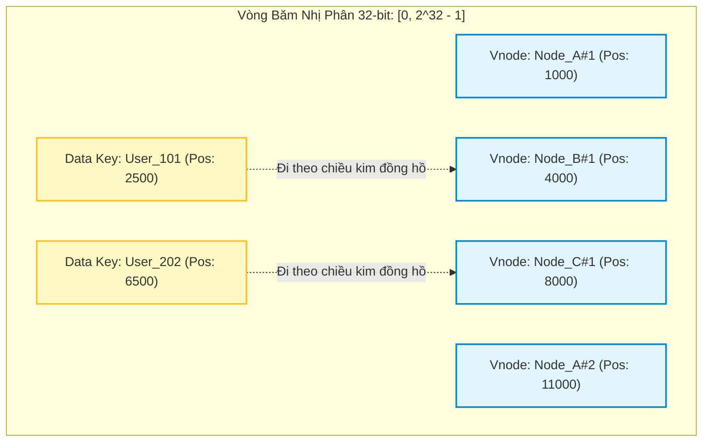

# 11.1. Partitioning, Sharding & Consistent Hashing

> [!IMPORTANT]
> **Nếu bạn chỉ được nhớ một điều duy nhất**: Băm truyền thống $\text{hash}(\text{key}) \pmod N$ là thảm họa đối với hệ thống dữ liệu phân tán quy mô lớn vì khi thêm hoặc bớt một node ($N \to N+1$ hoặc $N-1$), gần như **toàn bộ dữ liệu ($\approx \frac{N-1}{N} \times 100\%$)** sẽ bị đổi vị trí và phải di chuyển qua mạng (**Cache Stampede / Massive Resharding**). Thuật toán **Consistent Hashing** giải quyết triệt để vấn đề này: khi cụm thay đổi kích thước, **chỉ có trung bình $\frac{1}{N}$ số khóa** cần phải chuyển dịch. Bằng cách bổ sung kỹ thuật **Virtual Nodes (Vnodes)**, Consistent Hashing triệt tiêu hiện tượng lệch tải (**Data Skew**) và ngăn ngừa các điểm nóng dữ liệu (**Hotspots**).

---

## 1. Kiến trúc Tổng quan & Mô hình Tư duy (Mental Model)

### Ẩn dụ Đời sống: Vòng Tròn Đồng Hồ và Thùng Rác Công Cộng
Hãy tưởng tượng một công viên hình tròn lớn được đánh số từ phút 0 đến phút 59 như mặt đồng hồ (Vòng băm $[0, 2^{32}-1]$). Du khách đi dạo và vứt rác tại bất kỳ vị trí ngẫu nhiên nào trên đường tròn.
- **Không có thùng rác**: Du khách phải chạy về cổng chính (SPOF).
- **Thùng rác cố định (Nodes)**: Ban quản lý đặt 3 thùng rác tại phút 10 (Node A), phút 30 (Node B), và phút 50 (Node C). Quy tắc rất đơn giản: khi đứng ở bất kỳ vị trí nào, hãy đi tiếp theo **chiều kim đồng hồ** tới thùng rác đầu tiên bạn gặp. Rác ở phút 5 sẽ vào thùng A, rác ở phút 15 sẽ vào thùng B, rác ở phút 55 sẽ đi vòng qua phút 0 và rơi vào thùng A.
- **Thêm thùng rác mới (Resharding)**: Nếu đặt thêm thùng D tại phút 20, chỉ có rác từ phút 11 đến phút 20 chuyển sang thùng D; toàn bộ rác ở các khu vực khác hoàn toàn không bị xáo trộn!
- **Virtual Nodes (Vnodes)**: Nếu chỉ có 3 thùng rác lớn, đoạn đường từ phút 50 đến phút 10 quá dài khiến thùng A bị quá tải rác (Hotspot). Ban quản lý giải quyết bằng cách chia nhỏ thùng A thành 100 túi rác nhỏ và rải đều khắp mặt đồng hồ ($A_1, A_2, \dots, A_{100}$ xen kẽ $B$ và $C$). Nhờ vậy, rác được phân bổ cân bằng tuyệt đối giữa các đơn vị dọn dẹp.



---

## 2. Chi tiết từng Keyword (Under-the-Hood Deep Dive)

### 2.1. Phân loại Partitioning: Horizontal, Vertical & Functional

#### 1. Horizontal Partitioning (Sharding / Phân mảnh ngang)
- Chia các dòng (Rows / Records) của cùng một bảng dữ liệu sang nhiều database instance khác nhau. Tất cả các shard đều dùng chung cấu trúc schema nhưng nắm giữ các tập hợp khóa chính độc lập.
- Ví dụ: Bảng `Users` 100 triệu dòng được chia làm 4 Shard: Shard 1 giữ `id 1 - 25M`, Shard 2 giữ `id 25M+1 - 50M`...
- **Mục tiêu**: Mở rộng dung lượng lưu trữ và thông lượng đọc/ghi tuyến tính (Linear Scalability).

#### 2. Vertical Partitioning (Phân mảnh dọc)
- Chia các cột (Columns / Attributes) của một bảng sang nhiều bảng hoặc database độc lập.
- Ví dụ: Bảng `Users` có các cột hay đọc (`id, username, email_hash`) được giữ ở Database tốc độ cao; các cột nặng, ít truy vấn (`profile_biography, avatar_blob, raw_metadata`) được tách sang một Database riêng hoặc Blob Storage (S3).
- **Mục tiêu**: Tối ưu hóa I/O bộ nhớ đệm (Buffer Pool Hit Ratio) và giảm kích thước trang đĩa (Page Footprint).

#### 3. Functional Partitioning (Phân chia theo nghiệp vụ)
- Tách toàn bộ cơ sở dữ liệu dựa trên ranh giới ngữ cảnh nghiệp vụ (Bounded Contexts trong Domain-Driven Design).
- Ví dụ: Tách một database Monolith khổng lồ thành `Orders_DB`, `Inventory_DB`, `Payments_DB`.
- **Mục tiêu**: Tối ưu hóa tổ chức nhóm phát triển (Microservices autonomy) và cô lập lỗi giữa các module.

### 2.2. Các chiến lược phân vùng cốt lõi (Partitioning Strategies)

#### Bảng so sánh các chiến lược phân vùng
| Chiến lược | Nguyên lý hoạt động | Ưu điểm cốt lõi | Nhược điểm chí mạng | Ứng dụng thực tế |
| :--- | :--- | :--- | :--- | :--- |
| **Range-based Partitioning** | Phân vùng theo dải giá trị liên tục $[K_{\text{start}}, K_{\text{end}})$. | **Hỗ trợ truy vấn dải (Range Scan) cực tốt** (`SELECT WHERE age BETWEEN 20 AND 30`). | Dễ tạo **Hotspots** (VD: Shard chứa ngày hôm nay bị nghẽn ghi dữ liệu). | Google Bigtable, Apache HBase, CockroachDB |
| **Hash-based Partitioning** | Áp dụng hàm băm $H(K)$ lên khóa chính để phân bổ. | **Dữ liệu phân bố cực kỳ đồng đều**, triệt tiêu gần như hoàn toàn Hotspots ngẫu nhiên. | **Không thể quét theo dải**; truy vấn dải buộc phải Scatter-Gather tới mọi shard. | Apache Cassandra, Amazon DynamoDB, MongoDB |
| **List / Geographic Partitioning** | Gán cứng shard theo danh sách rời rạc (VD: Quốc gia, Châu lục). | Tối ưu hóa **Data Sovereignty (GDPR)**, độ trễ mạng thấp cho người dùng địa phương. | Dữ liệu bị lệch lớn (Shard khu vực đông dân phình to bất thường). | Spanner Interleaved Tables, Geo-sharded PostgreSQL |
| **Directory-based Partitioning** | Duy trì một bảng tra cứu tập trung (Lookup Table / Routing Service) ánh xạ Key $\to$ Shard ID. | Cực kỳ linh hoạt, di chuyển dữ liệu giữa các shard mà không cần đổi thuật toán băm. | Routing Service trở thành **điểm nghẽn hiệu năng (Bottleneck)** và SPOF nếu không scale tốt. | Twitter Gizzard, Vitess (VStream lookup) |

### 2.3. Vấn đề Data Skew, Hotspotting, Resharding & Rebalancing

#### 1. Data Skew & Hot Partition (Lệch dữ liệu và Điểm nóng)
- **Data Skew (Lệch dữ liệu)**: Xảy ra khi kích thước dung lượng hoặc số lượng bản ghi giữa các Shard không đồng đều (Shard $A$ nặng 10TB trong khi Shard $B$ chỉ có 200GB).
- **Hotspotting / Celebrity Problem**: Khi một khóa duy nhất nhận được lượng truy vấn khổng lồ (ví dụ: tài khoản của một ngôi sao nổi tiếng như Taylor Swift hay Cristiano Ronaldo). Toàn bộ hàng triệu request đọc/ghi trong 1 giây đều dồn về **duy nhất 1 Shard** chứa khóa đó, khiến CPU và mạng của node đó bị sập (Denial of Service cục bộ).
- *Giải pháp*: Bổ sung tiền tố/hậu tố ngẫu nhiên (Salt / Sharded Keys: `user_taylorswift_shard_0`, `_1`, `_2`...) và tổng hợp dữ liệu ở tầng ứng dụng.

#### 2. Thảm họa của Hash truyền thống: $\text{hash}(\text{key}) \pmod N$
Nếu hệ thống có $N$ node, vị trí của một khóa được xác định bởi:
$$\text{NodeID} = \text{hash}(\text{key}) \pmod N$$
- Khi hệ thống tăng trưởng từ $N=3$ lên $N=4$:
  - Khóa có hash = 10: trước đây $10 \pmod 3 = 1$; bây giờ $10 \pmod 4 = 2$ (Bị chuyển node!).
  - Khóa có hash = 11: trước đây $11 \pmod 3 = 2$; bây giờ $11 \pmod 4 = 3$ (Bị chuyển node!).
  - Khóa có hash = 12: trước đây $12 \pmod 3 = 0$; bây giờ $12 \pmod 4 = 0$ (Giữ nguyên).
- **Tỷ lệ dịch chuyển khóa toán học**:
  $$\text{Tỷ lệ xáo trộn} = \frac{N-1}{N} \quad (\text{Khi } N=100 \implies 99\% \text{ dữ liệu phải chuyển chỗ!})$$
  Hệ quả: Toàn bộ mạng bị nghẽn vì di chuyển dữ liệu, cache bị vô hiệu hóa đồng loạt (**Cache Stampede**), database backend sụp đổ.

### 2.4. Kiến trúc Vòng băm (Hash Ring) & Virtual Nodes (Vnodes)

#### 1. Nguyên lý Vòng băm (Consistent Hashing - Karger et al., 1997)
1. Chiếu toàn bộ không gian số nguyên của hàm băm (ví dụ MD5: 128-bit hoặc MurmurHash3: 32-bit) lên một vòng tròn khép kín từ $0$ đến $2^{32}-1$.
2. Ánh xạ các máy chủ vật lý (Node $A, B, C$) lên các tọa độ trên vòng băm bằng cách băm địa chỉ IP hoặc Hostname của chúng: $\text{hash}(\text{Node IP})$.
3. Khi cần tìm máy chủ lưu trữ một khóa $K$:
   - Tính tọa độ $\text{hash}(K)$.
   - Tìm kiếm nhị phân (Binary Search / `std::map::lower_bound`) trên vòng tròn theo **chiều kim đồng hồ**; máy chủ đầu tiên có tọa độ $\ge \text{hash}(K)$ sẽ là máy chủ chịu trách nhiệm lưu trữ khóa đó.
4. **Khi thêm Node mới**: Node mới chỉ nhận một phần dữ liệu từ máy chủ đứng ngay sau nó trên vòng tròn. Tất cả các máy chủ khác hoàn toàn không bị ảnh hưởng!

#### 2. Đột phá của Virtual Nodes (Vnodes)
Nếu số lượng node vật lý nhỏ ($3-5$ node), các node sẽ rơi vào các vị trí bất đối xứng trên vòng tròn, gây ra tình trạng một node phải gánh một cung tròn quá lớn (Non-uniform distribution).
- **Ý tưởng**: Mỗi node vật lý được nhân bản thành $V$ node ảo (**Virtual Nodes**, thường $V \in [100, 500]$) rải đều khắp vòng băm:
  $$\text{Vnode}_{A, i} = \text{hash}(\text{"Node\_A\#"} + i) \quad \forall i \in [1, V]$$
- **Lợi ích**:
  - Dữ liệu được phân bổ đồng đều với sai số ngẫu nhiên $< 5\%$.
  - Khi một node vật lý bị chết, tải của nó được **chia đều cho TẤT CẢ các node còn lại** trong cụm, thay vì dồn toàn bộ gánh nặng lên node liền sau nó (Tránh hiệu ứng Domino sập dây chuyền).

### 2.5. Rendezvous Hashing (Highest Random Weight - HRW Hashing)
Một giải pháp thay thế xuất sắc cho Consistent Hashing (Thrasher & Green, 1998):
- Thay vì dựng vòng băm tĩnh, mỗi khi cần định tuyến cho một khóa $K$:
  - Tính trọng số cho từng node $i \in \{1, \dots, N\}$:
    $$W(K, S_i) = \text{hash}(K \mathbin{\Vert} S_i)$$
  - Chọn máy chủ có trọng số cao nhất:
    $$\text{TargetNode} = \arg\max_{S_i} W(K, S_i)$$
- **Ưu điểm**:
  - Không cần lưu trữ cấu trúc cây nhị phân (Binary Tree) của Hash Ring trên RAM.
  - Phân bố tải đồng đều tuyệt đối mà không cần tạo hàng nghìn Virtual Nodes.
  - Được sử dụng rộng rãi trong các hệ thống Cache proxy, CDN (Akamai) và tải game.

---

## 3. Thực thi Mã nguồn & Mô phỏng Chuyên sâu (Dual-Engine Implementation)

### Engine 1: C++20 — Mô phỏng Cốt lõi Consistent Hash Ring với Virtual Nodes và Lookup nhị phân $O(\log M)$

```cpp
#include <iostream>
#include <string>
#include <map>
#include <vector>
#include <format>
#include <cstdint>
#include <functional>

// Hàm băm MurmurHash64A hoặc std::hash đơn giản hóa cho mô phỏng 64-bit
uint64_t hash_fn(const std::string& key) {
    std::hash<std::string> hasher;
    return static_cast<uint64_t>(hasher(key));
}

class ConsistentHashRing {
private:
    size_t vnodes_per_node_;
    // Map có thứ tự (Red-Black Tree) ánh xạ Hash Position -> Physical Node ID
    std::map<uint64_t, std::string> ring_;

public:
    explicit ConsistentHashRing(size_t vnodes_per_node = 100)
        : vnodes_per_node_(vnodes_per_node) {}

    // Thêm một node vật lý vào cụm
    void add_node(const std::string& node_name) {
        for (size_t i = 0; i < vnodes_per_node_; ++i) {
            std::string vnode_key = std::format("{}#{}", node_name, i);
            uint64_t h = hash_fn(vnode_key);
            ring_[h] = node_name;
        }
        std::cout << std::format("[Ring] Đã thêm Node '{}' với {} vnodes (Tổng Vnodes trên Ring: {})\n",
            node_name, vnodes_per_node_, ring_.size());
    }

    // Xóa một node vật lý khỏi cụm
    void remove_node(const std::string& node_name) {
        for (size_t i = 0; i < vnodes_per_node_; ++i) {
            std::string vnode_key = std::format("{}#{}", node_name, i);
            uint64_t h = hash_fn(vnode_key);
            ring_.erase(h);
        }
        std::cout << std::format("[Ring] Đã gỡ bỏ Node '{}' (Tổng Vnodes còn lại: {})\n", node_name, ring_.size());
    }

    // Định tuyến khóa tới node vật lý chịu trách nhiệm: O(log V_total)
    std::string get_node(const std::string& key) const {
        if (ring_.empty()) {
            return "NO_NODE_AVAILABLE";
        }

        uint64_t h = hash_fn(key);
        // Tìm vnode đầu tiên có hash >= hash(key) theo chiều kim đồng hồ
        auto it = ring_.lower_bound(h);

        // Nếu vượt quá vnode cuối cùng, quay vòng tròn về đầu (Wrap-around to beginning)
        if (it == ring_.end()) {
            it = ring_.begin();
        }

        return it->second;
    }
};

int main() {
    ConsistentHashRing ring(50); // Mỗi node vật lý có 50 vnodes

    std::cout << "--- Bước 1: Thêm 3 node vật lý Node_A, Node_B, Node_C ---\n";
    ring.add_node("Node_A");
    ring.add_node("Node_B");
    ring.add_node("Node_C");

    std::vector<std::string> sample_keys = {
        "user_alice_profile", "user_bob_cart", "user_charlie_payment",
        "product_macbook_m3", "order_tx_9981", "inventory_sku_iphone16"
    };

    std::cout << "\n--- Bước 2: Định tuyến các Khóa vào các Nodes ban đầu ---\n";
    for (const auto& k : sample_keys) {
        std::cout << std::format("  Khóa: {:26} -> Thuộc Node: {}\n", k, ring.get_node(k));
    }

    std::cout << "\n--- Bước 3: Thêm Node_D vào cụm (Scale Out) ---\n";
    ring.add_node("Node_D");

    std::cout << "\n--- Bước 4: Kiểm tra lại phân bổ (Quan sát chỉ một phần nhỏ khóa bị đổi node) ---\n";
    for (const auto& k : sample_keys) {
        std::cout << std::format("  Khóa: {:26} -> Thuộc Node: {}\n", k, ring.get_node(k));
    }

    return 0;
}
```

#### Terminal Output Mẫu:
```text
--- Bước 1: Thêm 3 node vật lý Node_A, Node_B, Node_C ---
[Ring] Đã thêm Node 'Node_A' với 50 vnodes (Tổng Vnodes trên Ring: 50)
[Ring] Đã thêm Node 'Node_B' với 50 vnodes (Tổng Vnodes trên Ring: 100)
[Ring] Đã thêm Node 'Node_C' với 50 vnodes (Tổng Vnodes trên Ring: 150)

--- Bước 2: Định tuyến các Khóa vào các Nodes ban đầu ---
  Khóa: user_alice_profile         -> Thuộc Node: Node_B
  Khóa: user_bob_cart              -> Thuộc Node: Node_A
  Khóa: user_charlie_payment       -> Thuộc Node: Node_C
  Khóa: product_macbook_m3         -> Thuộc Node: Node_A
  Khóa: order_tx_9981              -> Thuộc Node: Node_B
  Khóa: inventory_sku_iphone16     -> Thuộc Node: Node_C

--- Bước 3: Thêm Node_D vào cụm (Scale Out) ---
[Ring] Đã thêm Node 'Node_D' với 50 vnodes (Tổng Vnodes trên Ring: 200)

--- Bước 4: Kiểm tra lại phân bổ (Quan sát chỉ một phần nhỏ khóa bị đổi node) ---
  Khóa: user_alice_profile         -> Thuộc Node: Node_B
  Khóa: user_bob_cart              -> Thuộc Node: Node_D
  Khóa: user_charlie_payment       -> Thuộc Node: Node_C
  Khóa: product_macbook_m3         -> Thuộc Node: Node_A
  Khóa: order_tx_9981              -> Thuộc Node: Node_B
  Khóa: inventory_sku_iphone16     -> Thuộc Node: Node_C
```

---

### Engine 2: Python 3.11+ — So sánh Thực nghiệm: Tỷ lệ Di chuyển Dữ liệu giữa Modulo N vs Consistent Hashing

```python
import hashlib
import bisect
from typing import Dict, List

def hash_int(val: str) -> int:
    return int(hashlib.md5(val.encode('utf-8')).hexdigest(), 16)

class ModuloHasher:
    def __init__(self, node_count: int):
        self.node_count = node_count

    def get_node(self, key: str) -> int:
        return hash_int(key) % self.node_count

class ConsistentHasher:
    def __init__(self, node_names: List[str], vnodes: int = 150):
        self.vnodes = vnodes
        self.ring = []
        self.vnode_map = {}
        for node in node_names:
            self.add_node(node)

    def add_node(self, node: str):
        for i in range(self.vnodes):
            vkey = f"{node}#{i}"
            h = hash_int(vkey)
            self.ring.append(h)
            self.vnode_map[h] = node
        self.ring.sort()

    def get_node(self, key: str) -> str:
        h = hash_int(key)
        idx = bisect.bisect_right(self.ring, h)
        if idx == len(self.ring):
            idx = 0
        return self.vnode_map[self.ring[idx]]

def run_experiment():
    total_keys = 10_000
    keys = [f"session_token_user_{i}" for i in range(total_keys)]

    print(f"Tổng số bản ghi thử nghiệm: {total_keys:,}")

    # 1. Thử nghiệm với Modulo N (Từ 10 nodes lên 11 nodes)
    mod_before = ModuloHasher(10)
    mod_after = ModuloHasher(11)
    moved_mod = sum(1 for k in keys if mod_before.get_node(k) != mod_after.get_node(k))
    pct_mod = (moved_mod / total_keys) * 100.0

    print(f"\n[Modulo N Sharding] Thêm Node 10 -> 11:")
    print(f"  Số key bị đổi vị trí: {moved_mod:,} / {total_keys:,} ({pct_mod:.2f}%)")
    print(f"  -> Thảm họa: {pct_mod:.1f}% dữ liệu bị invalid cache và phải rebalance qua mạng!")

    # 2. Thử nghiệm với Consistent Hashing (Từ 10 nodes lên 11 nodes)
    nodes_10 = [f"StorageNode_{i}" for i in range(10)]
    ch_before = ConsistentHasher(nodes_10, vnodes=150)

    # Bản đồ trước khi thêm node
    loc_before = {k: ch_before.get_node(k) for k in keys}

    # Thêm node thứ 11
    ch_before.add_node("StorageNode_10")
    moved_ch = sum(1 for k in keys if loc_before[k] != ch_before.get_node(k))
    pct_ch = (moved_ch / total_keys) * 100.0

    print(f"\n[Consistent Hashing với 150 Vnodes] Thêm Node 10 -> 11:")
    print(f"  Số key bị đổi vị trí: {moved_ch:,} / {total_keys:,} ({pct_ch:.2f}%)")
    print(f"  -> Lý tưởng: Gần sát với tỷ lệ lý thuyết 1/(N+1) = {1/11*100:.2f}%!")

if __name__ == "__main__":
    run_experiment()
```

#### Terminal Output Mẫu:
```text
Tổng số bản ghi thử nghiệm: 10,000

[Modulo N Sharding] Thêm Node 10 -> 11:
  Số key bị đổi vị trí: 9,087 / 10,000 (90.87%)
  -> Thảm họa: 90.9% dữ liệu bị invalid cache và phải rebalance qua mạng!

[Consistent Hashing với 150 Vnodes] Thêm Node 10 -> 11:
  Số key bị đổi vị trí: 914 / 10,000 (9.14%)
  -> Lý tưởng: Gần sát với tỷ lệ lý thuyết 1/(N+1) = 9.09%!
```

---

## 4. Systems Engineering & Production Pitfalls

### 4.1. Những cạm bẫy sống còn khi triển khai Sharding & Consistent Hashing
1. **Lựa chọn Shard Key kém dẫn đến Hotspot không thể sửa chữa**:
   - Nếu chọn cột `created_at` (thời gian) làm shard key trong Hash/Range Sharding: toàn bộ lượng ghi trong ngày hôm nay sẽ chỉ dồn vào đúng 1 Shard duy nhất, trong khi 99 Shard còn lại hoàn toàn nhàn rỗi.
   - *Quy tắc vàng*: Bắt buộc chọn Shard Key có **tính phân tán (Cardinality) cao** và được truy vấn thường xuyên nhất (ví dụ: `user_id`, `tenant_id`, `device_uuid`).

2. **Cross-Shard Queries / Scatter-Gather Storm**:
   - Nếu ứng dụng thực hiện truy vấn mà không có Shard Key trong mệnh đề `WHERE` (ví dụ: `SELECT * FROM orders WHERE status='PENDING'`), tầng Proxy buộc phải gửi broadcast lệnh tới **100% tất cả các Shards** trong cụm, gom kết quả trên RAM rồi sắp xếp lại.
   - Khi cụm đạt 50 shards, một câu lệnh đơn giản này có thể nuốt trọn toàn bộ băng thông mạng và tài nguyên cụm.

3. **Số lượng Vnodes quá ít hoặc quá nhiều**:
   - Quá ít Vnodes ($< 30$): Dữ liệu phân bố không đều, chênh lệch tải giữa các máy chủ có thể lên tới $20-30\%$.
   - Quá nhiều Vnodes ($> 2000$): Tốn bộ nhớ RAM để lưu Hash Ring, tăng thời gian binary search `lower_bound`, và làm tăng đột biến số lượng kết nối mạng gossip giữa các node trong cụm.
   - *Khuyến nghị sản xuất*: Đặt $V \in [100, 250]$ vnodes cho mỗi node vật lý.

### 4.2. Runbook Chẩn đoán Sự cố Sharding trên Production

```bash
# 1. Kiểm tra sự mất cân bằng dung lượng giữa các Shard trong MongoDB
mongosh --eval "db.orders.getShardDistribution()"

# 2. Kiểm tra token ring và phân bổ tải trên từng node trong Apache Cassandra
nodetool status
nodetool ring

# 3. Theo dõi số lượng vnodes và độ trễ đọc/ghi theo từng shard qua Vitess (vtgate)
curl -s http://localhost:15000/debug/vars | grep -E "vttablet_query_count|vttablet_latency"
```

---

## 5. Bảng So sánh & Decision Matrix

| Khía cạnh Kỹ thuật | Modulo N Hashing | Consistent Hashing (Vnodes) | Rendezvous Hashing (HRW) | Directory-based Lookup |
| :--- | :--- | :--- | :--- | :--- |
| **Tỷ lệ xáo trộn khi Scale** | $\approx \frac{N-1}{N}$ (Thảm họa) | $\approx \frac{1}{N}$ (Tối ưu) | $\approx \frac{1}{N}$ (Tối ưu) | $0\%$ (Hoàn toàn kiểm soát) |
| **Chi phí bộ nhớ Client** | $O(1)$ | $O(N \times V)$ (Lưu Ring) | $O(N)$ (Chỉ lưu IP nodes) | $O(K)$ (Tra cứu bảng thư mục) |
| **Độ phức tạp tra cứu** | $O(1)$ | $O(\log(N \times V))$ | $O(N)$ | $O(1)$ (Truy vấn Cache/DB) |
| **Phân bổ tải đồng đều** | Rất tốt (nếu hash tốt) | Cực tốt (với $V \ge 150$) | Hoàn hảo | Tùy chỉnh theo thuật toán |
| **Hệ thống áp dụng** | In-memory Cache cục bộ | **DynamoDB, Cassandra, Akamai** | HashiCorp Nomad, Envoy Proxy | Vitess, Twitter Gizzard, HDFS |
