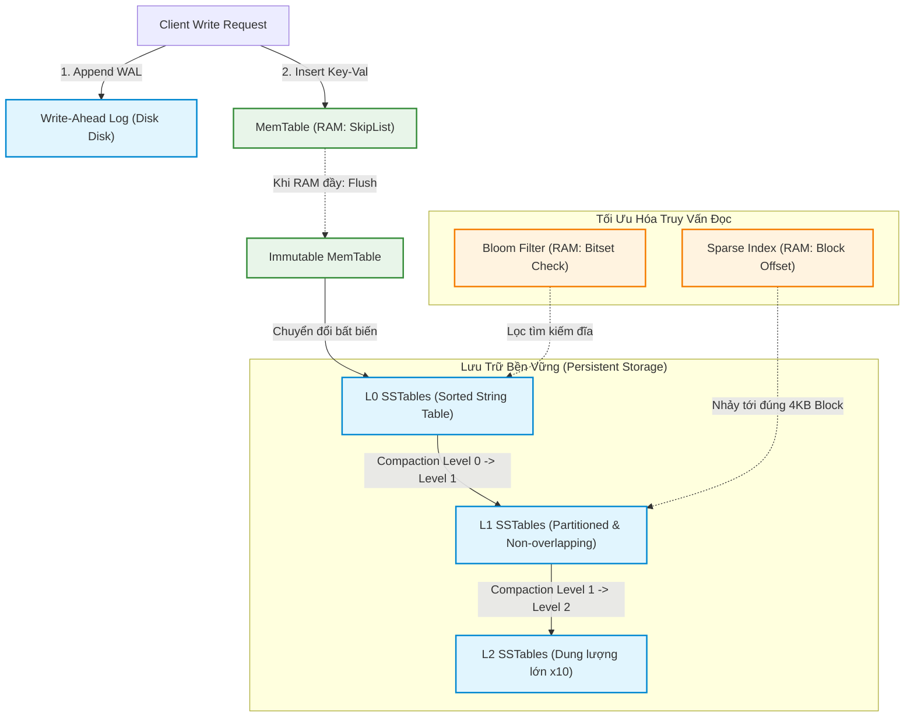

# 11.2. Distributed Query Execution & LSM-Tree Storage Engines

> [!IMPORTANT]
> **Nếu bạn chỉ được nhớ một điều duy nhất**: Hiệu năng của hệ thống lưu trữ phân tán bắt nguồn từ việc tận dụng đặc tính vật lý của phần cứng lưu trữ: **Ghi tuần tự (Sequential Write) luôn nhanh hơn gấp hàng chục đến hàng trăm lần so với Ghi ngẫu nhiên (Random Write)**. Động cơ **LSM-Tree (Log-Structured Merge-Tree)** (dùng trong RocksDB, Cassandra, Bigtable) chuyển toàn bộ thao tác ghi ngẫu nhiên thành ghi tuần tự vào bộ nhớ RAM (**MemTable**) và append-only log (**WAL**), sau đó xả xuống đĩa thành các file bất biến (**SSTables**). Để bù lại chi phí đọc đắt đỏ, LSM-Tree sử dụng **Bloom Filters** để loại trừ các tìm kiếm vô ích và thuật toán **Compaction** để cân đối điểm đánh đổi tam giác giữa **Write, Read, và Space Amplification (RUM Conjecture)**.

---

## 1. Kiến trúc Tổng quan & Mô hình Tư duy (Mental Model)

### Ẩn dụ Đời sống: Người Thư Ký Ghi Chú và Giá Sách Thư Viện
Hãy tưởng tượng một phòng tiếp tân công chứng bận rộn:
- **Kiến trúc B-Tree (In-place Update)**: Mỗi khi khách hàng đến sửa đổi một thông tin, nhân viên phải chạy đến đúng kệ sách, rút cuốn sổ lưu trữ năm 2018 ra, dùng bút tẩy xóa dòng cũ và chèn chữ mới vào giữa trang (Random Disk I/O). Khi trang bị đầy, nhân viên phải chia đôi trang giấy (Page Split). Thao tác này cực kỳ chậm và làm nghẽn quầy tiếp tân.
- **Kiến trúc LSM-Tree (Append-Only Log)**: Người tiếp tân có một cuốn sổ ghi chú cầm tay trên bàn (**MemTable trên RAM**). Khi khách đến, người đó chỉ việc viết nối tiếp vào cuối sổ một dòng mới: `[Thời gian, Khách hàng, Thông tin mới]`. Khi cuốn sổ đầy, anh ta đóng dấu niêm phong (bất biến - Immutable) và cất nó vào kho thành một tập tài liệu đã sắp xếp theo bảng chữ cái (**SSTable trên đĩa**).
- **Compaction**: Ban đêm khi vắng khách, nhân viên dọn dẹp (Compaction Worker) gom các tập tài liệu cũ lại, loại bỏ các dòng bị xóa hoặc đã lỗi thời, và gộp chúng thành một cuốn bách khoa toàn thư duy nhất.
- **Bloom Filter**: Để không phải lật tung từng cuốn sổ khi tìm thông tin khách hàng, nhân viên có một bảng kiểm tra nhanh (**Bloom Filter**). Nếu bảng báo *"Khách hàng này chắc chắn KHÔNG có trong tập sách số 3"*, nhân viên không bao giờ cần mở tập sách đó ra!



---

## 2. Chi tiết từng Keyword (Under-the-Hood Deep Dive)

### 2.1. Scatter-Gather Pattern & Distributed Aggregation

#### 1. Khái niệm & Cơ chế Under the Hood
Khi dữ liệu được phân mảnh (Sharding) trên $M$ máy chủ độc lập và câu lệnh truy vấn không chứa Shard Key (ví dụ: `SELECT COUNT(*), AVG(salary) FROM employees WHERE department = 'Engineering'`):
- **Giai đoạn 1 (Scatter / Phát tán)**: Node điều phối (Coordinator / Query Router) dịch câu lệnh thành $M$ truy vấn con và phát tán song song qua mạng tới toàn bộ $M$ Shard.
- **Giai đoạn 2 (Local Execution / Tính toán cục bộ)**: Mỗi Shard thực thi truy vấn trên phân vùng dữ liệu riêng của nó và tạo ra kết quả trung gian:
  $$\text{Local Aggregate Shard } i = \langle \text{local\_count}_i, \text{local\_sum}_i \rangle$$
- **Giai đoạn 3 (Gather / Thu thập & Hợp nhất)**: Coordinator nhận các phản hồi trung gian từ $M$ shard, tổng hợp lại thành kết quả cuối cùng:
  $$\text{Global Count} = \sum_{i=1}^M \text{local\_count}_i, \quad \text{Global AVG} = \frac{\sum \text{local\_sum}_i}{\sum \text{local\_count}_i}$$

#### 2. Thách thức `LIMIT` và `OFFSET` trong Scatter-Gather
Nếu người dùng gọi: `SELECT * FROM products ORDER BY price DESC LIMIT 10 OFFSET 1000`:
- Coordinator buộc phải yêu cầu **mỗi Shard trả về 1010 bản ghi đầu tiên** của nó.
- Nếu có 100 Shards, Coordinator phải nhận $100 \times 1010 = 101,000$ bản ghi qua card mạng, gom vào RAM, thực thi Merge-Sort, lấy 10 bản ghi ở vị trí 1000, và vứt bỏ 100,990 bản ghi còn lại $\implies$ **Chi phí I/O mạng cực kỳ khủng khiếp (Deep Paging Problem)**!

### 2.2. Distributed JOINs: Broadcast Join, Shuffle Join & Colocated Join

#### Bảng so sánh 3 chiến lược Distributed JOIN
| Chiến lược JOIN | Cơ chế thực thi | Chi phí mạng (Network I/O) | Điều kiện áp dụng tốt nhất | Hệ thống áp dụng |
| :--- | :--- | :--- | :--- | :--- |
| **Broadcast Join (Map-Side Join)** | Bảng nhỏ (Dimension table $< 100\text{MB}$) được gửi broadcast toàn bộ tới **tất cả** các node đang giữ bảng lớn. | Rất thấp: $O(M \times \text{size}(\text{SmallTable}))$. | Một bảng rất nhỏ join với một bảng cực lớn (Fact table). | Apache Spark, Presto/Trino, BigQuery |
| **Shuffle Join (Repartition Join)** | Cả hai bảng lớn đều được hash theo khóa JOIN: $H(\text{join\_key}) \pmod M$ và truyền chéo qua mạng (Shuffle) để các cặp khóa trùng nhau rơi về cùng 1 node. | **Cực cao**: Phải truyền toàn bộ dữ liệu của cả 2 bảng qua mạng. | Cả hai bảng đều rất lớn và chưa được phân vùng theo cùng một khóa. | MapReduce, Spark SQL, Hive |
| **Colocated Join (Bucket / Co-partitioned Join)** | Cả hai bảng đã được phân vùng từ trước trên **cùng một Shard Key** và lưu trữ trên cùng các máy chủ vật lý. JOIN thực thi hoàn toàn cục bộ trên đĩa. | **Bằng 0 (Zero Network Shuffle)**. | Hai bảng có quan hệ cha-con chặt chẽ (VD: `Orders` và `OrderItems` cùng shard theo `order_id`). | CockroachDB, Citus PostgreSQL, Spanner Interleaved |

### 2.3. Secondary Indexes: Local Secondary Index (LSI) vs Global Secondary Index (GSI)

#### 1. Local Secondary Index (LSI / Document-Partitioned Index)
- Mỗi Shard tự xây dựng một chỉ mục phụ độc lập cho riêng các bản ghi nằm trong shard đó.
- **Ghi**: Cực kỳ nhanh. Thao tác ghi và cập nhật chỉ mục diễn ra cục bộ trong cùng 1 shard (Local Transaction).
- **Đọc**: Chậm. Để tìm bản ghi theo chỉ mục phụ, Coordinator phải dùng **Scatter-Gather** tới toàn bộ mọi shard.
- Đại diện: MongoDB Secondary Indexes, Elasticsearch.

#### 2. Global Secondary Index (GSI / Term-Partitioned Index)
- Toàn bộ chỉ mục phụ được gom lại và phân vùng độc lập dựa trên chính giá trị của chỉ mục phụ.
- **Đọc**: Cực kỳ nhanh. Chỉ cần định tuyến trực tiếp tới đúng 1 shard đang nắm giữ dải giá trị của chỉ mục phụ đó.
- **Ghi**: Chậm và phức tạp. Cập nhật một bản ghi đòi hỏi **Distributed Transaction** giữa Shard chứa dữ liệu gốc và Shard chứa chỉ mục phụ (hoặc chấp nhận Eventual Consistency bất đồng bộ).
- Đại diện: Amazon DynamoDB GSI, Apache Cassandra Materialized Views.

### 2.4. Block Storage vs File Storage vs Object Storage

| Tiêu chí | Block Storage | File Storage | Object Storage |
| :--- | :--- | :--- | :--- |
| **Đơn vị lưu trữ** | Raw Blocks (512B, 4KB Sector) | Files & Directories (Hệ thống phân cấp) | Objects (Payload + Metadata vô hạn + UUID) |
| **Giao thức truy cập** | iSCSI, FC (Fibre Channel), NVMe-oF | NFS, SMB/CIFS, POSIX | RESTful HTTP (GET, PUT, DELETE S3 API) |
| **Khả năng sửa đổi** | Ghi đè ngẫu nhiên từng Byte/Block cực nhanh | Sửa đổi từng phần trong file | **Bất biến (Immutable)**: Chỉ có ghi đè toàn bộ |
| **Khả năng mở rộng** | Hạn chế (Gắn vào 1 VM/Node duy nhất) | Trung bình (Vài chục Petabytes) | **Vô hạn (Exabytes)** qua nhiều Data Centers |
| **Ứng dụng tiêu biểu** | AWS EBS, SAN, Ổ đĩa chạy Database Engine | AWS EFS, CephFS, NAS chia sẻ file văn phòng | **AWS S3, Google Cloud Storage, MinIO** |

### 2.5. B-Tree vs LSM-Tree: Cuộc chiến Random Write vs Sequential Write

#### Bản chất phần cứng của Đĩa cứng (HDD & NVMe SSD)
- Trên ổ từ HDD: Kim đọc phải di chuyển cơ học (Seek time $\approx 10\text{ms}$). Ghi ngẫu nhiên chỉ đạt $\sim 100-200$ IOPS, trong khi ghi tuần tự đạt hàng trăm MB/s.
- Trên ổ NVMe SSD: Dù không có chi phí cơ học, SSD được tổ chức thành các Block lớn ($2-8\text{MB}$) gồm nhiều Page nhỏ ($4-16\text{KB}$). SSD không thể ghi đè trực tiếp lên Page cũ mà phải xóa toàn bộ Block (Erase Block). Thao tác ghi ngẫu nhiên gây ra hiện tượng **Write Amplification nội bộ của bộ điều khiển SSD** và làm hao mòn tế bào nhớ flash nhanh chóng.
- **Chiến thắng của LSM-Tree**: Bằng cách chỉ thực hiện **Append-Only Sequential Writes**, LSM-Tree đạt thông lượng ghi cao gấp $10-50$ lần B-Tree trên cùng một phần cứng đĩa.

### 2.6. Kiến trúc nội bộ của LSM-Tree: MemTable, Commit Log, SSTable & Compaction

1. **Commit Log / WAL (Write-Ahead Log)**: Ghi nối tiếp tuần tự xuống đĩa trước tiên để đảm bảo tính bền vững (Durability) khi mất điện.
2. **MemTable (Memory Table)**: Cấu trúc dữ liệu có thứ tự trên RAM (thường là **SkipList** hoặc Red-Black Tree). Dữ liệu ghi được chèn vào MemTable với độ phức tạp $O(\log N)$.
3. **SSTable (Sorted String Table)**:
   - Khi MemTable đạt kích thước ngưỡng (ví dụ 64MB), nó chuyển thành **Immutable MemTable** và một tiến trình nền xả (Flush) toàn bộ xuống đĩa thành một file SSTable mới.
   - SSTable được sắp xếp theo thứ tự khóa và **hoàn toàn bất biến (Immutable)**.
   - Gồm 2 thành phần chính: Data Blocks (các cặp key-value nén) và Index Block (Sparse Index lưu vị trí byte offset của các block).
4. **Bloom Filter**: Một cấu trúc dữ liệu xác suất (Probabilistic Data Structure) cực kỳ nhỏ gọn nằm trên RAM:
   - Cho phép kiểm tra nhanh một key có tồn tại trong SSTable hay không mà không cần đọc đĩa.
   - **Đặc tính Bloom Filter**:
     - Nếu trả lời `False`: Key **chắc chắn 100% không tồn tại** trong file SSTable đó (Bỏ qua đọc đĩa!).
     - Nếu trả lời `True`: Key **có thể tồn tại** (Xác suất False Positive có thể kiểm soát được bằng số lượng hàm băm và kích thước bit array).

### 2.7. Compaction Strategies & Ba loại Amplification (RUM Conjecture)

#### Leveled Compaction vs Size-Tiered Compaction
- **Size-Tiered Compaction (STCS)**: Gom các SSTable có kích thước tương đương nhau lại để merge. Phù hợp cho tải ghi nặng (Write-heavy), nhưng tốn nhiều dung lượng đĩa tạm thời (lên tới 50% dung lượng trống).
- **Leveled Compaction (LCS)**: Chia đĩa thành nhiều tầng ($L_0, L_1, L_2, \dots$):
  - Tầng $L_1$ lớn gấp 10 lần $L_0$, tầng $L_2$ lớn gấp 10 lần $L_1$.
  - Từ tầng $L_1$ trở đi, **các SSTable trong cùng một tầng tuyệt đối không bị chồng chéo dải khóa (Non-overlapping key ranges)**.
  - Phù hợp cho tải đọc nặng (Read-heavy), tối ưu hóa dung lượng lưu trữ.

#### Ba loại Amplification trong Kỹ nghệ Lưu trữ (RUM Conjecture)
Định lý RUM (Read, Update, Memory/Space Overhead) khẳng định không thể tối ưu đồng thời cả 3 yếu tố:
1. **Write Amplification (WA)**: Số byte thực tế ghi xuống đĩa chia cho số byte ứng dụng yêu cầu ghi:
   $$\text{WA} = \frac{\text{Bytes written to storage}}{\text{Bytes written by application}}$$
2. **Read Amplification (RA)**: Số byte hoặc số lần truy cập đĩa cần thiết để phục vụ một truy vấn đọc của client.
3. **Space Amplification (SA)**: Dung lượng đĩa thực tế bị chiếm dụng chia cho kích thước dữ liệu hữu ích (do chứa các bản ghi cũ chưa kịp dọn dẹp hoặc fragmentation).

---

## 3. Thực thi Mã nguồn & Mô phỏng Chuyên sâu (Dual-Engine Implementation)

### Engine 1: C++20 — Mô phỏng Cốt lõi LSM-Tree với MemTable SkipList/Map, SSTable Flush & Bloom Filter

```cpp
#include <iostream>
#include <string>
#include <map>
#include <vector>
#include <bitset>
#include <format>
#include <cstdint>
#include <memory>
#include <functional>

// Bloom Filter nhỏ gọn 64-bit sử dụng 2 hàm băm
class SimpleBloomFilter {
private:
    std::bitset<64> bits_;

    size_t hash1(const std::string& key) const {
        return std::hash<std::string>{}(key) % 64;
    }
    size_t hash2(const std::string& key) const {
        return (std::hash<std::string>{}(key) ^ 0x5bd1e995) % 64;
    }

public:
    void add(const std::string& key) {
        bits_.set(hash1(key));
        bits_.set(hash2(key));
    }

    bool might_contain(const std::string& key) const {
        return bits_.test(hash1(key)) && bits_.test(hash2(key));
    }
};

// Cấu trúc mô phỏng một file SSTable bất biến trên đĩa
struct DiskSSTable {
    uint32_t level;
    std::vector<std::pair<std::string, std::string>> sorted_data;
    SimpleBloomFilter bloom_filter;

    // Tìm kiếm nhị phân trên SSTable: O(log N)
    std::optional<std::string> get(const std::string& key) const {
        // Tối ưu hóa: Kiểm tra Bloom Filter trước khi sờ vào dữ liệu
        if (!bloom_filter.might_contain(key)) {
            return std::nullopt; // Chắc chắn 100% không có, tiết kiệm I/O đĩa!
        }

        auto it = std::lower_bound(
            sorted_data.begin(), sorted_data.end(), key,
            [](const auto& pair, const std::string& k) { return pair.first < k; }
        );

        if (it != sorted_data.end() && it->first == key) {
            return it->second;
        }
        return std::nullopt;
    }
};

class MiniLSMTreeEngine {
private:
    size_t memtable_threshold_;
    std::map<std::string, std::string> memtable_; // RAM: Red-Black Tree
    std::vector<DiskSSTable> sstables_;          // Disk: Danh sách SSTables

public:
    explicit MiniLSMTreeEngine(size_t threshold = 3) : memtable_threshold_(threshold) {}

    // Ghi dữ liệu: Luôn ghi vào RAM trước (MemTable)
    void put(const std::string& key, const std::string& val) {
        memtable_[key] = val;
        std::cout << std::format("[LSM Write] Put('{}: {}') -> MemTable (Size: {}/{})\n",
            key, val, memtable_.size(), memtable_threshold_);

        if (memtable_.size() >= memtable_threshold_) {
            flush_to_sstable();
        }
    }

    // Xả MemTable xuống đĩa thành SSTable bất biến
    void flush_to_sstable() {
        std::cout << ">>> [LSM Flush] MemTable đầy! Đang xả xuống SSTable trên đĩa (Immutable Disk File)...\n";
        DiskSSTable sst;
        sst.level = 0;

        for (const auto& [k, v] : memtable_) {
            sst.sorted_data.emplace_back(k, v);
            sst.bloom_filter.add(k);
        }

        sstables_.push_back(std::move(sst));
        memtable_.clear(); // Dọn sạch RAM cho các lượt ghi tiếp theo
        std::cout << std::format("    -> Tạo thành công SSTable #{}. Tổng số SSTables trên đĩa: {}\n",
            sstables_.size(), sstables_.size());
    }

    // Đọc dữ liệu: Đi từ MemTable -> SSTables mới nhất -> SSTables cũ nhất
    std::optional<std::string> get(const std::string& key) {
        std::cout << std::format("\n[LSM Read] Tìm kiếm khóa '{}':\n", key);

        // Bước 1: Tra cứu trên RAM (MemTable)
        if (memtable_.contains(key)) {
            std::cout << "  -> [FOUND IN RAM] Khóa tìm thấy ngay trên MemTable!\n";
            return memtable_[key];
        }

        // Bước 2: Tra cứu trên đĩa từ SSTable mới nhất ngược về cũ
        for (int i = static_cast<int>(sstables_.size()) - 1; i >= 0; --i) {
            std::cout << std::format("  -> Kiểm tra SSTable #{} qua Bloom Filter...\n", i + 1);
            auto res = sstables_[i].get(key);
            if (res.has_value()) {
                std::cout << std::format("     [FOUND ON DISK] Khóa tìm thấy trong SSTable #{}: '{}'\n", i + 1, res.value());
                return res;
            } else {
                std::cout << "     [SKIPPED / NOT FOUND] Bloom filter loại trừ hoặc không khớp khóa.\n";
            }
        }

        std::cout << "  -> [KEY NOT FOUND] Khóa không tồn tại trong hệ thống.\n";
        return std::nullopt;
    }
};

int main() {
    MiniLSMTreeEngine lsm(3); // Ngưỡng flush là 3 bản ghi

    std::cout << "--- 1. Ghi 4 bản ghi để kích hoạt 1 lần Flush xuống đĩa ---\n";
    lsm.put("apple", "Fruit_Red");
    lsm.put("banana", "Fruit_Yellow");
    lsm.put("cherry", "Fruit_DarkRed"); // Kích hoạt Flush ở đây!
    lsm.put("date", "Fruit_Sweet");

    std::cout << "\n--- 2. Đọc khóa tồn tại trên RAM (date) ---\n";
    lsm.get("date");

    std::cout << "\n--- 3. Đọc khóa đã xả xuống SSTable trên đĩa (apple) ---\n";
    lsm.get("apple");

    std::cout << "\n--- 4. Đọc khóa không tồn tại (mango) được lọc bởi Bloom Filter ---\n";
    lsm.get("mango");

    return 0;
}
```

#### Terminal Output Mẫu:
```text
--- 1. Ghi 4 bản ghi để kích hoạt 1 lần Flush xuống đĩa ---
[LSM Write] Put('apple: Fruit_Red') -> MemTable (Size: 1/3)
[LSM Write] Put('banana: Fruit_Yellow') -> MemTable (Size: 2/3)
[LSM Write] Put('cherry: Fruit_DarkRed') -> MemTable (Size: 3/3)
>>> [LSM Flush] MemTable đầy! Đang xả xuống SSTable trên đĩa (Immutable Disk File)...
    -> Tạo thành công SSTable #1. Tổng số SSTables trên đĩa: 1
[LSM Write] Put('date: Fruit_Sweet') -> MemTable (Size: 1/3)

--- 2. Đọc khóa tồn tại trên RAM (date) ---

[LSM Read] Tìm kiếm khóa 'date':
  -> [FOUND IN RAM] Khóa tìm thấy ngay trên MemTable!

--- 3. Đọc khóa đã xả xuống SSTable trên đĩa (apple) ---

[LSM Read] Tìm kiếm khóa 'apple':
  -> Kiểm tra SSTable #1 qua Bloom Filter...
     [FOUND ON DISK] Khóa tìm thấy trong SSTable #1: 'Fruit_Red'

--- 4. Đọc khóa không tồn tại (mango) được lọc bởi Bloom Filter ---

[LSM Read] Tìm kiếm khóa 'mango':
  -> Kiểm tra SSTable #1 qua Bloom Filter...
     [SKIPPED / NOT FOUND] Bloom filter loại trừ hoặc không khớp khóa.
  -> [KEY NOT FOUND] Khóa không tồn tại trong hệ thống.
```

---

### Engine 2: Python 3.11+ — Mô phỏng Scatter-Gather Pattern & Broadcast Join trong Distributed Query Execution

```python
import asyncio
from typing import Dict, List, Any

class DatabaseShard:
    def __init__(self, shard_id: int, local_orders: List[Dict[str, Any]]):
        self.shard_id = shard_id
        self.orders = local_orders

    async def execute_local_aggregate(self) -> Dict[str, Any]:
        """Tính toán tổng hợp cục bộ tại Shard (Map phase)."""
        await asyncio.sleep(0.01) # Giả lập I/O đĩa cục bộ
        local_sum = sum(o["amount"] for o in self.orders)
        local_count = len(self.orders)
        return {"shard_id": self.shard_id, "sum": local_sum, "count": local_count}

    async def execute_broadcast_join(self, broadcast_customers: Dict[int, str]) -> List[Dict[str, Any]]:
        """Map-Side Join với bảng khách hàng nhỏ được broadcast toàn bộ sang Shard."""
        await asyncio.sleep(0.01)
        results = []
        for o in self.orders:
            cust_name = broadcast_customers.get(o["customer_id"], "Unknown")
            results.append({
                "order_id": o["order_id"],
                "customer_name": cust_name,
                "amount": o["amount"]
            })
        return results

class DistributedQueryCoordinator:
    def __init__(self, shards: List[DatabaseShard]):
        self.shards = shards

    async def run_scatter_gather_avg(self) -> float:
        print("\n>>> [Coordinator] Scatter truy vấn: SELECT AVG(amount) FROM orders")
        # 1. Scatter (Phát tán truy vấn con song song)
        tasks = [shard.execute_local_aggregate() for shard in self.shards]
        local_results = await asyncio.gather(*tasks)

        # 2. Gather (Hợp nhất kết quả tại Coordinator)
        total_sum = 0.0
        total_count = 0
        for res in local_results:
            print(f"  <- [Gather từ Shard {res['shard_id']}] Sum: ${res['sum']:.2f}, Count: {res['count']}")
            total_sum += res["sum"]
            total_count += res["count"]

        global_avg = total_sum / total_count if total_count > 0 else 0.0
        print(f"[Coordinator Kết Quả] Global AVG = ${global_avg:.2f} (Tổng: ${total_sum:.2f} trên {total_count} đơn hàng)")
        return global_avg

    async def run_broadcast_join(self, customers_table: Dict[int, str]):
        print("\n>>> [Coordinator] Thực thi Broadcast Join với bảng Khách hàng nhỏ")
        tasks = [shard.execute_broadcast_join(customers_table) for shard in self.shards]
        shard_joined_rows = await asyncio.gather(*tasks)

        all_rows = [row for rows in shard_joined_rows for row in rows]
        print(f"[Coordinator] Đã JOIN thành công {len(all_rows)} bản ghi mà không tốn chi phí Shuffle!")
        for r in all_rows[:3]:
            print(f"  -> Đơn {r['order_id']}: Khách '{r['customer_name']}' - Số tiền: ${r['amount']}")

async def main():
    # Khởi tạo dữ liệu mẫu phân mảnh trên 3 shards
    shard1 = DatabaseShard(1, [{"order_id": "ORD_1", "customer_id": 10, "amount": 100.0}, {"order_id": "ORD_2", "customer_id": 20, "amount": 200.0}])
    shard2 = DatabaseShard(2, [{"order_id": "ORD_3", "customer_id": 10, "amount": 150.0}])
    shard3 = DatabaseShard(3, [{"order_id": "ORD_4", "customer_id": 30, "amount": 350.0}, {"order_id": "ORD_5", "customer_id": 20, "amount": 50.0}])

    coord = DistributedQueryCoordinator([shard1, shard2, shard3])

    # Kịch bản 1: Scatter-Gather Aggregation
    await coord.run_scatter_gather_avg()

    # Kịch bản 2: Broadcast Join
    small_customers_dim = {10: "Alice", 20: "Bob", 30: "Charlie"}
    await coord.run_broadcast_join(small_customers_dim)

if __name__ == "__main__":
    asyncio.run(main())
```

#### Terminal Output Mẫu:
```text
>>> [Coordinator] Scatter truy vấn: SELECT AVG(amount) FROM orders
  <- [Gather từ Shard 1] Sum: $300.00, Count: 2
  <- [Gather từ Shard 2] Sum: $150.00, Count: 1
  <- [Gather từ Shard 3] Sum: $400.00, Count: 2
[Coordinator Kết Quả] Global AVG = $170.00 (Tổng: $850.00 trên 5 đơn hàng)

>>> [Coordinator] Thực thi Broadcast Join với bảng Khách hàng nhỏ
[Coordinator] Đã JOIN thành công 5 bản ghi mà không tốn chi phí Shuffle!
  -> Đơn ORD_1: Khách 'Alice' - Số tiền: $100.0
  -> Đơn ORD_2: Khách 'Bob' - Số tiền: $200.0
  -> Đơn ORD_3: Khách 'Alice' - Số tiền: $150.0
```

---

## 4. Systems Engineering & Production Pitfalls

### 4.1. Những cạm bẫy sống còn khi vận hành Storage Engine & Distributed Queries
1. **Compaction Debt làm tê liệt Động cơ RocksDB / Cassandra**:
   - Nếu tốc độ ghi liên tục vượt quá tốc độ đĩa có thể merge SSTables, số lượng SSTables ở tầng $L_0$ sẽ tích tụ hàng trăm file.
   - Khi đó, RocksDB buộc phải kích hoạt cơ chế **Write Stall**: nó đóng băng hoặc làm chậm tốc độ ghi của ứng dụng từ 50.000 ops/s xuống còn 500 ops/s để đợi background thread dọn dẹp đĩa!
   - *Khắc phục*: Tăng số lượng `max_background_compactions` và sử dụng ổ đĩa NVMe SSD có IOPS ghi ngẫu nhiên cao.

2. **Bão Scatter-Gather do Thiếu Partition Filter**:
   - Trong Presto/Trino hoặc Elasticsearch, một câu lệnh SQL không lọc theo Partition Key (ví dụ quét toàn bộ thời gian `WHERE 1=1`) sẽ gửi hàng nghìn worker tasks tới tất cả các node. Hàng đợi Task Queue bị tràn, khiến các truy vấn quan trọng khác bị timeout đồng loạt.
   - *Khắc phục*: Cấu hình `hive.strict.filtering = true` để bắt buộc mọi câu truy vấn phân tích phải có điều kiện lọc ngày tháng hoặc Partition Key.

3. **Tombstones phình to gây Read Latency Spike trong Cassandra**:
   - Khi xóa dữ liệu trong LSM-Tree, hệ thống không xóa vật lý mà ghi thêm một bản ghi đánh dấu xóa (**Tombstone**).
   - Nếu ứng dụng thực hiện xóa hàng triệu dòng và sau đó quét dữ liệu (`SELECT * FROM table WHERE ...`), Cassandra phải duyệt qua hàng triệu Tombstone trên đĩa chỉ để tìm ra một vài bản ghi còn sống $\implies$ JVM bị văng lỗi `ReadTimeoutException` hoặc OOM Crash!
   - *Khắc phục*: Giảm thời gian `gc_grace_seconds` và chạy `nodetool compact` định kỳ.

### 4.2. Runbook Chẩn đoán Sự cố Storage Engine (CLI Commands)

```bash
# 1. Kiểm tra thống kê Compaction và số lượng SSTables trong RocksDB / CockroachDB
cockroach debug storage rocksdb-stats --format=raw | grep -E "Level|Compaction|Write Amplification"

# 2. Kiểm tra số lượng Tombstone bị quét trên mỗi truy vấn trong Cassandra
nodetool tablestats ks_orders.orders | grep -E "Average tombstones scanned|Maximum tombstones scanned"

# 3. Theo dõi Write Stall duration qua Prometheus
curl -s http://localhost:9100/metrics | grep "rocksdb_write_stall_micros"
```

---

## 5. Bảng So sánh & Decision Matrix

| Khía cạnh Kỹ thuật | B-Tree (Postgres/MySQL) | LSM-Tree (RocksDB/Cassandra) | Fractal Tree (TokuDB) |
| :--- | :--- | :--- | :--- |
| **Tối ưu hóa tải** | Tối ưu hóa **Đọc (Read-Optimized)** | Tối ưu hóa **Ghi (Write-Optimized)** | Cân bằng Đọc và Ghi |
| **Vị trí cập nhật** | Cập nhật tại chỗ (In-place Update) | Ghi nối tiếp bất biến (Append-Only) | Bộ đệm thông điệp theo tầng |
| **Write Amplification (WA)** | Rất cao ($30-100\times$ do Page Writes) | Trung bình ($10-30\times$ qua Compaction) | Cực thấp ($2-5\times$) |
| **Read Amplification (RA)** | Cực thấp ($1-3$ I/O đĩa với B-Tree index) | Cao hơn (Phải kiểm tra nhiều SSTables) | Thấp |
| **Tổ chức trên đĩa** | Khối dữ liệu phân mảnh (Page Fragmentation) | SSTables nén chặt chẽ (Zero Fragmentation)| Cây phân cấp có đệm |
| **Hệ sinh thái áp dụng** | **RDBMS: Oracle, PostgreSQL, MySQL** | **NoSQL: RocksDB, Cassandra, TiKV** | TokuMX, Percona Server |
