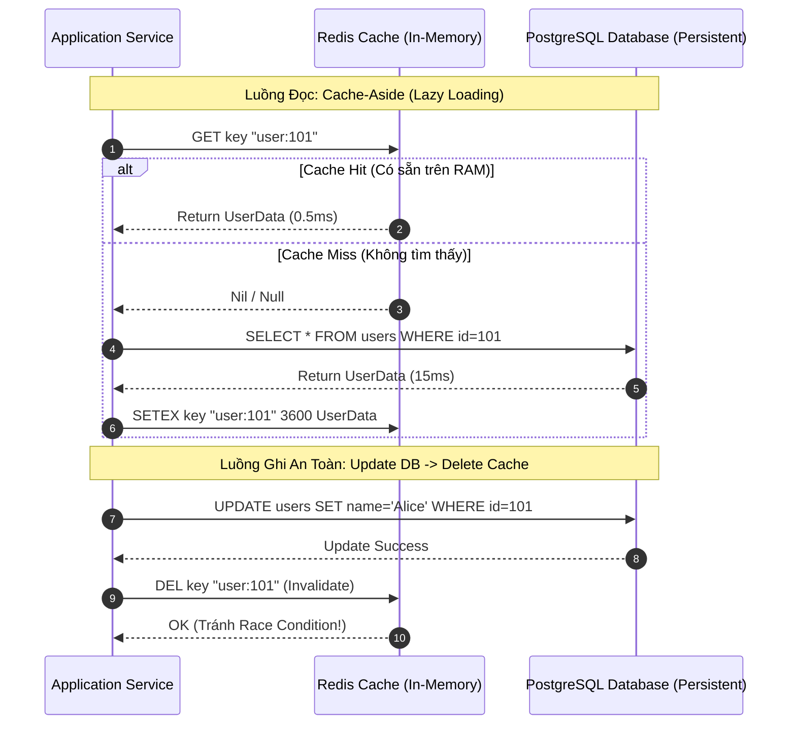

# 12.1. Distributed Caching Fundamentals & Write Patterns

> [!IMPORTANT]
> **Nếu bạn chỉ được nhớ một điều duy nhất**: Cache phân tán không bao giờ là giải pháp thay thế cơ sở dữ liệu mà là một sự đánh đổi có chủ đích giữa **Độ trễ (Latency)** và **Tính nhất quán (Consistency)**. Trong mẫu thiết kế phổ biến nhất là **Cache-Aside (Lazy Loading)**, nguyên tắc vàng khi cập nhật dữ liệu là: **Luôn luôn cập nhật Database trước, sau đó XÓA cache (Invalidate/Delete), tuyệt đối không bao giờ cập nhật thẳng giá trị mới vào cache**. Cập nhật trực tiếp vào cache sẽ mở ra cánh cửa cho hiện tượng tranh chấp tương tranh (**Race Condition**) khiến cache lưu giữ dữ liệu sai lệch vĩnh viễn!

---

## 1. Kiến trúc Tổng quan & Mô hình Tư duy (Mental Model)

### Ẩn dụ Đời sống: Bàn Làm Việc của Thư Ký và Kho Hồ Sơ Tầng Hầm
Hãy tưởng tượng một văn phòng xử lý thủ tục hành chính:
- **Cơ sở dữ liệu (Database)**: Là kho lưu trữ hồ sơ lớn dưới tầng hầm. Mọi văn bản gốc được lưu trong tủ sắt chống cháy; việc đi thang máy xuống tầng hầm, tìm kiếm hồ sơ và mang lên mất 15 phút (Độ trễ đĩa $\sim 10-50\text{ms}$).
- **Bộ nhớ Cache (In-Memory Cache)**: Là mặt bàn làm việc của người thư ký. Anh ta chỉ để những hồ sơ của các vụ việc đang được hỏi nhiều nhất lên bàn. Khi sếp hỏi, anh ta rút ngay tập tài liệu trên bàn trong 5 giây (Độ trễ RAM $\sim 100\text{ns}$).
- **Cache Hit vs Miss**: Nếu tập hồ sơ có sẵn trên bàn $\to$ **Cache Hit**. Nếu không có $\to$ **Cache Miss** (thư ký phải đi xuống tầng hầm lấy lên và để một bản sao lên bàn).
- **Eviction (Đẩy dữ liệu khỏi bàn)**: Mặt bàn có diện tích giới hạn (RAM có hạn). Khi bàn đầy, thư ký phải dọn dẹp các hồ sơ ít được ngó ngàng nhất trong tuần qua (**LRU - Least Recently Used**) cất lại xuống kho.
- **Write Patterns**: Khi có quyết định thay đổi nội dung hồ sơ:
  - Nếu thư ký sửa vào kho tầng hầm trước rồi gạt bỏ tập hồ sơ cũ trên bàn vào thùng rác (**Cache-Aside Invalidation**): Lần sau có ai hỏi, anh ta sẽ xuống kho lấy bản mới nhất lên bàn.
  - Nếu thư ký tự tiện sửa vào tập hồ sơ trên bàn trong khi kho tầng hầm chưa cập nhật: hai người làm cùng lúc sẽ ghi đè lẫn nhau gây sai lệch hồ sơ vĩnh viễn.



---

## 2. Chi tiết từng Keyword (Under-the-Hood Deep Dive)

### 2.1. Vòng đời dữ liệu: Cache Hit, Miss, Invalidation & Expiration

1. **Cache Hit (Trúng Cache)**: Dữ liệu yêu cầu có sẵn trong bộ nhớ cache và còn hạn sử dụng. Ứng dụng đọc dữ liệu trực tiếp từ cache mà không cần truy vấn Database, giảm độ trễ từ $10\text{ms}$ xuống $< 1\text{ms}$.
2. **Cache Miss (Trượt Cache)**: Dữ liệu không tồn tại trong cache (chưa từng được nạp, đã bị xóa hoặc hết hạn). Ứng dụng buộc phải truy vấn database backend, sau đó nạp lại bản ghi vào cache.
3. **Cache Expiration (Thời gian hết hạn - TTL)**:
   - **Hard Expiration (TTL cứng)**: Sau khoảng thời gian $T$, hệ thống cache tự động giải phóng bộ nhớ của key đó.
   - **Soft Expiration (TTL mềm)**: Key vẫn nằm trong cache, nhưng ứng dụng kiểm tra metadata thấy dữ liệu đã quá hạn sẽ trả về dữ liệu cũ (Stale) cho client đồng thời kích hoạt một background thread đi cập nhật dữ liệu mới từ database (Asynchronous Refresh).
4. **Cache Invalidation (Vô hiệu hóa cache)**: Thao tác chủ động xóa bỏ hoặc đánh dấu dữ liệu trong cache không còn hợp lệ ngay khi dữ liệu gốc dưới Database có sự thay đổi.

### 2.2. Các chính sách đẩy dữ liệu ra khỏi bộ nhớ (Cache Eviction Policies)
Khi dung lượng bộ nhớ RAM đạt ngưỡng tối đa (`maxmemory`), cache engine buộc phải loại bỏ các key cũ để nhường chỗ cho dữ liệu mới:

#### Bảng so sánh các giải pháp Eviction
| Thuật toán | Cơ chế loại bỏ | Độ phức tạp | Nhược điểm cốt lõi | Hệ thống áp dụng |
| :--- | :--- | :--- | :--- | :--- |
| **LRU (Least Recently Used)** | Loại bỏ key có thời điểm truy cập cuối cùng xa nhất trong quá khứ. | $O(1)$ (HashMap + Doubly LinkedList) | Dễ bị ô nhiễm cache khi có thao tác quét dữ liệu hàng loạt (Batch Scan / Loop). | Redis, Memcached |
| **LFU (Least Frequently Used)** | Loại bỏ key có tần suất truy cập (Frequency Counter) thấp nhất. | $O(1)$ (HashMap + Frequency Buckets) | Dữ liệu cũ từng được đọc rất nhiều trong quá khứ sẽ "sống dai" dù hiện tại không ai đọc nữa. | Redis 4.0+ (`volatile-lfu`) |
| **FIFO (First In, First Out)** | Loại bỏ key được đưa vào cache sớm nhất, bất kể được đọc bao nhiêu lần. | $O(1)$ (Queue đơn giản) | Hiệu năng kém; key "hot" bị đuổi ra liên tục làm tụt tỷ lệ Cache Hit. | Simple In-Memory Buffers |
| **W-TinyLFU (Window TinyLFU)** | Kết hợp một cửa sổ LRU nhỏ ở đầu và bộ lọc tần suất Compact Count-Min Sketch ở sau. | $O(1)$ | Cấu trúc dữ liệu phức tạp hơn để triển khai. | **Caffeine Cache (Java), Ristretto (Go)** |
| **Clock / Second Chance** | Sử dụng con trỏ quét vòng tròn và bit tham chiếu (Reference Bit: 0 hoặc 1). | $O(1)$ xấp xỉ | Tiết kiệm bộ nhớ hơn LRU vì không cần con trỏ Doubly Linked List. | Linux Kernel Page Cache |

### 2.3. Cache-Aside Pattern (Lazy Loading)

#### Khái niệm & Cơ chế Under the Hood
Ứng dụng chịu trách nhiệm trực tiếp trong việc kết nối và điều phối giữa Cache và Database:
- **Khi đọc**: Ứng dụng hỏi Cache trước $\to$ nếu Miss thì đọc DB $\to$ ghi lại vào Cache $\to$ trả kết quả.
- **Tại sao phải XÓA Cache thay vì CẬP NHẬT Cache khi ghi?**
  - Giả sử có 2 luồng ghi đồng thời: Luồng 1 cập nhật $X = 1$, Luồng 2 cập nhật $X = 2$.
  - Nếu cập nhật thẳng vào cache: do độ trễ mạng, Luồng 2 có thể ghi vào Cache trước ($X=2$), sau đó Luồng 1 mới ghi đè lên ($X=1$).
  - Trong khi đó dưới Database: Luồng 1 ghi trước, Luồng 2 ghi sau ($X=2$).
  - **Hệ quả**: Dưới DB giá trị là 2, nhưng trên Cache giá trị bị kẹt ở 1 vĩnh viễn!
  - Khi áp dụng **Xóa Cache (Cache Invalidation)**, lần đọc tiếp theo chắc chắn sẽ lấy giá trị mới nhất từ DB nạp lên cache.

### 2.4. Read-Through & Write-Through Cache
Trong mô hình này, ứng dụng chỉ giao tiếp duy nhất với Cache Abstraction Layer như một datastore chính:
- **Read-Through**: Khi Cache Miss, **chính hệ thống Cache** tự động truy vấn Database, tự nạp dữ liệu vào RAM và trả kết quả cho ứng dụng.
- **Write-Through**: Khi ứng dụng cập nhật dữ liệu:
  - Ứng dụng ghi vào Cache.
  - Hệ thống Cache **ngay lập tức ghi đồng bộ (Synchronously)** vào Database bên dưới.
  - Giao dịch chỉ trả về thành công cho Client khi cả Cache và Database đều đã ghi nhận dữ liệu.
  - **Đặc tính**: Đảm bảo tính nhất quán cao, nhưng độ trễ ghi bằng tổng độ trễ của cả Cache và Database.

### 2.5. Write-Back (Write-Behind) vs Write-Around Cache

#### 1. Write-Back Cache (Write-Behind / Ghi trễ)
- Ứng dụng chỉ ghi dữ liệu thẳng vào Cache RAM và nhận phản hồi `Success` ngay lập tức ($< 1\text{ms}$).
- Một tiến trình nền định kỳ hoặc khi gom đủ batch sẽ ghi bất đồng bộ (Asynchronously) các thay đổi này xuống Database.
- **Ưu điểm**: Thông lượng ghi cực kỳ khủng khiếp, giảm tải tối đa cho Database (gộp 100 lần cập nhật cùng 1 dòng thành 1 câu `UPDATE` duy nhất).
- **Rủi ro chí mạng**: **Mất mát dữ liệu (Data Loss)** nếu máy chủ Cache bị sập điện hoặc crash trước khi kịp xả dữ liệu xuống Database.
- Ứng dụng tiêu biểu: Hệ thống đếm lượt xem video YouTube, số lượt like bài viết mạng xã hội.

#### 2. Write-Around Cache
- Thao tác ghi đi thẳng vào Database, **hoàn toàn bỏ qua tầng Cache**.
- Dữ liệu chỉ được nạp lên cache khi có thao tác đọc xảy ra (Lazy Load).
- Phù hợp nhất cho các hệ thống có dữ liệu "ghi một lần, không bao giờ đọc lại ngay" (ví dụ: log lưu trữ, dữ liệu sao lưu).

#### 3. Refresh-Ahead Cache
- Hệ thống Cache tự động theo dõi tần suất truy cập của các key.
- Nếu một key được dự đoán sắp hết hạn TTL và vẫn đang nhận được lượng đọc cao, Cache Engine sẽ **chủ động gửi truy vấn ngầm xuống Database để làm mới giá trị trước khi TTL chạm mốc 0**.
- Triệt tiêu hoàn toàn hiện tượng tụt giảm hiệu năng khi key hết hạn.

#### Bảng so sánh 5 Caching Write Patterns
| Mẫu thiết kế | Độ trễ Ghi | Tính nhất quán dữ liệu | Rủi ro mất mát dữ liệu | Phù hợp nhất cho |
| :--- | :--- | :--- | :--- | :--- |
| **Cache-Aside** | Thấp (Chỉ ghi DB và xóa Cache) | Eventual Consistency | Không có | **Mọi hệ thống Web / Microservices thông thường** |
| **Write-Through** | Cao (Ghi đồng bộ Cache + DB) | Rất cao (Đồng bộ tuyệt đối) | Không có | Hệ thống tài chính yêu cầu dữ liệu đọc luôn tươi mới |
| **Write-Back (Write-Behind)** | **Cực thấp ($< 1\text{ms}$)** | Kém (Eventual sau vài giây) | **Có (Mất dữ liệu nếu Cache chết)** | Đếm View, Click Tracking, IoT Telemetry |
| **Write-Around** | Trung bình (Chỉ ghi DB) | Tốt | Không có | Dữ liệu ít khi được đọc lại ngay sau khi ghi |
| **Refresh-Ahead** | Không tác động | Tốt | Không có | Các bảng danh mục, dữ liệu nóng đọc cực nhiều |

---

## 3. Thực thi Mã nguồn & Mô phỏng Chuyên sâu (Dual-Engine Implementation)

### Engine 1: C++20 — Triển khai Hoàn chỉnh Thread-Safe LRU Cache $O(1)$ với Doubly-Linked List và Hash Map

```cpp
#include <iostream>
#include <list>
#include <unordered_map>
#include <optional>
#include <mutex>
#include <string>
#include <format>
#include <cstdint>

template <typename Key, typename Value>
class ThreadSafeLRUCache {
private:
    size_t capacity_;
    mutable std::mutex mtx_;

    // Danh sách liên kết đôi lưu thứ tự sử dụng: Đầu list = Mới nhất, Cuối list = Cũ nhất
    std::list<std::pair<Key, Value>> lru_list_;

    // Hash Map ánh xạ Key -> Iterator trỏ vào Node trong danh sách liên kết: O(1) Lookup
    std::unordered_map<Key, typename std::list<std::pair<Key, Value>>::iterator> cache_map_;

public:
    explicit ThreadSafeLRUCache(size_t capacity) : capacity_(capacity) {
        if (capacity == 0) throw std::invalid_argument("Capacity must be > 0");
    }

    std::optional<Value> get(const Key& key) {
        std::lock_guard<std::mutex> lock(mtx_);
        auto it = cache_map_.find(key);
        if (it == cache_map_.end()) {
            return std::nullopt; // Cache Miss
        }

        // Cache Hit: Di chuyển node được truy cập lên đầu danh sách (Most Recently Used)
        lru_list_.splice(lru_list_.begin(), lru_list_, it->second);
        return it->second->second;
    }

    void put(const Key& key, const Value& value) {
        std::lock_guard<std::mutex> lock(mtx_);
        auto it = cache_map_.find(key);

        if (it != cache_map_.end()) {
            // Cập nhật giá trị cũ và đưa lên đầu danh sách
            it->second->second = value;
            lru_list_.splice(lru_list_.begin(), lru_list_, it->second);
            return;
        }

        // Kiểm tra dung lượng để thực thi Eviction
        if (cache_map_.size() >= capacity_) {
            // Lấy phần tử ở cuối danh sách (Least Recently Used)
            auto lru_node = lru_list_.back();
            std::cout << std::format("  [Eviction] Cache đầy ({})! Đẩy phần tử cũ nhất ra khỏi RAM: Key='{}'\n",
                capacity_, lru_node.first);
            cache_map_.erase(lru_node.first);
            lru_list_.pop_back();
        }

        // Thêm phần tử mới vào đầu danh sách
        lru_list_.emplace_front(key, value);
        cache_map_[key] = lru_list_.begin();
    }

    size_t size() const {
        std::lock_guard<std::mutex> lock(mtx_);
        return cache_map_.size();
    }
};

int main() {
    ThreadSafeLRUCache<std::string, std::string> cache(3);

    std::cout << "--- 1. Thêm 3 phần tử vào Cache dung lượng 3 ---\n";
    cache.put("user:1", "Alice");
    cache.put("user:2", "Bob");
    cache.put("user:3", "Charlie");

    std::cout << "\n--- 2. Truy cập 'user:1' để đánh dấu nó là Mới Sử Dụng Gần Đây (MRU) ---\n";
    auto val = cache.get("user:1");
    if (val) std::cout << std::format("Cache Hit: user:1 -> {}\n", val.value());

    std::cout << "\n--- 3. Thêm phần tử thứ 4 ('user:4') -> Kỳ vọng 'user:2' bị đẩy ra ngoài (Evicted) ---\n";
    cache.put("user:4", "David");

    std::cout << "\n--- 4. Kiểm tra các khóa còn lại trong Cache ---\n";
    std::cout << std::format("user:1 tồn tại: {}\n", cache.get("user:1").has_value());
    std::cout << std::format("user:2 tồn tại: {}\n", cache.get("user:2").has_value()); // Kỳ vọng False!
    std::cout << std::format("user:3 tồn tại: {}\n", cache.get("user:3").has_value());
    std::cout << std::format("user:4 tồn tại: {}\n", cache.get("user:4").has_value());

    return 0;
}
```

#### Terminal Output Mẫu:
```text
--- 1. Thêm 3 phần tử vào Cache dung lượng 3 ---

--- 2. Truy cập 'user:1' để đánh dấu nó là Mới Sử Dụng Gần Đây (MRU) ---
Cache Hit: user:1 -> Alice

--- 3. Thêm phần tử thứ 4 ('user:4') -> Kỳ vọng 'user:2' bị đẩy ra ngoài (Evicted) ---
  [Eviction] Cache đầy (3)! Đẩy phần tử cũ nhất ra khỏi RAM: Key='user:2'

--- 4. Kiểm tra các khóa còn lại trong Cache ---
user:1 tồn tại: true
user:2 tồn tại: false
user:3 tồn tại: true
user:4 tồn tại: true
```

---

### Engine 2: Python 3.11+ — Mô phỏng So sánh Cơ chế Ghi Cache: Cache-Aside vs Write-Behind (Batching Buffer)

```python
import asyncio
from typing import Dict, List

class MockPersistentDatabase:
    def __init__(self):
        self.storage: Dict[str, str] = {}
        self.write_count = 0

    async def write(self, key: str, val: str):
        await asyncio.sleep(0.02) # Giả lập I/O đĩa chậm 20ms
        self.storage[key] = val
        self.write_count += 1

    async def batch_write(self, batch: Dict[str, str]):
        await asyncio.sleep(0.03) # Ghi batch chỉ mất 30ms cho nhiều dòng
        self.storage.update(batch)
        self.write_count += len(batch)

class CacheAsideService:
    def __init__(self, db: MockPersistentDatabase):
        self.db = db
        self.cache: Dict[str, str] = {}

    async def update_data(self, key: str, value: str):
        # Nguyên tắc Cache-Aside: Ghi DB trước, sau đó xóa Cache
        await self.db.write(key, value)
        if key in self.cache:
            del self.cache[key] # Invalidate
            print(f"[Cache-Aside] Cập nhật DB và Invalidate Cache cho key '{key}'")

class WriteBehindBufferService:
    def __init__(self, db: MockPersistentDatabase, batch_interval_sec: float = 0.1):
        self.db = db
        self.cache: Dict[str, str] = {}
        self.buffer: Dict[str, str] = {}
        self.batch_interval = batch_interval_sec
        self._running = True
        self._flusher_task = asyncio.create_task(self._background_flush())

    async def update_data(self, key: str, value: str):
        # Nguyên tắc Write-Behind: Ghi ngay vào RAM Cache & Buffer, trả về tức thì
        self.cache[key] = value
        self.buffer[key] = value
        # Zero disk I/O latency cho client!

    async def _background_flush(self):
        while self._running:
            await asyncio.sleep(self.batch_interval)
            if self.buffer:
                to_flush = self.buffer.copy()
                self.buffer.clear()
                print(f"[Write-Behind Flusher] Gom batch {len(to_flush)} keys xả xuống DB...")
                await self.db.batch_write(to_flush)

async def main():
    db1 = MockPersistentDatabase()
    db2 = MockPersistentDatabase()

    print("--- 1. Thử nghiệm Cache-Aside: 5 lần cập nhật liên tiếp vào cùng 1 key ---")
    aside_svc = CacheAsideService(db1)
    t0 = asyncio.get_event_loop().time()
    for i in range(5):
        await aside_svc.update_data("counter_view", f"v_{i}")
    t1 = asyncio.get_event_loop().time()
    print(f"-> Cache-Aside hoàn thành trong: {(t1 - t0)*1000:.1f}ms | Số lần I/O đĩa: {db1.write_count}")

    print("\n--- 2. Thử nghiệm Write-Behind: 5 lần cập nhật vào cùng 1 key với gộp Batch ---")
    wb_svc = WriteBehindBufferService(db2, batch_interval_sec=0.05)
    t0 = asyncio.get_event_loop().time()
    for i in range(5):
        await wb_svc.update_data("counter_view", f"v_{i}")
    t1 = asyncio.get_event_loop().time()
    print(f"-> Write-Behind Client phản hồi chỉ mất: {(t1 - t0)*1000:.2f}ms!")

    # Chờ flusher gom batch
    await asyncio.sleep(0.08)
    wb_svc._running = False
    wb_svc._flusher_task.cancel()
    print(f"-> Giá trị cuối cùng dưới DB: '{db2.storage['counter_view']}'")

if __name__ == "__main__":
    asyncio.run(main())
```

#### Terminal Output Mẫu:
```text
--- 1. Thử nghiệm Cache-Aside: 5 lần cập nhật liên tiếp vào cùng 1 key ---
[Cache-Aside] Cập nhật DB và Invalidate Cache cho key 'counter_view'
[Cache-Aside] Cập nhật DB và Invalidate Cache cho key 'counter_view'
[Cache-Aside] Cập nhật DB và Invalidate Cache cho key 'counter_view'
[Cache-Aside] Cập nhật DB và Invalidate Cache cho key 'counter_view'
[Cache-Aside] Cập nhật DB và Invalidate Cache cho key 'counter_view'
-> Cache-Aside hoàn thành trong: 104.5ms | Số lần I/O đĩa: 5

--- 2. Thử nghiệm Write-Behind: 5 lần cập nhật vào cùng 1 key với gộp Batch ---
-> Write-Behind Client phản hồi chỉ mất: 0.12ms!
[Write-Behind Flusher] Gom batch 1 keys xả xuống DB...
-> Giá trị cuối cùng dưới DB: 'v_4'
```

---

## 4. Systems Engineering & Production Pitfalls

### 4.1. Những cạm bẫy sống còn khi triển khai Caching
1. **Hiện tượng Race Condition khi Xóa Cache trước khi Ghi DB**:
   - Nếu luồng ghi thực hiện: Xóa Cache $\to$ Ghi DB:
     - Luồng 1 xóa key khỏi Cache.
     - Luồng 2 (Đọc) đến ngay sau đó, thấy Cache Miss bèn đọc giá trị CŨ từ DB và nạp lại vào Cache.
     - Luồng 1 lúc này mới hoàn thành câu lệnh `UPDATE` xuống DB.
     - **Hệ quả**: Dữ liệu cũ bị kẹt trong Cache mãi mãi cho đến khi hết hạn TTL!
     - *Khắc phục*: Bắt buộc **Ghi DB trước, Xóa Cache sau**. Nếu muốn an toàn tuyệt đối, áp dụng kỹ thuật **Delayed Double Deletion** (Xóa cache $\to$ Ghi DB $\to$ Ngủ 500ms $\to$ Xóa cache lần 2).

2. **Dữ liệu lớn làm nghẽn đơn luồng Redis (BigKey Problem)**:
   - Redis xử lý các lệnh đọc ghi trên một Event Loop đơn luồng. Nếu lưu một key có dung lượng hàng chục MB (ví dụ danh sách bạn bè 1 triệu phần tử trong Redis Set) và gọi `DEL my_big_key`, Redis sẽ bị đóng băng CPU trong 200ms, khiến tất cả các request khác trong hệ thống bị timeout!
   - *Khắc phục*: Sử dụng lệnh `UNLINK` thay vì `DEL` để chuyển việc giải phóng bộ nhớ cho background thread, và chia nhỏ dữ liệu thành nhiều bucket nhỏ.

3. **Cấu hình `maxmemory-policy` không đúng gây Crash ứng dụng**:
   - Mặc định một số cấu hình Redis để policy là `noeviction`. Khi RAM đầy, Redis sẽ từ chối tất cả các lệnh ghi và ném lỗi `OOM command not allowed when used memory > 'maxmemory'`.
   - *Khắc phục*: Luôn thiết lập `maxmemory-policy allkeys-lru` hoặc `volatile-lru` trong file `redis.conf`.

### 4.2. Runbook Chẩn đoán Sự cố Cache trên Production (CLI Commands)

```bash
# 1. Tìm các Big Keys đang ngốn bộ nhớ lớn nhất trong Redis
redis-cli --bigkeys

# 2. Kiểm tra tỷ lệ Cache Hit/Miss trong thời gian thực
redis-cli info stats | grep -E "keyspace_hits|keyspace_misses"

# 3. Theo dõi số lượng key bị Evicted do đầy bộ nhớ
redis-cli info stats | grep "evicted_keys"
```

---

## 5. Bảng So sánh & Decision Matrix

| Trường hợp Sử dụng | Mô hình Cache Tối ưu | Công nghệ Khuyến nghị | Thời gian sống (TTL) |
| :--- | :--- | :--- | :--- |
| **Thông tin Hồ sơ Người dùng (User Profile)** | **Cache-Aside (Invalidation)** | Redis / Dragonfly | $1 - 24$ giờ |
| **Danh mục Sản phẩm / Bảng tỷ giá ngoại tệ** | **Refresh-Ahead / Two-Level L1+L2** | Caffeine (L1) + Redis (L2) | $5 - 15$ phút |
| **Bộ đếm Lượt Xem / Tracking Hành vi** | **Write-Behind (Batching)** | In-Memory Buffer + Redis | Không TTL (Ghi ngầm) |
| **Dữ liệu Báo cáo / Export File lớn** | **Write-Around** | AWS S3 / Direct DB | Không cache |
| **Session Đăng nhập Người dùng (Auth Token)** | **Cache-Aside (Hard Expiration)** | Redis Cluster | Bằng Session Expire (7 ngày) |
