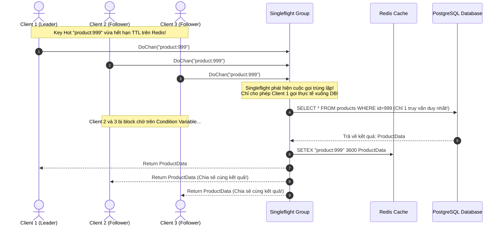

# 12.2. Caching Anomalies, Topologies & The Singleflight Pattern

> [!IMPORTANT]
> **Nếu bạn chỉ được nhớ một điều duy nhất**: Bốn dị thường kinh điển của Cache (**Penetration**, **Avalanche**, **Breakdown/Stampede**, và **Inconsistency**) là nguyên nhân số một gây sụp đổ dây chuyền hệ thống phân tán trong giờ cao điểm. Trong đó, sự cố **Cache Stampede** (khi một key cực hot bị hết hạn và hàng chục nghìn request cùng lúc tràn xuống Database) có thể được hóa giải triệt để bằng hai vũ khí kỹ thuật tối thượng: mẫu thiết kế **Singleflight Pattern** (chỉ cho phép 1 request duy nhất gọi xuống Database trong khi các request khác chờ chia sẻ kết quả) và thuật toán xác suất **XFetch** (tự động làm mới cache sớm dựa trên phân phối ngẫu nhiên trước khi key kịp chết).

---

## 1. Kiến trúc Tổng quan & Mô hình Tư duy (Mental Model)

### Ẩn dụ Đời sống: Cửa Hàng Bánh Mì Nổi Tiếng và Cơn Bão Đói
Hãy tưởng tượng một tiệm bánh mì đông khách:
- **Cache Penetration (Kẻ phá rối hỏi món không có)**: Kẻ xấu liên tục đến quầy hỏi mua *"Phở bò Wagyu dát vàng"* (khóa không tồn tại). Nhân viên quầy không có bánh bèn chạy vào kho hỏi thủ kho. Vì kho cũng không có nên nhân viên quay ra báo không có. Kẻ xấu gọi hàng nghìn cuộc như vậy khiến thủ kho bị kiệt sức (Database sập). Giải pháp: Nhân viên treo biển dán ngoài cửa: *"Món này không có"* trong 5 phút (**Null Value Caching**) hoặc dùng người bảo vệ kiểm tra thực đơn (**Bloom Filter**).
- **Cache Avalanche (Đồng loạt cúp điện các tủ trưng bày)**: Tất cả các tủ bánh được cài đặt hẹn giờ tự tắt cùng lúc vào đúng 12:00 trưa (Cùng TTL). Đột nhiên toàn bộ bánh bị cất đi, hàng nghìn khách hàng lập tức xông thẳng vào kho làm sập cửa kho. Giải pháp: Cài đặt giờ tắt tủ ngẫu nhiên lệch nhau 5-10 phút (**Jittered TTL**).
- **Cache Stampede / Breakdown (Bánh mì đặc biệt hết hàng)**: Món bánh mì kẹp thịt ngon nhất tiệm vừa hết sạch đúng lúc 500 khách hàng ùa vào. Nếu cả 500 khách cùng chạy xộc vào bếp giục đầu bếp làm bánh, nhà bếp sẽ nổ tung.
- **Singleflight Pattern**: Trưởng nhóm khách hàng giơ tay ra lệnh: *"Tất cả đứng yên ở sảnh chờ! Tôi sẽ cử ĐÚNG MỘT NGƯỜI bước vào bếp lấy bánh. Khi người đó mang bánh ra, tất cả chúng ta sẽ cùng ăn chung!"*.



---

## 2. Chi tiết từng Keyword (Under-the-Hood Deep Dive)

### 2.1. Bảng phân biệt 4 dị thường Cache

| Dị thường | Triệu chứng bản chất | Nguyên nhân gốc rễ | Hậu quả thực tế | Giải pháp đặc trị |
| :--- | :--- | :--- | :--- | :--- |
| **Cache Penetration (Thủng cache)** | Truy vấn liên tục các key **hoàn toàn không tồn tại** trong cả Cache lẫn DB. | Hacker tấn công vét cạn hoặc lỗi logic client. | Tỷ lệ Cache Hit tụt về 0%, DB chịu tải 100% các câu vô nghĩa. | **Bloom Filter**, Cache Null Object có TTL ngắn. |
| **Cache Avalanche (Tuyết lở)** | Hàng loạt key (hàng chục nghìn) **đồng loạt hết hạn cùng một thời điểm**. | Cài đặt TTL cố định khi import dữ liệu hoặc Cache Server restart. | DB sập do một đợt sóng truy vấn khổng lồ ập xuống cùng lúc. | **Thêm Jitter ngẫu nhiên vào TTL** ($\text{TTL} + \text{rand}$), cụm Cache HA. |
| **Cache Breakdown / Stampede** | **Một key duy nhất cực Hot** (Super Hotkey) đột ngột hết hạn TTL. | Key nhận hàng chục nghìn req/s bị hết hạn tại đúng giây $T$. | DB bị nghẽn CPU $100\%$ do hàng nghìn luồng cùng tính toán lại 1 kết quả. | **Singleflight Pattern**, **Thuật toán XFetch**, Mutex Lock. |
| **Cache Inconsistency** | Dữ liệu trên Cache khác biệt so với dữ liệu trong Database. | Race condition giữa luồng Đọc và Ghi, mạng trễ. | Người dùng thấy thông tin sai lệch (giá tiền, số lượng tồn kho). | Xóa Cache sau khi Ghi DB, CDC Debezium Invalidation. |

### 2.2. Chi tiết kỹ thuật & Giải pháp cho từng Dị thường

#### 1. Cache Penetration (Thủng tầng cache)
- **Kỹ thuật 1: Cache Null Object (Lưu giá trị Rỗng)**:
  - Khi truy vấn Database không thấy kết quả (`res == null`), thay vì không làm gì, hệ thống lưu thẳng `SETEX key 60 "NULL_MARKER"`.
  - Các request tiếp theo cho key đó sẽ trúng cache và nhận về Null ngay lập tức.
  - Cần đặt TTL ngắn ($1-5$ phút) để nếu sau đó bản ghi được tạo mới trong DB, dữ liệu sẽ sớm được cập nhật.
- **Kỹ thuật 2: Bloom Filter Guard**:
  - Dựng một Bloom Filter chứa toàn bộ ID hợp lệ của Database.
  - Mọi request đọc trước tiên phải đi qua Bloom Filter: nếu Bloom Filter báo `False`, từ chối truy vấn ngay lập tức mà không thèm kiểm tra Redis lẫn Database!

#### 2. Cache Avalanche (Tuyết lở)
- **Công thức tính TTL có Jitter**:
  Thay vì đặt cứng: `TTL = 3600` giây (1 giờ), áp dụng công thức:
  $$\text{Effective\_TTL} = \text{Base\_TTL} + \text{UniformRandom}(0, \text{Jitter\_Range})$$
  Ví dụ: `TTL = 3600 + rand(0, 600)` $\implies$ Các key sẽ hết hạn rải rác trong khoảng từ 60 đến 70 phút, làm phẳng hoàn toàn đỉnh sóng truy vấn (Flatten the curve).

### 2.3. Giải pháp chuyên sâu cho Cache Stampede / Breakdown

#### 1. Thuật toán xác suất XFetch (Vattani et al., VLDB 2015)
Thay vì chờ key hết hạn hẳn mới tính toán lại, XFetch cho phép các client đọc tính toán một xác suất ngẫu nhiên để **chủ động làm mới cache sớm** khi key sắp sửa hết hạn:
- Điều kiện kích hoạt làm mới sớm:
  $$-\beta \times \delta \times \ln(\text{rand}()) > (\text{TTL} - t)$$
  - $t$: Thời điểm hiện tại.
  - $\text{TTL}$: Thời điểm key hết hạn.
  - $\delta$: Thời gian tính toán để tái tạo dữ liệu từ Database (Compute time).
  - $\beta$: Hệ số điều chỉnh độ quyết liệt ($\beta > 0$, thường chọn $\beta = 1$).
  - $\text{rand}() \in (0, 1]$: Biến ngẫu nhiên đều.
- **Ý nghĩa toán học**: Khi key càng gần thời điểm hết hạn ($\text{TTL} - t \to 0$), xác suất điều kiện trên thỏa mãn càng tăng lên. Client đầu tiên rơi vào xác suất này sẽ đi đọc Database và ghi đè giá trị mới, giúp key không bao giờ bị chết!

#### 2. Singleflight Pattern (Gom nhóm truy vấn đồng thời)
Được phát minh trong gói `golang.org/x/sync/singleflight`:
- Duy trì một bảng tra cứu nội bộ trên RAM của ứng dụng: `map[Key]*call`.
- Mỗi khi có request hỏi `key`:
  - Nếu `key` **đang có** một tiến trình khác đang thực thi: request hiện tại **không tạo kết nối mới xuống DB** mà đăng ký lắng nghe trên kênh thông báo (Channel / Condition Variable).
  - Nếu `key` **chưa có**: request hiện tại trở thành "Leader", gửi truy vấn xuống DB.
  - Khi "Leader" nhận được kết quả, nó phát broadcast kết quả cho toàn bộ các "Follower" đang đợi và xóa `key` khỏi bảng tra cứu.
- Giảm số lượng truy vấn xuống Database từ $10.000$ xuống **đúng 1 truy vấn duy nhất**!

### 2.4. Local Cache vs Distributed Cache vs Two-Level Caching (L1/L2)

#### 1. So sánh Local Cache và Distributed Cache
- **Local Cache (Caffeine, Guava, In-Process Memory)**:
  - Nằm ngay trong không gian địa chỉ tiến trình (RAM của ứng dụng).
  - Tốc độ vô địch: $< 100\text{ns}$ (Không tốn chi phí tuần tự hóa Serialization và mạng TCP).
  - Nhược điểm: Tốn RAM của ứng dụng, không nhất quán giữa các instance (Node A sửa nhưng Node B không biết).
- **Distributed Cache (Redis, Memcached)**:
  - Nằm trên cụm máy chủ chuyên dụng độc lập qua mạng.
  - Tốc độ: $1-3\text{ms}$. Dữ liệu nhất quán tập trung cho toàn bộ hàng trăm container.
  - Nhược điểm: Phụ thuộc vào băng thông card mạng (Network I/O bottleneck).

#### 2. Kiến trúc Cache Hai Tầng (Two-Level Caching: L1 + L2)
Kết hợp sức mạnh tối thượng của cả hai:
- **Tầng L1 (Local In-Memory Cache)**: Sử dụng Caffeine hoặc Go sync.Map đặt tại từng Pod/Container (TTL rất ngắn: $5-30$ giây). Hứng $95\%$ lượng đọc siêu nóng.
- **Tầng L2 (Distributed Cache)**: Sử dụng Redis Cluster (TTL dài: vài giờ/ngày).
- **Cơ chế Đồng bộ Hóa Invalidation (Pub/Sub Sync)**:
  - Khi bất kỳ một node nào cập nhật dữ liệu vào DB, nó gửi một thông điệp xóa cache lên **Redis Pub/Sub**.
  - Tất cả các Pod khác đang chạy lắng nghe topic này và lập tức dọn sạch key đó trong bộ nhớ L1 cục bộ của mình.

### 2.5. Redis vs Memcached & Redis Cluster Architecture

#### 1. Bảng so sánh Redis vs Memcached
| Tiêu chí | Redis | Memcached |
| :--- | :--- | :--- |
| **Mô hình Luồng (Threading)** | Event Loop Đơn luồng (Single-threaded I/O multiplexing) | Đa luồng thực sự (Multi-threaded event-driven) |
| **Cấu trúc Dữ liệu** | Phong phú: String, Hash, List, Set, ZSet, HyperLogLog, Bitmap | Đơn giản: Key-Value nhị phân thuần túy |
| **Tính bền vững (Durability)**| Hỗ trợ ghi đĩa: RDB Snapshot + AOF Log | Hoàn toàn trong RAM (Mất hết khi restart) |
| **Replication & HA** | Native Master-Replica + Sentinel / Cluster | Không hỗ trợ native (Client tự hash chia node) |

#### 2. Redis Cluster Architecture Under the Hood
- Redis Cluster không sử dụng vòng băm Consistent Hashing thông thường mà chia không gian lưu trữ thành cố định **16,384 Hash Slots**:
  $$\text{Slot} = \text{CRC16}(\text{key}) \pmod{16384}$$
- 16,384 slot này được phân chia cho các Master nodes (ví dụ: Node 1 giữ slot 0 - 5460, Node 2 giữ 5461 - 10922, Node 3 giữ 10923 - 16383).
- **Chuyển tiếp MOVED & ASK**:
  - Khi Client gửi truy vấn đến nhầm node không nắm giữ slot của key, node đó trả về mã lỗi: `-MOVED <slot> <target_ip:port>`. Client lưu cache lại bảng định tuyến slot và tự động redirect sang node đích.
- **Hash Tags `{...}`**: Cho phép người dùng ép buộc nhiều key rơi vào cùng một hash slot để thực thi giao dịch Multi-key hoặc Lua script:
  - Key `user:{1001}:profile` và `user:{1001}:orders` chỉ băm phần trong dấu ngoặc nhọn `{1001}`, đảm bảo 100% chúng nằm trên cùng một máy chủ vật lý.

---

## 3. Thực thi Mã nguồn & Mô phỏng Chuyên sâu (Dual-Engine Implementation)

### Engine 1: C++20 — Triển khai Hoàn chỉnh Singleflight Pattern Engine với Mutex & Condition Variable

```cpp
#include <iostream>
#include <string>
#include <unordered_map>
#include <memory>
#include <mutex>
#include <condition_variable>
#include <functional>
#include <thread>
#include <vector>
#include <format>

// Đại diện cho một cuộc gọi đang bay (In-flight call)
struct InFlightCall {
    bool done{false};
    std::string val;
    std::exception_ptr err;
    std::mutex mtx;
    std::condition_variable cv;
};

class SingleflightGroup {
private:
    std::mutex group_mtx_;
    std::unordered_map<std::string, std::shared_ptr<InFlightCall>> calls_;

public:
    // Thực thi hàm fn có bảo vệ chống trùng lặp đồng thời
    std::string do_call(const std::string& key, std::function<std::string()> fn) {
        std::shared_ptr<InFlightCall> call;
        bool is_leader = false;

        {
            std::lock_guard<std::mutex> lock(group_mtx_);
            auto it = calls_.find(key);
            if (it != calls_.end()) {
                // Đã có một luồng Leader đang gọi key này! Ta trở thành Follower
                call = it->second;
            } else {
                // Ta là Leader đầu tiên gọi key này!
                call = std::make_shared<InFlightCall>();
                calls_[key] = call;
                is_leader = true;
            }
        }

        if (is_leader) {
            std::cout << std::format("[Singleflight LEADER] Luồng {} bắt đầu gọi Database cho key '{}'...\n",
                std::hash<std::thread::id>{}(std::this_thread::get_id()) % 1000, key);
            try {
                call->val = fn();
            } catch (...) {
                call->err = std::current_exception();
            }

            {
                std::lock_guard<std::mutex> call_lock(call->mtx);
                call->done = true;
            }
            // Đánh thức tất cả các Follower đang chờ
            call->cv.notify_all();

            // Xóa khỏi bảng map để các request đến sau thực thi chu kỳ mới
            {
                std::lock_guard<std::mutex> lock(group_mtx_);
                calls_.erase(key);
            }

            if (call->err) std::rethrow_exception(call->err);
            return call->val;
        } else {
            // Luồng Follower: Chờ đợi Leader mang kết quả về
            std::cout << std::format("  -> [Singleflight FOLLOWER] Luồng {} xếp hàng đợi kết quả từ Leader cho key '{}'...\n",
                std::hash<std::thread::id>{}(std::this_thread::get_id()) % 1000, key);
            std::unique_lock<std::mutex> call_lock(call->mtx);
            call->cv.wait(call_lock, [&]() { return call->done; });

            if (call->err) std::rethrow_exception(call->err);
            return call->val;
        }
    }
};

int main() {
    SingleflightGroup sf;

    // Giả lập Database backend đắt đỏ (Mất 100ms)
    auto expensive_database_query = []() -> std::string {
        std::this_thread::sleep_for(std::chrono::milliseconds(100));
        return "DATABASE_RECORD_DATA_IPHONE_16";
    };

    std::cout << "--- Bắn đồng thời 5 luồng cùng truy vấn vào cùng một key 'product:iphone16' ---\n";
    std::vector<std::thread> workers;

    for (int i = 0; i < 5; ++i) {
        workers.emplace_back([&sf, &expensive_database_query]() {
            std::string res = sf.do_call("product:iphone16", expensive_database_query);
            std::cout << std::format("      [Kết quả Worker] Nhận dữ liệu thành công: '{}'\n", res);
        });
    }

    for (auto& t : workers) {
        t.join();
    }

    std::cout << "[V] Đã hoàn thành 5 request! Database chỉ bị gọi đúng DUY NHẤT 1 LẦN!\n";
    return 0;
}
```

#### Terminal Output Mẫu:
```text
--- Bắn đồng thời 5 luồng cùng truy vấn vào cùng một key 'product:iphone16' ---
[Singleflight LEADER] Luồng 142 bắt đầu gọi Database cho key 'product:iphone16'...
  -> [Singleflight FOLLOWER] Luồng 389 xếp hàng đợi kết quả từ Leader cho key 'product:iphone16'...
  -> [Singleflight FOLLOWER] Luồng 512 xếp hàng đợi kết quả từ Leader cho key 'product:iphone16'...
  -> [Singleflight FOLLOWER] Luồng 780 xếp hàng đợi kết quả từ Leader cho key 'product:iphone16'...
  -> [Singleflight FOLLOWER] Luồng 901 xếp hàng đợi kết quả từ Leader cho key 'product:iphone16'...
      [Kết quả Worker] Nhận dữ liệu thành công: 'DATABASE_RECORD_DATA_IPHONE_16'
      [Kết quả Worker] Nhận dữ liệu thành công: 'DATABASE_RECORD_DATA_IPHONE_16'
      [Kết quả Worker] Nhận dữ liệu thành công: 'DATABASE_RECORD_DATA_IPHONE_16'
      [Kết quả Worker] Nhận dữ liệu thành công: 'DATABASE_RECORD_DATA_IPHONE_16'
      [Kết quả Worker] Nhận dữ liệu thành công: 'DATABASE_RECORD_DATA_IPHONE_16'
[V] Đã hoàn thành 5 request! Database chỉ bị gọi đúng DUY NHẤT 1 LẦN!
```

---

### Engine 2: Python 3.11+ — Mô phỏng Thuật toán Xác suất XFetch Ngăn chặn Cache Stampede

```python
import math
import random
import time
from typing import Optional, Tuple

class XFetchCacheItem:
    def __init__(self, key: str, value: str, delta_sec: float, ttl_sec: float):
        self.key = key
        self.value = value
        self.delta = delta_sec # Thời gian cần để compute lại giá trị từ DB
        self.expiry = time.time() + ttl_sec # Thời điểm hết hạn tuyệt đối

    def is_expired(self) -> bool:
        return time.time() >= self.expiry

    def should_xfetch_early_refresh(self, beta: float = 1.0) -> bool:
        """Thuật toán xác suất XFetch: -beta * delta * ln(rand()) > (expiry - now)"""
        now = time.time()
        time_left = self.expiry - now
        if time_left <= 0:
            return True # Đã hết hạn hoàn toàn

        # Sinh số ngẫu nhiên r in (0, 1]
        r = random.random()
        if r == 0.0:
            r = 0.000001

        probabilistic_threshold = -beta * self.delta * math.log(r)
        return probabilistic_threshold > time_left

def expensive_db_query() -> Tuple[str, float]:
    t0 = time.time()
    time.sleep(0.05) # Giả lập query DB mất 50ms
    delta = time.time() - t0
    return "FRESH_DATA_VERSION_2026", delta

def main():
    print("--- Khởi tạo Cache Item với TTL 0.2 giây, delta 0.05 giây ---")
    val, delta = expensive_db_query()
    item = XFetchCacheItem("top_news", val, delta, ttl_sec=0.2)

    refreshed = False
    start_time = time.time()

    print("Mô phỏng 10 request đọc liên tục trong 0.25 giây...")
    for req_idx in range(1, 11):
        time.sleep(0.02)
        elapsed = time.time() - start_time
        time_left = item.expiry - time.time()

        if item.should_xfetch_early_refresh(beta=1.5):
            print(f"Req #{req_idx:02d} (t={elapsed*1000:.1f}ms, time_left={time_left*1000:.1f}ms): "
                  f"[XFETCH TRIGGERED] Chủ động làm mới sớm trước khi key chết!")
            new_val, new_delta = expensive_db_query()
            item = XFetchCacheItem("top_news", new_val, new_delta, ttl_sec=0.2)
            refreshed = True
            break
        else:
            print(f"Req #{req_idx:02d} (t={elapsed*1000:.1f}ms, time_left={time_left*1000:.1f}ms): "
                  f"[CACHE HIT] Đọc giá trị an toàn từ Cache RAM.")

    print(f"\n[Kết quả] Cache đã được tái sinh mượt mà: {refreshed}. Database không hề bị Stampede!")

if __name__ == "__main__":
    main()
```

#### Terminal Output Mẫu:
```text
--- Khởi tạo Cache Item với TTL 0.2 giây, delta 0.05 giây ---
Mô phỏng 10 request đọc liên tục trong 0.25 giây...
Req #01 (t=21.4ms, time_left=178.6ms): [CACHE HIT] Đọc giá trị an toàn từ Cache RAM.
Req #02 (t=43.1ms, time_left=156.9ms): [CACHE HIT] Đọc giá trị an toàn từ Cache RAM.
Req #03 (t=65.0ms, time_left=135.0ms): [CACHE HIT] Đọc giá trị an toàn từ Cache RAM.
Req #04 (t=86.8ms, time_left=113.2ms): [CACHE HIT] Đọc giá trị an toàn từ Cache RAM.
Req #05 (t=108.5ms, time_left=91.5ms): [CACHE HIT] Đọc giá trị an toàn từ Cache RAM.
Req #06 (t=130.3ms, time_left=69.7ms): [XFETCH TRIGGERED] Chủ động làm mới sớm trước khi key chết!

[Kết quả] Cache đã được tái sinh mượt mà: True. Database không hề bị Stampede!
```

---

## 4. Systems Engineering & Production Pitfalls

### 4.1. Những cạm bẫy sống còn khi vận hành Cache trong sản xuất
1. **Singleflight Memory Leak khi Database bị treo vô hạn**:
   - Nếu câu truy vấn Database của luồng "Leader" trong Singleflight bị treo kết nối (không có Connection Timeout hoặc Query Timeout), đối tượng `InFlightCall` sẽ bị giữ trong bảng map mãi mãi.
   - Hàng nghìn luồng Follower đến sau sẽ bị kẹt vĩnh viễn ở trạng thái chờ đợi, làm cạn kiệt Thread Pool của ứng dụng và gây sập toàn bộ hệ thống (Cascading Outage).
   - *Khắc phục*: Luôn bọc hàm `fn()` bên trong một **Context Timeout** (ví dụ: tối đa 3 giây).

2. **Dùng nhầm `KEYS *` thay vì `SCAN` trên Redis**:
   - Một lập trình viên viết script kiểm tra các key liên quan đến người dùng bằng lệnh `KEYS user:*`. Trên môi trường production có 20 triệu keys, lệnh này khóa cứng luồng duy nhất của Redis trong $5-10$ giây! Tất cả các dịch vụ khác bị timeout hàng loạt.
   - *Quy tắc nghiêm ngặt*: Đổi tên hoặc vô hiệu hóa lệnh `KEYS` trong `redis.conf`: `rename-command KEYS ""`. Bắt buộc dùng `SCAN` để duyệt con trỏ không chặn.

3. **Hiện tượng Hotkey nuốt trọn băng thông card mạng của một Redis Node**:
   - Trong Redis Cluster, dù có 50 node, một Hotkey như thông tin vé sự kiện concert chỉ nằm trên đúng 1 node duy nhất. Card mạng 10Gbps của node đó bị nghẽn $100\%$, trong khi 49 node còn lại nhàn rỗi.
   - *Khắc phục*: Bắt buộc kích hoạt **L1 Local Cache (Caffeine)** trên từng client Pod để giảm tải $99\%$ đọc cho Hotkey đó.

### 4.2. Runbook Chẩn đoán Sự cố Hotkey và Chậm trễ Cache (CLI Commands)

```bash
# 1. Bật cơ chế theo dõi Hotkeys trong thời gian thực trên Redis (Yêu cầu maxmemory-policy LFU)
redis-cli --hotkeys

# 2. Xem các câu lệnh đang bị chậm (Slowlog) trên Redis
redis-cli slowlog get 10

# 3. Kiểm tra số lượng kết nối client và băng thông mạng sử dụng
redis-cli info clients
redis-cli info stats | grep -E "total_net_input_bytes|total_net_output_bytes"
```

---

## 5. Bảng So sánh & Decision Matrix

| Kỹ thuật Đối phó Dị thường | Mục tiêu Ngăn chặn | Độ phức tạp cài đặt | Chi phí tài nguyên | Nhược điểm / Đánh đổi |
| :--- | :--- | :--- | :--- | :--- |
| **Bloom Filter Guard** | Cache Penetration | Trung bình | Rất thấp (Vài MB bitset) | Có tỷ lệ False Positive nhỏ |
| **Cache Null Object** | Cache Penetration | Cực thấp | Thấp | Tốn một chút RAM lưu trữ null keys |
| **TTL Jitter ($\text{TTL} + \text{rand}$)** | Cache Avalanche | Cực thấp | Bằng 0 | Không có |
| **Singleflight Pattern** | Cache Stampede / Breakdown | Thấp đến Trung bình | Rất thấp | Cần quản lý context timeout chặt chẽ |
| **Thuật toán xác suất XFetch** | Cache Stampede / Breakdown | Trung bình | Thấp | Cần theo dõi delta thời gian query |
| **Two-Level Caching (L1 + L2)** | Hotkey Network Saturation | Cao (Cần Pub/Sub sync) | Trung bình (Tốn RAM container) | Trễ đồng bộ invalidation giữa các Pod |
