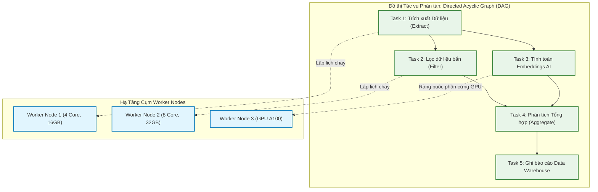

# 13.1. Distributed Scheduling & Job Processing Deep Dive

> [!IMPORTANT]
> **Nếu bạn chỉ được nhớ một điều duy nhất**: Lập lịch phân tán (Distributed Scheduling) là bài toán tối ưu hóa phân bổ tài nguyên có ràng buộc không gian và thời gian trên hàng chục nghìn máy chủ dị thể. Trọng tâm tiến hóa của các kiến trúc Scheduler chuyển từ mô hình đơn khối (**Monolithic** - nút thắt cổ chai) sang **Two-Level** (Mesos), **Shared-State** (Google Omega / Nomad với Optimistic Concurrency Control), và **Fully Distributed** (Sparrow với kỹ thuật *Power of Two Choices*). Trong môi trường đám mây đầy biến động, mọi tác vụ phân tán **bắt buộc phải có tính lũy đẳng (Task Idempotency)** và sử dụng thuật toán **Exponential Backoff với Full Jitter** khi retry để tránh hủy diệt các dịch vụ phụ thuộc bằng các đợt sóng bão yêu cầu (**Retry Storms**).

---

## 1. Kiến trúc Tổng quan & Mô hình Tư duy (Mental Model)

### Ẩn dụ Đời sống: Sân Bay Quốc Tế và Tháp Điều Phối Không Lưu
Hãy tưởng tượng một sân bay quốc tế khổng lồ với 50 đường băng và hàng nghìn chuyến bay:
- **Job và DAG (Kế hoạch bay)**: Một chuyến bay hạ cánh an toàn không phải là một thao tác đơn lẻ mà là một đồ thị có hướng không chu trình (**DAG**): Chuyến bay hạ cánh ($T_1$) $\to$ Trả khách ($T_2$) song song với Xả xăng/Nạp nhiên liệu ($T_3$) $\to$ Dọn vệ sinh cabin ($T_4$) $\to$ Đón khách mới ($T_5$) $\to$ Cất cánh ($T_6$). Bước $T_5$ bắt buộc phải đợi cả $T_2, T_3, T_4$ hoàn tất!
- **Scheduler Monolithic (Một kiểm soát viên duy nhất)**: Một người duy nhất dùng mắt thường nhìn toàn bộ 50 đường băng và phân lịch cho từng máy bay. Khi sân bay quá đông, người này bị quá tải (Bottleneck), máy bay phải bay lượn vòng trên trời chờ lệnh.
- **Two-Level Scheduling (Người chia đường băng và Hãng bay tự quyết)**: Ban quản lý sân bay chỉ phân bổ: *"Đường băng số 3 đang trống trong 15 phút, ai muốn lấy?"* (Resource Offer). Hãng hàng không Vietnam Airlines tự quyết định cho chuyến bay nào của mình hạ cánh vào ô đó.
- **Shared-State Scheduling (Bảng điện tử dùng chung)**: Mọi hãng bay cùng nhìn vào một bảng điện tử trạng thái toàn sân bay. Mỗi hãng tự chọn vị trí trống cho mình và thực hiện thao tác cam kết lạc quan (**Optimistic Lock**). Nếu hai hãng cùng chọn 1 ô tại cùng một mili-giây, người đến sau bị xung đột và chọn lại ô khác.
- **Work Stealing (Đội bốc dỡ hỗ trợ lẫn nhau)**: Đội bốc hành lý ở Ga A đã làm xong hết việc trong khi Ga B đang bị ngập trong 1.000 kiện hàng. Đội Ga A chủ động đi sang phía sau kho của Ga B để "đánh cắp" bớt kiện hàng mang về ga mình xử lý (**Work Stealing**), giúp toàn sân bay giải phóng hành lý với tốc độ tối đa.



---

## 2. Chi tiết từng Keyword (Under-the-Hood Deep Dive)

### 2.1. Kiến trúc phân rã công việc: Job, Task & DAG

#### 1. Định nghĩa Kỹ thuật
- **Job (Công việc toàn cục)**: Đơn vị công việc cấp cao do người dùng hoặc hệ thống kích hoạt (ví dụ: "Chạy báo cáo tài chính tháng 11" hoặc "Huấn luyện mô hình Llama-3").
- **Task (Tác vụ nguyên tử)**: Đơn vị tính toán nhỏ nhất không thể chia cắt được, được đóng gói để thực thi trên một luồng CPU/GPU của một máy chủ Worker cụ thể.
- **DAG (Directed Acyclic Graph - Đồ thị có hướng không chu trình)**:
  - Các đỉnh ($V$) đại diện cho các Task.
  - Các cạnh có hướng ($E$) đại diện cho quan hệ phụ thuộc dữ liệu hoặc thứ tự thực thi ($T_A \to T_B$: $T_B$ chỉ có thể chạy sau khi $T_A$ hoàn thành thành công).
  - Thuật toán **Sắp xếp Tô pô (Topological Sort / Kahn's Algorithm)** được sử dụng để xác định các Task độc lập có thể chạy song song ngay lập tức (In-degree = 0).

#### 2. Vòng đời trạng thái của một Task (Task State Lifecycle)
```text
[SUBMITTED] -> [PENDING] -> [SCHEDULED] -> [RUNNING] ---> [SUCCEEDED]
                   ^                          |
                   |--- (Retry on Failure) <--|---------> [FAILED]
```
- **PENDING**: Task nằm trong hàng đợi trung tâm, chờ tài nguyên phù hợp.
- **SCHEDULED / ASSIGNED**: Scheduler đã gán Task cho một Worker Node cụ thể.
- **RUNNING**: Worker đã tải container/binary và đang chạy mã nguồn.
- **SUCCEEDED**: Task hoàn thành và trả về exit code 0 cùng dữ liệu đầu ra.
- **FAILED**: Gặp lỗi ngoại lệ hoặc Worker bị crash; kích hoạt retry hoặc chuyển trạng thái lỗi lên DAG.

### 2.2. Task Priority, Preemption, Work Stealing & Work Sharing

#### 1. Task Preemption (Tước quyền thực thi tài nguyên)
- Khi một Task có độ ưu tiên cao (High Priority / Production SLA) cần tài nguyên gấp mà cụm đã kín chỗ ($100\%$ CPU/RAM):
  - Scheduler tiến hành kiểm tra các Task có độ ưu tiên thấp đang chạy (Low Priority / Batch processing).
  - Scheduler gửi tín hiệu `SIGTERM` (sau đó là `SIGKILL`) để **thu hồi tài nguyên (Preempt)** của Task thấp, đẩy nó về lại hàng đợi PENDING hoặc chuyển sang node khác.
  - Cấp tài nguyên vừa thu hồi cho Task ưu tiên cao.

#### 2. Work Stealing vs Work Sharing
Hai trường phái cân bằng tải giữa các hàng đợi tác vụ của Worker:
- **Work Sharing (Chia sẻ việc chủ động)**:
  - Khi một Worker nhận được tác vụ mới, nếu thấy hàng đợi cục bộ của mình đã đầy, nó chủ động tìm kiếm các Worker khác đang rảnh rỗi để "đẩy" việc sang (Push model).
  - Tốn chi phí kiểm tra và đồng bộ liên tục khi tất cả các worker đều bận.
- **Work Stealing (Đánh cắp việc bị động - Cilk / Java ForkJoinPool / Go Runtime)**:
  - Mỗi Worker sở hữu một hàng đợi hai đầu (**Double-ended Queue - Deque**).
  - Worker sở hữu hàng đợi sẽ thao tác lấy việc và đẩy việc ở **Đầu đỉnh (Head/Top)** theo nguyên tắc LIFO (tối ưu hóa CPU Cache Locality).
  - Khi một Worker bị rảnh việc (Deque của nó rỗng): nó biến thành "kẻ trộm", chọn ngẫu nhiên một Worker khác và "đánh cắp" tác vụ ở **Đáy hàng đợi (Bottom/Tail)** theo nguyên tắc FIFO.
  - **Lợi ích**: Giảm thiểu tối đa xung đột khóa (Lock Contention) vì chủ nhân và kẻ trộm thao tác ở hai đầu đối diện của Deque!

### 2.3. Bốn thế hệ kiến trúc Scheduler (Scheduling Architectures)

#### Bảng so sánh 4 thế hệ kiến trúc Scheduler
| Thế hệ Kiến trúc | Nguyên lý thiết kế | Điểm nghẽn (Bottlenecks) | Ưu điểm cốt lõi | Đại diện tiêu biểu |
| :--- | :--- | :--- | :--- | :--- |
| **Thế hệ 1: Monolithic** | Một tiến trình duy nhất nắm toàn bộ trạng thái cụm và đưa ra mọi quyết định lập lịch tuần tự. | Nút thắt CPU/RAM tại Master Node khi cụm $> 5,000$ nodes. | Quyết định tối ưu toàn cục (Global Optimal), kiểm soát xung đột tuyệt đối. | Apache Hadoop v1 JobTracker, Kubernetes `kube-scheduler` |
| **Thế hệ 2: Two-Level** | Phân tách: Central Coordinator quản lý tài nguyên thô và gửi lời mời (**Resource Offers**) tới các Framework Schedulers riêng biệt. | Framework có thể từ chối offer liên tục (Pessimistic lock), gây lãng phí thời gian. | Hỗ trợ đa dạng tải trên cùng hạ tầng (chạy chung Hadoop, Spark, MPI). | **Apache Mesos**, Hadoop YARN |
| **Thế hệ 3: Shared-State** | Nhiều Scheduler độc lập chạy song song, cùng đọc một bản sao trạng thái cụm trên RAM và ghi lại bằng **Optimistic Concurrency Control (OCC)**. | Tỷ lệ xung đột (Transaction Aborts) tăng cao khi cụm bị quá tải $95\%$ tài nguyên. | Thông lượng lập lịch cực cao (hàng chục nghìn tasks/giây), phân tách logic linh hoạt. | **Google Omega**, **Google Borg**, **HashiCorp Nomad** |
| **Thế hệ 4: Distributed** | Không có trạng thái tập trung. Scheduler chọn ngẫu nhiên 2 worker, thăm dò hàng đợi của chúng và gửi task cho node ngắn hơn (**Power of Two Choices**). | Không có cái nhìn toàn cục; có thể đưa ra quyết định dưới mức tối ưu. | Độ trễ cực thấp (vài mili-giây), scale vô hạn cho các micro-tasks. | **Sparrow Scheduler (UC Berkeley)** |

### 2.4. Các bảo đảm trong xử lý tác vụ (Job Processing Guarantees)

#### 1. Tính lũy đẳng (Task Idempotency)
- Trong môi trường phân tán, mạng chập chờn có thể khiến thông điệp xác nhận hoàn thành Task bị thất lạc. Scheduler sẽ hiểu nhầm Worker đã chết và kích hoạt chạy lại Task đó trên Worker khác.
- Một Task được gọi là có tính lũy đẳng nếu việc thực thi nó $K$ lần ($K \ge 1$) mang lại kết quả trạng thái hoàn toàn giống hệt như thực thi 1 lần duy nhất:
  $$f(f(x)) = f(x)$$
- *Kỹ thuật*: Sử dụng cơ chế Deduplication Key hoặc UPSERT thay vì INSERT thuần túy.

#### 2. Exponential Backoff với Full Jitter (Khuyến nghị AWS)
Khi một dịch vụ backend bị quá tải, nếu 10.000 worker cùng retry sau đúng 1 giây, chúng sẽ tạo thành một đợt sóng xung kích (**Retry Storm**) đánh sập hoàn toàn backend.
- **Công thức Exponential Backoff với Full Jitter**:
  $$\text{SleepTime} = \text{UniformRandom}\left(0, \min(M, B \times 2^{\text{attempt}})\right)$$
  - $B$: Base backoff (ví dụ 100ms).
  - $M$: Max backoff (ví dụ 30 giây).
  - $\text{UniformRandom}(0, \dots)$: Rải đều toàn bộ các yêu cầu retry trong một khoảng thời gian liên tục, xóa sổ hoàn toàn đỉnh tải nhọn.

### 2.5. Zombie Task Detection & Task Heartbeat Leases
- **Hiểm họa Zombie Task**: Worker chạy một Task bị treo CPU hoặc bị cô lập mạng một chiều. Scheduler đã hết hạn kiên nhẫn và giao Task đó cho Worker mới. Đột nhiên Worker cũ tỉnh dậy và tiếp tục ghi đè kết quả cũ lên kết quả mới!
- **Giải pháp**:
  - Giao cho mỗi Task đang chạy một **Lease TTL ngắn** (ví dụ 30 giây).
  - Worker định kỳ gửi Heartbeat Ping về Scheduler để gia hạn Lease.
  - Nếu Worker mất kết nối quá thời hạn Lease, nó **bắt buộc phải tự hủy tiến trình (Suicide / Self-termination)** trước khi Worker mới được phép chạm vào dữ liệu.

---

## 3. Thực thi Mã nguồn & Mô phỏng Chuyên sâu (Dual-Engine Implementation)

### Engine 1: C++20 — Mô phỏng Cốt lõi Work-Stealing Task Queue Engine với Deque Luồng An toàn

```cpp
#include <iostream>
#include <deque>
#include <vector>
#include <thread>
#include <mutex>
#include <optional>
#include <functional>
#include <chrono>
#include <format>
#include <random>

using Task = std::function<void(uint32_t worker_id)>;

// Hàng đợi hai đầu hỗ trợ Work Stealing
class WorkStealingDeque {
private:
    std::mutex mtx_;
    std::deque<Task> deque_;

public:
    // Chủ sở hữu đẩy việc vào đỉnh (Head)
    void push(Task task) {
        std::lock_guard<std::mutex> lock(mtx_);
        deque_.push_front(std::move(task));
    }

    // Chủ sở hữu lấy việc từ đỉnh (Head: LIFO)
    std::optional<Task> pop() {
        std::lock_guard<std::mutex> lock(mtx_);
        if (deque_.empty()) return std::nullopt;
        Task t = std::move(deque_.front());
        deque_.pop_front();
        return t;
    }

    // Kẻ trộm đánh cắp việc từ đáy (Tail: FIFO)
    std::optional<Task> steal() {
        std::lock_guard<std::mutex> lock(mtx_);
        if (deque_.empty()) return std::nullopt;
        Task t = std::move(deque_.back());
        deque_.pop_back();
        return t;
    }

    size_t size() {
        std::lock_guard<std::mutex> lock(mtx_);
        return deque_.size();
    }
};

class WorkStealingThreadPool {
private:
    uint32_t num_workers_;
    std::vector<std::unique_ptr<WorkStealingDeque>> deques_;
    std::vector<std::thread> workers_;
    std::atomic<bool> running_{true};

public:
    explicit WorkStealingThreadPool(uint32_t num_workers) : num_workers_(num_workers) {
        for (uint32_t i = 0; i < num_workers_; ++i) {
            deques_.push_back(std::make_unique<WorkStealingDeque>());
        }

        for (uint32_t i = 0; i < num_workers_; ++i) {
            workers_.emplace_back(&WorkStealingThreadPool::worker_loop, this, i);
        }
    }

    ~WorkStealingThreadPool() {
        running_ = false;
        for (auto& t : workers_) {
            if (t.joinable()) t.join();
        }
    }

    void submit_to_worker(uint32_t worker_id, Task task) {
        deques_[worker_id % num_workers_]->push(std::move(task));
    }

private:
    void worker_loop(uint32_t id) {
        std::mt19937 rng(id + 42);
        std::uniform_int_distribution<uint32_t> dist(0, num_workers_ - 1);

        while (running_) {
            // 1. Cố gắng lấy việc từ hàng đợi cục bộ của chính mình (Pop Head)
            auto task = deques_[id]->pop();

            // 2. Nếu rảnh rỗi, đi ăn trộm việc từ worker khác (Steal Tail)
            if (!task.has_value()) {
                uint32_t victim = dist(rng);
                if (victim != id) {
                    task = deques_[victim]->steal();
                    if (task.has_value()) {
                        std::cout << std::format("  -> [WORK STEALING] Worker {} đã đánh cắp 1 task từ Worker {}!\n", id, victim);
                    }
                }
            }

            // 3. Thực thi task nếu tìm thấy
            if (task.has_value()) {
                (*task)(id);
            } else {
                std::this_thread::sleep_for(std::chrono::milliseconds(5));
            }
        }
    }
};

int main() {
    std::cout << "--- Khởi tạo Work-Stealing Pool với 3 Worker ---\n";
    WorkStealingThreadPool pool(3);

    // Kịch bản: Dồn toàn bộ 6 task nặng vào DUY NHẤT Worker 0
    std::cout << "[Dispatcher] Giao toàn bộ 6 tác vụ cho Worker 0 (Gây lệch tải cực độ)...\n";
    for (int i = 1; i <= 6; ++i) {
        pool.submit_to_worker(0, [i](uint32_t wid) {
            std::this_thread::sleep_for(std::chrono::milliseconds(20));
            std::cout << std::format("      [Exec] Task {} được hoàn thành bởi Worker {}!\n", i, wid);
        });
    }

    // Chờ các worker đánh cắp việc và hoàn thành
    std::this_thread::sleep_for(std::chrono::milliseconds(150));
    std::cout << "[V] Toàn bộ tác vụ đã hoàn thành đồng đều nhờ cơ chế Work Stealing!\n";

    return 0;
}
```

#### Terminal Output Mẫu:
```text
--- Khởi tạo Work-Stealing Pool với 3 Worker ---
[Dispatcher] Giao toàn bộ 6 tác vụ cho Worker 0 (Gây lệch tải cực độ)...
  -> [WORK STEALING] Worker 1 đã đánh cắp 1 task từ Worker 0!
  -> [WORK STEALING] Worker 2 đã đánh cắp 1 task từ Worker 0!
      [Exec] Task 6 được hoàn thành bởi Worker 0!
      [Exec] Task 1 được hoàn thành bởi Worker 1!
      [Exec] Task 2 được hoàn thành bởi Worker 2!
  -> [WORK STEALING] Worker 1 đã đánh cắp 1 task từ Worker 0!
      [Exec] Task 5 được hoàn thành bởi Worker 0!
      [Exec] Task 3 được hoàn thành bởi Worker 1!
      [Exec] Task 4 được hoàn thành bởi Worker 0!
[V] Toàn bộ tác vụ đã hoàn thành đồng đều nhờ cơ chế Work Stealing!
```

---

### Engine 2: Python 3.11+ — Mô phỏng Đồ thị Tác vụ DAG Scheduler với Topological Sort & Retry Full Jitter

```python
import asyncio
import random
from typing import Dict, List, Set

class DAGTask:
    def __init__(self, name: str, dependencies: List[str] = None):
        self.name = name
        self.dependencies = dependencies or []
        self.completed = False

    async def execute(self) -> bool:
        print(f"  -> [Worker] Đang chạy {self.name}...")
        await asyncio.sleep(0.05)
        # Giả lập tỷ lệ lỗi ngẫu nhiên để kích hoạt retry
        if self.name == "Task_Transform" and random.random() < 0.4:
            raise RuntimeError(f"Lỗi kết nối I/O ngẫu nhiên trong {self.name}!")
        print(f"  [OK] {self.name} hoàn thành thành công!")
        self.completed = True
        return True

class DistributedDAGScheduler:
    def __init__(self, tasks: Dict[str, DAGTask]):
        self.tasks = tasks

    async def run_with_backoff(self, task: DAGTask, max_retries: int = 3):
        base_backoff = 0.05
        max_backoff = 0.5

        for attempt in range(1, max_retries + 1):
            try:
                await task.execute()
                return
            except Exception as e:
                if attempt == max_retries:
                    raise e
                # Công thức Exponential Backoff với Full Jitter
                cap = min(max_backoff, base_backoff * (2 ** attempt))
                sleep_jitter = random.uniform(0, cap)
                print(f"     [RETRY] {task.name} thất bại (Lần {attempt}). Ngủ Full Jitter {sleep_jitter*1000:.1f}ms rồi thử lại...")
                await asyncio.sleep(sleep_jitter)

    async def execute_dag(self):
        print("\n>>> [DAG Scheduler] Bắt đầu lập lịch thực thi đồ thị phụ thuộc...")
        completed_tasks: Set[str] = set()

        while len(completed_tasks) < len(self.tasks):
            # Tìm tất cả các task đã sẵn sàng chạy (mọi dependency đã hoàn thành)
            ready_tasks = [
                task for name, task in self.tasks.items()
                if not task.completed and all(dep in completed_tasks for dep in task.dependencies)
            ]

            if not ready_tasks:
                raise RuntimeError("Phát hiện chu trình vòng lặp (Deadlock / Cycle) trong DAG!")

            print(f"\n[Wave Execution] Tìm thấy {len(ready_tasks)} task sẵn sàng chạy song song: {[t.name for t in ready_tasks]}")
            # Chạy song song các task độc lập
            await asyncio.gather(*[self.run_with_backoff(t) for t in ready_tasks])

            for t in ready_tasks:
                completed_tasks.add(t.name)

        print("\n[V] TOÀN BỘ ĐỒ THỊ DAG ĐÃ HOÀN TẤT VIÊN MÃN!")

async def main():
    # Định nghĩa đồ thị DAG:
    # Task_Extract -> Task_Transform (song song Task_Audit) -> Task_Load
    tasks = {
        "Task_Extract": DAGTask("Task_Extract"),
        "Task_Audit": DAGTask("Task_Audit", dependencies=["Task_Extract"]),
        "Task_Transform": DAGTask("Task_Transform", dependencies=["Task_Extract"]),
        "Task_Load": DAGTask("Task_Load", dependencies=["Task_Audit", "Task_Transform"])
    }

    scheduler = DistributedDAGScheduler(tasks)
    await scheduler.execute_dag()

if __name__ == "__main__":
    asyncio.run(main())
```

#### Terminal Output Mẫu:
```text
>>> [DAG Scheduler] Bắt đầu lập lịch thực thi đồ thị phụ thuộc...

[Wave Execution] Tìm thấy 1 task sẵn sàng chạy song song: ['Task_Extract']
  -> [Worker] Đang chạy Task_Extract...
  [OK] Task_Extract hoàn thành thành công!

[Wave Execution] Tìm thấy 2 task sẵn sàng chạy song song: ['Task_Audit', 'Task_Transform']
  -> [Worker] Đang chạy Task_Audit...
  -> [Worker] Đang chạy Task_Transform...
  [OK] Task_Audit hoàn thành thành công!
     [RETRY] Task_Transform thất bại (Lần 1). Ngủ Full Jitter 43.2ms rồi thử lại...
  -> [Worker] Đang chạy Task_Transform...
  [OK] Task_Transform hoàn thành thành công!

[Wave Execution] Tìm thấy 1 task sẵn sàng chạy song song: ['Task_Load']
  -> [Worker] Đang chạy Task_Load...
  [OK] Task_Load hoàn thành thành công!

[V] TOÀN BỘ ĐỒ THỊ DAG ĐÃ HOÀN TẤT VIÊN MÃN!
```

---

## 4. Systems Engineering & Production Pitfalls

### 4.1. Những cạm bẫy sống còn khi lập lịch trong hệ thống phân tán
1. **Thảm họa Thundering Herd do Cố định Giờ Cronjob (Clock Aligned Crons)**:
   - Hàng nghìn kỹ sư cùng cài đặt job chạy vào lúc `00:00:00` nửa đêm (`0 0 * * *`). Đúng nửa đêm, hàng vạn container cùng khởi động, làm sập hoàn toàn cụm Kubernetes API Server và Database backend.
   - *Khắc phục*: Luôn sử dụng cú pháp Hashed Cron trong Jenkins (`H 0 * * *`) hoặc thêm ngẫu nhiên độ trễ khởi động (`sleep $[RANDOM%300]`).

2. **Kube-Scheduler Head-of-Line Blocking**:
   - Khi một Pod kích thước khổng lồ (yêu cầu 64 Cores và 256GB RAM) đứng ở đầu hàng đợi, nếu cụm không có node nào đủ chỗ, Pod này sẽ bị kẹt. Nếu cơ chế lập lịch xử lý tuần tự, nó có thể chặn toàn bộ các Pod nhỏ hơn đến sau.
   - *Khắc phục*: Triển khai nhiều Scheduler song song hoặc phân tách Queue theo Resource Quota (Kubernetes ResourceQuota / PriorityClass).

3. **Zombie Worker nuốt Task do Mất Heartbeat tạm thời**:
   - Worker bị Java GC pause trong 40 giây, Scheduler tưởng Worker đã chết bèn gán Task cho Worker 2. Khi Worker 1 tỉnh lại, cả hai Worker cùng thực thi một batch job và ghi đè kết quả lên S3/HDFS mà không có Fencing Token.
   - *Khắc phục*: Luôn gán Lease ID và xác thực Version token trước khi commit output cuối cùng.

### 4.2. Runbook Chẩn đoán Sự cố Scheduler trên Production (CLI Commands)

```bash
# 1. Xem các Pod đang bị nghẽn ở trạng thái PENDING do thiếu tài nguyên trong Kubernetes
kubectl get pods --all-namespaces --field-selector=status.phase=Pending

# 2. Xem nguyên nhân Kube-Scheduler không thể gán Pod vào Node
kubectl describe pod <pending-pod-name> | grep -A 5 "Events:"

# 3. Kiểm tra trạng thái hàng đợi và worker lag trong Celery
celery -A proj inspect active
celery -A proj inspect reserved
```

---

## 5. Bảng So sánh & Decision Matrix

| Hệ thống Scheduler | Mô hình Kiến trúc | Độ trễ Lập lịch (Latency) | Khả năng Mở rộng Quy mô | Môi trường Tối ưu |
| :--- | :--- | :--- | :--- | :--- |
| **Kubernetes (`kube-scheduler`)** | Monolithic (Plugin Pipeline) | $5-50\text{ms}$ / pod | Trung bình ($< 15,000$ pods) | **Quản trị Microservices Container lâu dài** |
| **HashiCorp Nomad** | Shared-State (Optimistic Lock) | $< 2\text{ms}$ / allocation | Cực cao ($> 100,000$ containers)| Tác vụ Container & Non-container hỗn hợp |
| **Apache Airflow** | DAG Workflow (Polling Metadata) | Vài giây đến hàng chục giây | Thấp đến Trung bình | **ETL / Batch Data Pipeline / Data Warehouse** |
| **Temporal.io** | Event-Sourcing State Machine | Vài mili-giây | Rất cao | **Microservices Saga Orchestration, Financial Flow** |
| **Apache Spark Scheduler** | Centralized DAG Engine | Vài mili-giây | Rất cao (Hàng triệu tasks ngắn) | **Tính toán Phân tán Trong Bộ nhớ (In-Memory)** |
