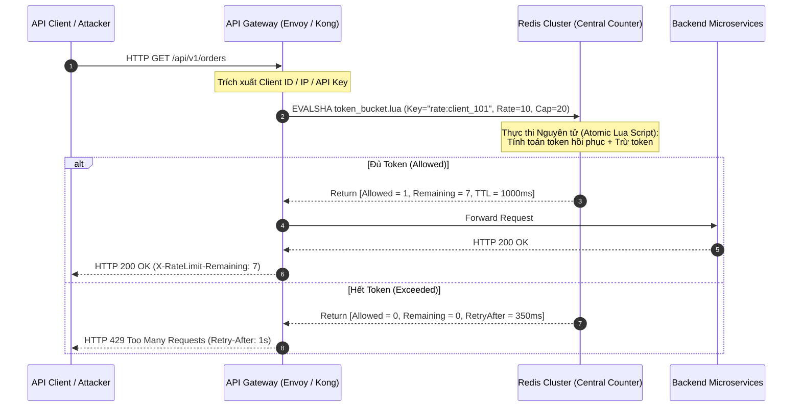

# 14.1. Distributed Rate Limiting Algorithms & Implementations

> [!IMPORTANT]
> **Nếu bạn chỉ được nhớ một điều duy nhất**: Giới hạn tốc độ phân tán (Distributed Rate Limiting) là lá chắn đầu tiên bảo vệ hệ thống khỏi các cuộc tấn công từ chối dịch vụ (DDoS), crawler vét cạn, và hiện tượng "hàng xóm ồn ào" (Noisy Neighbors). Điểm mấu chốt khi triển khai trên cụm phân tán là: **Bắt buộc phải thực thi logic kiểm tra và trừ token nguyên tử (Atomic Check-and-Deduct) bằng Redis Lua Script**. Nếu tách rời thao tác đọc (`GET`) và ghi (`SET`), hiện tượng tranh chấp tương tranh (**Race Condition**) sẽ cho phép lượng truy vấn vượt quá giới hạn hàng chục lần. Khi Redis bị sự cố, kiến trúc sư phải lựa chọn giữa **Fail-Open (Ưu tiên khả dụng)** hoặc **Fail-Closed (Ưu tiên bảo mật)**.

---

## 1. Kiến trúc Tổng quan & Mô hình Tư duy (Mental Model)

### Ẩn dụ Đời sống: Trạm Thu Phí Đường Cao Tốc và Cửa Xoay Tự Động
Hãy tưởng tượng một trạm thu phí trên tuyến đường cao tốc đông đúc:
- **Rate Limiting (Giới hạn lưu lượng)**: Mỗi ô tô chỉ được phép đi qua nếu tài xế có một chiếc vé hợp lệ. Trạm quy định: mỗi phút chỉ phát tối đa 100 vé.
- **Token Bucket (Xô đựng vé)**: Nhân viên trạm thả đều đặn 10 vé vào hộp mỗi giây. Nếu lúc vắng xe, hộp có thể chứa tối đa 50 vé tích lũy. Khi có một đoàn xe 30 chiếc ùa tới cùng lúc (Traffic Burst), cả 30 xe được rút vé và qua trạm ngay lập tức!
- **Leaky Bucket (Cửa xoay hẹp nhỏ giọt)**: Dù bên ngoài có 500 xe xếp hàng dồn dập, cửa xoay cơ học chỉ mở cho đúng 1 xe đi qua mỗi 2 giây. Dòng xe được nắn phẳng hoàn toàn (**Traffic Shaping**). Xe nào đến sau khi hàng chờ đầy sẽ bị đuổi quay đầu (**Dropped / 429 Too Many Requests**).
- **Fixed Window Trap (Cơn ác mộng đổi ca)**: Trạm quy định 100 xe/phút từ 08:00 đến 08:01. Nếu 100 xe chạy qua vào lúc 08:00:59 và 100 xe khác chạy qua vào lúc 08:01:01, thì trong khoảng thời gian chỉ 2 giây quanh mốc giao ca, đã có tới 200 xe tràn qua làm sập cây cầu phía trước!



---

## 2. Chi tiết từng Keyword (Under-the-Hood Deep Dive)

### 2.1. Phân biệt: Rate Limiting vs Throttling vs Traffic Shaping vs Traffic Policing

| Khái niệm | Hành động khi vượt ngưỡng | Mục đích cốt lõi | Vị trí áp dụng phổ biến |
| :--- | :--- | :--- | :--- |
| **Rate Limiting** | Từ chối ngay lập tức (**Drop / Return HTTP 429**) các request vượt quá định mức cho phép. | Bảo vệ tài nguyên backend khỏi bị quá tải, ngăn chặn spam và brute-force. | API Gateway, WAF, Edge Proxy (Cloudflare, Kong). |
| **Throttling** | Làm chậm tốc độ xử lý hoặc giới hạn số lượng tài nguyên (Concurrency / CPU limit) mà một client được cấp. | Ngăn chặn hiện tượng chiếm dụng tài nguyên độc quyền (Fair resource sharing). | Database Connection Pools, Message Consumer concurrency. |
| **Traffic Shaping** | Lưu tạm thời các gói tin vượt ngưỡng vào hàng đợi (Buffer / Queue) và xả ra với **tốc độ đều đặn liên tục**. | Làm phẳng các đợt bùng nổ lưu lượng (Smooth out bursts), tối ưu hóa băng thông mạng. | Network Routers, Video Streaming, Message Brokers. |
| **Traffic Policing** | Không lưu đệm; gói tin nào vượt ngưỡng tốc độ cam kết sẽ bị **vứt bỏ ngay lập tức (Hard Drop)**. | Thực thi nghiêm ngặt thỏa thuận mức dịch vụ mạng (SLA Bandwidth contract). | ISP Core Routers, Telco Networks. |

### 2.2. Năm thuật toán giới hạn tốc độ kinh điển (Rate Limiting Algorithms)

#### 1. Token Bucket Algorithm (Xô đựng thẻ)
- Một chiếc xô có dung lượng tối đa $C$ (Capacity).
- Thẻ (Tokens) được nạp đều đặn vào xô với tốc độ không đổi $R$ token mỗi giây. Nếu xô đầy, token mới rơi ra ngoài bị bỏ qua.
- Mỗi request đến cần rút $1$ (hoặc $K$) token khỏi xô:
  - Nếu số token hiện có $\ge 1$: Trừ token và cho phép request đi qua.
  - Nếu số token $< 1$: Từ chối request (HTTP 429).
- **Ưu điểm vượt trội**: **Cho phép bùng nổ lưu lượng tức thời (Burst Traffic)** lên tới dung lượng $C$, rất thân thiện với trải nghiệm người dùng thực tế.

#### 2. Leaky Bucket Algorithm (Xô rò nước)
- Một chiếc xô có đáy bị thủng một lỗ nhỏ, nước rò rỉ ra ngoài với tốc độ không đổi $R$.
- Các request đến tương tự như các ca nước đổ vào xô. Dung lượng tối đa của xô là $C$ (Hàng đợi đệm):
  - Nếu xô còn chỗ trống: Request được xếp vào hàng đợi và được xử lý theo tốc độ rò rỉ đều đặn $R$.
  - Nếu xô đầy tràn: Request bị vứt bỏ lập tức.
- **Ưu điểm**: Đảm bảo tải đi vào backend luôn là một đường thẳng hoàn hảo, loại bỏ 100% rủi ro quá tải đột ngột.

#### 3. Fixed Window Counter (Bộ đếm khung thời gian cố định)
- Chia thời gian thành các khung cố định (ví dụ: $00:00 - 00:01$, $00:01 - 00:02$).
- Mỗi khung có một bộ đếm số nguyên. Khi request đến, tăng bộ đếm thêm 1. Nếu bộ đếm $> \text{Limit}$, từ chối.
- **Lỗ hổng 2x Traffic (Boundary Problem)**: Nếu limit là 100 req/phút:
  - Client gửi 100 request ở giây thứ $59$ của phút thứ nhất.
  - Client gửi tiếp 100 request ở giây thứ $01$ của phút thứ hai.
  - Cả hai đợt đều hợp lệ theo thuật toán, nhưng trong khoảng thời gian chỉ 2 giây, hệ thống phải hứng chịu **200 requests (Gấp đôi ngưỡng an toàn)**!

#### 4. Sliding Window Log (Nhật ký cửa sổ trượt)
- Lưu timestamp của **từng request** của client vào một tập hợp có thứ tự (Sorted Set).
- Khi có request mới tại thời điểm $T$:
  - Xóa toàn bộ các timestamp cũ hơn $T - \text{WindowSize}$ (lệnh `ZREMRANGEBYSCORE`).
  - Đếm số lượng phần tử còn lại trong tập hợp (lệnh `ZCARD`).
  - Nếu số lượng $< \text{Limit}$: Thêm timestamp $T$ vào tập hợp và cho phép; ngược lại từ chối.
- **Ưu điểm**: Chính xác tuyệt đối $100\%$, không có lỗ hổng ranh giới.
- **Nhược điểm chí mạng**: **Tốn bộ nhớ RAM khổng lồ**. Nếu một user gửi $10.000$ req/phút, Redis phải lưu $10.000$ số thực 64-bit cho duy nhất một user!

#### 5. Sliding Window Counter / Estimation (Ước lượng cửa sổ trượt - Cloudflare)
Thuật toán thông minh của Cloudflare kết hợp sự nhẹ nhàng về RAM của Fixed Window với độ chính xác của Sliding Window:
- Chỉ lưu bộ đếm của **Khung giờ Hiện tại** và **Khung giờ Trước đó**.
- Công thức ước lượng số lượng request trong cửa sổ trượt:
  $$\text{Count} = \text{Count}_{\text{current}} + \text{Count}_{\text{previous}} \times (1 - \text{Tỷ lệ thời gian đã trôi qua})$$
- Ví dụ: Trong cửa sổ 1 phút, hiện tại đang ở giây thứ 18 (đã trôi qua 30%):
  $$\text{Count} = \text{Count}_{\text{current}} + \text{Count}_{\text{previous}} \times 0.70$$
- Tiết kiệm $99\%$ RAM so với Sliding Window Log trong khi sai số thực nghiệm $< 0.05\%$!

### 2.3. Triển khai Distributed Rate Limiter với Redis & Lua Script

#### 1. Nguy cơ Race Condition nếu không dùng Lua Script
Nếu viết mã nguồn phía ứng dụng:
```python
current = redis.get(key)
if current < limit:
    redis.incr(key) # NGUY HIỂM: Race condition giữa GET và INCR!
```
Khi có 100 request đồng thời từ 10 container khác nhau, cả 100 request cùng đọc được `current = 99` $\implies$ Cả 100 request cùng được cấp phép! Giới hạn bị phá vỡ hoàn toàn.

#### 2. Thuật toán Token Bucket bằng Redis Lua Script (Atomic Execution)
Thay vì dùng timer chạy ngầm để nạp token (tốn tài nguyên), chúng ta áp dụng **Lazy Refill (Nạp lười)** dựa trên khoảng cách thời gian giữa 2 lần request liên tiếp:
$$\text{Tokens to Add} = (\text{CurrentTime} - \text{LastRefillTime}) \times \text{RefillRate}$$
Toàn bộ logic tính toán và trừ token được đóng gói vào một **Lua Script duy nhất** chạy nguyên tử trên Redis Event Loop.

### 2.4. Fault Tolerance trong Rate Limiting: Fail-Open vs Fail-Closed
Chuyện gì xảy ra nếu cụm Redis bị sập mạng, quá tải CPU $100\%$, hoặc timeout?
- **Chiến lược Fail-Open (Mở cổng an toàn - Ưu tiên Tính khả dụng)**:
  - Nếu không thể kết nối tới Redis, API Gateway tự động cho phép toàn bộ traffic đi qua.
  - Tránh làm gián đoạn trải nghiệm người dùng thật. Rủi ro: Backend có thể bị sập nếu đang bị tấn công DDoS thực sự.
  - Phù hợp cho: Ứng dụng thương mại điện tử, đặt xe, xem phim.
- **Chiến lược Fail-Closed (Đóng cổng an toàn - Ưu tiên Bảo mật)**:
  - Nếu Redis sập, từ chối toàn bộ request hoặc chỉ cho phép một lượng traffic nội bộ rất nhỏ.
  - Bảo vệ tuyệt đối an toàn cho cơ sở dữ liệu backend.
  - Phù hợp cho: Cổng thanh toán tài chính, API ngân hàng, hệ thống chứng khoán.

---

## 3. Thực thi Mã nguồn & Mô phỏng Chuyên sâu (Dual-Engine Implementation)

### Engine 1: C++20 — Mô phỏng Cốt lõi Token Bucket Rate Limiter Thread-Safe với Lazy Refill

```cpp
#include <iostream>
#include <chrono>
#include <mutex>
#include <algorithm>
#include <format>
#include <thread>
#include <vector>

class ThreadSafeTokenBucket {
private:
    double capacity_;       // Dung lượng xô tối đa
    double refill_rate_;    // Tốc độ nạp (tokens / giây)
    double tokens_;         // Số token hiện có
    std::chrono::steady_clock::time_point last_refill_time_;
    std::mutex mtx_;

public:
    ThreadSafeTokenBucket(double capacity, double refill_rate)
        : capacity_(capacity), refill_rate_(refill_rate), tokens_(capacity),
          last_refill_time_(std::chrono::steady_clock::now()) {}

    bool allow(double tokens_requested = 1.0) {
        std::lock_guard<std::mutex> lock(mtx_);
        auto now = std::chrono::steady_clock::now();

        // 1. Tính toán lượng thời gian trôi qua để nạp token lười (Lazy Refill)
        std::chrono::duration<double> elapsed = now - last_refill_time_;
        last_refill_time_ = now;

        double tokens_to_add = elapsed.count() * refill_rate_;
        tokens_ = std::min(capacity_, tokens_ + tokens_to_add);

        // 2. Kiểm tra xem có đủ token để phục vụ request không
        if (tokens_ >= tokens_requested) {
            tokens_ -= tokens_requested;
            return true;
        }

        return false;
    }

    double get_current_tokens() {
        std::lock_guard<std::mutex> lock(mtx_);
        return tokens_;
    }
};

int main() {
    // Xô có dung lượng tối đa 5 token, tốc độ hồi phục 2 token / giây
    ThreadSafeTokenBucket bucket(5.0, 2.0);

    std::cout << "--- Bước 1: Bắn liên tiếp 6 request tức thời (Kỳ vọng 5 thành công, 1 thất bại) ---\n";
    for (int i = 1; i <= 6; ++i) {
        bool ok = bucket.allow(1.0);
        std::cout << std::format("  Request #{}: {} (Tokens còn lại: {:.2f})\n",
            i, (ok ? "[ALLOWED 200]" : "[DENIED 429]"), bucket.get_current_tokens());
    }

    std::cout << "\n--- Bước 2: Chờ 1 giây để nạp hồi phục 2 token ---\n";
    std::this_thread::sleep_for(std::chrono::milliseconds(1000));

    std::cout << "--- Bước 3: Gửi tiếp 3 request ---\n";
    for (int i = 7; i <= 9; ++i) {
        bool ok = bucket.allow(1.0);
        std::cout << std::format("  Request #{}: {} (Tokens còn lại: {:.2f})\n",
            i, (ok ? "[ALLOWED 200]" : "[DENIED 429]"), bucket.get_current_tokens());
    }

    return 0;
}
```

#### Terminal Output Mẫu:
```text
--- Bước 1: Bắn liên tiếp 6 request tức thời (Kỳ vọng 5 thành công, 1 thất bại) ---
  Request #1: [ALLOWED 200] (Tokens còn lại: 4.00)
  Request #2: [ALLOWED 200] (Tokens còn lại: 3.00)
  Request #3: [ALLOWED 200] (Tokens còn lại: 2.00)
  Request #4: [ALLOWED 200] (Tokens còn lại: 1.00)
  Request #5: [ALLOWED 200] (Tokens còn lại: 0.00)
  Request #6: [DENIED 429] (Tokens còn lại: 0.00)

--- Bước 2: Chờ 1 giây để nạp hồi phục 2 token ---
--- Bước 3: Gửi tiếp 3 request ---
  Request #7: [ALLOWED 200] (Tokens còn lại: 1.00)
  Request #8: [ALLOWED 200] (Tokens còn lại: 0.00)
  Request #9: [DENIED 429] (Tokens còn lại: 0.00)
```

---

### Engine 2: Python 3.11+ — Mô phỏng Redis Lua Script Sliding Window Counter Rate Limiter Chuẩn Production

```python
import time
from typing import Dict, Tuple

class MockRedisWithLua:
    """Mô phỏng máy chủ Redis hỗ trợ thực thi Lua Script nguyên tử và Time API."""
    def __init__(self):
        self.hashes: Dict[str, Dict[str, str]] = {}

    def execute_sliding_window_lua(self, key: str, limit: int, window_sec: int) -> Tuple[int, int, float]:
        """
        Mô phỏng chính xác logic của Lua Script Sliding Window Counter trong Redis:
        KEYS[1] = key
        ARGV[1] = limit
        ARGV[2] = window_sec
        """
        now = time.time()
        current_window = int(now // window_sec)
        previous_window = current_window - 1
        time_into_current = now % window_sec
        weight = 1.0 - (time_into_current / window_sec)

        if key not in self.hashes:
            self.hashes[key] = {}

        data = self.hashes[key]
        curr_count = int(data.get(str(current_window), 0))
        prev_count = int(data.get(str(previous_window), 0))

        estimated_count = curr_count + int(prev_count * weight)

        if estimated_count < limit:
            # Cho phép và tăng bộ đếm khung hiện tại
            curr_count += 1
            data[str(current_window)] = str(curr_count)
            # Dọn dẹp các khung cũ hơn previous
            for w in list(data.keys()):
                if int(w) < previous_window:
                    del data[w]
            return 1, limit - estimated_count - 1, window_sec - time_into_current
        else:
            # Bị vượt ngưỡng
            return 0, 0, window_sec - time_into_current

class DistributedRateLimiterClient:
    def __init__(self, redis: MockRedisWithLua, limit: int, window_sec: int):
        self.redis = redis
        self.limit = limit
        self.window_sec = window_sec

    def check_rate_limit(self, client_id: str) -> bool:
        key = f"rate_limit:{client_id}"
        allowed, remaining, ttl = self.redis.execute_sliding_window_lua(key, self.limit, self.window_sec)
        if allowed == 1:
            print(f"[Gateway] Client '{client_id}' -> 200 OK | Còn lại: {remaining} requests | Reset sau: {ttl:.1f}s")
            return True
        else:
            print(f"[Gateway] Client '{client_id}' -> 429 TOO MANY REQUESTS! Đã vượt hạn mức {self.limit}/{self.window_sec}s! Thử lại sau {ttl:.1f}s")
            return False

def main():
    redis = MockRedisWithLua()
    # Định mức: Tối đa 3 requests trong cửa sổ 1 giây
    limiter = DistributedRateLimiterClient(redis, limit=3, window_sec=1)

    print("--- 1. Bắn 4 requests liên tục từ Client_A ---")
    limiter.check_rate_limit("Client_A")
    limiter.check_rate_limit("Client_A")
    limiter.check_rate_limit("Client_A")
    limiter.check_rate_limit("Client_A") # Kỳ vọng bị 429

    print("\n--- 2. Kiểm tra Client_B độc lập (Kỳ vọng vẫn được phép) ---")
    limiter.check_rate_limit("Client_B")

    print("\n--- 3. Chờ 1.1 giây để bước sang cửa sổ mới ---")
    time.sleep(1.1)
    limiter.check_rate_limit("Client_A")

if __name__ == "__main__":
    main()
```

#### Terminal Output Mẫu:
```text
--- 1. Bắn 4 requests liên tục từ Client_A ---
[Gateway] Client 'Client_A' -> 200 OK | Còn lại: 2 requests | Reset sau: 0.8s
[Gateway] Client 'Client_A' -> 200 OK | Còn lại: 1 requests | Reset sau: 0.8s
[Gateway] Client 'Client_A' -> 200 OK | Còn lại: 0 requests | Reset sau: 0.8s
[Gateway] Client 'Client_A' -> 429 TOO MANY REQUESTS! Đã vượt hạn mức 3/1s! Thử lại sau 0.8s

--- 2. Kiểm tra Client_B độc lập (Kỳ vọng vẫn được phép) ---
[Gateway] Client 'Client_B' -> 200 OK | Còn lại: 2 requests | Reset sau: 0.8s

--- 3. Chờ 1.1 giây để bước sang cửa sổ mới ---
[Gateway] Client 'Client_A' -> 200 OK | Còn lại: 2 requests | Reset sau: 0.7s
```

---

## 4. Systems Engineering & Production Pitfalls

### 4.1. Những cạm bẫy sống còn khi triển khai Distributed Rate Limiting
1. **Độ trễ Round-Trip Time (RTT) tới Redis trên mọi Request**:
   - Nếu mỗi request gửi tới API Gateway đều phải thực hiện một lệnh đồng bộ tới Redis ($1-2\text{ms}$), độ trễ P99 của toàn bộ hệ thống sẽ tăng gấp đôi.
   - *Khắc phục*: Triển khai kỹ thuật **Token Batching cục bộ (Local Token Bucket)**. API Gateway xin cấp trước một batch 50 tokens từ Redis về bộ nhớ RAM cục bộ của Pod, sau đó tự trừ dần trên RAM. Khi sắp hết mới xin tiếp batch mới.

2. **Cấu hình Client IP Spoofing qua Header `X-Forwarded-For`**:
   - Nếu rate limiter dựa vào IP trích xuất từ header `X-Forwarded-For` mà không cấu hình tin cậy Reverse Proxy (`trusted_proxies`), hacker có thể gửi header giả mạo `X-Forwarded-For: 1.2.3.4` ngẫu nhiên trên mỗi request để vượt qua rate limiting hoàn toàn!
   - *Khắc phục*: Chỉ đọc IP từ tầng TCP Socket của Gateway hoặc từ Cloudflare Header được xác thực (`CF-Connecting-IP`).

3. **Cạn kiệt Connection Pool Redis khi có Traffic Spike**:
   - Khi có đợt tấn công DDoS với 500.000 req/s, API Gateway tạo ra 500.000 kết nối đồng thời tới Redis làm tràn Connection Pool và cạn kiệt File Descriptors (`Too many open files`).
   - *Khắc phục*: Sử dụng Envoy Proxy native Redis rate-limiting filter với persistent connection pooling và kích hoạt **Fail-Open** khi Redis latency vượt quá 10ms.

### 4.2. Runbook Chẩn đoán Sự cố Rate Limiting trên Production (CLI Commands)

```bash
# 1. Kiểm tra số lượng request bị chặn 429 trên Nginx / Envoy Access Log
tail -n 1000 /var/log/nginx/access.log | awk '{print $9}' | grep 429 | wc -l

# 2. Theo dõi tốc độ thực thi lệnh của Redis rate-limiting keyspace
redis-cli --latency-history -h localhost -p 6379

# 3. Xem danh sách các key bị giới hạn tốc độ đang có trong Redis
redis-cli --scan --pattern "rate_limit:*" | head -n 20
```

---

## 5. Bảng So sánh & Decision Matrix

| Thuật toán | Cho phép Burst Traffic? | Tiêu tốn Bộ nhớ RAM | Độ chính xác toán học | Trường hợp Khuyên dùng |
| :--- | :--- | :--- | :--- | :--- |
| **Token Bucket** | **Có (Lên tới Capacity $C$)** | Rất thấp ($O(1)$) | Rất cao | **API Gateway, Stripe/GitHub API, User Quotas** |
| **Leaky Bucket** | Không (Làm phẳng cứng) | Rất thấp ($O(1)$) | Rất cao | **Nắn dòng dữ liệu vào Database, Message Ingestion** |
| **Fixed Window Counter** | Có (Lỗ hổng 2x ở ranh giới) | Thấp nhất ($O(1)$) | Kém | Hạn chế mức đơn giản theo ngày/tháng (VD: 1000 email/ngày) |
| **Sliding Window Log** | Không | **Rất cao ($O(N)$ requests)**| Hoàn hảo $100\%$ | Hệ thống tài chính bảo mật cao với tần suất request thấp |
| **Sliding Window Counter** | Có (Được điều chỉnh mịn) | Rất thấp ($O(1)$) | Cao (Sai số $< 0.1\%$) | **Cloudflare WAF, Enterprise Traffic Management** |
