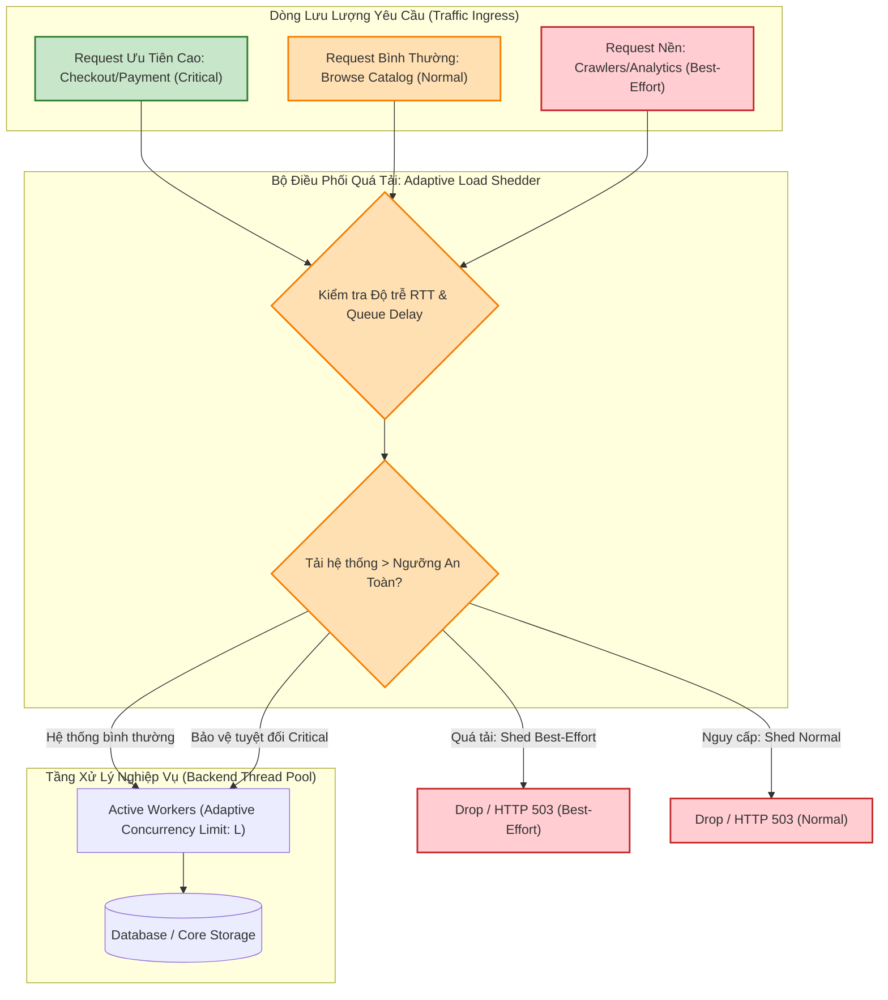

# 14.2. Traffic Management, Load Shedding & Adaptive Concurrency Limits

> [!IMPORTANT]
> **Nếu bạn chỉ được nhớ một điều duy nhất**: Khi hệ thống bị quá tải, việc tiếp tục cố gắng phục vụ toàn bộ yêu cầu sẽ dẫn đến hiện tượng **Sụp đổ quá tải (Overload Collapse)**: hàng đợi phình to vô hạn, độ trễ tăng vọt khiến các yêu cầu bị timeout nhưng CPU vẫn tiếp tục xử lý các công việc vô ích, khiến lượng dữ liệu hữu ích (**Goodput**) rơi tự do về 0. Giải pháp sống còn là **Load Shedding** (chủ động vứt bỏ các yêu cầu ưu tiên thấp ngay tại cửa vào) kết hợp với **Adaptive Concurrency Limits** (tự động điều chỉnh số lượng kết nối đồng thời dựa trên Định luật Little và thuật toán TCP Vegas theo thời gian thực thay vì sử dụng các con số cấu hình tĩnh cứng nhắc).

---

## 1. Kiến trúc Tổng quan & Mô hình Tư duy (Mental Model)

### Ẩn dụ Đời sống: Phòng Cấp Cứu Bệnh Viện và Thảm Họa Sập Hầm
Hãy tưởng tượng một phòng cấp cứu (Emergency Room) trong một đợt thảm họa:
- **Throughput vs Goodput**:
  - Throughput: Tổng số bệnh nhân được bác sĩ thăm khám (bao gồm cả những người đã tử vong trước khi kịp tiêm thuốc).
  - Goodput: Số bệnh nhân thực sự được cứu sống kịp thời và xuất viện khỏe mạnh.
- **Hiện tượng Sụp đổ Quá tải (Overload Collapse)**: Nếu phòng cấp cứu chỉ có 5 bác sĩ nhưng tiếp nhận 500 nạn nhân cùng lúc và cho tất cả vào phòng chờ. Hàng đợi quá dài khiến thời gian chờ khám lên tới 4 tiếng. Khi bác sĩ đến lượt khám cho bệnh nhân thứ 50, người này đã chết do mất máu quá lâu. Bác sĩ tốn 30 phút hô hấp nhân tạo vô ích (lãng phí CPU), trong khi bệnh nhân thứ 51 bên ngoài tiếp tục tử vong. Tỷ lệ cứu sống (Goodput) tụt về 0%!
- **Priority-based Load Shedding (Phân loại Triage Cấp cứu)**: Y tá trưởng đứng ngay tại cổng:
  - Bệnh nhân nguy kịch, ngừng tim $\to$ **Critical Priority** (Đưa vào phòng mổ ngay lập tức).
  - Bệnh nhân trầy xước nhẹ, gãy ngón tay $\to$ **Non-critical** (Chủ động từ chối tiếp nhận hoặc yêu cầu chuyển sang trạm y tế phường).
- **Adaptive Concurrency Limits**: Giám đốc bệnh viện không đặt cứng quy tắc *"Mỗi bác sĩ luôn khám 10 người/giờ"*. Nếu ca mổ hôm nay phức tạp làm thời gian mổ kéo dài (RTT tăng), hệ thống tự động giảm số ca tiếp nhận đồng thời để bác sĩ không bị kiệt sức.



---

## 2. Chi tiết từng Keyword (Under-the-Hood Deep Dive)

### 2.1. Phân biệt Throughput vs Goodput & Hiện tượng sụp đổ quá tải

#### 1. Định nghĩa Kỹ thuật
- **Throughput (Thông lượng tổng)**: Tốc độ xử lý của hệ thống, đo bằng số lượng requests hoàn tất mỗi giây (req/s), **bất kể kết quả trả về là thành công hay thất bại/timeout**.
- **Goodput (Thông lượng hữu ích)**: Số lượng requests hoàn tất **thành công và trả về cho Client trước khi Client bị timeout**:
  $$\text{Goodput} = \frac{\text{Số requests thành công và còn giá trị}}{\text{Thời gian}}$$

#### 2. Hiện tượng Overload Collapse (Sụp đổ do Quá tải)
Khi lưu lượng vượt quá giới hạn bão hòa của phần cứng:
1. Hàng đợi (Queue) nội bộ của Web Server/Container phình to.
2. Thời gian một request nằm chờ trong hàng đợi (**Queue Delay**) tăng từ $5\text{ms}$ lên $5.000\text{ms}$.
3. Client (hoặc API Gateway) có cấu hình Timeout là $2.000\text{ms}$ $\implies$ Client đã ngắt kết nối và ném lỗi `HTTP 504 Gateway Timeout`.
4. Tuy nhiên, Worker Thread của server không hề hay biết, vẫn rút request đó ra khỏi hàng đợi và tiêu tốn CPU/DB query để xử lý trong 500ms nữa $\implies$ **Lãng phí 100% tài nguyên CPU cho một yêu cầu mà client đã bỏ đi!**
5. Lượng việc vô ích tích tụ khiến hàng đợi càng phình to hơn $\implies$ **Goodput tụt dốc không phanh về 0!**

#### Sơ đồ minh họa Đường cong Throughput vs Goodput khi có Load Shedding
```text
Lưu lượng Hữu ích (Goodput)
    ^
Max |          /-------------------\ (Có Load Shedding: Giữ vững Goodput tại đỉnh)
    |         /                     \
    |        /                       \................ (Không Load Shedding)
    |       /                                         \
    |      /                                           \ (Overload Collapse: Rơi tự do về 0)
    +----------------------------------------------------> Lưu lượng Yêu cầu (Offered Load)
           Dung lượng tối đa (Capacity)
```

### 2.2. Priority-based Load Shedding (Thả bỏ tải theo thứ tự ưu tiên)
Thay vì từ chối request ngẫu nhiên khi quá tải, Load Shedder phân loại lưu lượng thành các tầng ưu tiên:

| Cấp độ Ưu tiên | Loại lưu lượng tiêu biểu | Hành động khi Tải đạt 80% | Hành động khi Tải đạt 95% |
| :--- | :--- | :--- | :--- |
| **P0: Critical** | Quẹt thẻ thanh toán, Xác thực OTP, Checkout đơn hàng. | **Luôn luôn phục vụ 100%** | **Luôn luôn phục vụ 100%** |
| **P1: Standard** | Xem chi tiết sản phẩm, Tìm kiếm từ khóa. | Phục vụ 100% | Thả bỏ ngẫu nhiên $30-50\%$ |
| **P2: Low / Batch**| Báo cáo thống kê, Đề xuất sản phẩm cá nhân hóa. | Thả bỏ $50\%$ | **Thả bỏ 100% (Drop immediately)** |
| **P3: Best-Effort**| Web crawlers, Healthcheck không trọng yếu, Telemetry. | **Thả bỏ 100%** | **Thả bỏ 100%** |

- **Nguyên tắc Fast-Fail (Từ chối thần tốc)**: Việc từ chối một request bị shed phải diễn ra trong vòng $< 1\text{ms}$ ngay tại tầng Gateway/Filter, trả về `HTTP 503 Service Unavailable` hoặc `HTTP 429` với header `Retry-After`, tuyệt đối không để request chạm vào database.

### 2.3. Tại sao cấu hình Max Concurrency cố định luôn luôn thất bại?
Hầu hết các kỹ sư thường cấu hình tĩnh số lượng luồng đồng thời trong Tomcat/Gunicorn/Envoy: `max_connections = 200`. Con số này mang tính chất giả định tĩnh chết người:
- Khi Database phản hồi nhanh ($10\text{ms}$): 200 kết nối phục vụ được:
  $$\text{Throughput} = \frac{200}{0.01\text{s}} = 20,000 \text{ req/s}$$
- Khi Database bị chậm do một câu query khóa bảng ($500\text{ms}$):
  $$\text{Throughput} = \frac{200}{0.5\text{s}} = 400 \text{ req/s}$$
- Lúc này, 200 kết nối bị chiếm dụng hoàn toàn; các request mới đổ về không có chỗ chứa, tràn hàng đợi và đánh sập server!
- **Kết luận**: Giới hạn đồng thời (Concurrency Limit) không thể là một hằng số cố định mà bắt buộc phải là một **biến số động thích ứng theo độ trễ thời gian thực**.

### 2.4. Thuật toán Vegas & Little's Law trong Adaptive Limits

#### 1. Định luật Little (Little's Law)
Trong một hệ thống xếp hàng ổn định:
$$L = \lambda \times W$$
- $L$ (Concurrency): Số lượng request đang được xử lý đồng thời trong hệ thống.
- $\lambda$ (Throughput / Arrival Rate): Tốc độ đến của các request.
- $W$ (Latency / Response Time): Thời gian trung bình để xử lý xong một request.

#### 2. Thuật toán TCP Vegas áp dụng vào Concurrency Limits (Netflix Concurrency Limits)
Thuật toán đo lường độ trễ thực tế và so sánh với độ trễ lý tưởng khi không có hàng đợi:
- $RTT_{\text{base}}$: Độ trễ tối thiểu ghi nhận được của hệ thống (khi hệ thống rảnh rỗi nhất).
- $RTT_{\text{actual}}$: Độ trễ trung bình đo được trong cửa sổ gần nhất.
- Số lượng request đang bị ứ đọng trong hàng đợi:
  $$\text{QueueSize} = \text{CurrentLimit} \times \left(1 - \frac{RTT_{\text{base}}}{RTT_{\text{actual}}}\right)$$
- **Quy tắc điều chỉnh Concurrency Limit**:
  - Nếu $\text{QueueSize} < \alpha$ (Hàng đợi quá ngắn, hệ thống còn nhiều năng lực):
    $$\text{Limit}_{\text{new}} = \text{Limit}_{\text{current}} + 1$$
  - Nếu $\text{QueueSize} > \beta$ (Hàng đợi bắt đầu ứ đọng, độ trễ tăng vọt do tắc nghẽn):
    $$\text{Limit}_{\text{new}} = \text{Limit}_{\text{current}} - 1 \quad (\text{hoặc giảm theo tỷ lệ } \beta)$$
  - Nếu $\alpha \le \text{QueueSize} \le \beta$: Giữ nguyên giới hạn hiện tại.

### 2.5. Tầng mạng Kernel: TCP Listen Backlog & Queue Overflow Protection
Trước khi một request chạm tới mã nguồn ứng dụng, nó phải đi qua hai hàng đợi của hệ điều hành Linux Kernel:
1. **SYN Backlog Queue (`tcp_max_syn_backlog`)**: Lưu các kết nối TCP đang ở trạng thái bắt tay nửa vời (SYN_RECV) trong quá trình 3-Way Handshake.
2. **Accept Queue (`somaxconn` / `backlog` trong `listen(fd, backlog)`)**: Lưu các kết nối TCP đã hoàn tất bắt tay (ESTABLISHED) nhưng chưa được tiến trình ứng dụng gọi hàm `accept()` để lấy ra xử lý.
- **Hiểm họa Drop Gói ngầm (Silent Drops)**: Nếu ứng dụng bị nghẽn CPU, Accept Queue sẽ bị đầy. Mặc định Linux sẽ âm thầm vứt bỏ các gói SYN mới hoặc gửi gói RST, khiến Client thấy lỗi `Connection reset by peer` hoặc `Connection timed out` mà không hề có bất kỳ dòng log nào xuất hiện trong ứng dụng!
- *Tối ưu hóa*: Tăng `net.core.somaxconn = 65535` và `net.ipv4.tcp_abort_on_overflow = 1` để thông báo lỗi rõ ràng.

---

## 3. Thực thi Mã nguồn & Mô phỏng Chuyên sâu (Dual-Engine Implementation)

### Engine 1: C++20 — Mô phỏng Bộ điều phối Adaptive Concurrency Limiter theo Thuật toán Vegas

```cpp
#include <iostream>
#include <chrono>
#include <atomic>
#include <algorithm>
#include <cmath>
#include <format>
#include <thread>
#include <vector>

class VegasAdaptiveLimiter {
private:
    double limit_{10.0};       // Concurrency limit ban đầu
    double min_rtt_ms_{1000.0}; // Base RTT tối thiểu ghi nhận được
    double alpha_{3.0};         // Ngưỡng dưới hàng đợi
    double beta_{6.0};          // Ngưỡng trên hàng đợi

    std::atomic<int> in_flight_{0};

public:
    VegasAdaptiveLimiter(double initial_limit, double alpha, double beta)
        : limit_(initial_limit), alpha_(alpha), beta_(beta) {}

    // Kiểm tra xem có thể tiếp nhận request mới không
    bool try_acquire() {
        if (in_flight_.load() < static_cast<int>(limit_)) {
            in_flight_++;
            return true;
        }
        return false; // Bị Load Shed / Concurrency throttled
    }

    // Cập nhật phản hồi sau khi request hoàn tất (Feedback Loop)
    void on_sample(double rtt_ms) {
        in_flight_--;

        // Cập nhật Base RTT nếu phát hiện độ trễ kỷ lục mới
        if (rtt_ms < min_rtt_ms_) {
            min_rtt_ms_ = rtt_ms;
        }

        // Tính toán lượng request ước tính đang nghẽn trong Queue theo Vegas
        double queue_size = limit_ * (1.0 - (min_rtt_ms_ / rtt_ms));

        if (queue_size < alpha_) {
            // Hệ thống rảnh, tăng dần limit
            limit_ += 1.0;
        } else if (queue_size > beta_) {
            // Hệ thống nghẽn, giảm limit để xả tải
            limit_ = std::max(2.0, limit_ - 1.0);
        }

        std::cout << std::format("  [Vegas Feedback] RTT: {:.1f}ms (Base: {:.1f}ms) | QueueSize: {:.2f} | Limit mới: {:.1f}\n",
            rtt_ms, min_rtt_ms_, queue_size, limit_);
    }

    double get_limit() const { return limit_; }
    int get_in_flight() const { return in_flight_.load(); }
};

int main() {
    std::cout << "--- Khởi tạo Adaptive Limiter: Limit ban đầu = 5, Alpha = 2, Beta = 4 ---\n";
    VegasAdaptiveLimiter limiter(5.0, 2.0, 4.0);

    // Giai đoạn 1: Hệ thống nhanh và ổn định (RTT ~ 10ms) -> Limit tự động tăng
    std::cout << "\n>>> Giai đoạn 1: Độ trễ thấp (10ms) -> Kỳ vọng Limit tăng trưởng\n";
    for (int i = 0; i < 4; ++i) {
        if (limiter.try_acquire()) {
            limiter.on_sample(10.0);
        }
    }

    // Giai đoạn 2: Hệ thống bị quá tải, DB chậm chạp (RTT tăng vọt lên 40ms) -> Limit tự động co lại
    std::cout << "\n>>> Giai đoạn 2: Database bị nghẽn, RTT nhảy lên 40ms -> Kỳ vọng Limit tụt giảm\n";
    for (int i = 0; i < 5; ++i) {
        if (limiter.try_acquire()) {
            limiter.on_sample(40.0);
        }
    }

    std::cout << std::format("\n[Kết quả cuối cùng] Concurrency Limit hiện tại: {:.1f}\n", limiter.get_limit());
    return 0;
}
```

#### Terminal Output Mẫu:
```text
--- Khởi tạo Adaptive Limiter: Limit ban đầu = 5, Alpha = 2, Beta = 4 ---

>>> Giai đoạn 1: Độ trễ thấp (10ms) -> Kỳ vọng Limit tăng trưởng
  [Vegas Feedback] RTT: 10.0ms (Base: 10.0ms) | QueueSize: 0.00 | Limit mới: 6.0
  [Vegas Feedback] RTT: 10.0ms (Base: 10.0ms) | QueueSize: 0.00 | Limit mới: 7.0
  [Vegas Feedback] RTT: 10.0ms (Base: 10.0ms) | QueueSize: 0.00 | Limit mới: 8.0
  [Vegas Feedback] RTT: 10.0ms (Base: 10.0ms) | QueueSize: 0.00 | Limit mới: 9.0

>>> Giai đoạn 2: Database bị nghẽn, RTT nhảy lên 40ms -> Kỳ vọng Limit tụt giảm
  [Vegas Feedback] RTT: 40.0ms (Base: 10.0ms) | QueueSize: 6.75 | Limit mới: 8.0
  [Vegas Feedback] RTT: 40.0ms (Base: 10.0ms) | QueueSize: 6.00 | Limit mới: 8.0
  [Vegas Feedback] RTT: 40.0ms (Base: 10.0ms) | QueueSize: 6.00 | Limit mới: 8.0
  [Vegas Feedback] RTT: 40.0ms (Base: 10.0ms) | QueueSize: 6.00 | Limit mới: 8.0
  [Vegas Feedback] RTT: 40.0ms (Base: 10.0ms) | QueueSize: 6.00 | Limit mới: 8.0

[Kết quả cuối cùng] Concurrency Limit hiện tại: 8.0
```

---

### Engine 2: Python 3.11+ — Mô phỏng Priority-based Load Shedder Chống Hiện tượng Sụp Đổ Quá Tải

```python
import asyncio
from enum import IntEnum
from typing import NamedTuple

class Priority(IntEnum):
    CRITICAL = 1  # Thanh toán / Đặt hàng
    NORMAL = 2    # Xem sản phẩm
    BATCH = 3     # Thu thập dữ liệu / Bot

class Request(NamedTuple):
    req_id: str
    priority: Priority
    cost_ms: float

class LoadSheddingGateway:
    def __init__(self, max_queue_capacity: int = 5):
        self.max_capacity = max_queue_capacity
        self.queue = []
        self.successful_goodput = 0
        self.dropped_count = 0

    def admit(self, req: Request) -> bool:
        """Quyết định Load Shedding dựa trên mức độ ưu tiên và độ đầy của hàng đợi."""
        current_len = len(self.queue)

        # Nếu hàng đợi còn rảnh, nhận tất cả
        if current_len < 3:
            self.queue.append(req)
            return True

        # Khi hàng đợi đầy trên 60%, thả bỏ ngay BATCH
        if req.priority == Priority.BATCH:
            print(f"  [LOAD SHED] Thả bỏ Request BATCH #{req.req_id} (Queue đã đạt {current_len}/{self.max_capacity})")
            self.dropped_count += 1
            return False

        # Khi hàng đợi đầy 100%, chỉ giữ lại CRITICAL nếu có thể
        if current_len >= self.max_capacity:
            if req.priority == Priority.CRITICAL:
                # Tước quyền của một task Normal hoặc Batch trong queue để nhường chỗ
                for idx, queued in enumerate(self.queue):
                    if queued.priority > Priority.CRITICAL:
                        dropped = self.queue.pop(idx)
                        print(f"  [PREEMPTION] Tước quyền #{dropped.req_id} ({dropped.priority.name}) nhường chỗ cho CRITICAL #{req.req_id}!")
                        self.queue.append(req)
                        self.dropped_count += 1
                        return True
            print(f"  [OVERFLOW DROP] Hàng đợi đầy cứng! Bác bỏ #{req.req_id} ({req.priority.name})")
            self.dropped_count += 1
            return False

        self.queue.append(req)
        return True

    async def process_all(self):
        while self.queue:
            req = self.queue.pop(0)
            await asyncio.sleep(req.cost_ms / 1000.0)
            self.successful_goodput += 1
            print(f"    [Executed 200 OK] Hoàn thành #{req.req_id} ({req.priority.name})")

async def main():
    gateway = LoadSheddingGateway(max_queue_capacity=4)

    requests = [
        Request("REQ_01", Priority.NORMAL, 20),
        Request("REQ_02", Priority.NORMAL, 20),
        Request("REQ_03", Priority.BATCH, 50),
        Request("REQ_04", Priority.BATCH, 50),   # Bị Shed vì Queue >= 3
        Request("REQ_05", Priority.NORMAL, 20),
        Request("REQ_06", Priority.CRITICAL, 30) # Preempt một task thường để được vào
    ]

    print("--- 1. Tiếp nhận đợt sóng 6 requests dồn dập ---")
    for r in requests:
        gateway.admit(r)

    print("\n--- 2. Xử lý hàng đợi được bảo vệ ---")
    await gateway.process_all()

    print(f"\n[Thống kê] Goodput Thành công: {gateway.successful_goodput} | Dropped: {gateway.dropped_count}")

if __name__ == "__main__":
    asyncio.run(main())
```

#### Terminal Output Mẫu:
```text
--- 1. Tiếp nhận đợt sóng 6 requests dồn dập ---
  [LOAD SHED] Thả bỏ Request BATCH #REQ_04 (Queue đã đạt 3/4)
  [PREEMPTION] Tước quyền #REQ_03 (BATCH) nhường chỗ cho CRITICAL #REQ_06!

--- 2. Xử lý hàng đợi được bảo vệ ---
    [Executed 200 OK] Hoàn thành #REQ_01 (NORMAL)
    [Executed 200 OK] Hoàn thành #REQ_02 (NORMAL)
    [Executed 200 OK] Hoàn thành #REQ_05 (NORMAL)
    [Executed 200 OK] Hoàn thành #REQ_06 (CRITICAL)

[Thống kê] Goodput Thành công: 4 | Dropped: 2
```

---

## 4. Systems Engineering & Production Pitfalls

### 4.1. Những cạm bẫy sống còn khi quản trị quá tải hệ thống
1. **Drop Request muộn màng ở tầng Ứng dụng**:
   - Nếu để request đi qua toàn bộ các Filter kiểm tra xác thực JWT, phân quyền RBAC, giải nén JSON, rồi mới kiểm tra xem hệ thống có bị quá tải không $\implies$ hệ thống đã tốn $70\%$ CPU cho các khâu tiền xử lý đó!
   - *Khắc phục*: Load Shedding phải nằm ở **vòng ngoài cùng tuyệt đối (Lớp Filter đầu tiên của API Gateway / Reverse Proxy)**.

2. **Bỏ qua Header `X-Request-Start` và Hiện tượng Queue Stale**:
   - Nếu Reverse Proxy (Nginx) đính kèm header `X-Request-Start: t=1700000000.123`, ứng dụng khi nhận request cần kiểm tra ngay:
     $$\Delta t = \text{CurrentTime} - \text{RequestStartTime}$$
   - Nếu $\Delta t > 2.000\text{ms}$ (Request đã nằm chờ trong hàng đợi lâu hơn thời gian Timeout của Client): **Lập tức vứt bỏ và không xử lý tiếp**!

3. **Cấu hình Sai TCP `somaxconn` trong Docker Container**:
   - Mặc định Linux chỉ cho `somaxconn = 128` trong các container chưa được tinh chỉnh kernel. Khi có đợt traffic spike, các kết nối TCP bị rớt âm thầm ở tầng OS mà ứng dụng không hề hay biết.
   - *Khắc phục*: Thêm cấu hình sysctl vào Kubernetes Pod spec:
     ```yaml
     securityContext:
       sysctls:
       - name: net.core.somaxconn
         value: "32768"
     ```

### 4.2. Runbook Chẩn đoán Sự cố Tràn Hàng Đợi (CLI Commands)

```bash
# 1. Kiểm tra các socket TCP đang bị nghẽn trong hàng đợi Send-Q / Recv-Q
ss -lnt '( sport = :80 or sport = :443 or sport = :8080 )'

# 2. Xem số lượng kết nối TCP bị rớt do tràn hàng đợi Listen Queue trong Linux Kernel
netstat -s | grep -i "listen overflows"

# 3. Theo dõi số lượng request bị Load Shedding qua chỉ số Prometheus
curl -s http://localhost:8080/metrics | grep "traffic_load_shed_total"
```

---

## 5. Bảng So sánh & Decision Matrix

| Khía cạnh So sánh | Rate Limiting (Token Bucket) | Circuit Breaker (Hystrix/Resilience4j) | Priority Load Shedding | Adaptive Concurrency Limits |
| :--- | :--- | :--- | :--- | :--- |
| **Góc độ Bảo vệ** | Bảo vệ theo Định danh Client (User/IP) | Bảo vệ Caller khỏi dịch vụ Callee bị sập | Bảo vệ toàn bộ hệ thống khỏi sụp đổ | Tự động cân bằng tải nội tại |
| **Tiêu chí Kích hoạt**| Tần suất request / giây | Tỷ lệ lỗi `% Errors` của đối tác | Độ dài Queue & Mức độ ưu tiên | Độ trễ RTT & Gradient hàng đợi |
| **Khả năng Thích ứng**| Tĩnh (Cần điều chỉnh thủ công) | Tĩnh (Cài đặt threshold lỗi) | Bán động (Theo Priority Rules) | **Hoàn toàn Động (Tự điều chỉnh)** |
| **Vị trí Triển khai** | API Gateway, WAF Edge | Client Library trong Microservice | Reverse Proxy, Ingress Controller | **Thread Pool / RPC Framework (gRPC)** |
