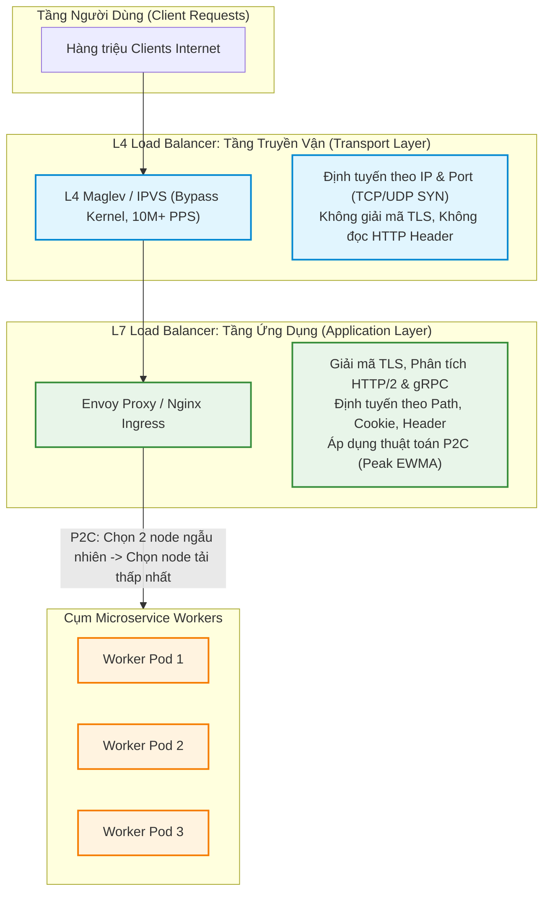

# 15.1. Scalability Laws & Load Balancing (L4/L7 & P2C)

> [!IMPORTANT]
> **Nếu bạn chỉ được nhớ một điều duy nhất**: Khả năng mở rộng (Scalability) của một hệ thống phân tán không bao giờ là vô hạn. Theo **Định luật Phổ quát về Khả năng Mở rộng (Universal Scalability Law - USL)** của Neil Gunther, khi tăng số lượng node ($N$), hệ thống không chỉ bị giới hạn bởi phần thực thi tuần tự (**Contention $\sigma$** - theo Định luật Amdahl) mà còn bị suy thoái nghiêm trọng bởi chi phí đồng bộ hóa dữ liệu đa chiều (**Coherency $\kappa$**). Khi $N$ vượt qua ngưỡng tới hạn, hệ thống sẽ rơi vào trạng thái **Mở rộng ngược (Negative Scalability)**: càng bổ sung thêm node, thông lượng càng tụt giảm! Ở tầng cân bằng tải, thuật toán **Power of Two Choices (P2C)** chứng minh rằng chỉ cần chọn ngẫu nhiên 2 node và gán việc cho node có tải thấp hơn sẽ đạt được hiệu năng xấp xỉ thuật toán bận rộn toàn cục mà không tốn chi phí đồng bộ hóa trạng thái tập trung.

---

## 1. Kiến trúc Tổng quan & Mô hình Tư duy (Mental Model)

### Ẩn dụ Đời sống: Đội Ngũ Thợ Xây và Cuộc Họp Giao Ban
Hãy tưởng tượng một công trường xây dựng:
- **Scalability Tuyến tính Lý tưởng (Linear Scalability)**: 1 người thợ xây xong bức tường trong 10 ngày. Nếu thuê 10 người thợ, công việc hoàn thành trong 1 ngày.
- **Định luật Amdahl (Điểm nghẽn tuần tự - Contention $\sigma$)**: Trộn xi măng và đổ móng chỉ có thể do 1 người làm tại một thời điểm (Chiếm 10% công việc). Dù bạn có thuê 1.000 thợ xây, thời gian làm móng vẫn không thể nhanh hơn. Tốc độ tối đa toàn công trình bị chặn cứng ở mức $10\times$ (không bao giờ vượt qua được giới hạn của phần tuần tự).
- **Định luật USL (Hiện tượng Họp Giao ban - Coherency $\kappa$)**: Khi có 5 người, họ dễ dàng phân công. Nhưng khi có 100 người thợ, họ bắt đầu cãi cọ, dẫm chân lên nhau và phải tổ chức họp giao ban giữa các cặp thợ để báo cáo trạng thái ($N(N-1)/2$ kênh liên lạc!). Thời gian họp và giải quyết xung đột lớn hơn thời gian xây gạch. Kết quả: 100 người thợ xây một ngôi nhà còn **chậm hơn** đội 10 người (**Negative Scalability**)!
- **Power of Two Choices (P2C)**: Để chia việc cho 100 thợ, người chỉ huy không cần chạy khắp công trường đo nhịp tim của từng người (tốn $O(N)$). Ông chỉ việc chỉ tay vào **2 người thợ ngẫu nhiên bất kỳ**, nhìn xem ai đang rảnh tay hơn thì ném xô vữa cho người đó. Phép màu toán học chứng minh tải của toàn công trường sẽ cân bằng kỳ diệu.



---

## 2. Chi tiết từng Keyword (Under-the-Hood Deep Dive)

### 2.1. Phân loại Scalability: Horizontal, Vertical, Diagonal & Elasticity

1. **Vertical Scalability (Scale-Up / Mở rộng dọc)**:
   - Nâng cấp phần cứng của một máy chủ duy nhất: bổ sung RAM, nâng cấp CPU nhiều core hơn, đổi sang ổ NVMe tốc độ cao hơn.
   - **Giới hạn**: Chạm ngưỡng trần vật lý của phần cứng (Hardware Ceiling), chi phí tăng theo cấp số nhân (đắt đỏ bất hợp lý), tạo ra điểm lỗi tập trung (SPOF).
2. **Horizontal Scalability (Scale-Out / Mở rộng ngang)**:
   - Bổ sung thêm nhiều máy chủ giá rẻ (Commodity Hardware) vào một cụm mạng phân tán.
   - **Đặc điểm**: Khả năng mở rộng lý thuyết vô hạn, tính sẵn sàng cao, nhưng tăng độ phức tạp trong lập trình (phải giải quyết đồng thuận, phân vùng, trễ mạng).
3. **Diagonal Scalability (Mở rộng chéo)**:
   - Kết hợp cả hai: nâng cấp máy chủ lên cấu hình tối ưu chi phí (Sweet Spot) trước, sau đó nhân bản máy chủ đó theo chiều ngang.
4. **Elasticity (Tính co giãn động)**:
   - Khả năng hệ thống tự động tăng tài nguyên khi có nhu cầu cao và **tự động giải phóng tài nguyên khi nhu cầu giảm** (ví dụ: Kubernetes Horizontal Pod Autoscaler - HPA).

### 2.2. Định luật Amdahl (Amdahl's Law - 1967)

#### 1. Công thức Toán học
Định luật Amdahl tính toán gia tốc tối đa $S(N)$ có thể đạt được khi bổ sung $N$ bộ xử lý cho một tác vụ:
$$S(N) = \frac{1}{(1 - p) + \frac{p}{N}} = \frac{1}{\sigma + \frac{1 - \sigma}{N}}$$
- $p$: Tỷ lệ phần công việc có thể song song hóa hoàn toàn ($0 \le p \le 1$).
- $\sigma = 1 - p$: Tỷ lệ phần công việc bắt buộc phải thực thi tuần tự (Serial Fraction).
- $N$: Số lượng bộ xử lý hoặc máy chủ worker.

#### 2. Hệ quả tàn khốc của phần tuần tự
Khi số lượng máy chủ tiến tới vô cùng ($N \to \infty$):
$$\lim_{N \to \infty} S(N) = \frac{1}{1 - p} = \frac{1}{\sigma}$$
- Nếu một hệ thống có **chỉ 5% công việc tuần tự** ($\sigma = 0.05$ - ví dụ: thao tác ghi vào một file log tập trung, hoặc tranh chấp một Distributed Lock):
  $$\text{Tốc độ tối đa} = \frac{1}{0.05} = 20\times$$
  Dù bạn có đầu tư **1.000.000 máy chủ**, hệ thống cũng không bao giờ chạy nhanh hơn gấp 20 lần một máy chủ đơn lẻ!

### 2.3. Định luật Phổ quát về Khả năng Mở rộng (Universal Scalability Law - USL)

#### 1. Công thức USL của Neil Gunther (1993)
Amdahl chỉ xem xét điểm nghẽn tuần tự mà bỏ qua chi phí giao tiếp mạng giữa các node. Định luật USL bổ sung tham số tương quan đa chiều:
$$C(N) = \frac{N}{1 + \sigma(N - 1) + \kappa N(N - 1)}$$
- $N$: Số lượng node / CPU.
- $\sigma$ (Contention): Hệ số suy hao do xếp hàng tuần tự (Amdahl Bottleneck).
- $\kappa$ (Coherency): Hệ số suy hao do duy trì tính nhất quán dữ liệu (Cache Coherency, Crosstalk, Point-to-Point Gossip).

#### 2. Hiện tượng Negative Scalability (Mở rộng ngược)
- Số lượng kênh liên lạc giữa $N$ node phân tán tăng theo quy tắc tổ hợp:
  $$\text{Số kênh} = \frac{N(N - 1)}{2} \approx O(N^2)$$
- Khi $N$ tăng lên, thành phần bậc hai $\kappa N(N - 1)$ ở mẫu số tăng vọt, lấn át hoàn toàn tử số $N$.
- **Điểm cực đại (Optimal Scale Point)**:
  $$N_{\text{max}} = \sqrt{\frac{1 - \sigma}{\kappa}}$$
- Vượt qua ngưỡng $N_{\text{max}}$, thông lượng của cụm sẽ **suy giảm nghiêm trọng**. Thêm node mới chỉ làm tăng độ trễ và khiến hệ thống chết vì quá tải trao đổi thông điệp nội bộ!

### 2.4. L4 Load Balancing vs L7 Load Balancing

#### Bảng so sánh chuyên sâu L4 vs L7
| Tiêu chí | L4 Load Balancing (Transport Layer) | L7 Load Balancing (Application Layer) |
| :--- | :--- | :--- |
| **Giao thức hoạt động** | TCP, UDP, SCTP | HTTP/1.1, HTTP/2, gRPC, WebSocket |
| **Dữ liệu phân tích** | Địa chỉ IP nguồn/đích, Cổng Port | URL Path, Headers, Cookies, JSON Payload |
| **Mở kết nối TCP** | Chỉ định tuyến gói tin (Packet Forwarding / NAT) | **Terminates 2 kết nối TCP độc lập** (Client $\to$ LB và LB $\to$ Backend) |
| **Giải mã TLS / HTTPS** | Không (Chỉ chuyển tiếp TLS Passthrough) | **Có (TLS Termination & Re-encryption)** |
| **Thông lượng (Throughput)**| **Cực kỳ khủng khiếp** (Hàng chục triệu PPS) | Trung bình (Vài chục nghìn đến hàng trăm nghìn RPS) |
| **Công nghệ tiêu biểu** | Linux IPVS, AWS NLB, Google Maglev | **Envoy Proxy, Nginx, HAProxy, AWS ALB** |

### 2.5. Các thuật toán Cân bằng tải kinh điển
1. **Round Robin**: Phân phối tuần tự xoay vòng ($1 \to 2 \to 3 \to 1$). Đơn giản nhưng không phản ánh được tình trạng tải thực tế của máy chủ.
2. **Weighted Round Robin**: Gán trọng số dựa trên cấu hình phần cứng (Node mạnh nhận 3 phần, node yếu nhận 1 phần).
3. **Least Connections**: Gán request cho node đang có ít kết nối TCP mở nhất.
   - *Điểm yếu*: Trong cụm phân tán có nhiều bộ cân bằng tải chạy song song, việc thu thập số kết nối chính xác từ mọi node đòi hỏi đồng bộ hóa tập trung tốn kém.
4. **Consistent IP Hashing**: Băm địa chỉ IP của Client để gán cố định vào một máy chủ (Sticky Session).

### 2.6. Thuật toán Sức mạnh của Hai Lựa chọn Ngẫu nhiên (Power of Two Choices - P2C)

#### 1. Vấn đề của Least Connections trong Hệ thống Phân tán
Nếu sử dụng thuật toán Least Connections trong một cụm có 100 instance L7 proxy:
- Tất cả 100 proxy cùng nhìn thấy Node 5 đang có ít kết nối nhất.
- Cả 100 proxy **đồng thời dồn request vào Node 5** $\implies$ Node 5 bị sập vì nghẽn tải (**Herd Effect / Thundering Herd**).

#### 2. Thuật toán P2C (Mitzenmacher 2001)
Nguyên lý cực kỳ thanh lịch:
1. Mỗi khi có request đến, Proxy **chọn ngẫu nhiên 2 node bất kỳ** trong cụm ($Node_A$ và $Node_B$).
2. So sánh tải hiện tại của 2 node này.
3. Chuyển request đến node có tải nhẹ hơn.
- **Chứng minh Toán học**: Thuật toán ngẫu nhiên thuần túy tạo ra hàng đợi có độ dài tối đa là $O\left(\frac{\ln N}{\ln \ln N}\right)$. Bằng việc chỉ bổ sung **thêm 1 lựa chọn ngẫu nhiên thứ hai**, độ dài hàng đợi tối đa giảm theo cấp số mũ xuống còn:
  $$O\left(\frac{\ln \ln N}{\ln 2}\right) \quad (\text{Giảm từ hàm Logarit xuống Double-Logarit!})$$
- **P2C Peak EWMA**: Envoy Proxy cải tiến P2C bằng cách đo lường độ trễ trung bình động có trọng số mũ (**Exponentially Weighted Moving Average**) kết hợp với số lượng request đang bay (**Active Requests**), tạo ra bộ cân bằng tải thông minh nhất thế giới hiện nay.

---

## 3. Thực thi Mã nguồn & Mô phỏng Chuyên sâu (Dual-Engine Implementation)

### Engine 1: C++20 — Mô phỏng Cốt lõi P2C Load Balancer với Peak EWMA Latency Scoring

```cpp
#include <iostream>
#include <vector>
#include <string>
#include <random>
#include <algorithm>
#include <format>
#include <chrono>

struct BackendNode {
    std::string id;
    int active_requests{0};
    double ewma_latency_ms{10.0}; // Độ trễ trung bình động (ms)

    // Tính điểm tải kết hợp: Load Score = ActiveRequests * Latency
    double calculate_load_score() const {
        return (active_requests + 1) * ewma_latency_ms;
    }
};

class PowerOfTwoChoicesLoadBalancer {
private:
    std::vector<BackendNode> nodes_;
    std::mt19937 rng_;

public:
    explicit PowerOfTwoChoicesLoadBalancer(std::vector<BackendNode> nodes)
        : nodes_(std::move(nodes)), rng_(1337) {}

    // Thuật toán P2C: Chọn 2 node ngẫu nhiên và lấy node có điểm tải nhỏ hơn
    size_t pick_node() {
        if (nodes_.empty()) throw std::runtime_error("No backend nodes available");
        if (nodes_.size() == 1) return 0;

        std::uniform_int_distribution<size_t> dist(0, nodes_.size() - 1);
        size_t idx1 = dist(rng_);
        size_t idx2 = dist(rng_);

        // Đảm bảo 2 node chọn ra là khác nhau
        while (idx2 == idx1) {
            idx2 = dist(rng_);
        }

        double score1 = nodes_[idx1].calculate_load_score();
        double score2 = nodes_[idx2].calculate_load_score();

        size_t chosen = (score1 <= score2) ? idx1 : idx2;
        std::cout << std::format("  [P2C Pick] So sánh Node '{}' (Score: {:.1f}) vs Node '{}' (Score: {:.1f}) -> Chọn: '{}'\n",
            nodes_[idx1].id, score1, nodes_[idx2].id, score2, nodes_[chosen].id);

        return chosen;
    }

    void simulate_request(size_t node_idx, double actual_latency_ms) {
        nodes_[node_idx].active_requests++;
        // Cập nhật EWMA Latency: alpha = 0.3
        double alpha = 0.3;
        nodes_[node_idx].ewma_latency_ms = alpha * actual_latency_ms + (1.0 - alpha) * nodes_[node_idx].ewma_latency_ms;
        nodes_[node_idx].active_requests--;
    }
};

int main() {
    std::vector<BackendNode> cluster = {
        BackendNode{.id = "Server_Alpha", .active_requests = 1, .ewma_latency_ms = 8.5},
        BackendNode{.id = "Server_Beta",  .active_requests = 5, .ewma_latency_ms = 45.0}, // Đang bị chậm
        BackendNode{.id = "Server_Gamma", .active_requests = 0, .ewma_latency_ms = 12.0},
        BackendNode{.id = "Server_Delta", .active_requests = 2, .ewma_latency_ms = 15.0}
    };

    PowerOfTwoChoicesLoadBalancer lb(cluster);

    std::cout << "--- Mô phỏng 5 lần định tuyến bằng thuật toán P2C Peak EWMA ---\n";
    for (int req = 1; req <= 5; ++req) {
        std::cout << std::format("Request #{:02d}:\n", req);
        size_t chosen_idx = lb.pick_node();
        lb.simulate_request(chosen_idx, 10.0);
    }

    return 0;
}
```

#### Terminal Output Mẫu:
```text
--- Mô phỏng 5 lần định tuyến bằng thuật toán P2C Peak EWMA ---
Request #01:
  [P2C Pick] So sánh Node 'Server_Beta' (Score: 270.0) vs Node 'Server_Gamma' (Score: 12.0) -> Chọn: 'Server_Gamma'
Request #02:
  [P2C Pick] So sánh Node 'Server_Alpha' (Score: 17.0) vs Node 'Server_Delta' (Score: 45.0) -> Chọn: 'Server_Alpha'
Request #03:
  [P2C Pick] So sánh Node 'Server_Gamma' (Score: 11.4) vs Node 'Server_Beta' (Score: 270.0) -> Chọn: 'Server_Gamma'
Request #04:
  [P2C Pick] So sánh Node 'Server_Alpha' (Score: 17.9) vs Node 'Server_Delta' (Score: 45.0) -> Chọn: 'Server_Alpha'
Request #05:
  [P2C Pick] So sánh Node 'Server_Beta' (Score: 270.0) vs Node 'Server_Alpha' (Score: 17.9) -> Chọn: 'Server_Alpha'
```

---

### Engine 2: Python 3.11+ — Mô phỏng Mô hình Toán học Định luật USL và Xác định Điểm Mở Rộng Ngược (Negative Scalability)

```python
import math
from typing import List, Tuple

def usl_throughput(n: int, sigma: float, kappa: float) -> float:
    """Công thức Universal Scalability Law: C(N) = N / (1 + sigma*(N - 1) + kappa*N*(N - 1))"""
    denominator = 1.0 + sigma * (n - 1) + kappa * n * (n - 1)
    return n / denominator

def find_peak_scale(sigma: float, kappa: float) -> Tuple[int, float]:
    """Tính toán điểm cực trị toán học N_max = sqrt((1 - sigma) / kappa)"""
    if kappa <= 0:
        return float('inf'), float('inf')
    n_peak = math.sqrt((1.0 - sigma) / kappa)
    n_int = round(n_peak)
    max_capacity = usl_throughput(n_int, sigma, kappa)
    return n_int, max_capacity

def main():
    # Tham số đo đạc thực tế:
    # sigma = 0.03 (3% tuần tự do Transaction Lock)
    # kappa = 0.0008 (Hệ số xung đột mạng đồng bộ hóa)
    sigma = 0.03
    kappa = 0.0008

    peak_nodes, peak_throughput = find_peak_scale(sigma, kappa)

    print("================ PHÂN TÍCH ĐỊNH LUẬT UNIVERSAL SCALABILITY LAW ================")
    print(f"Hệ số Tuần tự (Contention sigma): {sigma*100:.1f}%")
    print(f"Hệ số Đồng bộ (Coherency kappa):  {kappa*100:.3f}%")
    print(f"-> ĐIỂM BÃOHÒA TỐI ĐA (Optimal Peak): {peak_nodes} Nodes (Gia tốc tối đa: {peak_throughput:.2f}x)\n")

    print(f"{'Nodes (N)':>10} | {'Linear':>10} | {'Amdahl':>10} | {'USL (Thực tế)':>14} | {'Trạng thái'}")
    print("-" * 65)

    test_points = [1, 5, 10, 20, peak_nodes, 50, 75, 100]
    for n in sorted(list(set(test_points))):
        linear = float(n)
        amdahl = 1.0 / (sigma + (1.0 - sigma) / n)
        usl = usl_throughput(n, sigma, kappa)

        status = "Tăng trưởng"
        if n == peak_nodes:
            status = "ĐỈNH TỐI ƯU"
        elif n > peak_nodes:
            status = "NEGATIVE SCALE! (Tụt giảm)"

        print(f"{n:>10} | {linear:>10.1f} | {amdahl:>10.2f} | {usl:>14.2f} | {status}")

if __name__ == "__main__":
    main()
```

#### Terminal Output Mẫu:
```text
================ PHÂN TÍCH ĐỊNH LUẬT UNIVERSAL SCALABILITY LAW ================
Hệ số Tuần tự (Contention sigma): 3.0%
Hệ số Đồng bộ (Coherency kappa):  0.080%
-> ĐIỂM BÃOHÒA TỐI ĐA (Optimal Peak): 35 Nodes (Gia tốc tối đa: 17.06x)

 Nodes (N) |     Linear |     Amdahl |  USL (Thực tế) | Trạng thái
-----------------------------------------------------------------
         1 |        1.0 |       1.00 |           1.00 | Tăng trưởng
         5 |        5.0 |       4.46 |           4.39 | Tăng trưởng
        10 |       10.0 |       7.87 |           7.45 | Tăng trưởng
        20 |       20.0 |      12.74 |          11.27 | Tăng trưởng
        35 |       35.0 |      17.33 |          17.06 | ĐỈNH TỐI ƯU
        50 |       50.0 |      20.24 |          14.58 | NEGATIVE SCALE! (Tụt giảm)
        75 |       75.0 |      23.29 |          11.19 | NEGATIVE SCALE! (Tụt giảm)
       100 |      100.0 |      25.19 |           8.74 | NEGATIVE SCALE! (Tụt giảm)
```

---

## 4. Systems Engineering & Production Pitfalls

### 4.1. Những cạm bẫy sống còn khi vận hành Cân bằng tải và Mở rộng quy mô
1. **Dùng Round Robin khi tác vụ có thời gian thực thi chênh lệch lớn (Request Cost Variance)**:
   - Nếu Request A mất $2\text{ms}$ (truy vấn cache) trong khi Request B mất $2.000\text{ms}$ (tổng hợp báo cáo tài chính). Thuật toán Round Robin chia đều số lượng request sẽ vô tình dồn 3 request nặng vào cùng một máy chủ, làm CPU của máy đó nhảy vọt lên $100\%$ trong khi các máy khác nhàn rỗi.
   - *Khắc phục*: Bắt buộc sử dụng thuật toán **P2C Peak EWMA** hoặc **Least Request**.

2. **Hiện tượng Bão Tái Kết Nối khi L4 Load Balancer Failover**:
   - Khi một L4 Load Balancer chính (Active) bị chết và chuyển sang Backup, nếu không có cơ chế đồng bộ hóa trạng thái phiên TCP (**Session State Sync / Conntrack Replication**), toàn bộ hàng triệu kết nối TCP đang mở sẽ bị gửi gói RST làm đứt kết nối. Toàn bộ người dùng sẽ ấn F5 cùng lúc, đánh sập hệ thống.
   - *Khắc phục*: Sử dụng kỹ thuật **Consistent Hashing trên L4 (Google Maglev)** để ngay cả khi chuyển đổi node cân bằng tải, các kết nối TCP cũ vẫn được ánh xạ về đúng máy chủ backend ban đầu.

3. **Mở rộng quá điểm tới hạn USL gây lãng phí ngân sách đám mây**:
   - Rất nhiều doanh nghiệp thấy hệ thống chậm liền tăng từ 40 Pods lên 100 Pods. Tuy nhiên do điểm nghẽn nằm ở cơ sở dữ liệu khóa bảng, việc thêm 60 Pods chỉ làm tăng số lượng kết nối tranh chấp, đẩy hệ thống sâu hơn vào vùng **Negative Scalability**, khiến hệ thống chậm hơn gấp đôi trong khi hóa đơn AWS tăng gấp ba!

### 4.2. Runbook Chẩn đoán Sự cố Cân bằng tải trên Production (CLI Commands)

```bash
# 1. Kiểm tra bảng kết nối IPVS L4 Load Balancer trên Linux Kernel
sudo ipvsadm -ln --stats

# 2. Xem phân bổ tải giữa các upstream endpoint trong Envoy Proxy
curl -s http://localhost:15000/stats | grep "cluster.backend_service.upstream_rq_active"

# 3. Theo dõi số lượng kết nối đang mở theo từng máy chủ backend trong Nginx
curl -s http://localhost/nginx_status
```

---

## 5. Bảng So sánh & Decision Matrix

| Thuật toán Cân bằng tải | Độ phức tạp Thuật toán | Chi phí Đồng bộ hóa | Khả năng Chống Herd Effect | Môi trường Tối ưu |
| :--- | :--- | :--- | :--- | :--- |
| **Round Robin** | $O(1)$ | Không có | Kém | Các tác vụ siêu ngắn, tải hoàn toàn đồng đều |
| **Weighted Least Connections** | $O(N)$ quét toàn bộ | Rất cao (Cần trạng thái tập trung) | Rất kém (Dễ dồn tải cùng lúc) | Cụm nhỏ ($< 10$ servers) với 1 bộ cân bằng tải |
| **IP Consistent Hashing** | $O(\log N)$ | Thấp | Tốt | Cần độ dính phiên (Stateful/Session Sticky) |
| **Power of Two Choices (P2C)**| **$O(1)$ (Chỉ lấy mẫu 2 node)** | **Bằng 0 (Zero Coordination)** | **Xuất sắc (Tránh dồn tải)** | **Envoy, Finagle, gRPC, Cloud Microservices quy mô lớn** |
