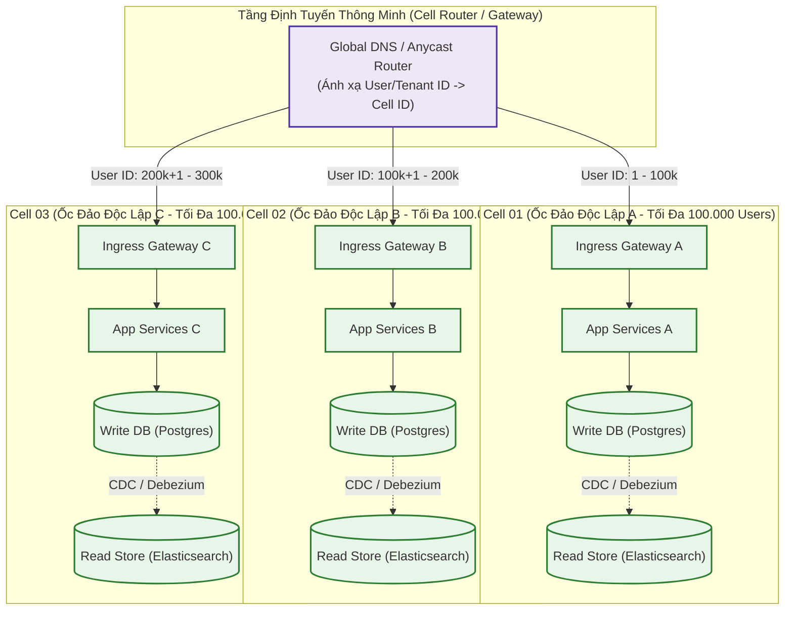

# 15.2. Scalability Patterns: CQRS & Cell-Based Architecture

> [!IMPORTANT]
> **Nếu bạn chỉ được nhớ một điều duy nhất**: Khi một hệ thống đạt tới quy mô hàng triệu người dùng, việc mở rộng một cụm cơ sở dữ liệu hoặc cụm dịch vụ duy nhất trên toàn cầu (**Single Global Cluster**) sẽ biến toàn bộ hạ tầng thành một khối cầu lửa nguy hiểm: một lỗi cấu hình nhỏ hoặc một câu truy vấn độc hại có thể hạ gục toàn bộ hệ thống (**Bán kính tàn phá / Blast Radius = 100%**). **Kiến trúc Phân ô (Cell-Based Architecture)** của AWS và Slack giải quyết triệt để rủi ro này bằng cách chia hệ thống thành các "tế bào" độc lập, tự vận hành hoàn chỉnh; sự cố tại một Cell không bao giờ lây lan sang các Cell khác. Kết hợp với **CQRS**, hệ thống giải phóng tầng Đọc khỏi các ràng buộc chuẩn hóa của tầng Ghi, cho phép mở rộng quy mô phi đối xứng.

---

## 1. Kiến trúc Tổng quan & Mô hình Tư duy (Mental Model)

### Ẩn dụ Đời sống: Vỏ Tàu Thủy Nhiều Khoang Ngăn Nước và Báo In
Hãy tưởng tượng hai nguyên lý thiết kế kinh điển:
- **Tàu Titanic vs Tàu Chở Hàng Hiện Đại (Cell-Based Architecture)**:
  - Tàu Titanic được thiết kế như một không gian khổng lồ thông nhau. Khi một vết rách thủng xuất hiện ở mạn thuyền, nước biển tràn tự do vào tất cả các khu vực khiến toàn bộ con tàu chìm xuống đáy biển (Blast Radius = 100%).
  - Tàu thủy hiện đại được chia thành 20 **khoang kín nước độc lập (Watertight Cells)**. Nếu một khoang bị thủng và ngập nước hoàn toàn, 19 khoang còn lại vẫn giữ cho con tàu nổi bình yên trên mặt biển (Blast Radius $\le 5\%$).
- **Tòa Soạn Báo (CQRS)**:
  - **Command (Tầng Viết bài)**: Các phóng viên và biên tập viên làm việc tại văn phòng, tranh luận, kiểm tra nguồn tin, sửa từng câu chữ trong văn bản gốc được lưu trong két sắt được chuẩn hóa nghiêm ngặt (Write Model / 3NF).
  - **Query (Tầng Độc giả đọc báo)**: Tòa soạn in 500.000 tờ báo giấy được dàn trang phẳng đẹp mắt (Read Model / Denormalized Views) và phân phát ra các sạp báo trên toàn quốc. Độc giả chỉ việc cầm tờ báo lên đọc trong 5 giây mà không bao giờ cần bước chân vào văn phòng của phóng viên hay làm phiền két sắt của tòa soạn!



---

## 2. Chi tiết từng Keyword (Under-the-Hood Deep Dive)

### 2.1. CQRS (Command Query Responsibility Segregation) & Materialized Views

#### 1. Khái niệm Bản chất & Sự Mâu thuẫn giữa Đọc và Ghi
Trong mô hình kiến trúc truyền thống (CRUD), cùng một mô hình thực thể (Entity) được dùng cho cả thao tác ghi dữ liệu và truy vấn đọc. Điều này dẫn đến sự mâu thuẫn cơ bản:
- **Tầng Ghi (Commands)**: Cần chuẩn hóa dữ liệu cao (3NF - Third Normal Form) để tránh trùng lặp dữ liệu, đảm bảo tính toàn vẹn và các ràng buộc khóa ngoại (Foreign Keys), hỗ trợ các giao dịch ACID ngắn, tập trung vào từng bản ghi.
- **Tầng Đọc (Queries)**: Cần phi chuẩn hóa dữ liệu (Denormalization) để tránh các phép `JOIN` 10 bảng đắt đỏ, cần tổng hợp dữ liệu sẵn (Pre-aggregated Views), hỗ trợ tìm kiếm toàn văn (Full-text Search) và tối ưu hóa bộ nhớ đệm.
- **Giải pháp CQRS (Greg Young & Martin Fowler)**: Phân tách hệ thống thành 2 mô hình độc lập hoàn toàn:
  - **Command Model**: Chỉ tiếp nhận các mệnh lệnh thay đổi trạng thái (`CreateOrderCommand`, `UpdateAddressCommand`), thực thi validation nghiệp vụ và ghi xuống Write Database (PostgreSQL/MySQL).
  - **Query Model**: Đọc dữ liệu từ Read Database (Elasticsearch, Redis, MongoDB) được tối ưu hóa riêng cho từng màn hình hiển thị của người dùng (Materialized Views).

#### 2. Đồng bộ hóa qua Materialized Views bất đồng bộ
- Mỗi khi Write Model ghi nhận một Command thành công, nó phát ra một Domain Event (`OrderCreatedEvent`).
- Một tiến trình chiếu dữ liệu (**Event Projector**) lắng nghe sự kiện này và cập nhật cấu trúc dữ liệu phẳng vào Read Model (Materialized View).
- **Tính nhất quán**: Chấp nhận **Eventual Consistency** (có độ trễ vài mili-giây giữa lúc ghi xong và lúc màn hình đọc cập nhật).

### 2.2. Database Connection Pooling: Tại sao cần Connection Pool?

#### 1. Cơ chế tầng Kernel và Chi phí của một kết nối Database
Một kết nối TCP tới cơ sở dữ liệu quan hệ (đặc biệt là PostgreSQL) không phải là một con trỏ nhẹ trong bộ nhớ mà tiêu tốn chi phí khổng lồ:
1. Bắt tay 3 bước TCP (3-Way Handshake) qua mạng: tốn ít nhất $1 \times \text{RTT}$.
2. Bắt tay mã hóa TLS/SSL: tốn thêm $1-2 \times \text{RTT}$ cùng tính toán CPU mã hóa bất đối xứng (RSA/ECDSA).
3. Quá trình xác thực người dùng (User Authentication, Password Hashing, Permission check).
4. **Chi phí Process trên PostgreSQL**: PostgreSQL sử dụng mô hình đa tiến trình (Process-per-connection). Mỗi kết nối mới khiến Linux Kernel phải gọi `fork()`, cấp phát từ $5\text{MB}$ đến $10\text{MB}$ RAM riêng biệt.
- **Thảm họa Connection Exhaustion**: Nếu 500 microservice pods mỗi pod mở 50 kết nối trực tiếp xuống DB $\implies 25.000$ kết nối! Database sẽ cạn kiệt RAM, tiêu tốn 90% CPU chỉ để chuyển ngữ cảnh (**Context Switching**) giữa 25.000 processes, dẫn đến sập nguồn hoàn toàn!

#### 2. Giải pháp Connection Pooling (HikariCP, PgBouncer)
- **HikariCP (Application-level Pool)**: Duy trì một tập hợp các kết nối mở sẵn trong RAM của JVM. Khi thread cần query, nó mượn một kết nối có sẵn trong $< 1\mu\text{s}$ và trả lại pool sau khi xong việc.
- **PgBouncer (Proxy-level Pool)**: Đứng trước cụm PostgreSQL, đóng vai trò multiplexing: cho phép hàng chục nghìn client kết nối tới PgBouncer, nhưng PgBouncer chỉ mở **đúng 50 kết nối thực sự** xuống máy chủ PostgreSQL!

### 2.3. Stateless Architecture & Shared-Nothing Architecture

#### 1. Stateless Architecture (Kiến trúc phi trạng thái)
- Máy chủ ứng dụng (Web/App Server) **tuyệt đối không lưu giữ bất kỳ trạng thái phiên (Session State)** nào của người dùng trong bộ nhớ RAM cục bộ giữa các request.
- Mọi thông tin trạng thái đều được chuyển vào:
  - **Client Token**: Mã hóa bên trong JWT Token gửi kèm mỗi request.
  - **External In-Memory Store**: Lưu tập trung trên cụm Redis hoặc Database.
- **Lợi ích**: Bất kỳ máy chủ nào trong cụm cũng có thể phục vụ bất kỳ request nào của người dùng; việc Autoscaling thêm/bớt Pods diễn ra tức thì mà không lo mất session của khách hàng.

#### 2. Shared-Nothing Architecture (SN Architecture)
- Mọi node trong hệ thống hoạt động hoàn toàn độc lập, không dùng chung bất kỳ tài nguyên phần cứng nào:
  $$\text{Không chung RAM} \quad - \quad \text{Không chung Ổ đĩa Disk} \quad - \quad \text{Không chung CPU}$$
- Các node chỉ giao tiếp với nhau bằng cách truyền thông điệp qua mạng (Message Passing).
- Loại bỏ hoàn toàn điểm nghẽn tranh chấp tài nguyên phần cứng (Hardware Lock Contention).

### 2.4. Cell-Based Architecture (Kiến trúc phân ô độc lập)

#### 1. Giới hạn của Single Global Cluster & Khái niệm Blast Radius
- Khi một dịch vụ đạt quy mô toàn cầu, việc duy trì một cụm Kubernetes duy nhất với 50.000 nodes hoặc một cụm Database 100TB sẽ dẫn đến các thảm họa:
  - **Blast Radius = 100%**: Một lỗi cấu hình sai trong file Helm Chart hoặc một bug rò rỉ bộ nhớ sẽ đánh sập toàn bộ dịch vụ trên toàn thế giới.
  - **Chạm trần mở rộng phần mềm (Software Scale Ceiling)**: ETCD của Kubernetes không thể xử lý nổi cụm quá 5.000 nodes; Control Plane bị nghẽn mạch.

#### 2. Kiến trúc Cell-Based: Chia nhỏ thành các Ốc đảo độc lập
- Thay vì xây dựng một tòa nhà chọc trời khổng lồ, chúng ta xây dựng một khu đô thị gồm hàng trăm **ngôi nhà độc lập (Cells)**:
  - Mỗi **Cell** là một phiên bản hoàn chỉnh độc lập của toàn bộ hệ thống (chứa đầy đủ API Gateway, Application Pods, Database, Cache, Message Broker riêng biệt).
  - Kích thước của mỗi Cell bị giới hạn cố định (ví dụ: mỗi Cell phục vụ tối đa 100.000 người dùng).
- **Cell Router (Bộ định tuyến phân ô)**:
  - Nằm ở tầng ngoài cùng Internet.
  - Khi request đến, Router kiểm tra `user_id` hoặc `tenant_id` và định tuyến toàn bộ lưu lượng của người dùng đó vào đúng Cell phụ trách của họ:
    $$\text{Cell ID} = H(\text{tenant\_id}) \pmod{\text{Total Cells}}$$
- **Lợi ích đột phá**:
  - **Khoanh vùng sự cố tuyệt đối**: Nếu Cell 03 bị sập nguồn hoàn toàn, chỉ có người dùng thuộc Cell 03 bị ảnh hưởng; 99% người dùng thuộc các Cell khác vẫn sử dụng dịch vụ bình thường!
  - **Kiểm thử Canary an toàn**: Triển khai phiên bản code mới trên duy nhất Cell 01 để theo dõi trong 24 giờ trước khi rollout sang các Cell khác.

---

## 3. Thực thi Mã nguồn & Mô phỏng Chuyên sâu (Dual-Engine Implementation)

### Engine 1: C++20 — Mô phỏng Cell Router Định Tuyến Người Dùng & Connection Pool Multiplexing

```cpp
#include <iostream>
#include <vector>
#include <string>
#include <memory>
#include <unordered_map>
#include <format>
#include <cstdint>
#include <functional>

// Đại diện cho một Cell độc lập hoàn chỉnh
class ApplicationCell {
public:
    uint32_t cell_id;
    size_t active_users_count{0};
    bool is_healthy{true};

    explicit ApplicationCell(uint32_t id) : cell_id(id) {}

    void execute_query(const std::string& user_id, const std::string& query) {
        if (!is_healthy) {
            throw std::runtime_error(std::format("Cell #{} đang gặp sự cố! Blast radius bị cô lập.", cell_id));
        }
        std::cout << std::format("      [Cell #{:02d} Execution] User '{}' chạy: '{}'\n", cell_id, user_id, query);
    }
};

// Bộ định tuyến phân ô thông minh (Cell Router)
class CellRouter {
private:
    std::vector<std::shared_ptr<ApplicationCell>> cells_;

public:
    explicit CellRouter(size_t num_cells) {
        for (size_t i = 1; i <= num_cells; ++i) {
            cells_.push_back(std::make_shared<ApplicationCell>(i));
        }
    }

    // Ánh xạ User ID vào Cell tương ứng bằng hàm băm xác định
    std::shared_ptr<ApplicationCell> route_user(const std::string& user_id) {
        size_t h = std::hash<std::string>{}(user_id);
        size_t cell_idx = h % cells_.size();
        return cells_[cell_idx];
    }

    void simulate_cell_failure(uint32_t cell_id) {
        for (auto& cell : cells_) {
            if (cell->cell_id == cell_id) {
                cell->is_healthy = false;
                std::cout << std::format("\n[CẢNH BÁO THẢM HỌA] Cell #{:02d} ĐÃ BỊ SẬP HOÀN TOÀN!\n", cell_id);
                return;
            }
        }
    }
};

int main() {
    std::cout << "--- Khởi tạo Hạ Tầng 4 Cells Độc Lập Hoàn Toàn ---\n";
    CellRouter router(4);

    std::vector<std::pair<std::string, std::string>> sample_traffic = {
        {"user_alice", "SELECT * FROM orders"},
        {"user_bob", "UPDATE profile SET name='Robert'"},
        {"user_charlie", "INSERT INTO cart VALUES (101)"},
        {"user_david", "SELECT balance FROM account"},
        {"user_eve", "SELECT * FROM feed"}
    };

    std::cout << "\n--- 1. Định tuyến các yêu cầu người dùng vào các Cells tương ứng ---\n";
    for (const auto& [user, query] : sample_traffic) {
        auto cell = router.route_user(user);
        std::cout << std::format("[Router] Ánh xạ User '{}' -> Cell #{:02d}\n", user, cell->cell_id);
        cell->execute_query(user, query);
    }

    std::cout << "\n--- 2. Giả lập Cell #02 bị sập nguồn hoàn toàn (Kiểm tra Blast Radius) ---\n";
    router.simulate_cell_failure(2);

    std::cout << "\n--- 3. Kiểm tra xem các User thuộc Cell khác có bị ảnh hưởng không ---\n";
    for (const auto& [user, query] : sample_traffic) {
        auto cell = router.route_user(user);
        try {
            cell->execute_query(user, query);
        } catch (const std::exception& e) {
            std::cout << std::format("  [!] LỖI CỤC BỘ: User '{}' bị ảnh hưởng: {}\n", user, e.what());
        }
    }

    std::cout << "\n[V] Độc lập thành công: Sự cố tại Cell 2 không hề gây ảnh hưởng tới các Cell 1, 3, 4!\n";
    return 0;
}
```

#### Terminal Output Mẫu:
```text
--- Khởi tạo Hạ Tầng 4 Cells Độc Lập Hoàn Toàn ---

--- 1. Định tuyến các yêu cầu người dùng vào các Cells tương ứng ---
[Router] Ánh xạ User 'user_alice' -> Cell #01
      [Cell #01 Execution] User 'user_alice' chạy: 'SELECT * FROM orders'
[Router] Ánh xạ User 'user_bob' -> Cell #02
      [Cell #02 Execution] User 'user_bob' chạy: 'UPDATE profile SET name='Robert''
[Router] Ánh xạ User 'user_charlie' -> Cell #03
      [Cell #03 Execution] User 'user_charlie' chạy: 'INSERT INTO cart VALUES (101)'
[Router] Ánh xạ User 'user_david' -> Cell #04
      [Cell #04 Execution] User 'user_david' chạy: 'SELECT balance FROM account'
[Router] Ánh xạ User 'user_eve' -> Cell #01
      [Cell #01 Execution] User 'user_eve' chạy: 'SELECT * FROM feed'

--- 2. Giả lập Cell #02 bị sập nguồn hoàn toàn (Kiểm tra Blast Radius) ---

[CẢNH BÁO THẢM HỌA] Cell #02 ĐÃ BỊ SẬP HOÀN TOÀN!

--- 3. Kiểm tra xem các User thuộc Cell khác có bị ảnh hưởng không ---
      [Cell #01 Execution] User 'user_alice' chạy: 'SELECT * FROM orders'
  [!] LỖI CỤC BỘ: User 'user_bob' bị ảnh hưởng: Cell #2 đang gặp sự cố! Blast radius bị cô lập.
      [Cell #03 Execution] User 'user_charlie' chạy: 'INSERT INTO cart VALUES (101)'
      [Cell #04 Execution] User 'user_david' chạy: 'SELECT balance FROM account'
      [Cell #01 Execution] User 'user_eve' chạy: 'SELECT * FROM feed'

[V] Độc lập thành công: Sự cố tại Cell 2 không hề gây ảnh hưởng tới các Cell 1, 3, 4!
```

---

### Engine 2: Python 3.11+ — Mô phỏng Kiến trúc CQRS với Write Aggregate và Asynchronous Read Projector

```python
import asyncio
from typing import Dict, List, Any

# Domain Event
class OrderCreatedEvent:
    def __init__(self, order_id: str, customer_name: str, total_amount: float, items: List[str]):
        self.order_id = order_id
        self.customer_name = customer_name
        self.total_amount = total_amount
        self.items = items

# Tầng Ghi: Command Model (Chuẩn hóa, kiểm soát toàn vẹn)
class OrderWriteModel:
    def __init__(self):
        self.orders_table: Dict[str, Dict[str, Any]] = {}

    def handle_create_order_command(self, order_id: str, customer: str, items: List[str], amount: float) -> OrderCreatedEvent:
        if amount <= 0:
            raise ValueError("Số tiền đơn hàng phải > 0!")
        
        # Ghi vào Write Database chuẩn hóa
        self.orders_table[order_id] = {
            "id": order_id, "customer": customer, "status": "CONFIRMED", "amount": amount
        }
        print(f"[Command Write] Đã lưu Đơn hàng {order_id} vào Write DB (Normalized Relational DB).")
        return OrderCreatedEvent(order_id, customer, amount, items)

# Tầng Đọc: Query Model (Materialized View phi chuẩn hóa cho tìm kiếm nhanh)
class OrderReadProjector:
    def __init__(self):
        # Lưu trữ dạng phẳng (giống Elasticsearch Document)
        self.order_summary_view: Dict[str, Dict[str, Any]] = {}

    async def on_order_created(self, event: OrderCreatedEvent):
        await asyncio.sleep(0.01) # Giả lập truyền tin Event bất đồng bộ
        # Chiếu dữ liệu thành Materialized View phẳng sẵn sàng cho UI hiển thị
        self.order_summary_view[event.order_id] = {
            "display_title": f"Đơn hàng #{event.order_id} - Khách: {event.customer_name}",
            "formatted_price": f"${event.total_amount:,.2f}",
            "item_count": len(event.items),
            "searchable_text": f"{event.order_id} {event.customer_name} {' '.join(event.items)}".lower()
        }
        print(f"  -> [Query Projector] Materialized View đã được cập nhật cho Đơn {event.order_id}!")

    def search(self, query: str) -> List[Dict[str, Any]]:
        query = query.lower()
        return [
            v for v in self.order_summary_view.values()
            if query in v["searchable_text"]
        ]

async def main():
    write_service = OrderWriteModel()
    read_projector = OrderReadProjector()

    print("--- 1. Gửi Command Tạo 2 Đơn Hàng mới ---")
    event1 = write_service.handle_create_order_command("ORD_101", "Alice", ["MacBook Pro", "Mouse"], 2499.00)
    event2 = write_service.handle_create_order_command("ORD_102", "Bob", ["Keyboard"], 150.00)

    # Chiếu dữ liệu sang Read Store bất đồng bộ
    await asyncio.gather(
        read_projector.on_order_created(event1),
        read_projector.on_order_created(event2)
    )

    print("\n--- 2. Thực thi Truy vấn Đọc trên Query Model (Zero JOINs) ---")
    search_res = read_projector.search("macbook")
    print(f"Kết quả tìm kiếm cho 'macbook':")
    for r in search_res:
        print(f"  -> {r['display_title']} | Giá: {r['formatted_price']} | Số món: {r['item_count']}")

if __name__ == "__main__":
    asyncio.run(main())
```

#### Terminal Output Mẫu:
```text
--- 1. Gửi Command Tạo 2 Đơn Hàng mới ---
[Command Write] Đã lưu Đơn hàng ORD_101 vào Write DB (Normalized Relational DB).
[Command Write] Đã lưu Đơn hàng ORD_102 vào Write DB (Normalized Relational DB).
  -> [Query Projector] Materialized View đã được cập nhật cho Đơn ORD_101!
  -> [Query Projector] Materialized View đã được cập nhật cho Đơn ORD_102!

--- 2. Thực thi Truy vấn Đọc trên Query Model (Zero JOINs) ---
Kết quả tìm kiếm cho 'macbook':
  -> Đơn hàng #ORD_101 - Khách: Alice | Giá: $2,499.00 | Số món: 2
```

---

## 4. Systems Engineering & Production Pitfalls

### 4.1. Những cạm bẫy sống còn khi triển khai CQRS & Cell Architecture
1. **Sự cố "Đọc Lạc Hậu Ngay Sau Khi Ghi" (Read-Your-Own-Writes Anomaly)**:
   - Trong kiến trúc CQRS, do Read Model cập nhật bất đồng bộ (Eventual Consistency), khi người dùng ấn nút "Đổi tên", trang web redirect về trang Profile thì họ vẫn thấy tên cũ!
   - *Khắc phục*: Trong vòng 5 giây sau khi ghi, tầng UI hoặc API Gateway cưỡng chế đọc trực tiếp từ **Write Model (Primary DB)** hoặc cập nhật Optimistic UI tại trình duyệt trước.

2. **Cross-Cell Communication (Giao tiếp giữa các Cell) phá vỡ tính cô lập**:
   - Nếu Cell A cần gọi đồng bộ sang Cell B để kiểm tra thông tin người dùng, thì khi Cell B chết, Cell A cũng sẽ bị treo dây chuyền.
   - *Quy tắc bất di bất dịch*: Tuyệt đối **không cho phép các Cell gọi đồng bộ (Synchronous RPC) lẫn nhau**. Mọi trao đổi dữ liệu liên Cell bắt buộc phải thông qua Message Broker toàn cầu bất đồng bộ.

3. **Cấu hình Sai Connection Pool size trong HikariCP**:
   - Hầu hết mọi người lầm tưởng: Càng nhiều connection trong Pool thì hệ thống càng nhanh!
   - *Thực tế toán học*: Theo công thức tính pool size của PostgreSQL:
     $$\text{Pool Size} = \text{CPU Cores} \times 2 + \text{Disk Spindles}$$
     Một máy chủ 16 Cores chỉ nên duy trì khoảng $32 - 40$ connections trong Pool. Nếu đặt 500 connections, CPU sẽ bị nghẽn vì tranh chấp tài nguyên và hiệu năng tụt dốc thảm hại.

### 4.2. Runbook Chẩn đoán Sự cố Connection Pool trên Production (CLI Commands)

```bash
# 1. Kiểm tra số lượng kết nối đang hoạt động trong PostgreSQL
psql -U postgres -c "SELECT count(*), state FROM pg_stat_activity GROUP BY state;"

# 2. Kiểm tra độ trễ hàng đợi của PgBouncer Connection Pool
psql -p 6432 -U pgbouncer pgbouncer -c "SHOW POOLS;"

# 3. Xem danh sách các kết nối bị rò rỉ (Connection Leak) trong HikariCP qua JMX / Prometheus
curl -s http://localhost:8080/actuator/prometheus | grep "hikaricp_connections_pending"
```

---

## 5. Bảng So sánh & Decision Matrix

| Khía cạnh | Monolithic Single Cluster | Microservices trên Shared DB | CQRS Architecture | Cell-Based Architecture |
| :--- | :--- | :--- | :--- | :--- |
| **Bán kính Tàn phá (Blast Radius)** | **100% (Sập toàn bộ)** | $70-100\%$ | Trung bình | **Cực nhỏ ($\le \frac{1}{\text{Cells}}$)** |
| **Độ trễ khi Ghi** | Thấp | Thấp | Thấp | Thấp |
| **Độ trễ khi Đọc** | Chậm (JOIN phức tạp) | Chậm | **Cực nhanh (Pre-computed)**| Rất nhanh |
| **Tính phức tạp Vận hành** | Thấp nhất | Trung bình | Cao (Event projection) | **Rất cao (Quản lý đa Cell)** |
| **Doanh nghiệp Tiêu biểu** | Startups, Công ty nhỏ | Doanh nghiệp vừa | Netflix, Axon Framework | **AWS, Slack, DoorDash, Uber** |
