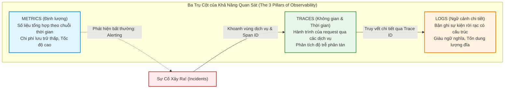

# 16.1. Distributed Observability: Fundamentals, Logging & Metrics

> [!IMPORTANT]
> **Nếu bạn chỉ được nhớ một điều duy nhất**: Khả năng quan sát (Observability) không phải là việc thu thập thật nhiều dữ liệu mà là khả năng **suy luận chính xác trạng thái nội tại của một hệ thống phân tán chỉ dựa trên các đầu ra bên ngoài của nó (Lý thuyết Điều khiển - Control Theory)**. Điểm phân định giữa một hệ thống quan sát trưởng thành và nghiệp dư là cách xử lý bài toán **High Cardinality**: việc đưa các định danh có độ phân tán cao (như `user_id`, `email`, hoặc `order_uuid`) vào nhãn (Labels) của Time-Series Database (như Prometheus) sẽ kích hoạt hiện tượng **Bùng nổ Chiều dữ liệu (Cardinality Explosion)** làm sập hoàn toàn bộ nhớ RAM; các dữ liệu phân tán này bắt buộc phải được chuyển sang tầng **Structured Logging** hoặc **Distributed Tracing**.

---

## 1. Kiến trúc Tổng quan & Mô hình Tư duy (Mental Model)

### Ẩn dụ Đời sống: Hộp Đen Máy Bay, Bảng Đồng Hồ Buồng Lái và Ống Nghe Y Tế
Hãy tưởng tượng một chiếc máy bay thương mại hiện đại bay qua vùng bão:
- **Metrics (Bảng Đồng hồ Buồng lái)**: Các đồng hồ đo tốc độ (Airspeed), độ cao (Altitude), nhiệt độ động cơ (Engine Temp). Các con số số học tổng hợp nhỏ gọn, hiển thị tức thì theo thời gian thực ($< 1$ giây) giúp phi công biết ngay: *"Hệ thống có đang gặp nguy hiểm không?"*. (Giám sát mức độ vĩ mô - What is broken?).
- **Logs (Hộp đen Ghi âm Buồng lái)**: Ghi lại chi tiết từng câu nói, từng cảnh báo, từng nút bấm được kích hoạt kèm timestamp chính xác. Khi máy bay gặp sự cố, các chuyên gia mở hộp đen đọc từng dòng để tìm hiểu: *"Chuyện gì cụ thể đã xảy ra tại giây thứ 42?"*. (Điều tra vi mô - Why did it break?).
- **Traces (Hành trình của Dòng Khí động học)**: Theo dõi một luồng khí cụ thể từ lúc đi vào cửa hút gió của động cơ, qua buồng đốt, tới cánh quạt xả khí. Giúp kỹ sư biết được một yêu cầu cụ thể đã đi qua những linh kiện nào và bị nghẽn ở đâu.
- **Monitoring vs Observability**:
  - Monitoring: Kiểm tra xem các bóng đèn cảnh báo có sáng đỏ không (Biết trước các lỗi đã biết - *Known Unknowns*).
  - Observability: Cho phép phi công đặt câu hỏi mới tinh mà chưa ai từng nghĩ tới khi thiết kế hệ thống để tìm ra một lỗi kỳ lạ chưa từng xuất hiện trong lịch sử (*Unknown Unknowns*).



---

## 2. Chi tiết từng Keyword (Under-the-Hood Deep Dive)

### 2.1. Monitoring vs Observability & Ba trụ cột (The Three Pillars)

#### 1. Định nghĩa Kỹ thuật
- **Monitoring (Giám sát)**: Trả lời câu hỏi *"Hệ thống có đang hoạt động bình thường không?"*. Dựa vào các ngưỡng cấu hình tĩnh (Static Thresholds: CPU $> 85\%$, Error Rate $> 1\%$). Chỉ phát hiện được các triệu chứng lỗi đã được lường trước.
- **Observability (Khả năng quan sát)**: Thước đo mức độ thấu hiểu trạng thái bên trong của hệ thống dựa trên đầu ra viễn trắc (Telemetry). Cho phép người vận hành gỡ lỗi (Debug) các trạng thái phức tạp, bất định trong môi trường Microservices mà không cần phải triển khai lại code mới.

#### 2. Ba trụ cột (The Three Pillars)
1. **Metrics (Chuỗi số liệu thời gian - Time Series)**: Dữ liệu số học có thể tổng hợp được (Counters, Gauges) gắn với các nhãn (Key-Value Labels) và mốc thời gian. Tối ưu cho việc vẽ biểu đồ Dashboard và bắn cảnh báo (Alerting).
2. **Logs (Bản ghi nhật ký)**: Dòng văn bản có cấu trúc ghi lại một sự kiện xảy ra tại một thời điểm cụ thể. Chứa thông tin ngữ cảnh đầy đủ nhất (Stack trace, Payload, Error message).
3. **Traces (Dấu vết phân tán)**: Biểu diễn đồ thị thực thi của một yêu cầu duy nhất khi nó đi xuyên qua hàng chục microservices độc lập.

### 2.2. High Cardinality & Hiểm họa Cardinality Explosion trong TSDB

#### Bản chất Toán học của Cardinality
- **Cardinality (Lực lượng tập hợp)**: Số lượng các giá trị phân biệt duy nhất của một trường dữ liệu (Label / Tag).
  - Low Cardinality: `env` (`dev`, `prod` $\to$ 2 giá trị), `status_code` (`200`, `400`, `500` $\to$ vài chục giá trị).
  - High Cardinality: `user_id` ($10$ triệu giá trị), `order_id` ($100$ triệu giá trị), `ip_address`.

#### Hiểm họa Cardinality Explosion trong Prometheus / TSDB
- Trong Prometheus, mỗi tổ hợp duy nhất của các nhãn (Unique Labelset) tạo ra một **chuỗi thời gian độc lập (Time Series)**:
  $$\text{Tổng số Time Series} = \prod_{i=1}^M \text{Cardinality}(\text{Label}_i)$$
- **Thảm họa**: Nếu một lập trình viên đưa nhãn `user_id` vào metric HTTP:
  ```promql
  http_requests_total{method="POST", path="/checkout", user_id="123456"}
  ```
  Khi có 1 triệu người dùng, Prometheus phải tạo ra **1.000.000 chuỗi thời gian mới trong RAM**! Bộ nhớ TSDB (Head Block Index) bị phình to hàng chục GB trong vài phút, làm sập hoàn toàn máy chủ giám sát (**OOMKilled**).
- *Quy tắc vàng*: **Tuyệt đối không bao giờ đưa dữ liệu High Cardinality vào Prometheus Labels**. Dữ liệu định danh người dùng bắt buộc phải đưa vào **Structured Logs** hoặc **Trace Baggage**.

### 2.3. Structured Logging vs Unstructured Logging

#### 1. Unstructured Logging (Cổ điển - Chống chỉ định trong Microservices)
```text
2026-11-15 14:30:00 [ERROR] User 9981 checkout failed on order 101: Insufficient funds
```
- Khó trích xuất tự động bằng máy. Để tìm các lỗi do "Insufficient funds", công cụ tìm kiếm buộc phải quét Regex toàn văn (Full Text Search) làm chậm toàn bộ cụm Elasticsearch.

#### 2. Structured Logging (Chuẩn công nghiệp - JSON Format)
```json
{
  "timestamp": "2026-11-15T14:30:00.123Z",
  "level": "ERROR",
  "service": "payment-service",
  "trace_id": "4bf92f3577b34da6a3ce929d0e0e4736",
  "user_id": 9981,
  "order_id": 101,
  "error_code": "INSUFFICIENT_FUNDS",
  "message": "User checkout failed due to lack of balance"
}
```
- **Ưu điểm vượt trội**: Cho phép các hệ thống xử lý log (Logstash, FluentBit, Loki) lập chỉ mục trực tiếp theo các trường số học và từ khóa, hỗ trợ truy vấn lọc tức thì: `error_code = "INSUFFICIENT_FUNDS" AND user_id = 9981`.

### 2.4. So sánh Kiến trúc Lưu trữ Log: ELK vs Grafana Loki

| Tiêu chí So sánh | Cụm ELK (Elasticsearch / OpenSearch) | Grafana Loki |
| :--- | :--- | :--- |
| **Chiến lược Lập chỉ mục** | Đánh chỉ mục đảo toàn văn (**Full-Text Inverted Index**) cho từng từ trong message. | **Chỉ đánh chỉ mục nhãn Metadata** (tương tự như Prometheus: `app`, `env`, `pod`). Message được nén thành các Chunk thô. |
| **Tiêu tốn Dung lượng RAM & Đĩa** | **Cực lớn**: File index có thể nặng bằng hoặc lớn hơn dung lượng log gốc. | **Cực kỳ nhỏ gọn**: Tiết kiệm tới $80-90\%$ chi phí lưu trữ nhờ nén Gzip/Snappy. |
| **Tốc độ Truy vấn** | Cực nhanh với tìm kiếm từ khóa bất kỳ. | Nhanh với lọc theo nhãn, chậm hơn nếu grep chuỗi trong dải thời gian rộng. |
| **Độ phức tạp Vận hành** | Cao (Cần quản lý Shards, Replicas, JVM Heap tuning). | Rất thấp (Cloud-native, lưu trữ trực tiếp trên AWS S3 / GCS). |

### 2.5. Bốn loại Metric cơ bản (Metric Types trong Prometheus)
1. **Counter (Bộ đếm tăng ngặt)**: Chỉ có thể tăng lên hoặc reset về 0 khi tiến trình khởi động lại (ví dụ: `http_requests_total`, `errors_total`). Sử dụng hàm `rate()` hoặc `increase()` trong PromQL để tính tốc độ thay đổi.
2. **Gauge (Thước đo biến thiên)**: Giá trị số thực có thể tăng hoặc giảm tự do theo thời gian (ví dụ: dung lượng RAM sử dụng `memory_usage_bytes`, số kết nối database đang mở `db_connections_active`).
3. **Histogram (Bộ đếm phân vị)**: Lấy mẫu dữ liệu và chia vào các thùng chứa cấu hình sẵn (**Buckets** - ví dụ: `le="0.1"`, `le="0.5"`, `le="2.0"`). Cho phép tính toán độ trễ phân vị (**P95, P99 Latency**) chính xác bằng hàm `histogram_quantile()`.
4. **Summary (Bộ đếm tổng kết tại Client)**: Tính toán trực tiếp các phân vị trên client side (P50, P90). Nhược điểm: Không thể cộng gộp (Aggregate) số liệu Summary giữa nhiều Pods khác nhau.

### 2.6. Hai khung phương pháp giám sát chuẩn mực: USE vs RED

#### 1. Phương pháp USE (Brendan Gregg - Giám sát Hạ tầng / Resources)
Áp dụng cho mọi tài nguyên phần cứng (CPU, Memory, Disk, Network Interface):
- **Utilization (Mức độ sử dụng)**: Tỷ lệ thời gian tài nguyên đang bận xử lý công việc (% CPU bận).
- **Saturation (Mức độ bão hòa)**: Lượng công việc không thể xử lý ngay và phải xếp hàng chờ đợi (Load Average, Queue Depth).
- **Errors (Lỗi phần cứng)**: Số lượng sự kiện lỗi (Memory ECC errors, Network dropped packets).

#### 2. Phương pháp RED (Tom Wilkie - Giám sát Dịch vụ / Microservices)
Áp dụng cho mọi API Endpoint hoặc giao diện mạng của ứng dụng:
- **Rate (Tần suất)**: Số lượng request nhận được mỗi giây (RPS).
- **Errors (Lỗi)**: Số lượng request bị lỗi mỗi giây (HTTP 5xx).
- **Duration (Thời lượng)**: Thời gian hoàn tất một request (Độ trễ P50, P95, P99).

#### 3. Bốn Tín hiệu Vàng của Google (Google SRE's Four Golden Signals)
Được chuẩn hóa trong cuốn sách Google Site Reliability Engineering:
$$\text{Four Golden Signals} = \langle \text{Latency (Độ trễ)}, \quad \text{Traffic (Lưu lượng)}, \quad \text{Errors (Lỗi)}, \quad \text{Saturation (Mức độ bão hòa)} \rangle$$

### 2.7. Khung quản trị độ tin cậy: SLI, SLO, SLA & Error Budget

- **SLI (Service Level Indicator - Chỉ số mức dịch vụ)**: Thước đo định lượng trực tiếp hiệu năng hệ thống:
  $$\text{SLI} = \frac{\text{Số requests hợp lệ có độ trễ } < 200\text{ms}}{\text{Tổng số requests hợp lệ}} \times 100\%$$
- **SLO (Service Level Objective - Mục tiêu mức dịch vụ)**: Ngưỡng cam kết nội bộ giữa đội kỹ thuật và sản phẩm (ví dụ: $\text{SLO} = 99.9\%$ trong chu kỳ 30 ngày).
- **SLA (Service Level Agreement - Thỏa thuận mức dịch vụ)**: Cam kết pháp lý với khách hàng kèm hình thức phạt tiền nếu vi phạm (thường nới lỏng hơn SLO: ví dụ $\text{SLA} = 99.5\%$).
- **Error Budget (Ngân sách Lỗi)**: Phần trăm dung sai cho phép hệ thống bị lỗi:
  $$\text{Error Budget} = 100\% - \text{SLO} \quad (\text{Với SLO } 99.9\% \implies \text{Error Budget} = 0.1\% \approx 43.2 \text{ phút downtime/tháng})$$
  - Khi Error Budget còn dương: Đội ngũ kỹ sư tự do triển khai tính năng mới (Ship fast).
  - Khi Error Budget bị cạn kiệt: Đóng băng toàn bộ việc release tính năng, tập trung 100% nhân lực vào việc vá lỗi độ tin cậy (Reliability Sprint).

---

## 3. Thực thi Mã nguồn & Mô phỏng Chuyên sâu (Dual-Engine Implementation)

### Engine 1: C++20 — Mô phỏng Cốt lõi Prometheus Metrics Exporter Engine Chuẩn Định Dạng Văn Bản

```cpp
#include <iostream>
#include <string>
#include <atomic>
#include <sstream>
#include <vector>
#include <format>
#include <cstdint>
#include <mutex>

// Metric Counter Thread-Safe
class PrometheusCounter {
private:
    std::string name_;
    std::string help_;
    std::atomic<uint64_t> value_{0};

public:
    PrometheusCounter(std::string name, std::string help)
        : name_(std::move(name)), help_(std::move(help)) {}

    void inc(uint64_t n = 1) { value_.fetch_add(n, std::memory_order_relaxed); }
    uint64_t get() const { return value_.load(std::memory_order_relaxed); }
    const std::string& name() const { return name_; }
    const std::string& help() const { return help_; }
};

// Metric Histogram đơn giản với Buckets cấu hình sẵn
class PrometheusHistogram {
private:
    std::string name_;
    std::string help_;
    std::vector<double> buckets_;
    std::vector<std::atomic<uint64_t>> bucket_counts_;
    std::atomic<uint64_t> count_{0};
    std::atomic<double> sum_{0.0};
    std::mutex sum_mtx_;

public:
    PrometheusHistogram(std::string name, std::string help, std::vector<double> buckets)
        : name_(std::move(name)), help_(std::move(help)), buckets_(std::move(buckets)),
          bucket_counts_(buckets_.size()) {
        for (auto& bc : bucket_counts_) bc.store(0);
    }

    void observe(double val) {
        count_.fetch_add(1, std::memory_order_relaxed);
        {
            std::lock_guard<std::mutex> lock(sum_mtx_);
            sum_ = sum_ + val;
        }

        // Tăng các bucket tương ứng
        for (size_t i = 0; i < buckets_.size(); ++i) {
            if (val <= buckets_[i]) {
                bucket_counts_[i].fetch_add(1, std::memory_order_relaxed);
            }
        }
    }

    std::string to_prometheus_format() {
        std::stringstream ss;
        ss << std::format("# HELP {} {}\n# TYPE {} histogram\n", name_, help_, name_);
        for (size_t i = 0; i < buckets_.size(); ++i) {
            ss << std::format("{}_bucket{{le=\"{:.2f}\"}} {}\n", name_, buckets_[i], bucket_counts_[i].load());
        }
        ss << std::format("{}_bucket{{le=\"+Inf\"}} {}\n", name_, count_.load());
        ss << std::format("{}_sum {:.4f}\n", name_, sum_.load());
        ss << std::format("{}_count {}\n", name_, count_.load());
        return ss.str();
    }
};

int main() {
    PrometheusCounter http_requests("http_requests_total", "Tong so luong HTTP requests");
    PrometheusHistogram http_latency("http_request_duration_seconds", "Do tre HTTP requests", {0.05, 0.1, 0.2, 0.5});

    std::cout << "--- Mô phỏng phục vụ 4 requests với các độ trễ khác nhau ---\n";
    http_requests.inc(); http_latency.observe(0.04); // Rơi vào bucket <= 0.05
    http_requests.inc(); http_latency.observe(0.09); // Rơi vào bucket <= 0.10
    http_requests.inc(); http_latency.observe(0.18); // Rơi vào bucket <= 0.20
    http_requests.inc(); http_latency.observe(0.45); // Rơi vào bucket <= 0.50

    std::cout << "\n>>> XUẤT BẢN TEXT FORMAT CHUẨN PROMETHEUS (/metrics endpoint) <<<\n";
    std::cout << std::format("# HELP {} {}\n# TYPE {} counter\n",
        http_requests.name(), http_requests.help(), http_requests.name());
    std::cout << std::format("{}{{method=\"POST\",status=\"200\"}} {}\n\n",
        http_requests.name(), http_requests.get());

    std::cout << http_latency.to_prometheus_format();

    return 0;
}
```

#### Terminal Output Mẫu:
```text
--- Mô phỏng phục vụ 4 requests với các độ trễ khác nhau ---

>>> XUẤT BẢN TEXT FORMAT CHUẨN PROMETHEUS (/metrics endpoint) <<<
# HELP http_requests_total Tong so luong HTTP requests
# TYPE http_requests_total counter
http_requests_total{method="POST",status="200"} 4

# HELP http_request_duration_seconds Do tre HTTP requests
# TYPE http_request_duration_seconds histogram
http_request_duration_seconds_bucket{le="0.05"} 1
http_request_duration_seconds_bucket{le="0.10"} 2
http_request_duration_seconds_bucket{le="0.20"} 3
http_request_duration_seconds_bucket{le="0.50"} 4
http_request_duration_seconds_bucket{le="+Inf"} 4
http_request_duration_seconds_sum 0.7600
http_request_duration_seconds_count 4
```

---

### Engine 2: Python 3.11+ — Tính toán SLI, SLO & Tốc độ Tiêu hao Ngân sách Lỗi (Error Budget Burn Rate)

```python
import math
from typing import NamedTuple

class SLOResult(NamedTuple):
    total_requests: int
    failed_requests: int
    sli_availability: float
    slo_target: float
    error_budget_total: int
    error_budget_consumed: int
    budget_remaining_percent: float
    burn_rate: float

class ErrorBudgetCalculator:
    def __init__(self, slo_target: float = 0.999):
        self.slo_target = slo_target # Ví dụ: 99.9%
        self.allowed_error_fraction = 1.0 - slo_target # 0.001 (0.1%)

    def analyze_window(self, total_requests: int, failed_requests: int, window_hours: float, total_period_hours: float = 720.0) -> SLOResult:
        """
        Tính toán tốc độ Burn Rate:
        Burn Rate = 1.0 nghĩa là hệ thống tiêu thụ ngân sách lỗi vừa khít 100% trong toàn bộ chu kỳ 30 ngày (720 giờ).
        Burn Rate = 14.4 nghĩa là hệ thống sẽ thiêu rụi toàn bộ ngân sách lỗi của 30 ngày trong vòng chỉ 2 ngày (48 giờ)!
        """
        actual_sli = (total_requests - failed_requests) / total_requests if total_requests > 0 else 1.0

        # Tổng số lỗi cho phép trong toàn bộ chu kỳ
        total_period_requests_est = (total_requests / window_hours) * total_period_hours
        error_budget_total = int(total_period_requests_est * self.allowed_error_fraction)

        # Số lỗi cho phép trong cửa sổ hiện tại
        budget_for_this_window = total_requests * self.allowed_error_fraction
        burn_rate = (failed_requests / budget_for_this_window) if budget_for_this_window > 0 else 0.0

        budget_remaining_pct = max(0.0, 1.0 - (failed_requests / error_budget_total)) * 100.0 if error_budget_total > 0 else 100.0

        return SLOResult(
            total_requests=total_requests,
            failed_requests=failed_requests,
            sli_availability=actual_sli * 100.0,
            slo_target=self.slo_target * 100.0,
            error_budget_total=error_budget_total,
            error_budget_consumed=failed_requests,
            budget_remaining_percent=budget_remaining_pct,
            burn_rate=burn_rate
        )

def main():
    calc = ErrorBudgetCalculator(slo_target=0.999) # SLO 99.9%

    print("================ PHÂN TÍCH QUẢN TRỊ ĐỘ TIN CẬY (SRE SLO/SLI) ================")
    # Kịch bản: Cửa sổ 1 giờ, phục vụ 100.000 requests, có 500 requests bị lỗi 500
    res = calc.analyze_window(total_requests=100_000, failed_requests=500, window_hours=1.0)

    print(f"Tổng số Requests (1 giờ):    {res.total_requests:,}")
    print(f"Số Requests Thất Bại:        {res.failed_requests:,}")
    print(f"SLI Khả Dụng Thực Tế:        {res.sli_availability:.3f}% (Mục tiêu SLO: {res.slo_target:.1f}%)")
    print(f"Tốc độ Đốt Tiền (Burn Rate): {res.burn_rate:.1f}x!")

    if res.burn_rate > 14.4:
        print("\n[BÁO ĐỘNG ĐỎ PAGERDUTY] Burn Rate > 14.4x! Toàn bộ Error Budget 30 ngày sẽ cạn kiệt trong 48 giờ!")
    elif res.burn_rate > 1.0:
        print("\n[CẢNH BÁO VÀNG] Burn Rate > 1.0x! Đang tiêu thụ ngân sách lỗi nhanh hơn tốc độ an toàn.")
    else:
        print("\n[AN TOÀN] Hệ thống nằm trong giới hạn kiểm soát ngân sách lỗi.")

if __name__ == "__main__":
    main()
```

#### Terminal Output Mẫu:
```text
================ PHÂN TÍCH QUẢN TRỊ ĐỘ TIN CẬY (SRE SLO/SLI) ================
Tổng số Requests (1 giờ):    100,000
Số Requests Thất Bại:        500
SLI Khả Dụng Thực Tế:        99.500% (Mục tiêu SLO: 99.9%)
Tốc độ Đốt Tiền (Burn Rate): 5.0x!

[CẢNH BÁO VÀNG] Burn Rate > 1.0x! Đang tiêu thụ ngân sách lỗi nhanh hơn tốc độ an toàn.
```

---

## 4. Systems Engineering & Production Pitfalls

### 4.1. Những cạm bẫy sống còn trong Giám sát và Quan sát phân tán
1. **Dùng nhầm Trung bình cộng (Average Latency) thay vì Phân vị (Percentiles)**:
   - Một API có thời gian xử lý: 99 requests mất $10\text{ms}$, và 1 request mất $10.000\text{ms}$ (10 giây).
   - $\text{Average Latency} = \frac{99 \times 10 + 10000}{100} = 109.9\text{ms}$ (Nhìn có vẻ bình thường!).
   - Nhưng thực tế: $1\%$ khách hàng của bạn đang phải đợi 10 giây và chuẩn bị rời bỏ dịch vụ.
   - *Quy tắc bất biến*: **Tuyệt đối không đo độ trễ bằng Average/Mean**. Luôn sử dụng **P95, P99, P99.9** để phát hiện Tail Latency!

2. **Cảnh báo Bão táp (Alert Fatigue)**:
   - Cài đặt hàng trăm alert dựa trên ngưỡng tĩnh CPU $> 80\%$. Nửa đêm hệ thống quét backup làm CPU nhảy lên 85% trong 5 phút, PagerDuty réo chuông liên tục. Sau 1 tuần, kỹ sư sẽ tắt chuông cảnh báo $\implies$ Khi có sự cố thật, không ai dậy xử lý!
   - *Khắc phục*: Chỉ bắn cảnh báo PagerDuty dựa trên **Triệu chứng ảnh hưởng trực tiếp tới người dùng (User-facing Symptoms / Burn Rate Alerts)**, không cảnh báo trên nguyên nhân phụ trợ (Cause-based alerts).

3. **Log đồng bộ (Synchronous Logging) làm nghẽn Event Loop**:
   - Viết lệnh `logger.info()` ghi thẳng ra file đĩa hoặc gửi qua socket TCP đồng bộ. Khi đĩa bị quá tải I/O, lệnh ghi log bị block $100\text{ms}$, kéo theo toàn bộ worker thread bị đóng băng!
   - *Khắc phục*: Luôn sử dụng **Asynchronous Logging với Ring Buffer không khóa (Disruptor / Log4j2 Async)**.

### 4.2. Runbook Chẩn đoán Sự cố Giám sát trên Production (CLI Commands)

```bash
# 1. Tìm các Metric có số lượng Time Series cao nhất gây bùng nổ Cardinality trong Prometheus
curl -s http://localhost:9090/api/v1/status/tsdb | jq .data.seriesCountByMetricName | head -n 15

# 2. Xem tốc độ nạp Log (Ingestion Rate) trong Grafana Loki
curl -s http://localhost:3100/metrics | grep "loki_distributor_bytes_received_total"

# 3. Kiểm tra số lượng kết nối Scrape bị lỗi trong Prometheus
curl -s http://localhost:9090/api/v1/targets | jq '.data.activeTargets[] | select(.health != "up")'
```

---

## 5. Bảng So sánh & Decision Matrix

| Khía cạnh | Metrics (Prometheus) | Structured Logs (Loki / ELK) | Distributed Tracing (Jaeger) |
| :--- | :--- | :--- | :--- |
| **Câu hỏi giải quyết** | *Cái gì đang hỏng? (What)* | *Tại sao nó hỏng? (Why)* | *Nó hỏng ở đâu trên hành trình? (Where)* |
| **Chi phí Lưu trữ** | Rất thấp (Số liệu tổng hợp) | Cao (Văn bản chi tiết) | Trung bình (Nhờ kỹ thuật Sampling) |
| **Độ trễ Thu thập** | Cực thấp (Near Real-time) | Thấp ($1-5$ giây) | Thấp ($1-5$ giây) |
| **Xử lý High Cardinality** | **Kém (Dễ nổ TSDB)** | **Rất tốt** | **Rất tốt** |
| **Công nghệ Hàng đầu** | **Prometheus, VictoriaMetrics, M3DB** | **Grafana Loki, Elasticsearch, OpenSearch** | **OpenTelemetry, Jaeger, Tempo** |
