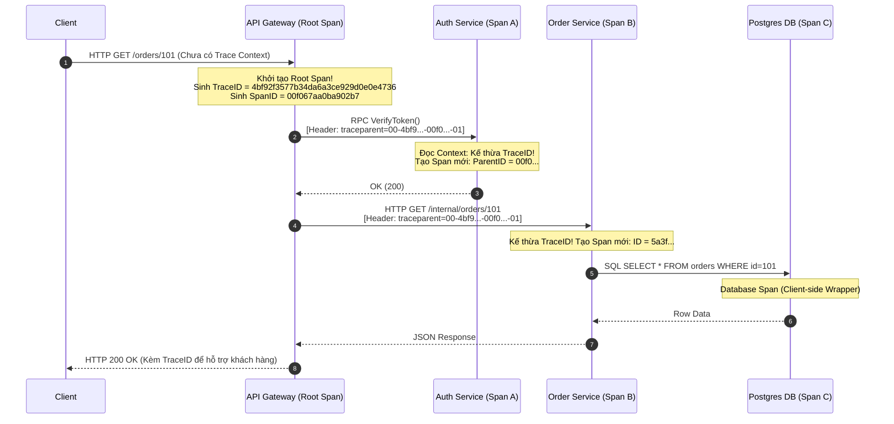

# 16.2. Distributed Tracing, OpenTelemetry & W3C Trace Context

> [!IMPORTANT]
> **Nếu bạn chỉ được nhớ một điều duy nhất**: Trong kiến trúc Microservices nơi một yêu cầu duy nhất có thể kích hoạt một mạng lưới đồ thị gồm hàng chục cuộc gọi RPC và Event bất đồng bộ, **Distributed Tracing** là công nghệ duy nhất có khả năng ghép nối toàn bộ bức tranh phân tán thông qua cơ chế lan truyền ngữ cảnh (**Context Propagation**). Chuẩn quốc tế **W3C Trace Context** quy định cấu trúc định tuyến bất biến qua header `traceparent` (`version-trace_id-parent_id-trace_flags`). Để giải quyết bài toán chi phí lưu trữ khổng lồ mà không bỏ sót các lỗi hiếm gặp, các hệ sinh thái hiện đại chuyển dịch từ **Head-based Sampling** (chọn mẫu ngẫu nhiên tại cổng vào) sang **Tail-based Sampling** (thu thập toàn bộ và chỉ lưu lại các Trace có lỗi hoặc có độ trễ vượt ngưỡng P99).

---

## 1. Kiến trúc Tổng quan & Mô hình Tư duy (Mental Model)

### Ẩn dụ Đời sống: Mã Vận Đơn Bưu Phẩm Quốc Tế
Hãy tưởng tượng bạn đặt một kiện hàng từ Tokyo về Hà Nội:
- **Trace ID (Mã Vận Đơn Toàn Cầu)**: Một chuỗi số hex 128-bit duy nhất được in lên gói hàng ngay khi người bán giao cho bưu điện (Root Span). Dù gói hàng có chuyển qua xe tải, máy bay Boeing, kho hải quan, hay xe máy của shipper, mã vận đơn này **không bao giờ thay đổi**.
- **Span (Từng chặng hành trình)**: Mỗi công đoạn vận chuyển là một Span có thời gian bắt đầu và kết thúc cụ thể:
  - Chặng 1 ($Span_1$): Xe tải chở hàng từ Shop đến sân bay Narita.
  - Chặng 2 ($Span_2$): Máy bay chở từ Narita về sân bay Nội Bài (Span con của $Span_1$).
  - Chặng 3 ($Span_3$): Thủ tục thông quan tại Nội Bài.
- **Context Propagation (Bàn giao hồ sơ)**: Khi lái xe tải giao hàng cho phi công, anh ta đưa cho phi công tập hồ sơ có ghi rõ: *"Tôi là lái xe mang mã số $Span_1$, gói hàng này thuộc mã vận đơn $TraceID$."* Phi công ghi lại mã này và tạo ra $Span_2$ với thuộc tính `parent_id = Span_1`. Nhờ vậy, hệ thống theo dõi có thể vẽ lại toàn bộ cây phả hệ hành trình của kiện hàng (**Directed Acyclic Graph of Spans**).
- **Critical Path (Đường găng)**: Khoảng thời gian từ lúc đặt hàng đến khi nhận hàng bằng tổng thời gian của các chặng tuần tự dài nhất; tối ưu hóa một chặng nằm ngoài đường găng sẽ không giúp kiện hàng đến sớm hơn!



---

## 2. Chi tiết từng Keyword (Under-the-Hood Deep Dive)

### 2.1. Mô hình dữ liệu cốt lõi: Trace, Span, Root Span & Parent Span

#### 1. Định nghĩa Kỹ thuật
- **Trace (Dấu vết toàn cục)**: Một đồ thị có hướng không chu trình (DAG) đại diện cho toàn bộ luồng thực thi của một yêu cầu đi qua hệ thống phân tán. Một Trace được định danh bởi một chuỗi số ngẫu nhiên 16 bytes (**Trace ID - 128 bit**, hiển thị dưới dạng 32 ký tự Hex).
- **Span (Đoạn dấu vết / Đơn vị thực thi cơ bản)**: Đại diện cho một khối công việc có giới hạn thời gian (ví dụ: một truy vấn SQL, một lời gọi HTTP, hoặc một hàm xử lý logic).
- **Cấu trúc dữ liệu của một Span**:
  $$\text{Span} = \langle \text{Name, TraceID, SpanID, ParentSpanID, StartTime, EndTime, Attributes, Events, Status} \rangle$$
- **Root Span (Span gốc)**: Span đầu tiên được tạo ra tại cửa ngõ tiếp nhận request (thường là API Gateway hoặc Load Balancer). Root Span **không có `ParentSpanID`**.
- **Parent-Child Span Relationship**:
  - Khi Service A gọi sang Service B: Span của Service A là **Parent Span**, Span của Service B là **Child Span**.
  - Mối quan hệ phân cấp này cho phép công cụ hiển thị (Jaeger, Zipkin) vẽ biểu đồ thác nước (**Waterfall Gantt Chart**).

```mermaid
gantt
    title Cấu trúc Một Trace trong Không gian Thời gian (Waterfall View)
    dateFormat X
    axisFormat %s ms

    section API Gateway
    Root Span: Ingress Gateway           :active, 0, 100
    section Auth Service
    Child Span: Verify JWT Token         :crit, 5, 25
    section Order Service
    Child Span: Fetch Order Metadata     :25, 95
    section Database
    Grandchild Span: SQL SELECT Orders   :40, 85
```

### 2.2. Chuẩn hóa quốc tế W3C Trace Context & Context Propagation

#### 1. HTTP Header: `traceparent` (Bắt buộc theo chuẩn W3C)
Để truyền ngữ cảnh qua các giao thức mạng (HTTP/gRPC/Kafka Headers), W3C định nghĩa định dạng chuỗi chuẩn gồm đúng 4 trường phân cách bằng dấu gạch ngang `-`:
$$\text{traceparent} = \text{version} - \text{trace\_id} - \text{parent\_id} - \text{trace\_flags}$$

- **`version` (2 Hex digits)**: Phiên bản chuẩn hiện tại là `00`.
- **`trace_id` (32 Hex digits / 16 Bytes)**: Mã định danh toàn cục của cả Trace.
- **`parent_id` (16 Hex digits / 8 Bytes)**: Mã `SpanID` của người gọi (Caller Span ID).
- **`trace_flags` (2 Hex digits / 8 Bits)**: Cờ điều khiển việc lấy mẫu:
  - `01` (Sampled): Trace này đã được chọn để ghi nhận và xuất bản lên backend.
  - `00` (Not Sampled): Trace này không được ghi nhận chi tiết (tiết kiệm tài nguyên).

*Ví dụ chuẩn thực tế*:
```http
traceparent: 00-4bf92f3577b34da6a3ce929d0e0e4736-00f067aa0ba902b7-01
```

#### 2. HTTP Header: `tracestate` & `baggage`
- **`tracestate`**: Chứa danh sách các cặp key-value do các hệ thống Vendor cụ thể quy định (ví dụ: `rojo=123,congo=456`), giúp nhiều công cụ tracing khác nhau (Dynatrace, Datadog, NewRelic) cùng cộng tác trên một hệ thống mà không làm mất metadata riêng của từng hãng.
- **`baggage` (W3C Baggage API)**: Cho phép đính kèm các cặp Key-Value tùy chỉnh của người dùng (ví dụ: `tenant_id=acme,datacenter=us-east-1`) để **tự động lan truyền xuyên suốt toàn bộ cây gọi dịch vụ** tới tất cả các microservices phía sau.

### 2.3. Trace Sampling: Head-based Sampling vs Tail-based Sampling

#### Bảng so sánh Head-based vs Tail-based Sampling
| Tiêu chí | Head-based Sampling (Lấy mẫu tại Cổng vào) | Tail-based Sampling (Lấy mẫu tại Cổng ra) |
| :--- | :--- | :--- |
| **Thời điểm Quyết định**| Tại thời điểm **bắt đầu Root Span** (khi request vừa chạm vào API Gateway). | Tại thời điểm **toàn bộ Trace đã hoàn thành** trên tất cả các dịch vụ. |
| **Cơ chế Lọc** | Lấy mẫu theo tỷ lệ phần trăm cố định (ví dụ: chọn ngẫu nhiên $1\%$ hoặc $5\%$ tổng số requests). | Đánh giá toàn diện: **Lưu lại 100% các Trace có lỗi (HTTP 5xx) hoặc có độ trễ $> 1.000\text{ms}$**; loại bỏ các Trace thành công bình thường. |
| **Tiêu tốn Tài nguyên Collector** | Cực thấp (Các request không được chọn bị bỏ qua ngay từ đầu). | Cao hơn (Yêu cầu OpenTelemetry Collector phải đệm các Span trên RAM trong vài giây để đợi toàn bộ Trace kết thúc). |
| **Bắt lỗi hiếm gặp (Rare Anomalies)** | **Kém**: Có thể bỏ sót một lỗi hiếm xảy ra với tỷ lệ 1/10.000 requests. | **Xuất sắc**: Đảm bảo 100% các lỗi nghiêm trọng đều được thu thập đầy đủ. |

### 2.4. Critical Path Analysis (Phân tích Đường găng)
Trong một đồ thị Trace phức tạp gồm hàng chục Span chạy song song bất đồng bộ:
- **Critical Path (Đường găng)**: Là chuỗi các Span tuần tự dài nhất từ điểm bắt đầu đến điểm kết thúc của Trace mà **tổng thời gian thực thi của chúng quyết định trực tiếp độ trễ tổng thể của toàn bộ request**.
- **Ý nghĩa Kỹ nghệ Hiệu năng**:
  - Nếu một Span chạy song song mất 20ms trong khi nhánh chính mất 200ms $\implies$ Tối ưu hóa nhánh 20ms về 0ms cũng không làm giảm độ trễ tổng thể của người dùng!
  - Việc tập trung nguồn lực tối ưu hóa các Span nằm trên **Critical Path** mang lại hiệu quả ROI cao nhất cho nỗ lực Performance Engineering.

---

## 3. Thực thi Mã nguồn & Mô phỏng Chuyên sâu (Dual-Engine Implementation)

### Engine 1: C++20 — Triển khai W3C Trace Context Injector & Extractor Engine Chuẩn Quốc Tế

```cpp
#include <iostream>
#include <string>
#include <sstream>
#include <vector>
#include <format>
#include <regex>
#include <random>
#include <iomanip>

struct TraceContext {
    std::string version;
    std::string trace_id;
    std::string parent_span_id;
    std::string trace_flags;

    bool is_sampled() const {
        return trace_flags == "01";
    }

    std::string serialize_traceparent() const {
        return std::format("{}-{}-{}-{}", version, trace_id, parent_span_id, trace_flags);
    }
};

class W3CTraceContextPropagator {
private:
    std::mt19937_64 rng_;

public:
    W3CTraceContextPropagator() : rng_(std::random_device{}()) {}

    // Tạo Hex ngẫu nhiên với số byte chỉ định
    std::string generate_random_hex(size_t num_bytes) {
        std::stringstream ss;
        for (size_t i = 0; i < num_bytes; ++i) {
            uint8_t byte = rng_() & 0xFF;
            ss << std::hex << std::setw(2) << std::setfill('0') << static_cast<int>(byte);
        }
        return ss.str();
    }

    // Khởi tạo Root Context mới tinh tại API Gateway
    TraceContext create_root_context(bool sample = true) {
        return TraceContext{
            .version = "00",
            .trace_id = generate_random_hex(16),       // 16 bytes = 32 hex chars
            .parent_span_id = generate_random_hex(8),  // 8 bytes = 16 hex chars
            .trace_flags = (sample ? "01" : "00")
        };
    }

    // Trích xuất TraceContext từ HTTP Header 'traceparent'
    std::optional<TraceContext> extract(const std::string& header_val) {
        // Regex chuẩn W3C: version (2) - trace_id (32) - parent_id (16) - trace_flags (2)
        static const std::regex w3c_regex("^([0-9a-f]{2})-([0-9a-f]{32})-([0-9a-f]{16})-([0-9a-f]{2})$");
        std::smatch match;

        if (std::regex_match(header_val, match, w3c_regex)) {
            // Kiểm tra tính hợp lệ: trace_id và parent_id không được toàn số 0
            if (match[2].str() == std::string(32, '0') || match[3].str() == std::string(16, '0')) {
                return std::nullopt;
            }
            return TraceContext{
                .version = match[1].str(),
                .trace_id = match[2].str(),
                .parent_span_id = match[3].str(),
                .trace_flags = match[4].str()
            };
        }
        return std::nullopt;
    }

    // Tạo Child Span context để truyền tiếp cho downstream service
    TraceContext create_child_context(const TraceContext& parent_ctx) {
        return TraceContext{
            .version = parent_ctx.version,
            .trace_id = parent_ctx.trace_id,          // Kế thừa nguyên vẹn TraceID!
            .parent_span_id = generate_random_hex(8), // Sinh SpanID mới cho chặng tiếp theo
            .trace_flags = parent_ctx.trace_flags
        };
    }
};

int main() {
    W3CTraceContextPropagator propagator;

    std::cout << "--- 1. API Gateway tiếp nhận Request -> Khởi tạo Root Context ---\n";
    auto root_ctx = propagator.create_root_context(true);
    std::string outgoing_header = root_ctx.serialize_traceparent();
    std::cout << std::format("[API Gateway] Sinh header: 'traceparent: {}'\n", outgoing_header);

    std::cout << "\n--- 2. Order Service nhận Header qua HTTP -> Extract Context ---\n";
    auto extracted_ctx = propagator.extract(outgoing_header);
    if (extracted_ctx.has_value()) {
        std::cout << std::format("  -> [Order Service Extracted] TraceID: {}\n", extracted_ctx->trace_id);
        std::cout << std::format("  -> [Order Service Extracted] Caller SpanID: {}\n", extracted_ctx->parent_span_id);
        std::cout << std::format("  -> [Order Service Extracted] Sampled Flag: {}\n", extracted_ctx->is_sampled());

        std::cout << "\n--- 3. Order Service gọi tiếp sang Payment Service (Inject Child Context) ---\n";
        auto child_ctx = propagator.create_child_context(*extracted_ctx);
        std::cout << std::format("[Order Service] Gửi tiếp downstream: 'traceparent: {}'\n", child_ctx.serialize_traceparent());
    }

    return 0;
}
```

#### Terminal Output Mẫu:
```text
--- 1. API Gateway tiếp nhận Request -> Khởi tạo Root Context ---
[API Gateway] Sinh header: 'traceparent: 00-a4f10d2bc8e3914a1c5b88921e403d15-88f017aa02b9e2c1-01'

--- 2. Order Service nhận Header qua HTTP -> Extract Context ---
  -> [Order Service Extracted] TraceID: a4f10d2bc8e3914a1c5b88921e403d15
  -> [Order Service Extracted] Caller SpanID: 88f017aa02b9e2c1
  -> [Order Service Extracted] Sampled Flag: true

--- 3. Order Service gọi tiếp sang Payment Service (Inject Child Context) ---
[Order Service] Gửi tiếp downstream: 'traceparent: 00-a4f10d2bc8e3914a1c5b88921e403d15-5c2199ae0bb341fa-01'
```

---

### Engine 2: Python 3.11+ — Mô phỏng Cây Span OpenTelemetry và Thuật toán Phân tích Đường găng (Critical Path Analysis)

```python
import time
from typing import List, Optional

class SimulatedSpan:
    def __init__(self, name: str, duration_ms: float, parent: Optional['SimulatedSpan'] = None):
        self.name = name
        self.duration_ms = duration_ms
        self.parent = parent
        self.children: List['SimulatedSpan'] = []
        if parent:
            parent.children.append(self)

def find_critical_path(span: SimulatedSpan) -> List[str]:
    """Thuật toán tìm đường găng dài nhất từ Root Span tới lá trong cây DAG."""
    if not span.children:
        return [f"{span.name} ({span.duration_ms}ms)"]

    # Đệ quy tìm nhánh con có tổng thời gian thực thi dài nhất
    longest_child_path = []
    max_duration = -1.0

    for child in span.children:
        child_path = find_critical_path(child)
        # Tính tổng thời gian của nhánh
        branch_time = sum(float(seg.split("(")[1].replace("ms)", "")) for seg in child_path)
        if branch_time > max_duration:
            max_duration = branch_time
            longest_child_path = child_path

    return [f"{span.name} ({span.duration_ms}ms)"] + longest_child_path

def print_span_tree(span: SimulatedSpan, indent: int = 0):
    prefix = "  " * indent + ("└── " if indent > 0 else "")
    print(f"{prefix}{span.name}: {span.duration_ms}ms")
    for child in span.children:
        print_span_tree(child, indent + 1)

def main():
    print("--- 1. Xây dựng Cây Dấu vết Phân tán (Distributed Trace Tree) ---")
    # Root: API Gateway
    root = SimulatedSpan("API_Gateway_Ingress", duration_ms=10.0)

    # Nhánh 1: Auth Service (Chạy nhanh)
    auth = SimulatedSpan("Auth_VerifyJWT", duration_ms=25.0, parent=root)

    # Nhánh 2: Order Service (Gọi DB và Payment song song)
    order = SimulatedSpan("Order_ProcessCheckout", duration_ms=15.0, parent=root)
    db_query = SimulatedSpan("Postgres_QueryStock", duration_ms=80.0, parent=order)
    payment_rpc = SimulatedSpan("Payment_ChargeStripe", duration_ms=250.0, parent=order)
    fraud_check = SimulatedSpan("Fraud_ML_Score", duration_ms=60.0, parent=payment_rpc)

    print_span_tree(root)

    print("\n--- 2. Phân tích Đường Găng (Critical Path Analysis) ---")
    critical_path = find_critical_path(root)
    print("ĐƯỜNG GĂNG QUYẾT ĐỊNH ĐỘ TRỄ TOÀN BỘ YÊU CẦU:")
    for step_idx, step_name in enumerate(critical_path, 1):
        print(f"  Bước {step_idx}: {step_name}")

    total_crit_time = sum(float(seg.split("(")[1].replace("ms)", "")) for seg in critical_path)
    print(f"\n-> Tổng độ trễ đường găng: {total_crit_time:.1f}ms")
    print("-> Lời khuyên Kỹ nghệ: Muốn giảm latency, hãy tối ưu 'Payment_ChargeStripe' thay vì 'Auth_VerifyJWT'!")

if __name__ == "__main__":
    main()
```

#### Terminal Output Mẫu:
```text
--- 1. Xây dựng Cây Dấu vết Phân tán (Distributed Trace Tree) ---
API_Gateway_Ingress: 10.0ms
  └── Auth_VerifyJWT: 25.0ms
  └── Order_ProcessCheckout: 15.0ms
    └── Postgres_QueryStock: 80.0ms
    └── Payment_ChargeStripe: 250.0ms
      └── Fraud_ML_Score: 60.0ms

--- 2. Phân tích Đường Găng (Critical Path Analysis) ---
ĐƯỜNG GĂNG QUYẾT ĐỊNH ĐỘ TRỄ TOÀN BỘ YÊU CẦU:
  Bước 1: API_Gateway_Ingress (10.0ms)
  Bước 2: Order_ProcessCheckout (15.0ms)
  Bước 3: Payment_ChargeStripe (250.0ms)
  Bước 4: Fraud_ML_Score (60.0ms)

-> Tổng độ trễ đường găng: 335.0ms
-> Lời khuyên Kỹ nghệ: Muốn giảm latency, hãy tối ưu 'Payment_ChargeStripe' thay vì 'Auth_VerifyJWT'!
```

---

## 4. Systems Engineering & Production Pitfalls

### 4.1. Những cạm bẫy sống còn khi triển khai Distributed Tracing
1. **Lạm dụng Context Baggage làm Tràn Header HTTP (Header Overflow)**:
   - Baggage được tự động đính kèm vào mọi request mạng xuôi dòng. Nếu một lập trình viên vô tình nhét toàn bộ object giỏ hàng hoặc chuỗi token lớn vào `Baggage`, kích thước HTTP Header sẽ vượt quá giới hạn $8\text{KB}$ của Nginx/Envoy $\implies$ Server từ chối request với lỗi `HTTP 431 Request Header Fields Too Large`!
   - *Khắc phục*: Chỉ dùng Baggage cho $1-2$ trường metadata định danh cực ngắn (ví dụ: `tenant_id`, `traffic_env`).

2. **Gãy chuỗi Trace Context (Broken Traces) qua Asynchronous Threads**:
   - Trong Java hoặc Go, khi một hàm chuyển tác vụ sang một ThreadPool nền (`CompletableFuture.runAsync()` hoặc `go routine`), nếu không chủ động copy `TraceContext` từ luồng cha sang luồng con, ngữ cảnh tracing sẽ bị rơi rụng. Kết quả: Trace bị phân mảnh thành hàng nghìn mảnh vụn mồ côi không có liên kết cha-con!
   - *Khắc phục*: Sử dụng Java Agent tự động gắn bytecode (**OpenTelemetry Java Auto-Instrumentation**) hoặc bọc context qua `Context.current().wrap()`.

3. **Chi phí Băng thông Mạng khi Thu thập Trace không có Giới hạn**:
   - Nếu hệ thống có $100.000$ RPS và thu thập $100\%$ Trace chi tiết với kích thước trung bình 2KB/span (mỗi request đi qua 10 microservices $\implies 20\text{KB}$/trace):
     $$\text{Băng thông Tracing} = 100,000 \times 20\text{KB} = 2,000,000 \text{ KB/s} \approx 2\text{ GB/s}!$$
     Băng thông cho dữ liệu giám sát nuốt trọn card mạng của toàn bộ hệ thống sản xuất!
   - *Khắc phục*: Bắt buộc kích hoạt **Head-based Sampling 1%** hoặc triển khai **OpenTelemetry Collector Tail-based Sampling**.

### 4.2. Runbook Chẩn đoán Sự cố Tracing trên Production (CLI Commands)

```bash
# 1. Kiểm tra trạng thái sức khỏe và số lượng Span nhận được của OpenTelemetry Collector
curl -s http://localhost:8888/metrics | grep "otelcol_receiver_accepted_spans"

# 2. Xem các Trace bị rớt do hàng đợi xuất bản (Queue Export Drop) bị đầy
curl -s http://localhost:8888/metrics | grep "otelcol_exporter_enqueue_failed_spans"

# 3. Kiểm tra kết nối nhận gRPC của Jaeger Collector
grpcurl -plaintext localhost:4317 list
```

---

## 5. Bảng So sánh & Decision Matrix

| Khía cạnh Kỹ thuật | Zipkin | Jaeger Tracing | OpenTelemetry (OTel) |
| :--- | :--- | :--- | :--- |
| **Vai trò Thiết kế** | Hệ thống Tracing đời đầu (Twitter) | Nền tảng Tracing chuyên sâu (CNCF Graduated)| **Chuẩn công nghiệp thống nhất toàn cầu (CNCF)** |
| **Phạm vi Đo đạc** | Chỉ hỗ trợ Tracing | Tracing chuyên biệt | **Hợp nhất cả 3: Traces, Metrics, và Logs** |
| **Giao thức Truyền tin** | JSON qua HTTP, Kafka | Jaeger native format, gRPC | **OTLP (OpenTelemetry Protocol chuẩn qua gRPC/Protobuf)** |
| **Hỗ trợ Tail-based Sampling**| Không hỗ trợ native | Cần plugin phức tạp | **Tích hợp sẵn hoàn hảo trong OTel Collector** |
| **Khuyến nghị Lựa chọn** | Hệ thống Legacy | Backend lưu trữ/UI | **Chuẩn BẮT BUỘC cho toàn bộ SDK và Instrumentation mới** |
