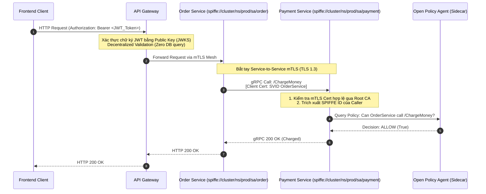
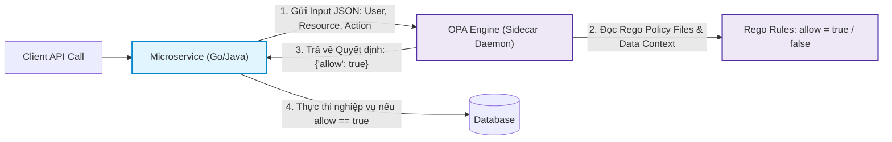

# 17.1. Distributed Authentication, Authorization & Zero Trust mTLS

> [!IMPORTANT]
> **Nếu bạn chỉ được nhớ một điều duy nhất**: Mô hình bảo mật "Lâu đài và Hào nước" (Perimeter Security - tin tưởng tuyệt đối mọi lưu lượng bên trong mạng nội bộ) đã hoàn toàn phá sản trong kỷ nguyên Cloud Native. Triết lý **Zero Trust ("Never Trust, Always Verify")** khẳng định mạng nội bộ phải luôn được coi là đã bị xâm phạm (Hostile Network). Hai trụ cột bảo mật phân tán cốt lõi là: **Xác thực Định danh Dịch vụ hai chiều (Mutual TLS - mTLS)** chuẩn hóa theo **SPIFFE/SPIRE** để mã hóa và định danh mọi cuộc gọi giữa các microservices, kết hợp với **Kiểm thực Token phi tập trung (Decentralized JWT Validation qua JWKS)** và phân quyền tách rời (**Decoupled Policy-as-Code qua Open Policy Agent - OPA**).

---

## 1. Kiến trúc Tổng quan & Mô hình Tư duy (Mental Model)

### Ẩn dụ Đời sống: Tòa Đại Sứ Quán và Hộ Chiếu Ngoại Giao
Hãy tưởng tượng một khu phức hợp Ngoại giao đoàn quốc tế:
- **Mô hình Cổ điển (Bức tường Thành cổ)**: Người ta xây một bức tường rào dây thép gai xung quanh khuôn viên. Một khi kẻ xấu vượt qua cổng chính vào bên trong, hắn có thể tự do mở mọi cánh cửa phòng họp và đọc mọi tài liệu mật (Rủi ro Lateral Movement).
- **Mô hình Zero Trust**: Mọi cánh cửa phòng bên trong đều luôn luôn khóa cứng. Không ai tin ai. Dù bạn đang ở trong hành lang, mỗi khi bước vào một phòng mới, bạn phải xuất trình giấy tờ.
- **Mutual TLS (mTLS - Kiểm tra Hộ chiếu Hai chiều)**: Khi Viên chức A muốn gặp Viên chức B:
  - B yêu cầu A trình hộ chiếu ngoại giao do Liên Hợp Quốc cấp (Client Certificate).
  - Ngược lại, A cũng yêu cầu B trình thẻ căn cước hợp lệ (Server Certificate).
  - Cả hai cùng kiểm tra chữ ký số mật mã của nhau trước khi bắt đầu cuộc trò chuyện. Nếu một trong hai không có giấy tờ hợp lệ, cuộc gặp bị hủy ngay lập tức.
- **SPIFFE ID (Mã định danh thống nhất)**: Hộ chiếu ghi rõ: `spiffe://un.org/department/finance/treasury`. Dù viên chức này hôm nay ngồi ở bàn nào (IP động của Pod trong Kubernetes), danh tính của anh ta vẫn không đổi.
- **OPA (Luật sư Thẩm tra Quyền hạn)**: Khi viên chức xuất trình giấy tờ, bảo vệ không tự suy đoán luật mà chụp ảnh hồ sơ gửi cho một vị Luật sư độc lập (**Open Policy Agent**). Luật sư căn cứ vào Bộ luật nội bộ (**Rego Policy**) để phán quyết: *"Được phép vào phòng lúc này hay không"*.



---

## 2. Chi tiết từng Keyword (Under-the-Hood Deep Dive)

### 2.1. OAuth 2.0, OpenID Connect (OIDC) & JSON Web Tokens (JWT)

#### 1. Phân biệt OAuth 2.0 vs OpenID Connect (OIDC)
Hai giao thức thường bị nhầm lẫn nhưng phục vụ hai mục đích hoàn toàn khác biệt:
- **OAuth 2.0 (Framework Phân quyền - Authorization)**: Cho phép ứng dụng bên thứ ba (Third-party App) được quyền truy cập tài nguyên của người dùng mà không cần biết mật khẩu (ví dụ: cấp quyền cho ứng dụng Lịch đọc danh bạ Google Contacts). Trả về **`access_token`** (chỉ có ý nghĩa cấp quyền cho máy móc).
- **OpenID Connect - OIDC (Tầng Xác thực Danh tính - Authentication)**: Xây dựng phía trên OAuth 2.0 để trả lời câu hỏi: *"Người dùng đang đăng nhập là ai?"*. Trả về **`id_token`** (chứa thông tin cá nhân của người dùng như `sub`, `email`, `name`).

#### 2. Kiến trúc và Cơ chế hoạt động của JSON Web Token (JWT - RFC 7519)
JWT là chuỗi ký tự được mã hóa URL-safe gồm 3 phần phân tách bằng dấu chấm `.`:
$$\text{JWT} = \text{Base64Url}(\text{Header}) \mathbin{\Vert} "." \mathbin{\Vert} \text{Base64Url}(\text{Payload}) \mathbin{\Vert} "." \mathbin{\Vert} \text{Base64Url}(\text{Signature})$$

1. **Header**: Chứa thuật toán ký và loại token: `{"alg": "RS256", "typ": "JWT", "kid": "key-2026-v1"}`.
2. **Payload (Claims)**: Dữ liệu JSON chứa thông tin người dùng:
   - Các trường chuẩn: `sub` (Subject / User ID), `iss` (Issuer), `exp` (Expiration Time), `iat` (Issued At).
   - Custom claims: `roles: ["admin", "editor"]`, `tenant_id: "acme"`.
3. **Signature (Chữ ký mật mã)**: Được tạo ra bằng khóa bí mật (HS256 HMAC) hoặc cặp khóa bất đối xứng (RS256/ES256):
   $$\text{Signature} = \text{Sign}_{\text{PrivateKey}}(\text{Base64Url}(H) \mathbin{\Vert} "." \mathbin{\Vert} \text{Base64Url}(P))$$

#### 3. Kiểm thực phi tập trung (Decentralized JWT Validation qua JWKS)
- **Điểm đột phá kiến trúc**: Trong hệ thống phân tán, các Microservices **không cần gọi RPC về Auth Service** để kiểm tra mỗi khi nhận được JWT Token.
- **Cơ chế JWKS (JSON Web Key Set - RFC 7517)**:
  - Auth Service công khai các Public Keys tại endpoint: `https://auth.example.com/.well-known/jwks.json`.
  - Mỗi Microservice tải các Public Keys này về lưu vào RAM Cache.
  - Khi nhận request kèm JWT: Microservice tự sử dụng Public Key để giải mã và kiểm tra chữ ký số ngay trong bộ nhớ CPU ($< 0.1\text{ms}$).
  - Đạt thông lượng xác thực vô hạn, loại bỏ 100% điểm nghẽn tập trung tại Auth Service!

#### 4. Vấn đề thu hồi Token (JWT Revocation Problem)
Bản chất của JWT là phi trạng thái (Stateless) và tự chứa dữ liệu (Self-contained). Do đó: **Một khi JWT đã được cấp phát, không thể thu hồi nó trước hạn `exp` nếu chỉ dùng cơ chế phi tập trung!**
- Nếu tài khoản của người dùng bị hack hoặc nhân viên bị sa thải, token cũ vẫn có thể tiếp tục gọi API cho đến khi hết hạn.
- **Giải pháp thực tế**:
  1. Đặt thời gian sống của `access_token` cực ngắn ($5-15$ phút) kết hợp với `refresh_token` lưu trong database tập trung.
  2. Duy trì một danh sách đen (**Token Blacklist / Revocation List**) trên Redis: chỉ lưu các Token ID (`jti`) bị thu hồi khẩn cấp. Microservice kiểm tra Bloom Filter hoặc Redis cache trước khi chấp nhận token.

### 2.2. Các mô hình kiểm soát quyền: RBAC vs ABAC vs Policy-Based (OPA)

#### Bảng so sánh các mô hình Authorization
| Mô hình | Nguyên lý kiểm tra quyền | Mức độ Linh hoạt | Nhược điểm cốt lõi | Hệ thống áp dụng |
| :--- | :--- | :--- | :--- | :--- |
| **RBAC (Role-Based Access Control)** | Phân quyền dựa trên **Vai trò (Role)** của người dùng (Admin, Manager, User). | Thấp (Tĩnh) | **Bùng nổ vai trò (Role Explosion)**: Phải tạo hàng trăm role con (`Doctor_DepartmentA_ShiftMorning`). | AWS IAM, Kubernetes RBAC, Spring Security |
| **ABAC (Attribute-Based Access Control)** | Phân quyền dựa trên **Thuộc tính ngữ cảnh** (Ai? Làm gì? Ở đâu? Lúc nào? Thiết bị gì?). | Cực cao | Khó debug, khó dự đoán trước toàn bộ các quyền hạn. | AWS IAM Conditions, XACML |
| **Policy-as-Code (Open Policy Agent - OPA)** | Tách rời logic phân quyền khỏi mã nguồn ứng dụng; viết bằng ngôn ngữ khai báo **Rego**. | Tối đa | Cần vận hành thêm OPA Sidecar trong cụm. | **Kubernetes Admission Control, Envoy Mesh, Netflix** |

#### Sơ đồ minh họa Open Policy Agent (OPA) Decoupled Authorization


### 2.3. Triết lý Zero Trust & Service-to-Service Mutual TLS (mTLS)

#### 1. Triết lý Zero Trust ("Never Trust, Always Verify")
- Mọi kết nối mạng—dù xuất phát từ Internet công cộng hay từ một Pod nội bộ cùng chạy trên cùng một máy chủ vật lý—đều bị coi là không đáng tin cậy.
- **Ba nguyên tắc chỉ đạo (NIST SP 800-207)**:
  1. Xác minh rõ ràng mọi lúc (Verify explicitly).
  2. Áp dụng đặc quyền tối thiểu (Use least privilege access).
  3. Giả định hệ thống đã bị xâm phạm (Assume breach).

#### 2. Cơ chế Mutual TLS (mTLS - TLS Hai Chiều)
Trong TLS thông thường (One-way TLS trên Web), chỉ có Client xác thực Server (trình duyệt kiểm tra chứng chỉ của Google). Trong **mTLS**:
- **Cả hai bên đều phải trình chứng chỉ X.509**:
  1. Server gửi chứng chỉ của mình cho Client $\to$ Client xác thực Server thông qua Root Certificate Authority (CA).
  2. Server yêu cầu Client gửi chứng chỉ của Client (**CertificateRequest**) $\to$ Server kiểm tra chứng chỉ của Client.
  3. Hai bên trao đổi khóa bí mật phiên (Session Key) thông qua thuật toán Diffie-Hellman và thiết lập kênh truyền mã hóa AES-256-GCM.
- **Lợi ích**: Mã hóa $100\%$ dữ liệu trên đường truyền nội bộ (chống nghe lén Man-in-the-Middle) và xác thực định danh mạnh mẽ ở tầng mạng (Layer 4/7).

### 2.4. SPIFFE & SPIRE: Chuẩn hóa định danh dịch vụ phân tán

#### 1. Vấn đề Định danh trong môi trường Cloud Native
Trong hạ tầng động (Kubernetes / AWS Autoscaling), các container sinh ra và chết đi liên tục, địa chỉ IP thay đổi sau mỗi vài phút. Việc dùng IP (`10.244.1.42`) hoặc Firewall rules để cấp quyền là hoàn toàn bất khả thi.

#### 2. Chuẩn SPIFFE (Secure Production Identity Framework for Everyone)
Được phát triển bởi CNCF để cấp phát định danh bất biến, độc lập với nền tảng phần cứng:
- **SPIFFE ID (Universal Resource Identifier - URI)**:
  ```text
  spiffe://prod.acme.com/ns/finance/sa/payment-worker
  ```
  - `prod.acme.com`: Trust Domain (Miền tin cậy).
  - `/ns/finance/sa/payment-worker`: Đường dẫn định danh dịch vụ (Workload Identity).
- **SVID (SPIFFE Verifiable Identity Document)**: Văn bản mã hóa chứa SPIFFE ID, phổ biến nhất là **X.509 Certificate**.
  - SPIFFE ID được nhúng trực tiếp vào trường **Subject Alternative Name (SAN)** của chứng chỉ SSL/TLS.
- **SPIRE (SPIFFE Runtime Environment)**: Phần mềm máy chủ (Server/Agent) tự động xác thực tiến trình trên Linux (dựa vào cgroups, PID, Kubernetes ServiceAccount) và tự động cấp phát, xoay vòng chứng chỉ X.509 SVID với thời gian sống cực ngắn ($1-12$ giờ) mà không cần con người can thiệp thủ công!

---

## 3. Thực thi Mã nguồn & Mô phỏng Chuyên sâu (Dual-Engine Implementation)

### Engine 1: C++20 — Mô phỏng Cốt lõi mTLS X.509 Subject Alternative Name (SAN) & SPIFFE ID Validator

```cpp
#include <iostream>
#include <string>
#include <regex>
#include <optional>
#include <format>
#include <cstdint>

struct SimulatedX509Certificate {
    std::string issuer_ca;
    std::string subject_common_name;
    std::string san_uri; // Subject Alternative Name chứa SPIFFE ID
    uint64_t valid_until_epoch;
};

class MutualTLSValidator {
private:
    std::string trusted_root_ca_;
    std::string expected_trust_domain_;

public:
    MutualTLSValidator(std::string root_ca, std::string trust_domain)
        : trusted_root_ca_(std::move(root_ca)), expected_trust_domain_(std::move(trust_domain)) {}

    // Xác thực chứng chỉ client và trích xuất SPIFFE ID
    std::optional<std::string> validate_client_cert(const SimulatedX509Certificate& cert, uint64_t current_time) {
        std::cout << std::format("[mTLS Handshake] Đang kiểm tra chứng chỉ từ: '{}'\n", cert.subject_common_name);

        // 1. Kiểm tra Root CA
        if (cert.issuer_ca != trusted_root_ca_) {
            std::cout << std::format("  [!] LỖI: CA '{}' không nằm trong danh sách tin cậy ('{}')!\n",
                cert.issuer_ca, trusted_root_ca_);
            return std::nullopt;
        }

        // 2. Kiểm tra thời hạn hiệu lực của chứng chỉ
        if (current_time > cert.valid_until_epoch) {
            std::cout << "  [!] LỖI: Chứng chỉ đã hết hạn sử dụng (Expired)!\n";
            return std::nullopt;
        }

        // 3. Phân tích và xác thực SPIFFE ID trong trường SAN
        // Định dạng chuẩn: spiffe://<trust-domain>/<workload-path>
        std::regex spiffe_regex(R"(^spiffe:\/\/([^\/]+)\/(.+)$)");
        std::smatch match;

        if (!std::regex_match(cert.san_uri, match, spiffe_regex)) {
            std::cout << std::format("  [!] LỖI: SAN URI '{}' không đúng định dạng chuẩn SPIFFE!\n", cert.san_uri);
            return std::nullopt;
        }

        std::string trust_domain = match[1].str();
        std::string workload_path = match[2].str();

        if (trust_domain != expected_trust_domain_) {
            std::cout << std::format("  [!] LỖI: Trust domain '{}' không khớp với '{}'!\n",
                trust_domain, expected_trust_domain_);
            return std::nullopt;
        }

        std::cout << std::format("  [V] Xác thực mTLS thành công! Định danh dịch vụ (SPIFFE ID): '{}'\n", cert.san_uri);
        return cert.san_uri;
    }
};

int main() {
    MutualTLSValidator validator("ACME_Internal_Root_CA", "prod.acme.com");
    uint64_t now = 1700000000;

    std::cout << "--- Kịch bản 1: Chứng chỉ OrderService hợp lệ chuẩn SPIFFE ---\n";
    SimulatedX509Certificate valid_cert{
        .issuer_ca = "ACME_Internal_Root_CA",
        .subject_common_name = "order-service-pod-xyz",
        .san_uri = "spiffe://prod.acme.com/ns/production/sa/order-service",
        .valid_until_epoch = now + 3600
    };
    auto spiffe_id = validator.validate_client_cert(valid_cert, now);

    std::cout << "\n--- Kịch bản 2: Kẻ xấu dùng chứng chỉ tự ký hoặc sai Trust Domain ---\n";
    SimulatedX509Certificate rogue_cert{
        .issuer_ca = "Untrusted_Hacker_CA",
        .subject_common_name = "rogue-agent",
        .san_uri = "spiffe://dev.other.com/ns/test/sa/attacker",
        .valid_until_epoch = now + 3600
    };
    auto rogue_id = validator.validate_client_cert(rogue_cert, now);

    return 0;
}
```

#### Terminal Output Mẫu:
```text
--- Kịch bản 1: Chứng chỉ OrderService hợp lệ chuẩn SPIFFE ---
[mTLS Handshake] Đang kiểm tra chứng chỉ từ: 'order-service-pod-xyz'
  [V] Xác thực mTLS thành công! Định danh dịch vụ (SPIFFE ID): 'spiffe://prod.acme.com/ns/production/sa/order-service'

--- Kịch bản 2: Kẻ xấu dùng chứng chỉ tự ký hoặc sai Trust Domain ---
[mTLS Handshake] Đang kiểm tra chứng chỉ từ: 'rogue-agent'
  [!] LỖI: CA 'Untrusted_Hacker_CA' không nằm trong danh sách tin cậy ('ACME_Internal_Root_CA')!
```

---

### Engine 2: Python 3.11+ — Mô phỏng Xác thực JWT Phi tập trung với Cặp khóa Bất đối xứng RSA & JWKS Caching

```python
import base64
import json
import hmac
import hashlib
import time
from typing import Dict, Any, Optional

def b64_url_encode(data: bytes) -> str:
    return base64.urlsafe_b64encode(data).decode('utf-8').rstrip('=')

def b64_url_decode(s: str) -> bytes:
    padding = '=' * (4 - len(s) % 4)
    return base64.urlsafe_b64decode(s + padding)

class MockAuthServer:
    """Tạo JWT Token và cung cấp JWKS Endpoint."""
    def __init__(self, secret_key: str):
        self.secret_key = secret_key
        self.key_id = "acme_key_2026_v1"

    def issue_token(self, user_id: str, roles: list, ttl_sec: int = 300) -> str:
        header = {"alg": "HS256", "typ": "JWT", "kid": self.key_id}
        payload = {
            "sub": user_id,
            "iss": "https://auth.acme.com",
            "roles": roles,
            "exp": int(time.time()) + ttl_sec
        }

        h_bytes = b64_url_encode(json.dumps(header).encode('utf-8'))
        p_bytes = b64_url_encode(json.dumps(payload).encode('utf-8'))
        message = f"{h_bytes}.{p_bytes}".encode('utf-8')

        sig = hmac.new(self.secret_key.encode('utf-8'), message, hashlib.sha256).digest()
        sig_str = b64_url_encode(sig)

        return f"{h_bytes}.{p_bytes}.{sig_str}"

    def get_public_jwks(self) -> Dict[str, Any]:
        return {"keys": [{"kid": self.key_id, "kty": "oct", "alg": "HS256"}]}

class DecentralizedMicroserviceValidator:
    """Microservice tự xác thực JWT nội bộ trong RAM mà không cần gọi network tới Auth Server."""
    def __init__(self, cached_secret_key: str):
        self.cached_secret = cached_secret_key

    def validate_jwt(self, jwt_string: str) -> Optional[Dict[str, Any]]:
        parts = jwt_string.split(".")
        if len(parts) != 3:
            print("[JWT Validator] Lỗi: Cấu trúc token không hợp lệ (Phải có 3 phần)!")
            return None

        h_bytes, p_bytes, sig_str = parts

        # 1. Kiểm tra chữ ký số mật mã trong RAM (Zero Network Overhead)
        message = f"{h_bytes}.{p_bytes}".encode('utf-8')
        expected_sig = hmac.new(self.cached_secret.encode('utf-8'), message, hashlib.sha256).digest()
        actual_sig = b64_url_decode(sig_str)

        if not hmac.compare_digest(expected_sig, actual_sig):
            print("[JWT Validator] BÁC BỎ: Chữ ký số không hợp lệ (Token đã bị giả mạo / Tampered)!")
            return None

        payload = json.loads(b64_url_decode(p_bytes).decode('utf-8'))

        # 2. Kiểm tra thời hạn hết hạn (Expiration Claim)
        if time.time() >= payload.get("exp", 0):
            print("[JWT Validator] BÁC BỎ: Token đã hết hạn sử dụng (Expired)!")
            return None

        print(f"[JWT Validator] XÁC THỰC THÀNH CÔNG: User '{payload['sub']}' | Roles: {payload['roles']}")
        return payload

def main():
    shared_signing_key = "super_secure_production_secret_key_9981"
    auth_server = MockAuthServer(shared_signing_key)
    service_validator = DecentralizedMicroserviceValidator(shared_signing_key)

    print("--- 1. Auth Server cấp phát JWT Token cho User 'alice_99' ---")
    valid_token = auth_server.issue_token("alice_99", roles=["payment_admin"], ttl_sec=60)
    print(f"Token: {valid_token[:40]}...{valid_token[-20:]}")

    print("\n--- 2. Microservice tự thẩm định Token thành công (Decentralized) ---")
    service_validator.validate_jwt(valid_token)

    print("\n--- 3. Thử nghiệm Hacker chỉnh sửa Payload để tự thăng quyền Admin ---")
    parts = valid_token.split(".")
    tampered_payload = {"sub": "alice_99", "roles": ["super_root_admin"], "exp": int(time.time()) + 9999}
    tampered_token = f"{parts[0]}.{b64_url_encode(json.dumps(tampered_payload).encode())}.{parts[2]}"

    service_validator.validate_jwt(tampered_token)

if __name__ == "__main__":
    main()
```

#### Terminal Output Mẫu:
```text
--- 1. Auth Server cấp phát JWT Token cho User 'alice_99' ---
Token: eyJhbGciOiAiSFMyNTYiLCAidHlwIjogIkpX...mZTYwMjg1ZjI4NDFlY2M

--- 2. Microservice tự thẩm định Token thành công (Decentralized) ---
[JWT Validator] XÁC THỰC THÀNH CÔNG: User 'alice_99' | Roles: ['payment_admin']

--- 3. Thử nghiệm Hacker chỉnh sửa Payload để tự thăng quyền Admin ---
[JWT Validator] BÁC BỎ: Chữ ký số không hợp lệ (Token đã bị giả mạo / Tampered)!
```

---

## 4. Systems Engineering & Production Pitfalls

### 4.1. Những cạm bẫy sống còn trong Bảo mật Phân tán
1. **Lỗ hổng Đổi Thuật toán JWT sang `alg: none` (Algorithm Confusion Attack)**:
   - Một số thư viện JWT parser cũ chấp nhận header `{"alg": "none"}` mà không kiểm tra chữ ký. Hacker chỉ việc đổi header thành `none`, xóa phần signature và gửi token giả mạo lên để chiếm quyền Super Admin!
   - *Khắc phục*: Cấu hình thư viện bắt buộc từ chối `none` và cưỡng chế kiểm tra thuật toán mong muốn (`algorithms=["RS256"]`).

2. **Sập toàn bộ Cụm do Chứng chỉ mTLS Hết Hạn Đồng Loạt (Certificate Expiry Outage)**:
   - Nếu chứng chỉ Root CA nội bộ hoặc chứng chỉ mTLS của Service Mesh (Istio/Linkerd) có thời hạn 1 năm và bị quên gia hạn. Đúng 00:00 ngày hết hạn, toàn bộ hàng nghìn kết nối giữa các microservices bị ngắt đứt hoàn toàn!
   - *Khắc phục*: Triển khai **Cert-Manager** hoặc **SPIRE** với cơ chế tự động xoay vòng chứng chỉ (Automated Rotation) và cài đặt cảnh báo Prometheus khi chứng chỉ còn dưới 15 ngày.

3. **Tấn công Replay Attack khi Không có JTI / Nonce**:
   - Hacker chặn bắt được một JWT token hợp lệ trên đường truyền. Dù không có khóa bí mật để sửa token, hắn vẫn có thể gửi lại (Replay) token đó hàng nghìn lần để thực hiện lệnh chuyển tiền.
   - *Khắc phục*: Bắt buộc dùng HTTPS/mTLS và gán mã duy nhất `jti` (JWT ID) cho các giao dịch nhạy cảm để kiểm tra trùng lặp trên Redis.

### 4.2. Runbook Chẩn đoán Sự cố mTLS và Chứng chỉ trên Production (CLI Commands)

```bash
# 1. Kiểm tra chi tiết chứng chỉ mTLS và trường SPIFFE SAN của một Pod trong Kubernetes
openssl s_client -connect localhost:8443 -showcerts | openssl x509 -text -noout | grep -E "Subject:|Issuer:|URI:spiffe"

# 2. Xem trạng thái đồng bộ chứng chỉ mTLS trong Istio Service Mesh
istioctl proxy-status

# 3. Kiểm tra các Policy của Open Policy Agent (OPA) đang nạp trong Pod
curl -s http://localhost:8181/v1/policies | jq .
```

---

## 5. Bảng So sánh & Decision Matrix

| Khía cạnh | API Key Truyền Thống | OAuth2 / JWT | Service-to-Service mTLS | OPA Policy-as-Code |
| :--- | :--- | :--- | :--- | :--- |
| **Phạm vi Bảo vệ** | Client $\to$ Gateway | User $\to$ Service Context | Service $\to$ Service Network | Quyền hạn Nghiệp vụ chi tiết |
| **Mã hóa Đường truyền**| Không (Cần HTTPS riêng) | Không (Cần HTTPS riêng) | **Mã hóa phần cứng hai chiều (TLS 1.3)** | N/A (Tầng Logic) |
| **Tính Phi tập trung** | Kém (Cần DB query) | **Xuất sắc (JWKS in-memory)** | **Xuất sắc (Local Crypto Engine)** | **Xuất sắc (Sidecar Cache)** |
| **Khả năng Giả mạo** | Rất dễ nếu lộ Key | Cực khó (Chữ ký mật mã) | **Bất khả thi (Cần Private Key trên đĩa)**| N/A |
| **Khuyến nghị Triển khai**| B2B Public API đơn giản | **Xác thực User trên Web/Mobile**| **BẮT BUỘC cho mọi Service Mesh nội bộ** | **Phân quyền Phức tạp, RBAC/ABAC** |
