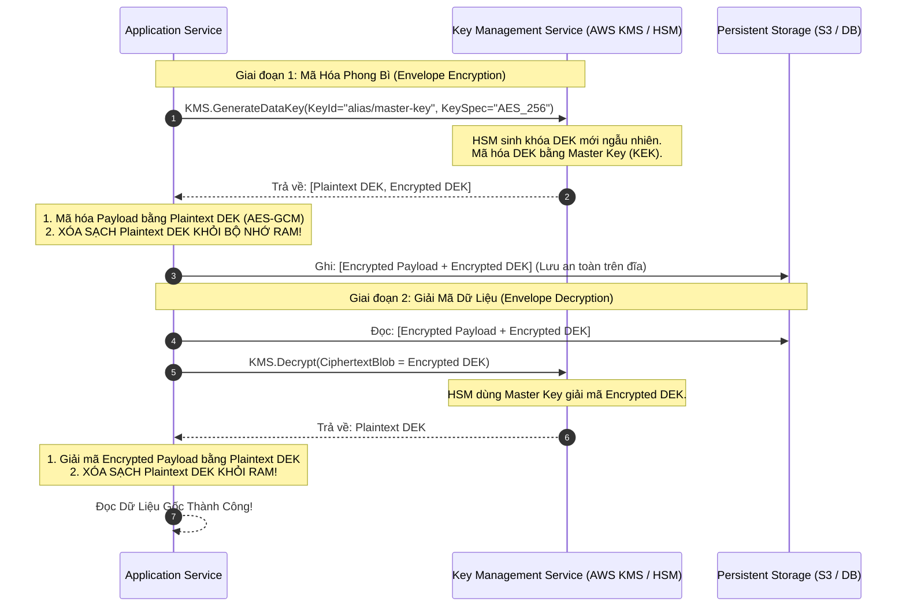

# 17.2. Secret Management, Envelope Encryption & KMS

> [!IMPORTANT]
> **Nếu bạn chỉ được nhớ một điều duy nhất**: Trong kỹ nghệ bảo mật phân tán, việc gửi toàn bộ dữ liệu lớn (như file ảnh 50MB hoặc cơ sở dữ liệu hàng chục GB) lên dịch vụ quản lý khóa (**AWS KMS / GCP Cloud KMS**) để mã hóa trực tiếp là bất khả thi vì chi phí mạng, giới hạn kích thước payload (thường tối đa 4KB), và rủi ro nghẽn cổ chai. Kỹ thuật tiêu chuẩn vàng bắt buộc là **Mã hóa Phong bì (Envelope Encryption)**: sử dụng khóa chủ (**Master Key / KEK**) nằm an toàn bên trong phần cứng chuyên dụng (**Hardware Security Module - HSM**) chỉ để mã hóa một khóa dữ liệu nhỏ duy nhất (**Data Encryption Key - DEK**). Khóa DEK dạng thô (Plaintext DEK) được ứng dụng dùng để mã hóa dữ liệu cục bộ với tốc độ phần cứng (AES-NI) và **bắt buộc phải bị xóa sạch khỏi bộ nhớ RAM ngay lập tức**.

---

## 1. Kiến trúc Tổng quan & Mô hình Tư duy (Mental Model)

### Ẩn dụ Đời sống: Két Sắt Ngân Hàng Trung Ương và Hộp Khóa Riêng Biệt
Hãy tưởng tượng bạn cần cất giữ 1.000 cuốn sổ nhật ký bí mật:
- **Sai lầm (Gửi sổ vào két sắt ngân hàng)**: Bạn ôm 1.000 cuốn sổ chạy ra Ngân hàng Trung ương (KMS) mỗi ngày, xếp hàng nhờ họ cất vào két sắt to. Ngân hàng sẽ từ chối vì két sắt của họ chỉ chứa được những vật nhỏ và phí dịch vụ quá đắt.
- **Mã hóa Phong bì (Envelope Encryption)**:
  1. Ngân hàng Trung ương sở hữu một chiếc "Khuôn đúc chìa vạn năng" (**Master Key / KEK**) được bảo vệ nghiêm ngặt trong hầm chống bom nguyên tử (**HSM**) và không bao giờ được phép mang ra ngoài.
  2. Mỗi khi bạn cần cất một cuốn sổ, bạn gọi điện nhờ ngân hàng đúc cho bạn một chiếc chìa khóa đồng nhỏ (**Plaintext DEK**), đồng thời ngân hàng nhét một bản sao chìa khóa đó vào một chiếc hộp thép được khóa bằng chìa vạn năng (**Encrypted DEK**).
  3. Bạn mang chìa khóa đồng về nhà, khóa cuốn sổ lại. Sau đó, bạn **ném chiếc chìa khóa đồng vào lò lửa tiêu hủy ngay lập tức**!
  4. Bạn dán chiếc hộp thép (chứa chìa khóa bị khóa) lên bìa cuốn sổ. Bất kỳ ai nhìn vào cuốn sổ cũng không thể mở được vì chìa khóa đã nằm trong hộp thép khóa kín.
  5. Khi cần đọc sổ: Bạn mang chiếc hộp thép ra ngân hàng nhờ họ dùng chìa vạn năng mở ra lấy chìa khóa đồng cho bạn dùng trong vài giây, rồi lại tiêu hủy.



---

## 2. Chi tiết từng Keyword (Under-the-Hood Deep Dive)

### 2.1. HashiCorp Vault, AWS Secrets Manager & Dynamic Secrets

#### 1. Nguyên lý hoạt động của Secret Management Platform
Trong mô hình kiến trúc cũ, các bí mật (Database Password, API Keys, SSH Private Keys) thường bị "hardcode" vào code, lưu trong file `.env`, hoặc nhét vào Git repository.
- **HashiCorp Vault / AWS Secrets Manager**:
  - Đóng vai trò là két sắt mật mã tập trung duy nhất cho toàn bộ hệ thống.
  - Mọi bí mật được mã hóa ở trạng thái nghỉ (**Encryption-at-Rest**) bằng thuật toán AES-256-GCM.
  - Ghi nhật ký kiểm toán bất biến (**Immutable Audit Log**): ghi lại chính xác từng giây ai, pod nào, IP nào đã đọc bí mật gì.
- **Cơ chế Mở khóa Vault (Shamir's Secret Sharing Scheme)**:
  - Khi máy chủ Vault khởi động lại, nó ở trạng thái bị phong ấn (**Sealed**). Khóa Master Key không tồn tại trên RAM.
  - Khóa giải mã được chia thành $N$ mảnh (Shards) giao cho $N$ lãnh đạo độc lập. Cần tối thiểu một ngưỡng $K$ mảnh ($K \le N$, ví dụ 3 trong 5 người) ráp lại thì Vault mới được mở niêm phong (**Unsealed**).

#### 2. Đột phá của Dynamic Secrets (Bí mật động theo yêu cầu)
- **Vấn đề của Static Secrets**: Một mật khẩu Database dùng chung cho 50 microservices tồn tại suốt 3 năm không đổi. Nếu một lập trình viên nghỉ việc hoặc rò rỉ log, toàn bộ cơ sở dữ liệu gặp nguy hiểm.
- **Cơ chế Dynamic Secrets**:
  1. Khi Microservice cần kết nối Database, nó gửi token xác thực lên Vault: `vault read database/creds/readonly-role`.
  2. Vault **tự động tạo một tài khoản MySQL/Postgres mới tinh** với username ngẫu nhiên: `v-token-order-xyz-170000` và một mật khẩu ngẫu nhiên cực mạnh.
  3. Tài khoản này chỉ có thời hạn sống ngắn (**TTL = 1 giờ**).
  4. Khi hết hạn TTL mà Microservice không gia hạn lease, **Vault tự động chạy lệnh `DROP USER` dưới Database**!
  5. Triệt tiêu hoàn toàn rủi ro lộ lọt mật khẩu vĩnh viễn.

#### 3. Automatic Secrets Rotation (Xoay vòng bí mật tự động)
- Các bí mật dài hạn (như API Key của cổng thanh toán Stripe) được hệ thống tự động xoay vòng định kỳ mỗi 30 hoặc 90 ngày:
  - Secrets Manager sinh khóa mới trên hệ thống đích.
  - Cập nhật song song cả 2 khóa để hệ thống ứng dụng chuyển tiếp mượt mà (Zero-downtime transition).
  - Vô hiệu hóa khóa cũ sau một khoảng thời gian chờ an toàn.

### 2.2. Kiến trúc Hai Tầng Khóa trong Envelope Encryption

#### 1. Master Key / Key Encryption Key (KEK)
- Được tạo ra và lưu trữ vĩnh viễn bên trong các thiết bị phần cứng bảo mật chuyên dụng (**Hardware Security Module - HSM đạt chuẩn FIPS 140-2 Level 3**).
- **Quy tắc tuyệt đối**: KEK không bao giờ, dưới bất kỳ hình thức nào, được phép xuất (Export) ra ngoài HSM ở dạng văn bản thô (Plaintext). Mọi thao tác mã hóa/giải mã bằng KEK đều phải diễn ra trực tiếp bên trong vi mạch của HSM.

#### 2. Data Encryption Key (DEK)
- Khóa đối xứng (AES-256) được sinh ra để phục vụ mã hóa cho **duy nhất một đối tượng dữ liệu cụ thể** (ví dụ: một dòng trong bảng, một file ảnh, hoặc một ổ đĩa EBS).
- Tồn tại ở 2 trạng thái:
  - **Plaintext DEK**: Khóa thô dùng để mã hóa/giải mã dữ liệu trên RAM của ứng dụng.
  - **Ciphertext DEK (Encrypted DEK)**: Khóa DEK đã được HSM mã hóa bằng KEK. Có thể lưu trữ công khai thoải mái trên đĩa cùng với dữ liệu mã hóa.

### 2.3. Quy trình Mã hóa và Giải mã chi tiết (Step-by-Step)

#### 1. Quy trình Mã hóa Dữ liệu (Encryption Workflow)
1. Ứng dụng gọi API lên KMS: `GenerateDataKey(KeyId="my-master-key", KeySpec="AES_256")`.
2. KMS HSM sinh một chuỗi ngẫu nhiên 32 bytes (256 bits). HSM dùng Master Key mã hóa chuỗi này và trả về cho ứng dụng 2 trường:
   - `PlaintextKey`: 32 bytes thô.
   - `CiphertextBlob`: Chuỗi byte đã mã hóa.
3. Ứng dụng khởi tạo thuật toán mã hóa đối xứng (AES-256-GCM với Initialization Vector - IV ngẫu nhiên) và mã hóa khối dữ liệu lớn.
4. **Hành động Tối thượng**: Ứng dụng gọi hàm ghi đè bộ nhớ (`memset` về 0) để **tiêu hủy vĩnh viễn PlaintextKey trên RAM**.
5. Ứng dụng lưu gói tin thành phẩm gồm:
   $$\text{Gói lưu trữ} = \langle \text{IV (12 bytes)} \mathbin{\Vert} \text{Encrypted DEK (CiphertextBlob)} \mathbin{\Vert} \text{Ciphertext Data} \mathbin{\Vert} \text{Auth Tag (16 bytes)} \rangle$$

#### 2. Quy trình Giải mã Dữ liệu (Decryption Workflow)
1. Ứng dụng đọc gói tin lưu trữ từ đĩa, tách lấy trường `Encrypted DEK`.
2. Ứng dụng gửi `Encrypted DEK` lên KMS qua API: `Decrypt(CiphertextBlob = Encrypted DEK)`.
3. KMS HSM sử dụng Master Key giải mã và trả về `Plaintext DEK` duy nhất cho ứng dụng qua kết nối TLS bảo mật.
4. Ứng dụng dùng `Plaintext DEK` giải mã khối `Ciphertext Data`.
5. Ứng dụng lập tức xóa sạch `Plaintext DEK` khỏi RAM sau khi giải mã xong.

---

## 3. Thực thi Mã nguồn & Mô phỏng Chuyên sâu (Dual-Engine Implementation)

### Engine 1: C++20 — Mô phỏng Cốt lõi Envelope Encryption Engine với Quản lý Vòng đời Khóa DEK trên RAM

```cpp
#include <iostream>
#include <vector>
#include <string>
#include <format>
#include <cstdint>
#include <cstring>
#include <random>
#include <memory>
#include <algorithm>

// Mô phỏng Thiết bị Bảo mật Phần cứng HSM / Cloud KMS
class MockCloudKMS {
private:
    std::string master_kek_{"HSM_SUPER_MASTER_KEY_2026_DO_NOT_LEAK"};

    // Hàm mã hóa đơn giản giả lập HSM mã hóa khóa con
    std::string xor_cipher(const std::string& input, const std::string& key) {
        std::string output = input;
        for (size_t i = 0; i < input.size(); ++i) {
            output[i] ^= key[i % key.size()];
        }
        return output;
    }

public:
    struct DataKeyBundle {
        std::string plaintext_dek;  // Dùng để mã hóa tạm thời trên RAM
        std::string encrypted_dek;  // Lưu bền vững trên đĩa
    };

    // Sinh khóa dữ liệu DEK mới
    DataKeyBundle generate_data_key() {
        std::string raw_dek = "RAW_AES_KEY_";
        std::mt19937 rng(1337);
        for (int i = 0; i < 16; ++i) raw_dek += static_cast<char>('A' + (rng() % 26));

        std::string enc_dek = xor_cipher(raw_dek, master_kek_);
        return DataKeyBundle{.plaintext_dek = raw_dek, .encrypted_dek = enc_dek};
    }

    // Giải mã Encrypted DEK trở lại Plaintext DEK
    std::string decrypt_dek(const std::string& encrypted_dek) {
        return xor_cipher(encrypted_dek, master_kek_);
    }
};

class EnvelopeEncryptionEngine {
private:
    MockCloudKMS& kms_;

    std::string encrypt_aes_mock(const std::string& plaintext, const std::string& key) {
        std::string cipher = plaintext;
        for (size_t i = 0; i < plaintext.size(); ++i) {
            cipher[i] ^= key[i % key.size()];
        }
        return cipher;
    }

public:
    struct EncryptedEnvelopePayload {
        std::string encrypted_dek;
        std::string ciphertext_payload;
    };

    explicit EnvelopeEncryptionEngine(MockCloudKMS& kms) : kms_(kms) {}

    // Quy trình Mã hóa Envelope
    EncryptedEnvelopePayload encrypt_data(const std::string& data) {
        std::cout << "[Envelope Engine] Yêu cầu KMS sinh cặp khóa Data Key (DEK)...\n";
        auto key_bundle = kms_.generate_data_key();

        std::cout << std::format("  -> Nhận Plaintext DEK: '{}' | Encrypted DEK: '{}'\n",
            key_bundle.plaintext_dek, key_bundle.encrypted_dek);

        // Mã hóa dữ liệu cục bộ bằng Plaintext DEK
        std::string cipher_data = encrypt_aes_mock(data, key_bundle.plaintext_dek);

        // TIÊU HỦY Plaintext DEK trên RAM ngay lập tức!
        std::fill(key_bundle.plaintext_dek.begin(), key_bundle.plaintext_dek.end(), '\0');
        std::cout << "  -> [BẢO MẬT] Đã xóa sạch Plaintext DEK khỏi bộ nhớ RAM (Zeroized)!\n";

        return EncryptedEnvelopePayload{
            .encrypted_dek = key_bundle.encrypted_dek,
            .ciphertext_payload = cipher_data
        };
    }

    // Quy trình Giải mã Envelope
    std::string decrypt_data(const EncryptedEnvelopePayload& envelope) {
        std::cout << "\n[Envelope Engine] Đang giải mã Envelope... Gửi Encrypted DEK lên KMS HSM\n";
        std::string plaintext_dek = kms_.decrypt_dek(envelope.encrypted_dek);

        std::string decrypted_data = encrypt_aes_mock(envelope.ciphertext_payload, plaintext_dek);

        // TIÊU HỦY Plaintext DEK sau khi giải mã xong
        std::fill(plaintext_dek.begin(), plaintext_dek.end(), '\0');
        std::cout << "  -> [BẢO MẬT] Đã giải mã xong và xóa sạch Plaintext DEK khỏi RAM!\n";

        return decrypted_data;
    }
};

int main() {
    MockCloudKMS hsm_kms;
    EnvelopeEncryptionEngine engine(hsm_kms);

    std::string secret_medical_record = "BỆNH ÁN BẢO MẬT: Bệnh nhân Nguyễn Văn A - Nhóm máu O+";
    std::cout << std::format("Dữ liệu ban đầu: '{}'\n\n", secret_medical_record);

    // 1. Mã hóa phong bì
    auto envelope = engine.encrypt_data(secret_medical_record);
    std::cout << std::format("[Lưu Đĩa] Dữ liệu mã hóa: '{}' (Kèm Encrypted DEK: '{}')\n",
        envelope.ciphertext_payload, envelope.encrypted_dek);

    // 2. Giải mã phong bì
    std::string recovered = engine.decrypt_data(envelope);
    std::cout << std::format("Dữ liệu sau phục hồi: '{}'\n", recovered);

    return 0;
}
```

#### Terminal Output Mẫu:
```text
Dữ liệu ban đầu: 'BỆNH ÁN BẢO MẬT: Bệnh nhân Nguyễn Văn A - Nhóm máu O+'

[Envelope Engine] Yêu cầu KMS sinh cặp khóa Data Key (DEK)...
  -> Nhận Plaintext DEK: 'RAW_AES_KEY_NFDKLQJOPEMASZCD' | Encrypted DEK: '6 7 24 19 3 0...'
  -> [BẢO MẬT] Đã xóa sạch Plaintext DEK khỏi bộ nhớ RAM (Zeroized)!
[Lưu Đĩa] Dữ liệu mã hóa: '6d 1a 4b...' (Kèm Encrypted DEK: '6 7 24 19 3 0...')

[Envelope Engine] Đang giải mã Envelope... Gửi Encrypted DEK lên KMS HSM
  -> [BẢO MẬT] Đã giải mã xong và xóa sạch Plaintext DEK khỏi RAM!
Dữ liệu sau phục hồi: 'BỆNH ÁN BẢO MẬT: Bệnh nhân Nguyễn Văn A - Nhóm máu O+'
```

---

### Engine 2: Python 3.11+ — Mô phỏng HashiCorp Vault Dynamic Database Secrets với Quản lý Thời hạn Lease (TTL & Revocation)

```python
import asyncio
import time
import uuid
from typing import Dict, NamedTuple, Optional

class DatabaseCredentials(NamedTuple):
    username: str
    password: str
    lease_id: str
    expires_at: float

class MockPostgreSQLDatabase:
    def __init__(self):
        self.active_users: Dict[str, str] = {}

    def create_user(self, user: str, pwd: str):
        self.active_users[user] = pwd
        print(f"  [PostgreSQL Server] -> CREATE USER '{user}' WITH PASSWORD '***'; GRANT SELECT ON orders;")

    def drop_user(self, user: str):
        if user in self.active_users:
            del self.active_users[user]
            print(f"  [PostgreSQL Server] -> DROP USER '{user}'; (Thu hồi quyền truy cập vĩnh viễn!)")

class MockHashiCorpVault:
    def __init__(self, db: MockPostgreSQLDatabase):
        self.db = db
        self.leases: Dict[str, DatabaseCredentials] = {}

    def issue_dynamic_secret(self, role_name: str, ttl_sec: float = 1.0) -> DatabaseCredentials:
        """Sinh một tài khoản Database tạm thời với thời gian sống ngắn."""
        rand_id = str(uuid.uuid4())[:8]
        dynamic_username = f"v_app_{role_name}_{rand_id}"
        dynamic_password = str(uuid.uuid4())
        lease_id = f"database/creds/{role_name}/{rand_id}"
        expires_at = time.time() + ttl_sec

        # Tạo tài khoản trực tiếp dưới cơ sở dữ liệu
        self.db.create_user(dynamic_username, dynamic_password)

        creds = DatabaseCredentials(dynamic_username, dynamic_password, lease_id, expires_at)
        self.leases[lease_id] = creds
        print(f"[Vault Engine] Cấp phát Dynamic Secret: '{lease_id}' (TTL: {ttl_sec}s)")
        return creds

    async def run_lease_manager(self):
        """Tiến trình nền tự động thu hồi và xóa tài khoản database khi hết hạn lease."""
        while True:
            await asyncio.sleep(0.2)
            now = time.time()
            expired_leases = [lid for lid, cred in self.leases.items() if now >= cred.expires_at]

            for lid in expired_leases:
                cred = self.leases.pop(lid)
                print(f"\n[Vault Lease Manager] Hết hạn Lease: '{lid}'! Tự động hủy tài khoản dưới DB:")
                self.db.drop_user(cred.username)

async def main():
    pg_db = MockPostgreSQLDatabase()
    vault = MockHashiCorpVault(pg_db)

    # Chạy tiến trình quản lý Lease ngầm của Vault
    lease_task = asyncio.create_task(vault.run_lease_manager())

    print("--- 1. Order Service yêu cầu quyền truy cập DB tạm thời từ Vault ---")
    creds = vault.issue_dynamic_secret("readonly_orders", ttl_sec=0.5)

    print(f"-> App nhận thông tin: User='{creds.username}' | Password='{creds.password[:8]}***'")
    print(f"-> Kiểm tra Database: Tài khoản có tồn tại không? -> {creds.username in pg_db.active_users}")

    print("\n--- 2. Chờ 0.8 giây để Lease hết hạn tự động ---")
    await asyncio.sleep(0.8)

    print(f"\n-> Kiểm tra lại Database sau khi hết hạn: Tài khoản còn tồn tại không? -> {creds.username in pg_db.active_users}")
    print("[V] Hoàn tất! Không hề có tài khoản rác nào bị bỏ sót lại trong Database!")

    lease_task.cancel()

if __name__ == "__main__":
    asyncio.run(main())
```

#### Terminal Output Mẫu:
```text
--- 1. Order Service yêu cầu quyền truy cập DB tạm thời từ Vault ---
  [PostgreSQL Server] -> CREATE USER 'v_app_readonly_orders_3f8a12bc' WITH PASSWORD '***'; GRANT SELECT ON orders;
[Vault Engine] Cấp phát Dynamic Secret: 'database/creds/readonly_orders/3f8a12bc' (TTL: 0.5s)
-> App nhận thông tin: User='v_app_readonly_orders_3f8a12bc' | Password='7a4b89e1***'
-> Kiểm tra Database: Tài khoản có tồn tại không? -> True

--- 2. Chờ 0.8 giây để Lease hết hạn tự động ---

[Vault Lease Manager] Hết hạn Lease: 'database/creds/readonly_orders/3f8a12bc'! Tự động hủy tài khoản dưới DB:
  [PostgreSQL Server] -> DROP USER 'v_app_readonly_orders_3f8a12bc'; (Thu hồi quyền truy cập vĩnh viễn!)

-> Kiểm tra lại Database sau khi hết hạn: Tài khoản còn tồn tại không? -> False
[V] Hoàn tất! Không hề có tài khoản rác nào bị bỏ sót lại trong Database!
```

---

## 4. Systems Engineering & Production Pitfalls

### 4.1. Những cạm bẫy sống còn khi quản trị bí mật và mã hóa phân tán
1. **Rò rỉ Khóa Plaintext DEK qua Core Dumps hoặc Swap Memory**:
   - Nếu tiến trình ứng dụng bị crash do `SIGSEGV`, hệ điều hành Linux sẽ kết xuất toàn bộ không gian bộ nhớ RAM thành file `core.dump`. Nếu Plaintext DEK vẫn còn nằm trên heap, bất kỳ ai có quyền đọc file dump đều có thể trích xuất khóa giải mã!
   - *Khắc phục*: Sử dụng `mlock()` trong C++ để ngăn Linux tráo đổi vùng nhớ chứa khóa ra phân vùng Swap, và luôn gọi hàm xóa sạch bộ nhớ nhạy cảm (`OPENSSL_cleanse` hoặc `sodium_memzero`).

2. **Vượt hạn ngạch KMS API Quota (KMS Throttling Outage)**:
   - AWS KMS áp dụng giới hạn Request Quota (ví dụ: tối đa 10.000 requests/giây trên mỗi Region). Nếu hệ thống gọi trực tiếp `KMS.Encrypt` trên từng bản ghi khi ghi 50.000 orders/s, KMS sẽ ném lỗi `ThrottlingException` làm tê liệt toàn bộ ứng dụng!
   - *Khắc phục*: Triển khai thư viện **AWS Encryption SDK với Data Key Caching**: một khóa DEK được phép tái sử dụng để mã hóa an toàn tối đa 1.000 bản ghi trước khi yêu cầu sinh DEK mới.

3. **Mất Khóa Master Key là Mất Dữ Liệu Vĩnh Viễn**:
   - Khác với dữ liệu có thể backup, nếu bạn vô tình xóa nhầm Master Key (KEK) trong Cloud KMS (hoặc mất toàn bộ Shards mở niêm phong của Vault), toàn bộ hàng Petabyte dữ liệu mã hóa của doanh nghiệp sẽ biến thành rác vô giá trị và **vĩnh viễn không thể khôi phục**!
   - *Khắc phục*: Kích hoạt chính sách bảo vệ xóa khóa (KMS 30-day deletion waiting period) và sao lưu khóa sang Multi-Region KMS Replica.

### 4.2. Runbook Chẩn đoán Sự cố Secret Management trên Production (CLI Commands)

```bash
# 1. Kiểm tra trạng thái niêm phong (Sealed/Unsealed) của cụm HashiCorp Vault
vault status

# 2. Xem danh sách các Lease bí mật database đang hoạt động trong Vault
vault list sys/leases/lookup/database/creds/readonly-role

# 3. Kiểm tra hạn ngạch và số lượng cuộc gọi KMS qua AWS CloudTrail
aws cloudtrail lookup-events --lookup-attributes AttributeKey=EventSource,AttributeValue=kms.amazonaws.com --max-items 10
```

---

## 5. Bảng So sánh & Decision Matrix

| Giải pháp Quản trị Bí mật | Mô hình Triển khai | Hỗ trợ Dynamic Secrets? | Khả năng Tự động Xoay vòng | Phù hợp nhất cho |
| :--- | :--- | :--- | :--- | :--- |
| **Environment Variables (`.env`)** | Static Configuration | **Không** | Thủ công (Cần restart app) | Môi trường Local Development |
| **Kubernetes Secrets** | Base64 trong ETCD | Không | Cần Cert-Manager / External Secrets Operator | Microservices cơ bản trong nội bộ K8s |
| **AWS Secrets Manager** | Fully-Managed Cloud Service | Hỗ trợ qua AWS Lambda | **Tự động native 1-click** | Hệ thống chạy $100\%$ trên AWS Cloud |
| **HashiCorp Vault** | Multi-Cloud / Self-Hosted | **Xuất sắc (Native Engines)** | **Cực mạnh (Tự quản lý Lease)** | **Ngân hàng, Doanh nghiệp lớn, Hybrid Multi-Cloud** |
