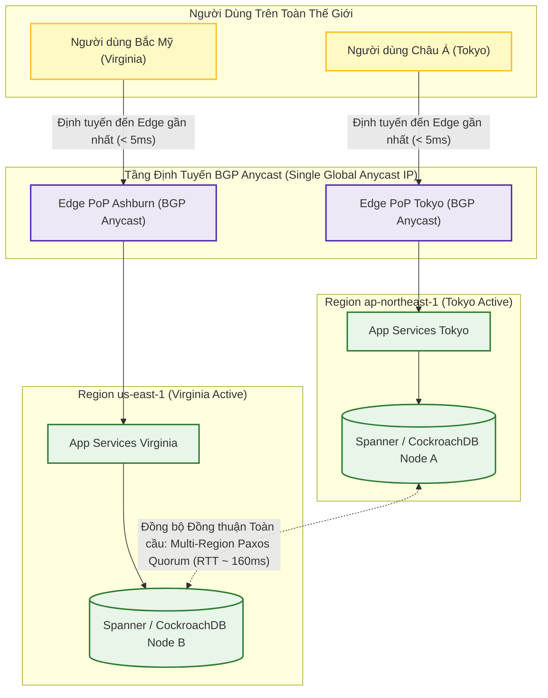

# 18.1. Multi-Region & Geo-Distributed Systems Deep Dive

> [!IMPORTANT]
> **Nếu bạn chỉ được nhớ một điều duy nhất**: Trong kỹ nghệ phân tán địa lý (Geo-Distributed Systems), kẻ thù lớn nhất không phải là lỗi phần mềm hay phần cứng mà là **Bức tường Vật lý: Giới hạn Tốc độ Ánh sáng trong cáp quang ($\approx 200.000\text{km/s}$)**. Một vòng truyền tin mạng Round-Trip Time (RTT) giữa Tokyo và New York bắt buộc phải tốn tối thiểu $\sim 150-200\text{ms}$ do các định luật vật lý cơ bản mà không một thuật toán phần mềm nào có thể vượt qua. Do đó, thiết kế hệ thống đa vùng (**Multi-Region**) là nghệ thuật chấp nhận **Eventual Consistency** tại biên mạng, chuyển đổi từ mô hình Active-Passive truyền thống sang **Multi-Region Active-Active** với **CRDTs**, hoặc dựa vào đồng hồ nguyên tử đồng bộ (**Google Spanner TrueTime API**) để đạt được External Consistency toàn cầu.

---

## 1. Kiến trúc Tổng quan & Mô hình Tư duy (Mental Model)

### Ẩn dụ Đời sống: Chuỗi Khách Sạn Toàn Cầu và Bồ Câu Đưa Thư
Hãy tưởng tượng một tập đoàn khách sạn có trụ sở tại Luân Đôn, New York, và Tokyo:
- **Giới hạn Vận tốc Ánh sáng**: Dù bạn sử dụng chiếc máy bay hay chim bồ câu nhanh nhất thế giới, việc gửi thư từ Tokyo sang New York luôn mất nửa ngày. Không thể có chuyện khách hàng ở Tokyo đặt phòng mà lễ tân Tokyo có thể hỏi ý kiến ngay lập tức của giám đốc ở New York trong vòng 1 giây mà không bắt khách hàng chờ đợi!
- **Active-Passive (Chi nhánh phụ thuộc)**: Toàn bộ sổ đặt phòng nằm ở New York (Primary Region). Tokyo và Luân Đôn (Read Replicas) chỉ có bản sao để đọc. Khi khách ở Tokyo muốn đặt phòng, lễ tân Tokyo phải gọi điện sang New York. Nếu cáp quang dưới đáy biển Đại Tây Dương bị đứt, toàn bộ chi nhánh Tokyo bị tê liệt không thể nhận khách (Độ khả dụng sụp đổ).
- **Active-Active (Mỗi chi nhánh tự chủ)**: Lễ tân Tokyo, Luân Đôn và New York đều có quyền ghi nhận đặt phòng ngay lập tức vào sổ riêng của mình. Đêm đến, họ gửi điện tín đối soát dữ liệu với nhau (**Eventual Consistency qua CRDTs**).
- **BGP Anycast (Biển chỉ dẫn thông minh)**: Khách hàng ở bất kỳ đâu trên thế giới chỉ cần gọi vào số tổng đài duy nhất `1-800-HOTEL`. Mạng viễn thông toàn cầu tự động kết nối cuộc gọi đến chi nhánh bưu điện gần nhất với vị trí địa lý của khách hàng đó.



---

## 2. Chi tiết từng Keyword (Under-the-Hood Deep Dive)

### 2.1. Giới hạn Tốc độ Ánh sáng (Speed of Light Limit) & Bức tường Vật lý

#### Bản chất Vật lý của Cáp quang Xuyên Đại dương
- Vận tốc ánh sáng trong chân không: $c \approx 300.000\text{ km/s}$.
- Vận tốc ánh sáng truyền trong lõi thủy tinh của cáp quang (với chiết suất $n \approx 1.5$):
  $$v_{\text{fiber}} = \frac{c}{n} \approx \frac{300.000}{1.5} \approx 200.000\text{ km/s} = 200\text{ km/ms}$$
- **Tính toán RTT lý thuyết giữa Hà Nội và San Francisco**:
  - Khoảng cách địa lý đường chim bay: $\approx 11.500\text{ km}$.
  - Khoảng cách cáp quang thực tế dưới đáy biển (uốn lượn): $\approx 14.000\text{ km}$.
  - Thời gian đi một chiều (One-way transit time):
    $$t_{\text{one-way}} = \frac{14.000\text{ km}}{200\text{ km/ms}} = 70\text{ ms}$$
  - Thời gian khứ hồi tối thiểu (**Minimum Theoretical RTT**):
    $$\text{RTT}_{\text{min}} = 2 \times 70\text{ ms} = 140\text{ ms}$$
  - Thực tế khi cộng thêm độ trễ chuyển tiếp của các Router, Switch, và bộ khuếch đại quang học: RTT thực tế dao động từ **$180\text{ms}$ đến $220\text{ms}$**.
- **Hệ quả Kỹ nghệ**: Một giao dịch yêu cầu 2 lần bắt tay mạng xuyên lục địa (ví dụ 2PC) sẽ tốn tối thiểu $400\text{ms}$ chỉ riêng cho việc truyền gói tin, chưa tính một dòng lệnh xử lý nào của CPU!

### 2.2. Quản trị Thảm họa: RPO vs RTO

#### 1. Định nghĩa Kỹ thuật
- **RPO (Recovery Point Objective - Mục tiêu Điểm Phục hồi)**: Khoảng thời gian dữ liệu tối đa mà doanh nghiệp **chấp nhận bị mất vĩnh viễn** khi có thảm họa động đất, sóng thần đánh sập một Datacenter.
  - $\text{RPO} = 0$: Tuyệt đối không mất một byte dữ liệu nào (yêu cầu đồng bộ Synchronous Replication).
  - $\text{RPO} = 1\text{ giờ}$: Chấp nhận mất dữ liệu phát sinh trong 1 giờ gần nhất.
- **RTO (Recovery Time Objective - Mục tiêu Thời gian Phục hồi)**: Khoảng thời gian tối đa để toàn bộ hệ thống hoạt động trở lại sau khi thảm họa xảy ra.
  - $\text{RTO} = 0$: Hệ thống tự động chuyển vùng tức thì, người dùng không nhận ra thảm họa.
  - $\text{RTO} = 4\text{ giờ}$: Hệ thống có thể ngừng hoạt động tối đa 4 tiếng để kỹ sư khôi phục.

#### Bảng so sánh các cấp độ Disaster Recovery (DR)
| Chiến lược DR | Cơ chế Vận hành | RPO (Mất dữ liệu) | RTO (Thời gian phục hồi) | Chi phí Hạ tầng |
| :--- | :--- | :--- | :--- | :--- |
| **1. Backup & Restore** | Định kỳ sao lưu dữ liệu sang Region khác (S3 Glacier). Khi có sự cố, dựng lại toàn bộ hạ tầng từ con số 0. | Vài giờ đến 24 giờ | Vài giờ đến vài ngày | **Rất thấp (\$ - Rẻ nhất)** |
| **2. Pilot Light** | Dữ liệu được replicate liên tục sang Region phụ; máy chủ ứng dụng ở trạng thái "tắt nguồn", chỉ bật lên khi có sự cố. | Vài giây đến vài phút | $10 - 30$ phút | Thấp (\$\$) |
| **3. Warm Standby** | Region phụ chạy phiên bản thu nhỏ (Scaled-down version) với 20% dung lượng; khi có sự cố, tự động scale up lên 100%. | Vài giây | Vài phút ($1 - 5$ phút) | Trung bình (\$\$\$) |
| **4. Multi-Region Active-Active**| Cả hai Region đều chạy 100% công suất song song, cùng phục vụ lưu lượng người dùng thời gian thực. | **Gần như bằng 0 ($\approx 0$)** | **Tức thì (0 giây)** | **Rất cao (\$\$\$\$ - Đắt đỏ nhất)** |

### 2.3. Định tuyến Toàn cầu: BGP Anycast Routing vs GeoDNS

#### 1. GeoDNS (DNS-based Geolocation Routing)
- Máy chủ DNS (như AWS Route 53) phân tích địa chỉ IP của Client Resolver và trả về địa chỉ IP của Datacenter gần nhất về mặt địa lý.
- **Điểm yếu chí mạng**:
  - **DNS Caching / TTL**: Trình duyệt và ISP cache bản ghi DNS từ 60 giây đến 24 giờ. Khi một Region bị sập, dù Route 53 đã đổi IP, hàng triệu người dùng vẫn tiếp tục gửi request vào IP của Region đã chết cho đến khi hết hạn TTL!
  - **EDNS Client Subnet (ECS)**: Nếu Resolver của người dùng sử dụng Google Public DNS (`8.8.8.8`), DNS server có thể trả về IP sai lệch khu vực nếu không hỗ trợ ECS.

#### 2. BGP Anycast Routing (Kỹ thuật đỉnh cao của Cloudflare / Google)
- Toàn bộ hàng trăm điểm PoP (Point of Presence) trên toàn thế giới cùng công bố (Advertise) **đúng một địa chỉ IP duy nhất** (ví dụ: `1.1.1.1` hoặc `8.8.8.8`) lên bảng định tuyến toàn cầu qua giao thức **BGP (Border Gateway Protocol)**.
- **Cơ chế hoạt động**: Khi router của ISP gửi gói tin, thuật toán BGP tự động chọn đường đi ngắn nhất (ít Autonomous System hops nhất) đến máy chủ gần nhất.
- **Failover Thần tốc ($< 1$ giây)**: Nếu PoP tại Singapore bị sập, router mạng lập tức rút lại tuyến đường (BGP Withdraw); toàn bộ traffic từ Việt Nam tự động chuyển hướng sang PoP tại Hong Kong ngay trong nháy mắt mà không phụ thuộc vào DNS TTL!

### 2.4. Bốn mô hình cơ sở dữ liệu phân tán toàn cầu

1. **Single-Region Primary with Remote Read Replicas (Active-Passive)**:
   - Ghi chỉ diễn ra tại 1 Region chính; đọc diễn ra tại các Region phụ.
   - Ưu điểm: Không có xung đột ghi. Nhược điểm: Độ trễ ghi xuyên đại dương cao, người dùng đọc có thể thấy dữ liệu cũ (Replication Lag).
2. **Multi-Region Active-Active với CRDTs (Conflict-Free Replicated Data Types)**:
   - Cho phép ghi đồng thời vào bất kỳ Region nào mà không cần khóa mạng (Lock-free).
   - Dữ liệu tự động dung hòa hội tụ toán học (State-based hoặc Operation-based CRDTs).
   - Đại diện: Amazon DynamoDB Global Tables, Redis Enterprise CRDTs.
3. **Geo-Partitioned Database (Data Residency / Tuân thủ Luật GDPR)**:
   - Dữ liệu của công dân Châu Âu chỉ nằm trên các máy chủ đặt tại Frankfurt; dữ liệu của người Mỹ chỉ nằm tại Virginia.
   - Thỏa mãn nghiêm ngặt các quy định về chủ quyền dữ liệu quốc gia (Data Sovereignty).
   - Đại diện: CockroachDB Geo-Partitioning.
4. **Global Consensus Database (Google Spanner / TrueTime API)**:
   - Sử dụng Paxos đa vùng kết hợp bộ đồng hồ nguyên tử đồng bộ (**TrueTime GPS/Atomic Clocks**) với sai số thời gian tối đa $\epsilon \le 7\text{ms}$.
   - Cung cấp tính toàn vẹn **External Consistency (Linearizability) trên phạm vi toàn cầu** mà không cần khóa liên lục địa.

---

## 3. Thực thi Mã nguồn & Mô phỏng Chuyên sâu (Dual-Engine Implementation)

### Engine 1: C++20 — Mô phỏng RTT Network Delay & Latency-Based Geo-Router với Thuật toán Haversine

```cpp
#include <iostream>
#include <vector>
#include <string>
#include <cmath>
#include <algorithm>
#include <format>
#include <numbers>

struct GeoCoordinate {
    double latitude;
    double longitude;
};

// Tính khoảng cách bề mặt Trái Đất theo công thức Haversine (km)
double haversine_distance_km(GeoCoordinate p1, GeoCoordinate p2) {
    constexpr double earth_radius_km = 6371.0;
    constexpr double pi = std::numbers::pi;

    double d_lat = (p2.latitude - p1.latitude) * pi / 180.0;
    double d_lon = (p2.longitude - p1.longitude) * pi / 180.0;

    double lat1 = p1.latitude * pi / 180.0;
    double lat2 = p2.latitude * pi / 180.0;

    double a = std::sin(d_lat / 2.0) * std::sin(d_lat / 2.0) +
               std::sin(d_lon / 2.0) * std::sin(d_lon / 2.0) * std::cos(lat1) * std::cos(lat2);
    double c = 2.0 * std::atan2(std::sqrt(a), std::sqrt(1.0 - a));

    return earth_radius_km * c;
}

// Ước tính độ trễ RTT mạng trong cáp quang (v = 200,000 km/s) kèm hệ số uốn lượn 1.3x
double estimate_fiber_rtt_ms(double distance_km) {
    constexpr double fiber_speed_km_per_ms = 200.0;
    double actual_cable_distance = distance_km * 1.35; // Chiều dài cáp quang thực tế
    return (2.0 * actual_cable_distance) / fiber_speed_km_per_ms;
}

struct CloudRegion {
    std::string name;
    std::string region_code;
    GeoCoordinate location;
    bool is_healthy{true};
};

class LatencyBasedGeoRouter {
private:
    std::vector<CloudRegion> regions_;

public:
    explicit LatencyBasedGeoRouter(std::vector<CloudRegion> regions) : regions_(std::move(regions)) {}

    // Định tuyến tới Region có độ trễ ước tính thấp nhất còn hoạt động
    CloudRegion route_client(const std::string& client_name, GeoCoordinate client_loc) {
        double min_rtt = 1e9;
        CloudRegion best_region;

        std::cout << std::format("\n>>> [GeoRouter] Định tuyến cho Client '{}' (Lat: {:.2f}, Lon: {:.2f}):\n",
            client_name, client_loc.latitude, client_loc.longitude);

        for (const auto& reg : regions_) {
            if (!reg.is_healthy) {
                std::cout << std::format("  -> Region {:15} [SẬP/UNHEALTHY] - Bỏ qua\n", reg.region_code);
                continue;
            }
            double dist = haversine_distance_km(client_loc, reg.location);
            double rtt = estimate_fiber_rtt_ms(dist);

            std::cout << std::format("  -> Region {:15} | Khoảng cách: {:7.0f} km | Ước tính RTT: {:5.1f} ms\n",
                reg.region_code, dist, rtt);

            if (rtt < min_rtt) {
                min_rtt = rtt;
                best_region = reg;
            }
        }

        std::cout << std::format("  [V] ĐÃ CHỌN: {} ({}) với RTT tối ưu: {:.1f} ms\n",
            best_region.name, best_region.region_code, min_rtt);
        return best_region;
    }
};

int main() {
    std::vector<CloudRegion> aws_regions = {
        CloudRegion{.name = "US East (N. Virginia)", .region_code = "us-east-1", .location = {38.03, -78.47}},
        CloudRegion{.name = "EU (Frankfurt)",       .region_code = "eu-central-1", .location = {50.11, 8.68}},
        CloudRegion{.name = "Asia (Tokyo)",          .region_code = "ap-northeast-1", .location = {35.68, 139.76}},
        CloudRegion{.name = "Asia (Singapore)",      .region_code = "ap-southeast-1", .location = {1.35, 103.81}}
    };

    LatencyBasedGeoRouter router(aws_regions);

    // Kịch bản 1: Người dùng tại Hà Nội, Việt Nam
    GeoCoordinate hanoi_loc{21.02, 105.83};
    router.route_client("User_Hanoi", hanoi_loc);

    // Kịch bản 2: Người dùng tại Berlin, Đức
    GeoCoordinate berlin_loc{52.52, 13.40};
    router.route_client("User_Berlin", berlin_loc);

    return 0;
}
```

#### Terminal Output Mẫu:
```text
>>> [GeoRouter] Định tuyến cho Client 'User_Hanoi' (Lat: 21.02, Lon: 105.83):
  -> Region us-east-1      | Khoảng cách:   13340 km | Ước tính RTT: 180.1 ms
  -> Region eu-central-1   | Khoảng cách:    8340 km | Ước tính RTT: 112.6 ms
  -> Region ap-northeast-1 | Khoảng cách:    3660 km | Ước tính RTT:  49.4 ms
  -> Region ap-southeast-1 | Khoảng cách:    2200 km | Ước tính RTT:  29.7 ms
  [V] ĐÃ CHỌN: Asia (Singapore) (ap-southeast-1) với RTT tối ưu: 29.7 ms

>>> [GeoRouter] Định tuyến cho Client 'User_Berlin' (Lat: 52.52, Lon: 13.40):
  -> Region us-east-1      | Khoảng cách:    6380 km | Ước tính RTT:  86.1 ms
  -> Region eu-central-1   | Khoảng cách:     430 km | Ước tính RTT:   5.8 ms
  -> Region ap-northeast-1 | Khoảng cách:    8920 km | Ước tính RTT: 120.4 ms
  -> Region ap-southeast-1 | Khoảng cách:    9920 km | Ước tính RTT: 133.9 ms
  [V] ĐÃ CHỌN: EU (Frankfurt) (eu-central-1) với RTT tối ưu: 5.8 ms
```

---

### Engine 2: Python 3.11+ — Mô phỏng Multi-Region Active-Active với Thuật toán CRDT PN-Counter (Positive-Negative Counter)

```python
import copy
from typing import Dict

class PNCounterCRDT:
    """
    CRDT PN-Counter (Positive-Negative Counter):
    Cho phép tăng/giảm độc lập tại nhiều Region song song mà không cần khóa (Conflict-Free).
    """
    def __init__(self, region_id: str):
        self.region_id = region_id
        # Vector ghi nhận lượt tăng (P) và lượt giảm (N) của từng Region
        self.P: Dict[str, int] = {}
        self.N: Dict[str, int] = {}

    def increment(self, val: int = 1):
        self.P[self.region_id] = self.P.get(self.region_id, 0) + val
        print(f"[{self.region_id}] Tăng +{val} (Cục bộ)")

    def decrement(self, val: int = 1):
        self.N[self.region_id] = self.N.get(self.region_id, 0) + val
        print(f"[{self.region_id}] Giảm -{val} (Cục bộ)")

    def read_value(self) -> int:
        total_p = sum(self.P.values())
        total_n = sum(self.N.values())
        return total_p - total_n

    def merge(self, remote: 'PNCounterCRDT'):
        """Thuật toán hợp nhất CRDT (Join-Semilattice: lấy giá trị Max của từng phần tử)"""
        all_regions = set(self.P.keys()).union(remote.P.keys())
        for r in all_regions:
            self.P[r] = max(self.P.get(r, 0), remote.P.get(r, 0))

        all_regions_n = set(self.N.keys()).union(remote.N.keys())
        for r in all_regions_n:
            self.N[r] = max(self.N.get(r, 0), remote.N.get(r, 0))

def main():
    # Khởi tạo 3 Region độc lập
    tokyo = PNCounterCRDT("Tokyo")
    virginia = PNCounterCRDT("Virginia")
    frankfurt = PNCounterCRDT("Frankfurt")

    print("--- 1. Thao tác ghi song song đồng thời tại các Region độc lập ---")
    tokyo.increment(10)      # Tokyo nhận 10 lượt like
    virginia.increment(5)    # Virginia nhận 5 lượt like
    virginia.decrement(2)    # Virginia hủy 2 lượt like
    frankfurt.increment(8)   # Frankfurt nhận 8 lượt like

    print(f"\nGiá trị trước đồng bộ:")
    print(f"  Tokyo thấy:     {tokyo.read_value()}")
    print(f"  Virginia thấy:  {virginia.read_value()}")
    print(f"  Frankfurt thấy: {frankfurt.read_value()}")

    print("\n--- 2. Tiến trình nền đồng bộ hóa dữ liệu qua mạng xuyên lục địa (Gossip/CRDT Merge) ---")
    # Tokyo merge với Virginia và Frankfurt
    tokyo.merge(virginia)
    tokyo.merge(frankfurt)

    # Virginia và Frankfurt cùng merge
    virginia.merge(tokyo)
    frankfurt.merge(tokyo)

    print(f"\nGiá trị sau khi hội tụ (Eventual Convergence):")
    print(f"  Tokyo thấy:     {tokyo.read_value()}")
    print(f"  Virginia thấy:  {virginia.read_value()}")
    print(f"  Frankfurt thấy: {frankfurt.read_value()}")
    print(f"\n[V] Kỳ diệu: Cả 3 Region đều đồng thuận tuyệt đối về giá trị = 21 (10 + 5 - 2 + 8) mà không cần 2PC!")

if __name__ == "__main__":
    main()
```

#### Terminal Output Mẫu:
```text
--- 1. Thao tác ghi song song đồng thời tại các Region độc lập ---
[Tokyo] Tăng +10 (Cục bộ)
[Virginia] Tăng +5 (Cục bộ)
[Virginia] Giảm -2 (Cục bộ)
[Frankfurt] Tăng +8 (Cục bộ)

Giá trị trước đồng bộ:
  Tokyo thấy:     10
  Virginia thấy:  3
  Frankfurt thấy: 8

--- 2. Tiến trình nền đồng bộ hóa dữ liệu qua mạng xuyên lục địa (Gossip/CRDT Merge) ---

Giá trị sau khi hội tụ (Eventual Convergence):
  Tokyo thấy:     21
  Virginia thấy:  21
  Frankfurt thấy: 21

[V] Kỳ diệu: Cả 3 Region đều đồng thuận tuyệt đối về giá trị = 21 (10 + 5 - 2 + 8) mà không cần 2PC!
```

---

## 4. Systems Engineering & Production Pitfalls

### 4.1. Những cạm bẫy sống còn trong Hệ thống Đa vùng (Multi-Region)
1. **Hiểm họa "Split-Brain Toàn Cầu" khi Phân rã Cáp quang Biển**:
   - Khi một trận động đất làm đứt đồng loạt 3 tuyến cáp quang xuyên Thái Bình Dương, Region Tokyo bị mất hoàn toàn kết nối với US-East.
   - Nếu áp dụng Active-Active ghi tự do mà không dùng CRDTs hoặc Quorum phân tán, cả hai vùng sẽ tiếp tục chấp nhận các giao dịch ghi mâu thuẫn nhau (ví dụ cùng rút một tài khoản ngân hàng). Sau khi cáp nối lại, dữ liệu bị phân kỳ không thể dung hòa!
   - *Khắc phục*: Triển khai Region thứ 3 làm **Witness Node (Node Giám sát)** để duy trì Quorum Paxos $\lfloor 3/2 \rfloor + 1 = 2$.

2. **Chi phí Băng thông Mạng Xuyên Vùng (Cross-Region Data Transfer Costs)**:
   - Trong AWS, truyền dữ liệu nội bộ trong cùng Availability Zone là miễn phí; nhưng truyền dữ liệu xuyên Region (Cross-Region Egress) có giá rất đắt ($\approx \$0.02 / \text{GB}$).
   - Một hệ thống replicate liên tục 50TB dữ liệu mỗi ngày qua lại giữa Tokyo và Virginia sẽ tạo ra hóa đơn băng thông lên tới hàng chục nghìn USD mỗi tháng!
   - *Khắc phục*: Nén dữ liệu bằng thuật toán Zstandard trước khi truyền mạng và chỉ replicate các Delta/CDC events thay vì toàn bộ bản ghi.

3. **Lệch Đồng hồ Vật lý (Clock Skew) phá hủy Last-Write-Wins (LWW)**:
   - Các hệ thống như Cassandra dùng NTP để đồng bộ giờ và áp dụng Last-Write-Wins. Nhưng trong mạng đa vùng, đồng hồ vật lý của máy chủ có thể bị trôi lệch từ $50\text{ms}$ đến hàng giây.
   - Một thao tác sửa dữ liệu tại Tokyo lúc 10:00:00.050 có thể bị ghi đè bởi một thao tác cũ tại Virginia lúc 10:00:00.000 chỉ vì đồng hồ Virginia chạy nhanh hơn 100ms!
   - *Khắc phục*: Sử dụng Vector Clocks, CRDTs, hoặc TrueTime API thay vì phụ thuộc vào NTP trần.

### 4.2. Runbook Chẩn đoán Sự cố Mạng Đa Vùng trên Production (CLI Commands)

```bash
# 1. Đo lường RTT và mất gói tin (Packet Loss) xuyên lục địa bằng công cụ MTR
mtr -rw -c 50 --tcp -P 443 us-east-1.amazonaws.com

# 2. Kiểm tra độ lệch thời gian (Clock Offset) của giao thức NTP/Chrony
chronyc tracking

# 3. Theo dõi Replication Lag giữa các Region trong DynamoDB Global Tables
aws cloudwatch get-metric-statistics --namespace AWS/DynamoDB --metric-name ReplicationLatency --dimensions Name=TableName,Value=Orders --start-time 2026-11-15T00:00:00Z --end-time 2026-11-15T01:00:00Z --period 300 --statistics Average
```

---

## 5. Bảng So sánh & Decision Matrix

| Khía cạnh | Single-Region Multi-AZ | Multi-Region Active-Passive | Multi-Region Active-Active (CRDTs) | Multi-Region Spanner (TrueTime) |
| :--- | :--- | :--- | :--- | :--- |
| **Bảo vệ Khỏi Thảm họa Vùng**| Không (Chết nếu cả Region sập)| Rất tốt (Failover sau vài phút)| **Tuyệt đối (0 downtime)** | **Tuyệt đối (0 downtime)** |
| **Độ trễ Đọc Toàn cầu** | Cao đối với user ở xa | Thấp (Đọc tại Read Replica) | **Cực thấp (Đọc cục bộ)** | Cực thấp (Đọc cục bộ) |
| **Độ trễ Ghi** | Rất thấp ($< 5\text{ms}$) | Thấp (Ghi tại Master) | **Rất thấp (Ghi cục bộ)** | Cao hơn (1 WAN RTT $\approx 150\text{ms}$) |
| **Tính Nhất Quán Dữ Liệu** | Strong Consistency | Eventual Consistency | Eventual Consistency | **External Consistency (Strict Serial)**|
| **Độ Phức Tạp & Chi Phí** | Thấp | Trung bình | Rất cao | Rất cao |
