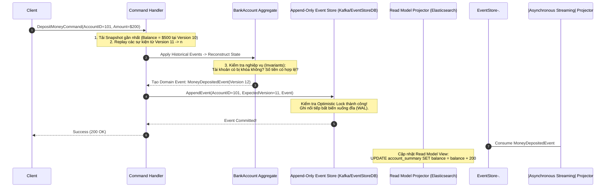
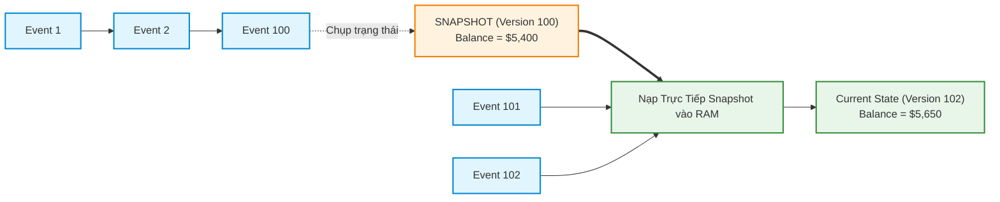

# 19.1. Event-Driven Architecture & Event Sourcing Deep Dive

> [!IMPORTANT]
> **Nếu bạn chỉ được nhớ một điều duy nhất**: Trong cơ sở dữ liệu CRUD truyền thống, thao tác `UPDATE` và `DELETE` sẽ vĩnh viễn tiêu hủy lịch sử và nguyên nhân dẫn đến trạng thái đó. **Event Sourcing** thay đổi hoàn toàn mô hình tư duy: **Không bao giờ lưu trạng thái hiện tại dưới dạng dòng dữ liệu ghi đè; chỉ lưu trữ một chuỗi tuần tự các sự kiện nghiệp vụ bất biến (Append-Only Event Store)**. Trạng thái hiện tại tại bất kỳ thời điểm nào là kết quả của một hàm toán học thuần túy (**Left Fold**) tích lũy toàn bộ các sự kiện trong quá khứ: $\text{CurrentState} = f(\text{Events})$. Để giải quyết bài toán hiệu năng khi số lượng sự kiện lên tới hàng triệu, kỹ thuật **Snapshotting** kết hợp với **Upcasting** là hai trụ cột bắt buộc trong sản xuất.

---

## 1. Kiến trúc Tổng quan & Mô hình Tư duy (Mental Model)

### Ẩn dụ Đời sống: Cuốn Sổ Cái Kế Toán Ngân Hàng và Bảng Điểm Thi
Hãy tưởng tượng cách thức kế toán tài chính vận hành suốt 500 năm qua:
- **Mô hình CRUD (Bảng điểm xóa sửa ngây thơ)**: Kế toán viên có một chiếc bảng đen ghi: `Số dư = $500`. Khi bạn nạp thêm $200, anh ta lấy giẻ lau số $500 đi và viết số $700. Khi kiểm toán viên đến hỏi: *"Tại sao khách hàng này có $700? Có ai chuyển tiền vào hay nhân viên tự ý ghi thêm?"*, kế toán viên hoàn toàn bất lực vì thông tin lịch sử đã bị xóa sạch!
- **Mô hình Event Sourcing (Sổ cái kế toán bất biến)**: Kế toán viên không bao giờ dùng tẩy. Anh ta chỉ viết nối tiếp các dòng vào cuốn sổ da:
  - Dòng 1: `Tài khoản mở ngày 01/01 với số dư ban đầu $0`
  - Dòng 2: `Nạp tiền $500 lúc 09:00`
  - Dòng 3: `Rút tiền $100 lúc 11:00`
  - Dòng 4: `Nạp tiền $300 lúc 14:00`
- Khi muốn biết số dư lúc 15:00: Kế toán viên cộng dồn từ trên xuống: $0 + 500 - 100 + 300 = \$700$.
- **Time Travel (Du hành thời gian)**: Nếu kiểm toán viên muốn biết số dư của bạn vào đúng lúc 10:00 sáng ngày hôm qua? Anh ta chỉ việc đọc các dòng từ 1 đến 2 và dừng lại $\implies$ Số dư chính xác là $\$500$!
- **Snapshotting (Chốt sổ định kỳ)**: Nếu cuốn sổ dày 100.000 trang, việc tính nhẩm lại từ trang 1 sẽ mất 2 tiếng. Do đó, cuối mỗi tháng, kế toán đóng dấu chốt sổ: *"Số dư tính đến hết ngày 31/10 là $50.000"* (**Snapshot**). Sang tháng 11, anh ta chỉ việc lấy $50.000 cộng với các sự kiện mới phát sinh.



---

## 2. Chi tiết từng Keyword (Under-the-Hood Deep Dive)

### 2.1. Phân loại 3 mẫu giao tiếp Sự kiện (Martin Fowler)
Trong kiến trúc hướng sự kiện (EDA), các thông điệp sự kiện được phân thành 3 trường phái rõ rệt:

1. **Event Notification (Thông báo sự kiện ngắn gọn)**:
   - Sự kiện chỉ đóng vai trò là tiếng chuông báo động: thông báo một điều gì đó vừa xảy ra với payload tối thiểu:
     ```json
     {"event": "OrderCreated", "order_id": "1001"}
     ```
   - **Đặc điểm**: Giữ liên kết lỏng (Loose coupling). Nhược điểm: Consumer khi nhận sự kiện buộc phải gọi ngược lại (RPC Callback) sang Order Service để lấy chi tiết $\implies$ Có thể tạo bão truy vấn ngược (**Query Storm**).
2. **Event-Carried State Transfer - ECST (Truyền tải trạng thái kèm sự kiện)**:
   - Sự kiện mang theo toàn bộ dữ liệu trạng thái mới nhất của đối tượng:
     ```json
     {"event": "OrderCreated", "order_id": "1001", "customer_name": "Alice", "total": 250.00, "items": [...]}
     ```
   - **Đặc điểm**: Consumer có đầy đủ dữ liệu để tự cập nhật Database cục bộ của nó mà không bao giờ cần gọi ngược lại Producer. Tối ưu hóa hiệu năng và tăng tính sẵn sàng độc lập.
3. **Event Sourcing (Lưu trữ nguồn gốc sự kiện)**:
   - Mọi thay đổi trạng thái của đối tượng đều được mô hình hóa thành một chuỗi các sự kiện nghiệp vụ và được lưu trữ vĩnh viễn trong **Event Store làm nguồn chân lý duy nhất (Single Source of Truth)**.

### 2.2. Bản chất cốt lõi của Event Sourcing

#### Trạng thái hiện tại là hàm của chuỗi sự kiện trong quá khứ
Về mặt toán học hàm (Functional Programming), một Aggregate trong Event Sourcing được biểu diễn bằng phép toán **Fold-Left (Reduce)**:
$$\text{CurrentState} = \text{foldl}(\text{apply}, \text{InitialState}, \text{EventHistory})$$
- Trạng thái (State) chỉ là một dạng bộ đệm tạm thời (Transient Projection) trên RAM.
- Dữ liệu thực sự tồn tại vĩnh viễn là danh sách các sự kiện quá khứ đã được cam kết:
  $$\text{EventHistory} = [E_1, E_2, E_3, \dots, E_n]$$

#### Lợi ích Vượt trội của Event Sourcing
1. **Kiểm toán Hoàn hảo 100% (Audit Log by Default)**: Không cần viết thêm code logging kiểm toán. Bất kỳ ai sửa đổi dữ liệu gì, vào lúc nào, với nguyên nhân nghiệp vụ nào đều được lưu vết vĩnh viễn.
2. **Du hành Thời gian & Phân tích Quá khứ (Time Travel Debugging)**: Có thể dễ dàng tái hiện lại trạng thái chính xác của hệ thống vào đúng ngày 15/03/2024 lúc 14:32:05 để tái hiện lỗi (Bug reproduction).
3. **Thử nghiệm Mô hình Nghiệp vụ Mới (What-If Analysis)**: Có thể replay lại toàn bộ sự kiện mua sắm của 5 năm qua trên một thuật toán tính điểm thưởng mới để xem doanh nghiệp có bị lỗ hay không.

### 2.3. Tối ưu hóa hiệu năng: Snapshotting trong Event Sourcing

#### Cơ chế Hoạt động của Snapshotting
Nếu một Aggregate (ví dụ: giỏ hàng hoặc tài khoản ngân hàng của một công ty lớn) có $100.000$ sự kiện:
- Mỗi lần có request mới, việc đọc $100.000$ events từ đĩa và replay trên RAM sẽ làm tăng độ trễ lên hàng giây.
- **Giải pháp**:
  1. Định kỳ mỗi $K$ sự kiện (ví dụ mỗi 100 events): Hệ thống chụp một bức ảnh đóng băng trạng thái (**Snapshot**) và lưu vào Snapshot Store kèm theo `Version` tương ứng:
     $$\text{Snapshot} = \langle \text{AggregateID: 101}, \quad \text{Version: 1000}, \quad \text{State: } \{\text{balance: } 5400.0\} \rangle$$
  2. Khi cần tái tạo trạng thái: Hệ thống chỉ đọc Snapshot gần nhất tại Version $1000$, sau đó chỉ cần đọc và replay các sự kiện từ Version $1001$ trở đi!
  3. Giảm thời gian tái tạo trạng thái từ $1.000\text{ms}$ xuống $< 2\text{ms}$.



### 2.4. Event Schema Evolution & Upcasting

#### Thách thức Bất biến của Sự kiện
Quy tắc vàng của Event Sourcing là: **Sự kiện trong quá khứ là bất biến (Immutable), không bao giờ được phép sửa đổi hoặc xóa bỏ trong Event Store**.
Tuy nhiên, logic nghiệp vụ luôn luôn thay đổi theo thời gian:
- Năm 2023: Sự kiện `UserRegisteredEvent_V1` chỉ có `fullName`.
- Năm 2026: Hệ thống nâng cấp yêu cầu tách thành `firstName` và `lastName`.

#### Kỹ thuật Upcasting (Nâng cấp Schema Động trên đường bay)
- Thay vì chạy script di chuyển cơ sở dữ liệu để sửa đổi hàng triệu sự kiện cũ trong Event Store (vi phạm tính bất biến):
- Hệ thống chèn một tầng chuyển đổi trung gian (**Upcaster Pipeline**) ngay sau khi đọc sự kiện từ đĩa lên RAM:
  $$\text{Event V1 (Từ đĩa)} \xrightarrow{\text{Upcaster}} \text{Event V2 (Trên RAM)} \xrightarrow{\text{Upcaster}} \text{Event V3 (Đưa vào Aggregate)}$$
- Upcaster tự động bổ sung các trường mặc định hoặc cắt tách chuỗi trên RAM mà không làm thay đổi một byte dữ liệu gốc nào trong Event Store.

---

## 3. Thực thi Mã nguồn & Mô phỏng Chuyên sâu (Dual-Engine Implementation)

### Engine 1: C++20 — Triển khai Hoàn chỉnh Event Sourced BankAccount Aggregate với State Replay & Snapshotting

```cpp
#include <iostream>
#include <vector>
#include <string>
#include <variant>
#include <memory>
#include <format>
#include <cstdint>

// Các sự kiện miền (Domain Events)
struct AccountOpenedEvent {
    std::string account_id;
    std::string owner;
};

struct MoneyDepositedEvent {
    double amount;
};

struct MoneyWithdrawnEvent {
    double amount;
};

using DomainEvent = std::variant<AccountOpenedEvent, MoneyDepositedEvent, MoneyWithdrawnEvent>;

// Aggregate Root: BankAccount
class BankAccountAggregate {
public:
    std::string account_id;
    std::string owner;
    double balance{0.0};
    uint64_t version{0};

    // Hàm thuần túy thay đổi trạng thái (Apply Event): Không chứa logic kiểm tra nghiệp vụ!
    void apply(const DomainEvent& event) {
        std::visit([this](auto&& e) {
            using T = std::decay_t<decltype(e)>;
            if constexpr (std::is_same_v<T, AccountOpenedEvent>) {
                this->account_id = e.account_id;
                this->owner = e.owner;
                this->balance = 0.0;
            } else if constexpr (std::is_same_v<T, MoneyDepositedEvent>) {
                this->balance += e.amount;
            } else if constexpr (std::is_same_v<T, MoneyWithdrawnEvent>) {
                this->balance -= e.amount;
            }
        }, event);
        version++;
    }

    // Tái tạo trạng thái từ danh sách sự kiện lịch sử (State Reconstruction)
    void replay_events(const std::vector<DomainEvent>& events) {
        for (const auto& ev : events) {
            apply(ev);
        }
    }
};

struct AccountSnapshot {
    std::string account_id;
    std::string owner;
    double balance;
    uint64_t snapshot_version;
};

int main() {
    std::cout << "--- 1. Tạo chuỗi sự kiện lịch sử trong Event Store ---\n";
    std::vector<DomainEvent> event_stream = {
        AccountOpenedEvent{.account_id = "ACC_9981", .owner = "Nguyen Van A"},
        MoneyDepositedEvent{.amount = 1000.0},
        MoneyWithdrawnEvent{.amount = 200.0},
        MoneyDepositedEvent{.amount = 500.0}
    };

    std::cout << "--- 2. Tái tạo trạng thái Aggregate bằng phép Left-Fold Replay ---\n";
    BankAccountAggregate account;
    account.replay_events(event_stream);

    std::cout << std::format("[Aggregate State] Account: {} | Chủ TK: {} | Số dư: ${:.2f} | Version: {}\n",
        account.account_id, account.owner, account.balance, account.version);

    std::cout << "\n--- 3. Thực hiện Snapshotting tại Version 4 ---\n";
    AccountSnapshot snapshot{
        .account_id = account.account_id,
        .owner = account.owner,
        .balance = account.balance,
        .snapshot_version = account.version
    };
    std::cout << std::format("[Snapshot Lưu Trữ] Đã lưu Snapshot tại Version {}: Balance=${:.2f}\n",
        snapshot.snapshot_version, snapshot.balance);

    std::cout << "\n--- 4. Phát sinh thêm Event mới (Nạp thêm $300) ---\n";
    DomainEvent new_event = MoneyDepositedEvent{.amount = 300.0};

    // Tái tạo trạng thái cực nhanh: Nạp Snapshot + Replay chỉ 1 event mới
    BankAccountAggregate fast_account;
    fast_account.account_id = snapshot.account_id;
    fast_account.owner = snapshot.owner;
    fast_account.balance = snapshot.balance;
    fast_account.version = snapshot.snapshot_version;

    fast_account.apply(new_event);
    std::cout << std::format("[Trạng thái Sau Cùng] Số dư mới: ${:.2f} | Version: {}\n",
        fast_account.balance, fast_account.version);

    return 0;
}
```

#### Terminal Output Mẫu:
```text
--- 1. Tạo chuỗi sự kiện lịch sử trong Event Store ---
--- 2. Tái tạo trạng thái Aggregate bằng phép Left-Fold Replay ---
[Aggregate State] Account: ACC_9981 | Chủ TK: Nguyen Van A | Số dư: $1300.00 | Version: 4

--- 3. Thực hiện Snapshotting tại Version 4 ---
[Snapshot Lưu Trữ] Đã lưu Snapshot tại Version 4: Balance=$1300.00

--- 4. Phát sinh thêm Event mới (Nạp thêm $300) ---
[Trạng thái Sau Cùng] Số dư mới: $1600.00 | Version: 5
```

---

### Engine 2: Python 3.11+ — Mô phỏng Pipeline Event Schema Upcasting và Du Hành Thời Gian (Time-Travel Debugging)

```python
import copy
from typing import Dict, List, Any

# Sự kiện Phiên bản 1 cũ (Năm 2023)
class UserRegisteredEventV1:
    def __init__(self, user_id: str, full_name: str):
        self.user_id = user_id
        self.full_name = full_name
        self.schema_version = 1

# Sự kiện Phiên bản 2 mới (Năm 2026)
class UserRegisteredEventV2:
    def __init__(self, user_id: str, first_name: str, last_name: str):
        self.user_id = user_id
        self.first_name = first_name
        self.last_name = last_name
        self.schema_version = 2

class EventUpcasterPipeline:
    """Tự động nâng cấp schema của event cũ khi đọc từ Event Store lên RAM."""
    @staticmethod
    def upcast(raw_event: Any) -> Any:
        if isinstance(raw_event, UserRegisteredEventV1):
            parts = raw_event.full_name.split(" ", 1)
            first = parts[0]
            last = parts[1] if len(parts) > 1 else ""
            print(f"  [Upcaster V1 -> V2] Chuyển đổi 'full_name: {raw_event.full_name}' thành 'first: {first}, last: {last}'")
            return UserRegisteredEventV2(raw_event.user_id, first, last)
        return raw_event

class UserProfileAggregate:
    def __init__(self):
        self.user_id = ""
        self.first_name = ""
        self.last_name = ""

    def apply(self, event: Any):
        if isinstance(event, UserRegisteredEventV2):
            self.user_id = event.user_id
            self.first_name = event.first_name
            self.last_name = event.last_name

def main():
    print("--- 1. Đọc dữ liệu lịch sử từ Event Store (Chứa Event V1 cũ) ---")
    event_store_raw = [
        UserRegisteredEventV1(user_id="USR_42", full_name="Donald Knuth")
    ]

    print("--- 2. Đi qua Upcaster Pipeline trước khi nạp vào Aggregate ---")
    upcasted_events = [EventUpcasterPipeline.upcast(ev) for ev in event_store_raw]

    print("\n--- 3. Tái tạo trạng thái với mô hình Aggregate hiện đại ---")
    user = UserProfileAggregate()
    for ev in upcasted_events:
        user.apply(ev)

    print(f"[Kết quả Aggregate] User ID: {user.user_id}")
    print(f"  Họ (Last Name):   '{user.last_name}'")
    print(f"  Tên (First Name): '{user.first_name}'")
    print("\n[V] Tính bất biến được bảo tồn: Dữ liệu đĩa vẫn là V1, nhưng ứng dụng chạy mượt mà theo chuẩn V2!")

if __name__ == "__main__":
    main()
```

#### Terminal Output Mẫu:
```text
--- 1. Đọc dữ liệu lịch sử từ Event Store (Chứa Event V1 cũ) ---
--- 2. Đi qua Upcaster Pipeline trước khi nạp vào Aggregate ---
  [Upcaster V1 -> V2] Chuyển đổi 'full_name: Donald Knuth' thành 'first: Donald, last: Knuth'

--- 3. Tái tạo trạng thái với mô hình Aggregate hiện đại ---
[Kết quả Aggregate] User ID: USR_42
  Họ (Last Name):   'Knuth'
  Tên (First Name): 'Donald'

[V] Tính bất biến được bảo tồn: Dữ liệu đĩa vẫn là V1, nhưng ứng dụng chạy mượt mà theo chuẩn V2!
```

---

## 4. Systems Engineering & Production Pitfalls

### 4.1. Những cạm bẫy sống còn khi triển khai Event Sourcing
1. **Xung đột Concurrency khi Append Event (Optimistic Concurrency Failure)**:
   - Hai người dùng cùng gửi lệnh chuyển tiền vào cùng 1 tài khoản tại cùng một mili-giây. Cả hai cùng đọc thấy `ExpectedVersion = 10`.
   - Lệnh 1 ghi thành công `Version = 11`. Lệnh 2 cố gắng ghi với `ExpectedVersion = 10` $\implies$ Event Store ném lỗi **Concurrency Exception**.
   - *Khắc phục*: Ứng dụng phải tự động bắt exception, nạp lại trạng thái mới nhất từ Version 11, kiểm tra lại nghiệp vụ và thử ghi lại (**Automatic Retry**).

2. **Khủng hoảng Tuân thủ Luật Xóa Dữ liệu Cá nhân (GDPR "Right to be Forgotten")**:
   - Luật GDPR yêu cầu doanh nghiệp phải xóa vĩnh viễn thông tin cá nhân của người dùng khi được yêu cầu. Nhưng trong Event Store, sự kiện là bất biến, việc `DELETE` một event trong quá khứ sẽ làm hỏng toàn bộ chuỗi cryptographic hash hoặc LSN!
   - *Khắc phục*: Sử dụng kỹ thuật **Mã hóa Tiêu hủy Khóa (Cryptographic Erasure)**: Mọi thông tin PII của người dùng được mã hóa bằng một khóa riêng. Khi người dùng yêu cầu xóa, chỉ cần **xóa bỏ khóa giải mã** đó $\implies$ Dữ liệu sự kiện cũ vĩnh viễn biến thành chuỗi rác ngẫu nhiên không thể giải mã!

3. **Event Store biến thành Nút thắt Cổ chai I/O**:
   - Nếu dùng bảng PostgreSQL thông thường làm Event Store và chèn 100.000 events/giây, chỉ số sequence và index của bảng sẽ gây khóa trang đĩa (Page Lock Contention).
   - *Khắc phục*: Sử dụng các hệ thống append-only chuyên dụng được thiết kế tối ưu hóa ghi tuần tự như **EventStoreDB** hoặc **Apache Kafka / Apache Pulsar**.

### 4.2. Runbook Chẩn đoán Sự cố Event Store trên Production (CLI Commands)

```bash
# 1. Kiểm tra trạng thái Stream và số lượng Event hiện có trong EventStoreDB
curl -i http://localhost:2113/streams/account-9981 -H "Accept: application/json"

# 2. Xem các sự kiện bị lỗi trong Dead Letter Queue (DLQ) của Event Projector
kafka-console-consumer --bootstrap-server localhost:9092 --topic order-projector-dlq --from-beginning --max-messages 5

# 3. Theo dõi độ trễ chiếu dữ liệu (Projection Lag) giữa Event Store và Read Model
curl -s http://localhost:9090/api/v1/query?query=event_sourcing_projection_lag_seconds
```

---

## 5. Bảng So sánh & Decision Matrix

| Khía cạnh | CRUD Model Truyền Thống | Event Notification | Event Sourcing (ES + CQRS) |
| :--- | :--- | :--- | :--- |
| **Nguồn Chân lý (Source of Truth)**| Trạng thái hiện tại trong RDBMS | Trạng thái hiện tại trong RDBMS | **Toàn bộ Lịch sử Sự kiện Bất biến** |
| **Duy trì Lịch sử** | Bị xóa đè qua `UPDATE/DELETE` | Không lưu | **Bảo tồn vĩnh viễn 100%** |
| **Khả năng Phục hồi Thảm họa**| Dựa vào DB Backup | Dựa vào DB Backup | **Replay toàn bộ từ ngày đầu tiên** |
| **Độ phức tạp Kỹ thuật** | Rất thấp | Thấp | **Rất cao (Đòi hỏi thay đổi tư duy)** |
| **Phù hợp nhất cho** | Ứng dụng CRUD đơn giản, CMS | Microservices giao tiếp cơ bản | **Ngân hàng, Sàn chứng khoán, E-commerce Core** |
