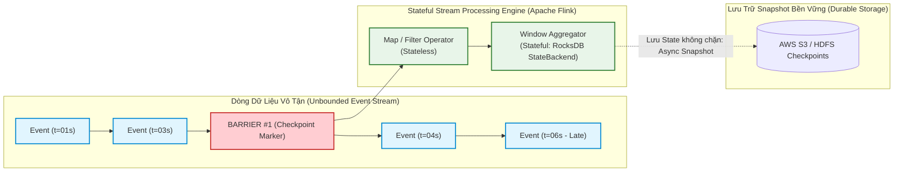

# 19.2. Stream Processing, Windowing & Stateful Stream Engines

> [!IMPORTANT]
> **Nếu bạn chỉ được nhớ một điều duy nhất**: Trong thế giới thực tế của hệ thống phân tán, dữ liệu luôn là một dòng chảy vô tận không có điểm dừng (**Unbounded Data Stream**). Để xử lý dòng chảy này chính xác, bài toán cốt lõi là **sự phân tách giữa Event Time (thời điểm sự kiện thực sự xảy ra tại nguồn) và Processing Time (thời điểm máy chủ nhận được sự kiện)**. Cơ chế **Watermarks** là công cụ toán học tối thượng để xử lý các sự kiện đến trễ (**Late Data / Out-of-Order Events**). Để đạt được ngữ nghĩa xử lý chính xác một lần (**Exactly-Once Processing**) mà không làm dừng dòng chảy dữ liệu, thuật toán **Asynchronous Barrier Snapshotting (ABS - biến thể Chandy-Lamport của Apache Flink)** chèn các rào chắn kiểm toán định kỳ vào luồng dữ liệu mà không gây khóa luồng tính toán.

---

## 1. Kiến trúc Tổng quan & Mô hình Tư duy (Mental Model)

### Ẩn dụ Đời sống: Dòng Sông Phù Sa, Đập Thủy Điện và Thuyền Trưởng
Hãy tưởng tượng một dòng sông lớn chảy qua nhà máy thủy điện:
- **Batch Processing (Xây hồ chứa nước đóng băng)**: Nhà máy đóng đập giữ toàn bộ nước trong 24 giờ. Đúng nửa đêm, họ mở cống xả toàn bộ lượng nước tích lũy để quay turbine trong 1 tiếng rồi lại đóng đập (Độ trễ 24 giờ).
- **Stream Processing (Guồng nước quay liên tục)**: Đặt các turbine ngay giữa dòng chảy xiết của dòng sông. Nước chảy tới đâu, điện được phát ra tới đó tức thì trong vòng vài mili-giây (Real-time).
- **Event Time vs Processing Time (Bức thư từ Đảo Xa)**:
  - Một người lính trên đảo xa viết thư gửi về đất liền vào ngày 01/10 (**Event Time**).
  - Do bão biển làm trễ tàu bưu điện, bức thư đến tay người nhận vào ngày 20/10 (**Processing Time**).
  - Nếu bạn thống kê xem *"Trong tháng 10 người lính có gửi thư vào tuần 1 không?"*, bạn bắt buộc phải dựa vào ngày viết trên phong bì (Event Time), chứ không thể dựa vào ngày người bưu tá bấm chuông (Processing Time)!
- **Watermark (Đồng hồ Chốt sổ của Thuyền trưởng)**: Thuyền trưởng phát tín hiệu: *"Nước sông đã chảy qua mốc $T = 10:05$. Tôi cam kết rằng $99\%$ lượng nước của mốc $10:00$ đã trôi qua. Bộ phận tính toán hãy chốt sổ cửa sổ từ $09:55 - 10:00$!"*. Bất kỳ giọt nước nào đến sau mốc này bị coi là nước trễ (**Late Data**).



---

## 2. Chi tiết từng Keyword (Under-the-Hood Deep Dive)

### 2.1. Batch Processing vs Stream Processing

| Tiêu chí | Batch Processing (Hadoop / Spark Batch) | Stream Processing (Apache Flink / Kafka Streams) |
| :--- | :--- | :--- |
| **Bản chất Dữ liệu** | Tập dữ liệu tĩnh, hữu hạn có giới hạn (**Bounded Dataset**). | Dòng dữ liệu vô tận, biến thiên liên tục (**Unbounded Stream**). |
| **Độ trễ Xử lý (Latency)** | Cao (Vài phút, vài giờ đến hàng ngày). | **Cực thấp (Vài mili-giây đến vài chục mili-giây)**. |
| **Khái niệm Thời gian** | Processing Time (Thời điểm job bắt đầu chạy). | **Event Time** (Dựa vào timestamp gốc của sự kiện). |
| **Cơ chế Tính toán** | Quét toàn bộ dữ liệu từ đầu đến cuối (Full Scan). | Xử lý từng bản ghi một (Record-by-record) hoặc Micro-batch. |
| **Mô hình Khôi phục** | Chạy lại toàn bộ tác vụ từ đầu (Re-run task). | Khôi phục trạng thái từ **Chandy-Lamport Checkpoints**. |

#### Ba khái niệm Thời gian Cốt lõi
1. **Event Time**: Thời điểm sự kiện thực sự được sinh ra tại thiết bị người dùng (ví dụ: cảm biến IoT ghi nhận nhiệt độ lúc `12:00:00.123`). Đây là thước đo chân lý duy nhất cho tính đúng đắn nghiệp vụ.
2. **Ingestion Time**: Thời điểm sự kiện bay vào hệ thống Message Broker (Kafka/Pulsar Topic).
3. **Processing Time**: Thời điểm máy chủ xử lý dữ liệu (Flink TaskManager) lấy sự kiện ra khỏi bộ nhớ và thực thi mã nguồn. Bị ảnh hưởng bởi GC pause, network lag, và tắc nghẽn hàng đợi.

### 2.2. Ba loại Cửa sổ tính toán (Windowing Strategies)

#### 1. Tumbling Window (Cửa sổ lật / Cố định không chồng lấn)
- Chia thời gian thành các khối cố định liên tiếp, có kích thước bằng nhau và **tuyệt đối không bị chồng chéo**.
- Ví dụ: Cửa sổ 5 phút ($[00:00 - 00:05), [00:05 - 00:10), \dots$).
- Một sự kiện chỉ thuộc về **duy nhất một cửa sổ**.
- Ứng dụng: Thống kê số lượng truy cập website mỗi 5 phút một lần.

#### 2. Hopping Window / Sliding Window (Cửa sổ trượt chồng lấn)
- Được định nghĩa bởi 2 tham số: **Kích thước cửa sổ (Size)** và **Bước trượt (Slide / Hop)**.
- Ví dụ: Cửa sổ kích thước 10 phút, bước trượt 2 phút ($[00:00 - 00:10), [00:02 - 00:12), \dots$).
- Một sự kiện có thể thuộc về **nhiều cửa sổ song song**.
- Ứng dụng: Tính toán đường trung bình động (Moving Average) giá cổ phiếu hoặc phát hiện gian lận thẻ tín dụng.

#### 3. Session Window (Cửa sổ phiên dựa trên khoảng lặng)
- Không có kích thước thời gian cố định; cửa sổ được định hình bởi hành vi của từng người dùng.
- Được kích hoạt bởi một khoảng thời gian không hoạt động (**Inactivity Gap / Timeout**).
- Nếu một người dùng liên tục click trong 20 phút, cửa sổ kéo dài 20 phút. Nếu họ ngừng click quá 5 phút, cửa sổ chốt lại và phiên mới được mở ra khi họ click tiếp.
- Ứng dụng: Phân tích hành vi phiên duyệt web của người dùng E-commerce.

```mermaid
gantt
    title So sánh 3 Loại Cửa Sổ Tính Toán (Windowing Strategies)
    dateFormat X
    axisFormat %s phút

    section Tumbling (5p)
    Window 1 [00:00 - 00:05] :active, 0, 5
    Window 2 [00:05 - 00:10] :crit, 5, 10
    Window 3 [00:10 - 00:15] :active, 10, 15

    section Sliding (Size 5p, Hop 2p)
    Window A [00:00 - 00:05] :done, 0, 5
    Window B [00:02 - 00:07] :active, 2, 7
    Window C [00:04 - 00:09] :crit, 4, 9

    section Session (Gap 3p)
    User 1 Session (Clicks...) :active, 1, 6
    User 2 Session (Clicks...) :crit, 8, 14
```



### 2.3. Quản lý Trạng thái & Exactly-Once Stream Processing

#### 1. Stateful vs Stateless Stream Processing
- **Stateless**: Mỗi sự kiện được xử lý độc lập, không cần nhớ quá khứ (ví dụ: `filter(e -> e.price > 100)` hoặc chuyển đổi định dạng JSON sang Protobuf). Cực kỳ dễ mở rộng quy mô.
- **Stateful**: Xử lý sự kiện hiện tại phụ thuộc vào các sự kiện đã xảy ra trước đó (ví dụ: tính tổng tiền của một cửa sổ, gom nhóm dữ liệu theo `user_id`, phát hiện chuỗi hành vi bất thường).
- **Managed State trong Apache Flink**: Trạng thái được lưu trên RAM (HashMapStateBackend) hoặc lưu trữ cục bộ trên đĩa thông qua động cơ nhúng **Embedded RocksDB StateBackend**.

#### 2. Thuật toán Asynchronous Barrier Snapshotting (Flink ABS / Chandy-Lamport)
Làm thế nào để chụp ảnh toàn bộ trạng thái phân tán của hàng trăm node worker mà không làm dừng dòng chảy xử lý dữ liệu?
1. **Barrier Injection**: JobManager định kỳ chèn một thông điệp đặc biệt tên là **Checkpoint Barrier $N$** vào dòng dữ liệu tại các Source Operators.
2. **Barrier Flow**: Barrier chảy xuôi dòng cùng với các bản ghi dữ liệu bình thường. Các bản ghi đứng trước Barrier thuộc về Checkpoint $N$; các bản ghi đứng sau Barrier thuộc về Checkpoint $N+1$.
3. **Barrier Alignment (Căn chỉnh rào chắn)**:
   - Khi một Operator nhận dữ liệu từ nhiều kênh đầu vào (ví dụ Kênh A và Kênh B):
   - Nếu Kênh A nhận được Barrier $N$ trước, Operator tạm thời dừng xử lý Kênh A và đệm dữ liệu của Kênh A lại cho đến khi Kênh B cũng nhận được Barrier $N$.
4. **State Snapshotting**: Khi tất cả các kênh đầu vào đều đã nhận được Barrier $N$, Operator lập tức kích hoạt một background thread để sao chép trạng thái cục bộ của nó lên hệ thống lưu trữ bền vững (S3/HDFS).
5. **Non-blocking Execution**: Trong lúc background thread đang tải snapshot lên S3, luồng tính toán chính tiếp tục xử lý các bản ghi phía sau Barrier ngay lập tức mà không phải dừng lại một mili-giây nào!

### 2.4. Khảo sát 3 Engine Stream Processing hàng đầu

| Tiêu chí Đánh giá | Apache Flink | Apache Spark Streaming | Kafka Streams |
| :--- | :--- | :--- | :--- |
| **Mô hình Xử lý Cốt lõi**| **Native Streaming (Từng bản ghi một)** | Micro-batching (Gom batch $100\text{ms}$) | Native Streaming (Từng bản ghi một) |
| **Độ trễ Xử lý (Latency)**| **Siêu thấp ($< 10\text{ms}$)** | Trung bình ($100\text{ms} - 500\text{ms}$) | Thấp ($10 - 50\text{ms}$) |
| **Hỗ trợ Event Time** | **Toàn diện (Advanced Watermarks)** | Hỗ trợ tốt từ Spark 2.x | Hỗ trợ tốt |
| **Độ phức tạp Triển khai**| Cao (Cần cụm Flink độc lập) | Cao (Chạy trên cụm Spark/YARN/K8s) | **Cực thấp (Thư viện Java nhúng)** |
| **Phù hợp nhất cho** | **Xử lý sự kiện thời gian thực siêu trễ, CEP, Fraud** | Tổng hợp dữ liệu kết hợp Batch + Stream | Microservices nghiệp vụ xây dựng trên Kafka |

---

## 3. Thực thi Mã nguồn & Mô phỏng Chuyên sâu (Dual-Engine Implementation)

### Engine 1: C++20 — Mô phỏng Tumbling Window Aggregator với Sliding Watermarks & Trừ Khử Sự Kiện Đến Trễ

```cpp
#include <iostream>
#include <vector>
#include <string>
#include <map>
#include <format>
#include <cstdint>
#include <algorithm>

struct StreamRecord {
    uint64_t event_time_sec; // Timestamp gốc của sự kiện
    std::string key;
    double value;
};

// Cửa sổ Tumbling Window cố định
struct TimeWindow {
    uint64_t start_sec;
    uint64_t end_sec; // [start, end)

    auto operator<=>(const TimeWindow&) const = default;
};

class TumblingWindowEngine {
private:
    uint64_t window_size_sec_;
    uint64_t allowed_lateness_sec_;
    uint64_t current_watermark_sec_{0};

    // Lưu trữ trạng thái tổng hợp theo: TimeWindow -> Map[Key, SumValue]
    std::map<TimeWindow, std::map<std::string, double>> window_state_;

public:
    TumblingWindowEngine(uint64_t window_size, uint64_t allowed_lateness)
        : window_size_sec_(window_size), allowed_lateness_sec_(allowed_lateness) {}

    // Cập nhật Watermark theo thời gian sự kiện cao nhất ghi nhận được trừ đi độ trễ cho phép
    void update_watermark(uint64_t max_event_time) {
        if (max_event_time > allowed_lateness_sec_) {
            current_watermark_sec_ = std::max(current_watermark_sec_, max_event_time - allowed_lateness_sec_);
        }
    }

    void process_record(const StreamRecord& rec) {
        std::cout << std::format("\n>>> Tiếp nhận Record: Key='{}', Val={:.1f}, EventTime={}s (Watermark hiện tại: {}s)\n",
            rec.key, rec.value, rec.event_time_sec, current_watermark_sec_);

        // Xác định khung cửa sổ của sự kiện
        uint64_t win_start = (rec.event_time_sec / window_size_sec_) * window_size_sec_;
        uint64_t win_end = win_start + window_size_sec_;
        TimeWindow win{win_start, win_end};

        // Kiểm tra xem sự kiện có đến quá trễ so với Watermark không
        if (win_end <= current_watermark_sec_) {
            std::cout << std::format("  [LATE DATA DROPPED] Bản ghi bị vứt bỏ vì Cửa sổ [{}-{}) đã bị Watermark ({}s) chốt sổ!\n",
                win_start, win_end, current_watermark_sec_);
            return;
        }

        // Tích lũy vào trạng thái cửa sổ
        window_state_[win][rec.key] += rec.value;
        std::cout << std::format("  [Window Aggregate] Đã cộng vào Cửa sổ [{}-{}) | Tổng hiện tại của '{}': {:.1f}\n",
            win_start, win_end, rec.key, window_state_[win][rec.key]);

        update_watermark(rec.event_time_sec);
    }

    void emit_and_purge_closed_windows() {
        std::cout << std::format("\n--- KIỂM TRA CHỐT SỔ VÀ PHÁT KẾT QUẢ CHO CÁC CỬA SỔ < WATERMARK ({}s) ---\n", current_watermark_sec_);
        for (auto it = window_state_.begin(); it != window_state_.end(); ) {
            if (it->first.end_sec <= current_watermark_sec_) {
                std::cout << std::format("  [V] [EMIT RESULT] Cửa sổ [{}-{}) đã đóng chính thức:\n",
                    it->first.start_sec, it->first.end_sec);
                for (const auto& [k, sum] : it->second) {
                    std::cout << std::format("      -> Key '{}': Tổng = {:.1f}\n", k, sum);
                }
                it = window_state_.erase(it); // Xóa khỏi RAM sau khi xuất bản
            } else {
                ++it;
            }
        }
    }
};

int main() {
    // Cửa sổ 10 giây, cho phép dữ liệu trễ tối đa 3 giây
    TumblingWindowEngine engine(10, 3);

    std::vector<StreamRecord> stream = {
        StreamRecord{.event_time_sec = 2, .key = "sensor_temp", .value = 24.5},
        StreamRecord{.event_time_sec = 8, .key = "sensor_temp", .value = 25.0},
        // Sự kiện thời gian nhảy vọt lên 18s -> Đẩy Watermark lên 18 - 3 = 15s
        StreamRecord{.event_time_sec = 18, .key = "sensor_temp", .value = 26.0},
        // Sự kiện đến cực kỳ trễ (Event Time = 5s) thuộc cửa sổ [0-10) trong khi Watermark đã là 15s!
        StreamRecord{.event_time_sec = 5, .key = "sensor_temp", .value = 23.0}
    };

    for (const auto& rec : stream) {
        engine.process_record(rec);
    }

    engine.emit_and_purge_closed_windows();

    return 0;
}
```

#### Terminal Output Mẫu:
```text
>>> Tiếp nhận Record: Key='sensor_temp', Val=24.5, EventTime=2s (Watermark hiện tại: 0s)
  [Window Aggregate] Đã cộng vào Cửa sổ [0-10) | Tổng hiện tại của 'sensor_temp': 24.5

>>> Tiếp nhận Record: Key='sensor_temp', Val=25.0, EventTime=8s (Watermark hiện tại: 0s)
  [Window Aggregate] Đã cộng vào Cửa sổ [0-10) | Tổng hiện tại của 'sensor_temp': 49.5

>>> Tiếp nhận Record: Key='sensor_temp', Val=26.0, EventTime=18s (Watermark hiện tại: 5s)
  [Window Aggregate] Đã cộng vào Cửa sổ [10-20) | Tổng hiện tại của 'sensor_temp': 26.0

>>> Tiếp nhận Record: Key='sensor_temp', Val=23.0, EventTime=5s (Watermark hiện tại: 15s)
  [LATE DATA DROPPED] Bản ghi bị vứt bỏ vì Cửa sổ [0-10) đã bị Watermark (15s) chốt sổ!

--- KIỂM TRA CHỐT SỔ VÀ PHÁT KẾT QUẢ CHO CÁC CỬA SỔ < WATERMARK (15s) ---
  [V] [EMIT RESULT] Cửa sổ [0-10) đã đóng chính thức:
      -> Key 'sensor_temp': Tổng = 49.5
```

---

### Engine 2: Python 3.11+ — Mô phỏng Session Windowing Dựa trên Khoảng Lặng (Inactivity Gap) và Hợp Nhất Phiên

```python
from typing import Dict, List, Tuple

class UserClickEvent:
    def __init__(self, user_id: str, timestamp_sec: int, action: str):
        self.user_id = user_id
        self.timestamp_sec = timestamp_sec
        self.action = action

class SessionWindow:
    def __init__(self, start_sec: int, end_sec: int, events: List[UserClickEvent]):
        self.start = start_sec
        self.end = end_sec
        self.events = events

class SessionWindowingEngine:
    def __init__(self, inactivity_gap_sec: int = 5):
        self.gap_sec = inactivity_gap_sec
        # Lưu phiên theo user_id -> List[SessionWindow]
        self.user_sessions: Dict[str, List[SessionWindow]] = {}

    def process_event(self, event: UserClickEvent):
        uid = event.user_id
        if uid not in self.user_sessions:
            self.user_sessions[uid] = []

        sessions = self.user_sessions[uid]
        t = event.timestamp_sec

        # Tìm các session có thể gộp với sự kiện mới: [t - gap, t + gap]
        merged_sessions = []
        new_start = t
        new_end = t
        new_events = [event]

        unaffected_sessions = []
        for s in sessions:
            # Kiểm tra xem event có rơi vào khoảng cách gap của session cũ không
            if not (t < s.start - self.gap_sec or t > s.end + self.gap_sec):
                new_start = min(new_start, s.start)
                new_end = max(new_end, s.end)
                new_events.extend(s.events)
            else:
                unaffected_sessions.append(s)

        new_session = SessionWindow(new_start, new_end, new_events)
        unaffected_sessions.append(new_session)
        unaffected_sessions.sort(key=lambda x: x.start)
        self.user_sessions[uid] = unaffected_sessions
        print(f"[{event.user_id}] Nhận '{event.action}' tại t={event.timestamp_sec}s -> Phiên hiện tại: [{new_start}s - {new_end}s] (Gồm {len(new_events)} thao tác)")

def main():
    engine = SessionWindowingEngine(inactivity_gap_sec=5) # Phiên kết thúc nếu ngừng click > 5 giây

    print("--- Mô phỏng Dòng Click của Người Dùng 'Alice' ---")
    events = [
        UserClickEvent("Alice", 1, "Xem Trang Chủ"),
        UserClickEvent("Alice", 3, "Bấm Xem Chi Tiết Giày"),
        UserClickEvent("Alice", 6, "Bấm Thêm Vào Giỏ Hàng"),
        # Khoảng lặng 10 giây (từ 6s đến 16s > 5s gap) -> Kích hoạt Phiên Mới!
        UserClickEvent("Alice", 16, "Mở lại Ứng Dụng"),
        UserClickEvent("Alice", 18, "Thanh Toán Đơn Hàng")
    ]

    for ev in events:
        engine.process_event(ev)

    print("\n================ TỔNG KẾT CÁC PHIÊN CỦA ALICE ================")
    for idx, s in enumerate(engine.user_sessions["Alice"], 1):
        print(f"Phiên #{idx}: Từ giây {s.start:02d}s đến {s.end:02d}s | Tổng thời lượng: {s.end - s.start}s | Số click: {len(s.events)}")

if __name__ == "__main__":
    main()
```

#### Terminal Output Mẫu:
```text
--- Mô phỏng Dòng Click của Người Dùng 'Alice' ---
[Alice] Nhận 'Xem Trang Chủ' tại t=1s -> Phiên hiện tại: [1s - 1s] (Gồm 1 thao tác)
[Alice] Nhận 'Bấm Xem Chi Tiết Giày' tại t=3s -> Phiên hiện tại: [1s - 3s] (Gồm 2 thao tác)
[Alice] Nhận 'Bấm Thêm Vào Giỏ Hàng' tại t=6s -> Phiên hiện tại: [1s - 6s] (Gồm 3 thao tác)
[Alice] Nhận 'Mở lại Ứng Dụng' tại t=16s -> Phiên hiện tại: [16s - 16s] (Gồm 1 thao tác)
[Alice] Nhận 'Thanh Toán Đơn Hàng' tại t=18s -> Phiên hiện tại: [16s - 18s] (Gồm 2 thao tác)

================ TỔNG KẾT CÁC PHIÊN CỦA ALICE ================
Phiên #1: Từ giây 01s đến 06s | Tổng thời lượng: 5s | Số click: 3
Phiên #2: Từ giây 16s đến 18s | Tổng thời lượng: 2s | Số click: 2
```

---

## 4. Systems Engineering & Production Pitfalls

### 4.1. Những cạm bẫy sống còn khi vận hành Stateful Stream Processing
1. **Hiện tượng Bão Backpressure trong Cụm Apache Flink**:
   - Nếu một Operator xuôi dòng (ví dụ: Sink ghi vào Database) bị chậm do DB khóa bảng, nó không thể tiêu thụ kịp dữ liệu từ Operator ngược dòng.
   - Các bộ đệm mạng (**Netty Network Buffers**) của Flink bị đầy 100%. Áp lực ngược (**Backpressure**) lan truyền ngược lên toàn bộ đồ thị DAG tới tận Kafka Source.
   - *Hệ quả*: Tốc độ tiêu thụ Kafka rớt về 0, Kafka Consumer Lag tăng vọt hàng triệu messages!
   - *Khắc phục*: Tối ưu hóa Sink bằng Batch Inserts (`INSERT INTO ... VALUES (...)`), tăng số lượng TaskManager Slots, hoặc kích hoạt **Reactive Mode Autoscaling**.

2. **Dung lượng State phình to không giới hạn gây Tràn Ổ Đĩa RocksDB**:
   - Nếu định nghĩa Session Window hoặc Keyed State mà không cài đặt **State Time-to-Live (State TTL)**, các key của người dùng vãng lai (chỉ vào website 1 lần duy nhất) sẽ nằm trong RocksDB vĩnh viễn. Sau 6 tháng, thư mục RocksDB phình to hàng chục Terabyte, làm sập ổ đĩa Node!
   - *Quy tắc vàng*: Bắt buộc kích hoạt `StateTtlConfig.newBuilder(Time.days(7)).cleanupInRocksdbCompactFilter(...)` cho mọi Keyed State trong Flink.

3. **Checkpoint Alignment Timeout gây sụp đổ Job Flink**:
   - Khi mạng giữa các TaskManager bị nghẽn, thời gian chờ căn chỉnh rào chắn (Barrier Alignment) có thể vượt quá ngưỡng `checkpointTimeout = 10` phút. Checkpoint liên tục thất bại $\implies$ Job bị restart liên tục theo cơ chế Restart Strategy, khiến toàn bộ pipeline bị đóng băng.
   - *Khắc phục*: Chuyển sang sử dụng cơ chế **Unaligned Checkpoints** trong Flink: cho phép Operator chụp ảnh luôn cả các bản ghi đang bay trong Network Buffer mà không cần đợi Barrier Alignment.

### 4.2. Runbook Chẩn đoán Sự cố Stream Processing trên Production (CLI Commands)

```bash
# 1. Kiểm tra mức độ Backpressure của các Task trong Apache Flink
curl -s http://localhost:8081/jobs/<job-id>/vertices/<vertex-id>/backpressure | jq .

# 2. Xem độ trễ tiêu thụ (Consumer Lag) của luồng dữ liệu trên Kafka
kafka-consumer-groups --bootstrap-server localhost:9092 --describe --group flink-stream-consumer

# 3. Kiểm tra kích thước State Checkpoint gần nhất được lưu trên S3/HDFS
curl -s http://localhost:8081/jobs/<job-id>/checkpoints | jq .latest.completed.external_path
```

---

## 5. Bảng So sánh & Decision Matrix

| Khía cạnh Kỹ thuật | Batch Processing (Spark) | Micro-Batching (Spark Stream) | Continuous Stream (Flink) | CEP / Complex Event (Esper) |
| :--- | :--- | :--- | :--- | :--- |
| **Độ trễ Đạt được** | Hàng chục phút đến hàng giờ | $100\text{ms} - 500\text{ms}$ | **$< 10\text{ms}$ (Cực nhanh)** | $< 1\text{ms}$ (Trong RAM) |
| **Bảo đảm Tính đúng đắn**| Exactly-Once (Tự nhiên) | Exactly-Once (Idempotent) | **Exactly-Once (ABS Checkpoints)**| At-most-once |
| **Xử lý Out-of-Order** | Sắp xếp lại toàn bộ bảng | Rất khó khăn | **Tự nhiên qua Watermarks** | Giới hạn theo Buffer |
| **Quản lý State dung lượng lớn**| Không có (Lưu đĩa trung gian)| State RDD trong RAM | **RocksDB hàng chục TB trên đĩa** | Giới hạn bởi RAM |
| **Khuyến nghị Áp dụng** | Báo cáo Data Warehouse cuối ngày| Dashboard trực quan $5-10$s | **Phát hiện gian lận thẻ, IoT Radar**| Giao dịch chứng khoán cao tần (HFT) |
