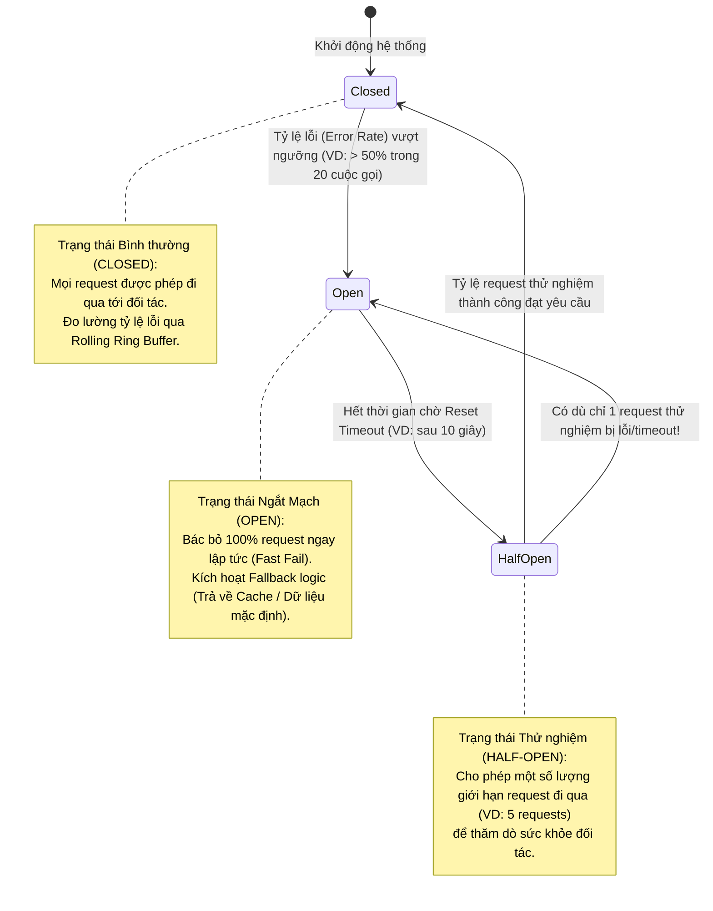
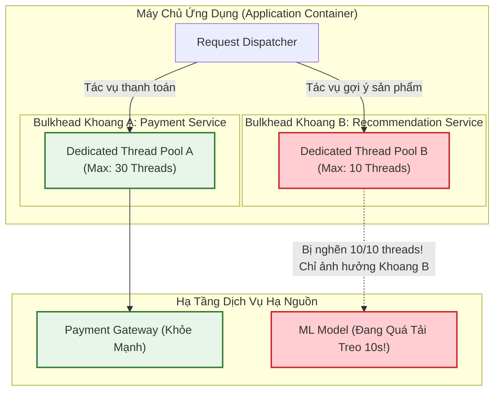

# 20.1. Resiliency & Stability Patterns in Distributed Systems

> [!IMPORTANT]
> **Nếu bạn chỉ được nhớ một điều duy nhất**: Trong một hệ thống phân tán gồm hàng trăm microservices, **lỗi không phải là một ngoại lệ bất thường mà là một quy luật tất yếu xảy ra mỗi giây**. Mối nguy hiểm lớn nhất không phải là bản thân dịch vụ bị lỗi mà là **Sự cố sập dây chuyền (Cascading Failure)**: một dịch vụ phụ trợ cấp 3 bị chậm $5$ giây sẽ khiến dịch vụ cấp 2 cạn kiệt Thread Pool, kéo theo API Gateway bị tê liệt và làm sập toàn bộ hệ thống. Bộ ba mẫu thiết kế sinh tử bắt buộc phải có trong mọi kiến trúc là: **Circuit Breaker** (ngắt kết nối thần tốc khi đối tác đổ bệnh), **Bulkhead** (cô lập tài nguyên thành các khoang kín nước độc lập), và **Exponential Backoff với Full Jitter kết hợp Graceful Fallback**.

---

## 1. Kiến trúc Tổng quan & Mô hình Tư duy (Mental Model)

### Ẩn dụ Đời sống: Cầu Dao Điện Tự Động và Vách Ngăn Tàu Ngầm
Hãy tưởng tượng hệ thống an toàn trên một chiếc tàu ngầm hạt nhân:
- **Cascading Failure (Hiện tượng chập điện lan tỏa)**: Một bóng đèn trong phòng bếp bị chập mạch tóe lửa. Nếu không có cầu dao, dòng điện quá tải sẽ chạy ngược về máy phát điện chính, làm nổ trạm biến áp, cắt điện phòng điều khiển và khiến tàu ngầm mất kiểm soát.
- **Circuit Breaker (Cầu dao tự ngắt)**:
  - Khi bóng đèn chập mạch liên tục (**Trạng thái OPEN**): Cầu dao lập tức "nhảy" cúp điện riêng phòng bếp. Mọi công tắc bật đèn trong bếp đều bị ngắt ngay tức khắc ($< 1\mu\text{s}$) mà không hề truyền áp lực lên máy phát điện chính.
  - Sau 10 phút (**Trạng thái HALF-OPEN**): Cầu dao tự động hé mở thử nghiệm một dòng điện nhỏ. Nếu bóng đèn đã được sửa xong $\to$ Cầu dao đóng lại hoạt động bình thường (**Trạng thái CLOSED**). Nếu vẫn chập $\to$ Lập tức nhảy sang OPEN tiếp!
- **Bulkhead (Vách ngăn khoang chống chìm)**: Tàu ngầm được chia thành 10 khoang kín nước độc lập với hệ thống bơm riêng biệt. Nếu khoang ngư lôi bị thủng, nước chỉ ngập đúng khoang đó. Động cơ và khoang chỉ huy vẫn có 100% oxy và năng lượng để đưa tàu nổi lên mặt nước.
- **Graceful Fallback (Phương án dự phòng êm dịu)**: Khi màn hình radar kỹ thuật số bị hỏng, thuyền trưởng rút chiếc la bàn cơ học cổ điển ra để định hướng. Tàu có thể đi chậm hơn một chút nhưng tuyệt đối không bị mất phương hướng!



---

## 2. Chi tiết từng Keyword (Under-the-Hood Deep Dive)

### 2.1. Circuit Breaker Pattern (Cầu dao tự ngắt - Michael Nygard)

#### 1. Ba trạng thái cốt lõi của Circuit Breaker State Machine
Được chuẩn hóa trong cuốn sách kinh điển *Release It!* của Michael Nygard:

1. **CLOSED (Đóng mạch - Bình thường)**:
   - Toàn bộ các yêu cầu từ Client được chuyển tiếp bình thường tới dịch vụ hạ nguồn (Downstream Service).
   - Duy trì một cửa sổ trượt (**Rolling Window / Ring Buffer**) để ghi nhận kết quả: Thành công, Thất bại (Exception), hoặc Quá thời hạn (Timeout).
   - Nếu tỷ lệ thất bại vượt quá ngưỡng cấu hình (ví dụ: $> 50\%$ lỗi trong 20 lần gọi gần nhất) $\implies$ Cầu dao tự động nhảy sang trạng thái **OPEN**.
2. **OPEN (Ngắt mạch - Cách ly sự cố)**:
   - Dịch vụ hạ nguồn được coi là đang bị "đột quỵ" hoặc quá tải nghiêm trọng.
   - Circuit Breaker **ngay lập tức từ chối 100% các request mới (Fast-Fail)** bằng cách ném ngoại lệ `CallNotPermittedException` trong $< 1\text{ms}$ mà không hề gửi bất kỳ gói tin mạng nào ra ngoài.
   - Bảo vệ dịch vụ hạ nguồn khỏi bị "vùi dập" thêm, giúp nó có thời gian tự hồi phục (Self-healing).
   - Khởi động một bộ đếm thời gian (**Reset Timeout**, thường là $10 - 60$ giây).
3. **HALF-OPEN (Nửa mở - Thăm dò phục hồi)**:
   - Khi hết hạn Reset Timeout, Circuit Breaker tự động chuyển sang HALF-OPEN.
   - Chỉ cho phép một số lượng hữu hạn $K$ requests thử nghiệm (Probe Requests, ví dụ $K = 5$) đi qua tới dịch vụ hạ nguồn.
   - Nếu tất cả $K$ requests đều thành công $\implies$ Hệ thống tin rằng hạ nguồn đã hồi phục hoàn toàn, chuyển mạch về **CLOSED**.
   - Nếu có dù chỉ một request bị lỗi hoặc timeout $\implies$ Lập tức quay trở lại trạng thái **OPEN** và bắt đầu một chu kỳ chờ mới!

### 2.2. Bulkhead Pattern (Mẫu vách ngăn khoang tàu)

#### 1. Nguyên lý Vách ngăn Khoang tàu
Nếu một ứng dụng sử dụng chung một Thread Pool duy nhất gồm 100 luồng cho toàn bộ các tác vụ:
- Service A (Thanh toán) chạy nhanh ($20\text{ms}$).
- Service B (Báo cáo nội bộ) đột ngột bị chậm và mất $10\text{ giây}$ trên mỗi request.
- Trong vòng 5 giây, toàn bộ 100 luồng của Thread Pool sẽ bị chiếm dụng bởi các request gọi sang Service B.
- **Thảm họa**: Khách hàng thanh toán tiền (Service A) bị từ chối phục vụ vì **không còn một luồng rảnh rỗi nào trong Thread Pool**, mặc dù Service A vẫn hoàn toàn khỏe mạnh!

#### 2. Kiến trúc Bulkhead trong Thực tế
Phân tách tài nguyên thực thi thành các khoang cách ly độc lập:
- **Thread Pool Bulkhead**:
  - Gán riêng cho Service A một Thread Pool gồm 30 luồng.
  - Gán riêng cho Service B một Thread Pool gồm 10 luồng.
  - Nếu Service B bị treo cứng 100% tài nguyên của nó (10 luồng), 30 luồng của Service A vẫn hoạt động trơn tru với công suất tối đa!
- **Semaphore Bulkhead**: Sử dụng các atomic counter nhẹ để giới hạn số lượng request đồng thời mà không tốn chi phí chuyển ngữ cảnh (Context Switching) của các luồng riêng biệt.



### 2.3. Retry, Exponential Backoff, Jitter & Fallback

#### 1. Ba quy tắc vàng của Retry
1. **Chỉ Retry các Lỗi Tạm Thời (Transient Errors)**:
   - Các lỗi tạm thời: Mạng bị drop gói tin, Timeout mạng, lỗi `HTTP 503 Service Unavailable`, lỗi khóa tương tranh database (`Deadlock detected`).
   - Tuyệt đối **KHÔNG BAO GIỜ RETRY** các lỗi logic nghiệp vụ vĩnh viễn: `HTTP 400 Bad Request`, `HTTP 401 Unauthorized`, `HTTP 404 Not Found`. Retry các lỗi này chỉ làm lãng phí 100% CPU.
2. **Bắt buộc Phải có Tính Lũy Đẳng (Idempotency)**:
   - Nếu gọi API thanh toán `POST /charges` bị timeout mạng, client không thể biết tiền đã bị trừ hay chưa.
   - Thao tác Retry bắt buộc phải đính kèm **`Idempotency-Key`** duy nhất để đảm bảo tài khoản khách hàng không bị trừ tiền 2 lần!
3. **Bắt buộc Kết hợp Exponential Backoff với Full Jitter**:
   - Khoảng thời gian chờ tăng theo cấp số nhân kết hợp số ngẫu nhiên để phá vỡ sự đồng bộ của hàng nghìn clients:
     $$T_{\text{sleep}} = \text{UniformRandom}\left(0, \min(T_{\text{max}}, T_{\text{base}} \times 2^{\text{attempt}})\right)$$

#### 2. Fallback Pattern (Phương án dự phòng êm dịu)
Khi Circuit Breaker ngắt mạch hoặc tác vụ retry thất bại hoàn toàn, thay vì ném lỗi `HTTP 500` vào mặt người dùng:
- **Trả về Dữ liệu Mặc định (Default Fallback)**: Nếu Service Gợi ý Sản phẩm cá nhân hóa bị sập $\to$ Trả về danh sách 10 sản phẩm bán chạy nhất được hardcode sẵn.
- **Trả về Dữ liệu Cache Cũ (Stale Cache Fallback)**: Nếu Service Tỷ giá Ngoại tệ bị sập $\to$ Trả về tỷ giá lưu trong Redis từ 1 tiếng trước kèm thông báo nhỏ.
- **Ghi nhận Tạm vào Hàng Đợi (Queue Fallback)**: Nếu Service Xuất Hóa đơn bị sập $\to$ Đẩy thông tin đơn vào RabbitMQ/Kafka để xử lý ngầm sau khi service hồi phục.

---

## 3. Thực thi Mã nguồn & Mô phỏng Chuyên sâu (Dual-Engine Implementation)

### Engine 1: C++20 — Mô phỏng Hoàn chỉnh Circuit Breaker State Machine Thread-Safe

```cpp
#include <iostream>
#include <chrono>
#include <mutex>
#include <atomic>
#include <string>
#include <format>
#include <vector>
#include <stdexcept>
#include <functional>

enum class CircuitState { CLOSED, OPEN, HALF_OPEN };

class CircuitBreakerOpenException : public std::runtime_error {
public:
    explicit CircuitBreakerOpenException(const std::string& msg) : std::runtime_error(msg) {}
};

class ProductionCircuitBreaker {
private:
    std::mutex mtx_;
    CircuitState state_{CircuitState::CLOSED};
    size_t failure_threshold_{3};             // Số lỗi tối đa để kích hoạt OPEN
    std::chrono::milliseconds reset_timeout_{500}; // Thời gian chờ để chuyển sang HALF-OPEN

    size_t consecutive_failures_{0};
    size_t half_open_success_needed_{2};
    size_t half_open_success_count_{0};
    std::chrono::steady_clock::time_point last_failure_time_;

public:
    ProductionCircuitBreaker(size_t threshold, std::chrono::milliseconds reset_timeout)
        : failure_threshold_(threshold), reset_timeout_(reset_timeout) {}

    // Bọc lời gọi hàm thực thi qua Circuit Breaker
    template <typename Func>
    std::string execute(Func&& action, const std::string& fallback_val) {
        {
            std::lock_guard<std::mutex> lock(mtx_);
            auto now = std::chrono::steady_clock::now();

            if (state_ == CircuitState::OPEN) {
                if (now - last_failure_time_ >= reset_timeout_) {
                    state_ = CircuitState::HALF_OPEN;
                    half_open_success_count_ = 0;
                    std::cout << "  [Circuit Breaker] Hết hạn Reset Timeout! Chuyển trạng thái: OPEN -> HALF-OPEN\n";
                } else {
                    std::cout << "  [FAST-FAIL] Mạch đang OPEN! Bác bỏ ngay lập tức và trả về Fallback!\n";
                    return fallback_val;
                }
            }
        }

        try {
            std::string result = action();
            on_success();
            return result;
        } catch (...) {
            on_failure();
            return fallback_val;
        }
    }

private:
    void on_success() {
        std::lock_guard<std::mutex> lock(mtx_);
        if (state_ == CircuitState::HALF_OPEN) {
            half_open_success_count_++;
            if (half_open_success_count_ >= half_open_success_needed_) {
                state_ = CircuitState::CLOSED;
                consecutive_failures_ = 0;
                std::cout << "  [Circuit Breaker] Thử nghiệm thành công! Chuyển trạng thái: HALF-OPEN -> CLOSED (Bình thường)\n";
            }
        } else if (state_ == CircuitState::CLOSED) {
            consecutive_failures_ = 0;
        }
    }

    void on_failure() {
        std::lock_guard<std::mutex> lock(mtx_);
        consecutive_failures_++;
        last_failure_time_ = std::chrono::steady_clock::now();

        if (state_ == CircuitState::HALF_OPEN) {
            state_ = CircuitState::OPEN;
            std::cout << "  [!] Thất bại trong giai đoạn thử nghiệm! Chuyển trạng thái: HALF-OPEN -> OPEN\n";
        } else if (state_ == CircuitState::CLOSED && consecutive_failures_ >= failure_threshold_) {
            state_ = CircuitState::OPEN;
            std::cout << std::format("  [!] Đạt ngưỡng lỗi ({}/{})! Chuyển trạng thái: CLOSED -> OPEN (Cắt mạch!)\n",
                consecutive_failures_, failure_threshold_);
        }
    }
};

int main() {
    ProductionCircuitBreaker cb(3, std::chrono::milliseconds(200));

    // Giả lập dịch vụ thanh toán hạ nguồn
    bool downstream_healthy = false;
    auto call_downstream_payment = [&]() -> std::string {
        if (!downstream_healthy) {
            throw std::runtime_error("HTTP 503: Payment Gateway Down!");
        }
        return "GIAO_DỊCH_THANH_TOÁN_THÀNH_CÔNG_200";
    };

    std::string fallback = "FALLBACK_OFFLINE_PROCESSED_LATER";

    std::cout << "--- 1. Gây ra 3 lỗi liên tiếp để ngắt mạch (CLOSED -> OPEN) ---\n";
    for (int i = 1; i <= 3; ++i) {
        std::cout << std::format("Lần gọi #{}:\n", i);
        cb.execute(call_downstream_payment, fallback);
    }

    std::cout << "\n--- 2. Lần gọi thứ 4: Kỳ vọng Fast-Fail lập tức không sờ vào mạng ---\n";
    cb.execute(call_downstream_payment, fallback);

    std::cout << "\n--- 3. Chờ 250ms để Circuit Breaker chuyển sang HALF-OPEN và sửa đối tác thành công ---\n";
    std::this_thread::sleep_for(std::chrono::milliseconds(250));
    downstream_healthy = true; // Hạ nguồn đã hồi phục!

    std::cout << "Lần gọi #5 (Thử nghiệm 1 trong HALF-OPEN):\n";
    cb.execute(call_downstream_payment, fallback);

    std::cout << "Lần gọi #6 (Thử nghiệm 2 trong HALF-OPEN -> Đóng mạch hoàn toàn):\n";
    cb.execute(call_downstream_payment, fallback);

    return 0;
}
```

#### Terminal Output Mẫu:
```text
--- 1. Gây ra 3 lỗi liên tiếp để ngắt mạch (CLOSED -> OPEN) ---
Lần gọi #1:
Lần gọi #2:
Lần gọi #3:
  [!] Đạt ngưỡng lỗi (3/3)! Chuyển trạng thái: CLOSED -> OPEN (Cắt mạch!)

--- 2. Lần gọi thứ 4: Kỳ vọng Fast-Fail lập tức không sờ vào mạng ---
  [FAST-FAIL] Mạch đang OPEN! Bác bỏ ngay lập tức và trả về Fallback!

--- 3. Chờ 250ms để Circuit Breaker chuyển sang HALF-OPEN và sửa đối tác thành công ---
Lần gọi #5 (Thử nghiệm 1 trong HALF-OPEN):
  [Circuit Breaker] Hết hạn Reset Timeout! Chuyển trạng thái: OPEN -> HALF-OPEN
Lần gọi #6 (Thử nghiệm 2 trong HALF-OPEN -> Đóng mạch hoàn toàn):
  [Circuit Breaker] Thử nghiệm thành công! Chuyển trạng thái: HALF-OPEN -> CLOSED (Bình thường)
```

---

### Engine 2: Python 3.11+ — Mô phỏng Bulkhead Semaphore Cô lập Tài nguyên & Graceful Fallback

```python
import asyncio
from typing import Optional

class BulkheadExceededException(Exception):
    pass

class AsyncBulkheadLimiter:
    """Sử dụng Semaphore để giới hạn tài nguyên độc quyền cho từng dịch vụ."""
    def __init__(self, name: str, max_concurrent: int):
        self.name = name
        self.semaphore = asyncio.Semaphore(max_concurrent)
        self.max_concurrent = max_concurrent

    async def execute_with_fallback(self, coro, fallback_value):
        # Thử lấy quyền truy cập không chặn (Non-blocking acquire)
        if self.semaphore.locked():
            print(f"  [BULKHEAD TRÀN] Khoang '{self.name}' đã hết slot ({self.max_concurrent}/{self.max_concurrent})! Kích hoạt Fallback lập tức!")
            return fallback_value

        async with self.semaphore:
            return await coro

async def slow_failing_dependency():
    # Giả lập dịch vụ gợi ý sản phẩm bị treo 1 giây
    await asyncio.sleep(1.0)
    return "LIVE_RECOMMENDATIONS_FROM_ML_MODEL"

async def main():
    # Khoang Recommendation chỉ được cấp tối đa 2 slots đồng thời
    recom_bulkhead = AsyncBulkheadLimiter("RecommendationPool", max_concurrent=2)
    fallback_recommendations = ["Sách Đắc Nhân Tâm", "Áo Thun Trơn Basic", "Bình Giữ Nhiệt"]

    print("--- Đồng thời gửi 4 requests vào Recommendation Service (Max Concurrency = 2) ---")
    tasks = []
    for req_id in range(1, 5):
        tasks.append(
            recom_bulkhead.execute_with_fallback(
                slow_failing_dependency(),
                fallback_value=fallback_recommendations
            )
        )

    results = await asyncio.gather(*tasks)

    print("\n================ TỔNG KẾT KẾT QUẢ CÁC REQUESTS ================")
    for idx, res in enumerate(results, 1):
        if res == fallback_recommendations:
            print(f"Request #{idx}: Nhận FALLBACK DỰ PHÒNG ÊM DỊU (Người dùng vẫn thấy sản phẩm bán chạy)")
        else:
            print(f"Request #{idx}: Nhận DỮ LIỆU SỐNG THÀNH CÔNG")

if __name__ == "__main__":
    asyncio.run(main())
```

#### Terminal Output Mẫu:
```text
--- Đồng thời gửi 4 requests vào Recommendation Service (Max Concurrency = 2) ---
  [BULKHEAD TRÀN] Khoang 'RecommendationPool' đã hết slot (2/2)! Kích hoạt Fallback lập tức!
  [BULKHEAD TRÀN] Khoang 'RecommendationPool' đã hết slot (2/2)! Kích hoạt Fallback lập tức!

================ TỔNG KẾT KẾT QUẢ CÁC REQUESTS ================
Request #1: Nhận DỮ LIỆU SỐNG THÀNH CÔNG
Request #2: Nhận DỮ LIỆU SỐNG THÀNH CÔNG
Request #3: Nhận FALLBACK DỰ PHÒNG ÊM DỊU (Người dùng vẫn thấy sản phẩm bán chạy)
Request #4: Nhận FALLBACK DỰ PHÒNG ÊM DỊU (Người dùng vẫn thấy sản phẩm bán chạy)
```

---

## 4. Systems Engineering & Production Pitfalls

### 4.1. Những cạm bẫy sống còn khi triển khai Resiliency Patterns
1. **Thiếu Request Timeout (Timeout Amnesia)**:
   - Cạm bẫy nguy hiểm nhất là triển khai Circuit Breaker nhưng quên cài đặt HTTP/gRPC Timeout trên Client!
   - Nếu dịch vụ hạ nguồn bị treo kết nối mãi mãi (không bao giờ trả về lỗi, socket TCP bị giữ), Circuit Breaker không bao giờ ghi nhận được biến cố thất bại $\implies$ Mạch vẫn giữ ở trạng thái CLOSED trong khi toàn bộ luồng của client bị đóng băng!
   - *Khắc phục*: **Mọi cuộc gọi mạng bắt buộc phải có Socket Timeout và Connection Timeout** (thường từ $500\text{ms}$ đến $2.000\text{ms}$).

2. **Cấu hình Reset Timeout của Circuit Breaker Quá Ngắn**:
   - Dịch vụ cơ sở dữ liệu hạ nguồn bị quá tải nên sập. Circuit Breaker chuyển sang OPEN nhưng cấu hình `resetTimeout = 1` giây.
   - Cứ mỗi 1 giây, Circuit Breaker lại chuyển sang HALF-OPEN và dội một đợt request mới xuống database đang hấp hối $\implies$ Database không bao giờ có cơ hội khởi động lại thành công!
   - *Khắc phục*: Tăng thời gian `resetTimeout` lên $30-60$ giây hoặc sử dụng Exponential Backoff cho chính Reset Timeout.

3. **Fallback Bị Lỗi Dây Chuyền (Fallback Failure)**:
   - Viết logic Fallback bằng cách gọi truy vấn vào một cơ sở dữ liệu dự phòng khác hoặc Redis cache. Nhưng khi hệ thống chính sập, hàng chục nghìn request ùa vào Fallback làm sập luôn cả Redis!
   - *Quy tắc vàng*: Logic Fallback phải là **thao tác trong bộ nhớ cực kỳ đơn giản (In-memory Static Default)**, tuyệt đối không tạo thêm các lời gọi mạng phức tạp.

### 4.2. Runbook Chẩn đoán Sự cố Phục hồi trên Production (CLI Commands)

```bash
# 1. Kiểm tra trạng thái các Circuit Breakers trong Resilience4j qua Spring Actuator
curl -s http://localhost:8080/actuator/circuitbreakers | jq .

# 2. Xem các chỉ số Circuit Breaker bị OPEN trong Prometheus
curl -s http://localhost:9090/api/v1/query?query=resilience4j_circuitbreaker_state{state="open"}

# 3. Theo dõi số lượng request bị vứt bỏ bởi Bulkhead
curl -s http://localhost:8080/actuator/prometheus | grep "resilience4j_bulkhead_rejected_calls_total"
```

---

## 5. Bảng So sánh & Decision Matrix

| Mẫu Thiết Kế (Pattern) | Cơ chế Bản chất | Thời điểm Can thiệp | Mục tiêu Bảo vệ | Chi phí Overhead |
| :--- | :--- | :--- | :--- | :--- |
| **Timeout Pattern** | Chặn đứng thời gian chờ tối đa | Tại từng request đơn lẻ | Tránh treo luồng vô hạn định | Cực thấp |
| **Circuit Breaker** | Cắt đứt kết nối mạng hoàn toàn | Khi tỷ lệ lỗi vượt ngưỡng | **Bảo vệ toàn bộ dịch vụ Caller & Callee** | Thấp (Vài KB Ring Buffer) |
| **Bulkhead Pattern** | Phân chia khoang tài nguyên | Tại thời điểm cấp phát luồng | Ngăn cản lỗi lan truyền chéo | Trung bình (Tốn bộ nhớ Thread) |
| **Retry với Jitter** | Thử lại có giãn cách thời gian | Sau khi gặp lỗi tạm thời | Vượt qua các lỗi chập chờn | Tăng thêm thời gian chờ |
| **Graceful Fallback** | Trả về kết quả thay thế êm dịu | Khi mọi nỗ lực đều thất bại | **Bảo vệ trải nghiệm người dùng cuối** | Rất thấp |
