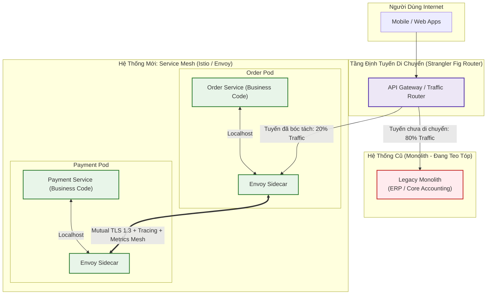

# 20.2. Modern Distributed Architectures, Service Mesh & Migration

> [!IMPORTANT]
> **Nếu bạn chỉ được nhớ một điều duy nhất**: Việc chuyển đổi từ hệ thống nguyên khối (**Monolith**) sang **Microservices** không bao giờ được thực hiện bằng cách đập đi xây lại từ đầu (**Big Bang Rewrite** - nguyên nhân thất bại của 90% dự án phần mềm). Chiến lược chuẩn mực bắt buộc là **Strangler Fig Pattern (Cây bàng bóp cổ)**: đặt một tầng Proxy thông minh ở cửa ngõ để bóc tách dần từng chức năng độc lập sang các dịch vụ mới cho đến khi khối Monolith cũ teo tóp và biến mất hoàn toàn. Để giải phóng lập trình viên khỏi gánh nặng viết lại mã nguồn mạng phức tạp (mTLS, Retries, Tracing, Metrics) trong từng service, kiến trúc **Service Mesh** sử dụng mẫu thiết kế **Sidecar (Envoy Proxy)** để trừu tượng hóa toàn bộ mạng truyền thông phân tán xuống tầng hạ tầng (**Data Plane**).

---

## 1. Kiến trúc Tổng quan & Mô hình Tư duy (Mental Model)

### Ẩn dụ Đời sống: Cây Bàng Bóp Cổ và Người Phiên Dịch Tháp Tùng
Hãy tưởng tượng hai hình ảnh sống động trong tự nhiên và ngoại giao:
- **Strangler Fig (Cây bàng rừng nhiệt đới)**: Một hạt giống cây bàng rơi vào hốc cây cổ thụ già cỗi (Monolith). Hạt nảy mầm, buông rễ phụ xuống đất và bắt đầu hút dinh dưỡng. Qua nhiều năm, mạng lưới rễ bàng ngày càng dày đặc, bao bọc toàn bộ thân cây chủ. Cuối cùng, cây cổ thụ bên trong chết đi và mục rữa, để lại một thân cây bàng rỗng ruột vững chãi vươn cao lên bầu trời. Hệ thống mới đã thay thế hoàn toàn hệ thống cũ một cách êm ái mà khách hàng không hề hay biết!
- **Sidecar Pattern (Người phiên dịch kiêm vệ sĩ tháp tùng)**: Mỗi đại sứ (Microservice) khi đi công tác nước ngoài đều có một người vệ sĩ kiêm thông dịch viên đi sát bên cạnh (**Envoy Sidecar Proxy**). Vị đại sứ chỉ tập trung đàm phán hợp đồng (Business Logic). Mọi việc liên quan đến đặt vé máy bay, kiểm tra an ninh mTLS, phòng chống bắn tỉa (Rate Limiting), ghi âm cuộc gọi (Distributed Tracing), và chuyển tiếp thư từ đều do người vệ sĩ lo liệu!



---

## 2. Chi tiết từng Keyword (Under-the-Hood Deep Dive)

### 2.1. Microservices vs SOA vs Serverless Architecture

#### Bảng so sánh 4 mô hình kiến trúc
| Khía cạnh | Monolithic Architecture | Service-Oriented Architecture (SOA) | Microservices Architecture | Serverless (FaaS) |
| :--- | :--- | :--- | :--- | :--- |
| **Quy mô Dịch vụ** | Một khối nhị phân duy nhất (Single Binary). | Dịch vụ lớn theo đơn vị phòng ban doanh nghiệp. | Dịch vụ siêu nhỏ theo Bounded Context (DDD). | Hàm chức năng nguyên tử (Functions: AWS Lambda). |
| **Giao tiếp Dữ liệu** | Lời gọi hàm trong RAM (In-memory method calls). | Bus dữ liệu tập trung doanh nghiệp (**Enterprise Service Bus - ESB**). | Giao tiếp nhẹ nhàng (**Smart Endpoints, Dumb Pipes** - REST/gRPC/Kafka). | Lập lịch kích hoạt bằng Sự kiện (Event-Triggered). |
| **Cơ sở Dữ liệu** | Một Database khổng lồ dùng chung (Shared DB). | Thường dùng chung Database trung tâm. | **Database-per-Service (Bắt buộc độc lập)**. | Tích hợp Cloud Storage (DynamoDB/S3). |
| **Độ phức tạp Vận hành** | Thấp ở giai đoạn đầu, cực cao khi phình to. | Cao (Phụ thuộc vào cấu hình phức tạp của ESB). | Rất cao (Cần Kubernetes, CI/CD, Observability). | Thấp (Nhà cung cấp Cloud quản lý hạ tầng). |
| **Khả năng Mở rộng** | Kém (Phải scale toàn bộ khối). | Trung bình | **Tuyệt vời (Scale độc lập từng microservice)**| **Vô hạn (Tự động scale từ 0 đến hàng vạn)** |

### 2.2. Database-per-Service Pattern vs Shared Database Anti-Pattern

#### 1. Hiểm họa Shared Database (Anti-Pattern)
Nhiều nhóm kỹ sư chia nhỏ tầng mã nguồn thành 20 microservices nhưng vẫn cho tất cả trỏ chung vào **duy nhất 1 database MySQL**:
- **Vi phạm tính đóng gói (Tight Coupling)**: Service A tự tiện chạy câu lệnh `JOIN` vào bảng của Service B. Khi Service B muốn đổi tên cột hoặc tối ưu hóa schema, nó làm gãy vụn mã nguồn của Service A!
- **Khóa tài nguyên chéo (Cross-service Lock Contention)**: Service B chạy một báo cáo nặng gây khóa bảng, kéo theo Service A bị nghẽn toàn bộ kết nối.
- **Rào cản công nghệ (Polyglot Persistence)**: Bắt buộc dịch vụ tìm kiếm cũng phải dùng MySQL thay vì Elasticsearch; dịch vụ mạng xã hội phải dùng bảng quan hệ thay vì Graph Database (Neo4j).

#### 2. Nguyên tắc Database-per-Service
- Mỗi microservice sở hữu toàn quyền độc quyền cơ sở dữ liệu của riêng nó:
  $$\text{Service A} \to \text{DB A (Postgres)}, \quad \text{Service B} \to \text{DB B (MongoDB)}$$
- Mọi truy cập vào dữ liệu của Service A từ bên ngoài **bắt buộc phải thông qua API công khai (REST/gRPC/Events)** của Service A.
- Đảm bảo tính tự chủ (Autonomy) tuyệt đối cho từng nhóm phát triển.

### 2.3. API Gateway Pattern vs Backend for Frontend (BFF Pattern)

#### 1. API Gateway Pattern
Đóng vai trò là điểm vào tập trung duy nhất cho toàn bộ các client bên ngoài:
- Thực thi các trách nhiệm xuyên suốt (Cross-cutting Concerns): Xác thực JWT, Rate Limiting, SSL Termination, Định tuyến URL, Ghi log truy cập.
- **Điểm yếu**: Dễ trở thành một khối Monolith mới nếu cố nhồi nhét quá nhiều logic nghiệp vụ tổng hợp vào Gateway.

#### 2. Backend for Frontend Pattern (BFF - Sam Newman)
Thay vì dùng một API Gateway chung chạ cho tất cả:
- **Vấn đề**: Ứng dụng di động (Mobile App) qua mạng 4G/5G cần payload JSON nhỏ gọn, ít trường để tiết kiệm pin; trong khi màn hình Desktop Web màn hình lớn cần nhiều trường và bảng biểu chi tiết.
- **Giải pháp**: Xây dựng các API Gateway chuyên biệt cho từng loại giao diện:
  - **Mobile BFF**: Gom dữ liệu từ 5 microservices, rút gọn chỉ lấy các trường cần thiết, nén tối đa cho Mobile.
  - **Web Desktop BFF**: Trả về dữ liệu chi tiết, phục vụ rendering giao diện Web.
  - **IoT / Public API BFF**: Phục vụ các thiết bị phần cứng hoặc đối tác thứ ba.

### 2.4. Service Mesh & Các mẫu thiết kế Sidecar

#### 1. Sidecar Pattern (Mẫu xe thùng gắn máy bay / Môtô thùng)
Chạy một tiến trình phụ trợ (Helper Process / Container) ngay bên cạnh tiến trình ứng dụng chính trong cùng một vòng đời (**cùng chia sẻ Network Namespace / Pod trong Kubernetes**):
- Ứng dụng chính chỉ cần lắng nghe và gửi request tới `localhost:15001`.
- Sidecar (Envoy) âm thầm đánh chặn (Intercept) toàn bộ lưu lượng mạng vào/ra để thực thi các tính năng nâng cao mà ứng dụng không cần biết.

#### 2. Ambassador Pattern (Đại sứ đại diện)
Sidecar đóng vai trò là đại diện đối ngoại cho ứng dụng để kết nối tới các dịch vụ phức tạp bên ngoài:
- Ví dụ: Ứng dụng gửi kết nối tới `localhost:6379`, Sidecar Ambassador tự động lo việc phân mảnh dữ liệu (Sharding) và định tuyến tới đúng node trong cụm Redis Cluster 50 máy chủ.

#### 3. Adapter Pattern (Bộ chuyển đổi giao diện)
Sidecar chuẩn hóa đầu ra của các ứng dụng không đồng nhất:
- Ví dụ: Ứng dụng cũ xuất log dạng text thô; Adapter Sidecar đọc file log đó, chuyển đổi thành định dạng JSON chuẩn OpenTelemetry và đẩy về Grafana Loki.

#### 4. Kiến trúc Service Mesh: Data Plane vs Control Plane
- **Data Plane (Envoy Proxy)**: Hàng nghìn Sidecar Proxy chạy phân tán tại từng Pod, trực tiếp xử lý và chuyển tiếp từng gói tin mạng tốc độ cao (mTLS, Retries, Load Balancing).
- **Control Plane (Istio `istiod`)**: Máy chủ điều phối trung tâm, cung cấp chứng chỉ bảo mật cho các Sidecar, biên dịch các cấu hình YAML (VirtualService, DestinationRule) thành cấu hình động đẩy xuống Envoy qua giao thức **xDS API**.

### 2.5. Chiến lược Di chuyển Hệ thống: Strangler Fig Pattern

#### Bốn giai đoạn di chuyển theo Strangler Fig (Martin Fowler)
1. **Giai đoạn 1: Transform (Chuyển đổi)**:
   - Xây dựng một chức năng nghiệp vụ mới tinh (ví dụ: `Payment Service`) hoàn toàn độc lập bằng kiến trúc Microservices hiện đại.
2. **Giai đoạn 2: Coexist (Cùng tồn tại)**:
   - Đặt một bộ định tuyến thông minh (**Strangler Proxy**) ở phía trước.
   - Cả Monolith cũ và Microservice mới cùng hoạt động song song trên môi trường sản xuất.
3. **Giai đoạn 3: Divert (Chuyển hướng)**:
   - Cấu hình Strangler Proxy chuyển dần lưu lượng sang Service mới: ban đầu $5\%$ (Canary testing), sau đó $20\%$, $50\%$, và $100\%$.
4. **Giai đoạn 4: Eliminate (Tiêu hủy)**:
   - Khi $100\%$ lưu lượng của chức năng đó đã chạy ổn định trên Service mới, tiến hành xóa bỏ vĩnh viễn đoạn code cũ tương ứng trong Monolith.
   - Lặp lại quy trình trên cho chức năng tiếp theo cho đến khi toàn bộ khối Monolith bị thay thế hoàn toàn!

---

## 3. Thực thi Mã nguồn & Mô phỏng Chuyên sâu (Dual-Engine Implementation)

### Engine 1: C++20 — Mô phỏng Cốt lõi Envoy-like Sidecar Interceptor & Circuit Breaker Proxy

```cpp
#include <iostream>
#include <string>
#include <memory>
#include <functional>
#include <format>
#include <chrono>

// Interface mô phỏng Data Plane Interceptor
class SidecarProxyInterceptor {
public:
    virtual ~SidecarProxyInterceptor() = default;
    virtual bool handle_outbound(const std::string& target_service, const std::string& request_payload) = 0;
};

// Envoy Sidecar Proxy chạy trên Localhost cùng Pod
class EnvoySidecarProxy : public SidecarProxyInterceptor {
private:
    std::string service_name_;
    std::string spiffe_id_;
    bool circuit_open_{false};

public:
    EnvoySidecarProxy(std::string service_name, std::string spiffe_id)
        : service_name_(std::move(service_name)), spiffe_id_(std::move(spiffe_id)) {}

    bool handle_outbound(const std::string& target_service, const std::string& request_payload) override {
        std::cout << std::format("\n[Envoy Sidecar @ {}] Đánh chặn lời gọi mạng ra ngoài tới '{}'...\n",
            service_name_, target_service);

        if (circuit_open_) {
            std::cout << "  -> [CIRCUIT BREAKER OPEN] Bác bỏ request ngay tại Localhost (Fast-Fail)!\n";
            return false;
        }

        // Tự động tiêm thông tin mTLS và Distributed Tracing
        std::cout << std::format("  -> [mTLS Injection] Đính kèm SVID Chứng chỉ: '{}'\n", spiffe_id_);
        std::cout << "  -> [Tracing Context] Tiêm W3C Header: 'traceparent: 00-4bf92f35...-01'\n";
        std::cout << std::format("  -> [Forwarding] Gửi gói tin mã hóa TLS 1.3 qua mạng tới '{}': Payload: '{}'\n",
            target_service, request_payload);

        return true;
    }

    void trip_circuit_breaker() {
        circuit_open_ = true;
        std::cout << std::format("[Control Plane xDS] Cập nhật: Circuit Breaker cho '{}' ĐÃ BỊ NGẮT (OPEN)!\n", service_name_);
    }
};

// Ứng dụng chính (Business App) hoàn toàn thuần khiết không chứa code bảo mật
class BusinessApplication {
private:
    std::shared_ptr<SidecarProxyInterceptor> sidecar_;

public:
    explicit BusinessApplication(std::shared_ptr<SidecarProxyInterceptor> sidecar)
        : sidecar_(std::move(sidecar)) {}

    void checkout_cart(const std::string& cart_id) {
        std::cout << "[Business App] Thực thi logic nghiệp vụ: Thanh toán Giỏ hàng " << cart_id << "\n";
        // Ứng dụng chỉ việc gửi tới Sidecar localhost
        bool ok = sidecar_->handle_outbound("payment-service", std::format("CHARGE_CART_{}", cart_id));
        if (ok) {
            std::cout << "[Business App] Nhận kết quả thành công từ Sidecar Proxy!\n";
        } else {
            std::cout << "[Business App] Sidecar báo lỗi kết nối. Kích hoạt logic Fallback cục bộ.\n";
        }
    }
};

int main() {
    auto envoy = std::make_shared<EnvoySidecarProxy>("order-service", "spiffe://cluster.local/ns/prod/sa/order");
    BusinessApplication app(envoy);

    std::cout << "--- 1. Lời gọi mạng bình thường qua Sidecar Proxy ---\n";
    app.checkout_cart("CART_101");

    std::cout << "\n--- 2. Control Plane báo hạ nguồn quá tải -> Ngắt mạch ---\n";
    envoy->trip_circuit_breaker();

    std::cout << "\n--- 3. Lời gọi tiếp theo: Ứng dụng được bảo vệ bởi Sidecar Fast-Fail ---\n";
    app.checkout_cart("CART_102");

    return 0;
}
```

#### Terminal Output Mẫu:
```text
--- 1. Lời gọi mạng bình thường qua Sidecar Proxy ---
[Business App] Thực thi logic nghiệp vụ: Thanh toán Giỏ hàng CART_101

[Envoy Sidecar @ order-service] Đánh chặn lời gọi mạng ra ngoài tới 'payment-service'...
  -> [mTLS Injection] Đính kèm SVID Chứng chỉ: 'spiffe://cluster.local/ns/prod/sa/order'
  -> [Tracing Context] Tiêm W3C Header: 'traceparent: 00-4bf92f35...-01'
  -> [Forwarding] Gửi gói tin mã hóa TLS 1.3 qua mạng tới 'payment-service': Payload: 'CHARGE_CART_CART_101'
[Business App] Nhận kết quả thành công từ Sidecar Proxy!

--- 2. Control Plane báo hạ nguồn quá tải -> Ngắt mạch ---
[Control Plane xDS] Cập nhật: Circuit Breaker cho 'order-service' ĐÃ BỊ NGẮT (OPEN)!

--- 3. Lời gọi tiếp theo: Ứng dụng được bảo vệ bởi Sidecar Fast-Fail ---
[Business App] Thực thi logic nghiệp vụ: Thanh toán Giỏ hàng CART_102

[Envoy Sidecar @ order-service] Đánh chặn lời gọi mạng ra ngoài tới 'payment-service'...
  -> [CIRCUIT BREAKER OPEN] Bác bỏ request ngay tại Localhost (Fast-Fail)!
[Business App] Sidecar báo lỗi kết nối. Kích hoạt logic Fallback cục bộ.
```

---

### Engine 2: Python 3.11+ — Mô phỏng Strangler Fig Pattern với Bộ Định Tuyến Phần Trăm Lưu Lượng (Canary Migration)

```python
import random
from typing import Dict, Any

class LegacyMonolithSystem:
    def handle_request(self, path: str, payload: Dict[str, Any]) -> str:
        return f"[LEGACY MONOLITH (PostgreSQL Monolith)] Xử lý {path} với công nghệ cũ năm 2018."

class NewMicroserviceSystem:
    def handle_request(self, path: str, payload: Dict[str, Any]) -> str:
        return f"[NEW MICROSERVICE (Cloud-Native gRPC)] Xử lý {path} với kiến trúc Event Sourcing hiện đại!"

class StranglerFigTrafficRouter:
    """Bộ định tuyến phân luồng di chuyển hệ thống không downtime."""
    def __init__(self, legacy: LegacyMonolithSystem, modern: NewMicroserviceSystem):
        self.legacy = legacy
        self.modern = modern
        # Cấu hình phần trăm chuyển sang hệ thống mới theo từng Route Path
        self.route_migration_rules: Dict[str, float] = {
            "/api/v1/orders": 0.0,       # Chưa di chuyển (0% mới, 100% cũ)
            "/api/v1/payments": 0.30,    # Đang Canary di chuyển 30% mới
            "/api/v1/users": 1.0         # Đã di chuyển hoàn toàn (100% mới)
        }

    def route_request(self, path: str, payload: Dict[str, Any]) -> str:
        migrated_pct = self.route_migration_rules.get(path, 0.0)
        rand_val = random.random()

        if rand_val < migrated_pct:
            print(f"[Strangler Router] Route '{path}' -> Chuyển sang NEW MICROSERVICE (Xác suất: {migrated_pct*100:.0f}%)")
            return self.modern.handle_request(path, payload)
        else:
            print(f"[Strangler Router] Route '{path}' -> Chuyển sang LEGACY MONOLITH (Dự phòng an toàn)")
            return self.legacy.handle_request(path, payload)

def main():
    legacy = LegacyMonolithSystem()
    modern = NewMicroserviceSystem()
    router = StranglerFigTrafficRouter(legacy, modern)

    print("--- 1. Kiểm tra Route Đã Di Chuyển Hoàn Toàn: '/api/v1/users' (100% Mới) ---")
    print(router.route_request("/api/v1/users", {"id": 1}))

    print("\n--- 2. Kiểm tra Route Chưa Di Chuyển: '/api/v1/orders' (0% Mới, 100% Cũ) ---")
    print(router.route_request("/api/v1/orders", {"cart": 99}))

    print("\n--- 3. Kiểm tra Route Đang Thử Nghiệm Canary: '/api/v1/payments' (30% Mới) ---")
    for req_idx in range(1, 5):
        res = router.route_request("/api/v1/payments", {"amount": 100})
        print(f"  -> Kết quả Lần #{req_idx}: {res}\n")

if __name__ == "__main__":
    main()
```

#### Terminal Output Mẫu:
```text
--- 1. Kiểm tra Route Đã Di Chuyển Hoàn Toàn: '/api/v1/users' (100% Mới) ---
[Strangler Router] Route '/api/v1/users' -> Chuyển sang NEW MICROSERVICE (Xác suất: 100%)
[NEW MICROSERVICE (Cloud-Native gRPC)] Xử lý /api/v1/users với kiến trúc Event Sourcing hiện đại!

--- 2. Kiểm tra Route Chưa Di Chuyển: '/api/v1/orders' (0% Mới, 100% Cũ) ---
[Strangler Router] Route '/api/v1/orders' -> Chuyển sang LEGACY MONOLITH (Dự phòng an toàn)
[LEGACY MONOLITH (PostgreSQL Monolith)] Xử lý /api/v1/orders với công nghệ cũ năm 2018.

--- 3. Kiểm tra Route Đang Thử Nghiệm Canary: '/api/v1/payments' (30% Mới) ---
[Strangler Router] Route '/api/v1/payments' -> Chuyển sang LEGACY MONOLITH (Dự phòng an toàn)
  -> Kết quả Lần #1: [LEGACY MONOLITH (PostgreSQL Monolith)] Xử lý /api/v1/payments với công nghệ cũ năm 2018.

[Strangler Router] Route '/api/v1/payments' -> Chuyển sang NEW MICROSERVICE (Xác suất: 30%)
  -> Kết quả Lần #2: [NEW MICROSERVICE (Cloud-Native gRPC)] Xử lý /api/v1/payments với kiến trúc Event Sourcing hiện đại!

[Strangler Router] Route '/api/v1/payments' -> Chuyển sang LEGACY MONOLITH (Dự phòng an toàn)
  -> Kết quả Lần #3: [LEGACY MONOLITH (PostgreSQL Monolith)] Xử lý /api/v1/payments với công nghệ cũ năm 2018.

[Strangler Router] Route '/api/v1/payments' -> Chuyển sang LEGACY MONOLITH (Dự phòng an toàn)
  -> Kết quả Lần #4: [LEGACY MONOLITH (PostgreSQL Monolith)] Xử lý /api/v1/payments với công nghệ cũ năm 2018.
```

---

## 4. Systems Engineering & Production Pitfalls

### 4.1. Những cạm bẫy sống còn khi vận hành Service Mesh & Di chuyển hệ thống
1. **Chi phí Tiêu tốn CPU/RAM của Hàng nghìn Sidecar Proxy (Sidecar Tax)**:
   - Trong cụm Kubernetes có 5.000 Pods, việc gắn thêm 5.000 container Envoy Sidecar (mỗi Sidecar ngốn tối thiểu 50MB RAM và 0.1 CPU core) sẽ làm tiêu tốn thêm **250GB RAM và 500 Cores CPU** chỉ riêng cho tầng mạng!
   - *Khắc phục*: Chuyển đổi sang kiến trúc **Ambient Mesh (Sidecar-less Service Mesh của Istio)**: sử dụng chung một Node-level proxy (Ztunnel trên nền tảng eBPF) cho mỗi máy chủ vật lý thay vì gắn sidecar vào từng Pod.

2. **Đồng bộ Dữ liệu Hai Chiều (Bi-directional Data Sync) trong Strangler Fig**:
   - Khi di chuyển chức năng Đơn hàng: Khách hàng mua trên hệ thống mới thì dữ liệu đơn hàng phải xuất hiện ngay trong hệ thống cũ để bộ phận kho vận cũ xử lý. Nếu đồng bộ hai chiều không có Idempotency, các trigger DB sẽ tạo ra vòng lặp vô hạn (**Infinite Ping-Pong Loop**) làm sập cả hai hệ thống!
   - *Khắc phục*: Sử dụng **Change Data Capture (Debezium)** với cờ metadata `origin_source = "NEW"` để lọc bỏ các sự kiện dội ngược lại.

3. **Hiện tượng Microservices Death Star (Mạng nhện phụ thuộc)**:
   - Bóc tách quá đà khiến hệ thống có 200 microservices nhỏ xíu. Để hoàn thành một thao tác xem giỏ hàng, request phải nhảy qua 45 chặng mạng (45 network hops) $\implies$ Độ trễ tăng vọt từ $10\text{ms}$ lên $800\text{ms}$!
   - *Khắc phục*: Tái cấu trúc gộp các dịch vụ quá nhỏ có cùng nhịp độ thay đổi thành một **Coarse-Grained Service** theo đúng ranh giới Bounded Context.

### 4.2. Runbook Chẩn đoán Sự cố Service Mesh trên Production (CLI Commands)

```bash
# 1. Kiểm tra cấu hình động của Envoy Sidecar Proxy trong một Pod cụ thể
istioctl proxy-config endpoints <pod-name>.<namespace>

# 2. Xem các lỗi đồng bộ giữa Istio Control Plane và Envoy Data Plane
istioctl proxy-status | grep -v "SYNCED"

# 3. Phân tích lưu lượng mạng và phát hiện chu trình gọi vòng tròn bằng Kiali
kubectl port-forward svc/kiali 20001:20001 -n istio-system
```

---

## 5. Bảng So sánh & Decision Matrix

| Khía cạnh | Monolith Rewrite (Big Bang) | Strangler Fig Pattern | Library-based Mesh (Finagle) | Sidecar Service Mesh (Envoy/Istio) |
| :--- | :--- | :--- | :--- | :--- |
| **Mức độ Rủi ro Dự án** | **Cực cao (90% thất bại)** | **Rất thấp (Từng bước an toàn)**| Thấp | Thấp |
| **Đa dạng Ngôn ngữ (Polyglot)**| Giới hạn 1 ngôn ngữ | Đa ngôn ngữ tự do | Bị trói buộc vào 1 ngôn ngữ | **100% Độc lập ngôn ngữ** |
| **Gánh nặng cho Dev** | Rất cao | Trung bình | Phải tự viết code retry/mTLS | **Bằng 0 (Hạ tầng tự động lo)** |
| **Thời gian thấy ROI** | Vài năm (Khi hoàn thành) | **Vài tuần (Ngay chặng đầu)** | Vài tháng | Vài tháng |
| **Chi phí Tài nguyên Hạ tầng**| Rất thấp | Thấp | Rất thấp | Cao hơn (Sidecar overhead) |
