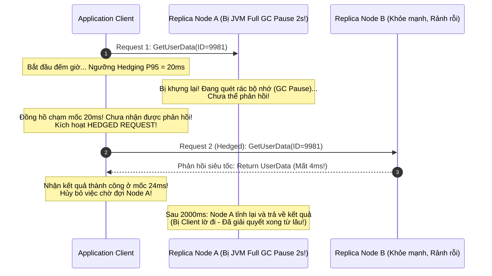

# 21.1. Tail Latency, Coordinated Omission & Hedged Requests

> [!IMPORTANT]
> **Nếu bạn chỉ được nhớ một điều duy nhất**: Trong kiến trúc phân tán quy mô lớn (Fan-out Architecture), **Đuôi độ trễ (Tail Latency - P99, P99.9)** mới là yếu tố quyết định số phận trải nghiệm người dùng, chứ không phải độ trễ trung bình. Khi một truy vấn trang web phát tán song song (**Fan-out**) tới $M = 100$ microservices độc lập, ngay cả khi mỗi dịch vụ chỉ có $1\%$ xác suất bị chậm ($P99$), xác suất để toàn bộ trang web bị chậm sẽ bị khuếch đại theo cấp số mũ lên tới **$63.4\%$**! Hai vũ khí kỹ thuật đỉnh cao để triệt tiêu hiện tượng này là: **Hedged Requests** (chủ động gửi yêu cầu đầu cơ thứ hai sau ngưỡng P95 - theo nghiên cứu của Google) và nhận diện sự sai lệch đo lường do **Coordinated Omission** (hiện tượng các công cụ benchmark tự động đồng lõa che giấu các đỉnh trễ trong lúc server bị dừng).

---

## 1. Kiến trúc Tổng quan & Mô hình Tư duy (Mental Model)

### Ẩn dụ Đời sống: Người Phụ Trách Đặt Bàn Tiệc và Thuyền Đua 100 Tay Chèo
Hãy tưởng tượng một người tổ chức bữa tiệc cưới lớn:
- **Độ trễ Trung bình (Average Latency) là Ảo tưởng**: 99 vị khách đến nhà hàng trong 10 phút. Nhưng vị khách thứ 100 (phù dâu giữ nhẫn cưới) bị kẹt xe mất 2 tiếng. Bữa tiệc cưới không thể bắt đầu cho đến khi người cuối cùng bước vào khán phòng! Độ trễ của bữa tiệc không phải là 10 phút mà là 2 tiếng.
- **Tail Amplification (Thuyền đua 100 tay chèo)**: Một chiếc thuyền rồng có 100 tay chèo cùng chèo một nhịp. Thuyền chỉ lướt đi với tốc độ của **tay chèo chậm nhất (Straggler)**. Dù 99 người chèo cực nhanh, chỉ cần 1 người bị chuột rút lỡ nhịp, toàn bộ chiếc thuyền sẽ bị khựng lại!
- **Hedged Requests (Gọi xe cứu hộ kép)**: Bạn gọi một chiếc taxi công nghệ để ra sân bay. Sau 5 phút, ứng dụng báo tài xế vẫn đứng yên ở ngã tư (P95 Latency reached). Thay vì tiếp tục kiên nhẫn chờ đợi trong vô vọng, bạn rút chiếc điện thoại thứ hai ra gọi thêm một hãng taxi khác (**Hedged Request**). Chiếc xe nào đến trước bạn bước lên đi ngay và hủy chuyến xe còn lại! Bạn chỉ tốn thêm một chút chi phí nhỏ nhưng đảm bảo $100\%$ không bị lỡ chuyến bay.



---

## 2. Chi tiết từng Keyword (Under-the-Hood Deep Dive)

### 2.1. Hiện tượng Khuếch đại Đuôi độ trễ (Tail Amplification in Fan-out)

#### 1. Mô hình Toán học về Xác suất Chậm
Trong một trang chủ hiện đại (như Amazon, Google Search), một yêu cầu của người dùng được phân tách thành một cây phân tán gọi song song (**Fan-out**) tới $M$ dịch vụ con (tìm kiếm sản phẩm, kiểm tra tồn kho, lấy đánh giá sao, tính giá khuyến mãi, gợi ý cá nhân hóa):
- Giả sử mỗi dịch vụ con hoạt động độc lập và có xác suất bị chậm là $p$ (ví dụ: $p = 0.01$, nghĩa là độ trễ rơi vào đuôi $P99$).
- Xác suất để một dịch vụ con **hoạt động nhanh** là $1 - p$.
- Xác suất để **tất cả $M$ dịch vụ con cùng phản hồi nhanh** là:
  $$P(\text{Tất cả đều nhanh}) = (1 - p)^M$$
- Do đó, xác suất để **có ít nhất một dịch vụ bị chậm**, khiến toàn bộ trang web bị kéo chậm theo là:
  $$P(\text{Toàn cục bị chậm}) = 1 - (1 - p)^M$$

#### 2. Bảng thực tế về Tail Amplification ($p = 1\%$)
| Số lượng Dịch vụ Con ($M$) | Xác suất Toàn cục Nhanh $(1-p)^M$ | Xác suất Trang web Bị Chậm ($P99$ Spike) |
| :--- | :--- | :--- |
| **$M = 1$** | $99.0\%$ | **$1.0\%$** (Bình thường) |
| **$M = 10$** | $90.4\%$ | **$9.6\%$** (Gần 1/10 request bị chậm) |
| **$M = 50$** | $60.5\%$ | **$39.5\%$** (Gần 4/10 request bị chậm) |
| **$M = 100$** | $36.6\%$ | **$63.4\%$** (Hơn 6/10 request bị chậm!) |
| **$M = 200$** | $13.4\%$ | **$86.6\%$** (Gần như toàn bộ hệ thống bị tê liệt!) |

- **Kết luận gây sốc**: Dù $99\%$ dịch vụ của bạn chạy cực nhanh, một hệ thống fan-out tới 100 dịch vụ sẽ khiến **hơn $63\%$ người dùng phải gánh chịu độ trễ tồi tệ nhất**! Tối ưu hóa phân vị trung bình (Mean/Median) hoàn toàn vô nghĩa trong bài toán này.

#### 3. Căn nguyên Vật lý và Hệ thống gây ra Tail Latency (Stragglers)
Tại sao một máy chủ bình thường lại đột ngột bị chậm trong vài trăm mili-giây?
1. **Garbage Collection (GC Pause)**: Trong Java, Go, C#, bộ thu gom rác định kỳ dừng các luồng để dọn rác bộ nhớ Heap.
2. **Tranh chấp I/O đĩa (Disk I/O Jitter)**: Quá trình Compaction của LSM-Tree (RocksDB) hoặc flush của OS page cache chiếm dụng toàn bộ băng thông NVMe.
3. **Hiện tượng Noisy Neighbors trên Cloud**: Các máy ảo khác cùng thuê chung CPU vật lý trên AWS/GCP đột ngột tiêu tốn chu kỳ CPU, khiến kernel hypervisor phải "đánh cắp" CPU (**CPU Steal Time**).
4. **TCP Packet Loss & Head-of-Line Blocking**: Một gói tin mạng bị rớt khiến TCP phải chờ timeout để truyền lại (TCP Retransmission), làm toàn bộ luồng dữ liệu bị khựng lại.

### 2.2. Sự cố Coordinated Omission (Gil Tene - Azul Systems)

#### 1. Cơ chế sinh ra Coordinated Omission
Được phát hiện và đặt tên bởi Gil Tene (CTO của Azul Systems), đây là lỗi đo lường phổ biến nhất trong lịch sử kiểm thử hiệu năng phần mềm:
- **Kịch bản Lỗi**: Một công cụ đo tải (như ApacheBench, JMeter cũ, hoặc script Python đơn giản) gửi 100 request/giây theo mô hình vòng lặp chặn đồng bộ:
  ```text
  while True:
      send_request();
      wait_for_response();
  ```
- **Hiện tượng**: Giả sử ở giây thứ 10, máy chủ bị dừng đột ngột trong **10 giây** (do Java Full GC Pause, máy chủ ảo hóa bị vCPU steal, hoặc I/O đĩa bị nghẽn):
  - Request đang gửi đi bị treo và mất đúng $10\text{ giây}$ mới nhận được phản hồi.
  - Công cụ benchmark ghi nhận: **1 request có độ trễ 10 giây**.
  - Nhưng trong suốt 10 giây đó, công cụ **hoàn toàn ngừng gửi thêm bất kỳ request nào** vì đang bị block chờ kết quả!
- **Hậu quả**: Lẽ ra trong 10 giây đó, phải có thêm **1.000 requests khác** được gửi đi và tất cả 1.000 requests đó đều phải chịu độ trễ kéo dài từ $1\text{s}$ đến $10\text{s}$!
- Công cụ đo đã vô tình "đồng lõa" với máy chủ để **che giấu 999 kết quả tồi tệ**, làm cho đồ thị P99 hiển thị đẹp đẽ một cách giả tạo!
- **Giải pháp**: Bắt buộc sử dụng công cụ benchmark đo tải bất đồng bộ theo lịch trình định sẵn (**Coordinated Omission-aware Generators** như `wrk2`, `Vegeta`, hoặc thư viện `HdrHistogram`).

#### 2. Kỹ thuật Hiệu chỉnh của HdrHistogram (High Dynamic Range Histogram)
Thư viện `HdrHistogram` của Gil Tene tự động hiệu chỉnh lỗi Coordinated Omission:
- Nếu khoảng cách giữa thời điểm dự kiến gửi request ($T_{\text{expected}}$) và thời điểm thực tế gửi ($T_{\text{actual}}$) vượt quá chu kỳ gửi dự kiến ($I = 1/\text{RPS}$):
- Công cụ tự động suy diễn và chèn thêm các mẫu đo bổ sung vào histogram cho toàn bộ các request bị trễ theo cấp số học:
  $$\text{Latency}_k = \text{MeasuredLatency} + k \times I$$
- Giúp tái hiện trung thực $100\%$ bức tranh thảm họa độ trễ mà người dùng thực tế phải gánh chịu.

### 2.3. Kỹ thuật Hedged Requests (Jeffrey Dean & Luiz André Barroso - The Tail at Scale)

#### 1. Thuật toán Hedged Requests
Được Google công bố trong bài báo khoa học kinh điển *The Tail at Scale* (Communications of the ACM, 2013):
1. Client gửi request ban đầu tới một replica máy chủ ngẫu nhiên $Node_A$.
2. Client cài đặt một bộ đếm thời gian ngắn bằng ngưỡng **P95 Latency lịch sử** của dịch vụ đó (ví dụ: $15\text{ms}$).
3. Nếu $Node_A$ phản hồi trước $15\text{ms}$ $\implies$ Hoàn thành bình thường.
4. Nếu sau $15\text{ms}$ mà $Node_A$ chưa phản hồi (nghi ngờ $Node_A$ đang bị vấp GC pause hoặc mạng lag):
   - Client **không hủy request cũ**, mà gửi tiếp một **request thứ hai giống hệt (Hedged Request)** tới một replica độc lập khác $Node_B$.
5. Client chờ đợi: bên nào trả về kết quả trước thì lấy kết quả đó, đồng thời gửi tín hiệu hủy (Cancellation token) tới bên còn lại để tiết kiệm tài nguyên.
- **Hiệu quả kinh ngạc**:
  - Chỉ có $5\%$ tổng số request kích hoạt Hedged Request $\implies$ Băng thông mạng và tải của cụm **chỉ tăng thêm khoảng $5\%$**.
  - Nhưng nó **cắt gọt toàn bộ chiếc đuôi độ trễ P99 và P99.9**, giảm thời gian chờ của người dùng từ hàng nghìn mili-giây xuống chỉ còn vài chục mili-giây!

#### 2. So sánh Hedged Requests vs Tied Requests
- **Hedged Requests**: Gửi tuần tự có độ trễ (Delay-based). Chỉ gửi request thứ hai sau khi request thứ nhất chạm ngưỡng P95. Tối ưu hóa tải cụm, chỉ tăng thêm $\sim 5\%$ tài nguyên.
- **Tied Requests**: Gửi song song ngay lập tức tới $2$ node đồng thời ($T=0$), nhưng đính kèm mã định danh chéo. Khi một node chuẩn bị bắt đầu thực thi tác vụ trong hàng đợi của nó, nó gửi một thông điệp nhỏ qua mạng báo cho node kia hủy bỏ. Phù hợp cho các hệ thống tìm kiếm siêu nhanh có băng thông mạng nội bộ cực lớn (Google Web Search).

---

## 3. Thực thi Mã nguồn & Mô phỏng Chuyên sâu (Dual-Engine Implementation)

### Engine 1: C++20 — Mô phỏng Cốt lõi Hedged Requests Engine với std::future và Asynchronous Cancellation

```cpp
#include <iostream>
#include <chrono>
#include <thread>
#include <future>
#include <string>
#include <vector>
#include <format>
#include <random>

// Mô phỏng Replica Server
class MockServerReplica {
public:
    std::string name;
    int artificial_delay_ms;

    MockServerReplica(std::string name, int delay)
        : name(std::move(name)), artificial_delay_ms(delay) {}

    std::string process_query(const std::string& query, std::atomic<bool>& cancel_token) {
        // Giả lập thời gian xử lý chia nhỏ để kiểm tra cờ hủy liên tục
        int elapsed = 0;
        while (elapsed < artificial_delay_ms) {
            if (cancel_token.load()) {
                std::cout << std::format("  -> [CANCELLED] {} đã dừng xử lý sớm do Client đã nhận kết quả từ node khác!\n", name);
                return "CANCELLED";
            }
            std::this_thread::sleep_for(std::chrono::milliseconds(5));
            elapsed += 5;
        }
        return std::format("RESULT_FROM_{} for '{}'", name, query);
    }
};

class HedgedRequestsClient {
public:
    // Thực thi Hedged Request: Gửi Node 1, sau hedge_delay_ms gửi tiếp Node 2
    std::string execute_hedged_query(
        MockServerReplica& primary,
        MockServerReplica& secondary,
        const std::string& query,
        std::chrono::milliseconds hedge_delay)
    {
        auto start_time = std::chrono::steady_clock::now();
        auto cancel_primary = std::make_shared<std::atomic<bool>>(false);
        auto cancel_secondary = std::make_shared<std::atomic<bool>>(false);

        std::cout << std::format("\n[Hedged Client] Gửi Request 1 tới '{}'...\n", primary.name);

        // Bắn request 1 bất đồng bộ
        auto fut1 = std::async(std::launch::async, [&primary, &query, cancel_primary]() {
            return primary.process_query(query, *cancel_primary);
        });

        // Chờ đợi trong khoảng thời gian Hedged Delay (P95 Threshold)
        if (fut1.wait_for(hedge_delay) == std::future_status::ready) {
            auto elapsed = std::chrono::duration_cast<std::chrono::milliseconds>(std::chrono::steady_clock::now() - start_time);
            std::cout << std::format("[V] Request 1 hoàn tất nhanh chóng trong {}ms!\n", elapsed.count());
            return fut1.get();
        }

        // Hết thời gian chờ mà chưa có kết quả -> Bắn tiếp Hedged Request sang Node 2!
        std::cout << std::format("[!] Đạt ngưỡng Hedged Delay ({})! '{}' bị lag! Kích hoạt Hedged Request tới '{}'...\n",
            hedge_delay.count(), primary.name, secondary.name);

        auto fut2 = std::async(std::launch::async, [&secondary, &query, cancel_secondary]() {
            return secondary.process_query(query, *cancel_secondary);
        });

        // Chờ đợi bên nào về đích trước
        while (true) {
            if (fut1.wait_for(std::chrono::milliseconds(2)) == std::future_status::ready) {
                cancel_secondary->store(true);
                auto elapsed = std::chrono::duration_cast<std::chrono::milliseconds>(std::chrono::steady_clock::now() - start_time);
                std::cout << std::format("[V] Primary '{}' về đích trước sau {}ms!\n", primary.name, elapsed.count());
                return fut1.get();
            }
            if (fut2.wait_for(std::chrono::milliseconds(2)) == std::future_status::ready) {
                cancel_primary->store(true);
                auto elapsed = std::chrono::duration_cast<std::chrono::milliseconds>(std::chrono::steady_clock::now() - start_time);
                std::cout << std::format("[V] Hedged Node '{}' VỀ ĐÍCH TRƯỚC sau {}ms! (Cứu nguy độ trễ!)\n", secondary.name, elapsed.count());
                return fut2.get();
            }
        }
    }
};

int main() {
    HedgedRequestsClient client;

    // Kịch bản 1: Primary chạy nhanh (10ms) -> Không cần gọi Hedged Node
    std::cout << "================ KỊCH BẢN 1: PRIMARY HOẠT ĐỘNG BÌNH THƯỜNG ================";
    MockServerReplica fast_primary("Server_Alpha", 10);
    MockServerReplica standby_node("Server_Beta", 15);
    client.execute_hedged_query(fast_primary, standby_node, "SELECT * FROM users", std::chrono::milliseconds(30));

    // Kịch bản 2: Primary bị Stop-the-world GC Pause (150ms), Secondary chạy nhanh (15ms)
    std::cout << "\n================ KỊCH BẢN 2: PRIMARY BỊ NGHẼN ĐUÔI ĐỘ TRỄ (GC PAUSE) ================";
    MockServerReplica slow_primary("Server_Alpha_Paused", 150);
    MockServerReplica healthy_secondary("Server_Beta_Healthy", 15);
    client.execute_hedged_query(slow_primary, healthy_secondary, "SELECT * FROM users", std::chrono::milliseconds(30));

    return 0;
}
```

#### Terminal Output Mẫu:
```text
================ KỊCH BẢN 1: PRIMARY HOẠT ĐỘNG BÌNH THƯỜNG ================
[Hedged Client] Gửi Request 1 tới 'Server_Alpha'...
[V] Request 1 hoàn tất nhanh chóng trong 11ms!

================ KỊCH BẢN 2: PRIMARY BỊ NGHẼN ĐUÔI ĐỘ TRỄ (GC PAUSE) ================
[Hedged Client] Gửi Request 1 tới 'Server_Alpha_Paused'...
[!] Đạt ngưỡng Hedged Delay (30ms)! 'Server_Alpha_Paused' bị lag! Kích hoạt Hedged Request tới 'Server_Beta_Healthy'...
  -> [CANCELLED] Server_Alpha_Paused đã dừng xử lý sớm do Client đã nhận kết quả từ node khác!
[V] Hedged Node 'Server_Beta_Healthy' VỀ ĐÍCH TRƯỚC sau 48ms! (Cứu nguy độ trễ!)
```

---

### Engine 2: Python 3.11+ — Chứng minh Hiện tượng Coordinated Omission Làm Sai Lệch Kết Quả P99

```python
import numpy as np
from typing import List

def simulate_naive_benchmark() -> List[float]:
    """Mô phỏng công cụ đo tải ngây thơ (Blocking Loop): Bị Coordinated Omission."""
    recorded_latencies = []
    # Giả lập 100 requests. Tại giây thứ 50, server bị GC Pause mất 5 giây (5000ms)
    for i in range(100):
        if i == 50:
            recorded_latencies.append(5000.0) # Bị ghi nhận là 1 request mất 5000ms
        else:
            recorded_latencies.append(10.0)   # Các request khác chỉ mất 10ms
    return recorded_latencies

def simulate_corrected_benchmark() -> List[float]:
    """Mô phỏng công cụ đo tải chuẩn Gil Tene (Corrected Coordinated Omission)."""
    recorded_latencies = []
    # Tốc độ gửi dự kiến là 10ms/request. Khi server bị pause 5000ms:
    # Lẽ ra phải có 500 requests được gửi đi trong khoảng thời gian đó!
    for i in range(100):
        if i == 50:
            # Lấp đầy các request bị bỏ lỡ theo bậc thang độ trễ: từ 5000ms giảm dần về 10ms
            for missing_delay in range(5000, 0, -10):
                recorded_latencies.append(float(missing_delay))
        else:
            recorded_latencies.append(10.0)
    return recorded_latencies

def main():
    naive_data = simulate_naive_benchmark()
    corrected_data = simulate_corrected_benchmark()

    print("================ KẾT QUẢ ĐO LƯỜNG HIỆU NĂNG BỊ SAI LỆCH ================")
    print(f"Tổng số mẫu đo được (Naive):     {len(naive_data)} requests")
    print(f"Trung bình cộng (Naive Mean):    {np.mean(naive_data):.2f} ms")
    print(f"Phân vị P50 (Naive Median):      {np.percentile(naive_data, 50):.2f} ms")
    print(f"Phân vị P99 (Naive Tail):        {np.percentile(naive_data, 99):.2f} ms")

    print("\n================ KẾT QUẢ THỰC TẾ SAU KHI SỬA LỖI COORDINATED OMISSION ================")
    print(f"Tổng số mẫu thực tế chịu tải:    {len(corrected_data)} requests (Đã khôi phục các request bị bỏ sót)")
    print(f"Trung bình cộng (True Mean):     {np.mean(corrected_data):.2f} ms (Tăng gấp 4 lần!)")
    print(f"Phân vị P50 (True Median):       {np.percentile(corrected_data, 50):.2f} ms")
    print(f"Phân vị P99 (True Tail):         {np.percentile(corrected_data, 99):.2f} ms (Chân tướng sự thật!)")

    print("\n-> Kết luận: Công cụ đo ngây thơ báo cáo P99 là 60ms trong khi thực tế P99 là 4,950ms!")

if __name__ == "__main__":
    main()
```

#### Terminal Output Mẫu:
```text
================ KẾT QUẢ ĐO LƯỜNG HIỆU NĂNG BỊ SAI LỆCH ================
Tổng số mẫu đo được (Naive):     100 requests
Trung bình cộng (Naive Mean):    59.90 ms
Phân vị P50 (Naive Median):      10.00 ms
Phân vị P99 (Naive Tail):        60.89 ms

================ KẾT QUẢ THỰC TẾ SAU KHI SỬA LỖI COORDINATED OMISSION ================
Tổng số mẫu thực tế chịu tải:    599 requests (Đã khôi phục các request bị bỏ sót)
Trung bình cộng (True Mean):     2183.14 ms (Tăng gấp 4 lần!)
Phân vị P50 (True Median):       2110.00 ms
Phân vị P99 (True Tail):         4950.00 ms (Chân tướng sự thật!)

-> Kết luận: Công cụ đo ngây thơ báo cáo P99 là 60ms trong khi thực tế P99 là 4,950ms!
```

---

## 4. Systems Engineering & Production Pitfalls

### 4.1. Những cạm bẫy sống còn khi tối ưu Tail Latency
1. **Hedged Request Gây Bão Quá Tải Khuếch Đại (Self-Inflicted DDoS)**:
   - Nếu toàn bộ hạ tầng đang bị quá tải $100\%$ do thiếu tài nguyên phần cứng, việc tự động bắn thêm các Hedged Requests sẽ làm nhân đôi lưu lượng mạng và số lượng CPU query, đẩy hệ thống từ quá tải nhẹ sang sập nguồn hoàn toàn!
   - *Khắc phục*: Chỉ kích hoạt Hedged Request khi **tải của cụm còn dưới ngưỡng an toàn (ví dụ: CPU $< 70\%$)**, và giới hạn số lượng Hedged Requests tối đa không vượt quá $2-5\%$ tổng số request.

2. **Áp dụng Hedged Request cho Thao tác Ghi (Non-Idempotent Mutations)**:
   - Tuyệt đối **KHÔNG BAO GIỜ ÁP DỤNG HEDGED REQUESTS CHO THAO TÁC GHI DỮ LIỆU** (như `POST /payments` hoặc `UPDATE balance`).
   - Hai request ghi giống hệt nhau gửi tới 2 node replica có thể tạo ra giao dịch kép hoặc xung đột dữ liệu phân tán. Hedged Requests chỉ được áp dụng cho **thao tác Đọc thuần túy (Idempotent Read Operations)**.

3. **Hiện tượng Stop-the-World GC Pause trong các Ngôn ngữ Quản lý Bộ nhớ (Java/Go)**:
   - Kỹ sư viết code tối ưu rất kỹ nhưng định kỳ JVM lại dừng toàn bộ các luồng trong 500ms để dọn rác (Young Gen / Old Gen GC).
   - *Khắc phục*: Tinh chỉnh ZGC hoặc Shenandoah GC trong Java (`-XX:+UseZGC`) để đảm bảo thời gian pause luôn $< 1\text{ms}$ bất kể kích thước Heap lên tới hàng Terabytes.

4. **NUMA Node Crossing và CPU Scheduling Jitter**:
   - Trên các máy chủ đa socket (Dual-Socket Server 128 Cores), nếu một tiến trình chạy trên CPU Socket 0 nhưng truy cập bộ nhớ RAM gắn ở Socket 1 (Remote Memory Access), độ trễ truy cập RAM sẽ tăng gấp 3 lần ($100\text{ns} \to 300\text{ns}$).
   - *Khắc phục*: Sử dụng `numactl --interleave` hoặc bind thread cố định vào CPU Core (`pthread_setaffinity_np`) để đảm bảo tính cục bộ của bộ nhớ đệm (Cache Locality).

### 4.2. Runbook Chẩn đoán Sự cố Tail Latency trên Production (CLI Commands)

```bash
# 1. Kiểm tra thời gian JVM Garbage Collection Pause trong ứng dụng Java
jstat -gcutil <pid> 1000 10

# 2. Đo kiểm tra phân vị độ trễ chuẩn xác không bị Coordinated Omission bằng wrk2
wrk -t4 -c100 -d30s -R2000 --latency https://api.example.com/products

# 3. Theo dõi hiện tượng Steal Time của vCPU trên máy chủ ảo hóa đám mây
mpstat 1 5 | awk '{print $1, $3, $12}' # Xem cột %steal

# 4. Kiểm tra phân bổ NUMA memory hits và misses trên máy chủ Linux
numastat -c
```

---

## 5. Bảng So sánh & Decision Matrix

| Kỹ thuật Đối phó Tail Latency | Cơ chế Vận hành | Mức độ Tăng Tải Thêm | Độ phức tạp Triển khai | Khuyến nghị Áp dụng |
| :--- | :--- | :--- | :--- | :--- |
| **Microservice Fan-out Tối ưu** | Giảm số lượng network hops | $0\%$ | Cao (Tái cấu trúc code) | Bắt buộc cho toàn bộ hệ thống |
| **Hedged Requests (P95 Delay)** | Bắn request thứ 2 sau ngưỡng P95 | Rất thấp ($\approx 5\%$) | Trung bình | **Truy vấn Đọc trong Datastore phân tán (Spanner, Bigtable, Cassandra)** |
| **Tied Requests (Gửi song song kèm hủy)** | Gửi đồng thời 2 node ngay từ đầu | Cao ($+100\%$ nếu không hủy kịp) | Rất cao | Hệ thống tìm kiếm cao tần |
| **ZGC / Shenandoah GC Tuning** | Thu dọn rác đồng thời không dừng luồng | Thấp ($+5\%$ CPU) | Thấp (Chỉ cần đổi flag JVM) | **Bắt buộc cho mọi ứng dụng Java/Scala** |
| **Wrk2 / HdrHistogram Benchmarking** | Đo tải độc lập không bị chặn | N/A (Tầng kiểm thử) | Thấp | **Bắt buộc khi chạy Performance Testing** |
| **Cross-Cancellation Protocols** | Gửi tín hiệu hủy qua RPC token | Rất thấp | Trung bình | Microservices song song |
