# 21.2. High-Throughput Techniques: Zero-Copy, io_uring & Kernel Bypass

> [!IMPORTANT]
> **Nếu bạn chỉ được nhớ một điều duy nhất**: Khi thông lượng hệ thống đạt ngưỡng hàng trăm gigabit mỗi giây (hoặc hàng triệu IOPS), điểm nghẽn lớn nhất không còn nằm ở thuật toán nghiệp vụ mà nằm ở **Chi phí của Hệ điều hành (OS Kernel Overhead)**: các thao tác chuyển ngữ cảnh (**Context Switches** giữa User Mode và Kernel Mode) và sao chép bộ nhớ dư thừa giữa đĩa, RAM và card mạng. Công nghệ **Zero-Copy (`sendfile`)** loại bỏ việc sao chép dữ liệu lên User-Space; kiến trúc **Linux `io_uring`** sử dụng hai hàng đợi vòng (**Lock-Free Ring Buffers**) chia sẻ bộ nhớ giữa User và Kernel để đạt được cảnh giới **Zero System Call (chế độ SQPOLL)**; và **Kernel Bypass (DPDK / RDMA)** chuyển toàn bộ quyền kiểm soát card mạng trực tiếp vào ứng dụng để đạt thông lượng hàng chục triệu gói tin mỗi giây với độ trễ cỡ nano-giây.

---

## 1. Kiến trúc Tổng quan & Mô hình Tư duy (Mental Model)

### Ẩn dụ Đời sống: Dây Chuyền Bốc Vác và Băng Chuyền Tự Động Sân Bay
Hãy tưởng tượng một kho hàng cần chuyển các thùng kiện từ xe tải (Ổ đĩa Đĩa cứng) lên máy bay (Card Mạng NIC):
- **I/O Truyền thống (`read` + `write`)**:
  1. Tài xế xe tải dỡ kiện hàng xuống kho của trạm trung chuyển (DMA Copy từ Đĩa vào OS Page Cache).
  2. Một người khuân vác bê kiện hàng từ kho trạm vào văn phòng của công ty xuất nhập khẩu (CPU Copy từ Kernel Space sang User Space Buffer - tốn 1 lần Context Switch).
  3. Nhân viên văn phòng ký giấy tờ xong, lại bê nguyên vẹn kiện hàng đó vác ngược ra kho xuất cảng (CPU Copy từ User Space vào Socket Buffer - tốn thêm 1 lần Context Switch).
  4. Nhân viên sân bay chuyển kiện hàng lên máy bay (DMA Copy vào Network Card).
  - **Hậu quả**: Kiện hàng bị bốc vác qua lại 4 lần! Nhân viên kiệt sức vì chạy qua chạy lại giữa văn phòng và kho bãi (Context Switches).
- **Zero-Copy (`sendfile`)**: Giám đốc ký lệnh ủy quyền cho người lái xe tải: *"Hãy chuyển thẳng kiện hàng từ xe tải sang cửa kho xuất cảng, không cần mang qua văn phòng công ty!"*. Dữ liệu đi thẳng từ Page Cache sang Network NIC mà không tốn một chu kỳ CPU nào của ứng dụng!
- **Linux `io_uring`**: Thay vì mỗi lần gửi 1 kiện hàng nhân viên phải chạy đến gõ cửa phòng hải quan xin ký giấy (gọi `syscall`), hai bên đặt **hai chiếc khay dùng chung** ở giữa hành lang. Công ty chỉ việc thả danh sách 1.000 kiện hàng vào khay (Submission Queue). Hải quan tự động nhặt đi xử lý và thả kết quả vào khay hoàn thành (Completion Queue). Không ai cần gõ cửa, không ai phải chờ ai (**Zero Syscall Overhead**).

```mermaid
flowchart TD
    subgraph Traditional_IO ["I/O Truyền Thống (4 Copies + 4 Context Switches)"]
        Disk1[("Hard Disk")] -->|1. DMA Copy| PageCache1["OS Page Cache (Kernel)"]
        PageCache1 -->|2. CPU Copy| UserBuffer["User Space Buffer (App)"]
        UserBuffer -->|3. CPU Copy| SocketBuffer["Socket Buffer (Kernel)"]
        SocketBuffer -->|4. DMA Copy| NIC1["Network Card (NIC)"]
    end

    subgraph ZeroCopy_IO ["Zero-Copy sendfile (2 Copies + 2 Context Switches)"]
        Disk2[("Hard Disk")] -->|1. DMA Copy| PageCache2["OS Page Cache (Kernel)"]
        PageCache2 -.->|Descriptor Pass Only| NIC2["Network Card (NIC)"]
        PageCache2 ==>|2. Scatter-Gather DMA Copy| NIC2
    end

    classDef legacyStyle fill:#ffebee,stroke:#c62828,stroke-width:2px;
    classDef zeroStyle fill:#e8f5e9,stroke:#2e7d32,stroke-width:2px;
    class Disk1,PageCache1,UserBuffer,SocketBuffer,NIC1 legacyStyle;
    class Disk2,PageCache2,NIC2 zeroStyle;
```



---

## 2. Chi tiết từng Keyword (Under-the-Hood Deep Dive)

### 2.1. Batching, Pipelining & Connection Multiplexing

#### 1. Batching (Gom nhóm dữ liệu)
- Mỗi lời gọi hệ thống (System Call) hoặc mỗi gói tin TCP đều tiêu tốn một khoản chi phí cố định (Fixed Overhead: Header 54 bytes của TCP/IP, ngắt ngắt phần cứng, context switch).
- Nếu gửi 10.000 thông điệp riêng lẻ, CPU tiêu tốn 90% thời gian cho chi phí quản lý.
- **Kỹ thuật Batching (như Apache Kafka)**: Gom 1.000 thông điệp vào một batch duy nhất trước khi nén (Snappy/Zstd) và gửi qua mạng bằng 1 syscall duy nhất. Tăng thông lượng lên gấp **$10-20$ lần**.

#### 2. Pipelining (Xếp ống bất đồng bộ)
- Trong mô hình truyền thống (Stop-and-Wait): Client gửi Request 1 $\to$ Chờ phản hồi $\to$ gửi Request 2. Thời gian chết của mạng bằng tổng các RTT.
- **Pipelining (như Redis Pipelining, HTTP/1.1 Pipelining)**: Client liên tục bắn Request 1, 2, 3 mà không cần chờ phản hồi của Request trước. Server xử lý và trả về một luồng kết quả liên tục, bão hòa hoàn toàn băng thông card mạng.

#### 3. Connection Multiplexing (Ghép kênh kết nối)
- **HTTP/1.1**: Mỗi kết nối TCP chỉ xử lý được một request tại một thời điểm (Head-of-Line Blocking ở tầng ứng dụng).
- **HTTP/2 & gRPC Multiplexing**: Trên **duy nhất 1 kết nối TCP**, hàng nghìn stream dữ liệu nhị phân (Binary Frames) được gửi xen kẽ song song. Tiết kiệm hàng nghìn cổng port và loại bỏ chi phí bắt tay 3 bước TCP.

### 2.2. Zero-Copy I/O & `sendfile(2)` System Call

#### 1. Chi phí Tàn khốc của I/O Truyền thống
Để đọc một file từ đĩa và gửi qua mạng bằng mã nguồn thông thường:
```c
read(file_fd, buffer, len);
write(socket_fd, buffer, len);
```
1. **Lệnh `read()`**:
   - Chuyển ngữ cảnh từ User Mode sang Kernel Mode (Syscall 1).
   - Bộ điều khiển DMA (Direct Memory Access) đọc dữ liệu từ đĩa vào **OS Page Cache** (Copy 1).
   - CPU sao chép dữ liệu từ Page Cache sang **User Space Buffer** của ứng dụng (Copy 2).
   - Chuyển ngữ cảnh từ Kernel Mode về User Mode.
2. **Lệnh `write()`**:
   - Chuyển ngữ cảnh từ User Mode sang Kernel Mode (Syscall 2).
   - CPU sao chép dữ liệu từ User Space Buffer vào **Socket Buffer** của card mạng (Copy 3).
   - Bộ điều khiển DMA sao chép dữ liệu từ Socket Buffer vào **Bộ đệm của Card mạng (NIC Buffer)** (Copy 4).
   - Chuyển ngữ cảnh về lại User Mode.
- **Tổng kết**: **4 lần chuyển ngữ cảnh (Context Switches) + 4 lần sao chép dữ liệu (2 DMA Copies + 2 CPU Copies)**! CPU bị bóp nghẹt vì liên tục di chuyển byte qua lại trong RAM.

#### 2. Đột phá của `sendfile(2)` System Call (True Zero-Copy)
Linux Kernel giới thiệu system call `sendfile(out_fd, in_fd, &offset, count)`:
- Dữ liệu được đọc trực tiếp từ đĩa vào Page Cache bằng DMA.
- Nếu card mạng hỗ trợ **Scatter-Gather DMA (Checksum Offload)**: CPU **không hề sao chép một byte dữ liệu nào** sang Socket Buffer! Nó chỉ ghi một mẩu mô tả con trỏ nhỏ (File Descriptor & Offset) vào Socket Buffer.
- Bộ điều khiển DMA của card mạng trực tiếp đọc dữ liệu từ chính **OS Page Cache** và bắn thẳng ra sợi cáp quang mạng!
- **Kết quả**: **Chỉ còn 2 lần chuyển ngữ cảnh + 2 lần DMA Copy + 0 lần CPU Copy**! Ứng dụng Apache Kafka sử dụng chính `sendfile` để stream hàng triệu events mỗi giây mà CPU vẫn rảnh rỗi ở mức $< 5\%$.

### 2.3. Linux `io_uring`: Cuộc cách mạng Asynchronous I/O của Jens Axboe (Linux 5.1+)

#### 1. Kiến trúc Hai Hàng Đợi Lock-Free Ring Buffers
Trước `io_uring`, Linux có `epoll` và `Linux AIO` nhưng vẫn tồn tại nhiều hạn chế (AIO chỉ hỗ trợ direct I/O trên file, không hỗ trợ socket mạng).
Jens Axboe (trưởng nhóm bảo trì khối I/O của Linux Kernel) đã thiết kế `io_uring` dựa trên cấu trúc bộ nhớ dùng chung (**Shared Memory**) giữa User Space và Kernel Space:
1. **Submission Queue (SQ - Hàng đợi Yêu cầu)**:
   - Ứng dụng ghi các yêu cầu I/O (Read, Write, Accept, Connect) vào các ô **SQE (Submission Queue Entry)** theo cấu trúc Ring Buffer không khóa.
2. **Completion Queue (CQ - Hàng đợi Hoàn thành)**:
   - Linux Kernel thực thi các yêu cầu I/O bất đồng bộ dưới nền tảng. Khi xong, Kernel ghi kết quả vào các ô **CQE (Completion Queue Entry)**.
   - Ứng dụng chỉ việc đọc kết quả từ CQE mà không cần gọi hàm hệ thống để thăm dò!

#### 2. Chế độ SQPOLL (Submission Queue Polling) - Cảnh giới Zero Syscall
- Khi kích hoạt cờ `IORING_SETUP_SQPOLL`:
- Một luồng Kernel chuyên trách (**Kernel Thread `io_uring-sq`**) chạy liên tục để thăm dò (Poll) Submission Queue.
- Ngay khi ứng dụng ghi một SQE vào RAM, Kernel Thread lập tức nhặt đi xử lý mà **ứng dụng KHÔNG CẦN GỌI BẤT KỲ SYSTEM CALL NÀO**!
- Lần đầu tiên trong lịch sử hệ điều hành, hàng triệu phép I/O đĩa và mạng có thể được thực thi mà **số lượng System Call bằng 0 tuyệt đối**!

### 2.4. Kernel Bypass & DPDK (Data Plane Development Kit)

#### 1. Vấn đề của Linux Network Stack
Dù Linux Kernel rất mạnh mẽ, TCP/IP stack của nó vẫn quá chậm cho các hệ thống viễn thông 5G, sàn giao dịch chứng khoán cao tần (HFT), hoặc các siêu máy chủ AI:
- Mỗi gói tin đi qua kernel phải trải qua hàng chục bước kiểm tra: Netfilter, iptables, socket queues, socket locks, ngắt ngắt phần cứng (Hardware Interrupts).
- Một CPU core chỉ có thể xử lý tối đa $\sim 1-2$ triệu gói tin mỗi giây (Mpps).

#### 2. Công nghệ Kernel Bypass (DPDK, RDMA, XDP)
- **DPDK (Data Plane Development Kit của Intel)**:
  - Gỡ bỏ hoàn toàn driver mạng của Linux Kernel.
  - Ứng dụng chạy trên User Space trực tiếp chiếm quyền điều khiển phần cứng của card mạng (NIC).
  - Sử dụng cơ chế thăm dò liên tục (**Poll Mode Driver - PMD**) thay vì ngắt ngắt (Interrupts), đạt thông lượng **hơn 40 triệu gói tin mỗi giây (40+ Mpps)** trên một CPU core duy nhất!
- **RDMA (Remote Direct Memory Access)**:
  - Cho phép máy chủ A đọc/ghi trực tiếp vào bộ nhớ RAM của máy chủ B thông qua card mạng (RoCE / InfiniBand) mà **hoàn toàn bỏ qua CPU và Hệ điều hành của cả hai máy chủ**!
  - Đạt độ trễ giao tiếp giữa các node GPU trong cụm huấn luyện AI xuống mức $< 2\mu\text{s}$ (Microseconds).

### 2.5. CPU Affinity (Thread Pinning) & NUMA-Aware Architecture

#### 1. Non-Uniform Memory Access (NUMA Architecture)
- Trên các máy chủ hiện đại có 2 hoặc 4 socket CPU:
  - Mỗi CPU Socket được gắn trực tiếp vào các thanh RAM cục bộ của nó (**Local Memory**).
  - Khi CPU Socket 0 cần đọc dữ liệu từ thanh RAM gắn ở Socket 1 (**Remote Memory**), dữ liệu phải đi qua bus liên kết (Intel UPI / AMD Infinity Fabric) $\implies$ Độ trễ tăng gấp $2-3$ lần và làm nghẽn bus hệ thống!

#### 2. CPU Affinity & Thread Pinning
- **Thread Pinning (`pthread_setaffinity_np`)**: Ép buộc một luồng ứng dụng chỉ được phép chạy trên một CPU Core vật lý cố định.
- **Lợi ích**:
  - Dữ liệu luôn nằm trong bộ nhớ đệm L1/L2/L3 Cache của Core đó (**Zero Cache Invalidation**).
  - Loại bỏ hoàn toàn chi phí chuyển luồng giữa các CPU Cores khác nhau của Linux Scheduler.

---

## 3. Thực thi Mã nguồn & Mô phỏng Chuyên sâu (Dual-Engine Implementation)

### Engine 1: C++20 — Mô phỏng Cốt lõi Zero-Copy File Streaming với POSIX `sendfile` (Tương thích Linux & macOS)

```cpp
#include <iostream>
#include <vector>
#include <string>
#include <format>
#include <cstdint>
#include <cstring>
#include <fcntl.h>
#include <unistd.h>
#include <sys/types.h>
#include <sys/stat.h>

#if defined(__linux__)
#include <sys/sendfile.h>
#elif defined(__APPLE__)
#include <sys/socket.h>
#include <sys/uio.h>
#endif

class ZeroCopyStreamer {
public:
    // Thực thi truyền dữ liệu Zero-Copy từ file nguồn sang descriptor đích
    static bool stream_file_zero_copy(int source_fd, int dest_fd, off_t file_size) {
        std::cout << std::format("[ZeroCopy Engine] Bắt đầu truyền file (Kích thước: {} bytes) qua Kernel Zero-Copy...\n", file_size);

        off_t offset = 0;
#if defined(__linux__)
        // Trên Linux: Sử dụng sendfile(2) system call
        ssize_t sent = sendfile(dest_fd, source_fd, &offset, file_size);
        if (sent < 0) {
            std::cerr << "  [!] Lỗi sendfile Linux: " << strerror(errno) << "\n";
            return false;
        }
        std::cout << std::format("  [V] Linux sendfile thành công: Đã chuyển {} bytes (Zero CPU Copy)!\n", sent);
        return true;
#elif defined(__APPLE__)
        // Trên macOS / BSD: Sử dụng sendfile(2) của BSD
        off_t len = file_size;
        int res = sendfile(source_fd, dest_fd, offset, &len, nullptr, 0);
        if (res < 0 && errno != EAGAIN) {
            std::cerr << "  [!] Lỗi sendfile macOS: " << strerror(errno) << "\n";
            return false;
        }
        std::cout << std::format("  [V] macOS sendfile thành công: Đã chuyển {} bytes (Zero CPU Copy)!\n", len);
        return true;
#else
        // Fallback mô phỏng nếu chạy trên môi trường khác
        std::cout << "  [!] Nền tảng không hỗ trợ native sendfile. Fallback sang simulated direct DMA.\n";
        return true;
#endif
    }
};

int main() {
    // Tạo một file dữ liệu mẫu tạm thời trên đĩa
    const char* filename = "/tmp/zerocopy_demo_payload.bin";
    int fd_in = open(filename, O_RDWR | O_CREAT | O_TRUNC, 0644);
    if (fd_in < 0) {
        std::cerr << "Không thể tạo file tạm!\n";
        return 1;
    }

    std::string test_data = "DATACENTER_HIGH_THROUGHPUT_PAYLOAD_CHUNK_2026_ZERO_COPY_DEMO_STREAM";
    for (int i = 0; i < 100; ++i) {
        write(fd_in, test_data.c_str(), test_data.size());
    }
    off_t total_size = lseek(fd_in, 0, SEEK_END);
    lseek(fd_in, 0, SEEK_SET);

    std::cout << "--- 1. File nguồn đã sẵn sàng trên đĩa ---\n";
    std::cout << std::format("Tên file: {} | Tổng dung lượng: {} bytes\n", filename, total_size);

    // Mở một pipe hoặc file đích để giả lập card mạng socket
    int pipe_fds[2];
    if (pipe(pipe_fds) < 0) {
        close(fd_in);
        return 1;
    }

    std::cout << "\n--- 2. Thực thi Zero-Copy Stream từ File FD sang Pipe/Socket FD ---\n";
    ZeroCopyStreamer::stream_file_zero_copy(fd_in, pipe_fds[1], total_size);

    // Dọn dẹp tài nguyên
    close(pipe_fds[0]);
    close(pipe_fds[1]);
    close(fd_in);
    unlink(filename);

    return 0;
}
```

#### Terminal Output Mẫu:
```text
--- 1. File nguồn đã sẵn sàng trên đĩa ---
Tên file: /tmp/zerocopy_demo_payload.bin | Tổng dung lượng: 6700 bytes

--- 2. Thực thi Zero-Copy Stream từ File FD sang Pipe/Socket FD ---
[ZeroCopy Engine] Bắt đầu truyền file (Kích thước: 6700 bytes) qua Kernel Zero-Copy...
  [V] macOS sendfile thành công: Đã chuyển 6700 bytes (Zero CPU Copy)!
```

---

### Engine 2: Python 3.11+ — Mô phỏng Cơ chế Lock-Free Ring Buffer của `io_uring` với Batching Submission

```python
import time
from typing import List, Optional, Tuple

class SubmissionQueueEntry:
    """Tương đương SQE trong Linux io_uring."""
    def __init__(self, op_id: int, opcode: str, fd: int, payload_size: int):
        self.op_id = op_id
        self.opcode = opcode
        self.fd = fd
        self.payload_size = payload_size

class CompletionQueueEntry:
    """Tương đương CQE trong Linux io_uring."""
    def __init__(self, op_id: int, result_bytes: int):
        self.op_id = op_id
        self.result_bytes = result_bytes

class SimulatedIOUring:
    """Mô phỏng hai hàng đợi vòng Lock-Free SQ và CQ chia sẻ bộ nhớ giữa User và Kernel."""
    def __init__(self, queue_depth: int = 16):
        self.depth = queue_depth
        self.sq_ring: List[SubmissionQueueEntry] = []
        self.cq_ring: List[CompletionQueueEntry] = []

    def submit_entry(self, sqe: SubmissionQueueEntry) -> bool:
        """User Space đẩy việc vào SQ (Không tốn Syscall!)."""
        if len(self.sq_ring) < self.depth:
            self.sq_ring.append(sqe)
            return True
        return False

    def kernel_sqpoll_worker(self) -> int:
        """Kernel Thread ngầm tự động quét SQ và hoàn tất công việc vào CQ."""
        processed = 0
        while self.sq_ring:
            sqe = self.sq_ring.pop(0)
            # Giả lập Kernel thực thi I/O DMA bất đồng bộ
            cqe = CompletionQueueEntry(sqe.op_id, result_bytes=sqe.payload_size)
            self.cq_ring.append(cqe)
            processed += 1
        return processed

    def reap_completions(self) -> List[CompletionQueueEntry]:
        """User Space gặt hái kết quả từ CQ (Không tốn Syscall!)."""
        results = self.cq_ring.copy()
        self.cq_ring.clear()
        return results

def main():
    ring = SimulatedIOUring(queue_depth=10)

    print("--- 1. User Space ghi một Batch 4 I/O Requests vào Submission Queue (SQ) ---")
    for i in range(1, 5):
        sqe = SubmissionQueueEntry(op_id=100 + i, opcode="IORING_OP_WRITE", fd=3, payload_size=4096)
        ring.submit_entry(sqe)
        print(f"  [User Space] Enqueue SQE #{sqe.op_id} ({sqe.opcode}, Size: {sqe.payload_size} bytes)")

    print("\n--- 2. Kernel SQPOLL Thread phát hiện SQ có việc -> Xử lý ngầm dưới nền ---")
    t0 = time.perf_counter()
    count = ring.kernel_sqpoll_worker()
    t1 = time.perf_counter()
    print(f"  [Kernel Thread] Đã xử lý xong {count} I/O events trong {(t1 - t0)*1000000:.2f} microseconds!")

    print("\n--- 3. User Space đọc kết quả từ Completion Queue (CQ) mà không gọi Syscall ---")
    completions = ring.reap_completions()
    for cqe in completions:
        print(f"  [User Space] Nhận kết quả thành công: CQE op_id={cqe.op_id} -> Đã ghi {cqe.result_bytes} bytes!")

    print("\n[V] Đột phá: Toàn bộ 4 thao tác I/O hoàn thành với 0 lần chuyển ngữ cảnh (Zero Syscall)!")

if __name__ == "__main__":
    main()
```

#### Terminal Output Mẫu:
```text
--- 1. User Space ghi một Batch 4 I/O Requests vào Submission Queue (SQ) ---
  [User Space] Enqueue SQE #101 (IORING_OP_WRITE, Size: 4096 bytes)
  [User Space] Enqueue SQE #102 (IORING_OP_WRITE, Size: 4096 bytes)
  [User Space] Enqueue SQE #103 (IORING_OP_WRITE, Size: 4096 bytes)
  [User Space] Enqueue SQE #104 (IORING_OP_WRITE, Size: 4096 bytes)

--- 2. Kernel SQPOLL Thread phát hiện SQ có việc -> Xử lý ngầm dưới nền ---
  [Kernel Thread] Đã xử lý xong 4 I/O events trong 4.12 microseconds!

--- 3. User Space đọc kết quả từ Completion Queue (CQ) mà không gọi Syscall ---
  [User Space] Nhận kết quả thành công: CQE op_id=101 -> Đã ghi 4096 bytes!
  [User Space] Nhận kết quả thành công: CQE op_id=102 -> Đã ghi 4096 bytes!
  [User Space] Nhận kết quả thành công: CQE op_id=103 -> Đã ghi 4096 bytes!
  [User Space] Nhận kết quả thành công: CQE op_id=104 -> Đã ghi 4096 bytes!

[V] Đột phá: Toàn bộ 4 thao tác I/O hoàn thành với 0 lần chuyển ngữ cảnh (Zero Syscall)!
```

---

## 4. Systems Engineering & Production Pitfalls

### 4.1. Những cạm bẫy sống còn khi tối ưu hóa Thông lượng cao
1. **Sự cố Sửa đổi File khi đang gọi `sendfile` (Torn Reads / File Truncation)**:
   - Nếu tiến trình A đang gọi `sendfile` để stream một file video 4GB cho client, cùng lúc đó tiến trình B gọi `truncate()` làm file co lại $\implies$ Kernel ném tín hiệu `SIGBUS` (Bus Error) ngay lập tức đánh sập tiến trình ứng dụng!
   - *Khắc phục*: Khóa file ở mức chia sẻ (Shared Read Lock qua `flock`) hoặc chỉ stream các file bất biến (Immutable Files).

2. **Lỗi Rò rỉ File Descriptors khi dùng `io_uring` với Registered Files**:
   - `io_uring` cung cấp tính năng đăng ký trước danh sách file descriptors (`IORING_REGISTER_FILES`) để tránh bảng con trỏ file trong kernel. Nếu ứng dụng đóng socket (`close(fd)`) mà quên hủy đăng ký với ring, ring sẽ giữ các socket mồ côi trong kernel mãi mãi.

3. **Cạn kiệt CPU do Chế độ SQPOLL Busy-Polling**:
   - Chế độ `SQPOLL` của `io_uring` hoặc PMD của DPDK chạy vòng lặp `while(true)` bận rộn trên một CPU core để đạt độ trễ cực thấp.
   - Core CPU đó sẽ luôn hiển thị **100% Utilization** trong lệnh `top`, ngay cả khi không có bất kỳ traffic nào!
   - *Khắc phục*: Cấu hình cờ `sq_thread_idle` (ví dụ: sau 2.000ms không có việc thì Kernel Thread tự động ngủ, khi có việc mới thì đánh thức dậy).

### 4.2. Runbook Chẩn đoán Hiệu năng Kernel I/O trên Production (CLI Commands)

```bash
# 1. Đo số lượng Context Switches và Interrupts mỗi giây trên máy chủ Linux
vmstat 1 5 | awk '{print $1, $11, $12}' # Xem cột in (interrupts) và cs (context switches)

# 2. Theo dõi các lời gọi hệ thống (System Calls) đang ngốn thời gian CPU nhiều nhất
sudo strace -c -p <pid>

# 3. Xem thống kê hoạt động của io_uring qua bpftrace
sudo bpftrace -e 'tracepoint:io_uring:io_uring_submit_sqe { @submits = count(); }'
```

---

## 5. Bảng So sánh & Decision Matrix

| Kỹ thuật Tối ưu Thông lượng | Tầng Can thiệp | Số lần Context Switches | Số lần CPU Data Copy | Trường hợp Khuyên dùng |
| :--- | :--- | :--- | :--- | :--- |
| **POSIX Standard I/O (`read/write`)** | User / Kernel boundary | $4$ lần / buffer | $2$ lần CPU copy | Tác vụ đọc ghi file đơn giản, xử lý dữ liệu nhỏ |
| **Zero-Copy (`sendfile`)** | OS Kernel Page Cache | **$2$ lần** | **$0$ lần (Zero CPU Copy)** | **File Servers, CDN Streaming, Apache Kafka** |
| **Linux `io_uring`** | Shared Ring Buffers | **$0$ lần (với SQPOLL)** | Tùy chọn (Hỗ trợ Registered Buffers) | **Database Storage Engines, High-Perf Proxies** |
| **Kernel Bypass (DPDK / RDMA)** | Direct Hardware NIC | **$0$ lần (Bỏ qua Kernel)** | **$0$ lần (Direct Memory Access)**| **Giao dịch chứng khoán HFT, Cụm AI GPU Cluster** |
