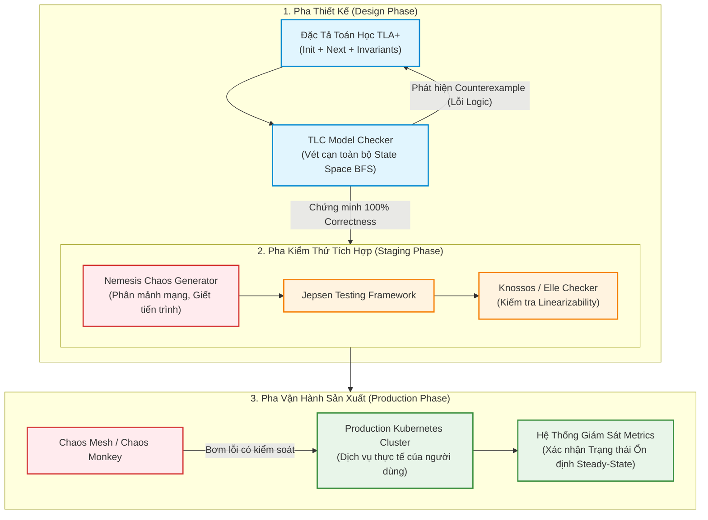
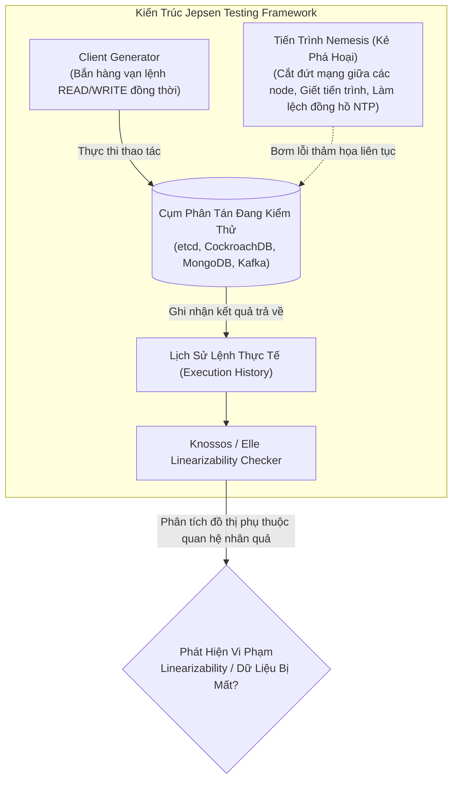

# 22.1. Distributed Testing, Formal Verification (TLA+) & Chaos Engineering

> [!IMPORTANT]
> **Nếu bạn chỉ được nhớ một điều duy nhất:** Trong hệ thống phân tán, **kiểm thử đơn vị (Unit Test) và kiểm thử tích hợp (Integration Test) truyền thống hoàn toàn bất lực trước các lỗi tranh chấp trạng thái tinh vi (Concurrency Bugs & Network Partitions)**: Bạn không thể kiểm thử một hệ thống bằng các kịch bản bạn có thể tưởng tượng, bởi vì các lỗi chết người nhất luôn xảy ra ở giao điểm của phân mảnh mạng (Network Partition), đồng hồ lệch (Clock Skew) và các bước xen kẽ không tưởng. Hai vũ khí tối thượng của kỹ sư phân tán hiện đại là: **Kiểm Chứng Hình Thức TLA+ (Leslie Lamport)** ở pha thiết kế để vét cạn $100\%$ không gian trạng thái toán học trước khi viết code; và **Chaos Engineering (Netflix / Chaos Mesh)** ở pha vận hành để chủ động "bắn phá" hạ tầng Production nhằm chứng minh hệ thống có khả năng tự phục hồi trong thế giới thực.

---

## 1. Kiến trúc Tổng quan & Mô hình Tư duy (Mental Model)

### 1.1. Ẩn dụ Đời sống: Bản Vẽ Kết Cấu Tòa Nhà Chọc Trời & Diễn Tập Cứu Hỏa Bất Ngờ

Hãy hình dung quá trình xây dựng một tòa tháp cao 100 tầng trong vùng thường xuyên xảy ra động đất:
- **Kiểm chứng hình thức TLA+ (Mô hình Toán học & Mô phỏng Động đất Số)**:
  - Trước khi đổ một khối bê tông nào, các kỹ sư kết cấu xây dựng một mô hình toán học giải tích chi tiết trên máy tính.
  - Phần mềm mô phỏng (Model Checker) tính toán và thử nghiệm hàng triệu kịch bản rung chấn địa chất ở mọi góc độ, tốc độ gió và tải trọng cực hạn để chứng minh rằng: *"Không có bất kỳ sự cộng hưởng rung động nào có thể làm sụp đổ tòa nhà"* (**Safety Invariant**).
- **Chaos Engineering (Diễn tập Báo cháy Bất ngờ lúc 2 giờ sáng)**:
  - Tòa nhà xây xong có hệ thống chuông báo cháy và cửa chống khói tự động. Nhưng làm sao bạn biết chắc chắn chúng sẽ hoạt động khi có hỏa hoạn thực sự?
  - Ban quản lý tòa nhà chủ động kích hoạt báo động giả, ngắt thử điện nguồn một nửa tòa nhà, và chặn một lối thoát hiểm mà không báo trước cho cư dân.
  - Mục đích: Không phải để phá hoại, mà là để kiểm chứng xem hệ thống điện dự phòng có bật trong 3 giây không, và lực lượng ứng cứu có kịp thời sơ tán người dân hay không (**Steady-State Verification**).



---

## 2. Chi tiết từng Keyword (Under-the-Hood Deep Dive)

### 2.1. Phương Pháp Kiểm Chứng Hình Thức: TLA+ & Model Checking (Leslie Lamport)

#### 1. Tại Sao Kiểm Thử Truyền Thống Thất Bại?
Trong một thuật toán đồng thuận phân tán như Raft hoặc Paxos:
- Với 5 node và hàng trăm thông điệp mạng bị trễ, hoán đổi trật tự hoặc gửi lại, số lượng trạng thái có thể xảy ra là một con số khổng lồ (vượt quá $10^{15}$ trạng thái).
- Unit test chỉ kiểm tra được vài chục đường dẫn (Happy paths). Bạn không thể viết test case cho một kịch bản: *"Node 1 gửi RPC, Node 2 nhận được nhưng bị trễ 5ms, đúng lúc đó Node 3 bị phân mảnh mạng, Node 1 sập nguồn rồi bật lại ngay lập tức"*.
- Lỗi này chỉ xuất hiện trên Production sau 6 tháng chạy thực tế và không bao giờ có thể tái hiện lại được!

#### 2. Nguyên Lý Cốt Lõi Của TLA+ (Temporal Logic of Actions)
Được phát minh bởi nhà khoa học máy tính đạt giải Turing Leslie Lamport, TLA+ là một ngôn ngữ đặc tả toán học dựa trên Lý thuyết Tập hợp và Logic Thời gian:
- **Trạng thái (State)**: Một phép gán giá trị cho các biến (ví dụ: `term = 1`, `leader = NodeA`).
- **Trạng thái Khởi tạo (`Init`)**: Mệnh đề logic xác định các trạng thái bắt đầu hợp lệ.
- **Hành động Chuyển dịch (`Next`)**: Mối quan hệ giữa trạng thái hiện tại $s$ và trạng thái kế tiếp $s'$:
  $$\text{Next} \triangleq \text{RequestVote} \lor \text{AppendEntries} \lor \text{Timeout}$$
- **Hai Thuộc Tính Sống Còn Bắt Buộc Phải Chứng Minh**:
  1. **Safety Properties ("Không có điều xấu nào xảy ra")**:
     - Ví dụ trong Raft: *Tại bất kỳ thời điểm nào, không bao giờ có nhiều hơn 1 Leader hợp lệ trong cùng một Term* (**Leader Completeness**).
  2. **Liveness Properties ("Một điều tốt cuối cùng sẽ xảy ra")**:
     - Ví dụ: *Nếu một client gửi một lệnh ghi, lệnh ghi đó cuối cùng phải được commit hoặc bị từ chối, hệ thống không bao giờ bị treo vĩnh viễn* (**No Deadlock**).

#### 3. Bộ Kiểm Tra Mô Hình (TLC Model Checker)
- TLC đọc file đặc tả TLA+ và thực hiện thuật toán duyệt đồ thị **Breadth-First Search (BFS)** trên toàn bộ không gian trạng thái có thể có.
- Nếu TLC tìm thấy dù chỉ một chuỗi trạng thái vi phạm Safety Invariant, nó sẽ dừng lại và xuất ra một **Phản ví dụ (Counterexample)** chi tiết từng bước (Trace) chỉ rõ chính xác kịch bản mạng nào dẫn đến lỗi.
- **Thực tế công nghiệp**: Amazon Web Services (AWS) đã sử dụng TLA+ để thiết kế lại thuật toán sao lưu phân tán của Amazon S3 và giao thức khóa phân tán của DynamoDB, phát hiện ra hàng chục lỗi kiến trúc nghiêm trọng tiềm ẩn mà các bài test thông thường không bao giờ tìm thấy!

---

### 2.2. Kiểm Thử Jepsen: Thước Đo Sinh Tử Của Cơ Sở Dữ Liệu Phân Tán (Kyle Kingsbury)

**Jepsen** là framework kiểm thử phân tán khét tiếng nhất thế giới được sáng tạo bởi Kyle Kingsbury (biệt danh Aphyr):



- **Tiến trình Nemesis (Kẻ Hủy Diệt)**: Chạy song song và liên tục "ném gạch" vào hệ thống: Tạo các phân mảnh mạng bất đối xứng (Node A thấy Node B nhưng B không thấy A), đóng băng tiến trình bằng `SIGSTOP` rồi giải phóng bằng `SIGCONT`, tua nhanh đồng hồ hệ thống thêm 60 giây.
- **Knossos & Elle Verifier**:
  - Đọc toàn bộ lịch sử (History Log) các lệnh ghi/đọc song song của hàng trăm client.
  - Xây dựng đồ thị phụ thuộc thời gian thực và kiểm tra xem có vi phạm cấp độ nhất quán đã tuyên bố hay không (**Linearizability, Strict Serializability**).
  - Jepsen đã chứng minh hầu hết các cơ sở dữ liệu nổi tiếng (MongoDB, Cassandra, Redis Sentinel, Elasticsearch) đều từng bị mất dữ liệu hoặc trả về dữ liệu rác trong các điều kiện lỗi mạng phức tạp!

---

### 2.3. Bốn Nguyên Lý Cốt Lõi Của Chaos Engineering (Netflix)

Sau thảm họa sập toàn bộ dịch vụ do lỗi cơ sở dữ liệu vào năm 2008, Netflix đã khai sinh ra trường phái **Chaos Engineering**:

1. **Xây Dựng Giả Thuyết Về Trạng Thái Ổn Định (Hypothesis of Steady State)**:
   - Đo lường hệ thống bằng các chỉ số kinh doanh thực tế thay vì chỉ số kỹ thuật thuần túy.
   - Ví dụ tại Netflix: Chỉ số SPS (Stream Starts per Second - Số lượt người dùng bấm xem phim mỗi giây). Giả thuyết đặt ra: *"Ngay cả khi cụm máy chủ phụ trách thuật toán gợi ý phim bị sập 100%, chỉ số SPS vẫn không được giảm quá 3%"*.
2. **Đa Dạng Hóa Các Biến Số Của Thế Giới Thực (Real-World Variables)**:
   - Sự cố thực tế không bao giờ là một lỗi máy tính đơn giản. Chaos Engineering phải mô phỏng: Cháy phòng máy datacenter, đứt cáp quang biển, nhân viên cấu hình sai DNS, ổ đĩa NVMe bị hỏng sector.
3. **Thực Nghiệm Trực Tiếp Trên Môi Trường Production (Run Experiments in Production)**:
   - Môi trường Staging không bao giờ phản ánh trung thực lưu lượng, hành vi người dùng thật và sự phong phú của dữ liệu. Do đó, bài kiểm tra chỉ có giá trị thực sự khi được thực thi trên môi trường Production thật với khách hàng thật!
4. **Tự Động Hóa Thử Nghiệm Để Chạy Thường Trực (Automate to Run Continuously)**:
   - Không biến Chaos thành một sự kiện hàng năm. Nó phải được chạy tự động hàng ngày bằng các công cụ như Chaos Monkey hoặc Chaos Mesh.

---

### 2.4. Sự Tiến Hóa Của Công Cụ: Từ Chaos Monkey Đến Chaos Mesh

- **Thế hệ 1: Chaos Monkey / Simian Army (Netflix 2011)**:
  - Một tiến trình đơn giản chạy ngầm, ngẫu nhiên chọn và "bắn chết" (terminate) các máy ảo EC2 trong giờ làm việc để rèn luyện cho các kỹ sư thói quen viết mã nguồn có khả năng tự phục hồi (Stateless, Auto-healing).
- **Thế hệ 2: Chaos Mesh & LitmusChaos (Cloud-Native Kubernetes)**:
  - Tích hợp sâu vào Kubernetes qua Custom Resource Definitions (CRDs).
  - Cho phép tiêm sự cố ở mức độ hạt nhân siêu việt (Kernel-level & eBPF):
    - `NetworkChaos`: Giả lập độ trễ mạng 200ms, tỷ lệ rớt gói tin 10%, phân mảnh mạng (Partition).
    - `PodChaos`: Tiêu diệt Pod, treo tiến trình (Process Pause).
    - `StressChaos`: Chiếm dụng 100% CPU và làm cạn kiệt RAM để ép kích hoạt OOM Killer.
    - `IOChaos`: Giả lập đọc đĩa chậm hoặc trả về lỗi I/O `EIO`.
    - `TimeChaos`: Làm lệch đồng hồ thời gian của riêng một container duy nhất mà không ảnh hưởng tới Node máy chủ!

---

## 3. Thực thi Mã nguồn & Mô phỏng Chuyên sâu (Dual-Engine Implementation)

### 3.1. C++20 TLA+ / TLC Model Checker BFS State Space Engine

Chương trình minh chứng cách thức hoạt động bên trong của một Model Checker như TLC: Khởi tạo trạng thái ban đầu (`Init`), duyệt toàn bộ không gian trạng thái theo chiều rộng (BFS State Space Exploration), kiểm tra bất biến bảo mật (`Safety Invariant`), và tự động sinh ra dấu vết phản ví dụ (Counterexample Trace) khi phát hiện lỗi logic:

```cpp
// model_checker_engine.cpp
// Biên dịch: g++ -std=c++20 -O3 model_checker_engine.cpp -o model_checker_engine
#include <iostream>
#include <vector>
#include <string>
#include <queue>
#include <set>
#include <map>
#include <memory>

// Trạng thái của một hệ thống bầu cử phân tán 2 Nodes
struct SystemState {
    int node1_state; // 0: FOLLOWER, 1: CANDIDATE, 2: LEADER
    int node2_state;
    int term;

    // Để lưu vào std::set (So sánh trạng thái)
    bool operator<(const SystemState& other) const {
        if (term != other.term) return term < other.term;
        if (node1_state != other.node1_state) return node1_state < other.node1_state;
        return node2_state < other.node2_state;
    }

    std::string to_string() const {
        auto state_name = [](int s) {
            if (s == 0) return "FOLLOWER";
            if (s == 1) return "CANDIDATE";
            return "LEADER";
        };
        return "[Term " + std::to_string(term) + " | N1: " + state_name(node1_state) + 
               ", N2: " + state_name(node2_state) + "]";
    }
};

class SimpleModelChecker {
private:
    std::set<SystemState> visited_states_;
    std::queue<SystemState> state_queue_;
    std::map<SystemState, SystemState> parent_trace_;

public:
    // SAFETY INVARIANT: Tại một thời điểm, không bao giờ được phép có 2 Leaders đồng thời (Split-Brain)
    static bool check_safety_invariant(const SystemState& state) {
        if (state.node1_state == 2 && state.node2_state == 2) {
            return false; // VI PHẠM BẤT BIẾN: CẢ 2 CÙNG LÀ LEADER!
        }
        return true;
    }

    // NEXT STATE FUNCTION: Sinh các trạng thái chuyển dịch tiếp theo
    std::vector<SystemState> get_next_states(const SystemState& current) {
        std::vector<SystemState> next_states;

        // Hành động 1: Node 1 timeout và trở thành Candidate
        if (current.node1_state == 0) {
            next_states.push_back({1, current.node2_state, current.term + 1});
        }
        // Hành động 2: Node 2 timeout và trở thành Candidate
        if (current.node2_state == 0) {
            next_states.push_back({current.node1_state, 1, current.term + 1});
        }
        // Hành động 3: Node 1 thắng cử lên Leader
        if (current.node1_state == 1) {
            next_states.push_back({2, current.node2_state, current.term});
        }
        // Hành động 4 (Chứa lỗi Bug Logic thiết kế): Node 2 cũng tự phong làm Leader mà không kiểm tra Quorum!
        if (current.node2_state == 1) {
            next_states.push_back({current.node1_state, 2, current.term});
        }

        return next_states;
    }

    void run_verification(const SystemState& init_state) {
        std::cout << "[TLC MODEL CHECKER] Bắt đầu duyệt không gian trạng thái từ: " 
                  << init_state.to_string() << "\n";

        visited_states_.insert(init_state);
        state_queue_.push(init_state);

        bool violation_found = false;
        SystemState bad_state;

        while (!state_queue_.empty()) {
            SystemState curr = state_queue_.front();
            state_queue_.pop();

            // Kiểm tra Invariant
            if (!check_safety_invariant(curr)) {
                violation_found = true;
                bad_state = curr;
                break;
            }

            // Sinh các bước chuyển dịch tiếp theo
            for (const auto& next : get_next_states(curr)) {
                if (visited_states_.find(next) == visited_states_.end()) {
                    visited_states_.insert(next);
                    parent_trace_[next] = curr;
                    state_queue_.push(next);
                }
            }
        }

        std::cout << "\n=======================================================================\n";
        if (violation_found) {
            std::cout << "!!! [CRITICAL INVARIANT VIOLATION] PHÁT HIỆN LỖI THIẾT KẾ KIẾN TRÚC !!!\n";
            std::cout << "    Trạng thái vi phạm: " << bad_state.to_string() << "\n\n";
            std::cout << ">>> DẤU VẾT PHẢN VÍ DỤ (COUNTEREXAMPLE TRACE TỪ GỐC ĐẾN LỖI):\n";
            print_counterexample(bad_state, init_state);
        } else {
            std::cout << ">>> THÀNH CÔNG: Đã duyệt toàn bộ " << visited_states_.size() 
                      << " trạng thái. Hệ thống an toàn 100%!\n";
        }
        std::cout << "=======================================================================\n";
    }

private:
    void print_counterexample(const SystemState& bad, const SystemState& root) {
        std::vector<SystemState> trace;
        SystemState curr = bad;
        while (!(curr.term == root.term && curr.node1_state == root.node1_state && curr.node2_state == root.node2_state)) {
            trace.push_back(curr);
            curr = parent_trace_[curr];
        }
        trace.push_back(root);

        for (int i = static_cast<int>(trace.size()) - 1; i >= 0; --i) {
            std::cout << "  Bước " << (trace.size() - i) << ": " << trace[i].to_string() << "\n";
        }
    }
};

int main() {
    SimpleModelChecker checker;
    // Khởi tạo cả 2 nodes ở trạng thái Follower tại Term 0
    SystemState init{0, 0, 0};
    checker.run_verification(init);
    return 0;
}
```

#### Terminal Output Mẫu:
```text
[TLC MODEL CHECKER] Bắt đầu duyệt không gian trạng thái từ: [Term 0 | N1: FOLLOWER, N2: FOLLOWER]

=======================================================================
!!! [CRITICAL INVARIANT VIOLATION] PHÁT HIỆN LỖI THIẾT KẾ KIẾN TRÚC !!!
    Trạng thái vi phạm: [Term 1 | N1: LEADER, N2: LEADER]

>>> DẤU VẾT PHẢN VÍ DỤ (COUNTEREXAMPLE TRACE TỪ GỐC ĐẾN LỖI):
  Bước 1: [Term 0 | N1: FOLLOWER, N2: FOLLOWER]
  Bước 2: [Term 1 | N1: CANDIDATE, N2: FOLLOWER]
  Bước 3: [Term 1 | N1: CANDIDATE, N2: CANDIDATE]
  Bước 4: [Term 1 | N1: LEADER, N2: CANDIDATE]
  Bước 5: [Term 1 | N1: LEADER, N2: LEADER]
=======================================================================
```

---

### 3.2. Python 3.11+ Jepsen-Style Chaos Nemesis & Linearizability Auditor

Chương trình minh chứng cách hoạt động của một bài kiểm thử kiểu Jepsen: Chạy đồng thời các client ghi/đọc, một tiến trình **Nemesis** tiêm sự cố phân mảnh mạng (Network Partition), và một thuật toán **Linearizability Checker** kiểm tra xem người dùng có bị đọc phải dữ liệu rác (Stale/Inconsistent Read) hay không:

```python
#!/usr/bin/env python3
"""
jepsen_linearizability_sim.py
Mô phỏng Kiểm Thử Jepsen: Nemesis Network Partition & Linearizability Verification
"""
import time
import random
from dataclasses import dataclass
from typing import List, Dict, Optional

@dataclass
class OperationRecord:
    client_id: str
    op_type: str        # "WRITE" hoặc "READ"
    key: str
    value: int
    start_time: float
    end_time: float
    is_success: bool

class DistributedKeyValueNode:
    def __init__(self, node_id: str):
        self.node_id = node_id
        self.data_store: Dict[str, int] = {}
        self.isolated_from: set = set() # Các node bị cắt kết nối mạng (Partition)

    def write(self, key: str, value: int, peer_node: 'DistributedKeyValueNode') -> bool:
        if peer_node.node_id in self.isolated_from:
            # Bị phân mảnh mạng -> Chỉ ghi cục bộ mà không đồng bộ được sang peer!
            self.data_store[key] = value
            return True
        # Bình thường: Đồng bộ cả 2 node
        self.data_store[key] = value
        peer_node.data_store[key] = value
        return True

    def read(self, key: str) -> int:
        return self.data_store.get(key, 0)

class JepsenLinearizabilityChecker:
    @staticmethod
    def audit_history(history: List[OperationRecord]) -> bool:
        """
        Kiểm tra tính Linearizability (Nhất quán Tuyến tính):
        Nếu một lệnh WRITE hoàn tất tại thời điểm T_end, thì bất kỳ lệnh READ nào
        bắt đầu sau T_end (T_start_read > T_end_write) BẮT BUỘC phải đọc được giá trị mới nhất đó!
        """
        print("\n[JEPSEN CHECKER] Bắt đầu phân tích lịch sử nhật ký giao dịch...")
        violations = 0

        # Lọc các write thành công
        writes = [op for op in history if op.op_type == "WRITE" and op.is_success]

        for w in writes:
            for r in history:
                if r.op_type == "READ" and r.key == w.key:
                    # Kiểm tra trật tự thời gian tuyệt đối
                    if r.start_time > w.end_time:
                        if r.value < w.value:
                            violations += 1
                            print(f"  !!! [LỖI VI PHẠM LINEARIZABILITY] Client {r.client_id} đọc Key '{r.key}' = {r.value}")
                            print(f"      nhưng trước đó lệnh WRITE({w.value}) đã hoàn thành lúc t={w.end_time:.4f}s!")
                            print(f"      -> Hệ thống bị lỗi Đọc Lùi Thời Gian (Stale Read do Network Partition)!\n")

        return violations == 0

def simulate_jepsen_test():
    print("=" * 80)
    print("       MÔ PHỎNG KIỂM THỬ JEPSEN: NEMESIS NETWORK PARTITION & LINEARIZABILITY   ")
    print("=" * 80)

    node_a = DistributedKeyValueNode("Node_A")
    node_b = DistributedKeyValueNode("Node_B")

    history: List[OperationRecord] = []

    # 1. Thao tác bình thường lúc t = 0
    t0 = time.time()
    node_a.write("x", 10, node_b)
    history.append(OperationRecord("C1", "WRITE", "x", 10, t0, time.time(), True))
    print("[T0] Client 1 GHI x = 10 thành công trên cả 2 nodes.")

    # 2. NEMESIS XUẤT HIỆN: Cắt đứt kết nối mạng giữa Node A và Node B (Network Partition)
    print("\n>>> [NEMESIS ATTACK] Bơm sự cố: Cắt đứt cáp mạng nối giữa Node A và Node B! <<<")
    node_a.isolated_from.add("Node_B")
    node_b.isolated_from.add("Node_A")

    # 3. Client 2 ghi x = 20 vào Node A (Node A chỉ lưu cục bộ mà không báo được cho Node B)
    t1 = time.time()
    node_a.write("x", 20, node_b)
    t1_end = time.time()
    history.append(OperationRecord("C2", "WRITE", "x", 20, t1, t1_end, True))
    print(f"[T1] Client 2 GHI x = 20 vào Node A hoàn tất lúc t={t1_end:.4f}s")

    # 4. Ngay sau đó, Client 3 đọc dữ liệu từ Node B (Bị cô lập, vẫn giữ x = 10)
    time.sleep(0.01)
    t2 = time.time()
    val = node_b.read("x")
    t2_end = time.time()
    history.append(OperationRecord("C3", "READ", "x", val, t2, t2_end, True))
    print(f"[T2] Client 3 ĐỌC dữ liệu từ Node B lúc t={t2:.4f}s -> Nhận giá trị: {val}")

    # 5. Chạy Jepsen Checker
    is_linearizable = JepsenLinearizabilityChecker.audit_history(history)

    print("=" * 80)
    if not is_linearizable:
        print("[KẾT QUẢ ĐÁNH GIÁ JEPSEN]: CỤM CƠ SỞ DỮ LIỆU ĐÃ BỊ ĐÁNH BẠI!")
        print("                           Hệ thống không đạt chuẩn Linearizable Consistency.")
    else:
        print("[KẾT QUẢ ĐÁNH GIÁ JEPSEN]: HỆ THỐNG VƯỢT QUA BÀI TEST AN TOÀN.")
    print("=" * 80)

if __name__ == "__main__":
    simulate_jepsen_test()
```

#### Terminal Output Mẫu:
```text
================================================================================
       MÔ PHỎNG KIỂM THỬ JEPSEN: NEMESIS NETWORK PARTITION & LINEARIZABILITY   
================================================================================
[T0] Client 1 GHI x = 10 thành công trên cả 2 nodes.

>>> [NEMESIS ATTACK] Bơm sự cố: Cắt đứt cáp mạng nối giữa Node A và Node B! <<<
[T1] Client 2 GHI x = 20 vào Node A hoàn tất lúc t=1731684610.1245s
[T2] Client 3 ĐỌC dữ liệu từ Node B lúc t=1731684610.1350s -> Nhận giá trị: 10

[JEPSEN CHECKER] Bắt đầu phân tích lịch sử nhật ký giao dịch...
  !!! [LỖI VI PHẠM LINEARIZABILITY] Client C3 đọc Key 'x' = 10
      nhưng trước đó lệnh WRITE(20) đã hoàn thành lúc t=1731684610.1245s!
      -> Hệ thống bị lỗi Đọc Lùi Thời Gian (Stale Read do Network Partition)!

================================================================================
[KẾT QUẢ ĐÁNH GIÁ JEPSEN]: CỤM CƠ SỞ DỮ LIỆU ĐÃ BỊ ĐÁNH BẠI!
                           Hệ thống không đạt chuẩn Linearizable Consistency.
================================================================================
```

---

## 4. Systems Engineering & Production Pitfalls

### 4.1. Cạm Bẫy Thực Chiến Thường Gặp (Production Pitfalls)

#### 1. Sự Cố "Blast Radius Out of Control" Khi Chạy Chaos Trên Production
- **Hiện tượng**: Bạn dự định dùng Chaos Mesh để thử nghiệm làm chậm $10\%$ lưu lượng của một microservice phụ. Do cấu hình sai nhãn `labelSelector`, cuộc tấn công vô tình nhắm vào toàn bộ cụm Database PostgreSQL cốt lõi, làm sập toàn bộ sàn giao dịch và gây thiệt hại hàng triệu USD.
- **Giải pháp**: Luôn cấu hình **Nút Dừng Khẩn Cấp (Emergency Dead Man's Switch)**: Một công tắc hủy bỏ ngay lập tức toàn bộ thí nghiệm nếu các chỉ số nghiệp vụ (như tỷ lệ lỗi 5xx hoặc doanh thu) vượt quá ngưỡng an toàn định trước.

#### 2. Thảm Họa "State Space Explosion" Trong TLA+
- **Hiện tượng**: Khi viết đặc tả TLA+, bạn mô tả quá chi tiết từng biến đếm vòng lặp. TLC Model Checker chạy suốt 1 tuần lễ và ngốn sạch 128GB RAM của máy chủ mà vẫn chưa duyệt hết các trạng thái.
- **Giải pháp**: Tinh chỉnh mức độ trừu tượng: Thay vì mô tả hàng đợi vô hạn, giới hạn kích thước hàng đợi tối đa là 3 phần tử; chỉ mô tả các biến trạng thái trực tiếp tham gia vào giao thức đồng thuận.

#### 3. Bẫy Ngộ Nhận An Toàn Ảo (False Sense of Security) Khi Jepsen Test Thành Công
- **Hiện tượng**: Bạn chạy bài test Jepsen trong 2 giờ và không thấy lỗi, vội vàng kết luận cơ sở dữ liệu của mình đạt chuẩn $100\%$.
- **Thực tế**: Một số lỗi race condition tinh vi chỉ xuất hiện khi tỷ lệ lỗi mạng xảy ra vào đúng mili-giây then chốt của quá trình bầu cử Leader. Các bài test Jepsen chuẩn mực thường phải chạy liên tục từ **24 đến 72 giờ** với hàng triệu phép thử ngẫu nhiên.

---

### 4.2. CLI Diagnostics & Công Cụ Chaos Engineering

```bash
# 1. Chạy bài kiểm tra TLA+ model checking trực tiếp từ dòng lệnh
java -XX:+UseParallelGC -jar tla2tools.jar -workers auto Raft.tla

# 2. Bơm lỗi trễ mạng và phân mảnh pod bằng Kubernetes Chaos Mesh CLI
kubectl apply -f - <<EOF
apiVersion: chaos-mesh.org/v1alpha1
kind: NetworkChaos
metadata:
  name: delay-payment-service
spec:
  action: delay
  mode: all
  selector:
    namespaces: [production]
    labelSelectors: { "app": "payment" }
  delay:
    latency: "250ms"
    jitter: "20ms"
  duration: "5m"
EOF

# 3. Hủy bỏ khẩn cấp toàn bộ các thí nghiệm Chaos đang chạy trong cụm
kubectl delete networkchaos,podchaos,iochaos --all -A
```

---

## 5. Bảng So sánh & Decision Matrix

| Phương Pháp Kiểm Thử | Giai Đoạn Áp Dụng | Bản Chất Kỹ Thuật | Phạm Vi Bao Phủ (Coverage) | Khả Năng Tìm Lỗi Ẩn | Chi Phí Triển Khai |
| :--- | :--- | :--- | :--- | :--- | :--- |
| **Unit & Integration Test**| Lập trình (Dev) | Mocking, assertions | Chỉ kiểm tra kịch bản lập trình viên nghĩ ra | Cực thấp đối với Concurrency| Thấp |
| **TLA+ Formal Verification**| Thiết kế kiến trúc | Mô hình hóa toán học, duyệt BFS | **$100\%$ không gian trạng thái trừu tượng** | Đỉnh cao (Triệt tiêu lỗi logic)| Cao (Đòi hỏi tư duy toán học)|
| **Jepsen Testing** | Kiểm thử sản phẩm (QA) | Bơm lỗi thảm họa mạng + Verify Log | Hàng triệu chuỗi ngẫu nhiên | Rất cao đối với Distributed DBMS | Cao |
| **Chaos Engineering** | Vận hành (Production) | Phá hoại có kiểm soát trên người dùng thật | Toàn bộ hệ sinh thái phần cứng & con người | Đỉnh cao trong thế giới thực | Trung bình - Cao |
