# 23.1. Distributed Technologies Ecosystem Landscape

> [!IMPORTANT]
> **Nếu bạn chỉ được nhớ một điều duy nhất:** Không có một công nghệ phân tán vạn năng nào (No Silver Bullet) có thể giải quyết trọn vẹn mọi bài toán: Mọi engine phân tán trong thế giới hiện đại đều là một điểm đánh đổi trên đồ thị đa chiều giữa **Cấp độ Nhất quán (Consistency Level)**, **Độ trễ I/O (Latency)**, **Thông lượng (Throughput)** và **Chi phí Vận hành (Operational Complexity)**. Việc lựa chọn giữa **NewSQL (Spanner, CockroachDB, TiDB)** cho giao dịch tài chính ACID, **NoSQL (Cassandra, ScyllaDB, Redis Cluster)** cho dữ liệu phi cấu trúc triệu QPS, **Distributed Stream Logs (Kafka, Redpanda, Pulsar)** cho xử lý luồng thời gian thực, hay **Consensus Stores (etcd, ZooKeeper, Consul)** làm xương sống điều phối hạ tầng phụ thuộc hoàn toàn vào việc bạn thấu hiểu bản chất thuật toán và mô hình lưu trữ bên dưới hạt nhân của chúng.

---

## 1. Kiến trúc Tổng quan & Mô hình Tư duy (Mental Model)

### 1.1. Ẩn dụ Đời sống: Đại Đô Thị Phân Tán & Bức Tranh Hạ Tầng Thành Phố

Hãy tưởng tượng một siêu đô thị hiện đại với hàng chục triệu dân:
- **Tòa án Tối cao & Ngân hàng Trung ương (NewSQL Databases: Spanner, CockroachDB)**:
  - Nơi lưu giữ quyền sở hữu nhà đất và các giao dịch chuyển tiền triệu đô.
  - Mọi bản án và giao dịch đều đòi hỏi sự chuẩn xác tuyệt đối $100\%$, không bao giờ được phép có sai sót hay mâu thuẫn (Strict Serializability / External Consistency), chấp nhận việc thủ tục giấy tờ kiểm tra chéo mất thêm vài giây.
- **Hệ thống Giao vận Chuyển phát Nhanh (NoSQL: Cassandra, ScyllaDB, Redis)**:
  - Hàng triệu shipper giao hàng liên tục trên đường phố.
  - Tốc độ là sinh mệnh: Kiện hàng phải được bốc dỡ ngay lập tức ($< 1\text{ ms}$). Nếu một shipper bị tắc đường tạm thời, gói hàng sẽ được giao bù vào cuối ngày (Eventual Consistency & Tunable Quorum).
- **Hệ thống Đường ray & Băng chuyền Hàng hóa (Distributed Streaming: Kafka, Redpanda)**:
  - Những đoàn tàu hỏa chở hàng ngày đêm chạy không ngừng nghỉ dọc các nhà ga.
  - Dữ liệu được ghi nối tiếp bất biến vào các toa tàu (Commit Log). Từng đoàn tàu chở hàng nghìn tấn hàng hóa cùng lúc (Batching & Zero-Copy).
- **Tháp Kiểm soát Không lưu & Bộ Điều phối Đèn Giao thông (Consensus: etcd, ZooKeeper)**:
  - Nơi duy trì sự thật duy nhất (Single Source of Truth) về trạng thái của toàn thành phố.
  - Dung lượng dữ liệu cực nhỏ (chỉ vài Megabytes cấu hình), nhưng độ tin cậy phải đạt $100\%$ tuyệt đối thông qua thuật toán đồng thuận Raft/Zab.

```mermaid
graph TD
    classDef newsql fill:#e1f5fe,stroke:#0288d1,stroke-width:2px;
    classDef nosql fill:#fff3e0,stroke:#f57c00,stroke-width:2px;
    classDef stream fill:#e8f5e9,stroke:#388e3c,stroke-width:2px;
    classDef coord fill:#f3e5f5,stroke:#7b1fa2,stroke-width:2px;
    classDef olap fill:#fce4ec,stroke:#c2185b,stroke-width:2px;

    Root["BẢN ĐỒ CÔNG NGHỆ HỆ THỐNG PHÂN TÁN"]

    Root --> G1["1. NewSQL (Distributed SQL)"]:::newsql
    Root --> G2["2. NoSQL & In-Memory Caches"]:::nosql
    Root --> G3["3. Event Streaming & Messaging"]:::stream
    Root --> G4["4. Distributed Coordination"]:::coord
    Root --> G5["5. OLAP & Distributed Search"]:::olap

    G1 --> G1A["Google Spanner (TrueTime, Multi-Paxos)"]
    G1 --> G1B["CockroachDB (HLC, Multi-Raft)"]
    G1 --> G1C["TiDB (PingCAP, TiKV, HTAP)"]
    G1 --> G1D["YugabyteDB (DocDB, PostgreSQL Wire)"]

    G2 --> G2A["Redis Cluster (16384 Hash Slots)"]
    G2 --> G2B["Apache Cassandra & ScyllaDB (LSM, Seastar)"]
    G2 --> G2C["Amazon DynamoDB (Managed KV Store)"]
    G2 --> G2D["MongoDB (Document, Sharded Cluster)"]

    G3 --> G3A["Apache Kafka (Partitioned Log, JVM)"]
    G3 --> G3B["Redpanda (C++20, Thread-per-core, Raft)"]
    G3 --> G3C["Apache Pulsar (BookKeeper, Tiered Storage)"]

    G4 --> G4A["etcd (Raft, Kubernetes Backbone)"]
    G4 --> G4B["Apache ZooKeeper (Zab, Hadoop/Kafka Legacy)"]
    G4 --> G4C["HashiCorp Consul (Raft + Gossip Serf)"]

    G5 --> G5A["ClickHouse (Columnar, SIMD Vectorized)"]
    G5 --> G5B["Elasticsearch / Solr (Lucene Inverted Index)"]
    G5 --> G5C["Snowflake (Storage/Compute Separation)"]
```



---

## 2. Chi tiết từng Keyword (Under-the-Hood Deep Dive)

### 2.1. Cơ Sở Dữ Liệu Phân Tán Hiện Đại (Distributed Relational / NewSQL Databases)

Trong hơn ba thập kỷ, các kỹ sư phải đau đầu lựa chọn: Chọn RDBMS truyền thống (MySQL, PostgreSQL) để có ACID nhưng không thể mở rộng quy mô ghi ngang (Scale-out Writes); hoặc chọn NoSQL để mở rộng quy mô nhưng mất sạch ACID transactions. **NewSQL ra đời để xóa bỏ sự đánh đổi này**: Mang lại khả năng mở rộng quy mô ngang không giới hạn (Horizontal Scalability) trong khi vẫn bảo toàn đầy đủ các đặc tính **ACID Transactions**:

#### 1. Google Spanner
- **Bản chất**: Cơ sở dữ liệu phân tán toàn cầu đầu tiên trên thế giới đạt cấp độ nhất quán **External Consistency (Strict Serializability)**.
- **Vũ khí bí mật: TrueTime API**: Sử dụng hệ thống đồng hồ nguyên tử (Atomic Clocks) và bộ thu GPS chuyên dụng trong từng trung tâm dữ liệu toàn cầu để thu hẹp độ sai lệch thời gian $\epsilon \le 7\text{ ms}$. Áp dụng cơ chế **Commit Wait**: Đợi $2\epsilon$ trước khi trả kết quả ghi để đảm bảo thứ tự thời gian thực tuyệt đối mà không cần liên lạc giữa các châu lục.
- **Đồng thuận**: Triển khai Multi-Paxos trên từng Shard (Split).

#### 2. CockroachDB (Chú Gián Đất Kiên Cường)
- **Bản chất**: Bản sao mã nguồn mở của Google Spanner, tương thích hoàn toàn với giao thức mạng của PostgreSQL (PostgreSQL Wire Compatible).
- **Cơ chế Hạt nhân**: Thay vì cần phần cứng TrueTime đắt tiền, CockroachDB sử dụng **Hybrid Logical Clocks (HLC)** kết hợp thời gian vật lý NTP với bộ đếm logic. Sử dụng **Multi-Raft**: Dữ liệu được chia thành các dải 64MB (Ranges), mỗi Range là một nhóm đồng thuận Raft 3 hoặc 5 nodes độc lập.

#### 3. TiDB (PingCAP)
- **Bản chất**: Hệ thống lai phân tích và giao dịch đồng thời (**HTAP - Hybrid Transactional and Analytical Processing**), tương thích giao thức MySQL.
- **Kiến trúc Tách Rời**:
  - Tầng tính toán Stateless (`TiDB Server`): Nhận câu lệnh SQL, phân tích cú pháp và tối ưu hóa truy vấn.
  - Tầng lưu trữ giao dịch theo hàng (`TiKV`): Dùng Multi-Raft và RocksDB để đảm bảo ACID OLTP.
  - Tầng lưu trữ phân tích theo cột (`TiFlash`): Tự động nhân bản dữ liệu thời gian thực từ TiKV theo dạng cột (Columnar format) để chạy các câu truy vấn phân tích OLAP nặng mà không làm ảnh hưởng tới giao dịch khách hàng!

#### Bảng So Sánh Các NewSQL Engines Hàng Đầu

| Tiêu Chí Kỹ Thuật | Google Spanner | CockroachDB | TiDB (PingCAP) | YugabyteDB |
| :--- | :--- | :--- | :--- | :--- |
| **Giao Thức Đồng Thuận** | Multi-Paxos | Multi-Raft | Multi-Raft | Multi-Raft |
| **Đồng Bộ Thời Gian** | TrueTime (GPS + Atomic Clocks) | Hybrid Logical Clocks (HLC) | Timestamp Oracle (TSO) | Hybrid Logical Clocks (HLC) |
| **Giao Tiếp Khách Hàng**| Giao thức gRPC độc quyền Google| PostgreSQL Wire Protocol | MySQL Wire Protocol | PostgreSQL & Cassandra CQL |
| **Mô Hình Dữ Liệu** | Bảng quan hệ có phân cấp | SQL Bảng quan hệ | SQL Bảng quan hệ (HTAP) | SQL Quan hệ + NoSQL Doc |
| **Môi Trường Triển Khai**| Độc quyền trên Google Cloud (GCP)| Đa đám mây (AWS, GCP, Bare-metal)| Đa đám mây, Kubernetes | Đa đám mây, Kubernetes |

---

### 2.2. Cơ Sở Dữ Liệu NoSQL Phân Tán (Distributed NoSQL Databases)

NoSQL hy sinh một phần tính nhất quán (ACID) để đổi lấy thông lượng ghi khổng lồ và độ trễ phản hồi sub-millisecond:

#### 1. Redis Cluster (In-Memory Key-Value)
- **16.384 Hash Slots**: Toàn bộ không gian khóa được băm bằng thuật toán `CRC16(key) mod 16384`.
- **Gossip Protocol**: Các node trong cụm trao đổi trạng thái và topology mạng qua cổng Bus (cổng 16379) mà không cần node Master trung tâm. Hỗ trợ chuyển hướng `MOVED` và `ASK` khi di chuyển slot.

#### 2. Apache Cassandra & ScyllaDB (Wide-Column Store)
- **Kiến trúc Vòng Tròn Ngang Hàng (Peer-to-Peer Ring Topology)**: Không có Master node (Masterless), loại bỏ hoàn toàn điểm nghẽn Single Point of Failure.
- **Consistent Hashing**: Dữ liệu được phân bổ vào vòng tròn băm 64-bit hoặc 128-bit (Murmur3Hash) với các nút ảo (Vnodes).
- **LSM-Tree Storage Engine**: Lệnh ghi chỉ ghi vào Append-only CommitLog và bộ nhớ RAM MemTable $\implies$ Tốc độ ghi nhanh như chớp ($< 1\text{ ms}$).
- **Đột phá ScyllaDB**: Viết lại toàn bộ Cassandra bằng **C++20** trên nền tảng framework bất đồng bộ **Seastar**. Triển khai mô hình **Thread-per-core Architecture**, giao tiếp Lock-free, triệt tiêu hoàn toàn thảm họa dừng hệ thống nhặt rác (Garbage Collection Pause) của Java.

---

### 2.3. Tìm Kiếm và Phân Tích Phân Tán (Distributed Search & Analytics)

#### 1. Distributed Search: Elasticsearch vs Apache Solr
- Đều được xây dựng trên lõi tìm kiếm toàn văn **Apache Lucene**.
- **Chỉ mục Đảo ngược (Inverted Index)**: Ánh xạ từ các từ khóa (Terms) sang danh sách các tài liệu (Document IDs) chứa từ khóa đó.
- Phân mảnh Sharding: Dữ liệu được chia thành các Primary Shards và Replica Shards, điều phối phân tán qua node Master.

#### 2. OLAP / Columnar Databases: ClickHouse vs Snowflake
- **Mô hình Lưu trữ Dạng Cột (Column-Oriented Storage)**: Chỉ nạp vào RAM đúng các cột cần tính toán, đạt tỷ lệ nén dữ liệu cực đại ($5x - 10x$).
- **Vectorized Query Execution (ClickHouse)**: Tận dụng các tập lệnh vi xử lý hiện đại **SIMD (AVX-512)** để tính toán hàng triệu phép tính số học trên các mảng dữ liệu song song trong đúng 1 chu kỳ xung nhịp CPU.

---

### 2.4. Hệ Thống Điều Phối Phân Tán (Distributed Coordination Systems)

Để điều hành hàng nghìn máy chủ, hệ thống cần một "trọng tài" duy nhất quản lý cấu hình, khóa phân tán (Distributed Locks) và phát hiện máy chủ sống/chết (Health Checking):

#### 1. etcd
- Được phát triển bằng ngôn ngữ Go bởi CoreOS, là trái tim điều phối của **Kubernetes Control Plane**.
- Thuật toán đồng thuận: **Raft thuần túy**.
- Hỗ trợ cơ chế theo dõi thay đổi thời gian thực (**Watch API**) dựa trên HTTP/2 gRPC streaming, phiên thuê bao có thời hạn (Leases) để tự động xóa khóa khi dịch vụ bị chết.

#### 2. Apache ZooKeeper
- Được sử dụng lịch sử trong hệ sinh thái Apache (Hadoop, HBase, Kafka phiên bản cũ).
- Thuật toán đồng thuận: **Zab (ZooKeeper Atomic Broadcast)**.
- Tổ chức dữ liệu dưới dạng cây phân cấp thư mục (**Hierarchical znode namespace**), hỗ trợ Ephemeral Nodes (nút tạm thời tự biến mất khi mất kết nối).

#### 3. HashiCorp Consul
- Kết hợp thuật toán Raft (cho việc đồng thuận dữ liệu trạng thái) và giao thức **Gossip Protocol (Serf Engine)** cho việc phát hiện thành viên trong cụm và kiểm tra sức khỏe phân tán đa trung tâm dữ liệu.

---

### 2.5. Hệ Thống Nhắn Tin và Truyền Luồng (Distributed Messaging & Streaming)

| Tiêu Chí So Sánh | Apache Kafka | Redpanda | Apache Pulsar | RabbitMQ |
| :--- | :--- | :--- | :--- | :--- |
| **Ngôn Ngữ & Runtime** | Java / Scala (JVM) | **C++20 Native** (Seastar) | Java (JVM) | Erlang (BEAM VM) |
| **Kiến Trúc Hạ Tầng** | Tích hợp ZooKeeper / KRaft | **Raft Tự Thân (Zero-Dependency)**| Tách rời Broker và BookKeeper | Broker Lưu Trữ Hàng Đợi |
| **Mô Hình Dữ Liệu** | Partitioned Commit Log | Partitioned Commit Log | Segment-based Log (BookKeeper)| AMQP Queues (Smart Broker)|
| **Thông Lượng (Throughput)**| Cực cao ($> 1\text{M msg/s}$)| **Siêu cao ($> 2-3\text{M msg/s}$)**| Rất cao | Trung bình ($\approx 50-100\text{K}$)|
| **Độ Trễ Đuôi ($p99$)** | Mili-giây (Dễ bị dính JVM GC)| **Dưới 1 mili-giây (No GC!)** | Mili-giây | Mili-giây |
| **Lưu Trữ Tầng Phổ Biến**| Đĩa cục bộ (Local Disk) | Đĩa NVMe cục bộ + S3 Tiered | Tiered Storage mặc định | RAM + Bounded Disk Spill |

---

## 3. Thực thi Mã nguồn & Mô phỏng Chuyên sâu (Dual-Engine Implementation)

### 3.1. C++20 Redis Cluster 16384 Hash Slot Routing Engine

Chương trình minh chứng cơ chế định tuyến thông minh của một Redis Cluster Client: Tính toán mã băm CRC16, ánh xạ khóa vào 16.384 Hash Slots, tra cứu bảng Topology của các Node máy chủ, và xử lý chuyển hướng `MOVED` khi dịch chuyển slot:

```cpp
// redis_cluster_router.cpp
// Biên dịch: g++ -std=c++20 -O3 redis_cluster_router.cpp -o redis_cluster_router
#include <iostream>
#include <string>
#include <vector>
#include <unordered_map>
#include <cstdint>
#include <iomanip>

constexpr uint16_t TOTAL_HASH_SLOTS = 16384;

// Thuật toán băm CRC16 chuẩn Redis (XMODEM variant)
uint16_t redis_crc16(const std::string& key) {
    uint16_t crc = 0;
    for (char c : key) {
        crc ^= static_cast<uint8_t>(c) << 8;
        for (int i = 0; i < 8; ++i) {
            if (crc & 0x8000) {
                crc = (crc << 1) ^ 0x1021;
            } else {
                crc = crc << 1;
            }
        }
    }
    return crc;
}

uint16_t get_key_slot(const std::string& key) {
    // Hỗ trợ Hash Tag: {user_id}:profile -> Chỉ băm phần trong {}
    auto start = key.find('{');
    auto end = key.find('}');
    if (start != std::string::npos && end != std::string::npos && end > start + 1) {
        return redis_crc16(key.substr(start + 1, end - start - 1)) % TOTAL_HASH_SLOTS;
    }
    return redis_crc16(key) % TOTAL_HASH_SLOTS;
}

struct ClusterNode {
    std::string node_id;
    std::string ip_port;
    uint16_t slot_start;
    uint16_t slot_end;
};

class RedisClusterClient {
private:
    std::vector<ClusterNode> topology_;

public:
    void register_node(const ClusterNode& node) {
        topology_.push_back(node);
    }

    void execute_command(const std::string& command, const std::string& key) {
        uint16_t slot = get_key_slot(key);
        std::cout << "[CLIENT ROUTER] Lệnh: " << command << " '" << key 
                  << "' -> Slot Băm: " << slot << "\n";

        std::string target_node = "UNKNOWN";
        for (const auto& node : topology_) {
            if (slot >= node.slot_start && slot <= node.slot_end) {
                target_node = node.node_id + " (" + node.ip_port + ")";
                std::cout << "  -> ĐIỀU HƯỚNG TRỰC TIẾP TỚI: " << target_node 
                          << " [Quản lý dải slots " << node.slot_start << " - " << node.slot_end << "]\n";
                break;
            }
        }

        std::cout << "  <- Phản hồi từ " << target_node << ": OK (Execution Success)\n\n";
    }
};

int main() {
    std::cout << "=======================================================================\n";
    std::cout << "        REDIS CLUSTER 16384 HASH SLOTS CLIENT ROUTER ENGINE (C++20)    \n";
    std::cout << "=======================================================================\n\n";

    RedisClusterClient cluster;

    // Cấu hình cụm Redis 3 Masters chia đều 16.384 slots
    cluster.register_node({"Node-A", "10.0.0.1:6379", 0, 5460});
    cluster.register_node({"Node-B", "10.0.0.2:6379", 5461, 10922});
    cluster.register_node({"Node-C", "10.0.0.3:6379", 10923, 16383});

    // Thử nghiệm các khóa khác nhau
    cluster.execute_command("SET", "user:1001:name");
    cluster.execute_command("GET", "order:ord-9988");
    cluster.execute_command("HSET", "session:tok_xyz");

    // Thử nghiệm Hash Tag: Gom các khóa có cùng user vào chung 1 slot và 1 node duy nhất
    std::cout << "--- KIỂM TRA TÍNH NĂNG HASH TAGS (MULTI-KEY TRANSACTION CO-LOCATION) ---\n";
    cluster.execute_command("SET", "{user_42}:profile");
    cluster.execute_command("SET", "{user_42}:orders");
    cluster.execute_command("SET", "{user_42}:cart");

    return 0;
}
```

#### Terminal Output Mẫu:
```text
=======================================================================
        REDIS CLUSTER 16384 HASH SLOTS CLIENT ROUTER ENGINE (C++20)    
=======================================================================

[CLIENT ROUTER] Lệnh: SET 'user:1001:name' -> Slot Băm: 12519
  -> ĐIỀU HƯỚNG TRỰC TIẾP TỚI: Node-C (10.0.0.3:6379) [Quản lý dải slots 10923 - 16383]
  <- Phản hồi từ Node-C (10.0.0.3:6379): OK (Execution Success)

[CLIENT ROUTER] Lệnh: GET 'order:ord-9988' -> Slot Băm: 2841
  -> ĐIỀU HƯỚNG TRỰC TIẾP TỚI: Node-A (10.0.0.1:6379) [Quản lý dải slots 0 - 5460]
  <- Phản hồi từ Node-A (10.0.0.1:6379): OK (Execution Success)

[CLIENT ROUTER] Lệnh: HSET 'session:tok_xyz' -> Slot Băm: 8112
  -> ĐIỀU HƯỚNG TRỰC TIẾP TỚI: Node-B (10.0.0.2:6379) [Quản lý dải slots 5461 - 10922]
  <- Phản hồi từ Node-B (10.0.0.2:6379): OK (Execution Success)

--- KIỂM TRA TÍNH NĂNG HASH TAGS (MULTI-KEY TRANSACTION CO-LOCATION) ---
[CLIENT ROUTER] Lệnh: SET '{user_42}:profile' -> Slot Băm: 14190
  -> ĐIỀU HƯỚNG TRỰC TIẾP TỚI: Node-C (10.0.0.3:6379) [Quản lý dải slots 10923 - 16383]
  <- Phản hồi từ Node-C (10.0.0.3:6379): OK (Execution Success)

[CLIENT ROUTER] Lệnh: SET '{user_42}:orders' -> Slot Băm: 14190
  -> ĐIỀU HƯỚNG TRỰC TIẾP TỚI: Node-C (10.0.0.3:6379) [Quản lý dải slots 10923 - 16383]
  <- Phản hồi từ Node-C (10.0.0.3:6379): OK (Execution Success)

[CLIENT ROUTER] Lệnh: SET '{user_42}:cart' -> Slot Băm: 14190
  -> ĐIỀU HƯỚNG TRỰC TIẾP TỚI: Node-C (10.0.0.3:6379) [Quản lý dải slots 10923 - 16383]
  <- Phản hồi từ Node-C (10.0.0.3:6379): OK (Execution Success)
```

---

### 3.2. Python 3.11+ Gossip vs Raft Consensus Topology Simulator

Chương trình so sánh cơ chế hoạt động giữa hai mô hình điều phối phân tán kinh điển: **Raft Consensus (Tập trung, Quorum đa số)** và **Gossip Protocol (Phân tán ngang hàng phi tập trung)**:

```python
#!/usr/bin/env python3
"""
consensus_vs_gossip_sim.py
Mô phỏng và So Sánh Giữa Đồng Thuận Raft (etcd) và Giao Thức Gossip (Cassandra/Redis)
"""
import random
from dataclasses import dataclass
from typing import List, Dict, Set

@dataclass
class RaftNode:
    node_id: str
    is_leader: bool
    is_alive: bool

class RaftCluster:
    def __init__(self, node_ids: List[str]):
        self.nodes = [RaftNode(nid, is_leader=(i == 0), is_alive=True) for i, nid in enumerate(node_ids)]
        self.quorum_size = (len(node_ids) // 2) + 1

    def write_data(self, key: str, value: str) -> bool:
        alive_nodes = [n for n in self.nodes if n.is_alive]
        leader = next((n for n in alive_nodes if n.is_leader), None)

        if not leader:
            print("[RAFT CLUSTER] LỖI: Không tìm thấy Leader còn sống! Từ chối ghi dữ liệu.")
            return False

        if len(alive_nodes) >= self.quorum_size:
            print(f"[RAFT SUCCESS] Ghi '{key}'='{value}' thành công qua Leader {leader.node_id} "
                  f"(Quorum đạt: {len(alive_nodes)}/{len(self.nodes)} nodes)")
            return True
        else:
            print(f"[RAFT FAILURE] LỖI MẤT QUORUM: Số node sống ({len(alive_nodes)}) < Quorum tối thiểu ({self.quorum_size})! "
                  f"Hệ thống ngừng nhận lệnh ghi để bảo vệ an toàn dữ liệu.")
            return False

class GossipNode:
    def __init__(self, node_id: str):
        self.node_id = node_id
        self.known_alive_nodes: Set[str] = {node_id}

    def gossip_with(self, peer: 'GossipNode'):
        # Lan truyền thông tin kiểu dịch bệnh (Epidemic Spread)
        shared_knowledge = self.known_alive_nodes.union(peer.known_alive_nodes)
        self.known_alive_nodes = set(shared_knowledge)
        peer.known_alive_nodes = set(shared_knowledge)

def main():
    print("=" * 80)
    print("      SO SÁNH BẢN CHẤT: RAFT CONSENSUS (etcd) vs GOSSIP PROTOCOL (Cassandra)   ")
    print("=" * 80)

    # 1. Thử nghiệm Cụm Raft 5 Nodes (Quorum = 3)
    print("\n[PHẦN 1: CỤM ĐỒNG THUẬN RAFT - YÊU CẦU QUORUM CHẶT CHẼ]")
    raft = RaftCluster(["Node-1", "Node-2", "Node-3", "Node-4", "Node-5"])
    raft.write_data("config:max_conn", "1000")

    # Giả lập 2 node bị sập (Còn 3 node sống -> Đủ Quorum)
    print("\n--- Giả lập 2 nodes bị sập nguồn ---")
    raft.nodes[3].is_alive = False
    raft.nodes[4].is_alive = False
    raft.write_data("config:timeout", "5s")

    # Giả lập thêm 1 node bị sập (Chỉ còn 2 node sống -> Mất Quorum!)
    print("\n--- Giả lập thêm 1 node nữa bị sập (Tổng cộng 3 node sập) ---")
    raft.nodes[2].is_alive = False
    raft.write_data("config:ssl_enabled", "true")

    # 2. Thử nghiệm Giao thức Gossip (Lan truyền thông tin tự do)
    print("\n" + "=" * 80)
    print("[PHẦN 2: GIAO THỨC GOSSIP - LAN TRUYỀN PHI TẬP TRUNG (EPIDEMIC SPREAD)]")
    gossip_nodes = [GossipNode(f"Peer-{i}") for i in range(1, 6)]

    # Node 1 phát hiện một máy chủ mới "New-Server-99" vừa gia nhập
    gossip_nodes[0].known_alive_nodes.add("New-Server-99")
    print(f"Ban đầu: Peer-1 biết: {gossip_nodes[0].known_alive_nodes}")
    print(f"         Peer-5 biết: {gossip_nodes[4].known_alive_nodes}")

    # Chạy 3 vòng lặp trao đổi ngẫu nhiên (Gossip Rounds)
    print("\n--- Bắt đầu 3 vòng lặp lan truyền tin đồn ngẫu nhiên (Gossip Rounds) ---")
    for r in range(1, 4):
        p1, p2 = random.sample(gossip_nodes, 2)
        p1.gossip_with(p2)
        print(f"  Vòng {r}: {p1.node_id} bắt tay trò chuyện với {p2.node_id}")

    print(f"\nKết quả sau Gossip: Peer-5 hiện tại đã biết: {gossip_nodes[4].known_alive_nodes}")
    print("=" * 80)

if __name__ == "__main__":
    main()
```

#### Terminal Output Mẫu:
```text
================================================================================
      SO SÁNH BẢN CHẤT: RAFT CONSENSUS (etcd) vs GOSSIP PROTOCOL (Cassandra)   
================================================================================

[PHẦN 1: CỤM ĐỒNG THUẬN RAFT - YÊU CẦU QUORUM CHẶT CHẼ]
[RAFT SUCCESS] Ghi 'config:max_conn'='1000' thành công qua Leader Node-1 (Quorum đạt: 5/5 nodes)

--- Giả lập 2 nodes bị sập nguồn ---
[RAFT SUCCESS] Ghi 'config:timeout'='5s' thành công qua Leader Node-1 (Quorum đạt: 3/5 nodes)

--- Giả lập thêm 1 node nữa bị sập (Tổng cộng 3 node sập) ---
[RAFT FAILURE] LỖI MẤT QUORUM: Số node sống (2) < Quorum tối thiểu (3)! Hệ thống ngừng nhận lệnh ghi để bảo vệ an toàn dữ liệu.

================================================================================
[PHẦN 2: GIAO THỨC GOSSIP - LAN TRUYỀN PHI TẬP TRUNG (EPIDEMIC SPREAD)]
Ban đầu: Peer-1 biết: {'Peer-1', 'New-Server-99'}
         Peer-5 biết: {'Peer-5'}

--- Bắt đầu 3 vòng lặp lan truyền tin đồn ngẫu nhiên (Gossip Rounds) ---
  Vòng 1: Peer-1 bắt tay trò chuyện với Peer-3
  Vòng 2: Peer-3 bắt tay trò chuyện với Peer-5
  Vòng 3: Peer-2 bắt tay trò chuyện với Peer-4

Kết quả sau Gossip: Peer-5 hiện tại đã biết: {'Peer-3', 'Peer-5', 'New-Server-99', 'Peer-1'}
================================================================================
```

---

## 4. Systems Engineering & Production Pitfalls

### 4.1. Cạm Bẫy Thực Chiến Thường Gặp (Production Pitfalls)

#### 1. Sự Cố "Multi-Raft Range Storm" Trong CockroachDB / TiDB
- **Hiện tượng**: Số lượng Range dữ liệu trong cụm NewSQL tăng lên hàng trăm nghìn. Máy chủ bị nghẽn CPU và nghẽn băng thông mạng ngay cả khi không có bất kỳ lệnh query nào từ người dùng!
- **Nguyên nhân**: Mỗi Range là một nhóm Raft độc lập gửi các gói tin Heartbeat định kỳ mỗi vài trăm mili-giây. Với 100.000 ranges, hệ thống phải xử lý hàng triệu gói tin Heartbeat mỗi giây qua mạng WAN!
- **Giải pháp**: Áp dụng **Raft Quiescence / Coalesced Heartbeats**: Tự động đưa các Range không có thao tác ghi vào trạng thái "ngủ đông" (Quiescent) và không gửi heartbeat cho đến khi có lệnh ghi mới.

#### 2. Thảm Họa "Hot Key Skew" Trong Redis Cluster
- **Hiện tượng**: Một cụm Redis gồm 32 nodes có 31 nodes chỉ tải $5\%$ CPU, nhưng đúng 1 node duy nhất bị nghẽn $100\%$ CPU và liên tục timeout.
- **Nguyên nhân**: Một khóa có lượng truy cập khổng lồ (ví dụ đợt Flash Sale của sản phẩm `item:flash-sale-999`) rơi vào đúng 1 Hash Slot duy nhất trên node đó.
- **Giải pháp**: Áp dụng kỹ thuật **Salted Keys**: Thêm tiền tố ngẫu nhiên `item:flash-sale-999:salt_{1..10}` để phân tán khóa ra 10 slots trên 10 máy chủ khác nhau, kết hợp Local In-Memory Cache tại tầng client.

#### 3. Bẫy etcd "Database Space Exceeded" Làm Sập Toàn Bộ Cụm Kubernetes
- **Hiện tượng**: Cụm Kubernetes ngừng nhận mọi lệnh `kubectl apply`, toàn bộ API Server bị treo cứng.
- **Nguyên nhân**: Mặc định etcd giới hạn dung lượng lưu trữ tối đa là **2GB** (hoặc cấu hình tối đa 8GB). Nếu ứng dụng lưu quá nhiều sự kiện hoặc quên không chạy tiến trình nén dọn dẹp lịch sử (**etcd compaction**), etcd sẽ tự động chuyển sang chế độ Read-Only để bảo vệ tính toàn vẹn dữ liệu.
- **Giải pháp**: Thiết lập cronjob chạy lệnh `etcdctl compact` và `etcdctl defrag` định kỳ hàng tuần.

---

### 4.2. CLI Diagnostics & Công Cụ Quản Lý Hệ Sinh Thái Phân Tán

```bash
# 1. Kiểm tra trạng thái sức khỏe và độ trễ Quorum của cụm etcd
etcdctl --endpoints=https://127.0.0.1:2379 endpoint health --write-out=table
etcdctl --endpoints=https://127.0.0.1:2379 endpoint status --write-out=table

# 2. Kiểm tra tính toàn vẹn 16384 slots của Redis Cluster
redis-cli --cluster check 10.0.0.1:6379

# 3. Xem danh sách các Range và trạng thái Raft trong CockroachDB
cockroach node status --insecure
cockroach debug range-log --insecure 1

# 4. Kiểm tra độ lệch Consumer Group Lag trong Kafka bằng kcat
kcat -b localhost:9092 -L
```

---

## 5. Bảng So sánh & Decision Matrix

| Phân Nhóm Công Nghệ | Đại Diện Tiêu Biểu | Cấp Độ Nhất Quán | Khả Năng Mở Rộng Ngang | Độ Phức Tạp Vận Hành | Kịch Bản Khuyên Dùng |
| :--- | :--- | :--- | :--- | :--- | :--- |
| **NewSQL (Distributed SQL)**| Google Spanner, CockroachDB, TiDB| **Strict Serializability (ACID)**| Vừa phải - Cao | Rất cao | Giao dịch tài chính ngân hàng, Sàn thương mại điện tử |
| **Distributed NoSQL** | ScyllaDB, Cassandra, DynamoDB | Eventual / Tunable Quorum | **Cực cao (Hàng trăm nodes)** | Trung bình | Dữ liệu IoT, Lịch sử chat, Time-series, Clickstreams |
| **In-Memory Caches** | Redis Cluster, Memcached | Weak / Eventual Consistency | Cao (Hash Slots) | Thấp - Trung bình | Đệm session người dùng, Bảng xếp hạng Leaderboard |
| **Distributed Streaming** | Apache Kafka, Redpanda, Pulsar | Sequential Consistency / Log Order| **Cực cao (Petabytes dữ liệu)**| Trung bình - Cao | Xương sống truyền thông tin giữa Microservices, Event Sourcing|
| **Coordination Engines** | etcd, ZooKeeper, Consul | **Strict Quorum Linearizable** | Thấp (Tối đa 3 - 7 nodes) | Cao | Service Discovery, Quản lý Metadata Kubernetes |
