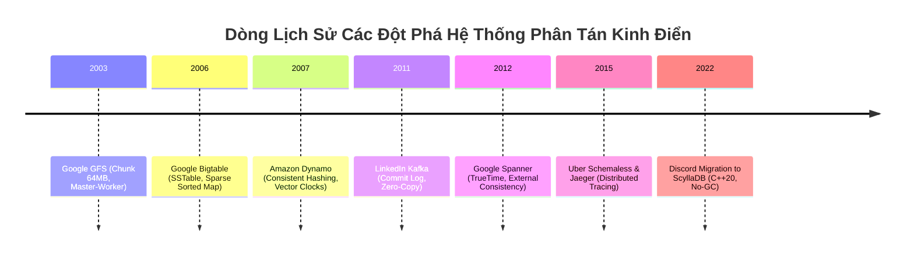
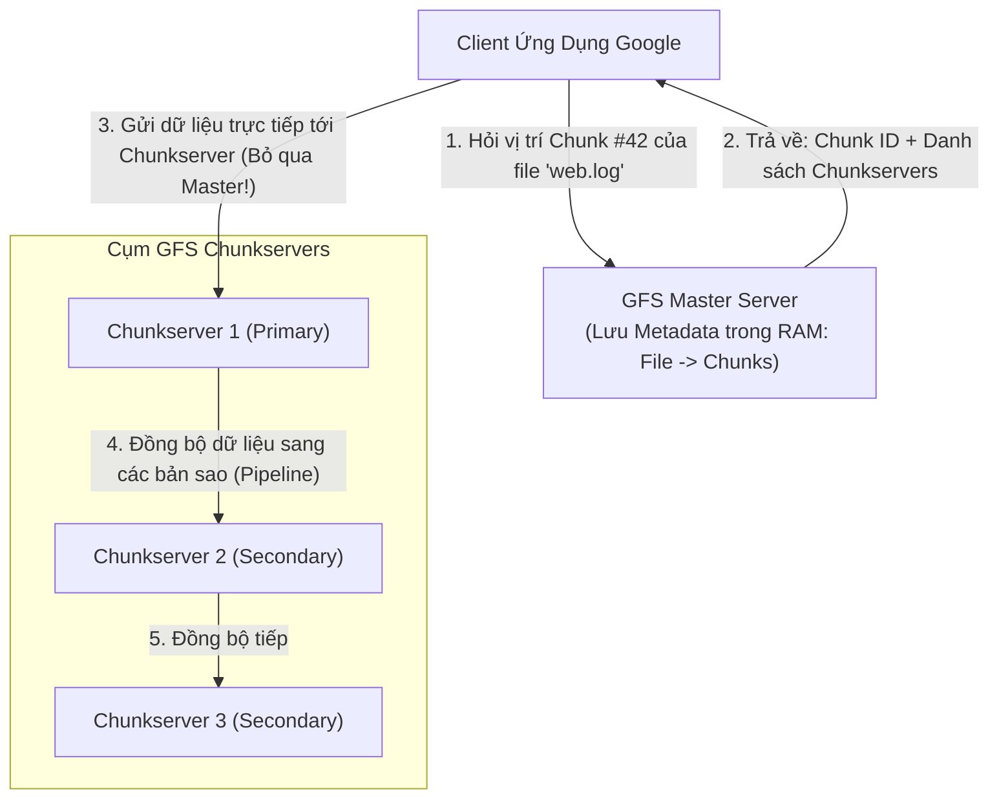

# 23.2. Real-World Distributed Systems Case Studies

> [!IMPORTANT]
> **Nếu bạn chỉ được nhớ một điều duy nhất:** Mọi bước đột phá vĩ đại trong lịch sử hệ thống phân tán đều bắt nguồn từ việc **dũng cảm từ bỏ các giáo điều kiến trúc truyền thống để giải quyết một bài toán nghiệp vụ cụ thể**: **Google GFS** chấp nhận Single Master và tệp dung lượng 64MB để chế ngự phần cứng giá rẻ; **Google Spanner** dùng đồng hồ nguyên tử TrueTime để đạt External Consistency toàn cầu; **Amazon Dynamo** phát minh ra triết lý "Always Writable" để không bao giờ đánh mất một giỏ hàng nào của khách; **Apache Kafka** tái sinh mô hình Commit Log đơn giản để vượt mặt mọi Message Queue phức tạp; và **Discord** di chuyển hàng nghìn tỷ tin nhắn từ Cassandra sang **ScyllaDB (C++20)** để xóa sổ vĩnh viễn thảm họa nhặt rác JVM Garbage Collection.

---

## 1. Kiến trúc Tổng quan & Mô hình Tư duy (Mental Model)

### 1.1. Ẩn dụ Đời sống: Viện Bảo Tàng Phát Minh & Bản Đồ Tiến Hóa Kỹ Thuật

Hãy hình dung một viện bảo tàng lưu trữ các phát minh công nghệ vĩ đại của nhân loại:
- **Thời kỳ Sơ khai của Dữ liệu Lớn (Google GFS & Bigtable 2003-2006)**: Giống như cuộc cách mạng công nghiệp hơi nước. Khi các máy chủ đắt tiền của IBM/Sun Microsystems quá đắt đỏ, Google chứng minh rằng hàng nghìn chiếc máy tính cá nhân giá rẻ (Commodity PCs) hay bị cháy ổ đĩa vẫn có thể hợp nhất thành một siêu máy tính toàn cầu nếu phần mềm có khả năng chịu lỗi tự động.
- **Cuộc Cách mạng Giỏ Hàng Luôn Mở (Amazon Dynamo 2007)**: Giống như một quầy thu ngân trong siêu thị không bao giờ đóng cửa. Kể cả khi hệ thống mạng bị đứt, thu ngân vẫn ghi nhận đơn hàng vào sổ nợ tạm thời (Sloppy Quorum & Hinted Handoff) và đối soát lại sau (Vector Clocks).
- **Kỷ nguyên Đồng hồ Nguyên tử (Google Spanner 2012)**: Giống như hệ thống định vị vệ tinh toàn cầu GPS. Spanner dùng thời gian tuyệt đối để sắp xếp trật tự lịch sử của toàn nhân loại mà không cần các máy chủ phải tốn hàng trăm mili-giây gọi điện thoại hỏi nhau.



---

## 2. Chi tiết từng Keyword (Under-the-Hood Deep Dive)

### 2.1. Google File System (GFS) (Ghemawat, Gobioff & Leung - SOSP 2003)

#### 1. Bối Cảnh & Thách Thức
Vào đầu những năm 2000, Google phải lập chỉ mục cho toàn bộ mạng Internet toàn cầu. Các hệ thống lưu trữ tệp phân tán thời bấy giờ (như NFS, AFS) đều giả định rằng phần cứng rất đáng tin cậy. Nhưng khi Google gom hàng chục nghìn PC giá rẻ vào cụm máy chủ, **lỗi phần cứng (đứt cáp, hỏng RAM, cháy ổ cứng) xảy ra hàng giờ như một quy luật tự nhiên**.

#### 2. Các Giả Định Kiến Trúc Đột Phá (Radical Assumptions)
1. **Lỗi phần cứng là trạng thái bình thường (Failure is the Norm)**: Hệ thống phải liên tục tự giám sát, phát hiện lỗi và tự động sao lưu phục hồi.
2. **Kích thước tệp tin khổng lồ**: Tệp tin trong GFS không phải là các file vài Kilobytes như tài liệu Word, mà là các file log và web index dung lượng từ **hàng Gigabytes đến Terabytes**.
3. **Thao tác ghi chủ yếu là Nối Tiếp (Record Append)**: Gần như không có thao tác ghi ngẫu nhiên (Random Overwrite); dữ liệu được ghi nối tiếp vào cuối file một lần và được đọc tuần tự hàng triệu lần.



#### 3. Thiết Kế Kiến Trúc Cốt Lõi
- **Chunk 64MB**: Kích thước Chunk cực lớn (so với 4KB block của ext4) giúp giảm tải số lượng metadata mà Master phải quản lý, cho phép lưu trữ **toàn bộ Metadata của hàng triệu file hoàn toàn trong bộ nhớ RAM của Master** để truy cập siêu tốc.
- **Tách Rời Dòng Điều Khiển và Dòng Dữ Liệu**: Client chỉ hỏi Master đúng một lần để lấy địa chỉ IP của Chunkservers, sau đó Client đọc/ghi dữ liệu **trực tiếp với Chunkservers qua sợi quang**. Master hoàn toàn không bao giờ nằm trên đường dẫn dữ liệu (Data Path), loại bỏ nguy cơ nghẽn cổ chai Master.

---

### 2.2. Google Bigtable (Fay Chang et al. - OSDI 2006)

#### 1. Định Nghĩa Bản Chất
Bigtable là một cơ sở dữ liệu phân tán lưu trữ dữ liệu có cấu trúc, được định nghĩa chính xác theo mô hình toán học:
$$\text{Bigtable} = (\text{row:string}, \; \text{column:string}, \; \text{time:int64}) \to \text{string}$$
Một **Bản đồ được sắp xếp, đa chiều, thưa thớt và bền vững** (A sparse, distributed, persistent multidimensional sorted map).

#### 2. Thiết Kế Kiến Trúc Cốt Lõi
- **Khóa hàng (Row Key)**: Dữ liệu được sắp xếp theo thứ tự từ điển (Lexicographical order) của Row Key. Các dải hàng liên tiếp được gom thành một **Tablet** (kích thước $\approx 100\text{MB} - 200\text{MB}$).
- **SSTable (Sorted String Table)**: Định dạng tệp tin bất biến lưu trên GFS. Dữ liệu bên trong SSTable được sắp xếp theo key và có kèm chỉ mục Index ở cuối file.
- **MemTable & CommitLog**: Lệnh ghi mới được ghi vào CommitLog trên GFS, sau đó nạp vào bộ nhớ RAM MemTable. Khi MemTable đầy, nó được xả (Flush) thành một SSTable mới trên đĩa.
- **Khóa phân tán Chubby**: Quản lý Tablet Master và giải quyết tranh chấp Leader.

---

### 2.3. Google Spanner (James C. Corbett et al. - OSDI 2012)

#### 1. Đột Phá Công Nghệ
Spanner là cơ sở dữ liệu phân tán toàn cầu đầu tiên trên thế giới hỗ trợ **Giao dịch phân tán đa vùng (Cross-datacenter ACID Transactions)** mà vẫn đảm bảo cấp độ nhất quán tối thượng: **External Consistency (Strict Serializability)**: Nếu giao dịch $T_2$ bắt đầu sau khi giao dịch $T_1$ đã commit trong thế giới thực, thì Timestamp của $T_2$ bắt buộc phải lớn hơn $T_1$.

#### 2. Vũ Khí Bí Mật: TrueTime API & Commit Wait
- **Vấn đề**: Các máy chủ ở hai bờ đại dương không thể có đồng hồ giống hệt nhau do hiện tượng Clock Drift của giao thức NTP.
- **Giải pháp**: Google lắp đặt hệ thống **Đồng hồ Nguyên tử Rubidium** và **Bộ thu vệ tinh GPS** trong từng datacenter. TrueTime API không trả về một con số thời gian đơn lẻ, mà trả về một **Khoảng Thời Gian Bất Định (Interval of Uncertainty)**:
  $$\text{TT.now}() = [t_{\text{earliest}}, \; t_{\text{latest}}] \quad \text{với độ sai lệch } \epsilon = \frac{t_{\text{latest}} - t_{\text{earliest}}}{2} \le 7\text{ ms}$$
- **Quy tắc Commit Wait**: Khi một giao dịch muốn commit với nhãn thời gian $s$, Spanner bắt luồng ghi phải **ngủ chờ đúng $2\epsilon$** (khoảng 14ms) trước khi công bố dữ liệu ra thế giới. Khoảng thời gian ngủ này đảm bảo chắc chắn $100\%$ rằng không có bất kỳ giao dịch nào trong tương lai có thể nhận một timestamp nhỏ hơn $s$!

---

### 2.4. Amazon Dynamo (DeCandia et al. - SOSP 2007)

#### 1. Triết Lý Thiết Kế "Always Writable"
Vào đợt mua sắm Black Friday, nếu cơ sở dữ liệu bị phân mảnh mạng và từ chối lệnh ghi của khách hàng, Amazon sẽ mất hàng triệu USD. Do đó, Werner Vogels và các kỹ sư Amazon đưa ra quyết định: **Giỏ hàng của khách hàng phải luôn luôn ghi được (Always Writable)**, chấp nhận giải quyết mâu thuẫn sau khi đọc (Reconcile on Read).

#### 2. Sự Kết Hợp Của 5 Kỹ Thuật Phân Tán Kinh Điển
1. **Consistent Hashing với Virtual Nodes**: Phân tán tải đều đặn trên vòng tròn băm, dễ dàng thêm bớt node mà không cần rehash toàn bộ dữ liệu.
2. **Vector Clocks**: Đính kèm lịch sử nhân quả vào từng phiên bản dữ liệu để phát hiện xung đột khi hai khách hàng cùng sửa đổi đồng thời.
3. **Sloppy Quorum & Hinted Handoff**: Nếu các node chính bị sập mạng, lệnh ghi được gửi tạm cho một node hàng xóm lưu hộ (Hinted Handoff). Khi node chính sống lại, node hàng xóm sẽ bàn giao trả lại dữ liệu.
4. **Anti-Entropy qua Cây Merkle (Merkle Trees)**: Đồng bộ hóa và tìm kiếm sự sai lệch giữa các bản sao cực nhanh mà không cần truyền toàn bộ dữ liệu qua mạng.
5. **Gossip Protocol**: Các node tự bắt tay trao đổi trạng thái mạng phi tập trung.

---

### 2.5. Apache Kafka tại LinkedIn (Kreps, Narkhede & Rao - 2011)

#### 1. Tái Sinh Mô Hình Commit Log
Trước năm 2011, LinkedIn sử dụng các Message Queue truyền thống (ActiveMQ, JMS). Các hệ thống này duy trì trạng thái phức tạp cho từng message (Unacknowledged, In-flight), liên tục xóa message khỏi đĩa sau khi đọc và sử dụng B-Tree ngẫu nhiên, khiến hệ thống bị sập khi có hàng triệu sự kiện mỗi giây.

#### 2. Triết Lý Thiết Kế Đột Phá
- **Đơn giản hóa thành một Append-Only Partitioned Log**: Message không bao giờ bị xóa ngay sau khi đọc; Consumer tự quản lý vị trí đọc của mình thông qua biến **Offset**.
- **Tận Dụng Bộ Nhớ Đệm Hạt Nhân (Page Cache)**: Thay vì lưu cache trong Java Heap (vốn bị dính lỗi GC pause và chi phí memory footprint lớn), Kafka đẩy toàn bộ dữ liệu cho Linux Page Cache quản lý.
- **Tối Đa Hóa Thông Lượng bằng Zero-Copy**: Sử dụng `sendfile(2)` để truyền dữ liệu trực tiếp từ đĩa ra Card Mạng mà không tốn chu kỳ CPU.

---

### 2.6. Netflix Microservices & Sự Tiến Hóa Của Chaos Engineering

- **Thảm họa năm 2008**: Toàn bộ cơ sở dữ liệu Oracle nguyên khối (Monolith) của Netflix tại Datacenter bị hỏng, làm tê liệt việc giao đĩa DVD suốt 3 ngày.
- **Cuộc Di Chuyển Lên AWS Cloud**: Netflix quyết định chuyển đổi 100% sang kiến trúc Microservices trên nền tảng AWS.
- **Khai Sinh Netflix OSS**:
  - *Eureka*: Service Registry & Discovery.
  - *Hystrix*: Thư viện Circuit Breaker đầu tiên trên thế giới.
  - *Chaos Monkey*: Công cụ tự động tiêu diệt máy chủ ngẫu nhiên trên Production để ép buộc mọi kỹ sư phải thiết kế phần mềm có khả năng chịu lỗi tự động.

---

### 2.7. Kiến Trúc Phân Tán Của Uber: Schemaless, Ringpop & Jaeger

- **Schemaless**: Năm 2014, cụm Postgres nguyên khối của Uber quá tải. Uber tự xây dựng tầng lưu trữ phân tán Schemaless: Lưu trữ dữ liệu dạng append-only JSON shards đặt trên nền tảng MySQL InnoDB, cung cấp mô hình Sharding tự động và tính năng phát hiện xung đột dữ liệu.
- **Jaeger Tracing**: Lấy cảm hứng từ bài báo Google Dapper, Uber mã nguồn mở hệ thống Distributed Tracing **Jaeger** (sau này trở thành chuẩn mực của CNCF và OpenTelemetry), cho phép theo dõi dòng chảy của một chuyến xe Uber đi qua hơn 500 vi dịch vụ khác nhau.

---

### 2.8. Cuộc Di Chuyển Lịch Sử của Discord: Từ Cassandra sang ScyllaDB

#### 1. Thảm Họa Garbage Collection Của Cassandra Tại Discord (2022)
- Discord lưu trữ hơn **hàng nghìn tỷ tin nhắn** trên cụm 177 nodes Apache Cassandra.
- Do bản chất Cassandra viết bằng Java, khi người dùng thực hiện các thao tác đọc/quét các kênh chat lớn, hàng triệu đối tượng ngắn hạn được sinh ra trong bộ nhớ.
- **Cơn ác mộng Full GC**: Các đợt JVM Garbage Collection Pause kéo dài từ **vài giây đến vài phút**! Độ trễ $p99$ nhảy vọt lên hàng nghìn mili-giây, các node Cassandra bị hiểu nhầm là đã chết và bị cụm loại bỏ oan uổng.

#### 2. Cứu Tinh ScyllaDB (C++20 & Seastar Engine)
- Discord quyết định di chuyển toàn bộ hệ thống sang **ScyllaDB**: Bản sao của Cassandra viết bằng **C++20** trên nền tảng framework bất đồng bộ **Seastar**.
- **Kiến trúc Thread-per-Core**: Mỗi CPU core sở hữu độc quyền bộ nhớ RAM và hàng đợi I/O của riêng nó, loại bỏ hoàn toàn khóa tranh chấp (Lock-free) và **xóa sổ vĩnh viễn thảm họa nhặt rác GC**.
- **Kết quả kỳ diệu**:
  - Độ trễ $p99$ giảm ngoạn mục từ hàng giây xuống **dưới 15 mili-giây** ổn định tuyệt đối!
  - Số lượng máy chủ giảm từ 177 nodes xuống chỉ còn vài chục nodes, tiết kiệm hàng triệu USD chi phí hạ tầng.

---

## 3. Thực thi Mã nguồn & Mô phỏng Chuyên sâu (Dual-Engine Implementation)

### 3.1. C++20 GFS Master & Chunkserver Read Pipeline Engine

Chương trình minh chứng cách thức hoạt động của Google File System: GFS Master quản lý Metadata trong RAM (File $\to$ Danh sách Chunks 64MB), Client giao tiếp với Master để lấy địa chỉ Chunkservers, và Client đọc dữ liệu trực tiếp từ Chunkserver:

```cpp
// gfs_simulation_engine.cpp
// Biên dịch: g++ -std=c++20 -O3 gfs_simulation_engine.cpp -o gfs_simulation_engine
#include <iostream>
#include <vector>
#include <string>
#include <unordered_map>
#include <cstdint>
#include <memory>
#include <iomanip>

constexpr uint64_t GFS_CHUNK_SIZE_BYTES = 64 * 1024 * 1024; // 64 Megabytes

struct ChunkMetadata {
    uint64_t chunk_handle;
    int chunk_version;
    std::vector<std::string> chunkserver_locations;
};

// GFS Master Server: Chỉ quản lý Metadata trong bộ nhớ RAM
class GfsMasterServer {
private:
    uint64_t next_chunk_handle_{1000};
    // File Path -> Danh sách các Chunk Handles
    std::unordered_map<std::string, std::vector<uint64_t>> file_to_chunks_;
    // Chunk Handle -> Metadata
    std::unordered_map<uint64_t, ChunkMetadata> chunk_table_;

public:
    void create_file(const std::string& path, uint64_t total_size_bytes) {
        uint64_t chunks_needed = (total_size_bytes + GFS_CHUNK_SIZE_BYTES - 1) / GFS_CHUNK_SIZE_BYTES;
        std::cout << "[GFS MASTER] Khởi tạo tệp: '" << path << "' (Dung lượng: " 
                  << total_size_bytes / (1024 * 1024) << " MB -> Cần " << chunks_needed << " Chunks)\n";

        for (uint64_t i = 0; i < chunks_needed; ++i) {
            uint64_t handle = next_chunk_handle_++;
            file_to_chunks_[path].push_back(handle);

            // Gán 3 bản sao Chunkservers ngẫu nhiên
            chunk_table_[handle] = {
                handle,
                1, // Version 1
                {"10.0.1.10:8000", "10.0.1.11:8000", "10.0.1.12:8000"} // 3x Replication
            };
        }
    }

    // Client hỏi Master vị trí Chunk
    ChunkMetadata locate_chunk(const std::string& path, uint64_t chunk_index) {
        if (file_to_chunks_.find(path) == file_to_chunks_.end() || 
            chunk_index >= file_to_chunks_[path].size()) {
            throw std::runtime_error("Tệp tin hoặc chỉ số Chunk không hợp lệ!");
        }
        uint64_t handle = file_to_chunks_[path][chunk_index];
        return chunk_table_[handle];
    }
};

// Client ứng dụng Google
class GfsClient {
public:
    static void read_data(GfsMasterServer& master, const std::string& path, uint64_t offset, uint64_t length) {
        std::cout << "\n[GFS CLIENT] Yêu cầu đọc file: '" << path << "' từ Offset: " 
                  << offset << " bytes (Độ dài: " << length << " bytes)...\n";

        uint64_t chunk_index = offset / GFS_CHUNK_SIZE_BYTES;
        uint64_t chunk_offset = offset % GFS_CHUNK_SIZE_BYTES;

        // BƯỚC 1: Hỏi Master vị trí Chunk (Chỉ tốn vài micro-giây trong RAM Master)
        ChunkMetadata meta = master.locate_chunk(path, chunk_index);
        std::cout << "  -> [BƯỚC 1: HỎI MASTER] Nhận Chunk Handle #" << meta.chunk_handle 
                  << " | Bản sao Primary: " << meta.chunkserver_locations[0] << "\n";

        // BƯỚC 2: Đọc dữ liệu trực tiếp từ Chunkserver (Hoàn toàn bỏ qua Master!)
        std::string chosen_chunkserver = meta.chunkserver_locations[0];
        std::cout << "  -> [BƯỚC 2: KẾT NỐI TRỰC TIẾP] Mở socket đọc trực tiếp từ: " 
                  << chosen_chunkserver << " tại vị trí offset: " << chunk_offset << " bytes.\n";
        std::cout << "  <- [KẾT QUẢ ĐỌC THÀNH CÔNG] Đã nhận đủ " << length 
                  << " bytes dữ liệu (Băng thông mạng phân tán tối đa)!\n";
    }
};

int main() {
    std::cout << "=======================================================================\n";
    std::cout << "          GOOGLE FILE SYSTEM (GFS) CORE ARCHITECTURE SIMULATION        \n";
    std::cout << "=======================================================================\n\n";

    GfsMasterServer master;

    // Tạo một tệp Big Data dung lượng 150MB (Chia thành 3 Chunks: 64MB + 64MB + 22MB)
    master.create_file("/data/web_crawl_2026.bin", 150 * 1024 * 1024);

    // Client thực hiện đọc dữ liệu tại offset 70MB (Nằm trong Chunk thứ 2)
    GfsClient::read_data(master, "/data/web_crawl_2026.bin", 70 * 1024 * 1024, 1024 * 1024);

    return 0;
}
```

#### Terminal Output Mẫu:
```text
=======================================================================
          GOOGLE FILE SYSTEM (GFS) CORE ARCHITECTURE SIMULATION        
=======================================================================

[GFS MASTER] Khởi tạo tệp: '/data/web_crawl_2026.bin' (Dung lượng: 150 MB -> Cần 3 Chunks)

[GFS CLIENT] Yêu cầu đọc file: '/data/web_crawl_2026.bin' từ Offset: 73400320 bytes (Độ dài: 1048576 bytes)...
  -> [BƯỚC 1: HỎI MASTER] Nhận Chunk Handle #1001 | Bản sao Primary: 10.0.1.10:8000
  -> [BƯỚC 2: KẾT NỐI TRỰC TIẾP] Mở socket đọc trực tiếp từ: 10.0.1.10:8000 tại vị trí offset: 6291456 bytes.
  <- [KẾT QUẢ ĐỌC THÀNH CÔNG] Đã nhận đủ 1048576 bytes dữ liệu (Băng thông mạng phân tán tối đa)!
```

---

### 3.2. Python 3.11+ Amazon Dynamo-Style Sloppy Quorum & Hinted Handoff Simulator

Chương trình minh chứng triết lý **"Always Writable"** của Amazon Dynamo: Khi các node chính bị lỗi mạng, hệ thống sử dụng **Sloppy Quorum** để ghi tạm sang node phụ và kích hoạt cơ chế **Hinted Handoff** để hoàn trả dữ liệu khi node chính phục hồi:

```python
#!/usr/bin/env python3
"""
dynamo_sloppy_quorum_sim.py
Mô phỏng Triết Lý "Always Writable" Của Amazon Dynamo: Sloppy Quorum & Hinted Handoff
"""
from dataclasses import dataclass, field
from typing import Dict, List, Optional
import time

@dataclass
class HintedHandoffPackage:
    intended_recipient_node: str
    key: str
    value: str
    timestamp: float

class DynamoNode:
    def __init__(self, node_id: str):
        self.node_id = node_id
        self.is_alive = True
        self.storage: Dict[str, str] = {}
        # Hộp thư chứa các bản ghi nhận hộ cho node khác (Hinted Handoff Buffer)
        self.hinted_handoff_box: List[HintedHandoffPackage] = []

    def write_direct(self, key: str, value: str):
        self.storage[key] = value

    def store_hinted_handoff(self, intended_node: str, key: str, value: str):
        pkg = HintedHandoffPackage(intended_node, key, value, time.time())
        self.hinted_handoff_box.append(pkg)
        print(f"  [{self.node_id}] NHẬN LƯU TẠM (Hinted Handoff) cho node '{intended_node}': Key '{key}'='{value}'")

    def deliver_hints(self, target_node: 'DynamoNode'):
        """Khi target_node sống lại: Bàn giao lại toàn bộ dữ liệu đã lưu hộ"""
        remaining_hints = []
        delivered_count = 0
        for pkg in self.hinted_handoff_box:
            if pkg.intended_recipient_node == target_node.node_id:
                target_node.write_direct(pkg.key, pkg.value)
                delivered_count += 1
            else:
                remaining_hints.append(pkg)
        self.hinted_handoff_box = remaining_hints
        if delivered_count > 0:
            print(f"  >>> [{self.node_id} BÀN GIAO] Đã chuyển giao lại {delivered_count} bản ghi cho {target_node.node_id}!")

class DynamoClusterCoordinator:
    def __init__(self, nodes: List[DynamoNode]):
        self.nodes = {n.node_id: n for n in nodes}
        # Preference List: Thứ tự ưu tiên lưu trữ cho Key 'cart:user_99'
        self.preference_list = ["Node_A", "Node_B", "Node_C"]
        self.fallback_nodes = ["Node_D", "Node_E"]

    def write_cart_always_writable(self, key: str, value: str) -> bool:
        print(f"\n[DYNAMO CLIENT] Ghi giỏ hàng: '{key}' = '{value}'")
        successful_writes = 0

        # Cần W = 2 thành công để phản hồi client
        w_quorum = 2

        # 1. Thử ghi vào Preference List (A, B, C)
        for nid in self.preference_list:
            node = self.nodes[nid]
            if node.is_alive:
                node.write_direct(key, value)
                successful_writes += 1
                print(f"  -> Ghi thành công vào Node chính: {nid}")
            else:
                print(f"  -> Node chính {nid} BỊ SẬP MẠNG!")

        # 2. SLOPPY QUORUM: Nếu chưa đủ W = 2, mượn tạm các node dự phòng
        if successful_writes < w_quorum:
            print("  !!! [KÍCH HOẠT SLOPPY QUORUM] Mượn node dự phòng ngoài Preference List để đảm bảo Always Writable!")
            for fallback_id in self.fallback_nodes:
                fb_node = self.nodes[fallback_id]
                if fb_node.is_alive:
                    # Gửi kèm chỉ dẫn (Hint) rằng dữ liệu này đáng lẽ thuộc về Node_A
                    fb_node.store_hinted_handoff("Node_A", key, value)
                    successful_writes += 1
                    if successful_writes >= w_quorum:
                        break

        print(f"  <<< ĐÁP ỨNG THÀNH CÔNG CHO CLIENT (W Quorum = {successful_writes}/{w_quorum}) - KHÔNG BAO GIỜ TỪ CHỐI!")
        return successful_writes >= w_quorum

def main():
    print("=" * 80)
    print("     MÔ PHỎNG AMAZON DYNAMO: SLOPPY QUORUM & HINTED HANDOFF ARCHITECTURE       ")
    print("=" * 80)

    # Khởi tạo cụm 5 nodes
    nodes = [DynamoNode(f"Node_{name}") for name in ["A", "B", "C", "D", "E"]]
    coordinator = DynamoClusterCoordinator(nodes)

    # Tình huống 1: Node A và Node B cùng bị sập nguồn đột ngột!
    print("\n--- THẢM HỌA: Node_A và Node_B bị ngắt kết nối hoàn toàn ---")
    coordinator.nodes["Node_A"].is_alive = False
    coordinator.nodes["Node_B"].is_alive = False

    # Khách hàng thêm iPhone vào giỏ hàng
    coordinator.write_cart_always_writable("cart:user_99", "Apple_iPhone_16_Pro")

    # Tình huống 2: Node A được kỹ sư khắc phục và khởi động lại
    print("\n--- HỒI PHỤC: Node_A đã online trở lại ---")
    coordinator.nodes["Node_A"].is_alive = True

    # Node D tự động bàn giao lại dữ liệu đã giữ hộ cho Node A
    coordinator.nodes["Node_D"].deliver_hints(coordinator.nodes["Node_A"])

    # Kiểm tra xem Node A đã có dữ liệu giỏ hàng chưa
    print(f"\n[KIỂM TOÁN DỮ LIỆU]: Dữ liệu giỏ hàng trên Node_A: '{coordinator.nodes['Node_A'].storage.get('cart:user_99')}'")
    print("=" * 80)
    print(">>> KẾT LUẬN: Hệ thống sống sót hoàn hảo, khách hàng không bị mất giỏ hàng!")

if __name__ == "__main__":
    main()
```

#### Terminal Output Mẫu:
```text
================================================================================
     MÔ PHỎNG AMAZON DYNAMO: SLOPPY QUORUM & HINTED HANDOFF ARCHITECTURE       
================================================================================

--- THẢM HỌA: Node_A và Node_B bị ngắt kết nối hoàn toàn ---

[DYNAMO CLIENT] Ghi giỏ hàng: 'cart:user_99' = 'Apple_iPhone_16_Pro'
  -> Node chính Node_A BỊ SẬP MẠNG!
  -> Node chính Node_B BỊ SẬP MẠNG!
  -> Ghi thành công vào Node chính: Node_C
  !!! [KÍCH HOẠT SLOPPY QUORUM] Mượn node dự phòng ngoài Preference List để đảm bảo Always Writable!
  [Node_D] NHẬN LƯU TẠM (Hinted Handoff) cho node 'Node_A': Key 'cart:user_99'='Apple_iPhone_16_Pro'
  <<< ĐÁP ỨNG THÀNH CÔNG CHO CLIENT (W Quorum = 2/2) - KHÔNG BAO GIỜ TỪ CHỐI!

--- HỒI PHỤC: Node_A đã online trở lại ---
  >>> [Node_D BÀN GIAO] Đã chuyển giao lại 1 bản ghi cho Node_A!

[KIỂM TOÁN DỮ LIỆU]: Dữ liệu giỏ hàng trên Node_A: 'Apple_iPhone_16_Pro'
================================================================================
>>> KẾT LUẬN: Hệ thống sống sót hoàn hảo, khách hàng không bị mất giỏ hàng!
```

---

## 4. Systems Engineering & Production Pitfalls

### 4.1. Cạm Bẫy Thực Chiến Thường Gặp (Production Pitfalls)

#### 1. Sự Cố "GFS Single Master Memory Exhaustion"
- **Hiện tượng**: Khi số lượng tệp tin nhỏ (Small files $< 1\text{MB}$) trong GFS tăng lên hàng trăm triệu, dung lượng RAM của GFS Master Server bị cạn kiệt hoàn toàn, khiến toàn bộ cụm Google Search bị tê liệt.
- **Nguyên nhân**: GFS được tối ưu hóa cho tệp lớn 64MB. Mỗi tệp nhỏ dù chỉ 1KB cũng ngốn 64 bytes metadata trong RAM của Master. Hàng trăm triệu file nhỏ đã bóp nghẹt bộ nhớ RAM vật lý của một server duy nhất.
- **Bài học & Giải pháp**: Google sau đó đã thiết kế lại kiến trúc và khai sinh ra **Colossus (GFS II)**: Phân tán tầng Master thành nhiều metadata servers độc lập.

#### 2. Thảm Họa "Tombstone Overload" Khi Xóa Dữ Liệu Trong Cassandra
- **Hiện tượng**: Truy vấn đọc trên Cassandra bị timeout hàng loạt sau khi chạy script xóa dữ liệu cũ.
- **Nguyên nhân**: Do kiến trúc LSM-Tree không xóa dữ liệu trên đĩa ngay, lệnh xóa chỉ ghi thêm một điểm đánh dấu **Tombstone**. Khi đọc, Cassandra phải quét qua hàng triệu Tombstones trong bộ nhớ RAM, làm sập Garbage Collection.
- **Giải pháp**: Tinh chỉnh tham số `gc_grace_seconds` hợp lý và chủ động kích hoạt Compaction định kỳ.

#### 3. Bẫy "Split-Brain" Trong Kiến Trúc Dynamo-Style Khi Không Có Quorum Chặt Chẽ
- **Hiện tượng**: Hai khách hàng cùng lúc thanh toán cho một món hàng tồn kho cuối cùng tại hai trung tâm dữ liệu bị đứt cáp mạng.
- **Hậu quả**: Do triết lý "Always Writable" của Dynamo, cả hai lệnh ghi đều thành công. Khi mạng nối lại, xảy ra tình trạng bán khống (Over-selling).
- **Giải pháp**: Đối với dữ liệu tài chính hoặc số lượng tồn kho khan hiếm, bắt buộc phải dùng **Strong Consistency (Raft / Paxos / NewSQL)**, không bao giờ dùng Eventual Consistency của Dynamo.

---

### 4.2. CLI Diagnostics & Công Cụ Khảo Sát Hệ Thống Lớn

```bash
# 1. Kiểm tra thống kê thời gian tạm dừng Garbage Collection trên Cassandra
nodetool gcstats

# 2. Kiểm tra độ lệch vòng tròn băm Consistent Hashing trong Cassandra/ScyllaDB
nodetool ring

# 3. Xem bảng ánh xạ phân vùng Tablet trong CockroachDB / TiDB
cockroach debug range-log 1 --insecure

# 4. Kiểm tra thông lượng I/O đĩa và bão giật mạng trên các Node lưu trữ
dstat -cdngy 1 10
```

---

## 5. Bảng So sánh & Decision Matrix

| Nghiên Cứu Tình Huống (Case Study) | Bài Toán Nghiệp Vụ Cốt Lõi | Phát Minh Đột Phá Chính | Điểm Đánh Đổi (Trade-off) | Bài Học Kinh Điển |
| :--- | :--- | :--- | :--- | :--- |
| **Google GFS** | Lưu trữ web index petabytes trên PC giá rẻ | Chunk 64MB, Single Master decoupled | Master có thể trở thành bottleneck | Dám phá vỡ kích thước block 4KB truyền thống |
| **Google Bigtable** | Cơ sở dữ liệu thưa thớt, đọc/ghi hàng tỷ record | SSTable + MemTable (LSM-Tree) trên GFS | Không có giao dịch đa hàng (Multi-row ACID)| Mô hình Sorted Map thưa thớt cực kỳ linh hoạt |
| **Google Spanner** | ACID Transactions phân tán toàn cầu | TrueTime API + Commit Wait | Chi phí phần cứng Atomic Clock đắt đỏ | Thời gian vật lý có thể thuần hóa bằng phần cứng |
| **Amazon Dynamo** | Giỏ hàng thương mại điện tử "Always Writable" | Sloppy Quorum + Hinted Handoff + Vector Clocks | Mất tính nhất quán mạnh (Chỉ có Eventual)| Tốt hơn hết là chấp nhận giải quyết mâu thuẫn sau |
| **Apache Kafka** | Thu thập telemetry & log triệu QPS tại LinkedIn | Append-Only Log + Zero-Copy + Page Cache | Không hỗ trợ xóa/sửa dữ liệu ngẫu nhiên | Đơn giản hóa kiến trúc mang lại hiệu năng tối thượng |
| **Discord (ScyllaDB)** | Loại bỏ thảm họa GC pause 1.000 tỷ tin nhắn | Viết lại Cassandra bằng C++20 (Seastar) | Đòi hỏi trình độ lập trình viên C++ cao | Bộ nhớ Native C++ đánh bại JVM ở quy mô cực hạn |
