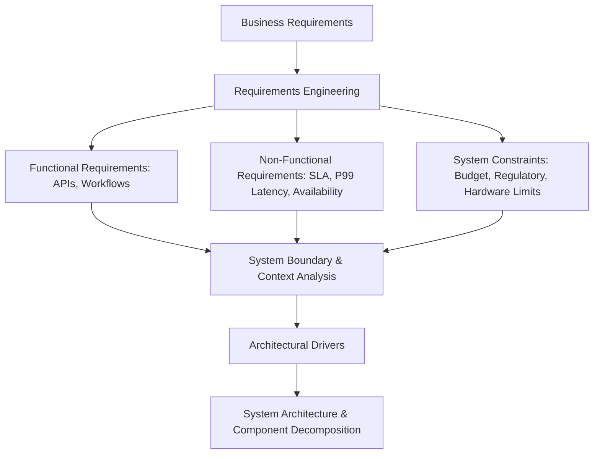
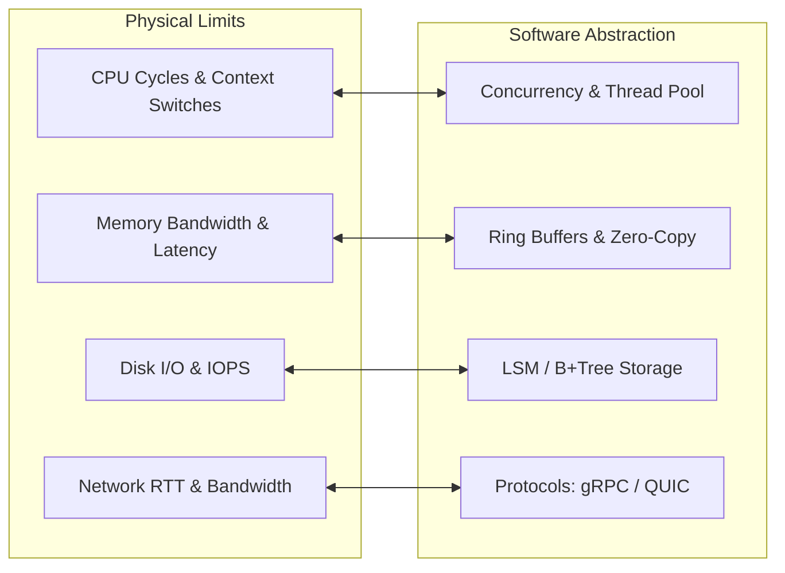
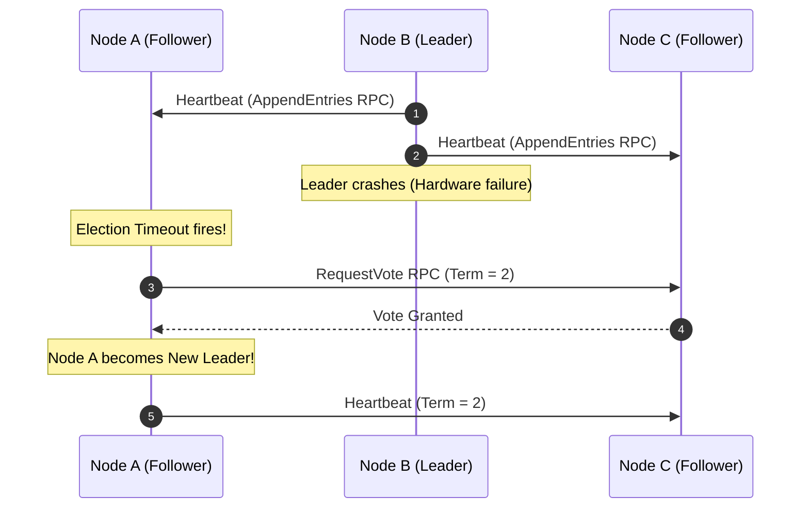
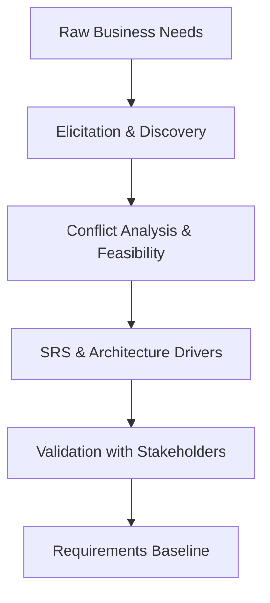
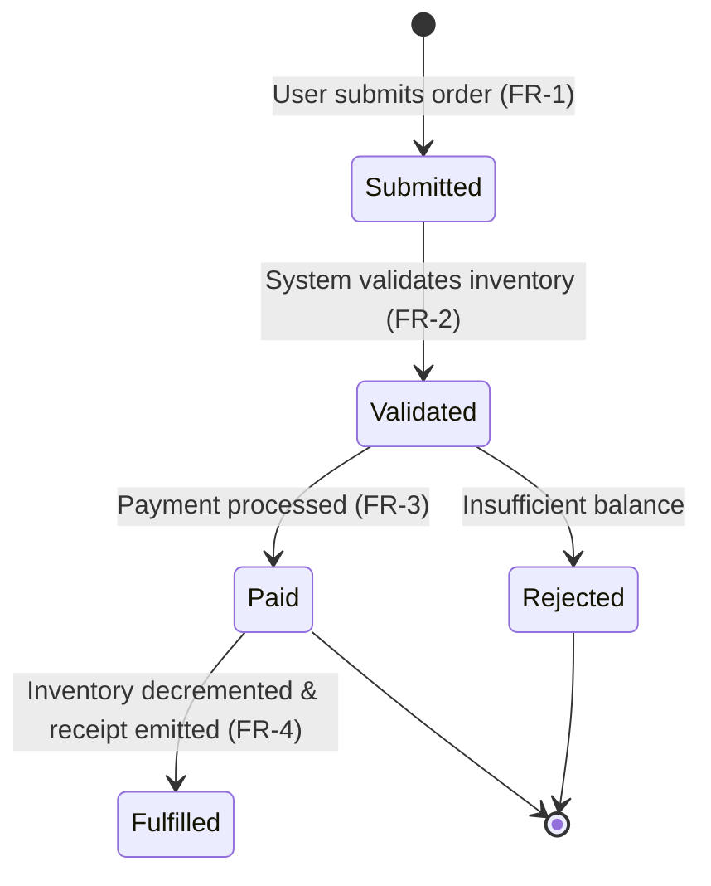
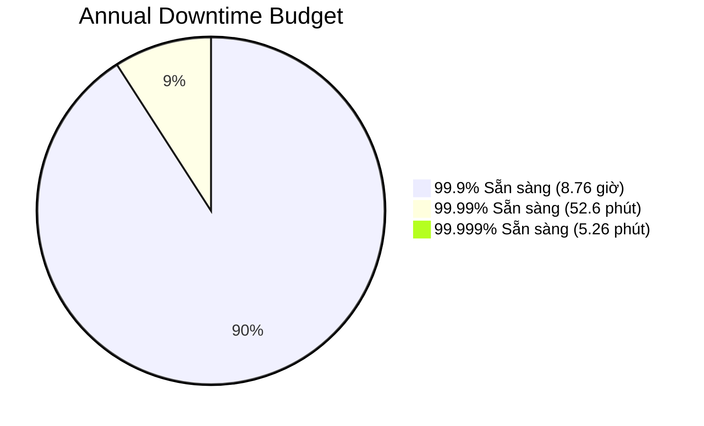
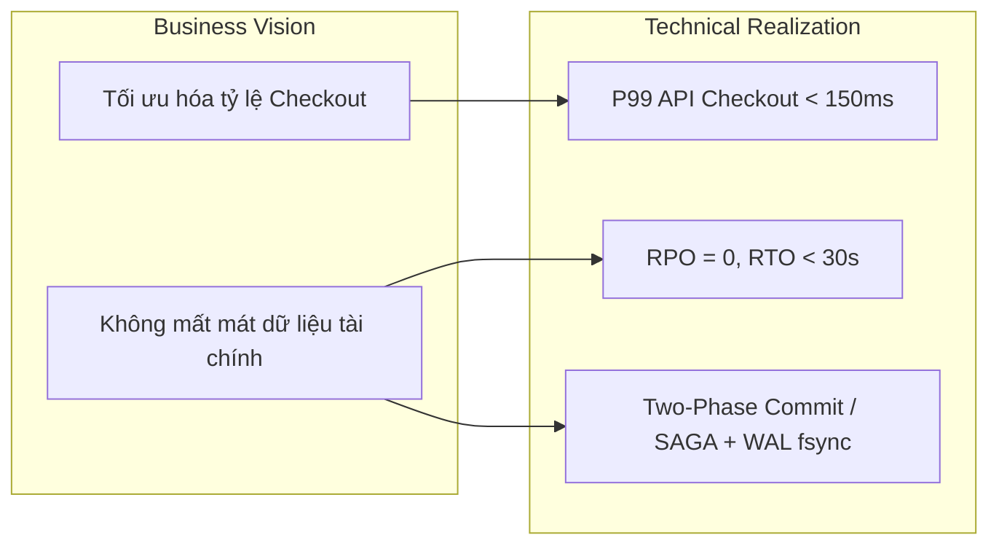
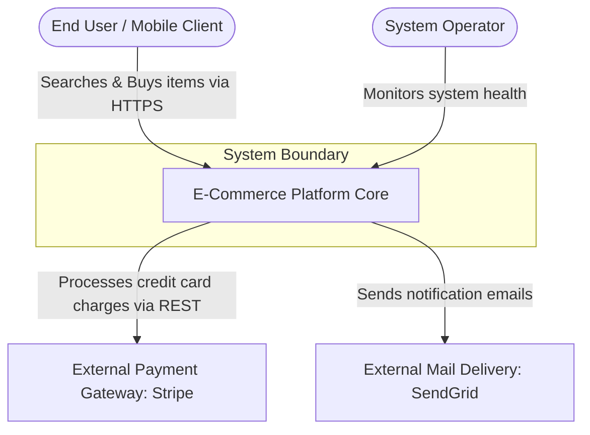
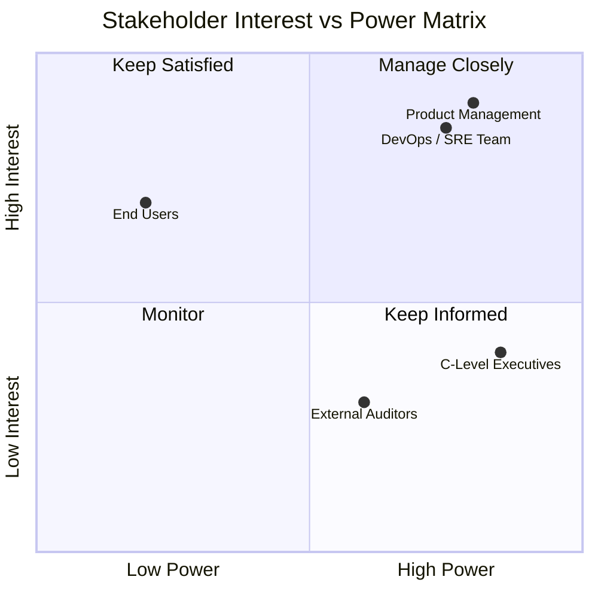

# 01.1. System Design Principles and Requirements (Nguyên Lý Thiết Kế Hệ Thống và Kỹ Nghệ Yêu Cầu)

## Tổng quan về Nguyên Lý Thiết Kế và Yêu Cầu Hệ Thống
Trong kỹ nghệ phần mềm quy mô lớn, **Thiết kế Hệ thống (System Design)** là quá trình chuyển đổi các bài toán kinh doanh trừu tượng thành một kiến trúc phần cứng, phần mềm, mạng và dữ liệu cụ thể. Mục tiêu tối thượng là đảm bảo tính đúng đắn chức năng (Functional Correctness), khả năng mở rộng (Scalability), tính sẵn sàng cao (High Availability), hiệu năng tối ưu (Low Latency / High Throughput) và tối ưu hóa chi phí vận hành (TCO - Total Cost of Ownership).

Một thiết kế hệ thống vững chắc không khởi đầu từ việc chọn công nghệ (như Kafka hay Kubernetes), mà khởi đầu từ **Kỹ nghệ Yêu cầu (Requirements Engineering)** — xác định chính xác phạm vi, ranh giới, các giả định ngầm và những ràng buộc vật lý/tài chính chi phối hệ thống.



---

## 2. Chi tiết từng Keyword (Under-the-Hood Deep Dive)

### 1. System Design Fundamentals (Nguyên lý Nền tảng Thiết kế Hệ thống)

#### 1. Khái niệm bản chất (What & Why)
System Design Fundamentals là tập hợp các phương pháp luận, mô hình tư duy và kỹ thuật phân rã một hệ thống phức tạp thành các hệ thống con (Subsystems), module và giao diện (Interfaces) độc lập. Lý do tồn tại của nguyên lý này là quy luật kiểm soát độ phức tạp (Managing Complexity): một bộ não con người không thể nắm giữ toàn bộ trạng thái của một hệ thống hàng triệu dòng code phục vụ hàng trăm triệu người dùng nếu không có sự trừu tượng hóa và phân tầng rõ ràng.

#### 2. Cơ chế hoạt động sâu (Under the hood / Hardcore Internals)
Ở tầng bản chất máy tính và mạng, mọi hệ thống phần mềm đều bị giới hạn bởi 4 tài nguyên vật lý hữu hạn:
1. **CPU Execution Cycle**: Giới hạn bởi xung nhịp, số core và chi phí context-switch (khoảng 1.2 - 2.5 µs cho một thread context switch trên Linux kernel).
2. **Memory Throughput & Capacity**: Giới hạn bởi băng thông RAM vật lý (DDR4 ~25.6 GB/s/channel, DDR5 ~51.2 GB/s/channel) và độ trễ truy xuất Cache hierarchy (L1 ~1ns, L2 ~3-4ns, L3 ~10-15ns, DRAM ~60-80ns).
3. **I/O Bandwidth (Disk & Storage)**: NVMe SSD PCIe 4.0 có thể đạt 7 GB/s sequential read và 1,000,000 IOPS, nhưng độ trễ ngẫu nhiên vẫn ở mức 10-30 µs, chậm hơn hàng nghìn lần so với CPU cache.
4. **Network Bandwidth & Latency**: Giới hạn bởi tốc độ ánh sáng trong sợi quang (~5 µs/km), độ trễ Round-Trip Time (RTT giữa London và New York ~70ms), và throughput card mạng (10GbE, 40GbE, 100GbE).

Thiết kế hệ thống ở mức cơ bản là việc quản lý và dung hòa các giới hạn vật lý này thông qua: Phân tán tải (Load distribution), Gom cụm I/O (Batching), Bất đồng bộ hóa (Asynchrony) và Lưu trữ đệm (Caching).

#### 3. Sơ đồ minh họa


#### 4. Code ví dụ thực chiến (C++20 - Benchmark latency truy cập tài nguyên)
Ví dụ minh họa chi phí truy cập tài nguyên (Memory Cache vs Pointer Chasing) tác động trực tiếp tới System Design:

```cpp
#include <iostream>
#include <vector>
#include <chrono>
#include <numeric>
#include <algorithm>
#include <random>

// Minh họa nguyên lý Spatial Locality trong thiết kế bộ nhớ đệm
void cacheLocalityDemo(size_t n) {
    std::vector<int> contiguous_data(n, 1);
    std::vector<size_t> random_indices(n);
    std::iota(random_indices.begin(), random_indices.end(), 0);
    
    std::random_device rd;
    std::mt19937 g(rd());
    std::shuffle(random_indices.begin(), random_indices.end(), g);

    // 1. Truy cập tuần tự (Sequential Access - Tận dụng tối đa L1/L2 Cache Line 64 bytes)
    auto start_seq = std::chrono::high_resolution_clock::now();
    volatile long long sum_seq = 0;
    for (size_t i = 0; i < n; ++i) {
        sum_seq += contiguous_data[i];
    }
    auto end_seq = std::chrono::high_resolution_clock::now();
    
    // 2. Truy cập ngẫu nhiên (Pointer Chasing / Random Access - Gây Cache Miss liên tục)
    auto start_rand = std::chrono::high_resolution_clock::now();
    volatile long long sum_rand = 0;
    for (size_t i = 0; i < n; ++i) {
        sum_rand += contiguous_data[random_indices[i]];
    }
    auto end_rand = std::chrono::high_resolution_clock::now();

    auto dur_seq = std::chrono::duration_cast<std::chrono::microseconds>(end_seq - start_seq).count();
    auto dur_rand = std::chrono::duration_cast<std::chrono::microseconds>(end_rand - start_rand).count();

    std::cout << "[Sequential Access] Time: " << dur_seq << " us\n";
    std::cout << "[Random Access]     Time: " << dur_rand << " us (" 
              << (double)dur_rand / dur_seq << "x slower)\n";
}

int main() {
    std::cout << "--- Hardware Reality in System Design ---\n";
    cacheLocalityDemo(10'000'000);
    return 0;
}
```

#### 5. Ưu / Nhược điểm, Pitfalls & Anti-patterns
- **Anti-pattern: Abstract Architecture Syndrome**: Thiết kế sơ đồ kiến trúc hộp-mũi tên hoàn hảo trên giấy nhưng bỏ qua chi phí I/O, độ trễ serialize/deserialize và network round-trip.
- **Pitfall: Premature Optimization**: Tối ưu hóa vi mô (Micro-optimization) từng hàm trong khi nút thắt cổ chai thực sự là truy vấn cơ sở dữ liệu hoặc kết nối HTTP chập chờn.

#### 6. Ứng dụng thực tế trong Backend / Systems
Mọi quyết định thiết kế của các hệ thống high-throughput (như ScyllaDB, Kafka, NGINX) đều dựa trên việc tuân thủ các nguyên lý cơ bản: hạn chế context switch (mô hình Thread-per-core), tận dụng tối đa Sequential I/O và Zero-Copy kernel bypass.

---

### 2. System Design Principles (Các Nguyên Tắc Thiết Kế Hệ Thống Cốt Lõi)

#### 1. Khái niệm bản chất (What & Why)
System Design Principles là những hướng dẫn bất biến giúp kỹ sư điều hướng qua các quyết định đánh đổi kỹ thuật. Các nguyên tắc này bao gồm:
- **KISS (Keep It Simple, Stupid)**: Ưu tiên sự đơn giản thay vì phức tạp hóa không cần thiết.
- **YAGNI (You Aren't Gonna Need It)**: Không xây dựng tính năng hay cơ chế dự phòng khi chưa có nhu cầu thực tế.
- **Separation of Concerns (SoC)**: Phân tách hệ thống thành các khối đảm nhiệm trách nhiệm riêng biệt.
- **Single Point of Failure (SPOF) Elimination**: Không để tồn tại bất kỳ một linh kiện hay node đơn lẻ nào có thể kéo sập toàn bộ hệ thống khi gặp sự cố.

#### 2. Cơ chế hoạt động sâu (Under the hood / Hardcore Internals)
Khi loại bỏ SPOF, hệ thống chuyển dịch từ mô hình tập trung sang mô hình phân tán đồng thuận (Consensus-based). Để đạt được tính sẵn sàng cao mà không có SPOF, các nút phải duy trì trạng thái nhất quán thông qua Heartbeats và Leader Election (ví dụ: thuật toán Raft hoặc Paxos).
Khi một Leader sập, thuật toán phát hiện lỗi (Failure Detector như $\varphi$-Accrual Failure Detector) dựa vào thống kê phân phối thời gian trễ của gói tin UDP/TCP Heartbeat để phát hiện và kích hoạt bầu chọn Leader mới trong thời gian dưới ngưỡng timeout định trước.

#### 3. Sơ đồ minh họa


#### 4. Code ví dụ thực chiến (C++20 - Heartbeat Failure Detector đơn giản hóa)
```cpp
#include <iostream>
#include <chrono>
#include <atomic>
#include <thread>

class HeartbeatMonitor {
private:
    std::atomic<std::chrono::steady_clock::time_point> last_heartbeat_;
    std::chrono::milliseconds timeout_threshold_;
    std::atomic<bool> is_alive_{true};

public:
    explicit HeartbeatMonitor(std::chrono::milliseconds threshold)
        : timeout_threshold_(threshold) {
        last_heartbeat_.store(std::chrono::steady_clock::now());
    }

    void recordHeartbeat() {
        last_heartbeat_.store(std::chrono::steady_clock::now(), std::memory_order_release);
    }

    bool checkHealth() {
        auto now = std::chrono::steady_clock::now();
        auto last = last_heartbeat_.load(std::memory_order_acquire);
        auto elapsed = std::chrono::duration_cast<std::chrono::milliseconds>(now - last);
        
        if (elapsed > timeout_threshold_) {
            is_alive_.store(false, std::memory_order_relaxed);
            return false; // Phát hiện node đã chết -> Kích hoạt Failover
        }
        return true;
    }
};

int main() {
    HeartbeatMonitor monitor(std::chrono::milliseconds(500));
    std::cout << "[Monitor] Starting node health check...\n";
    
    // Giả lập nhận heartbeat
    monitor.recordHeartbeat();
    std::cout << "Node status: " << (monitor.checkHealth() ? "HEALTHY" : "FAILED") << "\n";
    
    // Giả lập mất kết nối 600ms
    std::this_thread::sleep_for(std::chrono::milliseconds(600));
    std::cout << "Node status after network partition: " 
              << (monitor.checkHealth() ? "HEALTHY" : "FAILED (Trigger Failover)") << "\n";
              
    return 0;
}
```

#### 5. Ưu / Nhược điểm, Pitfalls & Anti-patterns
- **Pitfall: Split-Brain Scenario**: Khi mạng bị phân mảnh (Network Partition), nếu hệ thống không có Quorum ($Q > N/2$), hai nửa hệ thống có thể tự bầu Leader riêng, dẫn đến ghi đè và hỏng dữ liệu vĩnh viễn.

#### 6. Ứng dụng thực tế trong Backend / Systems
Các cụm etcd, Consul, ZooKeeper và Kubernetes Master Control Plane đều áp dụng nguyên tắc này để đảm bảo không có Single Point of Failure.

---

### 3. Requirements Engineering (Kỹ Nghệ Yêu Cầu)

#### 1. Khái niệm bản chất (What & Why)
Requirements Engineering là quá trình khám phá, phân tích, tài liệu hóa và kiểm tra xác thực các dịch vụ mà hệ thống cần cung cấp cùng với các ràng buộc vận hành. Trong thiết kế hệ thống, sai sót trong khâu yêu cầu là nguyên nhân tốn kém nhất: sửa một lỗi thiết kế kiến trúc ở giai đoạn Production có thể tốn gấp 100 đến 200 lần so với việc làm rõ ngay từ bước phân tích yêu cầu ban đầu.

#### 2. Cơ chế hoạt động sâu (Under the hood / Hardcore Internals)
Kỹ nghệ yêu cầu phân loại thông tin thành các ma trận đánh giá:
- **Input Data Profiles**: Kích thước payload trung bình, tần suất đỉnh (Peak), phân phối kích thước (Gaussian vs Heavy-tailed/Pareto).
- **Output Expectations**: Định dạng truyền tải (JSON, Protobuf, Avro), cam kết thời gian đáp ứng (SLA/SLO).
- **Consistency vs Availability Requirements**: Phân loại theo CAP/PACELC để quyết định loại Storage Engine (ACID RDBMS vs BASE NoSQL).

#### 3. Sơ đồ minh họa


#### 4. Code ví dụ thực chiến (TypeScript - Định nghĩa schema hợp đồng yêu cầu)
```typescript
import { z } from 'zod';

// Định nghĩa yêu cầu hệ thống dưới dạng Schema Validator cứng
export const SystemRequirementsContract = z.object({
  apiEndpoint: z.string().url(),
  payloadSizeBytesMax: z.number().max(10 * 1024 * 1024, "Payload cannot exceed 10MB"),
  targetThroughputRPS: z.number().min(1000, "Must support at least 1000 RPS"),
  latencyP99Milliseconds: z.number().max(50, "P99 Latency must be <= 50ms"),
  consistencyModel: z.enum(["STRICT_SERIALIZABLE", "EVENTUAL_CONSISTENCY", "CAUSAL"]),
  availabilityTier: z.enum(["99.9%", "99.99%", "99.999%"]),
});

export type SystemRequirements = z.infer<typeof SystemRequirementsContract>;

function validateArchitectureInput(req: SystemRequirements) {
  const result = SystemRequirementsContract.safeParse(req);
  if (!result.success) {
    console.error("Requirements Violation:", result.error.format());
    throw new Error("Invalid architectural requirements");
  }
  console.log("Requirements verified. Architectural drivers aligned.");
}
```

#### 5. Ưu / Nhược điểm, Pitfalls & Anti-patterns
- **Pitfall: Ambiguous NFRs**: Đưa ra các yêu cầu mơ hồ như "Hệ thống phải nhanh" hoặc "Hệ thống phải chịu tải cao" mà không có con số định lượng cụ thể ($P99 \le 50ms$, $Throughput \ge 50,000\ RPS$).

#### 6. Ứng dụng thực tế trong Backend / Systems
Tất cả các tài liệu RFC nội bộ tại Google, Uber, Amazon đều bắt buộc phải có mục "Requirements & Constraints" được lượng hóa bằng số liệu trước khi trình bày thiết kế kiến trúc.

---

### 4. Functional Requirements (Yêu Cầu Chức Năng)

#### 1. Khái niệm bản chất (What & Why)
Functional Requirements (FR) định nghĩa các hành vi, dịch vụ, luồng tính toán cụ thể mà hệ thống phần mềm bắt buộc phải thực thi khi nhận được một đầu vào nhất định. Chúng trả lời câu hỏi: *"Hệ thống làm được cái gì?"* (Ví dụ: Người dùng có thể rút gọn URL, người dùng có thể gửi tin nhắn trực tiếp đến người khác).

#### 2. Cơ chế hoạt động sâu (Under the hood / Hardcore Internals)
Ở tầng kiến trúc mã nguồn và API, các yêu cầu chức năng được ánh xạ trực tiếp thành:
- **State Transition Machine**: Dữ liệu chuyển từ trạng thái `PENDING` sang `PROCESSING`, `SUCCESS` hoặc `FAILED`.
- **API Interfaces & Protocols**: REST endpoints, gRPC Service RPCs, hoặc GraphQL Mutations.
- **Database Schema**: Các thực thể, bảng, quan hệ khóa ngoại (Foreign Keys), hoặc Document collections đại diện cho Domain Model.

#### 3. Sơ đồ minh họa


#### 4. Code ví dụ thực chiến (C++20 - State Machine cho Functional Requirement)
```cpp
#include <iostream>
#include <string>
#include <variant>

enum class OrderState { Draft, Placed, Paid, Shipped, Cancelled };

struct Order {
    std::string order_id;
    double amount;
    OrderState state = OrderState::Draft;

    bool placeOrder() {
        if (state == OrderState::Draft && amount > 0.0) {
            state = OrderState::Placed;
            std::cout << "[Order " << order_id << "] Transitioned to PLACED\n";
            return true;
        }
        return false;
    }

    bool payOrder() {
        if (state == OrderState::Placed) {
            state = OrderState::Paid;
            std::cout << "[Order " << order_id << "] Transitioned to PAID\n";
            return true;
        }
        return false;
    }
};

int main() {
    Order ord{"ORD-9981", 149.99};
    ord.placeOrder();
    ord.payOrder();
    return 0;
}
```

#### 5. Ưu / Nhược điểm, Pitfalls & Anti-patterns
- **Anti-pattern: Feature Creep**: Nhồi nhét quá nhiều tính năng phụ vào giai đoạn 1 mà không gắn liền với mục tiêu kinh doanh cốt lõi.

#### 6. Ứng dụng thực tế trong Backend / Systems
Áp dụng trong Domain-Driven Design (DDD), phân chia rõ ràng Bounded Contexts tương ứng với từng cụm Functional Requirements.

---

### 5. Non-Functional Requirements - NFRs (Yêu Cầu Phi Chức Năng)

#### 1. Khái niệm bản chất (What & Why)
NFRs (còn gọi là Quality Attributes) định nghĩa các tiêu chí dùng để đánh giá chất lượng vận hành của hệ thống thay vì hành vi cụ thể. Chúng trả lời câu hỏi: *"Hệ thống hoạt động tốt đến mức nào?"*. Các NFRs cốt lõi bao gồm: Latency, Throughput, Availability, Reliability, Scalability, Durability, Maintainability và Security.

#### 2. Cơ chế hoạt động sâu (Under the hood / Hardcore Internals)
NFR chi phối trực tiếp hạ tầng vật lý và kiến trúc phần mềm:
- **Availability (Tính sẵn sàng)**: Đo bằng số chữ số 9 (High Availability).
  $$\text{Downtime per year} = 365.25 \times 24 \times 60 \times (1 - \text{Availability})$$
  - 99.9% ("Three Nines") $\approx$ 8.76 giờ chết/năm.
  - 99.99% ("Four Nines") $\approx$ 52.6 phút chết/năm.
  - 99.999% ("Five Nines") $\approx$ 5.26 phút chết/năm.
- **Latency Distribution**: Phân tích Tail Latency ($P50, P90, P99, P99.9$). Trong một trang web microservices gọi 100 dịch vụ nội bộ song song, nếu mỗi dịch vụ có $P99 = 10ms$, xác suất để request của người dùng dính phải ít nhất 1 dịch vụ bị trễ $P99$ là:
  $$P(\text{Trễ}) = 1 - (1 - 0.01)^{100} = 1 - 0.366 = 63.4\%$$
  Nghĩa là gần 2/3 tổng số request của người dùng sẽ bị chậm nếu chỉ nhìn vào trung bình ($P50$) mà bỏ qua $P99$.

#### 3. Sơ đồ minh họa


#### 4. Code ví dụ thực chiến (C++20 - Tính toán P99 Latency Histogram)
```cpp
#include <iostream>
#include <vector>
#include <algorithm>
#include <numeric>

class LatencyTracker {
private:
    std::vector<double> latencies_ms_;

public:
    void record(double latency_ms) {
        latencies_ms_.push_back(latency_ms);
    }

    double getPercentile(double p) {
        if (latencies_ms_.empty()) return 0.0;
        std::sort(latencies_ms_.begin(), latencies_ms_.end());
        size_t rank = static_cast<size_t>(p * (latencies_ms_.size() - 1));
        return latencies_ms_[rank];
    }
};

int main() {
    LatencyTracker tracker;
    for (int i = 1; i <= 990; ++i) tracker.record(5.0 + (i % 5)); // 5-10ms
    for (int i = 1; i <= 10; ++i) tracker.record(120.0 + i * 10); // Spikes 130-220ms
    
    std::cout << "P50 Latency:  " << tracker.getPercentile(0.50) << " ms\n";
    std::cout << "P99 Latency:  " << tracker.getPercentile(0.99) << " ms\n";
    std::cout << "P99.9 Latency:" << tracker.getPercentile(0.999) << " ms\n";
    return 0;
}
```

#### 5. Ưu / Nhược điểm, Pitfalls & Anti-patterns
- **Pitfall: Bỏ qua Tail Latency (Chỉ đo Average Latency)**: Chỉ số trung bình che giấu hoàn toàn các spike do Garbage Collection (Stop-The-World) hoặc TCP retransmission timeout.

#### 6. Ứng dụng thực tế trong Backend / Systems
Google SRE và Amazon áp dụng NFRs để thiết lập Service Level Objectives (SLOs) và Error Budgets để chặn việc deploy tính năng mới khi ngân sách lỗi bị cạn.

---

### 6. Business Requirements vs Technical Requirements (Yêu Cầu Nghiệp Vụ và Kỹ Thuật)

#### 1. Khái niệm bản chất (What & Why)
- **Business Requirements (BR)**: Các mục tiêu chiến lược của tổ chức kinh doanh (Tăng tỷ lệ chuyển đổi, giảm chi phí lưu kho, đạt chuẩn thanh toán PCI-DSS).
- **Technical Requirements (TR)**: Sự chuyển hóa các BR thành các thông số kỹ thuật (Hệ thống thanh toán phải xử lý Tokenization an toàn qua Hardware Security Module - HSM, thời gian phản hồi Checkout API $\le 200ms$).

#### 2. Cơ chế hoạt động sâu (Under the hood / Hardcore Internals)
Sự ánh xạ giữa BR và TR quyết định việc lựa chọn công nghệ:
- BR: *"Dữ liệu số dư tài khoản ngân hàng không bao giờ được sai lệch dù có mất điện toàn bộ Data Center"*.
- TR: Hệ thống phải sử dụng Distributed Consensus (Raft/Paxos) kết hợp Synchronous Disk Flushing (`fsync()`) trên Write-Ahead Log (WAL), chấp nhận giảm Write Throughput để đổi lấy tính Bền vững (Durability).

#### 3. Sơ đồ minh họa


#### 4. Code ví dụ thực chiến (C++20 - Cơ chế Write-Ahead Logging fsync đảm bảo TR)
```cpp
#include <iostream>
#include <fcntl.h>
#include <unistd.h>
#include <cstring>

// Minh họa việc đáp ứng Technical Requirement: RPO=0 thông qua fsync()
void persistTransactionWAL(const std::string& record) {
    int fd = open("/tmp/wal_demo.log", O_WRONLY | O_CREAT | O_APPEND, 0644);
    if (fd < 0) {
        perror("Failed to open WAL");
        return;
    }

    // Ghi vào Page Cache của OS
    ssize_t bytes_written = write(fd, record.data(), record.size());
    if (bytes_written > 0) {
        // Technical Requirement: Bắt buộc ép kernel đẩy từ Page Cache xuống đĩa vật lý
        if (fsync(fd) == 0) {
            std::cout << "[WAL Persisted & Synced] " << record << "\n";
        } else {
            perror("fsync failed");
        }
    }
    close(fd);
}

int main() {
    persistTransactionWAL("TX_ID:901,FROM:ACC_A,TO:ACC_B,AMOUNT:5000\n");
    return 0;
}
```

#### 5. Ưu / Nhược điểm, Pitfalls & Anti-patterns
- **Pitfall: Misaligned Translation**: Đội ngũ kỹ thuật tự ý xây dựng hệ thống Microservices phức tạp chỉ vì thích công nghệ mới trong khi Business chỉ yêu cầu một MVP nhỏ phục vụ vài trăm đối tác B2B.

#### 6. Ứng dụng thực tế trong Backend / Systems
Fintech, Core Banking, và sàn giao dịch chứng khoán (NASDAQ, Binance) là nơi Business Requirements chi phối 100% các Technical Requirements khắt khe nhất về độ trễ microsecond và tính toàn vẹn dữ liệu.

---

### 7. System Constraints, Assumptions, Boundaries, Scope & Context

#### 1. Khái niệm bản chất (What & Why)
- **System Constraints (Ràng buộc)**: Các giới hạn bất khả kháng không thể đàm phán (Ngân sách hạ tầng, luật bảo vệ dữ liệu GDPR/HIPAA, công nghệ Legacy bắt buộc phải tích hợp).
- **System Assumptions (Giả định)**: Các tiền đề được coi là đúng trong bối cảnh hiện tại nhưng có thể thay đổi trong tương lai (Giả định tỉ lệ Read:Write là 100:1, giả định người dùng sử dụng smartphone kết nối 4G/5G).
- **System Boundaries (Ranh giới)**: Đường phân cách giữa hệ thống nội bộ đang thiết kế và thế giới bên ngoài (Third-party APIs, Client devices).
- **System Scope (Phạm vi)**: Tập hợp các chức năng được bao hàm (In-scope) và bị loại trừ (Out-of-scope) trong phiên bản hiện tại.
- **System Context (Bối cảnh hệ thống)**: Sơ đồ toàn cảnh thể hiện tương tác giữa hệ thống với con người, các tổ chức và hệ thống đối tác bên ngoài (C4 Model - Level 1 Context Diagram).

#### 2. Cơ chế hoạt động sâu (Under the hood / Hardcore Internals)
Khi thiết kế ranh giới (Boundaries), hệ thống phải áp dụng nguyên lý **Anti-Corruption Layer (ACL)** và **DMZ (Demilitarized Zone)**:
- Mọi gói tin đi qua Boundary đều là Untrusted Input, bắt buộc phải giải mã SSL/TLS tại API Gateway / Reverse Proxy, đi qua Web Application Firewall (WAF), rate limiting và schema validation trước khi được đưa vào mạng nội bộ (Internal VPC).
- Các giả định (Assumptions) phải được kiểm chứng thông qua metrics; nếu giả định sai (ví dụ: tỉ lệ Write tăng vọt từ 1% lên 40%), hệ thống lưu trữ có thể bị nghẽn I/O ngay lập tức.

#### 3. Sơ đồ minh họa (C4 System Context Diagram)


#### 4. Code ví dụ thực chiến (TypeScript - Anti-Corruption Layer bảo vệ System Boundary)
```typescript
// DTO từ hệ thống bên ngoài (Third-party không kiểm soát được định dạng)
interface ThirdPartyPaymentWebhookPayload {
  x_trans_id: string;
  val_cents: number;
  cust_ref_raw: string;
  st: 'OK' | 'ERR';
}

// Internal Domain Model sạch sẽ, bảo vệ bên trong System Boundary
interface PaymentTransaction {
  transactionId: string;
  amountUSD: number;
  customerId: string;
  isSuccessful: boolean;
  receivedAt: Date;
}

// Anti-Corruption Layer Adapter
export class PaymentACLAdapter {
  public static toDomain(payload: ThirdPartyPaymentWebhookPayload): PaymentTransaction {
    return {
      transactionId: payload.x_trans_id,
      amountUSD: payload.val_cents / 100.0,
      customerId: payload.cust_ref_raw.trim().toUpperCase(),
      isSuccessful: payload.st === 'OK',
      receivedAt: new Date(),
    };
  }
}
```

#### 5. Ưu / Nhược điểm, Pitfalls & Anti-patterns
- **Pitfall: Undocumented Assumptions**: Giả định rằng Third-party API luôn phản hồi trong 100ms. Khi dịch vụ đó bị nghẽn (hồi đáp mất 30s), toàn bộ Thread Pool của hệ thống nội bộ bị treo cứng (Cascading Failure).

#### 6. Ứng dụng thực tế trong Backend / Systems
Áp dụng trong mô hình kiến trúc Zero Trust và chuẩn hóa tài liệu C4 Model trong các tổ chức phần mềm quy mô toàn cầu.

---

### 8. Stakeholder Analysis (Phân Tích Các Bên Liên Quan)

#### 1. Khái niệm bản chất (What & Why)
Stakeholder Analysis là quá trình xác định và đánh giá mức độ ảnh hưởng cũng như kỳ vọng của tất cả các cá nhân, nhóm người bị tác động bởi hệ thống:
- **End Users**: Quan tâm đến độ trễ thấp, trải nghiệm mượt mà, không gián đoạn.
- **Product Owners**: Quan tâm đến Time-to-Market, tính năng mới.
- **Security & Compliance Officers**: Quan tâm đến bảo mật, mã hóa dữ liệu, tuân thủ luật pháp.
- **DevOps / SRE Engineers**: Quan tâm đến khả năng giám sát (Observability), dễ triển khai (Deployability), khả năng debug và phục hồi khi có sự cố.
- **C-Level Executives**: Quan tâm đến chi phí hạ tầng điện toán đám mây và ROI.

#### 2. Cơ chế hoạt động sâu (Under the hood / Hardcore Internals)
Sự đối nghịch giữa các Stakeholder đòi hỏi kiến trúc sư phải cân bằng về mặt kỹ thuật:
- Đội SRE muốn giới hạn số lần deploy để duy trì độ ổn định $\leftrightarrow$ Đội Product muốn deploy 50 lần/ngày.
- **Giải pháp kỹ thuật**: Xây dựng CI/CD pipeline tự động hóa với Canary Deployment, Feature Flags, Automated Rollback và Tracing toàn diện, biến việc deploy trở thành thao tác an toàn không gây downtime.

#### 3. Sơ đồ minh họa


#### 4. Code ví dụ thực chiến (TypeScript - Feature Flag cho phép Product thử nghiệm mà không ảnh hưởng SRE)
```typescript
interface UserContext {
  userId: string;
  country: string;
  isBetaTester: boolean;
}

class FeatureFlagService {
  private rolloutPercentage: number = 10; // Chỉ bật cho 10% traffic để đảm bảo SRE SLA

  public isFeatureEnabled(featureName: string, user: UserContext): boolean {
    if (user.isBetaTester) return true;
    
    // Hash-based deterministic bucketing
    const hash = this.hashString(`${user.userId}:${featureName}`);
    const bucket = hash % 100;
    return bucket < this.rolloutPercentage;
  }

  private hashString(val: string): number {
    let hash = 0;
    for (let i = 0; i < val.length; i++) {
      hash = (hash << 5) - hash + val.charCodeAt(i);
      hash |= 0; // Convert to 32bit integer
    }
    return Math.abs(hash);
  }
}
```

#### 5. Ưu / Nhược điểm, Pitfalls & Anti-patterns
- **Anti-pattern: Ivory Tower Architecture**: Kiến trúc sư tự thiết kế hệ thống trong phòng kín mà không lắng nghe đội vận hành trực đêm (On-call SRE), dẫn đến hệ thống khi chạy thực tế cực kỳ khó troubleshoot.

#### 6. Ứng dụng thực tế trong Backend / Systems
Các nền tảng phân phối cờ tính năng hiện đại như LaunchDarkly, Unleash được sinh ra để cân bằng quyền lợi giữa các nhóm Stakeholders trong toàn bộ vòng đời phần mềm.

---

## Tóm tắt liên kết hệ thống
Nắm vững phần 1.1 giúp kỹ sư định hình được **nền móng** của bài toán thiết kế: hiểu rõ ta đang giải quyết vấn đề gì, cho ai, trong phạm vi nào và chịu những ràng buộc vật lý/nghiệp vụ nào trước khi bắt tay vào các quyết định kỹ thuật chi tiết ở phần 1.2.
