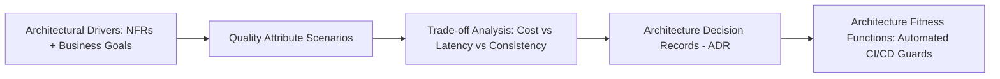
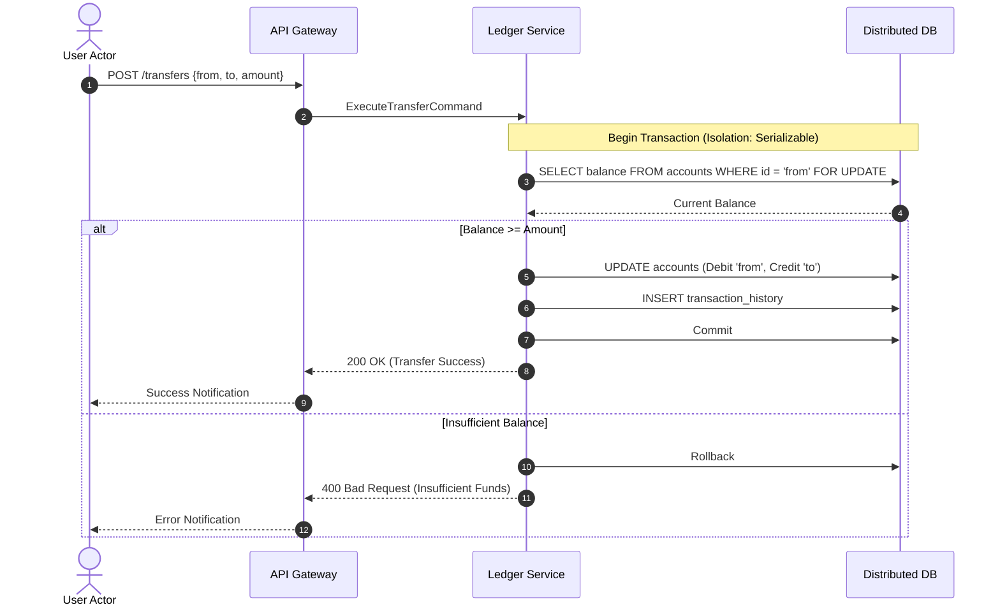
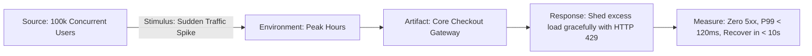
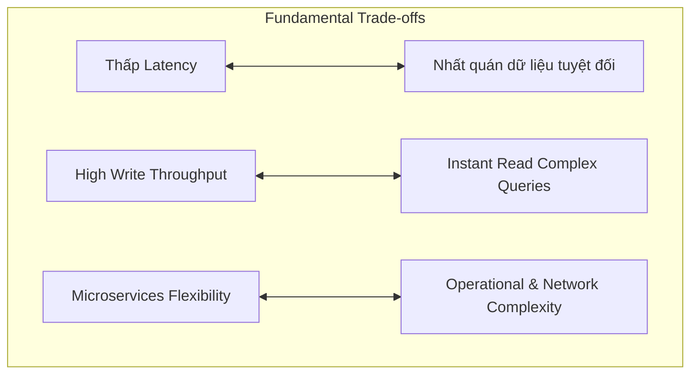
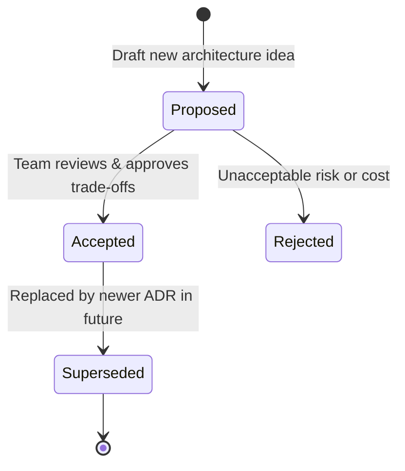
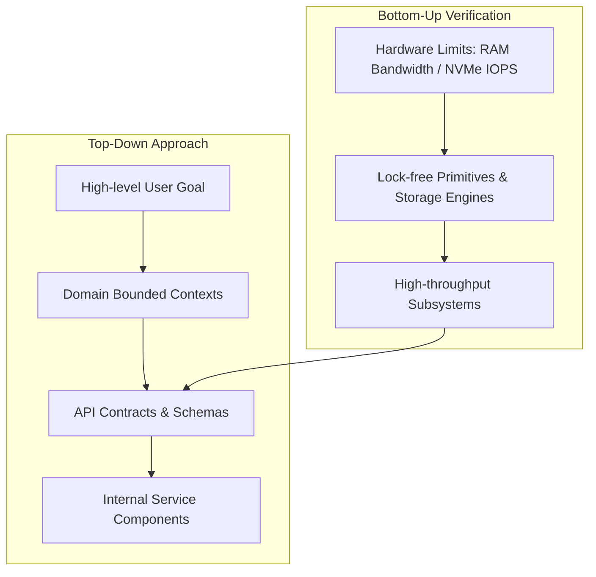
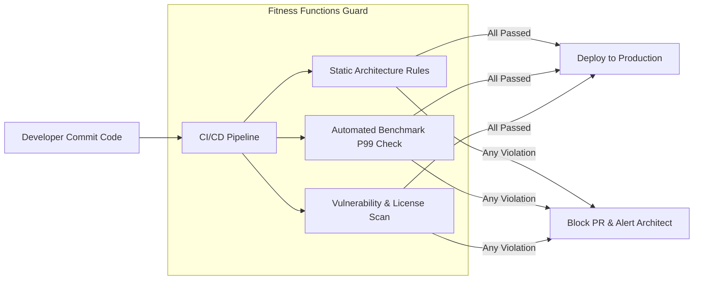

# 01.2. Quality Attributes and Architecture Decisions (Thuộc Tính Chất Lượng và Quyết Định Kiến Trúc)

## Tổng quan về Thuộc Tính Chất Lượng và Quyết Định Kiến Trúc
Trong kiến trúc hệ thống, kiến trúc sư không chỉ vẽ sơ đồ mà thực chất là người đưa ra các **quyết định đánh đổi (Trade-offs)** dưới sự thúc đẩy của các **Architectural Drivers**. Một kiến trúc tốt không phải là kiến trúc áp dụng nhiều công nghệ thời thượng nhất, mà là kiến trúc có khả năng giải thích rõ ràng: *Tại sao lại chọn giải pháp A thay vì B, hậu quả của việc chọn A là gì, và làm sao để kiểm chứng kiến trúc không bị thoái hóa theo thời gian?*

Chuyên đề này cung cấp phương pháp luận chuẩn mực từ việc mô tả kịch bản chất lượng, lập hồ sơ quyết định kiến trúc (ADR) cho đến việc tự động hóa giám sát chất lượng hệ thống thông qua Architecture Fitness Functions.



---

## 2. Chi tiết từng Keyword (Under-the-Hood Deep Dive)

### 1. Use Case Analysis & User Stories (Phân Tích Ca Sử Dụng và Câu Chuyện Người Dùng)

#### 1. Khái niệm bản chất (What & Why)
- **Use Case Analysis**: Kỹ thuật phân tích các kịch bản tương tác giữa tác nhân bên ngoài (Actor) và hệ thống nhằm đạt được một mục tiêu cụ thể, bao gồm luồng chính (Happy Path), các luồng phụ (Alternative Paths) và các luồng lỗi (Exception Paths).
- **User Stories**: Cách biểu đạt yêu cầu ngắn gọn từ góc nhìn người dùng cuối theo mẫu: *"Là một [vai trò], tôi muốn [hành động], để [đạt được giá trị]"*, đi kèm với các Tiêu chí chấp nhận (Acceptance Criteria - Gherkin Given/When/Then).

#### 2. Cơ chế hoạt động sâu (Under the hood / Hardcore Internals)
Trong System Design, Use Cases được dịch trực tiếp thành các **Transaction Boundaries** và **Concurrency Controls**:
- Phân tích một Use Case như *"Người dùng chuyển tiền"* cho thấy: Cần đảm bảo tính nguyên tử (Atomicity), chống race condition khi 2 giao dịch chuyển tiền xảy ra đồng thời trên cùng một tài khoản.
- Kỹ thuật dịch: Ánh xạ Use Case thành SQL Transaction với mức độ cô lập (Isolation Level) phù hợp (`REPEATABLE READ` hoặc `SERIALIZABLE`), hoặc sử dụng Distributed Lock / Pessimistic Locking (`SELECT ... FOR UPDATE`) để ngăn ngừa Dirty Read và Lost Update.

#### 3. Sơ đồ minh họa


#### 4. Code ví dụ thực chiến (C++20 - Concurrency Protection cho Use Case Transfer)
```cpp
#include <iostream>
#include <mutex>
#include <memory>
#include <system_error>

struct Account {
    int id;
    double balance;
    std::mutex mtx; // Lock riêng cho từng thực thể Account
};

class TransferService {
public:
    // Ngăn chặn Deadlock bằng cách sử dụng std::lock / std::scoped_lock (Deadlock-free locking)
    bool transfer(Account& from, Account& to, double amount) {
        if (from.id == to.id || amount <= 0.0) return false;

        // Khóa đồng thời cả 2 tài khoản theo thứ tự địa chỉ bộ nhớ ngầm để tránh Circular Wait
        std::scoped_lock lock(from.mtx, to.mtx);

        if (from.balance < amount) {
            std::cout << "[Transfer Failed] Account " << from.id << " insufficient funds.\n";
            return false;
        }

        from.balance -= amount;
        to.balance += amount;
        std::cout << "[Transfer Success] " << amount << "$ from Acc " << from.id 
                  << " to Acc " << to.id << ". Balance: " << from.balance << " | " << to.balance << "\n";
        return true;
    }
};

int main() {
    Account acc1{1, 1000.0, {}};
    Account acc2{2, 500.0, {}};
    TransferService service;
    service.transfer(acc1, acc2, 350.0);
    return 0;
}
```

#### 5. Ưu / Nhược điểm, Pitfalls & Anti-patterns
- **Pitfall: Bỏ qua Exception Paths**: Chỉ tập trung vào luồng chuyển tiền thành công, bỏ qua kịch bản mạng bị ngắt giữa chừng khi tài khoản A đã bị trừ tiền nhưng tài khoản B chưa được cộng tiền.

#### 6. Ứng dụng thực tế trong Backend / Systems
Mọi hệ thống thanh toán và thương mại điện tử đều dùng Acceptance Test-Driven Development (ATDD) để biến User Stories thành test suite tự động kiểm thử hệ thống.

---

### 2. Quality Attributes & Quality Attribute Scenarios (Thuộc Tính Chất Lượng và Kịch Bản Thử Thách)

#### 1. Khái niệm bản chất (What & Why)
- **Quality Attributes**: Các đặc tính phi chức năng đo lường năng lực của hệ thống (Performance, Availability, Modifiability, Security, Testability, Usability).
- **Quality Attribute Scenarios**: Một kỹ thuật chuẩn hóa (xuất phát từ Software Engineering Institute - SEI) nhằm mô tả thuộc tính chất lượng một cách rõ ràng và định lượng được. Một kịch bản hoàn chỉnh gồm 6 thành phần:
  1. **Source of Stimulus**: Ai/Cái gì tạo ra tác động?
  2. **Stimulus**: Tác động cụ thể là gì?
  3. **Artifact**: Bộ phận nào của hệ thống chịu tác động?
  4. **Environment**: Hệ thống đang ở trạng thái nào (Bình thường, quá tải, đang bảo trì)?
  5. **Response**: Hệ thống phải phản ứng ra sao?
  6. **Response Measure**: Thước đo thành công có thể kiểm chứng được là gì?

#### 2. Cơ chế hoạt động sâu (Under the hood / Hardcore Internals)
Khi xây dựng kịch bản:
- *Stimulus*: Đột ngột có $100,000$ concurrent users truy cập vào Flash Sale trong vòng 5 giây.
- *Artifact*: Payment & Inventory Subsystems.
- *Response*: Hệ thống không bị sập (`CrashLoopBackOff` trong Kubernetes), từ chối tải thừa một cách nhẹ nhàng bằng Token Bucket Rate Limiting (HTTP 429), bảo vệ cơ sở dữ liệu không bị tràn Connection Pool.
- *Response Measure*: Tỷ lệ lỗi 5xx $\le 0.01\%$, P99 Latency của các request được chấp nhận $\le 120ms$, hệ thống phục hồi về trạng thái bình thường trong vòng 10 giây sau khi xung tải kết thúc.

#### 3. Sơ đồ minh họa


#### 4. Code ví dụ thực chiến (C++20 - Rate Limiter để hiện thực hóa kịch bản bảo vệ hệ thống)
```cpp
#include <iostream>
#include <chrono>
#include <atomic>
#include <thread>

// Triển khai Token Bucket Algorithm đảm bảo Response Measure trong kịch bản quá tải
class TokenBucketRateLimiter {
private:
    const double capacity_;
    const double refill_rate_per_sec_;
    std::atomic<double> tokens_;
    std::atomic<std::chrono::steady_clock::time_point> last_refill_;

public:
    TokenBucketRateLimiter(double capacity, double refill_rate)
        : capacity_(capacity), refill_rate_per_sec_(refill_rate), tokens_(capacity) {
        last_refill_.store(std::chrono::steady_clock::now());
    }

    bool allowRequest(double tokens_demanded = 1.0) {
        refill();
        double current = tokens_.load(std::memory_order_relaxed);
        while (current >= tokens_demanded) {
            if (tokens_.compare_exchange_weak(current, current - tokens_demanded,
                                              std::memory_order_acquire,
                                              std::memory_order_relaxed)) {
                return true; // Cho phép request đi qua
            }
        }
        return false; // Shedding load: Bị từ chối (Trả về HTTP 429)
    }

private:
    void refill() {
        auto now = std::chrono::steady_clock::now();
        auto last = last_refill_.load(std::memory_order_relaxed);
        auto elapsed = std::chrono::duration_cast<std::chrono::microseconds>(now - last).count();
        
        if (elapsed > 1000) { // Mỗi 1ms kiểm tra bù token
            double new_tokens = (elapsed / 1'000'000.0) * refill_rate_per_sec_;
            double cur = tokens_.load(std::memory_order_relaxed);
            double updated = std::min(capacity_, cur + new_tokens);
            if (last_refill_.compare_exchange_strong(last, now, std::memory_order_release)) {
                tokens_.store(updated, std::memory_order_release);
            }
        }
    }
};

int main() {
    TokenBucketRateLimiter limiter(5.0, 2.0); // Dung lượng 5 tokens, nạp lại 2 tokens/s
    std::cout << "--- Simulating burst traffic ---\n";
    for (int i = 1; i <= 8; ++i) {
        bool allowed = limiter.allowRequest(1.0);
        std::cout << "Request #" << i << ": " << (allowed ? "200 OK" : "429 Too Many Requests") << "\n";
    }
    return 0;
}
```

#### 5. Ưu / Nhược điểm, Pitfalls & Anti-patterns
- **Pitfall: Đo lường không thực tế (Untestable Quality Attribute)**: Đặt ra yêu cầu "hệ thống phải có tính bảo mật cao" mà không định nghĩa kịch bản tấn công (ví dụ: brute force token, SQL injection payload) và chỉ số phản ứng.

#### 6. Ứng dụng thực tế trong Backend / Systems
Được sử dụng trong phương pháp đánh giá kiến trúc phần mềm ATAM (Architecture Tradeoff Analysis Method) do Viện SEI khởi xướng.

---

### 3. Architectural Drivers & Technical Trade-offs (Động Lực Kiến Trúc và Các Đánh Đổi Kỹ Thuật)

#### 1. Khái niệm bản chất (What & Why)
- **Architectural Drivers**: Tập hợp con của các yêu cầu chức năng, thuộc tính chất lượng, ràng buộc kinh doanh và kỹ thuật có ảnh hưởng sâu sắc nhất đến việc định hình kiến trúc. Một hệ thống có thể có hàng trăm yêu cầu, nhưng chỉ khoảng 5-10 yêu cầu là Architectural Drivers thực sự.
- **Technical Trade-offs (Sự đánh đổi)**: Định luật cơ bản của kỹ nghệ phần mềm: *"Không có giải pháp hoàn hảo, chỉ có sự đánh đổi"* (There are no solutions, only trade-offs). Tăng thuộc tính chất lượng này thường làm giảm thuộc tính khác.

#### 2. Cơ chế hoạt động sâu (Under the hood / Hardcore Internals)
Các cặp đánh đổi kinh điển trong kiến trúc máy tính và mạng:
1. **Consistency vs Latency (CAP / PACELC Theorem)**:
   - Nếu chọn Synchronous Replication (để đảm bảo Strict Consistency), mỗi thao tác ghi phải chờ mạng RTT tới tất cả các bản sao $\rightarrow$ Latency tăng cao, Availability giảm khi mạng phân mảnh.
   - Nếu chọn Asynchronous Replication, dữ liệu ghi vào Master trả về ngay trong 1ms $\rightarrow$ Latency cực thấp, nhưng rủi ro mất dữ liệu nếu Master sập trước khi đồng bộ bản sao (Replication Lag).
2. **Space vs Time (Dung lượng vs Tốc độ)**:
   - Dùng In-Memory Index (Hash Map / B-Tree trên RAM) giúp tìm kiếm $O(1)$ hoặc $O(\log N)$ nhưng tốn kém RAM gấp nhiều lần so với quét trên đĩa.
   - Dùng nén dữ liệu (Zstandard, Snappy): Tiết kiệm Disk I/O và Network Bandwidth nhưng tiêu tốn thêm chu kỳ CPU để giải nén.

#### 3. Sơ đồ minh họa


#### 4. Code ví dụ thực chiến (TypeScript - Trade-off giữa Caching vs Freshness)
```typescript
interface CacheOptions {
  ttlSeconds: number;
  allowStaleWhileRevalidate: boolean;
}

class UserProfileService {
  private cache = new Map<string, { data: any; expiry: number }>();

  // Trade-off: Giảm Latency bằng cách trả dữ liệu cũ (Stale) và cập nhật ngầm phía sau (Revalidate)
  async getUserProfile(userId: string, opts: CacheOptions) {
    const cached = this.cache.get(userId);
    const now = Date.now();

    if (cached) {
      if (now < cached.expiry) {
        return { data: cached.data, source: 'CACHE_FRESH' }; // Tối ưu Latency
      }
      if (opts.allowStaleWhileRevalidate) {
        // Trả ngay dữ liệu cũ để giữ Latency cực thấp (1ms), kích hoạt background fetch
        this.fetchAndRefreshCache(userId, opts.ttlSeconds);
        return { data: cached.data, source: 'CACHE_STALE_ASYNC_SYNC' };
      }
    }

    // Trường hợp Cache Miss hoặc không cho phép Stale: Chấp nhận Latency cao để lấy dữ liệu mới nhất
    return await this.fetchAndRefreshCache(userId, opts.ttlSeconds);
  }

  private async fetchAndRefreshCache(userId: string, ttl: number) {
    // Giả lập query Database tốn 50ms
    const freshData = { userId, name: "Alice", balance: 1000 };
    this.cache.set(userId, { data: freshData, expiry: Date.now() + ttl * 1000 });
    return { data: freshData, source: 'DATABASE_FRESH' };
  }
}
```

#### 5. Ưu / Nhược điểm, Pitfalls & Anti-patterns
- **Anti-pattern: The Magic Bullet Fallacy**: Tin rằng một công nghệ mới (ví dụ: Blockchain, NoSQL) có thể giải quyết được tất cả các bài toán mà không phải đánh đổi bất kỳ thứ gì.

#### 6. Ứng dụng thực tế trong Backend / Systems
DynamoDB của Amazon cho phép lập trình viên lựa chọn cấu hình: *Eventually Consistent Read* (tiêu tốn 0.5 RCU) hoặc *Strongly Consistent Read* (tiêu tốn 1.0 RCU, chi phí đắt gấp đôi).

---

### 4. Design Decisions & Architecture Decision Records - ADR (Quyết Định Thiết Kế và Hồ Sơ Quyết Định)

#### 1. Khái niệm bản chất (What & Why)
- **Design Decisions**: Những lựa chọn mang tính cấu trúc, khó thay đổi và có tác động sâu rộng đến toàn bộ vòng đời sản phẩm (ví dụ: chọn ngôn ngữ Go thay vì Java, chọn cơ chế Event Sourcing thay vì CRUD truyền thống).
- **Architecture Decision Record (ADR)**: Tài liệu định dạng văn bản ngắn gọn (Markdown) lưu trữ trong git repository ghi lại một quyết định kiến trúc cụ thể, lý do đưa ra quyết định, các phương án thay thế đã xem xét, và hậu quả tích cực lẫn tiêu cực của nó.

#### 2. Cơ chế hoạt động sâu (Under the hood / Hardcore Internals)
Một cấu trúc chuẩn của ADR (theo mẫu của Michael Nygard) bao gồm:
1. **Title**: Định danh quyết định (ví dụ: `ADR-004: Sử dụng Kafka làm Event Bus thay vì RabbitMQ`).
2. **Status**: Proposed / Accepted / Rejected / Superseded.
3. **Context**: Bối cảnh vấn đề, các áp lực kỹ thuật và ràng buộc kinh doanh.
4. **Decision**: Quyết định được đưa ra và cách thức thực hiện.
5. **Consequences**: Hệ quả tích cực (Ưu điểm), hệ quả tiêu cực (Gánh nặng bảo trì, công nghệ mới cần học, rủi ro).

Việc lưu trữ ADR ngay trong source control (ví dụ thư mục `docs/adr/`) giúp các kỹ sư vào sau hiểu được lý do tại sao hệ thống được xây dựng như hiện tại thay vì suy đoán hoặc xóa bỏ các cơ chế phòng vệ có chủ đích (Chesterton's Fence).

#### 3. Sơ đồ minh họa


#### 4. Minh họa một file ADR chuẩn Markdown thực tế
```markdown
# ADR-007: Áp dụng cơ chế Outbox Pattern cho phân phối sự kiện đơn hàng

## Trạng thái
Accepted

## Bối cảnh
Khi một đơn hàng được tạo trong dịch vụ Order Service, chúng ta cần ghi nhận đơn hàng vào cơ sở dữ liệu PostgreSQL và đồng thời phát đi một Event `OrderCreated` lên Kafka để Inventory Service trừ kho.
Nếu cập nhật database thành công nhưng mạng tới Kafka bị đứt, đơn hàng bị treo và kho không được trừ (Dual-Write Problem). Nếu phát event Kafka trước mà database ghi thất bại, dữ liệu ma sẽ được xử lý.

## Quyết định
Chúng tôi quyết định áp dụng **Transactional Outbox Pattern**:
1. Lưu bản ghi sự kiện trực tiếp vào bảng `outbox_events` nằm trong cùng một Local Transaction với bảng `orders`.
2. Sử dụng công cụ Debezium (CDC - Change Data Capture) lắng nghe PostgreSQL Write-Ahead Log (WAL) để stream các sự kiện từ bảng `outbox_events` sang Kafka một cách bất đồng bộ.

## Hệ quả
### Tích cực:
- Đảm bảo tính nhất quán dữ liệu tuyệt đối (Guaranteed At-Least-Once Delivery).
- Loại bỏ hoàn toàn sự cố Dual-Write mà không cần tới Distributed Transaction (2PC) vốn làm chậm hệ thống.
### Tiêu cực:
- Phải vận hành thêm cụm Debezium Kafka Connect.
- Phía Consumer bắt buộc phải triển khai Idempotent Consumer để loại trừ trùng lặp bản tin.
```

#### 5. Ưu / Nhược điểm, Pitfalls & Anti-patterns
- **Pitfall: Zombie ADRs**: Viết ADR xong bỏ quên, khi kiến trúc thực tế đã thay đổi hoàn toàn nhưng không cập nhật trạng thái `Superseded` kèm đường link tới ADR thay thế mới.

#### 6. Ứng dụng thực tế trong Backend / Systems
Các dự án mã nguồn mở lớn và các công ty công nghệ hàng đầu (ThoughtWorks, Spotify, Red Hat) quản lý hàng nghìn ADR để duy trì tính liên tục của tri thức kỹ thuật.

---

### 5. System Design Methodology: Top-Down vs Bottom-Up Design (Phương Pháp Luận Thiết Kế Hệ Thống)

#### 1. Khái niệm bản chất (What & Why)
- **Top-Down Design (Từ trên xuống)**: Bắt đầu từ tầm nhìn tổng thể, chia nhỏ hệ thống thành các Subsystems, rồi tiếp tục phân rã thành các Service, Module, Component cho đến từng hàm và bảng dữ liệu.
- **Bottom-Up Design (Từ dưới lên)**: Bắt đầu từ các thành phần cơ bản sẵn có (Primitive Components, Hardware limits, Core Algorithms, Cấu trúc dữ liệu nền tảng), sau đó lắp ghép và trừu tượng hóa dần lên các tầng cao hơn.

#### 2. Cơ chế hoạt động sâu (Under the hood / Hardcore Internals)
Trong thực tế của các kỹ sư phân tán lão luyện:
- **Top-Down** phù hợp cho việc phân định ranh giới miền (Domain Boundaries) và thiết kế luồng người dùng (User Workflows).
- **Bottom-Up** bắt buộc phải song hành để kiểm tra tính khả thi vật lý: Nếu bạn thiết kế một giao diện Top-Down yêu cầu tra cứu full-text search thời gian thực trong 5ms trên tập dữ liệu 50TB, bạn phải làm phép tính Bottom-Up về Disk IOPS, Memory size và B-tree node traversal để xem phần cứng có đáp ứng nổi không.

#### 3. Sơ đồ minh họa


#### 4. Code ví dụ thực chiến (C++20 - Bottom-Up Optimization: Thiết kế Ring Buffer trước khi xây hệ thống Logging)
```cpp
#include <iostream>
#include <vector>
#include <atomic>
#include <optional>

// Tiếp cận Bottom-Up: Xây dựng cấu trúc dữ liệu Lock-Free Single Producer Single Consumer (SPSC)
// tối ưu hóa tuyệt đối tầng Hardware trước khi gắn vào Top-Down Logging Engine
template<typename T, size_t Capacity>
class LockFreeSPSCQueue {
    static_assert((Capacity & (Capacity - 1)) == 0, "Capacity must be power of 2");
private:
    alignas(64) std::atomic<size_t> tail_{0}; // Cache-line alignment để chống False Sharing
    alignas(64) std::atomic<size_t> head_{0};
    T buffer_[Capacity];

public:
    bool push(const T& item) {
        size_t current_tail = tail_.load(std::memory_order_relaxed);
        size_t current_head = head_.load(std::memory_order_acquire);

        if ((current_tail - current_head) >= Capacity) {
            return false; // Queue full
        }

        buffer_[current_tail & (Capacity - 1)] = item;
        tail_.store(current_tail + 1, std::memory_order_release);
        return true;
    }

    std::optional<T> pop() {
        size_t current_head = head_.load(std::memory_order_relaxed);
        size_t current_tail = tail_.load(std::memory_order_acquire);

        if (current_head == current_tail) {
            return std::nullopt; // Queue empty
        }

        T item = buffer_[current_head & (Capacity - 1)];
        head_.store(current_head + 1, std::memory_order_release);
        return item;
    }
};

int main() {
    LockFreeSPSCQueue<int, 1024> queue;
    queue.push(42);
    queue.push(99);
    std::cout << "Popped: " << queue.pop().value_or(-1) << "\n";
    std::cout << "Popped: " << queue.pop().value_or(-1) << "\n";
    return 0;
}
```

#### 5. Ưu / Nhược điểm, Pitfalls & Anti-patterns
- **Pitfall: Pure Top-Down Naivety**: Thiết kế một kiến trúc microservices 50 tầng với các cuộc gọi REST nối tiếp nhau mà không tính toán rằng độ trễ mạng tích lũy sẽ vượt quá timeout của trình duyệt.

#### 6. Ứng dụng thực tế trong Backend / Systems
LMAX Disruptor được phát triển hoàn toàn bằng phương pháp Bottom-Up: nghiên cứu kỹ lưỡng CPU Cache Line và Memory Barrier để tạo ra kiến trúc xử lý 6 triệu đơn hàng/giây trên một luồng CPU duy nhất.

---

### 6. Evolutionary Architecture & Architecture Fitness Functions (Kiến Trúc Tiến Hóa và Hàm Đánh Giá Thích Nghi)

#### 1. Khái niệm bản chất (What & Why)
- **Evolutionary Architecture (Kiến trúc tiến hóa)**: Kiến trúc hỗ trợ sự thay đổi có định hướng và liên tục theo thời gian mà không làm sụp đổ các thuộc tính chất lượng sẵn có.
- **Architecture Fitness Functions (Hàm đánh giá thích nghi kiến trúc)**: Bất kỳ cơ chế nào cung cấp khả năng đánh giá khách quan, định lượng và tự động xem một quyết định kỹ thuật hay một đoạn code mới có phá vỡ các thuộc tính chất lượng của kiến trúc hay không.

#### 2. Cơ chế hoạt động sâu (Under the hood / Hardcore Internals)
Fitness Functions được cài đặt trực tiếp vào CI/CD Pipeline dưới nhiều hình thức:
- **Code Dependency Guards (ví dụ ArchUnit)**: Kiểm tra mã nguồn tầng Data Access không được phép gọi ngược lên tầng Presentation.
- **Latency Benchmarks**: Nếu một Pull Request làm tăng thời gian xử lý của critical path quá 5%, CI tự động đánh rớt build.
- **Security Scanners**: Quét các lỗ hổng dependency hoặc phát hiện rò rỉ secret trong git commit.
- **Chaos Engineering**: Tự động tắt ngẫu nhiên các node để kiểm tra tính tự phục hồi trong môi trường Staging.

#### 3. Sơ đồ minh họa


#### 4. Code ví dụ thực chiến (TypeScript - Automated Fitness Function kiểm tra quy tắc phụ thuộc tầng)
```typescript
import * as fs from 'fs';
import * as path from 'path';

// Kiến trúc quy định: Domain Layer KHÔNG ĐƯỢC PHÉP import từ Infrastructure Layer
function testArchitectureFitnessFunction(domainDir: string) {
  const files = fs.readdirSync(domainDir);
  let violations: string[] = [];

  for (const file of files) {
    if (file.endsWith('.ts')) {
      const content = fs.readFileSync(path.join(domainDir, file), 'utf-8');
      const lines = content.split('\n');
      lines.forEach((line, index) => {
        if (line.includes("from '../infrastructure/") || line.includes('from "../infrastructure/')) {
          violations.push(`[Fitness Violation] ${file}:${index + 1} - Domain violates DIP by importing Infrastructure!`);
        }
      });
    }
  }

  if (violations.length > 0) {
    console.error("❌ ARCHITECTURE FITNESS TEST FAILED:");
    violations.forEach(v => console.error(v));
    process.exit(1); // Block CI Build!
  } else {
    console.log("✅ Architecture Fitness Test Passed: Clean Boundaries Maintained.");
  }
}
```

#### 5. Ưu / Nhược điểm, Pitfalls & Anti-patterns
- **Anti-pattern: Architecture Drift (Kiến trúc thoái hóa ngầm)**: Sau 2 năm phát triển, hệ thống biến thành một mớ bòng bong ("Big Ball of Mud") vì các quy tắc ban đầu chỉ nằm trên tài liệu giấy mà không có công cụ tự động ngăn cản các commit vi phạm.

#### 6. Ứng dụng thực tế trong Backend / Systems
Netflix áp dụng Simian Army (tiêu biểu là Chaos Monkey) như một Runtime Fitness Function chạy liên tục trên môi trường Production của AWS để đảm bảo dịch vụ tự phục hồi khi có availability zone bị sập.

---

## Tóm tắt liên kết hệ thống
Sau khi hoàn thiện 2 bài viết của chuyên mục `01_System_Design_Fundamentals`, chúng ta đã thiết lập một hệ thống tư duy hoàn chỉnh: từ yêu cầu kinh doanh, kỹ nghệ ràng buộc, phân tích kịch bản chất lượng, cân bằng đánh đổi cho đến lưu trữ quyết định kiến trúc và tự động bảo vệ hệ thống bằng Fitness Functions. Đây là bệ phóng vững chắc để bước vào phân tích định lượng chi tiết ở chuyên mục tiếp theo: **Capacity Estimation & Back-of-the-Envelope Calculations**.
