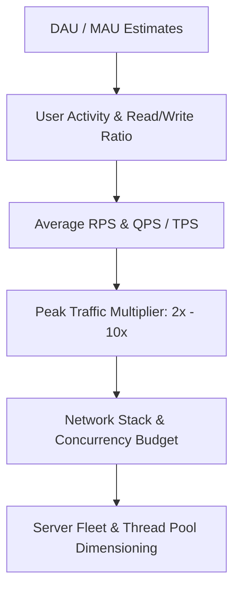
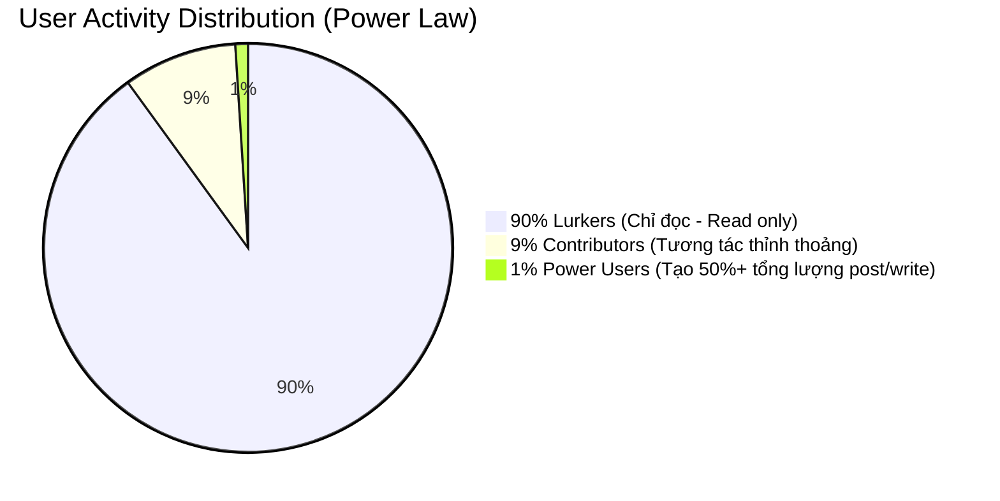
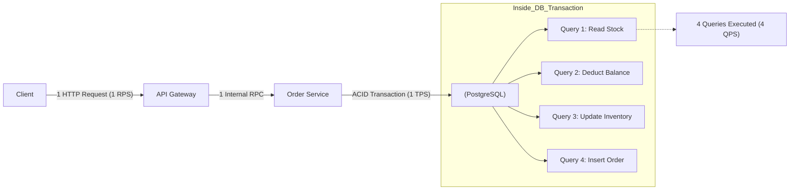
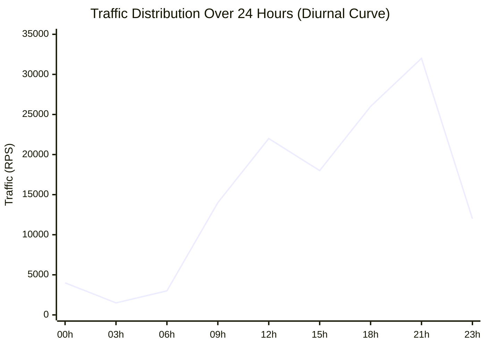
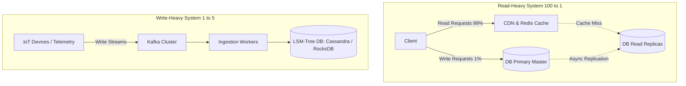

# 02.1. Traffic and Throughput Estimation (Ước Tính Lưu Lượng và Thông Lượng)

## Tổng quan về Ước Tính Lưu Lượng và Thông Lượng
Trong thiết kế hệ thống phân tán, **Ước tính sơ bộ (Back-of-the-Envelope Estimation)** không phải là việc đoán mò mà là một kỹ năng toán học kỹ thuật giúp kỹ sư nhanh chóng đánh giá tính khả thi của một kiến trúc, kích thước cụm máy chủ và xác định nút thắt cổ chai tiềm tàng trước khi viết một dòng code nào.

Nếu không ước tính thông lượng, kiến trúc sư có thể phạm phải hai sai lầm chết người: **Over-engineering** (lãng phí hàng triệu USD hạ tầng đám mây cho một hệ thống chỉ có vài chục request/giây) hoặc **Under-engineering** (hệ thống bị sập ngay ngày đầu ra mắt do tràn hàng đợi kết nối và cạn kiệt tài nguyên mạng).



---

## 2. Chi tiết từng Keyword (Under-the-Hood Deep Dive)

### 1. Back-of-the-Envelope Estimation (Ước Tính Sơ Bộ Trên Giấy Nháp)

#### 1. Khái niệm bản chất (What & Why)
Back-of-the-Envelope Estimation là phương pháp tính toán gần đúng dựa trên các số liệu làm tròn và các hằng số phần cứng kinh điển. Mục đích không phải là tìm ra con số chính xác tuyệt đối đến từng byte, mà là xác định **bậc của độ lớn (Order of Magnitude - lũy thừa của 10 hoặc 2)** để đưa ra các quyết định kiến trúc cốt lõi (ví dụ: cần 1 máy chủ hay 100 máy chủ; dữ liệu vừa trong RAM hay bắt buộc phải lưu trên SSD).

#### 2. Cơ chế hoạt động sâu (Under the hood / Hardcore Internals)
Các con số bỏ túi mà mọi kỹ sư hệ thống bắt buộc phải thuộc lòng:
- **Thời gian**:
  $$1 \text{ ngày} = 24 \times 3600 = 86,400 \text{ giây} \approx 10^5 \text{ giây (làm tròn để tính nhẩm)}$$
  $$1 \text{ tháng} \approx 2.5 \times 10^6 \text{ giây}$$
  $$1 \text{ năm} \approx 3.15 \times 10^7 \text{ giây} \approx 10^7 \times \pi \text{ giây}$$
- **Hệ thống dữ liệu (Powers of 2 vs 10)**:
  - $2^{10} = 1,024 \approx 10^3 = 1\text{ KB}$ (Kilo)
  - $2^{20} = 1,048,576 \approx 10^6 = 1\text{ MB}$ (Mega)
  - $2^{30} = 1,073,741,824 \approx 10^9 = 1\text{ GB}$ (Giga)
  - $2^{40} \approx 10^{12} = 1\text{ TB}$ (Tera)
  - $2^{50} \approx 10^{15} = 1\text{ PB}$ (Peta)
- **Độ trễ truy xuất phần cứng (Numbers Every Programmer Should Know - Jeff Dean)**:
  - Đọc L1 Cache: $\sim 1\text{ ns}$
  - Đọc L2 Cache: $\sim 4\text{ ns}$
  - Đọc RAM: $\sim 100\text{ ns}$
  - Đọc tuần tự 1MB từ RAM: $\sim 20\ \mu\text{s}$
  - Round trip trong cùng Datacenter: $\sim 500\ \mu\text{s} = 0.5\text{ ms}$
  - Đọc ngẫu nhiên SSD: $\sim 150\ \mu\text{s}$
  - Đọc tuần tự 1MB từ SSD: $\sim 1\text{ ms}$
  - Đọc tuần tự 1MB từ HDD: $\sim 20\text{ ms}$
  - Gói tin đi khứ hồi xuyên Đại Tây Dương (CA to Netherlands): $\sim 150\text{ ms}$

#### 3. Sơ đồ minh họa


```mermaid
gantt
    title Latency Comparison (Tương quan thời gian theo cấp số mũ)
    dateFormat X
    axisFormat %s
    section Hardware Speeds
    L1 Cache (1ns)            :0, 1
    RAM Access (100ns)        :0, 100
    SSD Read (150us)          :0, 150000
    Datacenter RTT (0.5ms)    :0, 500000
    Cross-Atlantic RTT (150ms):0, 150000000
```

#### 4. Code ví dụ thực chiến (C++20 - Thư viện tính nhẩm Back-of-the-Envelope)
```cpp
#include <iostream>
#include <string>
#include <cstdint>

struct SystemCapacityCalculator {
    static constexpr uint64_t SECONDS_PER_DAY = 86'400;
    static constexpr uint64_t ROUGH_SECONDS_PER_DAY = 100'000;

    static double calculateAverageRPS(uint64_t total_requests_per_day, bool use_exact = false) {
        uint64_t secs = use_exact ? SECONDS_PER_DAY : ROUGH_SECONDS_PER_DAY;
        return static_cast<double>(total_requests_per_day) / secs;
    }

    static double estimatePeakRPS(double avg_rps, double peak_factor = 2.0) {
        return avg_rps * peak_factor;
    }
};

int main() {
    uint64_t daily_events = 100'000'000; // 100 triệu request / ngày
    double avg_rps = SystemCapacityCalculator::calculateAverageRPS(daily_events, false);
    double peak_rps = SystemCapacityCalculator::estimatePeakRPS(avg_rps, 2.5);

    std::cout << "[Estimation for 100M Daily Requests]\n";
    std::cout << "Average RPS (Rough): " << avg_rps << " req/sec\n";
    std::cout << "Peak RPS (Factor 2.5): " << peak_rps << " req/sec\n";
    return 0;
}
```

#### 5. Ưu / Nhược điểm, Pitfalls & Anti-patterns
- **Pitfall: Precision Bias**: Dành 3 ngày cố gắng tính chính xác xem hệ thống cần 142.34 GB hay 143.12 GB thay vì làm tròn thành 150 GB để cộng thêm biên độ an toàn (Safety Margin).

#### 6. Ứng dụng thực tế trong Backend / Systems
Bắt buộc trong mọi vòng phỏng vấn System Design tại Google, Meta, Amazon và trong mọi tài liệu kiến trúc kỹ thuật trước khi trình ban Giám đốc hạ tầng duyệt ngân sách.

---

### 2. User Estimation: DAU, MAU & Activity Profiles (Ước Tính Người Dùng)

#### 1. Khái niệm bản chất (What & Why)
- **DAU (Daily Active Users)**: Số lượng người dùng duy nhất (Unique Users) thực hiện ít nhất một hành động trong vòng 24 giờ.
- **MAU (Monthly Active Users)**: Số lượng người dùng duy nhất tương tác trong vòng 30 ngày.
- **Tỷ lệ DAU / MAU (Stickiness Ratio)**: Thước đo mức độ gắn bó của sản phẩm. Một ứng dụng mạng xã hội hàng đầu (như Facebook, WeChat) có tỷ lệ DAU/MAU $\approx 50\% - 60\%$. Với các ứng dụng B2B hoặc thương mại điện tử, tỷ lệ này thường ở mức $10\% - 20\%$.

#### 2. Cơ chế hoạt động sâu (Under the hood / Hardcore Internals)
Khi chuyển từ User Estimation sang System Load:
- Không được đồng nhất số lượng người dùng đăng ký (Registered Users) với DAU. Một hệ thống có 1 tỷ người dùng đăng ký nhưng chỉ có 10 triệu DAU thì tải hạ tầng chỉ cần thiết kế phục vụ 10 triệu DAU.
- **Hyperactive Users (Power Users)**: Phân phối Pareto (Nguyên lý 80/20) hoặc Power Law thường chi phối hành vi người dùng: $1\%$ người dùng có thể tạo ra $50\%$ tổng số nội dung và tương tác trên nền tảng (ví dụ: các tài khoản người nổi tiếng với hàng chục triệu người theo dõi).

#### 3. Sơ đồ minh họa


#### 4. Code ví dụ thực chiến (TypeScript - Tính toán Stickiness và Ước tính số Request từ DAU)
```typescript
export interface UserActivityProfile {
  mau: number;
  stickinessRatio: number; // DAU / MAU (vd: 0.5)
  avgRequestsPerUserPerDay: number;
}

export function estimateSystemLoad(profile: UserActivityProfile) {
  const dau = profile.mau * profile.stickinessRatio;
  const totalDailyRequests = dau * profile.avgRequestsPerUserPerDay;
  const avgRPS = totalDailyRequests / 86400;
  const peakRPS = avgRPS * 2.5;

  return {
    dau,
    totalDailyRequests,
    avgRPS: Math.round(avgRPS),
    peakRPS: Math.round(peakRPS),
  };
}

const socialAppProfile: UserActivityProfile = {
  mau: 50_000_000,
  stickinessRatio: 0.4, // 20M DAU
  avgRequestsPerUserPerDay: 50, // Lướt feed, like, comment, load ảnh
};

console.log(estimateSystemLoad(socialAppProfile));
// Kết quả: DAU: 20M, Daily Requests: 1 tỷ, Avg RPS: ~11,574, Peak RPS: ~28,935
```

#### 5. Ưu / Nhược điểm, Pitfalls & Anti-patterns
- **Anti-pattern: Flat Distribution Assumption**: Giả định mọi người dùng đều hoạt động đều đặn như nhau suốt 24 giờ.

#### 6. Ứng dụng thực tế trong Backend / Systems
Dùng để phân chia cụm User Sharding: Shard ID có thể tính theo Hash của `user_id` để phân tán đều các user thông thường, nhưng cần cơ chế đặc biệt cho các Celebrity Users để tránh Hot Partition.

---

### 3. Throughput Metrics: RPS, QPS, TPS (Các Chỉ Số Thông Lượng Hệ Thống)

#### 1. Khái niệm bản chất (What & Why)
Mặc dù thường bị dùng lẫn lộn, ba khái niệm này đại diện cho các tầng xử lý hoàn toàn khác nhau:
- **RPS (Requests Per Second)**: Số lượng HTTP/gRPC request gửi đến API Gateway hoặc Web Server trong một giây.
- **QPS (Queries Per Second)**: Số lượng câu truy vấn được thực thi tại tầng dữ liệu (Database, Cache, Search Engine) trong một giây. Một HTTP request từ người dùng có thể kích hoạt nhiều database queries ($1\ \text{RPS} \rightarrow 5 - 10\ \text{QPS}$).
- **TPS (Transactions Per Second)**: Số lượng giao dịch nghiệp vụ hoàn chỉnh (Business Transactions) tuân thủ tính chất ACID được hoàn tất thành công trong một giây.

#### 2. Cơ chế hoạt động sâu (Under the hood / Hardcore Internals)
Mối quan hệ nhân quả giữa RPS, QPS và TPS:
- Người dùng nhấn nút "Mua hàng" (1 HTTP Request $\rightarrow$ 1 RPS tại Gateway).
- API Gateway gọi Order Service. Order Service thực hiện:
  1. Kiểm tra tồn kho (1 Read Query trên Redis).
  2. Trừ tiền tài khoản (1 Update Query).
  3. Trừ tồn kho sản phẩm (1 Update Query).
  4. Ghi lịch sử giao dịch (1 Insert Query).
  $\rightarrow$ Tương ứng với **4 Database Queries** ($4\ \text{QPS}$) gộp trong **1 ACID Transaction** ($1\ \text{TPS}$).

Ở tầng Linux Kernel và Network Socket:
Mỗi 10,000 RPS đồng nghĩa với việc kernel phải xử lý 10,000 TCP handshakes (nếu không có Connection Keep-Alive), tạo ra hàng nghìn Socket File Descriptors và kích hoạt hàng vạn ngắt CPU (Software Interrupts - `ksoftirqd`).

#### 3. Sơ đồ minh họa


#### 4. Code ví dụ thực chiến (C++20 - Benchmarking Network IOPS / Throughput)
```cpp
#include <iostream>
#include <chrono>
#include <atomic>
#include <vector>
#include <thread>

// Đo lường khả năng xử lý giao dịch in-memory (Atomic Counter TPS)
class TransactionEngine {
private:
    std::atomic<uint64_t> completed_transactions_{0};

public:
    void executeTransaction() {
        // Giả lập commit transaction thành công
        completed_transactions_.fetch_add(1, std::memory_order_relaxed);
    }

    uint64_t getCompleted() const {
        return completed_transactions_.load(std::memory_order_relaxed);
    }
};

int main() {
    TransactionEngine engine;
    const int num_threads = 4;
    const int duration_seconds = 2;
    std::atomic<bool> running{true};
    std::vector<std::thread> workers;

    auto start_time = std::chrono::high_resolution_clock::now();

    for (int i = 0; i < num_threads; ++i) {
        workers.emplace_back([&engine, &running]() {
            while (running.load(std::memory_order_relaxed)) {
                engine.executeTransaction();
            }
        });
    }

    std::this_thread::sleep_for(std::chrono::seconds(duration_seconds));
    running.store(false, std::memory_order_relaxed);

    for (auto& t : workers) t.join();
    auto end_time = std::chrono::high_resolution_clock::now();

    double elapsed = std::chrono::duration_cast<std::chrono::duration<double>>(end_time - start_time).count();
    uint64_t total = engine.getCompleted();
    double tps = total / elapsed;

    std::cout << "[Benchmark Results]\n";
    std::cout << "Total Transactions: " << total << "\n";
    std::cout << "Measured In-Memory TPS: " << static_cast<uint64_t>(tps) << " trans/sec\n";
    return 0;
}
```

#### 5. Ưu / Nhược điểm, Pitfalls & Anti-patterns
- **Pitfall: Nhầm lẫn giữa Gateway RPS và Database TPS**: Thiết kế cơ sở dữ liệu hỗ trợ 50,000 RPS và kỳ vọng nó xử lý được 50,000 ACID TPS ghi đĩa (trong khi hầu hết RDBMS đơn node chỉ chịu được khoảng 2,000 - 5,000 Write TPS do nghẽn `fsync` trên WAL).

#### 6. Ứng dụng thực tế trong Backend / Systems
Hệ thống thanh toán Visa xử lý trung bình 1,700 TPS và đỉnh điểm khoảng 24,000 - 65,000 TPS. Các sàn giao dịch chứng khoán đo đạc ở mức hàng triệu TPS nhờ kiến trúc In-Memory Matching Engines.

---

### 4. Peak Traffic Estimation & Traffic Distribution (Ước Tính Lưu Lượng Đỉnh và Phân Phối Tải)

#### 1. Khái niệm bản chất (What & Why)
- **Average Traffic (Tải trung bình)**: Lấy tổng số lượng request trong ngày chia cho 86,400 giây.
- **Peak Traffic (Tải đỉnh)**: Lưu lượng cực đại đổ vào hệ thống trong các khung giờ cao điểm (Peak Hours), ngày lễ hoặc sự kiện đặc biệt (Flash Sale, Giao thừa).
- **Peak Factor (Hệ số tải đỉnh)**: Tỷ số $\text{Peak RPS} / \text{Average RPS}$. Thông thường hệ số này dao động từ $2\times$ đến $5\times$ cho các ứng dụng thông thường, và có thể lên tới $10\times - 50\times$ cho các sự kiện bùng nổ (Ticketmaster mở bán vé ca sĩ, Shopee 11.11).

#### 2. Cơ chế hoạt động sâu (Under the hood / Hardcore Internals)
Phân phối lưu lượng thực tế theo thời gian không bao giờ là đường nằm ngang phẳng:
- **Diurnal Pattern (Chu kỳ ngày đêm)**: Người dùng thức dậy từ 7h sáng, lượng truy cập tăng vọt vào 12h trưa và 20h - 22h tối, sau đó giảm chạm đáy từ 2h - 5h sáng.
- **Poisson Arrival vs Burstiness**: Mặc dù các lý thuyết hàng đợi truyền thống (M/M/1 Queue) giả định các request đến theo phân phối Poisson (độc lập ngẫu nhiên), lưu lượng internet thực tế có tính chất **Self-Similar (Tự tương đồng)** và **Long-Range Dependence (Phụ thuộc xa)**. Tức là các đợt bùng nổ tải (Bursts) xảy ra liên tục ở mọi thang đo thời gian (từ microsecond đến giờ).

Nếu chỉ thiết kế hệ thống theo Tải trung bình, hệ thống sẽ chết chắc vào giờ cao điểm:
$$\text{Average RPS} = 10,000 \implies \text{Peak RPS (Peak factor 3.0)} = 30,000\ \text{RPS}$$

#### 3. Sơ đồ minh họa


#### 4. Code ví dụ thực chiến (C++20 - Mô phỏng hàng đợi chịu tải bùng nổ Burst Traffic)
```cpp
#include <iostream>
#include <queue>
#include <random>

class ServerCapacitySimulation {
public:
    static void runSimulation() {
        const int processing_capacity_per_ms = 10; // Server xử lý tối đa 10 req/ms (10,000 RPS)
        std::queue<int> request_queue;
        
        std::mt19937 gen(42);
        // Bình thường: 8 req/ms. Đột biến (Peak burst): 30 req/ms
        std::discrete_distribution<> traffic_mode({80, 20}); // 80% bình thường, 20% spike

        int total_dropped = 0;
        const size_t MAX_QUEUE_LIMIT = 50;

        for (int ms = 0; ms < 100; ++ms) {
            int incoming_requests = (traffic_mode(gen) == 0) ? 8 : 30;

            for (int r = 0; r < incoming_requests; ++r) {
                if (request_queue.size() < MAX_QUEUE_LIMIT) {
                    request_queue.push(1);
                } else {
                    total_dropped++; // Queue quá tải -> Drop request
                }
            }

            // Server xử lý
            int processed = 0;
            while (!request_queue.empty() && processed < processing_capacity_per_ms) {
                request_queue.pop();
                processed++;
            }
        }

        std::cout << "[Burst Traffic Simulation]\n";
        std::cout << "Remaining in Queue: " << request_queue.size() << "\n";
        std::cout << "Total Requests Dropped due to Burst: " << total_dropped << "\n";
    }
};

int main() {
    ServerCapacitySimulation::runSimulation();
    return 0;
}
```

#### 5. Ưu / Nhược điểm, Pitfalls & Anti-patterns
- **Anti-pattern: Autoscaling Lag Disaster**: Tin tưởng hoàn toàn vào Kubernetes HPA (Horizontal Pod Autoscaler) để đón đầu traffic spike. Thông thường, HPA cần từ 1 đến 3 phút để: thu thập metric $\rightarrow$ quyết định scale $\rightarrow$ kéo image container $\rightarrow$ JVM/NodeJS boot up $\rightarrow$ qua được readiness probe. Trong 3 phút đó, lưu lượng đỉnh đã đánh sập cụm máy chủ hiện tại.
- **Giải pháp**: Phải có cơ chế **Predictive Autoscaling** hoặc chủ động Over-provisioning (Pre-warming) trước các khung giờ đỉnh.

#### 6. Ứng dụng thực tế trong Backend / Systems
AWS Auto Scaling hỗ trợ Scheduled Scaling để tăng gấp đôi số lượng EC2 instance vào lúc 11h30 trưa mỗi ngày cho các ứng dụng đặt món ăn như DoorDash hay Baemin.

---

### 5. Read-to-Write Ratio (Tỷ Lệ Đọc - Ghi)

#### 1. Khái niệm bản chất (What & Why)
Read-to-Write Ratio là tỷ số giữa số lượng thao tác đọc dữ liệu (Query, Fetch, Search) so với số lượng thao tác ghi dữ liệu (Insert, Update, Delete). Đây là **Architectural Driver quan trọng bậc nhất** để quyết định:
- Chiến lược bộ nhớ đệm (Caching Strategy).
- Kiểu cơ sở dữ liệu (RDBMS B+Tree vs NoSQL LSM-Tree).
- Mô hình sao chép dữ liệu (Read Replicas vs Sharding).

#### 2. Cơ chế hoạt động sâu (Under the hood / Hardcore Internals)
Phân loại hệ thống theo tỷ lệ Đọc/Ghi:
1. **Read-Heavy Systems (Tỷ lệ 10:1 đến 100:1)**:
   - Ví dụ: Twitter, Facebook, Báo điện tử, E-Commerce Catalog.
   - 99% request chỉ để xem bảng tin hoặc xem sản phẩm; chỉ 1% là đăng status hoặc đặt hàng.
   - *Kiến trúc tối ưu*: Tận dụng Caching tối đa (Redis, Memcached, CDN), tạo nhiều Read Replicas (1 Master - 10 Replicas) để chia tải đọc. Cấu trúc dữ liệu tối ưu: **B+Tree** (tối ưu hóa cho tốc độ đọc $O(\log N)$ với độ sâu cây thấp).
2. **Write-Heavy Systems (Tỷ lệ 1:1 đến 1:10)**:
   - Ví dụ: Hệ thống IoT Telemetry, Log Aggregation (Elasticsearch/Loki), Hệ thống theo dõi vị trí tài xế GPS của Grab/Uber.
   - Ghi dữ liệu liên tục hàng trăm nghìn lần mỗi giây; việc đọc chỉ diễn ra khi người dùng tra cứu báo cáo hoặc mở bản đồ.
   - *Kiến trúc tối ưu*: Sử dụng Message Broker (Kafka) làm buffer đệm ghi, sử dụng Storage Engine dạng **LSM-Tree (Log-Structured Merge-tree)** như Cassandra, RocksDB, ScyllaDB. LSM-Tree biến các thao tác ghi ngẫu nhiên thành ghi tuần tự (Append-only write vào WAL và MemTable trên RAM), đạt tốc độ ghi cực đại $O(1)$.

#### 3. Sơ đồ minh họa


#### 4. Code ví dụ thực chiến (C++20 - B+Tree in-memory vs LSM-Tree Append buffer performance)
```cpp
#include <iostream>
#include <map>
#include <vector>
#include <chrono>

// So sánh chi phí ghi giữa B-Tree (std::map balancing) và Append-only log (LSM Memtable buffer)
void compareWritePatterns(size_t n) {
    // 1. Giả lập B-Tree Insert (Cần tìm vị trí và rebalance node)
    std::map<int, int> btree_mock;
    auto start_btree = std::chrono::high_resolution_clock::now();
    for (size_t i = 0; i < n; ++i) {
        btree_mock[static_cast<int>(i * 37 % n)] = static_cast<int>(i);
    }
    auto end_btree = std::chrono::high_resolution_clock::now();

    // 2. Giả lập LSM Append-only WAL (Ghi tuần tự vào cuối buffer)
    std::vector<std::pair<int, int>> lsm_wal_mock;
    lsm_wal_mock.reserve(n);
    auto start_lsm = std::chrono::high_resolution_clock::now();
    for (size_t i = 0; i < n; ++i) {
        lsm_wal_mock.emplace_back(static_cast<int>(i * 37 % n), static_cast<int>(i));
    }
    auto end_lsm = std::chrono::high_resolution_clock::now();

    auto dur_btree = std::chrono::duration_cast<std::chrono::milliseconds>(end_btree - start_btree).count();
    auto dur_lsm = std::chrono::duration_cast<std::chrono::milliseconds>(end_lsm - start_lsm).count();

    std::cout << "[Write Pattern Comparison for " << n << " items]\n";
    std::cout << "B-Tree Mock Write Time: " << dur_btree << " ms\n";
    std::cout << "LSM-Tree Append Time:   " << dur_lsm << " ms (" 
              << (double)dur_btree / dur_lsm << "x faster writes)\n";
}

int main() {
    compareWritePatterns(1'000'000);
    return 0;
}
```

#### 5. Ưu / Nhược điểm, Pitfalls & Anti-patterns
- **Anti-pattern: Using Read-Optimized RDBMS for High-Rate GPS Streaming**: Sử dụng MySQL hoặc PostgreSQL đơn node để nhận cập nhật vị trí GPS từ 500,000 tài xế xe công nghệ mỗi 3 giây (166,000 writes/sec), khiến hệ thống chết vì Disk I/O Queue sâu ngút ngàn và Transaction Lock contention.

#### 6. Ứng dụng thực tế trong Backend / Systems
Facebook phát triển RocksDB (dựa trên LSM-tree) chuyên biệt cho các tác vụ lưu trữ siêu nhanh trên SSD. Trong khi đó, các dịch vụ đọc tin tức dùng MySQL Master-Replica kết hợp Memcached phía trước.

---

## Tóm tắt liên kết hệ thống
Các phép tính toán trong phần **2.1** cung cấp cho kỹ sư con số chính xác về **Lưu lượng động (Traffic in Flight)**: DAU, Peak RPS, QPS và tỷ lệ Đọc/Ghi. Từ các con số thông lượng này, chúng ta sẽ chuyển tiếp sang phần **2.2** để tính toán **Dung lượng tĩnh và Tài nguyên phần cứng (Storage, Bandwidth, Memory, CPU & Capacity Planning)**.
