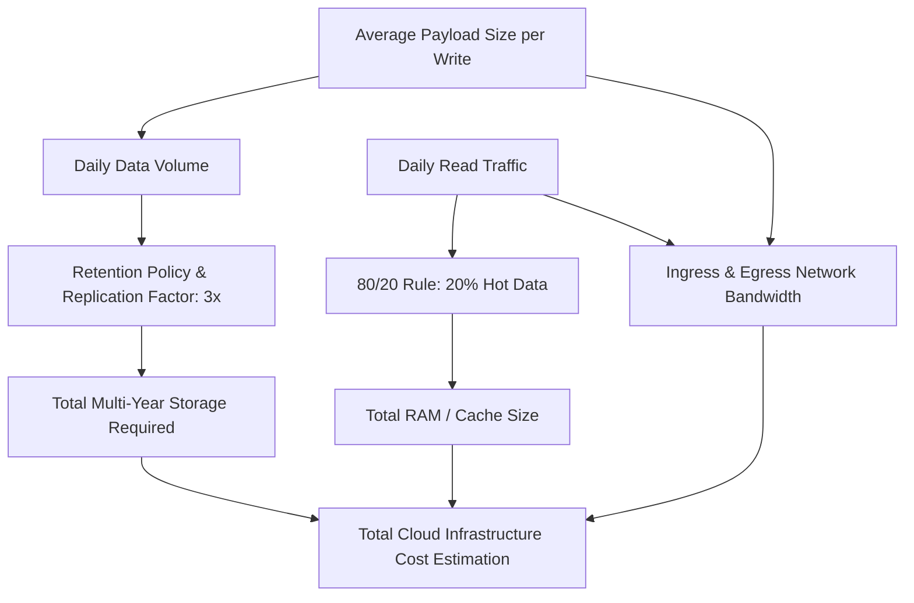
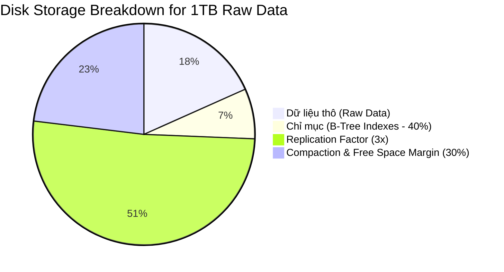
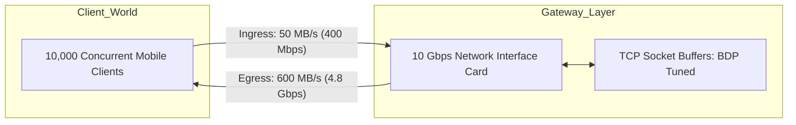
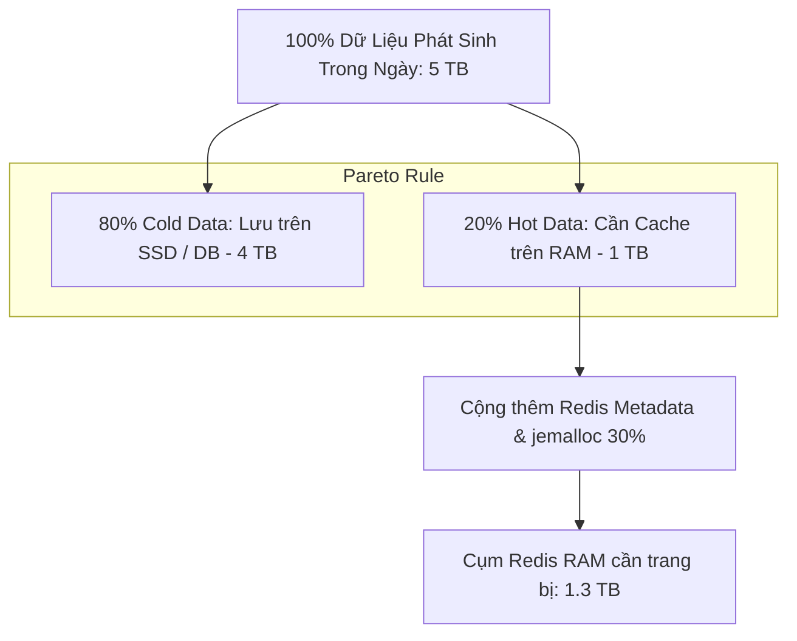
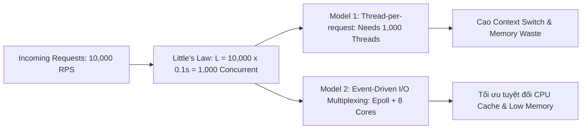
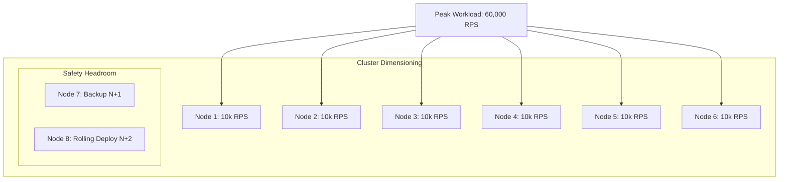

# 02.2. Storage, Memory, and Capacity Planning (Ước Tính Lưu Trữ, Bộ Nhớ và Quy Hoạch Năng Lực)

## Tổng quan về Lưu Trữ, Bộ Nhớ và Quy Hoạch Năng Lực
Sau khi đã xác định được lưu lượng request (RPS/QPS) ở phần 2.1, nhiệm vụ tiếp theo của kỹ sư hệ thống là định cỡ phần cứng vật lý: *Hệ thống cần bao nhiêu Terabyte ổ đĩa mỗi năm? Cần bao nhiêu Gigabyte RAM để duy trì Cache Hit Ratio trên 95%? Băng thông mạng (Egress/Ingress) tốn bao nhiêu Gbps? Và tổng chi phí hạ tầng (TCO) là bao nhiêu?*

Quy hoạch năng lực (Capacity Planning) chính xác giúp bảo vệ doanh nghiệp khỏi tình trạng cạn kiệt đĩa đột ngột (Disk Full Outage) hoặc tràn bộ nhớ Out-of-Memory (OOM Killer) của Linux Kernel, đồng thời tối ưu hóa chi phí điện toán đám mây.



---

## 2. Chi tiết từng Keyword (Under-the-Hood Deep Dive)

### 1. Data Volume, Storage & Database Growth Estimation (Ước Tính Khối Lượng và Tăng Trưởng Dữ Liệu)

#### 1. Khái niệm bản chất (What & Why)
- **Data Volume Estimation**: Tính toán lượng dữ liệu thô sinh ra từ mỗi thao tác ghi (Write Action).
- **Storage Estimation**: Tính toán tổng dung lượng đĩa cần thiết để lưu trữ dữ liệu sau khi tính đến: Metadata, Indexing Overhead, Compaction Buffer và Hệ số sao chép (Replication Factor).
- **Database Growth Estimation**: Dự phóng tốc độ phình to của cơ sở dữ liệu qua các mốc thời gian: 1 năm, 3 năm, 5 năm.

#### 2. Cơ chế hoạt động sâu (Under the hood / Hardcore Internals)
Khi tính toán Storage, một sai lầm phổ biến là chỉ cộng kích thước các trường dữ liệu người dùng (User Fields). Trong thực tế:
1. **Row Header & Alignment Overhead**: Mỗi hàng dữ liệu trong PostgreSQL tốn ít nhất 23 bytes (`HeapTupleHeaderData`), cộng thêm byte alignment padding (4 hoặc 8 bytes).
2. **Indexing Overhead**: Mỗi chỉ mục B-Tree (ví dụ trên cột `created_at` hoặc `user_id`) tốn thêm khoảng 15 - 30 bytes trên mỗi bản ghi cộng với dung lượng trang lá (Leaf pages) và trang trong (Internal pages). Nếu bảng có 5 indexes, dung lượng index có thể lớn hơn cả dung lượng dữ liệu thô (Table Data)!
3. **Replication Factor (RF)**: Trong các hệ thống chịu lỗi cao (như Cassandra, HDFS, Kafka), mỗi byte dữ liệu được sao chép ra $RF = 3$ bản sao trên 3 racks khác nhau.
4. **LSM-Tree Compaction Space Overhead**: Với các cơ sở dữ liệu dùng LSM-tree (RocksDB, Cassandra), cần dự phòng ít nhất $30\% - 50\%$ dung lượng đĩa trống để thực hiện quá trình Major Compaction (gộp các SSTables cũ và giải phóng tombstones).

**Công thức chuẩn**:
$$\text{Storage per Day} = \text{Daily Writes} \times \text{Avg Record Size} \times (1 + \text{Index Factor}) \times RF \times (1 + \text{Compaction/Safety Factor})$$

#### 3. Sơ đồ minh họa


#### 4. Code ví dụ thực chiến (C++20 - Bộ công cụ ước tính dung lượng đĩa 5 năm)
```cpp
#include <iostream>
#include <iomanip>
#include <cstdint>

struct DatabaseCapacityModel {
    uint64_t daily_new_records;
    size_t avg_payload_bytes;
    double index_overhead_ratio; // vd: 0.35 cho 2-3 indexes
    int replication_factor;      // vd: 3
    double free_space_headroom;  // vd: 0.30 cho compaction/safety

    void printProjection(int years) const {
        uint64_t days = years * 365;
        uint64_t total_records = daily_new_records * days;
        
        // Dung lượng thô
        double raw_bytes = static_cast<double>(total_records) * avg_payload_bytes;
        // Kèm index
        double indexed_bytes = raw_bytes * (1.0 + index_overhead_ratio);
        // Kèm replication
        double replicated_bytes = indexed_bytes * replication_factor;
        // Tổng dung lượng đĩa thực tế cần trang bị
        double total_disk_bytes = replicated_bytes * (1.0 + free_space_headroom);

        double total_terabytes = total_disk_bytes / (1024ULL * 1024ULL * 1024ULL * 1024ULL);

        std::cout << "--- Projections for " << years << " Years ---\n";
        std::cout << "Total Records:        " << total_records << "\n";
        std::cout << "Raw Data:             " << std::fixed << std::setprecision(2) 
                  << raw_bytes / (1024ULL * 1024ULL * 1024ULL) << " GB\n";
        std::cout << "Total Usable Disk:    " << total_terabytes << " TB (with 3x replication & headroom)\n";
    }
};

int main() {
    // Ví dụ: Hệ thống URL Shortener (TinyURL)
    // 100 triệu link mới mỗi ngày, mỗi bản ghi 500 bytes, 3 bản sao, 30% headroom
    DatabaseCapacityModel tinyurl_model{
        .daily_new_records = 100'000'000,
        .avg_payload_bytes = 500,
        .index_overhead_ratio = 0.3,
        .replication_factor = 3,
        .free_space_headroom = 0.3
    };

    tinyurl_model.printProjection(5);
    return 0;
}
```

#### 5. Ưu / Nhược điểm, Pitfalls & Anti-patterns
- **Anti-pattern: Ignoring Log Files & WAL Growth**: Bỏ quên Write-Ahead Log (WAL), Binary Logs (MySQL binlog) và Audit logs. Một cụm PostgreSQL bận rộn có thể tạo ra 500GB binlog mỗi ngày; nếu cơ chế rotate log bị lỗi, đĩa sẽ đầy 100% và database tự động shutdown trong hoảng loạn.

#### 6. Ứng dụng thực tế trong Backend / Systems
AWS RDS và Google Cloud SQL cung cấp tính năng "Storage Auto-scaling", nhưng nếu tốc độ phình to của đĩa vượt quá tốc độ mở rộng volume LVM của Cloud Provider (thường mất 15-30 phút), sự cố gián đoạn vẫn xảy ra.

---

### 2. Network Throughput & Bandwidth Estimation (Ước Tính Băng Thông Mạng)

#### 1. Khái niệm bản chất (What & Why)
- **Ingress Bandwidth (Băng thông đi vào)**: Tổng lưu lượng dữ liệu mà các máy chủ nhận vào từ client bên ngoài hoặc từ các dịch vụ khác trong một giây.
- **Egress Bandwidth (Băng thông đi ra)**: Tổng lưu lượng dữ liệu mà hệ thống gửi trả về cho client hoặc chuyển giao ra ngoài Internet.
- Phân biệt giữa **Byte** và **Bit**:
  - Lưu lượng lưu trữ đo bằng **Byte** (MB, GB, TB).
  - Tốc độ mạng của nhà mạng và card mạng đo bằng **bit** (Megabits per second - Mbps, Gigabits per second - Gbps).
  - Quy đổi: $1\text{ Byte} = 8\text{ bits}$.

#### 2. Cơ chế hoạt động sâu (Under the hood / Hardcore Internals)
Khi tính toán băng thông:
$$\text{Ingress Throughput (Bytes/s)} = \text{Write RPS} \times \text{Avg Inbound Payload Size}$$
$$\text{Egress Throughput (Bytes/s)} = \text{Read RPS} \times \text{Avg Outbound Response Size}$$
$$\text{Network Bandwidth Required (Gbps)} = \frac{\text{Throughput (Bytes/s)} \times 8}{10^9}$$

Ảnh hưởng tầng Network Stack:
- **Bandwidth-Delay Product (BDP)**:
  $$\text{BDP} = \text{Bandwidth (bits/s)} \times \text{RTT (giây)}$$
  BDP đại diện cho lượng dữ liệu tối đa có thể "nằm trên đường truyền" giữa client và server. Để tận dụng tối đa đường truyền 10Gbps với RTT 50ms, bộ đệm cửa sổ TCP (`tcp_rmem` và `tcp_wmem` trong Linux kernel) phải được cấu hình đủ lớn:
  $$\text{Buffer Size} \ge 10 \times 10^9 \times 0.05 / 8 \approx 62.5\text{ MB}$$
  Nếu cấu hình mặc định chỉ có 4MB, đường truyền mạng sẽ không bao giờ đạt được tốc độ tối đa!

#### 3. Sơ đồ minh họa


#### 4. Code ví dụ thực chiến (C++20 - Tính toán Bandwidth và TCP Window Size)
```cpp
#include <iostream>
#include <iomanip>

struct NetworkBandwidthEstimator {
    static void calculateNetworkDemands(double rps, size_t avg_response_bytes, double rtt_ms) {
        double bytes_per_sec = rps * avg_response_bytes;
        double bits_per_sec = bytes_per_sec * 8.0;
        double gbps = bits_per_sec / 1'000'000'000.0;

        // Tính Bandwidth-Delay Product (BDP) cho TCP Window Tuning
        double rtt_sec = rtt_ms / 1000.0;
        double bdp_bytes = (bits_per_sec * rtt_sec) / 8.0;

        std::cout << "[Network Bandwidth Calculation]\n";
        std::cout << "Egress Throughput:  " << std::fixed << std::setprecision(2) 
                  << bytes_per_sec / (1024 * 1024) << " MB/s\n";
        std::cout << "Network Bandwidth:  " << gbps << " Gbps\n";
        std::cout << "Required TCP BDP:   " << bdp_bytes / (1024 * 1024) << " MB (Per connection pool)\n";
    }
};

int main() {
    // 50,000 Read RPS, mỗi response trả về ảnh/JSON nặng 50KB, RTT 40ms
    NetworkBandwidthEstimator::calculateNetworkDemands(50'000, 50 * 1024, 40.0);
    return 0;
}
```

#### 5. Ưu / Nhược điểm, Pitfalls & Anti-patterns
- **Pitfall: Egress Cost Blindness (Cú sốc hóa đơn Egress)**: Các nhà cung cấp đám mây (AWS, GCP, Azure) miễn phí dữ liệu đi vào (Ingress), nhưng tính tiền rất đắt cho dữ liệu đi ra (Egress: $\sim \$0.08 - \$0.12$ cho mỗi GB). Nếu không đưa CDN vào gánh tải video/ảnh, hóa đơn Egress có thể chiếm tới 70% tổng chi phí vận hành.

#### 6. Ứng dụng thực tế trong Backend / Systems
Netflix xây dựng mạng lưới Open Connect CDN riêng, đặt máy chủ chứa sẵn video tại các trạm của nhà mạng viễn thông địa phương (ISP) để triệt tiêu hoàn toàn chi phí Egress Bandwidth xuyên lục địa.

---

### 3. Memory & Cache Size Estimation: The 80/20 Rule (Ước Tính Bộ Nhớ và Kích Thước Cache)

#### 1. Khái niệm bản chất (What & Why)
- **Memory Estimation**: Tính toán lượng RAM cần thiết cho ứng dụng, bao gồm: JVM Heap / V8 Isolate, Off-heap buffers, OS Page Cache và In-Memory Caches (Redis/Memcached).
- **The 80/20 Rule (Pareto Principle in Caching)**: Quy luật thống kê chỉ ra rằng **20% nội dung (Hot Data) tạo ra 80% lưu lượng truy cập hàng ngày**. Do đó, để đạt được tỷ lệ Cache Hit Ratio khoảng $80\%$, chúng ta chỉ cần lưu $20\%$ dữ liệu nóng của ngày hôm đó vào trong bộ nhớ RAM.

#### 2. Cơ chế hoạt động sâu (Under the hood / Hardcore Internals)
Tính toán kích thước cụm Redis:
1. Xác định tổng lượng dữ liệu đọc trong ngày:
   $$\text{Daily Read Data} = \text{Daily Reads} \times \text{Avg Object Size}$$
2. Áp dụng quy tắc 80/20:
   $$\text{Cache Working Set Size} = \text{Daily Read Data} \times 0.20$$
3. **Redis Memory Overhead**: Redis không chỉ lưu raw payload mà còn tiêu tốn bộ nhớ cho:
   - Cấu trúc `robj` (Redis Object Header: 16 bytes).
   - `dictEntry` (24 bytes trên hệ điều hành 64-bit).
   - `jemalloc` memory fragmentation (thường gây đội thêm $15\% - 25\%$ RAM).
4. Do đó, dung lượng RAM thực tế cần mua phải nhân với hệ số an toàn:
   $$\text{Total Redis RAM} = \text{Cache Working Set Size} \times 1.30$$

#### 3. Sơ đồ minh họa


#### 4. Code ví dụ thực chiến (C++20 - Ước tính cấu hình cụm Redis Cache)
```cpp
#include <iostream>
#include <iomanip>

struct CacheDimensioning {
    static void estimateRedisCluster(uint64_t daily_requests, size_t object_size_bytes) {
        double total_daily_bytes = static_cast<double>(daily_requests) * object_size_bytes;
        double hot_data_bytes = total_daily_bytes * 0.20; // 20% Hot Data
        
        // Bù thêm 30% cho redis overhead và fragmentation
        double actual_ram_bytes = hot_data_bytes * 1.30;
        double actual_ram_gb = actual_ram_bytes / (1024ULL * 1024ULL * 1024ULL);

        // Giả sử mỗi máy chủ Redis chuẩn có 32GB RAM khả dụng
        int nodes_needed = static_cast<int>(actual_ram_gb / 32.0) + 1;

        std::cout << "[Cache Sizing Estimation (80/20 Rule)]\n";
        std::cout << "20% Working Set Size: " << std::fixed << std::setprecision(2) 
                  << hot_data_bytes / (1024ULL * 1024ULL * 1024ULL) << " GB\n";
        std::cout << "Total RAM Needed:     " << actual_ram_gb << " GB (with Jemalloc overhead)\n";
        std::cout << "Redis Nodes (32GB ea):" << nodes_needed << " nodes (Primary only)\n";
        std::cout << "With Master-Replica:  " << nodes_needed * 2 << " nodes total\n";
    }
};

int main() {
    // 500 triệu read requests mỗi ngày, mỗi object nặng 4KB
    CacheDimensioning::estimateRedisCluster(500'000'000, 4 * 1024);
    return 0;
}
```

#### 5. Ưu / Nhược điểm, Pitfalls & Anti-patterns
- **Pitfall: Cold Cache Stampede after Restart**: Khởi động lại cụm Cache trống rỗng (Cold Cache). Vì không có dữ liệu trên RAM, 100% traffic tràn xuống Database khiến database sập ngay lập tức.
- **Giải pháp**: Phải có quy trình **Cache Warming** (nạp trước hot data) trước khi mở cổng cho traffic đổ vào.

#### 6. Ứng dụng thực tế trong Backend / Systems
Twitter và Reddit sử dụng các cụm Twemproxy / Redis Cluster chứa hàng chục Terabyte RAM để cache toàn bộ timeline của người dùng tích cực.

---

### 4. CPU Capacity & Thread Pool Sizing (Ước Tính Năng Lực CPU và Cỡ Thread Pool)

#### 1. Khái niệm bản chất (What & Why)
- **CPU Capacity Estimation**: Xác định số lượng vCPU core cần thiết để xử lý khối lượng công việc theo cam kết SLA.
- **Little's Law (Định luật Little)**:
  $$L = \lambda \times W$$
  - $L$: Số lượng requests đang được xử lý đồng thời trong hệ thống (Concurrency / In-Flight Requests).
  - $\lambda$: Tốc độ đến của request (Arrival Rate / RPS).
  - $W$: Thời gian trung bình để xử lý xong một request (Average Latency / Duration).

#### 2. Cơ chế hoạt động sâu (Under the hood / Hardcore Internals)
Áp dụng Định luật Little để định cỡ Thread Pool:
- Giả sử hệ thống nhận $\lambda = 10,000\ \text{RPS}$.
- Thời gian xử lý trung bình mỗi request là $W = 100\text{ ms} = 0.1\text{ giây}$.
- Số lượng request đồng thời hệ thống phải giữ trong bộ nhớ tại bất kỳ thời điểm nào là:
  $$L = 10,000 \times 0.1 = 1,000\ \text{concurrent requests}$$

Nếu dùng mô hình **Thread-per-request (như Tomcat truyền thống)**, bạn cần ít nhất $1,000$ active threads.
Mỗi thread trên Linux tốn mặc định $1\text{ MB}$ Stack Memory (`ulimit -s`). $1,000$ threads ngốn mất $1\text{ GB}$ chỉ riêng cho Thread Stacks, và CPU sẽ lãng phí phần lớn thời gian cho việc Context Switching!

**Công thức Brian Goetz tính số thread tối ưu cho Thread Pool**:
$$N_{\text{threads}} = N_{\text{cpu}} \times U_{\text{cpu}} \times \left(1 + \frac{W}{C}\right)$$
- $N_{\text{cpu}}$: Số lượng CPU cores.
- $U_{\text{cpu}}$: Mức độ sử dụng CPU mong muốn ($0 \le U_{\text{cpu}} \le 1$).
- $W/C$: Tỷ lệ giữa Thời gian chờ I/O ($W$ - Wait time) và Thời gian tính toán CPU ($C$ - Compute time).
- Nếu tác vụ thuần I/O bound (ví dụ: gọi database mất 90ms, xử lý CPU mất 10ms $\implies W/C = 9$), một máy chủ 8 cores có thể chạy: $8 \times 1 \times (1 + 9) = 80$ threads.

#### 3. Sơ đồ minh họa


#### 4. Code ví dụ thực chiến (C++20 - Tính toán Thread Pool và Concurrency theo Little's Law)
```cpp
#include <iostream>

struct CPUAndConcurrencyPlanner {
    static void calculateCapacity(double target_rps, double latency_sec, int cpu_cores, double wait_to_compute_ratio) {
        // Little's Law
        double in_flight_concurrency = target_rps * latency_sec;

        // Brian Goetz Thread Pool Formula
        double optimal_threads = cpu_cores * 1.0 * (1.0 + wait_to_compute_ratio);

        std::cout << "[Concurrency & CPU Capacity Planning]\n";
        std::cout << "Target RPS:                " << target_rps << " req/sec\n";
        std::cout << "Avg Latency:               " << latency_sec * 1000.0 << " ms\n";
        std::cout << "Little's Law In-Flight (L):" << in_flight_concurrency << " concurrent requests\n";
        std::cout << "Optimal Thread Pool Size:  " << static_cast<int>(optimal_threads) 
                  << " threads (on " << cpu_cores << " vCPU cores)\n";
    }
};

int main() {
    // Kịch bản: 20,000 RPS, mỗi request mất 50ms, máy chủ 16 cores, thời gian đợi I/O gấp 4 lần CPU compute
    CPUAndConcurrencyPlanner::calculateCapacity(20'000, 0.050, 16, 4.0);
    return 0;
}
```

#### 5. Ưu / Nhược điểm, Pitfalls & Anti-patterns
- **Anti-pattern: Giant Thread Pool Fallacy**: Tạo thread pool gồm 5,000 threads với suy nghĩ "càng nhiều thread xử lý càng nhanh". Thực tế, hiện tượng giật cục (Thrashing) xảy ra, CPU dành 80% thời gian chỉ để hoán đổi thanh ghi và xóa L1/L2 Cache thay vì thực thi logic nghiệp vụ.

#### 6. Ứng dụng thực tế trong Backend / Systems
NGINX, Node.js, Netty và Redis chọn mô hình **Non-blocking Event Loop (`epoll`/`kqueue`)**: chỉ dùng số thread bằng đúng số CPU core vật lý ($W/C \approx 0$ trong thread chính), chuyển toàn bộ thời gian chờ I/O cho Linux Kernel quản lý bất đồng bộ.

---

### 5. Horizontal vs Vertical Planning, Safety Margin, Headroom & Cost Estimation

#### 1. Khái niệm bản chất (What & Why)
- **Vertical Capacity Planning (Scale-Up)**: Nâng cấp phần cứng của máy chủ hiện tại (mua CPU mạnh hơn, cắm thêm RAM, dùng SSD NVMe nhanh hơn).
- **Horizontal Capacity Planning (Scale-Out)**: Bổ sung thêm nhiều máy chủ cấu hình vừa phải (Commodity Hardware) vào cụm và phân phối tải bằng Load Balancer.
- **Safety Margin & Headroom**: Tỷ lệ tài nguyên dự phòng bắt buộc phải có để đối phó với sự cố đột xuất (một node bị sập) hoặc traffic tăng đột biến. Thông thường, hệ thống production được khuyến cáo chạy ở mức **$60\% - 70\%$ công suất**, giữ lại **$30\% - 40\%$ Headroom**.
- **Cost Estimation**: Dự toán tổng chi phí sở hữu (TCO) gồm: Compute (EC2), Managed Database (RDS), Storage (S3), Caching (ElastiCache), Data Transfer (Egress) và nhân sự vận hành.

#### 2. Cơ chế hoạt động sâu (Under the hood / Hardcore Internals)
Quy tắc $N+1$ và $N+2$ Redundancy trong Horizontal Planning:
- Giả sử để xử lý Peak Traffic $60,000\ \text{RPS}$, chúng ta tính toán cần 6 máy chủ (mỗi máy xử lý được $10,000\ \text{RPS}$).
- **Quy tắc $N+1$**: Cụm phải có ít nhất $6 + 1 = 7$ máy. Nếu 1 máy bị cháy ổ cứng, 6 máy còn lại vẫn gánh đủ 100% tải mà không vi phạm SLA.
- **Quy tắc $N+2$**: Cụm có ít nhất $6 + 2 = 8$ máy. Cho phép 1 máy đang trong quá trình bảo trì/rolling deploy và 1 máy khác gặp sự cố đột ngột mà hệ thống vẫn sống sót an toàn.

#### 3. Sơ đồ minh họa


#### 4. Code ví dụ thực chiến (TypeScript - Công cụ tính toán chi phí hạ tầng Cloud hàng tháng)
```typescript
interface InfrastructureBillEstimate {
  ec2InstancesCount: number;
  ec2CostPerMonthEach: number;
  dbStorageTB: number;
  dbCostPerTBMonth: number;
  cacheNodesCount: number;
  cacheNodeCostMonth: number;
  egressBandwidthTB: number;
  egressCostPerTB: number;
}

export function calculateMonthlyCloudCost(bill: InfrastructureBillEstimate) {
  const computeCost = bill.ec2InstancesCount * bill.ec2CostPerMonthEach;
  const storageCost = bill.dbStorageTB * bill.dbCostPerTBMonth;
  const cacheCost = bill.cacheNodesCount * bill.cacheNodeCostMonth;
  const networkCost = bill.egressBandwidthTB * bill.egressCostPerTB;
  
  const totalBaseCost = computeCost + storageCost + cacheCost + networkCost;
  const contingencyReserve = totalBaseCost * 0.15; // 15% dự phòng phát sinh

  return {
    breakdown: { computeCost, storageCost, cacheCost, networkCost },
    totalBaseCost,
    totalWithContingency: Math.round(totalBaseCost + contingencyReserve),
  };
}

const mySystemBill: InfrastructureBillEstimate = {
  ec2InstancesCount: 8,       // 8 node c6g.2xlarge ($150/mo)
  ec2CostPerMonthEach: 150,
  dbStorageTB: 5,             // 5TB SSD Multi-AZ ($250/TB)
  dbCostPerTBMonth: 250,
  cacheNodesCount: 4,         // 4 Redis nodes cache.r6g.xlarge ($200/mo)
  cacheNodeCostMonth: 200,
  egressBandwidthTB: 50,      // 50TB Egress ra ngoài Internet ($90/TB)
  egressCostPerTB: 90,
};

console.log(calculateMonthlyCloudCost(mySystemBill));
```

#### 5. Ưu / Nhược điểm, Pitfalls & Anti-patterns
- **Anti-pattern: Maxing out at 95% CPU**: Để cụm máy chủ chạy ở mức $95\%$ CPU trong giờ bình thường nhằm "tiết kiệm tiền". Bất kỳ một đợt sóng tải nhỏ nào cũng sẽ đẩy CPU lên 100%, gây trễ hàng đợi, kích hoạt cascading failure và kéo sập toàn bộ hệ thống.

#### 6. Ứng dụng thực tế trong Backend / Systems
AWS Well-Architected Framework định nghĩa rõ trụ cột "Cost Optimization" và "Reliability", yêu cầu mọi hệ thống cấp Enterprise phải duy trì headroom và đa vùng sẵn sàng (Multi-AZ).

---

## Tóm tắt liên kết hệ thống
Toàn bộ phần **11.2 (Capacity Estimation & Calculations)** đã trang bị cho bạn đầy đủ vũ khí toán học và trực giác phần cứng: từ ước tính RPS, QPS, dung lượng đĩa 5 năm, kích thước cache 80/20, quy mô thread pool cho đến chi phí đám mây.

Nắm chắc số liệu này, chúng ta sẽ tự tin bước vào chương **11.3: System Architecture Styles** để lựa chọn phong cách kiến trúc phù hợp nhất cho quy mô hệ thống.
