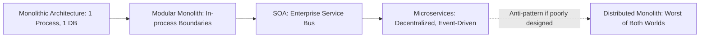
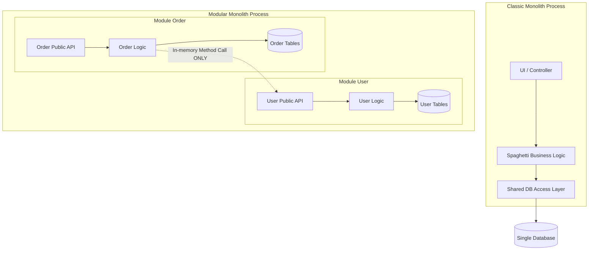
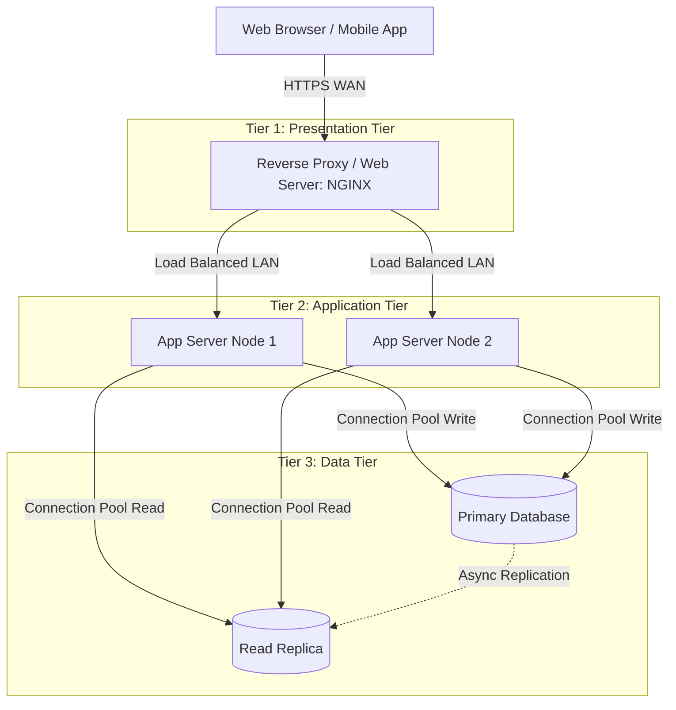
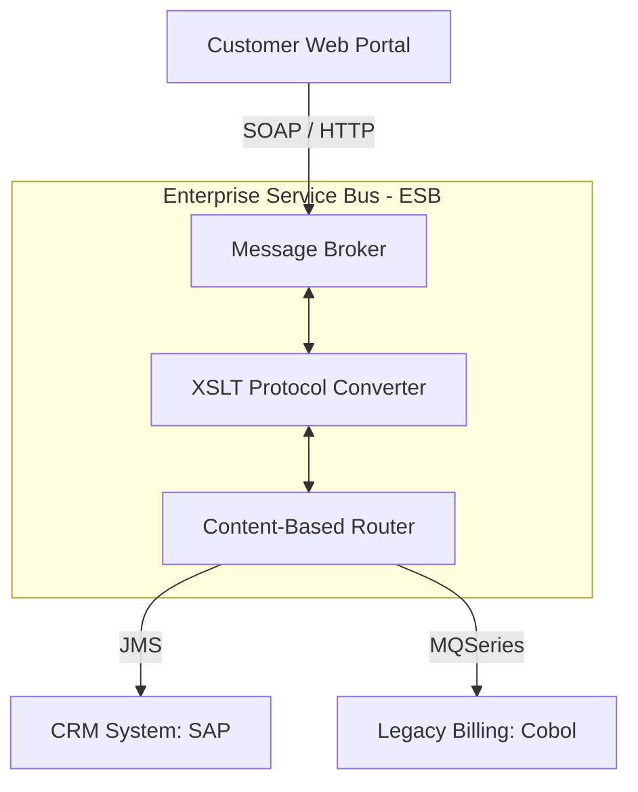
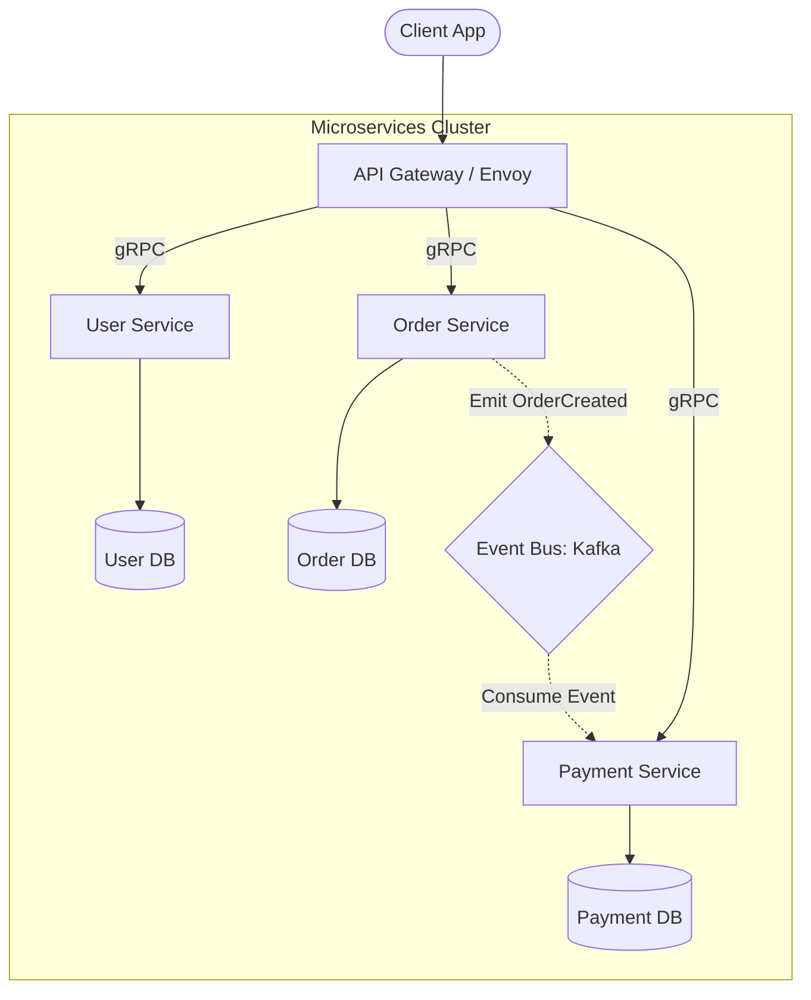
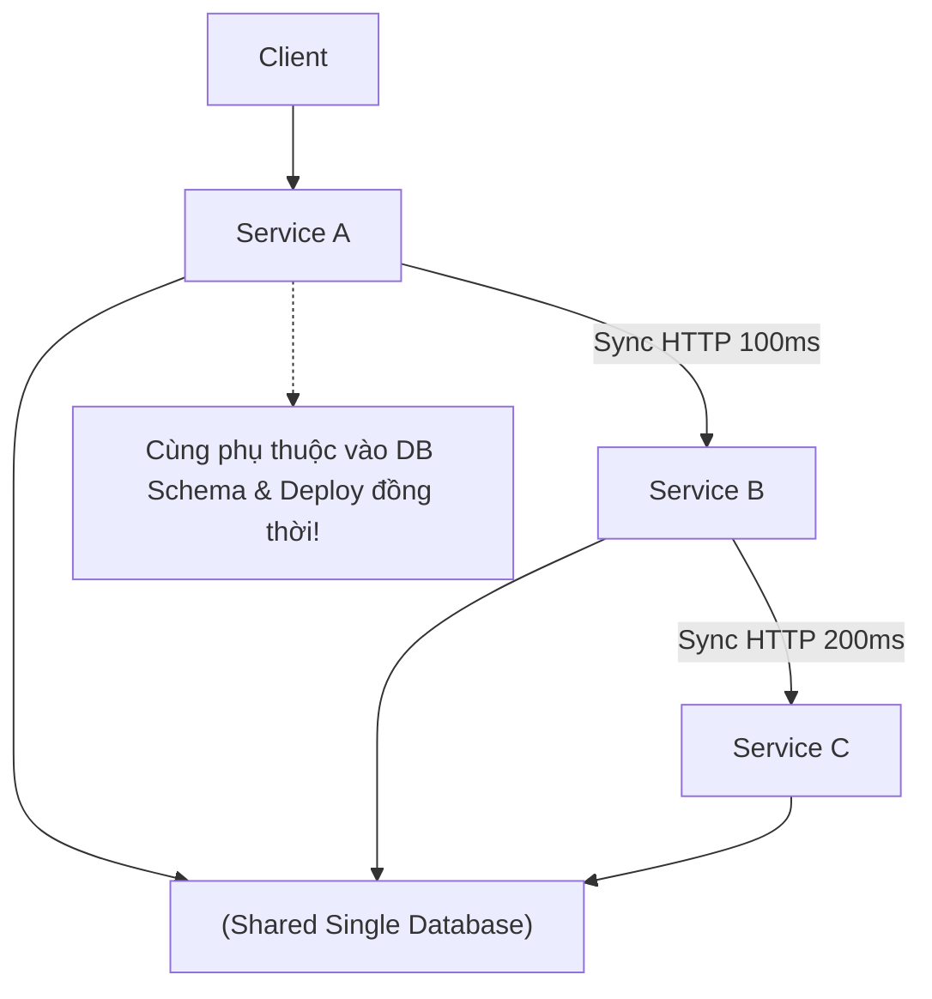

# 03.1. Monolithic, SOA, and Microservices Architectures (Kiến Trúc Đơn Khối, Hướng Dịch Vụ và Vi Dịch Vụ)

## Tổng quan về Các Phong Cách Kiến Trúc Hệ Thống
Phong cách kiến trúc (Architecture Style) là bản thiết kế thượng tầng xác định cách thức tổ chức các thành phần mã nguồn, phân định ranh giới logic và vật lý, cũng như quy định phương thức giao tiếp giữa các thành phần trong hệ thống. 

Không có phong cách kiến trúc nào là "tối thượng" trong mọi hoàn cảnh. Sự chuyển dịch từ **Monolith** sang **Modular Monolith**, **SOA** và **Microservices** là cuộc hành trình đánh đổi giữa **Sự đơn giản trong vận hành (Operational Simplicity)** và **Khả năng mở rộng độc lập của tổ chức (Organizational Scalability)**. Hiểu sai bản chất sự đánh đổi này thường dẫn đến cái bẫy tồi tệ nhất của kỹ nghệ phần mềm: **Distributed Monolith** (Đơn khối phân tán).



---

## 2. Chi tiết từng Keyword (Under-the-Hood Deep Dive)

### 1. Monolithic Architecture & Modular Monolith (Kiến Trúc Đơn Khối và Đơn Khối Mô-đun Hóa)

#### 1. Khái niệm bản chất (What & Why)
- **Monolithic Architecture**: Toàn bộ hệ thống phần mềm (Giao diện người dùng, logic nghiệp vụ, truy cập dữ liệu) được đóng gói và triển khai như **một đơn vị thực thi duy nhất (Single Deployment Unit)**, chạy chung trong một tiến trình hệ điều hành (OS Process) và chia sẻ một cơ sở dữ liệu chung.
- **Modular Monolith**: Vẫn là một đơn vị triển khai duy nhất (chạy trong 1 process), nhưng mã nguồn bên trong được phân chia nghiêm ngặt thành các mô-đun độc lập với ranh giới rõ ràng (Bounded Contexts). Các mô-đun chỉ được phép giao tiếp với nhau qua Public Interfaces (API trong bộ nhớ), nghiêm cấm việc một mô-đun truy cập trực tiếp vào cấu trúc dữ liệu nội bộ hoặc bảng cơ sở dữ liệu của mô-đun khác.

#### 2. Cơ chế hoạt động sâu (Under the hood / Hardcore Internals)
Ưu thế vật lý tuyệt đối của Monolith so với Hệ thống phân tán:
1. **Zero Network Overhead**: Giao tiếp giữa các thành phần diễn ra thông qua **Hàm gọi trực tiếp (Function Call / In-Process Memory Call)**.
   - Chi phí một function call trên CPU: Một lệnh `CALL` trong Assembly, hoán đổi vài thanh ghi, tốn **$< 2\text{ ns}$**.
   - Chi phí một gRPC / REST network call giữa microservices: Tốn từ **$0.5\text{ ms}$ đến $10\text{ ms}$** (chậm hơn từ 250,000 đến 5,000,000 lần!).
2. **ACID Local Transactions**: Mọi nghiệp vụ phức tạp (chuyển tiền, trừ kho, tạo hóa đơn) đều được thực hiện trong một Local Database Transaction duy nhất do RDBMS quản lý bằng Write-Ahead Log và Two-Phase Locking cục bộ. Hoàn toàn loại bỏ sự đau đầu của Distributed Transactions.
3. **Bộ nhớ dùng chung (Shared Memory)**: Có thể truyền con trỏ (`std::shared_ptr` hoặc tham chiếu) giữa các mô-đun với độ phức tạp $O(1)$, không tốn chu kỳ CPU cho việc Serialize (thành JSON/Protobuf) và Deserialize.

Điểm nghẽn của Monolith cổ điển:
- **Blast Radius (Bán kính thiệt hại)**: Một lỗi rò rỉ bộ nhớ (Memory Leak) hoặc Null Pointer Dereference ở tính năng xuất báo cáo PDF có thể kéo sập toàn bộ tiến trình, làm tê liệt luôn cả tính năng Đặt hàng và Thanh toán.
- **Lock Contention**: Toàn bộ hệ thống cùng tranh chấp kết nối và khóa hàng trên cùng một cơ sở dữ liệu tập trung.

#### 3. Sơ đồ minh họa


#### 4. Code ví dụ thực chiến (C++20 - Modular Monolith với In-Process Interface Boundary)
```cpp
#include <iostream>
#include <memory>
#include <string>

// Module Billing: Public Interface công khai
class IBillingModule {
public:
    virtual ~IBillingModule() = default;
    virtual bool processPayment(const std::string& account_id, double amount) = 0;
};

// Module Billing: Private Implementation (Nội bộ, không lộ ra ngoài)
class BillingModuleImpl : public IBillingModule {
public:
    bool processPayment(const std::string& account_id, double amount) override {
        // Xử lý thanh toán trong cùng tiến trình (Zero Network Call!)
        std::cout << "[BillingModule] Successfully billed " << amount 
                  << "$ to account " << account_id << " via Local Memory\n";
        return true;
    }
};

// Module Order: Phụ thuộc vào IBillingModule thông qua Dependency Injection
class OrderModule {
private:
    std::shared_ptr<IBillingModule> billing_;
public:
    explicit OrderModule(std::shared_ptr<IBillingModule> billing) : billing_(billing) {}

    void placeOrder(const std::string& user_id, double total_price) {
        std::cout << "[OrderModule] Placing order for user " << user_id << "...\n";
        // Gọi hàm trực tiếp trên RAM, chi phí < 5ns
        if (billing_->processPayment(user_id, total_price)) {
            std::cout << "[OrderModule] Order placed successfully!\n";
        }
    }
};

int main() {
    auto billing = std::make_shared<BillingModuleImpl>();
    OrderModule order_module(billing);
    order_module.placeOrder("USR-77", 299.99);
    return 0;
}
```

#### 5. Ưu / Nhược điểm, Pitfalls & Anti-patterns
- **Ưu điểm**: Triển khai siêu nhanh, debug dễ dàng bằng IDE breakpoints, chi phí hạ tầng thấp nhất, kiểm thử tích hợp (End-to-End) đơn giản.
- **Nhược điểm**: Khó scale độc lập một tính năng ngốn CPU; xung đột merge code khi team vượt quá 50 kỹ sư.
- **Anti-pattern**: Bỏ qua ranh giới trong Modular Monolith, cho phép code của Module này `JOIN` trực tiếp vào bảng dữ liệu của Module khác.

#### 6. Ứng dụng thực tế trong Backend / Systems
Shopify, Stack Overflow và Basecamp là những minh chứng kinh điển cho việc phục vụ hàng trăm triệu người dùng trên nền tảng Modular Monolith được tối ưu hóa xuất sắc.

---

### 2. Layered Architecture & N-Tier Architecture (Kiến Trúc Phân Tầng)

#### 1. Khái niệm bản chất (What & Why)
- **Layered Architecture (Phân tầng logic)**: Cách tổ chức mã nguồn thành các lớp logic ngang (Horizontal Layers), trong đó mỗi lớp có một trách nhiệm duy nhất và chỉ giao tiếp với lớp ngay bên dưới nó:
  1. *Presentation Layer (UI / Controller)*: Tiếp nhận request, xác thực dữ liệu đầu vào.
  2. *Business / Service Layer*: Thực thi quy tắc nghiệp vụ.
  3. *Persistence / Data Access Layer (Repository / DAO)*: Tương tác với cơ sở dữ liệu.
  4. *Database Layer*: Lưu trữ vật lý.
- **N-Tier Architecture (Phân tầng vật lý)**: Phân tách các lớp logic thành các **máy chủ vật lý độc lập** chạy trên mạng: Tier 1 (Client / Web Server), Tier 2 (Application Server Cluster), Tier 3 (Database Cluster).

#### 2. Cơ chế hoạt động sâu (Under the hood / Hardcore Internals)
Nguyên tắc đóng của kiến trúc phân tầng (Closed vs Open Layers):
- **Closed Layer**: Một request bắt buộc phải đi tuần tự từ Layer $N \rightarrow N-1 \rightarrow N-2$. Presentation không được phép nhảy cóc gọi thẳng Persistence. Điều này đảm bảo tính đóng gói (Encapsulation) và khả năng cô lập để kiểm thử (Testability).
- **Open Layer**: Cho phép request đi xuyên qua một lớp nếu lớp đó chỉ đóng vai trò trung chuyển tiện ích (Shared Utilities).

Ở cấp độ phần cứng và mạng trong N-Tier:
Mỗi bước nhảy giữa các Tier tương ứng với một Network Hop (Client $\xrightarrow{\text{WAN}}$ Web Server $\xrightarrow{\text{LAN}}$ App Server $\xrightarrow{\text{LAN}}$ Database). Kỹ sư phải cấu hình TCP Connection Pooling tại App Server để tái sử dụng socket kết nối xuống Database, tránh việc liên tục thực hiện TCP 3-way handshake cho từng câu query.

#### 3. Sơ đồ minh họa


#### 4. Code ví dụ thực chiến (TypeScript - Layered Architecture mẫu)
```typescript
// 1. Persistence Layer (Data Access)
interface UserRepository {
  findById(id: string): Promise<{ id: string; email: string; role: string } | null>;
}

// 2. Business Layer (Service)
class UserService {
  constructor(private userRepo: UserRepository) {}

  async canAccessAdminPanel(userId: string): Promise<boolean> {
    const user = await this.userRepo.findById(userId);
    if (!user) throw new Error("User not found");
    return user.role === 'ADMIN';
  }
}

// 3. Presentation Layer (Controller)
class UserController {
  constructor(private userService: UserService) {}

  async handleAdminCheckRequest(req: { params: { id: string } }) {
    try {
      const allowed = await this.userService.canAccessAdminPanel(req.params.id);
      return { status: 200, body: { canAccess: allowed } };
    } catch (err: any) {
      return { status: 404, body: { error: err.message } };
    }
  }
}
```

#### 5. Ưu / Nhược điểm, Pitfalls & Anti-patterns
- **Anti-pattern: Sinkhole Anti-pattern**: Các request chỉ đơn giản đi xuyên qua các tầng mà không có bất kỳ logic nghiệp vụ nào (Controller gọi Service, Service chỉ gọi Repository, Repository chỉ làm `SELECT *`). Nếu 80% hệ thống là sinkhole, việc phân tầng đang tạo ra sự cồng kềnh vô nghĩa.

#### 6. Ứng dụng thực tế trong Backend / Systems
Mô hình 3-Tier kinh điển (Apache/NGINX $\rightarrow$ Tomcat/NodeJS $\rightarrow$ Oracle/MySQL) là xương sống của hầu hết hệ thống doanh nghiệp trong suốt 20 năm qua.

---

### 3. Service-Oriented Architecture - SOA (Kiến Trúc Hướng Dịch Vụ)

#### 1. Khái niệm bản chất (What & Why)
SOA là phong cách kiến trúc tích hợp các ứng dụng doanh nghiệp quy mô lớn (Enterprise) bằng cách đóng gói các chức năng kinh doanh thành các **dịch vụ có thể tái sử dụng (Services)**. Giao tiếp giữa các dịch vụ được điều phối tập trung thông qua một trục xương sống gọi là **Enterprise Service Bus (ESB)**.

#### 2. Cơ chế hoạt động sâu (Under the hood / Hardcore Internals)
Đặc trưng kỹ thuật của SOA:
- **Heavyweight Protocols**: Sử dụng SOAP (Simple Object Access Protocol) dựa trên XML, được định nghĩa nghiêm ngặt bằng WSDL (Web Services Description Language). Việc phân tích cú pháp (XML Parsing) tiêu tốn rất nhiều CPU và RAM do cấu trúc thẻ lồng nhau cồng kềnh.
- **Smart Pipes, Dumb Endpoints**: Trục ESB không chỉ làm nhiệm vụ chuyển tiếp tin nhắn mà còn chứa đựng logic phức tạp: chuyển đổi giao thức (HTTP sang JMS), biến đổi dữ liệu (XML Transformation qua XSLT), định tuyến thông minh (Content-Based Routing) và điều phối giao dịch.

#### 3. Sơ đồ minh họa


#### 4. Code ví dụ thực chiến (C++20 - Mô phỏng cơ chế Content-Based Router trong ESB)
```cpp
#include <iostream>
#include <string>
#include <memory>

struct EnterpriseMessage {
    std::string destination_topic;
    std::string payload_xml;
};

// Mô phỏng ESB Router chuyển hướng bản tin dựa trên nội dung XML
class ESBContentRouter {
public:
    void route(const EnterpriseMessage& msg) {
        std::cout << "[ESB Core] Inspecting incoming XML payload...\n";
        if (msg.payload_xml.find("<Type>URGENT_PAYMENT</Type>") != std::string::npos) {
            std::cout << "[ESB Router] Directing to High-Priority Financial MQ\n";
        } else {
            std::cout << "[ESB Router] Directing to Standard Batch Queue\n";
        }
    }
};

int main() {
    ESBContentRouter esb;
    EnterpriseMessage m1{"FINANCE", "<Transaction><Type>URGENT_PAYMENT</Type><Amount>50000</Amount></Transaction>"};
    esb.route(m1);
    return 0;
}
```

#### 5. Ưu / Nhược điểm, Pitfalls & Anti-patterns
- **Pitfall: The ESB Bottleneck**: Toàn bộ logic doanh nghiệp bị dồn nén vào trục ESB. Đội ngũ quản trị ESB trở thành nút thắt cổ chai của toàn công ty; khi trục ESB sập, toàn bộ tập đoàn tê liệt.

#### 6. Ứng dụng thực tế trong Backend / Systems
Vẫn là nền tảng cốt lõi trong các ngân hàng lâu đời, hãng hàng không và tập đoàn viễn thông lớn sử dụng giải pháp của IBM (IBM MQ, WebSphere) hoặc Oracle (Oracle Service Bus).

---

### 4. Microservices Architecture (Kiến Trúc Vi Dịch Vụ)

#### 1. Khái niệm bản chất (What & Why)
Microservices Architecture là phương pháp phát triển phần mềm trong đó một ứng dụng lớn được cấu thành từ một tập hợp các **dịch vụ nhỏ, độc lập, có thể triển khai riêng biệt (Independently Deployable)**. Mỗi dịch vụ chạy trong một tiến trình riêng, tập trung vào một năng lực kinh doanh duy nhất (Single Business Capability / Bounded Context), sở hữu cơ sở dữ liệu riêng (**Database-per-service**) và giao tiếp với nhau bằng các giao thức gọn nhẹ (**Dumb Pipes, Smart Endpoints**: REST, gRPC hoặc Event-Driven Messaging).

#### 2. Cơ chế hoạt động sâu (Under the hood / Hardcore Internals)
Sự đối lập giữa SOA và Microservices:
- Thay vì dùng "Smart Pipes" (ESB), Microservices dùng "Dumb Pipes" (Kafka, RabbitMQ, HTTP/2). Toàn bộ logic nghiệp vụ nằm hoàn toàn ở hai đầu dịch vụ (Endpoints).
- **Decentralized Data Management (Database-per-service)**: Bắt buộc không dịch vụ nào được phép đọc trực tiếp vào database của dịch vụ khác. Nếu Service Order cần thông tin của Service Customer, nó phải gọi API hoặc đăng ký nhận sự kiện (Event) do Customer Service phát ra.
- **Chi phí phân tán (The Distributed Tax)**:
  - Phải giải quyết bài toán Eventual Consistency thông qua Saga Pattern thay vì ACID.
  - Phải quản lý Service Discovery (Consul, K8s CoreDNS), Distributed Tracing (OpenTelemetry), Circuit Breaker (Resilience4j).

#### 3. Sơ đồ minh họa


#### 4. Code ví dụ thực chiến (TypeScript - Database-per-service Client Call)
```typescript
// Order Service giao tiếp với Inventory Service qua HTTP/REST contract thay vì truy cập DB trực tiếp
interface InventoryCheckResponse {
  sku: string;
  available: boolean;
}

export class OrderService {
  constructor(private inventoryServiceBaseUrl: string) {}

  async createOrder(orderId: string, sku: string, quantity: number) {
    // Gọi Network RPC sang Inventory Service (Dumb Pipe)
    const response = await fetch(`${this.inventoryServiceBaseUrl}/api/v1/inventory/check`, {
      method: 'POST',
      headers: { 'Content-Type': 'application/json' },
      body: JSON.stringify({ sku, quantity })
    });

    if (!response.ok) {
      throw new Error("Inventory Service unavailable");
    }

    const data = (await response.json()) as InventoryCheckResponse;
    if (!data.available) {
      throw new Error(`Item ${sku} is out of stock!`);
    }

    console.log(`[OrderService] Order ${orderId} verified against isolated Inventory Service.`);
  }
}
```

#### 5. Ưu / Nhược điểm, Pitfalls & Anti-patterns
- **Ưu điểm**: Cho phép hàng trăm team phát triển và deploy code độc lập nhiều lần mỗi ngày; công nghệ đa dạng (Polyglot); khả năng mở rộng từng phần linh hoạt.
- **Nhược điểm**: Độ phức tạp vận hành bùng nổ, độ trễ mạng tăng, khó debug khi có sự cố trên chuỗi gọi dài, tốn kém chi phí hạ tầng.

#### 6. Ứng dụng thực tế trong Backend / Systems
Netflix, Uber, Amazon là các công ty tiên phong vận hành hàng nghìn microservices để phục vụ quy mô toàn cầu.

---

### 5. Distributed Monolith (Đơn Khối Phân Tán - Cơn Ác Mộng Của Kỹ Sư)

#### 1. Khái niệm bản chất (What & Why)
Distributed Monolith là một **Anti-pattern kinh điển** xảy ra khi một hệ thống trông bề ngoài giống như Microservices (chia thành nhiều repo, deploy trên nhiều container độc lập, giao tiếp qua HTTP/REST) nhưng bên trong lại **bị gắn kết chặt chẽ (Tightly Coupled)**. 

Đây là trạng thái tồi tệ nhất trong kỹ nghệ phần mềm vì nó gom toàn bộ nhược điểm của Monolith (không thể deploy độc lập, sửa một chỗ vỡ cả hệ thống) kết hợp với toàn bộ nhược điểm của Hệ thống phân tán (độ trễ mạng, mất kết nối, khó debug).

#### 2. Cơ chế hoạt động sâu (Under the hood / Hardcore Internals)
Các dấu hiệu nhận biết Distributed Monolith ở tầng mã nguồn và hạ tầng:
1. **Shared Database Anti-pattern**: Mười microservices khác nhau cùng trỏ vào một cơ sở dữ liệu MySQL tập trung. Khi Service A thay đổi schema một bảng (ví dụ: đổi tên cột `status` thành `state`), 9 service còn lại bị crash ngay lập tức.
2. **Cascading Synchronous Calls (Chuỗi gọi đồng bộ hình que)**:
   $$\text{Client} \xrightarrow{HTTP} \text{Service A} \xrightarrow{HTTP} \text{Service B} \xrightarrow{HTTP} \text{Service C} \xrightarrow{HTTP} \text{Service D}$$
   Nếu Service D bị chậm hoặc sập, toàn bộ các service phía trước bị nghẽn thread và sập dây chuyền theo.
3. **Lock-step Deployments**: Cần phải deploy Service A phiên bản 2.1, Service B phiên bản 1.8 và Service C phiên bản 3.0 cùng một lúc trong đêm thì hệ thống mới chạy được.

#### 3. Sơ đồ minh họa


#### 4. Code ví dụ thực chiến (C++20 - Minh họa hiện tượng Cascading Timeout do Tight Coupling)
```cpp
#include <iostream>
#include <chrono>
#include <thread>
#include <future>

// Minh họa chuỗi gọi đồng bộ làm bùng nổ Latency và gây nghẽn Thread trong Distributed Monolith
bool callServiceC() {
    // Giả lập Service C bị quá tải, phản hồi mất 2000ms
    std::this_thread::sleep_for(std::chrono::milliseconds(2000));
    return true;
}

bool callServiceB() {
    // Service B phải chờ Service C
    return callServiceC();
}

void handleClientRequestInServiceA() {
    auto start = std::chrono::high_resolution_clock::now();
    
    // Service A giữ thread chờ Service B (vốn đang chờ C)
    bool ok = callServiceB();

    auto end = std::chrono::high_resolution_clock::now();
    auto elapsed = std::chrono::duration_cast<std::chrono::milliseconds>(end - start).count();

    std::cout << "[Distributed Monolith] Service A thread blocked for: " << elapsed << " ms\n";
    if (elapsed > 1000) {
        std::cout << "[Cascading Failure] Client connection timed out!\n";
    }
}

int main() {
    handleClientRequestInServiceA();
    return 0;
}
```

#### 5. Ưu / Nhược điểm, Pitfalls & Anti-patterns
- **Nhược điểm**: Không có bất kỳ ưu điểm nào. Năng suất của đội ngũ kỹ thuật giảm sút nghiêm trọng, tỷ lệ downtime tăng cao.
- **Cách khắc phục**: Hợp nhất (Merge) các service quay trở lại thành **Modular Monolith**, hoặc tách hẳn cơ sở dữ liệu và chuyển đổi các cuộc gọi đồng bộ (Sync HTTP) sang kiến trúc hướng sự kiện bất đồng bộ (**Asynchronous Event-Driven**).

#### 6. Ứng dụng thực tế trong Backend / Systems
Nhiều công ty khởi nghiệp vội vã chia nhỏ hệ thống thành 30 microservices khi chỉ có 5 lập trình viên đã rơi vào bẫy Distributed Monolith và buộc phải thực hiện tái cấu trúc quy mô lớn để quay về Monolith.

---

## Tóm tắt liên kết hệ thống
Nội dung phần **3.1** đã mổ xẻ ranh giới và bản chất của Monolith, Layered, SOA, Microservices và Distributed Monolith. Trong bài tiếp theo (**3.2: Event-Driven, Serverless, and Modern Architecture Patterns**), chúng ta sẽ khám phá các mô hình kiến trúc hiện đại hơn: Event Sourcing, CQRS, Hexagonal/Clean Architecture, Cell-Based và Multi-Region Architecture.
