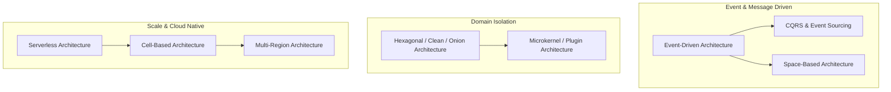
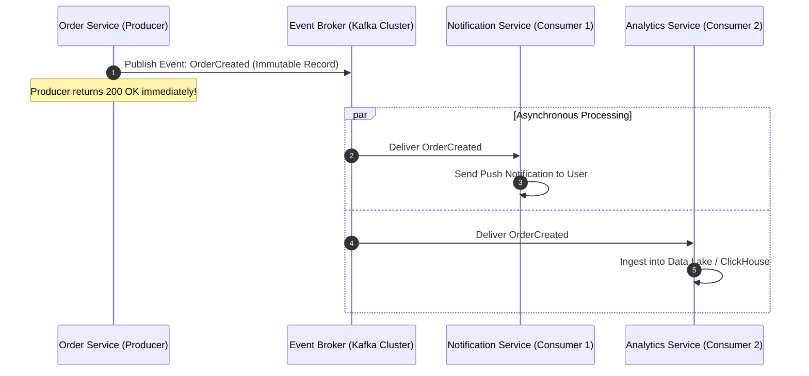
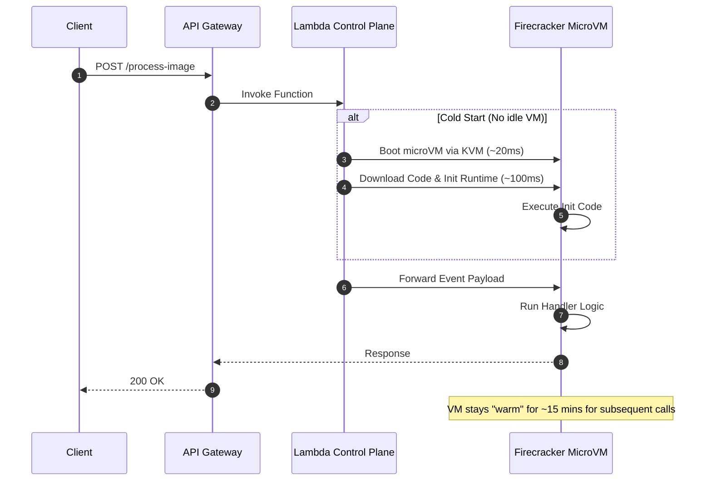
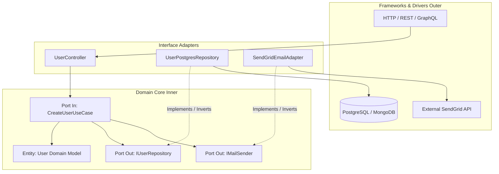
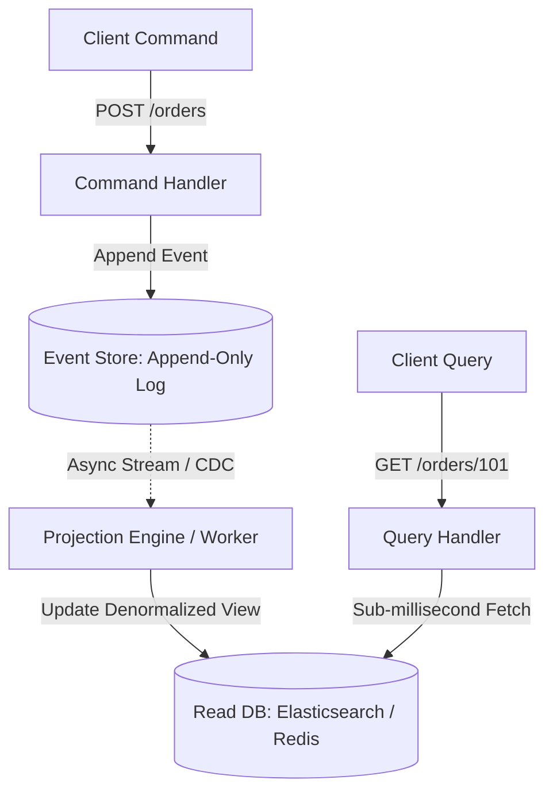
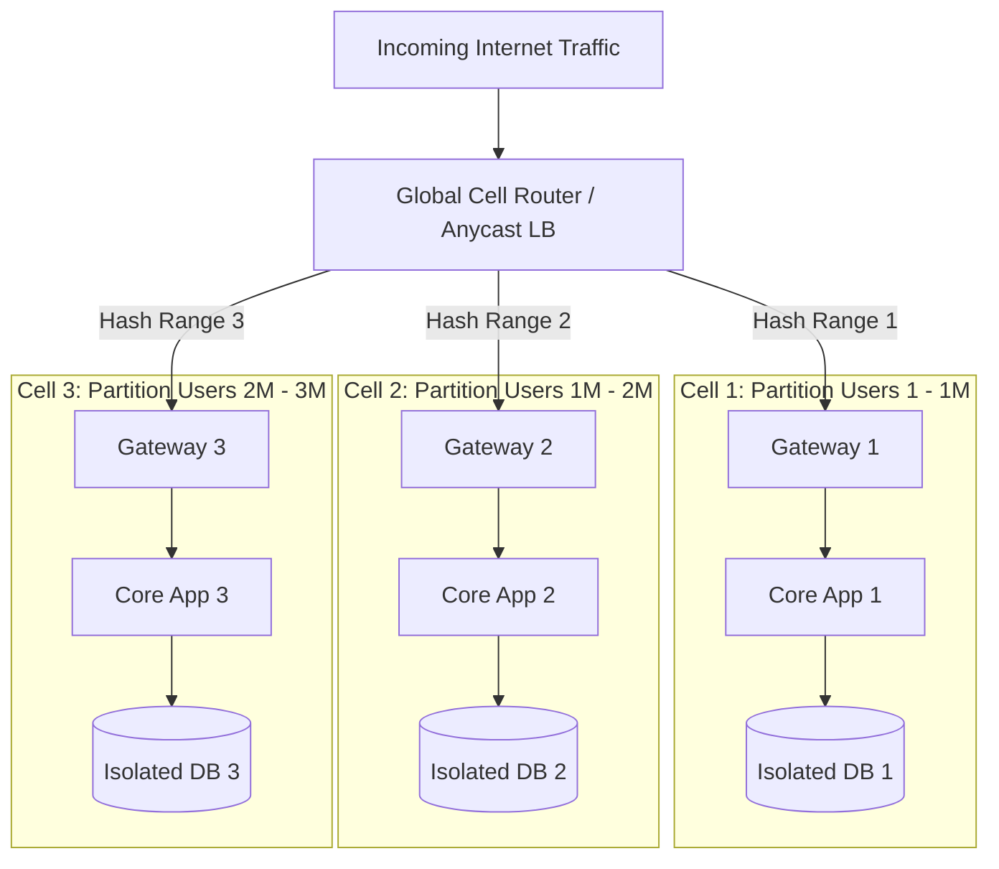

# 03.2. Event-Driven, Serverless, and Modern Architecture Patterns (Kiến Trúc Hướng Sự Kiện, Serverless và Các Mẫu Kiến Trúc Hiện Đại)

## Tổng quan về Kiến Trúc Hướng Sự Kiện và Các Mẫu Hiện Đại
Khi các hệ thống phân tán phát triển đến quy mô hàng triệu người dùng đồng thời, việc phụ thuộc vào các cuộc gọi đồng bộ (Synchronous Request-Response) bộc lộ giới hạn nghiêm trọng về tính gắn kết (Tight Coupling), độ trễ tích lũy và khả năng chịu lỗi. 

Các phong cách kiến trúc hiện đại giải quyết vấn đề này theo hai hướng:
1. **Phân rã theo thời gian và không gian (Spatial & Temporal Decoupling)**: Chuyển dịch sang kiến trúc Hướng sự kiện (**Event-Driven Architecture**), CQRS, Event Sourcing và Không gian dùng chung (**Space-Based Architecture**).
2. **Bảo vệ tính toàn vẹn của nghiệp vụ nội tại (Domain Integrity)**: Áp dụng các mô hình cô lập ranh giới như **Hexagonal / Clean / Onion Architecture** và cấu trúc chia tế bào cô lập hoàn toàn (**Cell-Based Architecture**).



---

## 2. Chi tiết từng Keyword (Under-the-Hood Deep Dive)

### 1. Event-Driven, Event-Based & Message-Driven Architecture (Kiến Trúc Hướng Sự Kiện và Hướng Thông Điệp)

#### 1. Khái niệm bản chất (What & Why)
- **Event-Driven Architecture (EDA)**: Hệ thống được xây dựng xoay quanh việc phát hiện, sản sinh và phản ứng với các **Sự kiện (Events)**. Một sự kiện là một bản ghi bất biến (Immutable Record) đại diện cho một điều gì đó **đã xảy ra trong quá khứ** (ví dụ: `OrderPlaced`, `PaymentProcessed`). Phía phát sự kiện (Producer) không biết và không quan tâm ai sẽ tiêu thụ nó (Zero Temporal & Spatial Coupling).
- **Message-Driven Architecture**: Khác với Event, một **Message (Thông điệp)** thường là một **Lệnh (Command)** được gửi có chủ đích đến một đích đến cụ thể (Specific Recipient) để yêu cầu thực hiện một hành động (ví dụ: `SendWelcomeEmailCommand`).
- **Reactive Systems**: Sự kết hợp giữa Message-Driven, Elastic, Resilient và Responsive (theo The Reactive Manifesto).

#### 2. Cơ chế hoạt động sâu (Under the hood / Hardcore Internals)
Sự khác biệt cốt lõi ở tầng giao tiếp:
- **Request-Response (Chờ đồng bộ)**: Thread của Producer bị chặn (Blocked) trong khi chờ Consumer xử lý và phản hồi $\rightarrow$ Lãng phí tài nguyên CPU và Socket.
- **Event-Driven (Bất đồng bộ hoàn toàn)**: Producer đẩy sự kiện vào Write-Ahead Log của Message Broker (như Kafka) và kết thúc ngay ($< 2\text{ ms}$). Consumer đọc sự kiện theo tốc độ riêng của nó (**Pull model / Backpressure**).
- **Temporal Decoupling (Tách biệt thời gian)**: Consumer có thể sập hoặc tạm dừng để bảo trì trong 2 giờ; Producer vẫn tiếp tục đẩy sự kiện vào Broker bình thường. Khi Consumer khởi động lại, nó đọc tiếp từ Offset đã lưu mà không làm mất mát một bản tin nào.

#### 3. Sơ đồ minh họa


#### 4. Code ví dụ thực chiến (C++20 - Event Bus in-memory với Observer Pattern)
```cpp
#include <iostream>
#include <vector>
#include <functional>
#include <string>
#include <memory>

struct OrderCreatedEvent {
    std::string order_id;
    double amount;
    uint64_t timestamp;
};

// In-Memory Event Bus decoupling Producers and Consumers
class EventBus {
public:
    using EventHandler = std::function<void(const OrderCreatedEvent&)>;

    void subscribe(EventHandler handler) {
        handlers_.push_back(handler);
    }

    void publish(const OrderCreatedEvent& event) {
        for (const auto& handler : handlers_) {
            handler(event); // Phát sự kiện tới tất cả subscriber độc lập
        }
    }

private:
    std::vector<EventHandler> handlers_;
};

int main() {
    EventBus bus;

    // Consumer 1: Notification System
    bus.subscribe([](const OrderCreatedEvent& e) {
        std::cout << "[Notification Service] Push notification sent for Order: " << e.order_id << "\n";
    });

    // Consumer 2: Analytics Tracking
    bus.subscribe([](const OrderCreatedEvent& e) {
        std::cout << "[Analytics Service] Logged revenue: " << e.amount << "$ for Order: " << e.order_id << "\n";
    });

    // Producer phát sự kiện
    OrderCreatedEvent ev{"ORD-101", 89.50, 1715000000};
    bus.publish(ev);
    return 0;
}
```

#### 5. Ưu / Nhược điểm, Pitfalls & Anti-patterns
- **Ưu điểm**: Khả năng mở rộng cực cao, thêm consumer mới không cần sửa producer, chịu lỗi tuyệt vời.
- **Nhược điểm**: Luồng dữ liệu phi tuyến tính rất khó theo dõi (cần OpenTelemetry Distributed Tracing); dữ liệu ở trạng thái Eventual Consistency (người dùng vừa mua hàng xong load lại trang có thể chưa thấy đơn hàng ngay).

#### 6. Ứng dụng thực tế trong Backend / Systems
Toàn bộ kiến trúc thanh toán và logistics của Uber, Shopee và LinkedIn vận hành dựa trên nền tảng Apache Kafka làm Event Backbone.

---

### 2. Serverless Architecture (Kiến Trúc Không Máy Chủ)

#### 1. Khái niệm bản chất (What & Why)
Serverless Architecture (Function-as-a-Service - FaaS kết hợp Backend-as-a-Service - BaaS) là mô hình điện toán đám mây cho phép lập trình viên chỉ tập trung viết mã nguồn logic của từng hàm đơn lẻ mà **hoàn toàn không phải quản lý, định cỡ hay vá lỗi máy chủ vật lý hay container**. Máy chủ vẫn tồn tại (do Cloud Provider quản lý), nhưng được trừu tượng hóa triệt để.

Đặc điểm cốt lõi:
- **Event-driven execution**: Hàm chỉ được đánh thức khi có sự kiện (HTTP request, S3 file upload, SQS message).
- **Scale to Zero**: Khi không có request, không có tài nguyên nào chạy $\implies$ Chi phí bằng $0\$$ (Zero idle cost).
- **Auto-scaling per request**: 1 request $\rightarrow$ 1 container; 10,000 requests $\rightarrow$ 10,000 containers tự động được nhân bản.

#### 2. Cơ chế hoạt động sâu (Under the hood / Hardcore Internals)
Hiện tượng **Cold Start (Khởi động lạnh)**:
- Khi một request đổ về một hàm chưa có container chạy sẵn (Warm instance):
  1. Control Plane của Cloud (ví dụ: AWS Lambda) cấp phát microVM (dùng công nghệ như **Firecracker** dựa trên Linux KVM).
  2. Tải mã nguồn hoặc container image từ S3/ECR.
  3. Khởi tạo môi trường Runtime (Node.js, Python, JVM, Go).
  4. Thực thi code khởi tạo toàn cục (Database connection pool, load libraries).
- Độ trễ Cold Start có thể từ **50ms (với Rust/Go/NodeJS)** lên tới **3 - 5 giây (với Java Spring Boot)**.
- **Stateless Execution**: Các hàm Serverless không được lưu giữ trạng thái cục bộ giữa các lần gọi. Mọi trạng thái bắt buộc phải lưu ra bên ngoài (DynamoDB, Redis, S3).

#### 3. Sơ đồ minh họa


#### 4. Code ví dụ thực chiến (TypeScript - AWS Lambda Function Handler)
```typescript
interface APIGatewayEvent {
  body: string;
  headers: Record<string, string>;
}

interface LambdaContext {
  awsRequestId: string;
}

// Global scope: Khởi tạo ngoài handler để tái sử dụng trong các Warm Starts
let dbConnection: string | null = null;

async function getOrCreateDbConnection(): Promise<string> {
  if (!dbConnection) {
    console.log("[Cold Start] Initializing database connection pool...");
    dbConnection = "CONNECTED_TO_DYNAMODB"; // Giả lập kết nối
  } else {
    console.log("[Warm Start] Reusing existing database connection.");
  }
  return dbConnection;
}

// Function Handler chính: Được kích hoạt theo từng event
export const handler = async (event: APIGatewayEvent, context: LambdaContext) => {
  const db = await getOrCreateDbConnection();
  const payload = JSON.parse(event.body || "{}");

  return {
    statusCode: 200,
    headers: { "Content-Type": "application/json" },
    body: JSON.stringify({
      message: "Serverless execution successful",
      requestId: context.awsRequestId,
      dbStatus: db,
      processedItem: payload.itemId
    })
  };
};
```

#### 5. Ưu / Nhược điểm, Pitfalls & Anti-patterns
- **Pitfall: Database Connection Exhaustion**: Nếu 5,000 hàm Lambda cùng khởi động đồng loạt để xử lý một đợt sóng tải, chúng sẽ mở 5,000 kết nối trực tiếp vào PostgreSQL RDS, làm sập hoàn toàn database vì vượt quá `max_connections`.
- **Giải pháp**: Bắt buộc phải đặt một Database Proxy (như AWS RDS Proxy hoặc PgBouncer) ở giữa để gom cụm kết nối (Connection Pooling).

#### 6. Ứng dụng thực tế trong Backend / Systems
Rất lý tưởng cho xử lý dữ liệu phi tập trung: Chuyển đổi định dạng video/ảnh khi người dùng upload lên S3, các Cron Jobs định kỳ, Webhooks tiếp nhận sự kiện từ Stripe/GitHub.

---

### 3. Hexagonal, Clean & Onion Architectures (Kiến Trúc Lục Giác, Kiến Trúc Sạch và Kiến Trúc Củ Hành)

#### 1. Khái niệm bản chất (What & Why)
Cả ba mô hình này đều chia sẻ cùng một triết lý thiết kế do Alistair Cockburn (Hexagonal / Ports and Adapters), Jeffrey Palermo (Onion) và Robert C. Martin (Clean Architecture) đề xướng:
- **Nguyên tắc đảo ngược phụ thuộc (The Dependency Rule)**: Mã nguồn bên trong (Domain Model & Business Rules) là trung tâm bất biến, **tuyệt đối không được phụ thuộc vào bất kỳ framework, UI, cơ sở dữ liệu hay thư viện bên ngoài nào**.
- Tất cả các chi tiết kỹ thuật bên ngoài (HTTP Controllers, PostgreSQL, Redis, Third-party SDKs) chỉ là các **Adapters** cắm vào các **Ports** (Giao diện trừu tượng) do tầng Domain định nghĩa.

#### 2. Cơ chế hoạt động sâu (Under the hood / Hardcore Internals)
Sự đối lập với kiến trúc phân tầng truyền thống:
- Trong Layered Architecture: `Domain Layer` phụ thuộc vào `Database Layer`.
- Trong Clean / Hexagonal Architecture: `Database Layer` phụ thuộc vào `Domain Layer` thông qua việc hiện thực hóa Interface (Dependency Inversion Principle - DIP).

Cấu trúc các vòng đồng tâm từ trong ra ngoài:
1. **Entities / Enterprise Business Rules**: Các cấu trúc dữ liệu và logic nghiệp vụ thuần túy nhất.
2. **Use Cases / Application Business Rules**: Điều phối luồng dữ liệu giữa các Entities.
3. **Interface Adapters**: Controllers, Presenters, Gateways (chuyển đổi dữ liệu từ định dạng Web/DB sang định dạng Use Case).
4. **Frameworks & Drivers**: Công cụ bên ngoài (Web Framework: Express/Spring, ORM: Prisma/Hibernate, Database: Postgres/Mongo).

#### 3. Sơ đồ minh họa


#### 4. Code ví dụ thực chiến (C++20 - Ports and Adapters hoàn chỉnh)
```cpp
#include <iostream>
#include <string>
#include <memory>

// ================= 1. DOMAIN CORE (Zero External Dependencies) =================
struct User {
    std::string id;
    std::string username;
};

// Outbound Port: Giao diện do Domain làm chủ, DB phải tuân theo
class IUserRepositoryPort {
public:
    virtual ~IUserRepositoryPort() = default;
    virtual void save(const User& user) = 0;
};

// Inbound Port / Use Case: Logic nghiệp vụ cốt lõi
class RegisterUserUseCase {
private:
    std::shared_ptr<IUserRepositoryPort> user_repo_;
public:
    explicit RegisterUserUseCase(std::shared_ptr<IUserRepositoryPort> repo)
        : user_repo_(repo) {}

    void execute(const std::string& id, const std::string& username) {
        // Business logic validation
        if (username.empty()) throw std::invalid_argument("Username cannot be empty");
        User new_user{id, username};
        user_repo_->save(new_user); // Gọi qua Port
        std::cout << "[Core Domain] User registered successfully: " << username << "\n";
    }
};

// ================= 2. ADAPTERS LAYER (Hạ tầng công nghệ bên ngoài) =================
// Secondary Adapter: Hiện thực hóa IUserRepositoryPort dùng Postgres (giả lập)
class PostgresUserAdapter : public IUserRepositoryPort {
public:
    void save(const User& user) override {
        std::cout << "[Postgres Adapter] INSERT INTO users VALUES ('" 
                  << user.id << "', '" << user.username << "');\n";
    }
};

// Test Adapter: Mock trong RAM phục vụ Unit Test siêu tốc không cần DB
class InMemoryMockUserAdapter : public IUserRepositoryPort {
public:
    void save(const User& user) override {
        std::cout << "[Mock Memory Adapter] User saved in memory vector.\n";
    }
};

int main() {
    // Chạy trong môi trường Production: Cắm Postgres Adapter
    auto real_db = std::make_shared<PostgresUserAdapter>();
    RegisterUserUseCase prod_app(real_db);
    prod_app.execute("USR-1", "john_doe");

    // Chạy trong Unit Test: Cắm Mock Adapter trong 1ms
    auto mock_db = std::make_shared<InMemoryMockUserAdapter>();
    RegisterUserUseCase test_app(mock_db);
    test_app.execute("USR-2", "alice_test");

    return 0;
}
```

#### 5. Ưu / Nhược điểm, Pitfalls & Anti-patterns
- **Ưu điểm**: Khả năng kiểm thử (Testability) hoàn hảo; dễ dàng hoán đổi cơ sở dữ liệu hoặc framework mà không cần sửa một dòng code nghiệp vụ nào; độc lập hoàn toàn với vòng đời của các thư viện bên thứ ba.
- **Nhược điểm**: Tạo ra nhiều boilerplate code (nhiều tầng DTO, Mappers và Interfaces); có thể là "Over-engineering" đối với các ứng dụng CRUD đơn giản.

#### 6. Ứng dụng thực tế trong Backend / Systems
Tiêu chuẩn vàng trong thiết kế Core Banking, bảo hiểm và các hệ thống Enterprise có vòng đời tồn tại từ 10 đến 30 năm.

---

### 4. CQRS & Event Sourcing Architecture (Kiến Trúc CQRS và Ghi Nhận Sự Kiện)

#### 1. Khái niệm bản chất (What & Why)
- **CQRS (Command Query Responsibility Segregation)**: Tách biệt hoàn toàn mô hình xử lý thao tác **Ghi (Command - Create/Update/Delete)** và mô hình xử lý thao tác **Đọc (Query)** thành hai đường dẫn dữ liệu riêng biệt.
  - *Command Model*: Tối ưu hóa cho tính nhất quán, thực thi nghiệp vụ phức tạp và khóa giao dịch.
  - *Query Model*: Tối ưu hóa cho tốc độ đọc siêu nhanh, trả về dữ liệu đã được phi chuẩn hóa (Denormalized Views).
- **Event Sourcing**: Thay vì chỉ lưu trạng thái hiện tại (Current State) của bản ghi vào bảng cơ sở dữ liệu (ví dụ: `balance = 500$`), hệ thống **lưu giữ toàn bộ chuỗi các sự kiện biến đổi trạng thái xảy ra từ trước đến nay** vào một **Event Store** bất biến chỉ cho phép ghi thêm (Append-only).
  - Trạng thái hiện tại được tái tạo bằng cách phát lại (Replay) toàn bộ các sự kiện từ đầu: $0 + 1000 - 200 - 300 = 500\$$.

#### 2. Cơ chế hoạt động sâu (Under the hood / Hardcore Internals)
Khi kết hợp CQRS với Event Sourcing:
1. Client gửi `DepositMoneyCommand(amount=200)`.
2. Command Handler tải chuỗi sự kiện của Account đó từ Event Store, tái hiện trạng thái (Aggregate Root), kiểm tra nghiệp vụ.
3. Nếu hợp lệ, một sự kiện mới `MoneyDepositedEvent(amount=200, version=5)` được ghi tuần tự vào Event Store (tốc độ $O(1)$ Append-only I/O).
4. Sự kiện được phát đi (Publish) sang **Read Side Projection Engine**.
5. Projection Engine cập nhật bảng tra cứu tối ưu hóa cho Đọc (Read Database: Elasticsearch hoặc MongoDB document) để phục vụ UI.

**Giải quyết bài toán Replay chậm bằng Snapshotting**:
Nếu một tài khoản ngân hàng có 100,000 giao dịch trong 10 năm, việc replay 100,000 sự kiện mỗi khi cần kiểm tra số dư sẽ làm nổ CPU. Hệ thống định kỳ tạo **Snapshot** (ví dụ: tại sự kiện thứ 99,000, số dư là 450$). Khi cần tính số dư hiện tại, hệ thống nạp Snapshot rồi chỉ cần replay 1,000 sự kiện còn lại!

#### 3. Sơ đồ minh họa


#### 4. Code ví dụ thực chiến (C++20 - Event Sourcing Replay Engine & Snapshot)
```cpp
#include <iostream>
#include <vector>
#include <string>

// Các sự kiện bất biến trong quá khứ
struct AccountEvent {
    std::string type; // "DEPOSITED" hoặc "WITHDRAWN"
    double amount;
    int version;
};

// Aggregate Root tái tạo trạng thái từ Event Sourcing
class BankAccountAggregate {
private:
    double balance_ = 0.0;
    int current_version_ = 0;

public:
    void apply(const AccountEvent& event) {
        if (event.type == "DEPOSITED") {
            balance_ += event.amount;
        } else if (event.type == "WITHDRAWN") {
            balance_ -= event.amount;
        }
        current_version_ = event.version;
    }

    void loadFromHistory(const std::vector<AccountEvent>& events) {
        for (const auto& ev : events) {
            apply(ev);
        }
    }

    double getBalance() const { return balance_; }
    int getVersion() const { return current_version_; }
};

int main() {
    // Lịch sử sự kiện lưu trong Event Store
    std::vector<AccountEvent> event_stream = {
        {"DEPOSITED", 1000.0, 1},
        {"WITHDRAWN", 150.0, 2},
        {"DEPOSITED", 50.0, 3},
        {"WITHDRAWN", 400.0, 4}
    };

    BankAccountAggregate account;
    account.loadFromHistory(event_stream);

    std::cout << "[Event Sourcing Result]\n";
    std::cout << "Replayed to Version: " << account.getVersion() << "\n";
    std::cout << "Current Balance:     " << account.getBalance() << "$\n"; // 1000 - 150 + 50 - 400 = 500$
    return 0;
}
```

#### 5. Ưu / Nhược điểm, Pitfalls & Anti-patterns
- **Ưu điểm**: Khả năng Audit Log hoàn hảo 100% (không bao giờ mất dữ liệu); Time-Travel Debugging (có thể tái tạo trạng thái hệ thống tại đúng thời điểm 14:02:15 ngày hôm trước); Read và Write scale hoàn toàn độc lập.
- **Nhược điểm**: Bắt buộc chấp nhận Eventual Consistency giữa Write và Read side; Schema Evolution của các event cũ trong quá khứ vô cùng phức tạp.

#### 6. Ứng dụng thực tế trong Backend / Systems
Hệ thống Git chính là hiện thân thuần khiết nhất của Event Sourcing (mỗi commit là một event/diff, nhánh `main` là trạng thái hiện tại được replay từ chuỗi commit). Các sàn giao dịch chứng khoán và hệ thống sổ cái ngân hàng đều dựa trên mô hình này.

---

### 5. Cell-Based, Space-Based & Multi-Region Architectures (Kiến Trúc Phân Tế Bào, Không Gian và Đa Vùng)

#### 1. Khái niệm bản chất (What & Why)
- **Cell-Based Architecture**: Phân tách toàn bộ hệ thống lớn thành nhiều **Tế bào (Cells)** hoàn chỉnh, khép kín và độc lập tuyệt đối. Mỗi cell chứa đầy đủ: API Gateway riêng, Microservices riêng, và Database riêng để phục vụ một nhóm khách hàng nhất định (ví dụ: Cell 1 phục vụ user từ ID 1 đến 1,000,000; Cell 2 phục vụ từ 1,000,001 đến 2,000,000). Mục tiêu tối thượng: **Khống chế bán kính thiệt hại (Contain Blast Radius)**. Nếu Cell 1 sập, chỉ 5% khách hàng bị ảnh hưởng; 95% khách hàng ở các cell khác hoàn toàn không nhận thấy bất kỳ sự gián đoạn nào!
- **Space-Based Architecture (Tuple Space / In-Memory Data Grid)**: Loại bỏ hoàn toàn cơ sở dữ liệu trung tâm ra khỏi luồng xử lý giao dịch thời gian thực. Toàn bộ trạng thái được lưu trên RAM phân tán giữa các Processing Units (dùng Hazelcast, Apache Ignite). Dữ liệu chỉ được ghi xuống đĩa bất đồng bộ ở phía sau.
- **Multi-Region Architecture**: Triển khai hệ thống đồng thời trên nhiều vùng địa lý toàn cầu (AWS us-east-1, eu-central-1, ap-southeast-1) để giảm độ trễ truy cập người dùng địa phương và chống chọi lại thảm họa sập toàn bộ một Data Center của nhà cung cấp đám mây.

#### 2. Cơ chế hoạt động sâu (Under the hood / Hardcore Internals)
Định tuyến trong Cell-Based Architecture:
Cần một thành phần siêu mỏng và có độ tin cậy cực cao ở cửa ngõ gọi là **Cell Router (Routing Layer)**.
- Khi request đến, Cell Router bóc tách `user_id` từ JWT token hoặc HTTP header.
- Áp dụng thuật toán băm nhất quán (Consistent Hashing) hoặc tra cứu bảng định tuyến siêu nhanh in-memory để chuyển hướng gói tin đến đúng Cell tương ứng.
- Tuyệt đối nghiêm cấm việc hai Cell gọi chéo nhau (Cross-cell communication).

Trong Multi-Region Architecture:
- Sử dụng **DNS Latency-Based Routing (Amazon Route 53)** hoặc **Anycast BGP IP** để dẫn đường người dùng tới Data Center gần nhất về mặt vật lý.
- Thách thức lớn nhất: Đồng bộ dữ liệu giữa các Region xuyên đại dương (RTT 150ms - 250ms). Bắt buộc phải áp dụng **Conflict-Free Replicated Data Types (CRDTs)** hoặc phân chia Master theo khu vực địa lý để tránh xung đột dữ liệu.

#### 3. Sơ đồ minh họa (Cell-Based Architecture)


#### 4. Code ví dụ thực chiến (C++20 - Cell Router Hash Mapping)
```cpp
#include <iostream>
#include <string>
#include <vector>
#include <functional>

struct CellEndpoint {
    int cell_id;
    std::string internal_vip;
};

class CellRouter {
private:
    std::vector<CellEndpoint> cells_;

public:
    explicit CellRouter(std::vector<CellEndpoint> cells) : cells_(std::move(cells)) {}

    const CellEndpoint& routeRequest(const std::string& tenant_or_user_id) const {
        // MurmurHash / std::hash ánh xạ ID vào đúng Cell
        size_t hash_val = std::hash<std::string>{}(tenant_or_user_id);
        size_t cell_index = hash_val % cells_.size();
        return cells_[cell_index];
    }
};

int main() {
    std::vector<CellEndpoint> cluster = {
        {1, "cell-1.internal.net"},
        {2, "cell-2.internal.net"},
        {3, "cell-3.internal.net"},
        {4, "cell-4.internal.net"}
    };

    CellRouter router(cluster);
    std::string user_a = "USER_UUID_99182";
    std::string user_b = "USER_UUID_44012";

    auto target_a = router.routeRequest(user_a);
    auto target_b = router.routeRequest(user_b);

    std::cout << "[Cell Routing Decision]\n";
    std::cout << "User " << user_a << " -> Routed to Cell #" << target_a.cell_id 
              << " (" << target_a.internal_vip << ")\n";
    std::cout << "User " << user_b << " -> Routed to Cell #" << target_b.cell_id 
              << " (" << target_b.internal_vip << ")\n";
    return 0;
}
```

#### 5. Ưu / Nhược điểm, Pitfalls & Anti-patterns
- **Ưu điểm**: Khống chế lỗi tuyệt đối (Zero Global Outage); quy mô mở rộng không giới hạn (chỉ cần dựng thêm Cell mới khi có thêm 1 triệu người dùng).
- **Nhược điểm**: Khó khăn trong việc xử lý các thao tác tổng hợp toàn cục (Global Analytics across all cells); chi phí hạ tầng ban đầu cao hơn do nhân bản các thành phần nền tảng.

#### 6. Ứng dụng thực tế trong Backend / Systems
AWS sử dụng Cell-Based Architecture cho toàn bộ hạ tầng cốt lõi: mỗi dịch vụ như S3, DynamoDB hay Route 53 bên dưới đều được chia thành hàng nghìn tế bào độc lập để bảo đảm không một sự cố phần mềm nào có thể làm sập toàn bộ dịch vụ trên quy mô toàn cầu.

---

## Tóm tắt liên kết hệ thống
Kết thúc chuyên mục **11.3 (System Architecture Styles)**, bạn đã nắm vững toàn bộ bản đồ các phong cách kiến trúc: từ Monolith, Microservices cho tới Clean Architecture, Event Sourcing và Cell-Based.

Tiếp theo, tại **11.4: Architectural Principles & Design Principles**, chúng ta sẽ đi sâu vào các quy tắc vàng định hướng từng dòng mã và từng ranh giới module (SOLID, DRY, KISS, Postel's Law, Design for Failure).
